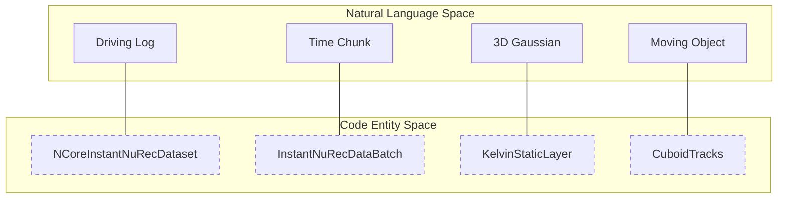

<!-- source: DeepWiki mcp.deepwiki.com · repo NVIDIA/instant-nurec · page 8 Glossary · fetched 2026-10-26 -->

# Glossary

Relevant source files

The following files were used as context for generating this wiki page:

- [CONTRIBUTING.md](CONTRIBUTING.md)
- [README.md](README.md)
- [TROUBLESHOOTING.md](TROUBLESHOOTING.md)
- [instant_nurec/config_schema/predict.py](instant_nurec/config_schema/predict.py)
- [instant_nurec/datasets/tracks.py](instant_nurec/datasets/tracks.py)
- [instant_nurec/model/jit_adapter.py](instant_nurec/model/jit_adapter.py)
- [instant_nurec/predict/primitive_merge.py](instant_nurec/predict/primitive_merge.py)
- [instant_nurec/primitives/kelvin_primitive.py](instant_nurec/primitives/kelvin_primitive.py)
- [instant_nurec/utils/merge_covariances.py](instant_nurec/utils/merge_covariances.py)
- [instant_nurec/utils/types.py](instant_nurec/utils/types.py)

This page provides technical definitions for codebase-specific terms, abbreviations, and architectural concepts used in InstantNuRec. It serves as a reference for onboarding engineers to map domain concepts to specific implementation files and classes.

## Core Concepts

### JIT Kelvin Adapter
The `JITKelvinAdapter` is the primary interface between the Python inference pipeline and the TorchScript-compiled Kelvin model. It handles the extraction of input tensors (RGB, rays, extrinsics) from data batches, performs shape validation, and transforms raw model outputs into structured `KelvinInstantNuRecPrimitive` objects.
*   **Implementation**: `JITKelvinAdapter` class in [instant_nurec/model/jit_adapter.py:56-131]().
*   **Key Function**: `_extract_tensors` [instant_nurec/model/jit_adapter.py:99-131]() converts `DataAndRenderingBatch` objects into the specific tensor formats expected by the JIT module.

### Kelvin Primitive
A "Primitive" represents the 3D Gaussian Splatting (3DGS) scene state. In InstantNuRec, this is specifically a `KelvinInstantNuRecPrimitive`. It is composed of a `static_layer` (geometry and appearance) and a `dynamic_layer` (motion keyframes), along with a sky cubemap.
*   **Implementation**: `KelvinInstantNuRecPrimitive` in [instant_nurec/primitives/kelvin_primitive.py:218-356]().
*   **Layers**:
    *   `KelvinStaticLayer`: Contains `positions`, `rotations`, `scales`, `rgb`, and `densities` [instant_nurec/primitives/kelvin_primitive.py:116-161]().
    *   `KelvinDynamicLayer`: Stores `keyframe_positions` and `keyframe_timestamps_us` for moving objects [instant_nurec/primitives/kelvin_primitive.py:175-215]().

### KL-Optimal Voxelization
A specialized merging algorithm used to reduce the Gaussian count while preserving the spatial distribution. It treats each Gaussian as a probability distribution and performs a moment-matched merge within voxels. The process iterates on the `voxel_size` until the Gaussian count lands within a target range (typically 90-100% of `target_n_gaussians`).
*   **Implementation**: `merge_covariances_kl_optimal` in [instant_nurec/utils/merge_covariances.py:46-143]().
*   **Logic**: It computes the merged covariance as the weighted sum of per-Gaussian covariances plus the spread of their means [instant_nurec/utils/merge_covariances.py:54-58]().

## Data Structures and Mapping

### Natural Language to Code Entity Space

The following diagram bridges high-level system concepts to their specific code representations.

**System Concept Mapping**

*Sources: [instant_nurec/utils/types.py:1-30](), [instant_nurec/datasets/tracks.py:40-46](), [instant_nurec/primitives/kelvin_primitive.py:116-123]()*

### Inference Data Flow

This diagram illustrates the transformation of data from input NCore formats through the internal processing structures.

**Data Transformation Pipeline**

*Sources: [instant_nurec/model/jit_adapter.py:56-65](), [instant_nurec/predict/primitive_merge.py:29-35](), [README.md:49-51]()*

## Terminology Table

| Term | Definition | File Reference |
| :--- | :--- | :--- |
| **NCore V4** | The standard driving log format used for input, containing multi-camera video and rig trajectories. | [README.md:14-26]() |
| **RigTrajectory** | A timestamped sequence of 4x4 matrices representing the vehicle's pose in world coordinates. | [instant_nurec/utils/types.py:139-168]() |
| **CuboidTracks** | 3D bounding boxes over time for dynamic objects (cars, pedestrians) used to refine the dynamic mask. | [instant_nurec/datasets/tracks.py:40-81]() |
| **Frustum Ownership** | A technique during merging where a Gaussian is kept only if it is "owned" by the chunk that produced it, based on camera proximity. | [instant_nurec/predict/primitive_merge.py:130-146]() |
| **tquat** | A 7-element vector representation of a pose (3 for translation, 4 for quaternion rotation). | [instant_nurec/utils/geometry.py:33-33]() |
| **Semantic Class** | An integer ID assigned to each Gaussian (e.g., EGO, SKY, ROAD, MOVABLE). | [instant_nurec/primitives/kelvin_primitive.py:42-50]() |
| **SE3** | A class representing a 3D rigid transformation (Special Euclidean group). | [instant_nurec/utils/se3.py:1-25]() |

## Technical Details

### Coordinate Frames and Conversions
InstantNuRec manages multiple coordinate systems:
1.  **NCore World**: The global coordinate system of the driving log.
2.  **Scene Frame**: A local, potentially rescaled frame used during inference to keep coordinates within numerical ranges suitable for the Transformer.
3.  **Sensor Frame**: The local coordinate system of an individual camera.

The `FrameConversion` class [instant_nurec/utils/types.py:52-137]() handles the math for moving between these frames, specifically supporting uniform scaling [instant_nurec/utils/types.py:79-81]().

### Dynamic Mask Refinement
The `JITKelvinAdapter` refines the model's predicted semantic mask using `CuboidTracks`. If a point is predicted as `MOVABLE` by the model but does not intersect with a known dynamic cuboid track, it may be filtered or reclassified to ensure temporal consistency of dynamic objects.
*   **Logic**: `_compute_dynamic_mask` in [instant_nurec/model/jit_adapter.py:133-182]().
*   **Intersection**: Uses `warp_points_with_cuboid_tracks` to check if Gaussians fall within object boundaries over time [instant_nurec/model/jit_adapter.py:44-46]().

Sources:
*   [instant_nurec/model/jit_adapter.py:1-182]()
*   [instant_nurec/primitives/kelvin_primitive.py:1-356]()
*   [instant_nurec/utils/types.py:1-200]()
*   [instant_nurec/utils/merge_covariances.py:1-144]()
*   [instant_nurec/predict/primitive_merge.py:1-160]()
*   [README.md:1-150]()