# Page: Overview

# Overview

<details>
<summary>Relevant source files</summary>

The following files were used as context for generating this wiki page:

- [CONTRIBUTING.md](CONTRIBUTING.md)
- [LICENSE.txt](LICENSE.txt)
- [README.md](README.md)
- [SECURITY.md](SECURITY.md)
- [docs/demo.gif](docs/demo.gif)
- [docs/demo.mp4](docs/demo.mp4)

</details>


InstantNuRec is a feed-forward reconstruction system that converts autonomous vehicle (AV) driving logs into dynamic 3D Gaussian Splatting (3DGS) representations in seconds [README.md:14-17](). Unlike traditional methods requiring per-scene optimization, InstantNuRec utilizes a vision-transformer backbone to infer geometry, appearance, and motion directly from multi-camera observations [README.md:15-21]().

The system is designed to provide a rapid "preview" of a scene, which can either be used immediately in simulation pipelines or serve as a high-quality initialization for high-fidelity refinement in the broader NuRec ecosystem [README.md:23-26]().

### System Role and Ecosystem

InstantNuRec operates within the NuRec data ecosystem, consuming **NCore V4** clips—the same input format used by the high-fidelity NuRec optimization pipeline [README.md:28-33](). While NuRec produces high-fidelity USDZ outputs via Docker-based optimization, InstantNuRec provides a native-Python, feed-forward alternative for rapid iteration [README.md:31-33]().

### High-Level Data Flow

The pipeline transforms raw driving logs into structured 3D primitives through the following stages:

1.  **Ingest**: Loading NCore V4 sequence JSONs and sensor data.
2.  **Batching**: Dividing the clip into time-synchronized "chunks" for processing.
3.  **Inference**: Executing a forward pass through a JIT-compiled Kelvin model.
4.  **Export**: Generating 3DGS PLY files, either per-chunk or merged into a global scene.

#### Logical to Code Entity Mapping

The following diagram illustrates how high-level system concepts map to specific classes and entry points within the codebase.

**System Concept to Code Entity Map**
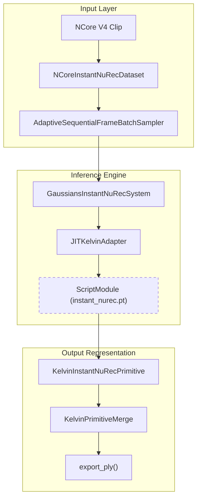
Sources: [README.md:51-52](), [instant_nurec/dataset/ncore_dataset.py:48-52](), [instant_nurec/systems/gaussians_instant_nurec.py:30-35](), [instant_nurec/models/jit_adapter.py:30-35]()

### Key Concepts

*   **JIT Kelvin Model**: The core transformer model, typically distributed as a TorchScript archive (`instant_nurec.pt`), which performs the feed-forward inference [README.md:114-118]().
*   **Kelvin Primitives**: A specialized 3D Gaussian representation containing static layers (geometry/color) and dynamic layers (motion/keyframes) [README.md:20-21]().
*   **Voxelization**: A KL-optimal process used during the merging of multiple chunks to maintain a target Gaussian count (default 2M) while preserving visual fidelity [README.md:143-147]().

#### Inference Execution Flow

The following diagram bridges the CLI execution to the internal system calls.

**CLI to System Execution Bridge**
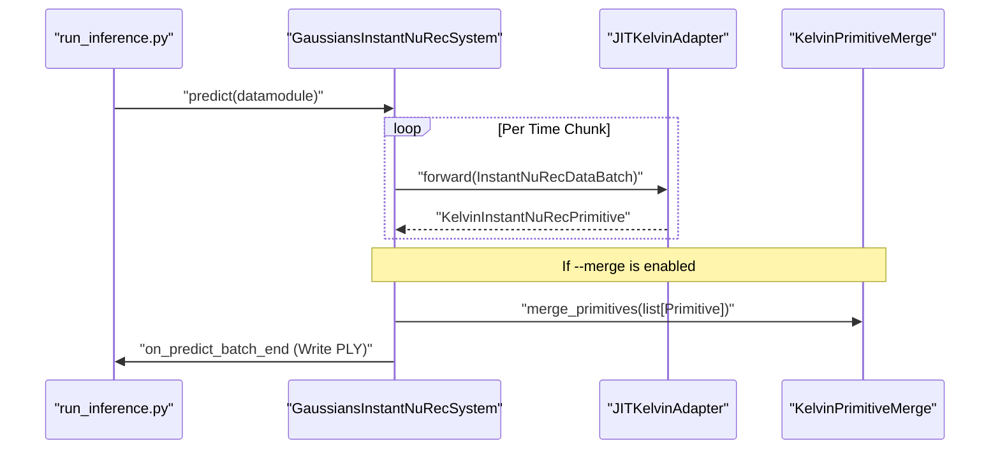
Sources: [run_inference.py:35-45](), [instant_nurec/systems/gaussians_instant_nurec.py:120-150](), [README.md:135-138]()

### Documentation Map

For deeper technical details, refer to the following child pages:

*   **[Getting Started](#1.1)**: Step-by-step setup using `setup.sh`, environment configuration (e.g., `INSTANT_NUREC_FULL_PT`), and running your first inference on demo clips [README.md:55-148]().
*   **[Contributing and Project Conventions](#1.2)**: Guide for developers on the `uv` package manager, `ruff` linting, `pytest` requirements, and mandatory DCO sign-offs [CONTRIBUTING.md:17-108]().

Further sections in the wiki cover the **System Architecture**, **Data Pipeline** (NCore ingestion), **Model and Inference** (JIT adapter details), **Gaussian Primitives** (PLY export and merging), and the **Utility Library** (SE3 math and sensor models).

Sources: [CONTRIBUTING.md:1-121](), [README.md:1-195]()

---

# Page: Getting Started

# Getting Started

<details>
<summary>Relevant source files</summary>

The following files were used as context for generating this wiki page:

- [.gitignore](.gitignore)
- [TROUBLESHOOTING.md](TROUBLESHOOTING.md)
- [pyproject.toml](pyproject.toml)
- [run.sh](run.sh)
- [run_inference.py](run_inference.py)
- [setup.sh](setup.sh)
- [uv.lock](uv.lock)

</details>


This page provides a step-by-step guide for setting up the InstantNuRec environment, installing necessary dependencies, and executing your first inference pipeline. InstantNuRec is designed to ingest NCore V4 driving-log data and produce 3D Gaussian Splatting (3DGS) PLY files using a JIT-compiled Kelvin model.

## Environment Setup

The project uses `uv` as its primary package manager to ensure reproducible builds through a locked dependency tree. The setup process bootstraps a virtual environment and installs pinned versions of libraries including `torch`, `nvidia-ncore`, and `huggingface_hub` [pyproject.toml:8-31]().

### Prerequisites
*   **Python**: Version 3.11.x is required [pyproject.toml:6-6]().
*   **Hardware**: An NVIDIA GPU with drivers meeting the [NuRec hardware minimums](https://docs.nvidia.com/nurec/basics/hardware.html#hardware-setup-and-requirements). There is no CPU fallback for inference [TROUBLESHOOTING.md:10-10]().
*   **uv**: If not installed, obtain it via `pip install uv` or the official install script [setup.sh:29-34]().

### Installation Steps
1.  **Clone the repository** and navigate to the root directory.
2.  **Run the setup script**:
    ```bash
    ./setup.sh
    ```
    This script executes `uv sync --frozen`, which synchronizes the local environment with the `uv.lock` file [setup.sh:40-40]().
3.  **Activate the environment**:
    ```bash
    source .venv/bin/activate
    ```

### Environment Variables
| Variable | Description |
| --- | --- |
| `INSTANT_NUREC_FULL_PT` | Optional. Absolute path to a local `instant_nurec.pt` model file to bypass Hugging Face downloads [TROUBLESHOOTING.md:5-5](). |
| `HTTPS_PROXY` | Required if your network blocks `huggingface.co` or `*.cloudfront.net` [TROUBLESHOOTING.md:5-5](). |

Sources: [setup.sh:1-58](), [pyproject.toml:1-94](), [TROUBLESHOOTING.md:1-15]()

## Running Inference

Inference is performed via the `run_inference.py` entry point, which can be invoked directly or through the `run.sh` wrapper.

### The `run.sh` Wrapper
The `run.sh` script provides a layer of validation before calling the Python engine. It ensures that:
*   `--ncore-path` points to a valid `.json` (single sequence) or `.lst` (manifest) file [run.sh:57-63]().
*   `--output-dir` is created and writable [run.sh:65-69]().

### Execution Example
```bash
./run.sh --ncore-path /path/to/sequence.json --output-dir ./results --n-gaussians 1000000 --merge
```

### Core CLI Arguments
| Argument | Description |
| --- | --- |
| `--ncore-path` | Path to NCore V4 data (JSON or LST) [run.sh:31-35](). |
| `--output-dir` | Directory where `.ply` files will be saved [run.sh:36-40](). |
| `--merge` | Boolean flag to merge per-chunk primitives into a global scene [run.sh:49-49](). |
| `--n-gaussians` | Target number of Gaussians for the output [run.sh:49-49](). |
| `--camera-id` | Filter for specific camera sensors within the NCore sequence [TROUBLESHOOTING.md:9-9](). |
| `--max-chunks` | Controls VRAM usage by limiting concurrent chunk processing [TROUBLESHOOTING.md:11-12](). |

Sources: [run.sh:1-72](), [run_inference.py:1-41](), [TROUBLESHOOTING.md:7-12]()

## Data Flow and Implementation

The following diagrams illustrate how the setup scripts and entry points transition into the core system logic.

### Setup and Entry Point Mapping
This diagram shows the relationship between the shell scripts, the Python entry point, and the primary CLI logic.

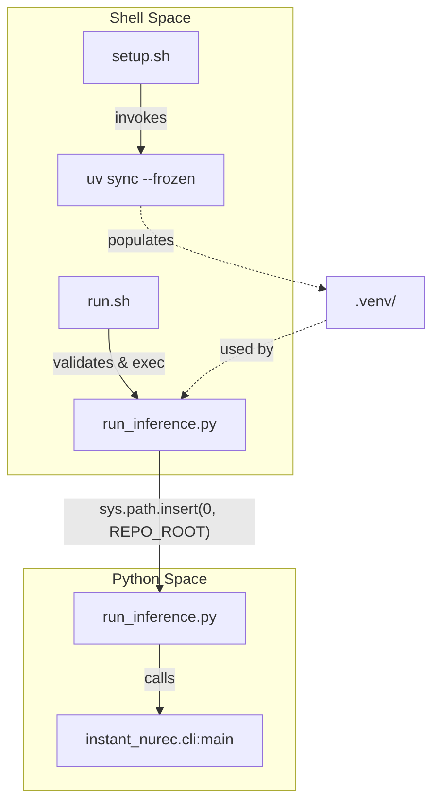
Sources: [setup.sh:40-40](), [run.sh:71-71](), [run_inference.py:32-40]()

### Inference Execution Logic
This diagram bridges the CLI command space to the internal system components that handle data ingestion and model prediction.

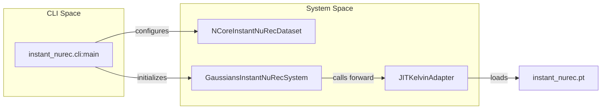
Sources: [run_inference.py:36-36](), [TROUBLESHOOTING.md:5-5]()

## Troubleshooting Common Issues

| Symptom | Cause | Fix |
| --- | --- | --- |
| `PretrainedModelError` | Network blocks Hugging Face or missing local file. | Set `INSTANT_NUREC_FULL_PT` to a local path [TROUBLESHOOTING.md:5-5](). |
| `ValueError: --ncore-path...` | File suffix is not `.json` or `.lst`. | Ensure the path points to an NCore JSON or LST manifest [run.sh:57-63](). |
| `RuntimeError: Found no NVIDIA driver` | Missing CUDA environment. | Verify `nvidia-smi` and ensure `torch.cuda.is_available()` is True [TROUBLESHOOTING.md:10-10](). |
| `OutOfMemoryError` | Per-chunk working set exceeds VRAM. | Lower the `--max-chunks` parameter [TROUBLESHOOTING.md:11-11](). |

Sources: [TROUBLESHOOTING.md:1-15](), [run.sh:57-63]()

---

# Page: Contributing and Project Conventions

# Contributing and Project Conventions

<details>
<summary>Relevant source files</summary>

The following files were used as context for generating this wiki page:

- [CONTRIBUTING.md](CONTRIBUTING.md)
- [THIRD_PARTY_LICENSE.txt](THIRD_PARTY_LICENSE.txt)
- [conftest.py](conftest.py)
- [pyproject.toml](pyproject.toml)

</details>


This page provides a comprehensive guide for developers contributing to the `instant_nurec` codebase. It outlines the mandatory contribution workflows, technical standards for code hygiene, and the configuration of the project's development environment.

## Contribution Workflow and Signing

The project enforces strict adherence to the **Developer Certificate of Origin (DCO)**. This ensures that every contribution is legally traceable and authorized by the contributor.

### DCO Sign-off
All commits must be "signed-off" using the `-s` or `--signoff` flag in Git [CONTRIBUTING.md:23-32](). This appends a `Signed-off-by` line to the commit message, certifying that the contributor has the rights to submit the work under the project's Apache-2.0 license [CONTRIBUTING.md:33-75]().

### Commit Hygiene
The project follows a structured commit format to maintain a clean and searchable history [CONTRIBUTING.md:114-121]():
*   **One logical change per commit.**
*   **Subject Line Format:** `<type>(<area>): <imperative one-liner>`.
*   **Valid Types:** `feat`, `fix`, `refactor`, `chore`, `test`, `docs`.
*   **Fixups:** Use `git commit --fixup=<SHA>` for minor corrections to existing commits on a branch.

## Local Development Environment

The project uses `uv` for dependency management and environment isolation.

### Environment Setup
The `setup.sh` script initializes the environment by running `uv sync --frozen`, which creates a `.venv/` directory based on the locked dependency tree in `uv.lock` [CONTRIBUTING.md:77-87]().

### Dependency Management
Dependencies are strictly version-pinned in `pyproject.toml` to prevent runtime drift [pyproject.toml:8-31](). The project uses custom indices for CUDA-enabled wheels (e.g., `torch`, `torchvision`, `torch-scatter`) to ensure compatibility with the `cu128` ABI [pyproject.toml:52-67]().

| Tool | Purpose | Configuration |
| :--- | :--- | :--- |
| `uv` | Dependency resolution and locking | `uv.lock` |
| `setuptools` | Build backend | `pyproject.toml` [pyproject.toml:91-93]() |
| `ruff` | Linting and formatting | `pyproject.toml` [tool.ruff] [pyproject.toml:68-75]() |
| `pytest` | Test runner | `conftest.py` [conftest.py:1-28]() |

Sources: [CONTRIBUTING.md:77-91](), [pyproject.toml:1-94]()

## Coding Conventions and Linting

### Linting with Ruff
The project uses `ruff` for static analysis and import sorting. The configuration is defined in `pyproject.toml` with a target version of Python 3.11 and a line length limit of 120 characters [pyproject.toml:68-70]().

*   **Import Sorting:** `isort` rules are enforced, with specific section ordering: `future`, `standard-library`, `third-party`, `first-party`, `local-folder` [pyproject.toml:83-89]().
*   **Exemptions:** Certain files like `run_inference.py` and tests are allowed to bypass `E402` (module-level import position) because they manually manipulate `sys.path` to resolve the in-tree `instant_nurec` package [pyproject.toml:76-81]().

### Code Style Implementation
The following diagram illustrates how the development tools interact with the source code to maintain project standards.

**Development Workflow and Tooling Map**
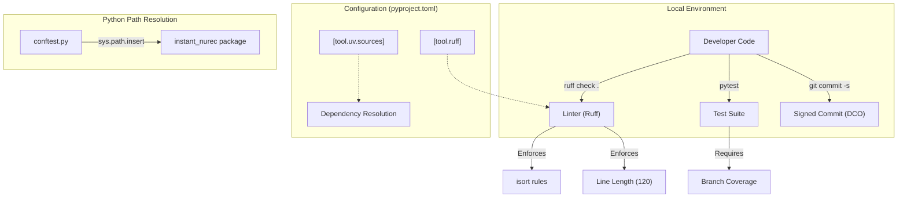
Sources: [pyproject.toml:68-89](), [CONTRIBUTING.md:101-108](), [conftest.py:16-27]()

## Testing Standards

### Pytest Configuration
Tests are located in the `tests/` directory. The `conftest.py` file at the root automatically adds the repository root to `sys.path`, allowing tests to import `instant_nurec` without requiring an editable install [conftest.py:16-27]().

### Requirements for New Code
*   **Branch Coverage:** New functions must include tests covering every logical branch [CONTRIBUTING.md:98-99]().
*   **Execution:** Tests should be run using `.venv/bin/python -m pytest tests/ -q` [CONTRIBUTING.md:94-96]().
*   **Parity:** Final correctness for inference must be verified on a GPU with real `ncorev4` data [CONTRIBUTING.md:110-113]().

## Project Structure and Entry Points

The project is structured as a standard Python package with a CLI entry point.

**Code Entity to System Map**
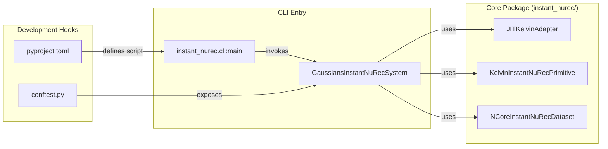
Sources: [pyproject.toml:33-34](), [conftest.py:16-27](), [CONTRIBUTING.md:19-21]()

### Package Metadata
*   **Name:** `instant_nurec` [pyproject.toml:2]()
*   **Version:** `0.1.0` [pyproject.toml:3]()
*   **CLI Command:** `instant-nurec` (mapped to `instant_nurec.cli:main`) [pyproject.toml:33-34]()
*   **Python Version:** `>=3.11, <3.12` [pyproject.toml:6]()

Sources: [pyproject.toml:1-34]()

---

# Page: System Architecture

# System Architecture

<details>
<summary>Relevant source files</summary>

The following files were used as context for generating this wiki page:

- [README.md](README.md)
- [instant_nurec/__init__.py](instant_nurec/__init__.py)
- [instant_nurec/predict/run.py](instant_nurec/predict/run.py)

</details>


The InstantNuRec system is a feed-forward inference pipeline designed to convert autonomous vehicle driving logs into high-fidelity 3D Gaussian Splatting (3DGS) representations [README.md:14-21](). It bypasses the traditional per-scene optimization process by using a vision-transformer backbone to directly infer geometry, appearance, and motion from multi-camera observations [README.md:15-21]().

The pipeline is structured as a sequential flow from raw data ingestion to exported 3D assets:

1.  **Data Ingestion**: Loading NCore V4 sequence metadata and multi-view imagery.
2.  **Batching**: Partitioning temporal sequences into manageable "time-chunks."
3.  **Forward Pass**: Executing the JIT-compiled Kelvin transformer model.
4.  **Primitive Processing**: Transforming model outputs into structured 3D Gaussian primitives.
5.  **Aggregation & Export**: Optional merging of chunks and writing to 3DGS-compatible PLY files.

### End-to-End Data Flow

The following diagram illustrates the transition from the "Natural Language Space" of user requirements to the "Code Entity Space" of classes and functions.

**End-to-End Inference Pipeline**
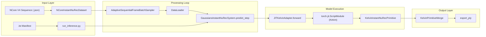
Sources: [README.md:51-51](), [instant_nurec/predict/run.py:38-53](), [instant_nurec/model/systems/gaussians_instantnurec.py:108-142]()

---

### Core Components

#### CLI and Entry Points
The primary entry point is `run_inference.py`, which parses command-line arguments into an `InstantNuRecConfig` object [instant_nurec/predict/run.py:38-41](). It handles both single-sequence processing and batch processing via `.lst` manifests [README.md:158-190]().

For details, see [CLI and Entry Points](#2.1).

#### Configuration Schema
The system is governed by a hierarchical Pydantic configuration tree. The root `InstantNuRecConfig` encapsulates settings for the dataset, the model architecture, the sampling strategy, and the export parameters [instant_nurec/predict/run.py:25-25]().

For details, see [Configuration Schema](#2.2).

#### Pretrained Model Loading
The system uses a factory pattern via `instant_nurec.model.make(config)` to instantiate the reconstruction system [instant_nurec/predict/run.py:43-43](). This process includes resolving the `instant_nurec.pt` TorchScript archive, which may be sourced from a local path (via `INSTANT_NUREC_FULL_PT`) or auto-downloaded from the Hugging Face Hub [README.md:84-108]().

For details, see [Pretrained Model Loading](#2.3).

### System Integration Map

This diagram bridges the high-level system components with the specific code entities responsible for the data transformations.

**System Component Mapping**
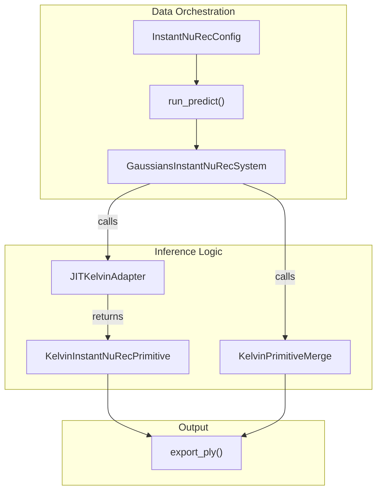
Sources: [instant_nurec/predict/run.py:38-53](), [instant_nurec/model/systems/gaussians_instantnurec.py:46-52](), [instant_nurec/model/systems/gaussians_instantnurec.py:126-142]()

### Execution Lifecycle

The execution follows a strictly defined lifecycle within `instant_nurec/predict/run.py`:

| Stage | Action | Code Entity |
| :--- | :--- | :--- |
| **Initialization** | Seeds RNGs and instantiates the system. | `_seed_everything`, `instantnurec_systems.make` |
| **Data Loading** | Prepares the NCore dataloader. | `system.datamodule.predict_dataloader` |
| **Inference** | Iterates through chunks and performs forward passes. | `system.predict_step` |
| **Post-Processing** | Handles primitive merging and file export. | `system.on_predict_batch_end` |

Sources: [instant_nurec/predict/run.py:31-53]()

---

# Page: CLI and Entry Points

# CLI and Entry Points

<details>
<summary>Relevant source files</summary>

The following files were used as context for generating this wiki page:

- [instant_nurec/cli.py](instant_nurec/cli.py)
- [instant_nurec/ncore_input.py](instant_nurec/ncore_input.py)
- [run.sh](run.sh)
- [run_inference.py](run_inference.py)

</details>


The InstantNuRec command-line interface (CLI) provides a standalone entry point for executing the Kelvin model prediction pipeline on NCore V4 datasets. It handles argument parsing, dataset manifest resolution, and the instantiation of the Pydantic-based configuration system required to drive the inference engine.

## Entry Points and Execution Flow

The system provides multiple layers of entry points, ranging from shell scripts to Python modules.

1.  **`run.sh`**: A bash wrapper that performs preliminary validation of `--ncore-path` and `--output-dir`, ensures the output directory is writable, and executes `run_inference.py` [run.sh:18-71]().
2.  **`run_inference.py`**: The primary Python entry point located at the repository root. It adds the repository to `sys.path` and delegates execution to the core CLI module [run_inference.py:32-40]().
3.  **`instant_nurec.cli.main`**: The core implementation logic that translates CLI flags into structured configuration objects [instant_nurec/cli.py:115-166]().

### CLI to Pipeline Wiring

The diagram below illustrates how the CLI flags are mapped to internal code entities and the subsequent prediction pipeline.

**CLI Wiring Diagram**
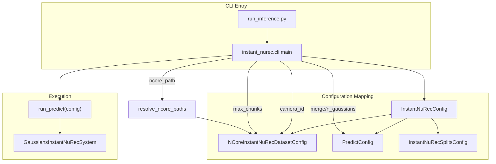
**Sources:** [instant_nurec/cli.py:115-152](), [run_inference.py:36-40]()

## Command-Line Arguments

The CLI is built using `argparse` via `make_parser()` [instant_nurec/cli.py:37-112]().

### Primary Flags

| Flag | Type | Default | Description |
| :--- | :--- | :--- | :--- |
| `--ncore-path` | `Path` | **Required** | Path to a single `.json` NCore sequence or a `.lst` manifest [instant_nurec/cli.py:42-52](). |
| `--output-dir` | `Path` | **Required** | Destination directory for generated 3DGS PLY files [instant_nurec/cli.py:53-58](). |
| `--merge` | `bool` | `False` | Enables merging per-chunk primitives and performing KL-optimal voxelization [instant_nurec/cli.py:60-69](). |
| `--n-gaussians` | `int` | `2,000,000` | Target static Gaussian count for voxelization (only if `--merge` is set) [instant_nurec/cli.py:70-81](). |
| `--camera-id` | `str` | `camera_front_wide_120fov` | The NCore camera ID used for both context and supervision [instant_nurec/cli.py:83-92](). |
| `--max-chunks` | `int` | `8` | Maximum 13.5s time-chunks to process per clip [instant_nurec/cli.py:94-105](). |
| `--log-level` | `str` | `INFO` | Standard Python logging level [instant_nurec/cli.py:106-111](). |

**Sources:** [instant_nurec/cli.py:32-112]()

## Data Input Handling

The CLI supports two input formats for the `--ncore-path` argument, which are resolved by `resolve_ncore_paths` [instant_nurec/ncore_input.py:31-77]().

### LST Manifest Format
A `.lst` file allows batch processing of multiple sequences. The format rules are:
*   One path per line [instant_nurec/ncore_input.py:50]().
*   Relative paths are anchored to the directory containing the `.lst` file [instant_nurec/ncore_input.py:57-58]().
*   Lines starting with `#` and blank lines are ignored [instant_nurec/ncore_input.py:52-53]().
*   All resolved paths must exist and end in `.json` [instant_nurec/ncore_input.py:62-71]().

**Path Resolution Logic**
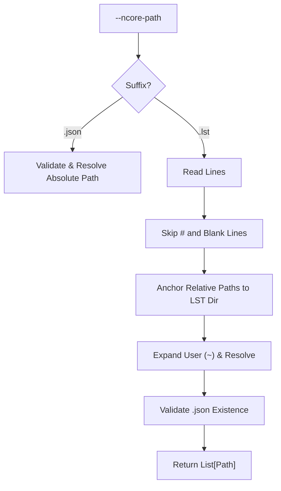
**Sources:** [instant_nurec/ncore_input.py:31-77]()

## Implementation Details

### Configuration Assembly
The `main` function instantiates the Pydantic configuration hierarchy [instant_nurec/cli.py:132-151](). It maps CLI flags to specific config fields:
*   `--max-chunks` is passed to `AdaptiveSequentialFrameBatchSamplerConfig.n_samples_per_sequence` [instant_nurec/cli.py:140]().
*   `--merge` controls both `enabled` and `enable_voxelization` in `PrimitiveMergeConfig` [instant_nurec/cli.py:146-147]().
*   `--camera-id` is assigned to both `context_camera_ids` and `supervision_camera_ids` [instant_nurec/cli.py:137-138]().

### Lazy Imports
To ensure that help commands (e.g., `python run_inference.py --help`) remain responsive and do not trigger heavy CUDA or Torch initializations, the CLI uses lazy imports within the `main` function [instant_nurec/cli.py:119-128]().

**Sources:** [instant_nurec/cli.py:119-152](), [instant_nurec/ncore_input.py:16-24]()

---

# Page: Configuration Schema

# Configuration Schema

<details>
<summary>Relevant source files</summary>

The following files were used as context for generating this wiki page:

- [instant_nurec/config_schema/README.md](instant_nurec/config_schema/README.md)
- [instant_nurec/config_schema/__init__.py](instant_nurec/config_schema/__init__.py)
- [instant_nurec/config_schema/base_schema.py](instant_nurec/config_schema/base_schema.py)
- [instant_nurec/config_schema/dataset.py](instant_nurec/config_schema/dataset.py)
- [instant_nurec/config_schema/instantnurec.py](instant_nurec/config_schema/instantnurec.py)
- [instant_nurec/config_schema/models.py](instant_nurec/config_schema/models.py)
- [instant_nurec/config_schema/predict.py](instant_nurec/config_schema/predict.py)

</details>


The configuration system in InstantNuRec is built using `pydantic` models to provide strict validation, type safety, and default value management. The schema is organized into a hierarchical structure where a top-level `InstantNuRecConfig` composes several specialized sub-configs.

## Base Configuration Architecture

All configuration classes inherit from `BaseConfigSchema`, which extends `pydantic.BaseModel` [instant_nurec/config_schema/base_schema.py:23-28](). This base class ensures strict validation and provides a stable hash for config instances based on their type and representation [instant_nurec/config_schema/base_schema.py:26-27]().

### Configuration Composition Diagram

The following diagram illustrates how the various configuration entities are composed into the final runtime object.

**Natural Language to Code Entity Mapping: Config Composition**
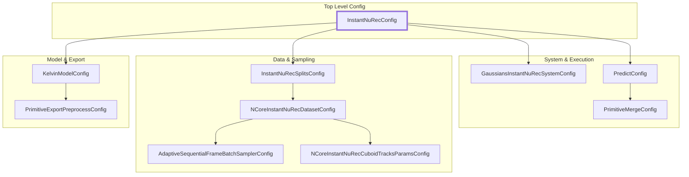
Sources: [instant_nurec/config_schema/instantnurec.py:35-54](), [instant_nurec/config_schema/dataset.py:68-114](), [instant_nurec/config_schema/predict.py:56-64](), [instant_nurec/config_schema/models.py:32-39]()

## Core Config Classes

### InstantNuRecConfig
The root configuration object for the inference pipeline. It aggregates system settings, dataset splits, model parameters, and prediction-specific logic.

| Field | Type | Default | Description |
| :--- | :--- | :--- | :--- |
| `seed` | `int` | `38` | Random seed for reproducibility. |
| `out_dir` | `str` | (Required) | Path where output PLY files and logs are written. |
| `system` | `GaussiansInstantNuRecSystemConfig` | Default Factory | Hardware/Dataloader worker settings. |
| `dataset` | `InstantNuRecSplitsConfig` | (Required) | Paths and parameters for the NCore dataset. |
| `model` | `KelvinModelConfig` | Default Factory | Model-specific export/pruning settings. |
| `predict` | `PredictConfig` | Default Factory | Logic for primitive merging and voxelization. |
| `run_id` | `str` | `shortuuid.uuid` | Unique ID for the run; can be overridden by `INSTANT_NUREC_RUN_ID` env var. |

Sources: [instant_nurec/config_schema/instantnurec.py:35-66]()

### GaussiansInstantNuRecSystemConfig
Controls the execution environment for the inference system.

*   `predict_num_workers` (int, default: `4`): Number of subprocesses used for data loading [instant_nurec/config_schema/instantnurec.py:31]().
*   `predict_batch_size` (int, default: `8`): Batch size for the dataloader. In the InstantNuRec predict pipeline, this is typically treated as the number of time-chunks processed [instant_nurec/config_schema/instantnurec.py:32]().

Sources: [instant_nurec/config_schema/instantnurec.py:28-32]()

## Dataset and Sampling Schema

The dataset configuration defines how NCore V4 driving logs are parsed and how time-chunks are sampled for the JIT model.

### NCoreInstantNuRecDatasetConfig
| Field | Type | Default | Description |
| :--- | :--- | :--- | :--- |
| `ncore_json_paths` | `list[str]` | (Required) | Absolute paths to NCore V4 sequence JSONs [instant_nurec/config_schema/dataset.py:77-80](). |
| `camera_max_fov_deg`| `float` | `190.0` | Max FOV used to invalidate boundary pixels for FTheta models [instant_nurec/config_schema/dataset.py:82-86](). |
| `context_camera_ids`| `list[str]` | `["camera_front_wide_120fov"]` | Cameras used as input to the model [instant_nurec/config_schema/dataset.py:89-92](). |
| `frame_batch_sampler`| `AdaptiveSequentialFrameBatchSamplerConfig` | Default | Configuration for time-chunking [instant_nurec/config_schema/dataset.py:94-96](). |

Sources: [instant_nurec/config_schema/dataset.py:68-105]()

### AdaptiveSequentialFrameBatchSamplerConfig
This class configures the `AdaptiveSequentialFrameBatchSampler`, which divides a long driving sequence into overlapping or sequential time-chunks.

*   `n_samples_per_sequence` (int, default: `8`): Maximum number of chunks to process. If a clip is longer than what these chunks cover, it is truncated [instant_nurec/config_schema/dataset.py:48-57]().
*   `max_frame_gap_timestamp_us` (int, default: `750,000`): Maximum microsecond spacing between frames in a single chunk [instant_nurec/config_schema/dataset.py:58-65]().

Sources: [instant_nurec/config_schema/dataset.py:42-65]()

## Prediction and Merging Schema

These classes control the post-processing of Kelvin primitives, specifically how multiple time-chunks are unified into a single 3DGS scene.

### PrimitiveMergeConfig
Configures the `KelvinPrimitiveMerge` logic.

*   `enabled` (bool, default: `False`): If true, per-chunk PLYs are merged into a single sequence PLY [instant_nurec/config_schema/predict.py:29]().
*   `frustum_ownership_max_diff_m` (float, default: `5.0`): Distance threshold for the de-overlap algorithm [instant_nurec/config_schema/predict.py:30-34]().
*   `enable_voxelization` (bool, default: `False`): Enables KL-optimal voxelization to reduce Gaussian count [instant_nurec/config_schema/predict.py:35-38]().
*   `target_n_gaussians` (int, default: `2,000,000`): The desired number of static Gaussians after voxelization [instant_nurec/config_schema/predict.py:44-48]().

Sources: [instant_nurec/config_schema/predict.py:21-54]()

### KelvinModelConfig & PrimitiveExportPreprocessConfig
These define the pruning applied to raw model outputs before they reach the merging or export stage.

*   `density_prune_threshold` (float, default: `0.01`): Gaussians with density below this value are discarded during `preprocess_for_export` [instant_nurec/config_schema/models.py:27-29]().

Sources: [instant_nurec/config_schema/models.py:23-39]()

## Data Flow and Config Resolution

The CLI (typically `cli.py`) is responsible for resolving high-level flags into these structured Pydantic objects.

**Natural Language to Code Entity Mapping: CLI to Config Flow**
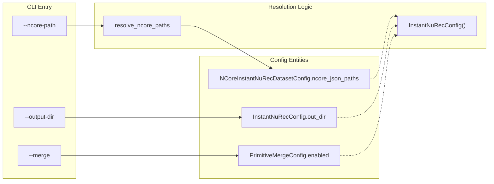
Sources: [instant_nurec/config_schema/README.md:19-22](), [instant_nurec/config_schema/dataset.py:68-75](), [instant_nurec/config_schema/predict.py:21-29]()

---

# Page: Pretrained Model Loading

# Pretrained Model Loading

<details>
<summary>Relevant source files</summary>

The following files were used as context for generating this wiki page:

- [instant_nurec/model/__init__.py](instant_nurec/model/__init__.py)
- [instant_nurec/pretrained.py](instant_nurec/pretrained.py)

</details>


The InstantNuRec system relies on a TorchScript-serialized model file, `instant_nurec.pt`, which contains the JIT Kelvin model weights and logic. This page details how the system resolves this file, the fallback mechanisms for offline use, and the factory pattern used to instantiate the inference system.

## Model Resolution Logic

The resolution of the pretrained model artifact is handled by the `instant_nurec.pretrained` module. It follows a strict priority order to ensure the model can be loaded in both internet-connected and air-gapped environments.

### Resolution Hierarchy

1.  **Environment Variable Override**: If the `INSTANT_NUREC_FULL_PT` environment variable is set and points to an existing file, it is used immediately. This is the primary method for offline usage [instant_nurec/pretrained.py:57-59]().
2.  **Hugging Face Hub Cache**: The system checks the local Hugging Face Hub cache using `try_to_load_from_cache` for the repository `nvidia/instant-nurec` and filename `instant_nurec.pt` [instant_nurec/pretrained.py:80-82]().
3.  **Hugging Face Hub Download**: If not found locally, it attempts to download the artifact from the Hub [instant_nurec/pretrained.py:85-86]().

### Error Handling
If resolution fails (e.g., no internet connection and no environment variable set), the system raises a `PretrainedModelError` [instant_nurec/pretrained.py:41-43](). At the model factory level, this is caught and re-raised as a `ModelNotFoundError` with descriptive instructions for the user [instant_nurec/model/__init__.py:37-46](), [instant_nurec/model/__init__.py:125-128]().

### Pretrained Model Resolution Flow
The following diagram illustrates the decision logic inside `download_instant_nurec_pt`.

"Model Resolution Decision Flow"
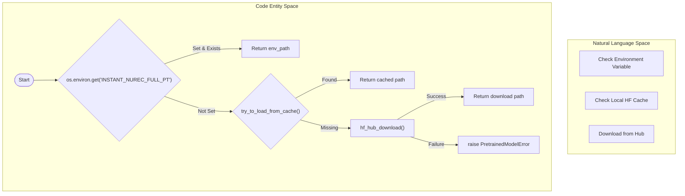
Sources: [instant_nurec/pretrained.py:45-93](), [instant_nurec/model/__init__.py:41-46]()

## The Model Factory: `instant_nurec.model.make()`

The `make()` function is the central entry point for initializing the inference system. It performs several critical "pre-flight" checks before loading the heavy TorchScript module.

### 1. Camera Validation
Before loading the model, `make()` invokes `_preflight_validate_camera_ids()`. This helper opens the first NCore sequence in the configuration to verify that all requested `context_camera_ids` and `supervision_camera_ids` actually exist in the data source [instant_nurec/model/__init__.py:72-78](). This prevents the system from failing deep inside the dataloader workers after the model has already been loaded into GPU memory [instant_nurec/model/__init__.py:58-61]().

### 2. JIT Module Loading
The model is loaded using `torch.jit.load`. To optimize performance, the fusion strategy is explicitly configured to disable certain JIT optimizations that can cause overhead in the specific Kelvin architecture [instant_nurec/model/__init__.py:135-136]().

### 3. Dimensionality Verification
The loaded `JITKelvinAdapter` exposes metadata about the model's expected input shapes (e.g., `expected_v` for the number of frames). The factory ensures that the number of context cameras provided in the config divides the model's expected frame count evenly [instant_nurec/model/__init__.py:140-147]().

### Model Initialization and System Assembly
The `GaussiansInstantNuRecSystem` is instantiated using a low-level `__new__` pattern to bypass standard Lightning/Torch initialization, allowing for manual attribute assignment from the config and the resolved model adapter [instant_nurec/model/__init__.py:149-165]().

"Model Factory and System Assembly"
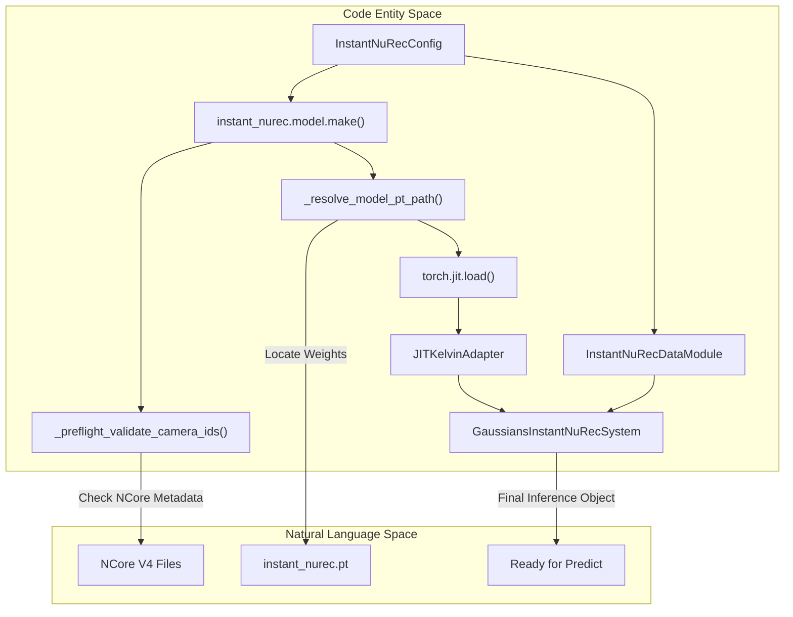
Sources: [instant_nurec/model/__init__.py:114-165](), [instant_nurec/model/jit_adapter.py:23-50]()

## Summary of Key Components

| Component | Role | Source |
| :--- | :--- | :--- |
| `download_instant_nurec_pt` | Logic for resolving the `.pt` file path via env var or HF Hub. | [instant_nurec/pretrained.py:45]() |
| `make()` | Primary factory function to build the inference system. | [instant_nurec/model/__init__.py:114]() |
| `PretrainedModelError` | Exception raised when the model artifact cannot be downloaded. | [instant_nurec/pretrained.py:41]() |
| `ModelNotFoundError` | High-level exception for resolution or validation failures. | [instant_nurec/model/__init__.py:37]() |
| `_resolve_model_pt_path` | Internal wrapper for pretrained model resolution. | [instant_nurec/model/__init__.py:41]() |
| `_preflight_validate_camera_ids` | Validates dataset camera IDs before loading the model. | [instant_nurec/model/__init__.py:72]() |

Sources: [instant_nurec/pretrained.py:1-93](), [instant_nurec/model/__init__.py:1-166]()

---

# Page: Data Pipeline

# Data Pipeline

<details>
<summary>Relevant source files</summary>

The following files were used as context for generating this wiki page:

- [instant_nurec/datasets/__init__.py](instant_nurec/datasets/__init__.py)
- [instant_nurec/datasets/datamodule.py](instant_nurec/datasets/datamodule.py)

</details>


The **Data Pipeline** in InstantNuRec is responsible for transforming raw NCore V4 driving logs into structured, time-chunked batches ready for the JIT-loaded Kelvin model. This process involves high-resolution image loading, sensor calibration parsing, vehicle trajectory reconstruction, and 3D object track processing.

The pipeline is centered around the `InstantNuRecDataModule` [instant_nurec/datasets/datamodule.py:23-23](), which orchestrates the dataset instantiation and provides the `DataLoader` [instant_nurec/datasets/datamodule.py:42-59]() used during the inference loop.

### System Flow: From Log to Batch

The following diagram illustrates how the data pipeline bridges the gap between raw filesystem data and the `InstantNuRecDataBatch` used by the model.

**Data Ingestion and Collation Flow**
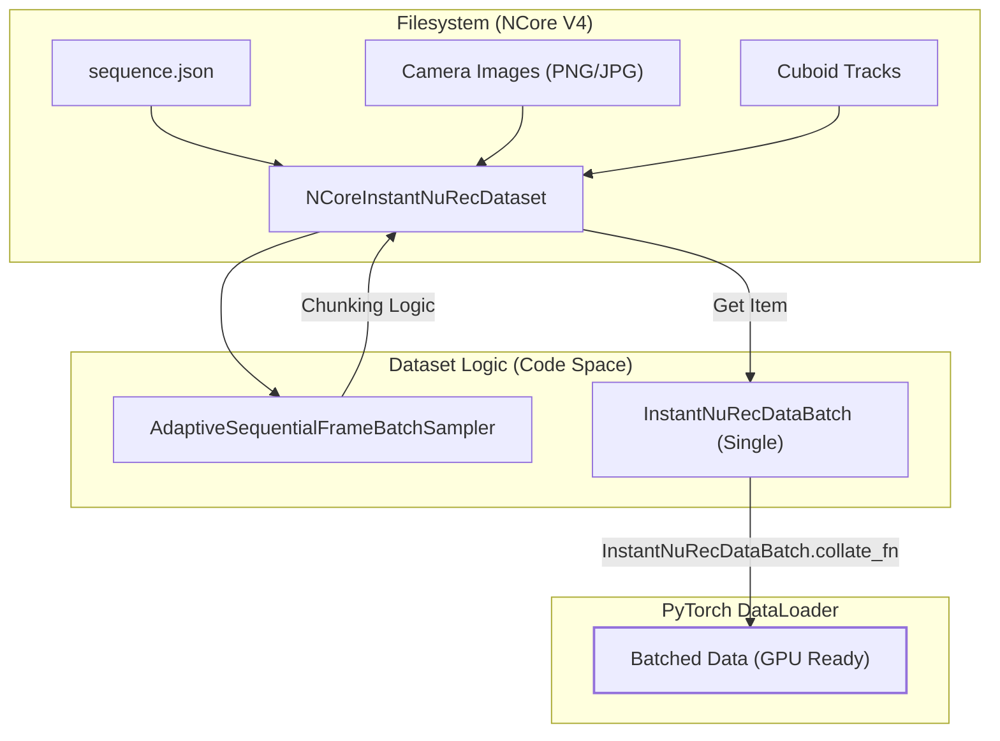
Sources: [instant_nurec/datasets/datamodule.py:46-59](), [instant_nurec/utils/batch.py:20-20]()

---

### NCore V4 Dataset Loader
The core of the ingestion logic resides in `NCoreInstantNuRecDataset` [instant_nurec/datasets/instantnurec_ncore.py](). It parses the NCore V4 sequence format, which typically includes:
*   **Sensor Calibrations**: Intrinsics and extrinsics for multiple cameras (e.g., FTheta or Pinhole models).
*   **Rig Trajectories**: The ego-vehicle's path through world space.
*   **Cuboid Tracks**: 3D bounding boxes for dynamic objects in the scene.

The dataset ensures that all spatial data is aligned and that images are resized to the dimensions required by the model (`frame_width`, `frame_height`) [instant_nurec/datasets/datamodule.py:48-49]().

For details, see [NCore V4 Dataset Loader](#3.1).

---

### Frame Sampling and Batch Structures
Because driving logs can be long, the pipeline uses an `AdaptiveSequentialFrameBatchSampler` to divide a continuous clip into manageable "time-chunks." Each chunk contains a fixed number of frames (`n_frames_per_sample`) [instant_nurec/datasets/datamodule.py:34-34]().

Data is encapsulated in a hierarchy of dataclasses:
1.  `InstantNuRecDataBatch`: The primary container for images, poses, and sensor metadata [instant_nurec/utils/batch.py:20-20]().
2.  `DataAndRenderingBatch`: A wrapper used during the system's predict step.
3.  `RenderingData`: Specific tensors required for the Gaussian Splatting rasterization.

The `InstantNuRecDataBatch.collate_fn` [instant_nurec/datasets/datamodule.py:58-58]() is responsible for merging individual samples into a single batch, handling the padding of tracks and the concatenation of temporal sequences.

For details, see [Frame Sampling and Batch Structures](#3.2).

---

### Cuboid Tracks and Dynamic Object Handling
A critical component of the pipeline is the extraction and processing of 3D object tracks. These "Cuboids" represent other vehicles or pedestrians in the scene. The pipeline:
*   Loads tracks from the NCore sequence.
*   Extrapolates positions for objects that enter or exit the sensor frustum during a time-chunk.
*   Classifies objects as static or dynamic based on their motion profiles.

This data is used by the model to generate dynamic masks, ensuring that moving objects are handled by the dynamic layers of the Gaussian primitives rather than being "baked" into the static background.

For details, see [Cuboid Tracks and Dynamic Object Handling](#3.3).

### Code Entities and Relationships

The following diagram maps the natural language concepts of the data pipeline to the specific classes and methods in the codebase.

**Data Pipeline Entity Map**
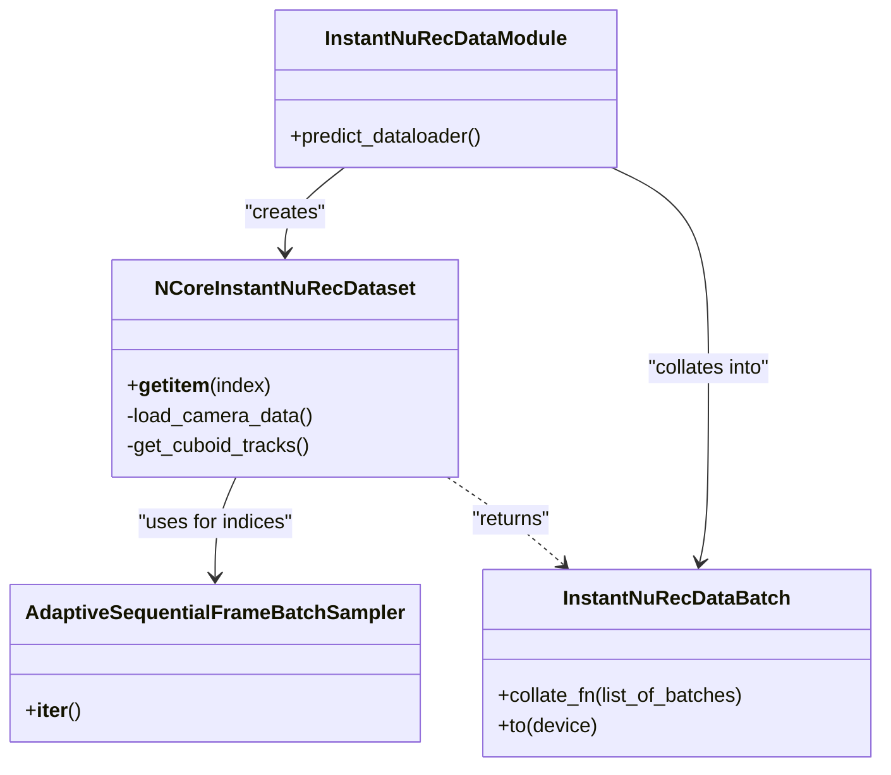
Sources: [instant_nurec/datasets/datamodule.py:23-59](), [instant_nurec/utils/batch.py:20-20]()

| Component | Responsibility | Source |
| :--- | :--- | :--- |
| **DataModule** | High-level orchestration and DataLoader creation. | [instant_nurec/datasets/datamodule.py]() |
| **Dataset** | Parsing NCore JSONs and loading raw image/track data. | [instant_nurec/datasets/instantnurec_ncore.py]() |
| **Sampler** | Logic for splitting clips into temporal chunks. | [instant_nurec/datasets/samplers.py]() |
| **DataBatch** | Tensor container and GPU transfer logic. | [instant_nurec/utils/batch.py]() |

**Sources:**
* [instant_nurec/datasets/datamodule.py:23-59]()
* [instant_nurec/utils/batch.py:20-20]()
* [instant_nurec/datasets/instantnurec_ncore.py:1-20]() (implied structure)

---

# Page: NCore V4 Dataset Loader

# NCore V4 Dataset Loader

<details>
<summary>Relevant source files</summary>

The following files were used as context for generating this wiki page:

- [instant_nurec/datasets/instantnurec_base.py](instant_nurec/datasets/instantnurec_base.py)
- [instant_nurec/datasets/instantnurec_ncore.py](instant_nurec/datasets/instantnurec_ncore.py)
- [instant_nurec/datasets/utils.py](instant_nurec/datasets/utils.py)
- [instant_nurec/ncore_input.py](instant_nurec/ncore_input.py)
- [instant_nurec/utils/ncore_utils.py](instant_nurec/utils/ncore_utils.py)

</details>


The `NCoreInstantNuRecDataset` is the primary entry point for ingesting NCore V4 driving-log data into the InstantNuRec inference pipeline. It handles the complexities of parsing sequence metadata, synchronizing multi-sensor camera streams, interpolating ego-vehicle trajectories, and extracting 3D cuboid tracks for dynamic object handling.

## Overview and Purpose

The dataset loader is responsible for transforming raw NCore V4 data stores into structured `InstantNuRecDataBatch` objects. It performs several critical transformations:
1.  **Temporal Chunking**: Dividing long driving sequences into smaller, overlapping time-chunks suitable for the Kelvin model's memory constraints.
2.  **Sensor Normalization**: Subsampling high-resolution camera frames and intrinsics to a fixed model resolution (e.g., 960x600).
3.  **Coordinate Alignment**: Computing SE3 transformations between the vehicle rig, world frame, and individual camera sensors across rolling-shutter time intervals.
4.  **Dynamic Filtering**: Identifying and tracking moving objects (pedestrians, vehicles) to facilitate dynamic mask generation.

### System Mapping: Data Loading Flow

The following diagram bridges the high-level data concepts to the specific code entities involved in the loading process.

**Data Loading Entity Map**
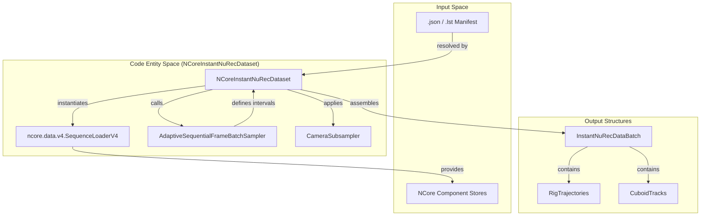
Sources: `[instant_nurec/datasets/instantnurec_ncore.py:69-136]()`, `[instant_nurec/ncore_input.py:31-77]()`, `[instant_nurec/utils/ncore_utils.py:144-159]()`

---

## Sequence Parsing and Loader Initialization

The loading process begins by resolving the `--ncore-path` argument via `resolve_ncore_paths`, which handles both single `.json` metadata files and `.lst` manifest files [instant_nurec/ncore_input.py:31-36](). 

Each sequence is parsed using `parse_sequence_meta_file` to extract the `sequence_id`, the total `time_range_us`, and the locations of the component stores [instant_nurec/utils/ncore_utils.py:113-141](). The `NCoreInstantNuRecDataset` then initializes an `ncore.data.v4.SequenceLoaderV4` to interface with the underlying data [instant_nurec/utils/ncore_utils.py:153-159]().

### Camera Subsampling
To ensure consistent input sizes for the Kelvin model, the `CameraSubsampler` performs center-cropping and resizing. It scales camera intrinsics (focal length, principal points) and applies nearest-neighbor or bilinear interpolation to image data based on the data type [instant_nurec/datasets/instantnurec_base.py:34-133]().

| Function | Responsibility |
| :--- | :--- |
| `_compute_pixel_rect` | Calculates the scale factor and crop offsets for target resolution [instant_nurec/datasets/instantnurec_base.py:47-61](). |
| `apply_camera_parameters` | Transforms `ConcreteCameraModelParametersUnion` using the calculated scale and offset [instant_nurec/datasets/instantnurec_base.py:63-73](). |
| `apply_frame_data` | Resizes RGB or semantic frames, using `antialias=True` for floating-point data [instant_nurec/datasets/instantnurec_base.py:93-133](). |

Sources: `[instant_nurec/datasets/instantnurec_base.py:34-133]()`, `[instant_nurec/utils/ncore_utils.py:113-159]()`

---

## Rig Trajectories and Pose Computation

The dataset loader builds a `RigTrajectories` object for every batch. This object encapsulates the ego-vehicle's motion within the chunk's time interval.

1.  **Interpolation**: Since camera frames and ego-poses are rarely perfectly synchronized, the loader evaluates the pose graph at specific timestamps [instant_nurec/datasets/instantnurec_ncore.py:120-123]().
2.  **Rolling Shutter**: For sensors with rolling shutter, the dataset prepares data for `image_points_to_world_rays_shutter_pose`, which interpolates the rig pose between the start and end of the frame exposure.
3.  **Coordinate Systems**: All poses are normalized relative to a "base" world frame computed at the start of the sequence to maintain numerical stability.

Sources: `[instant_nurec/datasets/instantnurec_ncore.py:120-123]()`, `[instant_nurec/utils/types.py:49-49]()`

---

## Cuboid Track Processing

Dynamic objects are handled via `CuboidTracks`. The loader filters and consolidates raw NCore observations into smooth trajectories.

**Cuboid Extraction Logic**
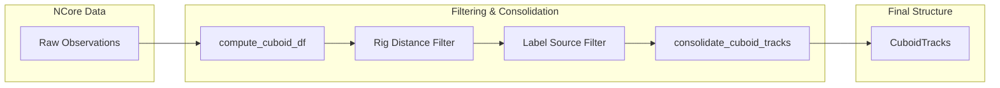

### Key Processing Steps
- **Observation Querying**: `compute_cuboid_df` fetches all cuboid observations within the chunk's `HalfClosedInterval` and sorts them by `track_id` and `timestamp_us` [instant_nurec/datasets/utils.py:31-60]().
- **Rig Proximity Filtering**: Observations too close to the rig center (e.g., the ego-vehicle itself) are discarded using `track_min_centroid_rig_dist_m` [instant_nurec/datasets/utils.py:136-139]().
- **Label Validation**: The loader filters tracks based on a list of `UNCONDITIONALLY_DYNAMIC_LABELS` (e.g., "pedestrian", "bicycle") to ensure only relevant moving objects are processed [instant_nurec/datasets/instantnurec_ncore.py:74-88]().
- **Consolidation**: `consolidate_cuboid_tracks` gathers per-observation poses into a dictionary indexed by `track_id`, including dimensions and class IDs [instant_nurec/datasets/utils.py:63-86]().

Sources: `[instant_nurec/datasets/utils.py:31-150]()`, `[instant_nurec/datasets/instantnurec_ncore.py:74-88]()`

---

## Batch Assembly

The final output of the loader is an `InstantNuRecDataBatch`. This object is a collation of multiple dataclasses that organize the data for the GPU.

### InstantNuRecDataBatch Structure

| Component | Class / Type | Description |
| :--- | :--- | :--- |
| **Metadata** | `FrameMeta` | Sequence IDs and global timestamps. |
| **Visual Data** | `DataAndRenderingBatch` | RGB images, depth maps, and semantic masks. |
| **Geometry** | `RigTrajectories` | Ego-motion SE3 matrices. |
| **Dynamic Objects** | `CuboidTracks` | Bounding box trajectories for moving objects. |
| **Labels** | `CameraFrameLabels` | Per-frame semantic and instance information. |

The assembly process uses `to_torch` to move NumPy arrays into PyTorch tensors and applies `consolidate_cuboid_tracks` to finalize the dynamic object representation before the batch is passed to the `AdaptiveSequentialFrameBatchSampler` for final collation.

Sources: `[instant_nurec/utils/batch.py:39-45]()`, `[instant_nurec/datasets/instantnurec_ncore.py:39-50]()`

---

# Page: Frame Sampling and Batch Structures

# Frame Sampling and Batch Structures

<details>
<summary>Relevant source files</summary>

The following files were used as context for generating this wiki page:

- [instant_nurec/datasets/samplers.py](instant_nurec/datasets/samplers.py)
- [instant_nurec/utils/batch.py](instant_nurec/utils/batch.py)
- [instant_nurec/utils/types.py](instant_nurec/utils/types.py)

</details>


This page details how InstantNuRec partitions long video sequences into manageable time-chunks, the hierarchical dataclass structures used to represent this data, and the mechanism for collating and transferring batches to the GPU for inference.

## Adaptive Sequential Frame Sampling

The `AdaptiveSequentialFrameBatchSampler` is responsible for dividing a sequence into a set of chunks. It ensures that the temporal gap between sampled frames within a chunk does not exceed a configured threshold, maintaining the density required for high-quality Gaussian Splatting reconstruction.

### Chunking Logic
The sampler calculates the number of chunks ($N_{chunks}$) required to cover the total timespan of the sequence while respecting the `max_frame_gap_timestamp_us` constraint [instant_nurec/datasets/samplers.py:81-83]().

1.  **Total Timespan**: Determined by the union of all camera time intervals [instant_nurec/datasets/samplers.py:79-81]().
2.  **Max Chunk Timespan**: Calculated as `max_frame_gap_timestamp_us * n_frames_per_sample` [instant_nurec/datasets/samplers.py:82]().
3.  **Adaptive Gapping**: The actual frame gap is calculated as `sequence_total_timespan / (n_chunks * n_frames_per_sample)` to ensure equal distribution across the sequence [instant_nurec/datasets/samplers.py:108]().

If the number of required chunks exceeds the user-defined `--max-chunks` (`n_samples_per_sequence`), the sampler logs a warning and drops trailing chunks [instant_nurec/datasets/samplers.py:85-103]().

### Frame Selection
For a given `sample_idx` (chunk index), the sampler generates a set of reference timestamps [instant_nurec/datasets/samplers.py:110-113](). It then performs a nearest-neighbor search using `get_closest_frame_index` against the actual hardware timestamps of each camera [instant_nurec/datasets/samplers.py:116-123]().

**Sources:** [instant_nurec/datasets/samplers.py:47-123](), [instant_nurec/config_schema/dataset.py:22-22]()

## Data Hierarchy and Batch Structures

InstantNuRec uses a nested dataclass hierarchy to manage the complexity of multi-camera, time-varying data.

### 1. InstantNuRecDataBatch
The top-level container produced by the dataset. It encapsulates all information required for a single inference step (one chunk).

| Field | Type | Description |
| :--- | :--- | :--- |
| `rendering_data` | `dict[str, RenderingData]` | Per-camera rendering information (rays, poses). |
| `rgb` | `dict[str, torch.Tensor]` | Input images for each camera. |
| `cuboid_tracks` | `CuboidTracksDataPack` | 3D bounding box tracks for dynamic objects. |
| `rig_trajectories` | `RigTrajectories` | Ego-vehicle motion and sensor calibrations. |

**Sources:** [instant_nurec/utils/batch.py:204-219]()

### 2. RenderingData
Contains the geometric primitives necessary for the rendering engine. It handles the transformation from sensor space to scene space.

*   **Rays**: Pre-computed ray origins and directions (B, H, W, 6) [instant_nurec/utils/batch.py:91-91]().
*   **Rolling Shutter**: Includes `rays_timestamps_us` and `timestamps_startend_us` to account for CMOS sensor readout timing [instant_nurec/utils/batch.py:94-95]().
*   **Depth Scaling**: Provides `distance_to_depth_scale` to convert radial distance to Z-buffer depth [instant_nurec/utils/batch.py:124-139]().

**Sources:** [instant_nurec/utils/batch.py:75-140]()

### 3. RigTrajectories
A shared structure containing the coordinate system transformations and sensor calibrations.

*   **world_to_scene**: A `FrameConversion` object that defines the scale and shift from NCore world coordinates to the local inference volume [instant_nurec/utils/types.py:146-146]().
*   **camera_calibrations**: An `OrderedDict` mapping camera IDs to their intrinsics and extrinsics [instant_nurec/utils/types.py:185-185]().

**Sources:** [instant_nurec/utils/types.py:139-186]()

## Data Flow: From Loader to GPU

The following diagram illustrates how raw NCore data is transformed into the `InstantNuRecDataBatch` and moved to the GPU device.

### Data Flow and Entity Mapping
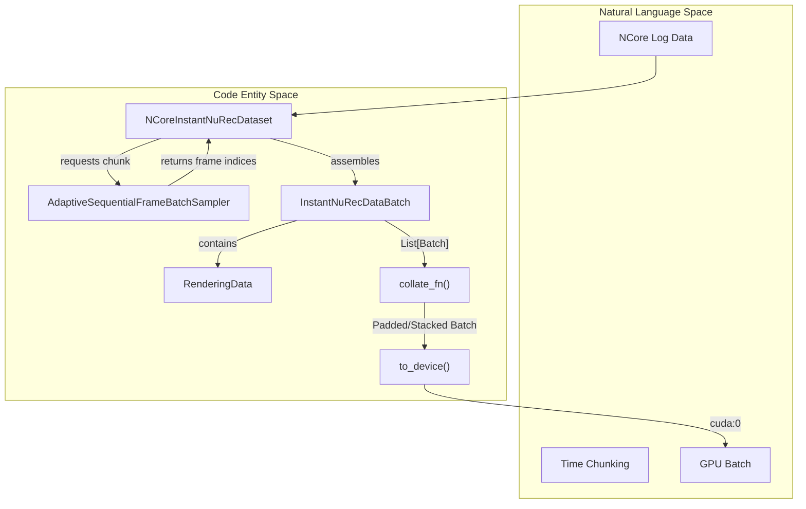
**Sources:** [instant_nurec/datasets/samplers.py:47-47](), [instant_nurec/utils/batch.py:204-204](), [instant_nurec/utils/batch.py:221-221](), [instant_nurec/utils/batch.py:238-238]()

## Collation and Device Transfer

Because the inference system expects batched tensors (even if Batch Size = 1), a custom collation mechanism is used to handle the complex nested structures.

### Collation Process
The `collate_fn` is implemented recursively across the dataclass hierarchy:
1.  **Recursive Traversal**: The function iterates through dataclass fields using `fields()` [instant_nurec/utils/batch.py:35-35]().
2.  **Special Handling**: 
    *   `torch.Tensor` objects are stacked or concatenated.
    *   `dict` and `list` objects are merged key-wise [instant_nurec/utils/batch.py:221-236]().
    *   `RenderingData` has a specialized `collate_fn` to handle `None` values in optional fields like `rays_timestamps_us` [instant_nurec/utils/batch.py:141-158]().

### GPU Migration
The `to_device` method recursively moves all tensors within the `InstantNuRecDataBatch` to the target `torch.device`. It specifically avoids moving CPU-only metadata (like `timestamps_startend_us_cpu`) to prevent unnecessary synchronization [instant_nurec/utils/batch.py:171-187](), [instant_nurec/utils/batch.py:238-251]().

**Sources:** [instant_nurec/utils/batch.py:141-187](), [instant_nurec/utils/batch.py:221-251]()

## Batch Structure Class Diagram

This diagram shows the relationship between the primary data structures used during the sampling and batching phase.

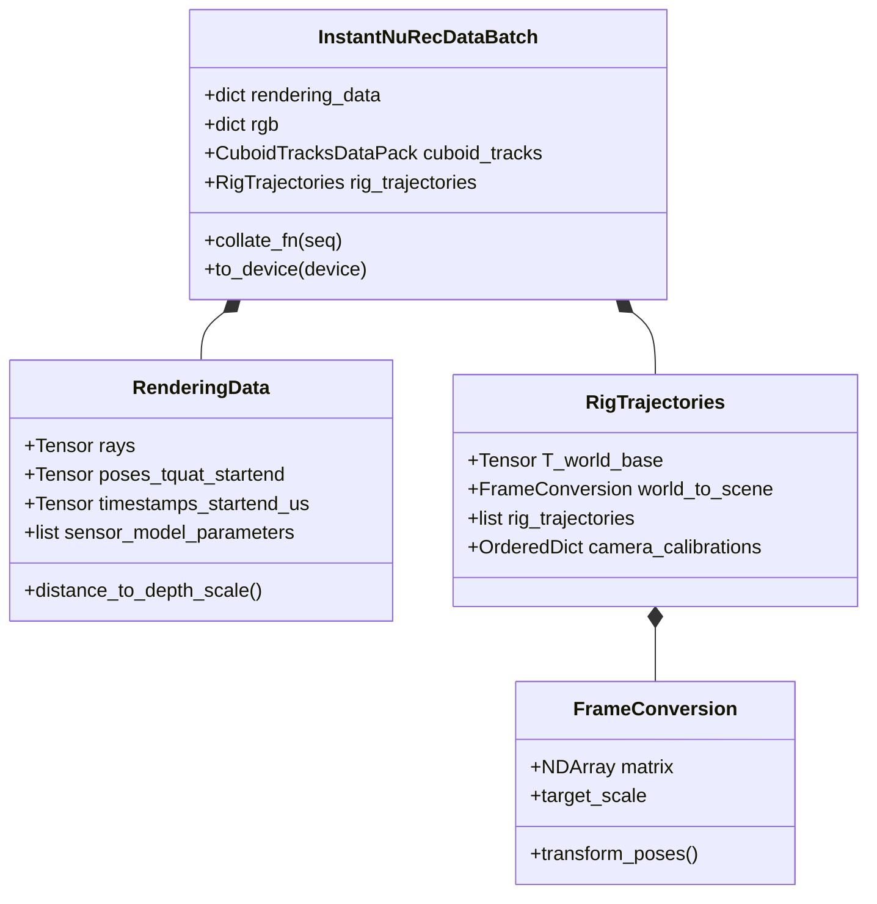
**Sources:** [instant_nurec/utils/batch.py:75-75](), [instant_nurec/utils/batch.py:204-204](), [instant_nurec/utils/types.py:52-52](), [instant_nurec/utils/types.py:139-139]()

---

# Page: Cuboid Tracks and Dynamic Object Handling

# Cuboid Tracks and Dynamic Object Handling

<details>
<summary>Relevant source files</summary>

The following files were used as context for generating this wiki page:

- [instant_nurec/datasets/ray_intersections.py](instant_nurec/datasets/ray_intersections.py)
- [instant_nurec/datasets/tracks.py](instant_nurec/datasets/tracks.py)
- [instant_nurec/utils/motion.py](instant_nurec/utils/motion.py)
- [instant_nurec/utils/types.py](instant_nurec/utils/types.py)

</details>


The `instant_nurec` system handles dynamic objects by ingesting 3D bounding-box tracks (CuboidTracks) from NCore V4 data. These tracks are used to classify scene regions as dynamic or static, extrapolate object motion beyond observed frames, and refine the dynamic masks used during the Gaussian Splatting inference process.

## CuboidTracks Representation

Tracks are managed by the `Tracks` and `CuboidTracks` classes, which store time-dependent poses and dimensions on the GPU for efficient intersection testing and interpolation.

*   **`Tracks`**: A base class managing a packed representation of SE3 poses and timestamps for multiple objects. It uses `TracksData` for storage `[instant_nurec/datasets/tracks.py:40-46]()`.
*   **`CuboidTracks`**: Extends `Tracks` to include 3D extents (dimensions) for each track, enabling ray-cuboid and point-cuboid intersection tests `[instant_nurec/datasets/tracks.py:255-263]()`.
*   **Data Structure**: Tracks are stored in a "packed" format where all poses for all tracks are concatenated into a single tensor, with a `tracks_packinfo` tensor storing the `[start_index, count]` for each track `[instant_nurec/utils/types.py:270-280]()`.

### Track Classification
Tracks are classified using `TrackFlags`, which determine how the model treats the space occupied by the cuboid:
*   **`DYNAMIC`**: Objects that are moving or capable of motion.
*   **`STATIC`**: Stationary objects (e.g., parked cars) that should be treated as part of the static background.
*   **`MOVABLE`**: A hybrid state used during inference to indicate potential motion.

Sources: `[instant_nurec/datasets/tracks.py:40-81]()`, `[instant_nurec/datasets/tracks.py:255-280]()`, `[instant_nurec/utils/types.py:250-285]()`.

## Data Flow: NCore to Inference

The following diagram illustrates how track data is processed from the raw NCore input into the `InstantNuRecDataBatch` used by the model.

### Track Loading and Processing Pipeline
```mermaid
graph TD
    subgraph "NCore Input Space"
        NC["NCore V4 Sequence JSON"] -- "Load Cuboids" --> CT_RAW["Raw Cuboid Tracks"]
    end

    subgraph "Processing Logic (instant_nurec/datasets/tracks.py)"
        CT_RAW -- "CuboidTracks.Factory.from_ncore" --> CT_OBJ["CuboidTracks Object"]
        CT_OBJ -- "extrapolate_constant_velocity" --> CT_EXT["Extrapolated Tracks"]
    end

    subgraph "Inference Batch (instant_nurec/utils/types.py)"
        CT_EXT -- "Assigned to" --> INR_BATCH["InstantNuRecDataBatch.cuboid_tracks"]
    end

    CT_EXT -- "Used for" --> DYN_MASK["Dynamic Mask Refinement"]
    INR_BATCH -- "Input to" --> JIT_ADAPT["JITKelvinAdapter"]
```
Sources: `[instant_nurec/datasets/tracks.py:321-350]()`, `[instant_nurec/utils/types.py:330-350]()`.

## Intersection and Interpolation

To determine if a pixel or a 3D point belongs to a dynamic object, the system performs high-performance GPU-based tests.

### Ray-Cuboid Intersection
Used to determine if a camera ray hits a dynamic object. This is implemented in `ray_cuboidtracks_intersection` using the "slab method" in the cuboid's local frame `[instant_nurec/datasets/ray_intersections.py:60-71]()`.
1.  **Interpolation**: The track's pose is interpolated to the ray's exact timestamp using SLERP for rotations and linear interpolation for translations `[instant_nurec/datasets/ray_intersections.py:140-148]()`.
2.  **Local Transformation**: The ray is transformed into the cuboid's coordinate system `[instant_nurec/datasets/ray_intersections.py:151-157]()`.
3.  **Slab Test**: A standard AABB intersection test is performed against the cuboid's half-dimensions `[instant_nurec/datasets/ray_intersections.py:34-57]()`.

### Point-Cuboid Intersection
Used to associate 3D points (Gaussians) with specific tracks.
*   **`point_intersection_interpolate_pose`**: Checks if a 3D point is inside any cuboid at a given timestamp. It returns the index of the intersecting track and the interpolated pose `[instant_nurec/datasets/tracks.py:423-435]()`.

Sources: `[instant_nurec/datasets/ray_intersections.py:16-57]()`, `[instant_nurec/datasets/ray_intersections.py:60-170]()`, `[instant_nurec/datasets/tracks.py:423-450]()`.

## Dynamic Mask Refinement

During inference, the `JITKelvinAdapter` uses the loaded `CuboidTracks` to refine the dynamic mask output by the Kelvin model.

### Warp Points Logic
The function `warp_points_with_cuboid_tracks` is the primary utility for moving points between different time frames based on object motion `[instant_nurec/utils/motion.py:98-105]()`.

| Step | Operation | Code Entity |
| :--- | :--- | :--- |
| 1 | **Association** | `dynamic_tracks.point_intersection_interpolate_pose` `[instant_nurec/utils/motion.py:140]()` |
| 2 | **Fallback** | Uses `aux_tracks_idx` (from ray-intersection) if point test fails `[instant_nurec/utils/motion.py:143-144]()` |
| 3 | **Inverse Transform** | Compute `inv_current_pose` at source timestamp `[instant_nurec/utils/motion.py:157-160]()` |
| 4 | **Forward Transform** | Apply `target_pose * inv_current_pose` to warp point to target time `[instant_nurec/utils/motion.py:164-169]()` |

### Track Extrapolation
Since NCore tracks may not cover the entire duration of a video clip, `CuboidTracks.extrapolate_constant_velocity` is used to extend tracks at the start or end of their lifecycle `[instant_nurec/datasets/tracks.py:532-540]()`. It calculates velocity from the first/last two available poses and creates new poses at the requested boundary timestamps `[instant_nurec/datasets/tracks.py:575-595]()`.

Sources: `[instant_nurec/utils/motion.py:98-170]()`, `[instant_nurec/datasets/tracks.py:532-600]()`.

## Technical Entity Mapping

The following diagram maps the logical concepts of dynamic handling to the specific classes and functions in the codebase.

### Entity Relationship Diagram
```mermaid
classDiagram
    class CuboidTracks {
        +tracks_data: CuboidTracksData
        +ray_intersection()
        +point_intersection_interpolate_pose()
        +extrapolate_constant_velocity()
    }
    class TracksData {
        +tracks_poses: lt.SE3
        +tracks_timestamps_us: Tensor
        +tracks_packinfo: Tensor
    }
    class TimeRemapping {
        +start_timestamp_us: int
        +end_timestamp_us: int
        +timestamps_us_to_continuous_times()
    }
    class RayIntersections {
        <<Utility>>
        +ray_cuboidtracks_intersection()
        +_slab_aabb_intersection()
    }

    CuboidTracks *-- TracksData : contains
    CuboidTracks ..> RayIntersections : calls
    CuboidTracks ..> TimeRemapping : uses for normalization
```
Sources: `[instant_nurec/datasets/tracks.py:255-263]()`, `[instant_nurec/utils/types.py:270-285]()`, `[instant_nurec/utils/motion.py:29-35]()`, `[instant_nurec/datasets/ray_intersections.py:16-25]()`.

---

# Page: Model and Inference

# Model and Inference

<details>
<summary>Relevant source files</summary>

The following files were used as context for generating this wiki page:

- [instant_nurec/model/__init__.py](instant_nurec/model/__init__.py)
- [instant_nurec/model/system.py](instant_nurec/model/system.py)

</details>


The **Model and Inference** subsystem handles the transition from raw multi-view sensor data to structured 3D Gaussian primitives. At its core, InstantNuRec utilizes a pre-trained model (internally referred to as "Kelvin") distributed as a TorchScript JIT module. This model is wrapped in an adapter that manages tensor shapes, dynamic masking, and the conversion of raw network outputs into high-level primitive objects.

The inference process is orchestrated by the `GaussiansInstantNuRecSystem`, which manages the prediction loop, chunking, and final export to 3DGS-compatible PLY files.

### High-Level Model Workflow

The following diagram illustrates the data flow from the JIT model loading to the generation of 3D primitives.

**Model Inference Data Flow**
```mermaid
graph TD
    subgraph "Initialization Space"
        A["instant_nurec.model.make()"] --> B["torch.jit.load()"]
        B --> C["JITKelvinAdapter"]
        C --> D["GaussiansInstantNuRecSystem"]
    end

    subgraph "Execution Space (Predict Loop)"
        D --> E["predict_step()"]
        E --> F["Chunking (B=1)"]
        F --> G["JITKelvinAdapter.reconstruct()"]
        G --> H["KelvinInstantNuRecPrimitive"]
        H --> I["preprocess_for_export()"]
        I --> J["KelvinPrimitiveMerge (Optional)"]
        J --> K["export_ply()"]
    end
```
Sources: [instant_nurec/model/__init__.py:114-165](), [instant_nurec/model/system.py:42-138]()

---

## JIT Kelvin Adapter

The `JITKelvinAdapter` serves as the primary interface to the `torch.jit.ScriptModule`. Because the underlying model has strict requirements regarding input dimensions (Height, Width, and number of views), the adapter performs extensive validation during initialization.

Key responsibilities include:
*   **Input Extraction:** Extracting `rgb`, `c2w`, `fov`, and `rays` from the `InstantNuRecDataBatch`.
*   **Dynamic Masking:** Computing masks by combining semantic argmax results from the model with cuboid-track intersections to separate static and dynamic Gaussians.
*   **Primitive Packaging:** Taking the resulting tensors (positions, densities, SH coefficients, etc.) and instantiating `KelvinInstantNuRecPrimitive` objects.

For details on tensor shapes and mask logic, see **[JIT Kelvin Adapter (#4.1)]**.

**Model Component Mapping**
```mermaid
graph LR
    subgraph "Code Entity Space"
        Batch["InstantNuRecDataBatch"]
        Adapter["JITKelvinAdapter"]
        JIT["torch.jit.ScriptModule"]
        Prim["KelvinInstantNuRecPrimitive"]
    end

    Batch -- "context" --> Adapter
    Adapter -- "jit_module(rgb, c2w, ...)" --> JIT
    JIT -- "raw_tensors" --> Adapter
    Adapter -- "constructs" --> Prim
```
Sources: [instant_nurec/model/__init__.py:136-137](), [instant_nurec/model/system.py:62-63]()

---

## Predict Loop and System

The `GaussiansInstantNuRecSystem` is a `torch.nn.Module` designed specifically for inference. It encapsulates the pre-trained model and provides the logic for processing long sequences by breaking them into manageable temporal chunks.

### The Predict Step
The `predict_step` method is the main driver for inference:
1.  **Chunking:** It iterates over the input batch with a hardcoded `_CHUNK_SIZE = 1`, as the model is optimized for single-batch reconstruction [instant_nurec/model/system.py:69-75]().
2.  **Forward Pass:** Calls the adapter's `reconstruct` method to generate primitives [instant_nurec/model/system.py:63-63]().
3.  **Preprocessing:** Invokes `preprocess_for_export` on each primitive to handle color transformations and coordinate system alignments [instant_nurec/model/system.py:80-82]().
4.  **Merging:** If enabled in `PredictConfig`, it uses `KelvinPrimitiveMerge` to fuse multiple chunk-wise primitives into a single global scene [instant_nurec/model/system.py:89-92]().

### PLY Export
After prediction, `on_predict_batch_end` handles the writing of the final 3DGS PLY files to the output directory defined in the `InstantNuRecConfig` [instant_nurec/model/system.py:100-137]().

For details on the system implementation and export logic, see **[Predict Loop and System (#4.2)]**.

| Component | Responsibility |
| :--- | :--- |
| `instant_nurec.model.make` | Factory function that resolves the `.pt` file and builds the system [instant_nurec/model/__init__.py:114-165](). |
| `GaussiansInstantNuRecSystem` | Manages the high-level inference lifecycle and memory cleanup [instant_nurec/model/system.py:42-98](). |
| `InstantNuRecDataModule` | Handles data loading specifically sized for the model's expected resolution [instant_nurec/model/__init__.py:158-163](). |

Sources: [instant_nurec/model/__init__.py:114-165](), [instant_nurec/model/system.py:42-138]()

---

# Page: JIT Kelvin Adapter

# JIT Kelvin Adapter

<details>
<summary>Relevant source files</summary>

The following files were used as context for generating this wiki page:

- [instant_nurec/model/jit_adapter.py](instant_nurec/model/jit_adapter.py)
- [instant_nurec/utils/sensor.py](instant_nurec/utils/sensor.py)
- [instant_nurec/utils/sensors/__init__.py](instant_nurec/utils/sensors/__init__.py)
- [instant_nurec/utils/sensors/kernel_types.py](instant_nurec/utils/sensors/kernel_types.py)
- [instant_nurec/utils/sensors/ncore_sensors_converters.py](instant_nurec/utils/sensors/ncore_sensors_converters.py)
- [instant_nurec/utils/sensors/ray_gen.py](instant_nurec/utils/sensors/ray_gen.py)
- [instant_nurec/utils/sensors/sensors.py](instant_nurec/utils/sensors/sensors.py)

</details>


The `JITKelvinAdapter` is a specialized `torch.nn.Module` wrapper designed to interface with the `torch.jit.ScriptModule` loaded from the pretrained `instant_nurec.pt` model. Its primary responsibilities include extracting and validating input tensors from data batches, performing dynamic mask refinement using semantic segmentation and cuboid tracks, and packaging the model's per-pixel outputs into the `KelvinInstantNuRecPrimitive` format used for 3D Gaussian Splatting (3DGS) export [instant_nurec/model/jit_adapter.py:16-24]().

## System Architecture and Data Flow

The adapter acts as the bridge between the high-level `GaussiansInstantNuRecSystem` and the low-level JIT-compiled kernels. It handles the transformation of NCore-standard camera parameters into the specific tensor formats expected by the Kelvin decoder.

### Data Flow Diagram: Batch to Primitive
The following diagram illustrates how the adapter transforms a `DataAndRenderingBatch` into a `KelvinInstantNuRecPrimitive`.

**Adapter Transformation Pipeline**
```mermaid
graph TD
    subgraph Input ["Input: DataAndRenderingBatch"]
        Batch["DataAndRenderingBatch"]
    end

    subgraph Adapter ["JITKelvinAdapter._extract_tensors"]
        RGB["RGB (1, V, H, W, 3)"]
        C2W["C2W Matrices (1, V, 4, 4)"]
        FOV["FOV (1, V, 2)"]
        Rays["Rays (1, V, H, W, 6)"]
    end

    subgraph Model ["jit_module.forward"]
        JIT["ScriptModule Kernels"]
        RawOut["Per-pixel 3DGS Attributes"]
    end

    subgraph Masking ["Dynamic Mask Computation"]
        Sem["Semantic Argmax"]
        Cuboids["CuboidTracks (Optional)"]
        DMask["Dynamic Mask (V, H, W)"]
    end

    subgraph Output ["Output: KelvinInstantNuRecPrimitive"]
        Prim["KelvinInstantNuRecPrimitive"]
    end

    Batch -->|Extract| RGB
    Batch -->|Extract| C2W
    Batch -->|Extract| FOV
    Batch -->|Extract| Rays
    
    RGB & C2W & FOV & Rays --> JIT
    JIT --> RawOut
    
    RawOut -->|Semantic Class| Sem
    Sem & Cuboids --> DMask
    
    RawOut & DMask --> Prim
```
**Sources:** [instant_nurec/model/jit_adapter.py:99-131](), [instant_nurec/model/jit_adapter.py:133-147]()

## Tensor Extraction and Validation

The `_extract_tensors` method performs the heavy lifting of preparing the model's context [instant_nurec/model/jit_adapter.py:99-101]().

### Input Validation
Upon initialization, the adapter reads expected dimensions from the JIT module's `static_core` [instant_nurec/model/jit_adapter.py:66-70](). Before inference, `_validate_input_shape` ensures the incoming RGB tensor matches these expected dimensions (Batch, Views, Height, Width) [instant_nurec/model/jit_adapter.py:77-87]().

### Geometric Transformations
The adapter performs several critical geometric adjustments:
*   **Scene Rescaling:** Camera-to-world (c2w) translation vectors are scaled by `self.scene_rescale` to align the NCore world coordinates with the model's internal coordinate system [instant_nurec/model/jit_adapter.py:111-112]().
*   **FOV Calculation:** The adapter converts complex camera models into simple pinhole parameters using `to_simple_pinhole_model_parameters` to derive the Field of View (FOV) for the model [instant_nurec/utils/sensor.py:23-36](), [instant_nurec/model/jit_adapter.py:114-123]().
*   **Pose Extraction:** It uses `tquat_to_se3_matrix` to convert translation-quaternion poses into $4 \times 4$ SE(3) matrices [instant_nurec/model/jit_adapter.py:109-110]().

**Sources:** [instant_nurec/model/jit_adapter.py:66-70](), [instant_nurec/model/jit_adapter.py:109-123](), [instant_nurec/utils/sensor.py:23-65]()

## Dynamic Mask Computation

A key feature of the `JITKelvinAdapter` is the `_compute_dynamic_mask` function, which determines which Gaussians belong to dynamic objects versus the static background [instant_nurec/model/jit_adapter.py:133-139]().

### Refinement Logic
The mask is computed through a tiered approach:
1.  **Semantic Baseline:** If no cuboid tracks are provided, the mask is purely based on whether the model's semantic argmax equals `KelvinSemanticClass.MOVABLE` [instant_nurec/model/jit_adapter.py:152-153]().
2.  **Cuboid Intersection:** When `CuboidTracks` are available, the adapter performs point-cuboid intersection. Points predicted as "movable" by the semantic head are verified against known 3D bounding boxes [instant_nurec/model/jit_adapter.py:163-168]().
3.  **Ray Fallback:** If a point is semantically movable but does not intersect a cuboid, a ray-cuboid intersection test is performed to capture points that might have been misaligned in depth [instant_nurec/model/jit_adapter.py:163-172]().

**Sources:** [instant_nurec/model/jit_adapter.py:133-172](), [instant_nurec/datasets/tracks.py:1-20]()

## Output Packaging

The final step of the adapter is to package the raw tensors into a `KelvinInstantNuRecPrimitive`. This primitive structure is required for subsequent chunk merging and PLY export.

### Layer Assembly
The adapter populates two primary layers within the primitive:
*   **Static Layer:** Contains the standard 3DGS parameters (XYZ, RGB, Opacity, Scaling, Rotation) and the refined semantic classes [instant_nurec/primitives/kelvin_primitive.py:39-40]().
*   **Dynamic Layer:** While the JIT model primarily produces static Gaussians, the adapter fills dynamic layer slots with zero placeholders to satisfy the downstream `KelvinPrimitiveMerge` logic [instant_nurec/model/jit_adapter.py:20-23]().

### Class Mapping
The semantic output of the JIT module is mapped to the `KelvinSemanticClass` enum, which includes categories like `BACKGROUND`, `MOVABLE`, and `VEHICLE` [instant_nurec/primitives/kelvin_primitive.py:38]().

**Sources:** [instant_nurec/model/jit_adapter.py:16-24](), [instant_nurec/primitives/kelvin_primitive.py:35-40]()

## Implementation Details

### Ray Generation
The adapter relies on `instant_nurec/utils/sensors/ray_gen.py` for generating world-space rays. It supports FTheta projection models and handles rolling-shutter compensation by interpolating poses based on per-pixel timestamps [instant_nurec/utils/sensors/ray_gen.py:18-25]().

**Ray Generation Component Mapping**
```mermaid
classDiagram
    class JITKelvinAdapter {
        +_extract_tensors(batch)
        +forward(batch)
    }
    class CameraModelConverter {
        +convert(camera_model)
    }
    class RayGenKernels {
        +image_points_to_world_rays_shutter_pose()
        +_ftheta_image_points_to_camera_rays()
    }
    class ShutterType {
        <<enumeration>>
        GLOBAL
        ROLLING_TOP_TO_BOTTOM
    }

    JITKelvinAdapter ..> CameraModelConverter : uses
    JITKelvinAdapter ..> RayGenKernels : invokes
    RayGenKernels ..> ShutterType : respects
```
**Sources:** [instant_nurec/utils/sensors/ray_gen.py:16-40](), [instant_nurec/utils/sensors/ncore_sensors_converters.py:62-69](), [instant_nurec/model/jit_adapter.py:106-107]()

---

# Page: Predict Loop and System

# Predict Loop and System

<details>
<summary>Relevant source files</summary>

The following files were used as context for generating this wiki page:

- [instant_nurec/model/system.py](instant_nurec/model/system.py)
- [instant_nurec/predict/run.py](instant_nurec/predict/run.py)

</details>


The `GaussiansInstantNuRecSystem` serves as the primary execution engine for the InstantNuRec inference pipeline. It manages the transition from batched sensor data to exported 3D Gaussian Splatting (3DGS) primitives by orchestrating model execution, primitive preprocessing, optional scene merging, and final PLY serialization.

## Execution Flow Overview

The prediction process is triggered by `run_predict` in `instant_nurec/predict/run.py`, which iterates over the dataloader and invokes the system's core logic. Because the underlying Kelvin model is optimized for single-chunk inference, the system implements an internal loop to process large batches (clips) in discrete steps.

### High-Level Sequence

1.  **Batch Preparation**: The system ensures rendering data (rays, masks) is computed and moved to the target GPU.
2.  **Chunked Inference**: The system iterates through the batch with a fixed chunk size of 1, calling the model's reconstruction logic.
3.  **Primitive Preprocessing**: Each resulting primitive is transformed and prepared for export (e.g., world-space alignment).
4.  **Merging (Optional)**: If configured, per-chunk primitives are merged into a unified scene representation.
5.  **Export**: The resulting primitives are written to `.ply` files compatible with 3DGS viewers.

### System Predict Logic

The following diagram illustrates the relationship between the execution loop and the code entities involved in the prediction step.

**Prediction Loop and Entity Mapping**

```mermaid
graph TD
    subgraph "Natural Language Space"
        A["Inference Loop"]
        B["Model Execution"]
        C["Scene Merging"]
        D["File Export"]
    end

    subgraph "Code Entity Space"
        A1["run_predict()"]
        A2["GaussiansInstantNuRecSystem.predict_step()"]
        B1["GaussiansInstantNuRecSystem.forward()"]
        B2["JITKelvinAdapter.reconstruct()"]
        C1["KelvinPrimitiveMerge.merge_primitives_and_batch()"]
        D1["GaussiansInstantNuRecSystem.on_predict_batch_end()"]
        D2["export_ply()"]
    end

    A1 -->|"calls"| A2
    A2 -->|"iterates chunks"| B1
    B1 -->|"invokes JIT"| B2
    A2 -->|"if enabled"| C1
    A1 -->|"finally calls"| D1
    D1 -->|"writes PLY"| D2

    style A fill:none,stroke-dasharray: 5 5
    style B fill:none,stroke-dasharray: 5 5
    style C fill:none,stroke-dasharray: 5 5
    style D fill:none,stroke-dasharray: 5 5
```

**Sources:** [instant_nurec/predict/run.py:38-53](), [instant_nurec/model/system.py:65-98]()

---

## The Predict Step

The `predict_step` method handles the heavy lifting of processing a `InstantNuRecDataBatch`. While the dataloader might provide a batch representing a long sequence, the model requires processing in smaller temporal windows.

### Chunked Iteration
The system uses a hardcoded `_CHUNK_SIZE = 1` [instant_nurec/model/system.py:69](). It slices the input `batch` and calls `self.forward(batch_chunk)` for each slice [instant_nurec/model/system.py:75-76]().

### Forward and Preprocessing
The `forward` method prepares the model context and invokes `reconstruct` [instant_nurec/model/system.py:57-63](). Immediately after inference, the system calls `preprocess_for_export` on the resulting primitive [instant_nurec/model/system.py:80-82](). This step typically involves:
*   Applying rig trajectories to move Gaussians into world space.
*   Applying any necessary color or rigid transformations defined in the export configuration.

### Memory Management
Given the high memory footprint of 3D Gaussian primitives, the system explicitly triggers garbage collection and clears the CUDA cache after the chunked loop completes [instant_nurec/model/system.py:94-96]().

**Sources:** [instant_nurec/model/system.py:42-98]()

---

## Primitive Merging and Export

Once all chunks in a batch are processed, the system can optionally merge them into a single global primitive.

### KelvinPrimitiveMerge
If `self.predict_config.primitive_merge.enabled` is True, the system instantiates a `KelvinPrimitiveMerge` object [instant_nurec/model/system.py:89-91](). This component:
1.  Assembles the list of per-chunk primitives.
2.  Handles overlapping regions between chunks.
3.  Returns a single `merged_primitive` and an updated batch metadata object.

### PLY Serialization
The `on_predict_batch_end` hook is responsible for the final filesystem output.

**Data Flow: From Primitives to Disk**

```mermaid
graph LR
    subgraph "GaussiansInstantNuRecSystem"
        P["primitives_list"]
        B["out_batch"]
    end

    subgraph "Export Logic"
        EC["export_chunk()"]
        EP["export_ply()"]
    end

    subgraph "Filesystem"
        PLY[".ply file"]
    end

    P --> EC
    B --> EC
    EC -->|"calls"| EP
    EP --> PLY
```

The export path is constructed using the `sequence_id` from the batch metadata [instant_nurec/model/system.py:113-119](). If merging was disabled, the system appends a `_chunk{idx}` suffix to the filename to prevent overwriting [instant_nurec/model/system.py:131]().

**Sources:** [instant_nurec/model/system.py:100-137](), [instant_nurec/predict/export_ply.py:1-125]()

---

## Implementation Details

### Key Methods

| Method | Role | File Reference |
| :--- | :--- | :--- |
| `forward` | Wraps the JIT model call and handles cuboid track unpacking. | [instant_nurec/model/system.py:57-63]() |
| `predict_step` | Orchestrates chunked inference, preprocessing, and merging. | [instant_nurec/model/system.py:65-98]() |
| `on_predict_batch_end` | Iterates through resulting primitives and triggers PLY export. | [instant_nurec/model/system.py:100-137]() |
| `run_predict` | Main entry point that sets up the device and drives the dataloader loop. | [instant_nurec/predict/run.py:38-53]() |

### Data Structures
*   **InstantNuRecDataBatch**: The primary container for sensor data, rig trajectories, and cuboid tracks [instant_nurec/utils/batch.py:1-50]().
*   **BaseInstantNuRecPrimitive**: The interface for the 3DGS data generated by the model [instant_nurec/primitives/base.py:1-30]().

**Sources:** [instant_nurec/model/system.py:42-137](), [instant_nurec/predict/run.py:1-53]()

---

# Page: Gaussian Primitives

# Gaussian Primitives

<details>
<summary>Relevant source files</summary>

The following files were used as context for generating this wiki page:

- [instant_nurec/primitives/__init__.py](instant_nurec/primitives/__init__.py)
- [instant_nurec/primitives/base.py](instant_nurec/primitives/base.py)

</details>


Gaussian Primitives represent the fundamental 3D representation used in InstantNuRec for scene reconstruction. Based on the 3D Gaussian Splatting (3DGS) paradigm, these primitives encapsulate spatial, appearance, and temporal properties extracted from the model's latent space. The system uses a hierarchical approach to manage these primitives, separating the abstract interface from the specific implementation used by the Kelvin model.

### Primitive Hierarchy

All reconstructed primitives in the system inherit from a common base class that defines the lifecycle of a primitive from inference to export. This hierarchy ensures that the `GaussiansInstantNuRecSystem` can handle different model outputs through a unified interface for transformations and preprocessing.

#### Base Primitive Interface
The `BaseInstantNuRecPrimitive` [instant_nurec/primitives/base.py:28-31]() is an abstract class defining the mandatory operations for any renderable primitive:
*   **Device Management**: Tracking the GPU device where primitive tensors reside [instant_nurec/primitives/base.py:34-34]().
*   **Rigid Transformation**: Applying SE3 transformations to the primitive geometry [instant_nurec/primitives/base.py:37-37]().
*   **Preprocessing**: Filtering and masking primitives (e.g., density or sky masking) based on a context batch before they are exported or merged [instant_nurec/primitives/base.py:40-50]().

#### Kelvin Implementation
The primary implementation used in the current pipeline is the `KelvinInstantNuRecPrimitive`. It extends the base class to support specific Kelvin architecture features, including decoupled static and dynamic layers, and semantic classification.

**Sources:** [instant_nurec/primitives/base.py:16-54]()

### Data Flow and Code Entity Mapping

The following diagram illustrates how the abstract `BaseInstantNuRecPrimitive` is realized in the codebase and how it interacts with the system configuration and data batches.

**Diagram: Primitive Class Relationship**
```mermaid
graph TD
    subgraph "Interface Space"
        BASE["BaseInstantNuRecPrimitive"]
    end

    subgraph "Implementation Space"
        KELVIN["KelvinInstantNuRecPrimitive"]
    end

    subgraph "Context Entities"
        BATCH["DataAndRenderingBatch"]
        CONFIG["PrimitiveExportPreprocessConfig"]
        TRAJ["RigTrajectories"]
    end

    BASE <|-- KELVIN
    
    KELVIN -- "uses" --> BATCH
    KELVIN -- "configured by" --> CONFIG
    KELVIN -- "transformed by" --> TRAJ

    style BASE stroke-width:2px
    style KELVIN stroke-width:2px
```
**Sources:** [instant_nurec/primitives/base.py:23-45]()

### Lifecycle of a Primitive

The lifecycle of a Gaussian primitive within InstantNuRec follows a specific sequence from generation to the final PLY file.

1.  **Generation**: The `JITKelvinAdapter` executes the model and packages the raw tensor outputs into a `KelvinInstantNuRecPrimitive` instance.
2.  **Preprocessing**: The `preprocess_for_export` [instant_nurec/primitives/base.py:40-45]() method is called to perform per-chunk filtering. This includes applying masks for sky, road, or low-density regions.
3.  **Transformation/Merging**: If multiple chunks are processed, `rigid_transform` [instant_nurec/primitives/base.py:37-37]() is used to align primitives into a global coordinate system.
4.  **Export**: The primitives are converted into the standard 3DGS PLY format, involving coordinate transformations and activation inversions.

**Diagram: Primitive Processing Pipeline**
```mermaid
graph LR
    subgraph "Model Output"
        RAW["Raw Tensors"]
    end

    subgraph "Primitive Entity"
        PRIM["KelvinInstantNuRecPrimitive"]
    end

    subgraph "Operations"
        PRE["preprocess_for_export()"]
        TRANS["rigid_transform()"]
    end

    subgraph "Output"
        PLY["3DGS PLY File"]
    end

    RAW --> PRIM
    PRIM --> PRE
    PRE --> TRANS
    TRANS --> PLY
```
**Sources:** [instant_nurec/primitives/base.py:33-53]()

### Detailed Sub-Topics

For technical details on specific aspects of the Gaussian Primitive system, refer to the following child pages:

*   **[KelvinInstantNuRecPrimitive](#5.1)**: Detailed reference for the Kelvin-specific implementation, including its static and dynamic layers, semantic classes, and how it handles keyframe timestamps.
*   **[Primitive Merging and Voxelization](#5.2)**: Explains how primitives from different time-chunks are assembled into a single scene, including color alignment and the KL-optimal voxelization algorithm.
*   **[PLY Export](#5.3)**: Technical details on the conversion process from internal primitive structures to the industry-standard 3DGS PLY format, including spherical harmonics conversion.

**Sources:** [instant_nurec/primitives/base.py:1-54]()

---

# Page: KelvinInstantNuRecPrimitive

# KelvinInstantNuRecPrimitive

<details>
<summary>Relevant source files</summary>

The following files were used as context for generating this wiki page:

- [instant_nurec/primitives/base.py](instant_nurec/primitives/base.py)
- [instant_nurec/primitives/kelvin_primitive.py](instant_nurec/primitives/kelvin_primitive.py)

</details>


The `KelvinInstantNuRecPrimitive` is the primary data structure used to represent 3D Gaussian Splatting (3DGS) reconstructions within the InstantNuRec system. It encapsulates both static geometry and dynamic temporal keyframes, providing a unified interface for rigid transformations, semantic filtering, and export preprocessing.

## Primitive Structure and Layers

The primitive is organized into two primary layers: a **Static Layer** containing geometric and appearance attributes, and a **Dynamic Layer** containing temporal trajectories for moving objects.

### KelvinStaticLayer
The `KelvinStaticLayer` stores the fundamental 3DGS attributes that define the appearance and shape of the reconstruction.

| Attribute | Shape | Type | Description |
| :--- | :--- | :--- | :--- |
| `positions` | `[N, 3]` | `float32` | XYZ coordinates in the primitive's local space. |
| `densities` | `[N, 1]` | `float32` | Opacity/density values for each Gaussian. |
| `rotations` | `[N, 4]` | `float32` | Unit quaternions in `wxyz` format. |
| `scales` | `[N, 3]` | `float32` | XYZ scale factors. |
| `rgb` | `[N, 3]` | `float32` | Diffuse color values. |
| `semantic_class` | `[N, 1]` | `uint8` | Optional semantic ID (see `KelvinSemanticClass`). |
| `normals` | `[N, 3]` | `float32` | Optional world-space surface unit vectors. |

Sources: [instant_nurec/primitives/kelvin_primitive.py:116-128](), [instant_nurec/primitives/kelvin_primitive.py:64-75]()

### KelvinDynamicLayer
The `KelvinDynamicLayer` enables temporal modeling by storing positions at specific keyframes.
*   **`keyframe_positions`**: `[N, K, 3]` tensor representing XYZ coordinates for $N$ Gaussians across $K$ keyframes. [instant_nurec/primitives/kelvin_primitive.py:177-180]()
*   **`keyframe_timestamps_us`**: `[K]` tensor of timestamps in microseconds corresponding to the keyframes. [instant_nurec/primitives/kelvin_primitive.py:181-181]()

### KelvinSemanticClass
The system uses an `IntEnum` to categorize Gaussians based on their semantic context. This is critical for filtering "ego" (the vehicle itself) and "sky" during the export process.

| Enum Member | Value | Description |
| :--- | :--- | :--- |
| `OTHERS` | 0 | Unclassified background. |
| `EGO` | 1 | Parts of the ego-vehicle. |
| `SKY` | 2 | Skybox/distant environment. |
| `ROAD` | 3 | Drivable surface. |
| `MOVABLE` | 4 | Dynamic objects (cars, pedestrians). |

Sources: [instant_nurec/primitives/kelvin_primitive.py:42-49]()

## System Entity Mapping

The following diagrams illustrate how natural language concepts map to specific code entities within the Kelvin primitive implementation.

### Data Layer Mapping
"Natural Language Space" to "Code Entity Space" mapping for Gaussian attributes.

```mermaid
graph TD
    subgraph "Natural Language Concepts"
        A["Geometry"]
        B["Appearance"]
        C["Semantics"]
        D["Motion"]
    end

    subgraph "Code Entity Space (KelvinLayer)"
        A1["KelvinStaticLayer.positions"]
        A2["KelvinStaticLayer.rotations"]
        A3["KelvinStaticLayer.scales"]
        B1["KelvinLayer.rgb"]
        C1["KelvinSemanticClass"]
        D1["KelvinDynamicLayer.keyframe_positions"]
    end

    A --> A1
    A --> A2
    A --> A3
    B --> B1
    C --> C1
    D --> D1
```
Sources: [instant_nurec/primitives/kelvin_primitive.py:64-185]()

### Transform and Preprocess Flow
Mapping of operations performed on primitives during the inference pipeline.

```mermaid
graph LR
    subgraph "Operation"
        OP1["Spatial Alignment"]
        OP2["Color Correction"]
        OP3["Filtering"]
    end

    subgraph "Code Implementation"
        F1["KelvinInstantNuRecPrimitive.rigid_transform"]
        F2["KelvinInstantNuRecPrimitive.color_transform"]
        F3["KelvinInstantNuRecPrimitive.preprocess_for_export"]
    end

    OP1 --> F1
    OP2 --> F2
    OP3 --> F3
```
Sources: [instant_nurec/primitives/kelvin_primitive.py:255-334]()

## Implementation Details

### Rigid Transformations
The `rigid_transform` method applies a $4 \times 4$ SE3 matrix to the primitive. It updates the static positions and normals via matrix multiplication and rotates the quaternions using `quat_mult_xyzw`. 

For dynamic layers, the transformation is applied to all keyframe positions:
`positions = (self.positions @ T_new[:3, :3].T) + T_new[:3, 3]`
Sources: [instant_nurec/primitives/kelvin_primitive.py:144-149](), [instant_nurec/primitives/kelvin_primitive.py:192-198]()

### Color Transformations
The `color_transform` method applies an affine transformation to the RGB values: $RGB_{new} = RGB \cdot \text{gain} + \text{bias}$. This is primarily used during chunk merging to align exposure across different time segments.
Sources: [instant_nurec/primitives/kelvin_primitive.py:270-274]()

### Preprocessing for Export
The `preprocess_for_export` function is a critical step before saving to PLY. It performs the following:
1.  **Semantic Masking**: Uses `KelvinSemanticClass.opacity_mask_from_semantic_probs` to remove "ego" and "sky" Gaussians by setting their opacity to zero or filtering them out. [instant_nurec/primitives/kelvin_primitive.py:52-60]()
2.  **Density Filtering**: Removes low-density Gaussians that do not contribute significantly to the scene. [instant_nurec/primitives/kelvin_primitive.py:317-318]()
3.  **Sky Rotation**: If a sky cubemap is present, it is rotated to align with the world frame using `rotate_sky_cubemap`. [instant_nurec/primitives/kelvin_primitive.py:330-332]()

```mermaid
sequenceDiagram
    participant S as GaussiansInstantNuRecSystem
    participant P as KelvinInstantNuRecPrimitive
    participant C as KelvinSemanticClass

    S->>P: preprocess_for_export(context_batch, config)
    P->>C: opacity_mask_from_semantic_probs(probs)
    C-->>P: mask (non-ego, non-sky)
    P->>P: apply mask to StaticLayer
    P->>P: filter by density threshold
    P-->>S: preprocessed primitive
```
Sources: [instant_nurec/primitives/kelvin_primitive.py:276-334]()

### Data Flow: Forward to Primitive
When the `JITKelvinAdapter` receives output from the TorchScript model, it packages the raw tensors into the `KelvinInstantNuRecPrimitive`.

1.  **Static Data**: Extracted from model outputs (e.g., `gs_pos`, `gs_opacity`, `gs_rot`).
2.  **Dynamic Data**: If the model provides temporal offsets, these are converted into `keyframe_positions` relative to the chunk's timestamps.
3.  **Semantics**: The model's semantic logits are converted to `KelvinSemanticClass` IDs via `argmax`.

Sources: [instant_nurec/primitives/kelvin_primitive.py:220-253]()

---

# Page: Primitive Merging and Voxelization

# Primitive Merging and Voxelization

<details>
<summary>Relevant source files</summary>

The following files were used as context for generating this wiki page:

- [instant_nurec/predict/primitive_merge.py](instant_nurec/predict/primitive_merge.py)
- [instant_nurec/utils/gaussians/__init__.py](instant_nurec/utils/gaussians/__init__.py)
- [instant_nurec/utils/gaussians/utils.py](instant_nurec/utils/gaussians/utils.py)
- [instant_nurec/utils/merge_covariances.py](instant_nurec/utils/merge_covariances.py)

</details>


The `KelvinPrimitiveMerge` system is responsible for aggregating the outputs of the JIT Kelvin model from multiple time-chunks into a single, coherent 3D scene. This process involves resolving overlaps between chunks, aligning color variations caused by auto-exposure, and performing a memory-efficient voxelization to reduce the total Gaussian count while preserving visual quality.

## Merging Workflow

The merging process is triggered within the `GaussiansInstantNuRecSystem.predict_step` when the `merge` flag is enabled in the `PrimitiveMergeConfig`. It follows a sequential pipeline:

1.  **Coordinate Alignment**: All per-chunk primitives are transformed into a common world coordinate system using the `RigTrajectories` provided in the batch.
2.  **Frustum Ownership Masking**: Overlapping Gaussians from different chunks are filtered based on their proximity to the camera that originally "saw" them.
3.  **Affine Color Alignment**: Global color shifts between chunks are corrected to ensure visual consistency.
4.  **Voxelization**: A bracketed binary search algorithm finds the optimal voxel size to meet a target Gaussian count, followed by a KL-optimal parameter merge.

### Camera Frustum Ownership

To prevent redundant geometry in overlapping regions, `instant_nurec` uses a frustum-based ownership strategy. For every Gaussian in chunk $i$, the system checks if it is "closer" to the cameras of chunk $i$ than to any other chunk $j$.

The `CameraFrustum` class [instant_nurec/predict/primitive_merge.py:41-44]() implements the `in_frustum` check [instant_nurec/predict/primitive_merge.py:49-67]() by projecting world-space positions into the sensor's local frame and comparing them against the camera model's boundaries.

The `compute_frustum_ownership_mask` function [instant_nurec/predict/primitive_merge.py:130-146]() calculates distances for each Gaussian to all available camera centers. If a Gaussian is significantly closer to a camera in a different chunk, it is masked out to avoid duplication.

Sources: [instant_nurec/predict/primitive_merge.py:41-67](), [instant_nurec/predict/primitive_merge.py:130-146]()

## Affine Color Alignment

Because the Kelvin model is run on individual chunks, the resulting colors can vary due to differences in exposure or lighting conditions across the sequence. The `align_colors_affine` function [instant_nurec/predict/primitive_merge.py:197-200]() solves this by finding an affine transformation (gain and bias) that minimizes the color difference in overlapping regions.

The alignment uses a least-squares approach to compute a global scale and offset for the RGB values of each chunk relative to a reference (usually the first chunk).

Sources: [instant_nurec/predict/primitive_merge.py:197-200]()

## KL-Optimal Voxelization

The most computationally intensive part of the merge is the voxelization, which reduces the number of Gaussians while maintaining the spatial distribution.

### Voxel Search Algorithm
The system uses a **bracketed binary search** to find the voxel size that results in a target number of Gaussians (`target_n_gaussians`). 
1.  It starts with a range $[0, 1.0]$ meters.
2.  In each iteration, it computes the number of unique voxels produced by a candidate size.
3.  The search terminates when the count is within a tolerance or the maximum iterations are reached.

### Parameter Merging
Once voxels are defined, Gaussians within the same voxel are merged using a **KL-optimal (moment-matched)** approach in `merge_covariances_kl_optimal` [instant_nurec/utils/merge_covariances.py:46-70]().

| Parameter | Merging Strategy |
| :--- | :--- |
| **Position** | Weighted average of means [instant_nurec/utils/merge_covariances.py:52-66]() |
| **Covariance** | Weighted sum of per-Gaussian covariances + spread of means (moment matching) [instant_nurec/utils/merge_covariances.py:94-105]() |
| **Rotation** | Eigendecomposition of the merged covariance matrix [instant_nurec/utils/merge_covariances.py:127-141]() |
| **Scale** | Square root of eigenvalues from the merged covariance [instant_nurec/utils/merge_covariances.py:129-130]() |
| **Density** | Sum of densities (max-clamped) |
| **Color** | Weighted average of RGB/Features |

The covariance merge specifically handles the "spread" term $\delta_i \delta_i^T$ [instant_nurec/utils/merge_covariances.py:102](), ensuring that the merged Gaussian covers the volume previously occupied by the group of smaller Gaussians.

Sources: [instant_nurec/utils/merge_covariances.py:46-143](), [instant_nurec/predict/primitive_merge.py:255-270]()

## Implementation Diagrams

### Data Flow: Chunk to Merged Scene
This diagram illustrates how per-chunk `KelvinInstantNuRecPrimitive` objects are processed by `KelvinPrimitiveMerge`.

```mermaid
graph TD
    subgraph "Per-Chunk Processing"
        A1["KelvinInstantNuRecPrimitive (Chunk 0)"]
        A2["KelvinInstantNuRecPrimitive (Chunk 1)"]
        A3["KelvinInstantNuRecPrimitive (Chunk N)"]
    end

    B["transform_rig_trajectories"] --> C["World Space Alignment"]
    A1 & A2 & A3 --> C
    
    C --> D["compute_frustum_ownership_mask"]
    D --> E["Masked Primitives"]
    
    E --> F["align_colors_affine"]
    F --> G["Color-Aligned Primitives"]
    
    subgraph "Voxelization Loop"
        H["Binary Search for Voxel Size"]
        I["torch_scatter.scatter_add"]
        J["merge_covariances_kl_optimal"]
    end
    
    G --> H
    H --> I
    I --> J
    J --> K["Final Merged Primitive"]
```
Sources: [instant_nurec/predict/primitive_merge.py:255-270](), [instant_nurec/utils/merge_covariances.py:105-111]()

### Code Entity Relationship: Covariance Merging
This diagram maps the mathematical concepts of KL-optimal merging to the specific functions and tensors in `merge_covariances.py`.

```mermaid
graph LR
    subgraph "instant_nurec/utils/merge_covariances.py"
        direction TB
        M1["merge_covariances_kl_optimal"]
        M2["_batched_eigh"]
        
        subgraph "Logic Steps"
            L1["quat_to_so3_matrix"]
            L2["Spread Calculation (delta * delta^T)"]
            L3["Symmetrize & Regularize"]
            L4["so3_matrix_to_quat"]
        end
    end

    M1 --> L1
    L1 --> L2
    L2 --> L3
    L3 --> M2
    M2 --> L4
    L4 --> Final["Merged Rotations/Scales"]
```
Sources: [instant_nurec/utils/merge_covariances.py:33-143]()

## Key Functions and Classes

### `KelvinPrimitiveMerge`
The primary class orchestrating the merge logic. It holds the `PrimitiveMergeConfig` which defines the `target_n_gaussians` and distance thresholds.

### `CameraFrustum`
*   **Definition**: [instant_nurec/predict/primitive_merge.py:41]()
*   **Role**: Provides geometric utilities to determine if a point in 3D space is within the field of view of a specific camera at a specific time.

### `merge_covariances_kl_optimal`
*   **Definition**: [instant_nurec/utils/merge_covariances.py:46]()
*   **Role**: Implements the mathematical core of voxelization. It converts rotations and scales into covariance matrices, aggregates them using `torch_scatter` [instant_nurec/utils/merge_covariances.py:110](), and then uses `torch.linalg.eigh` [instant_nurec/utils/merge_covariances.py:36]() to decompose the merged result back into the 3DGS-compatible rotation (quaternion) and scale format.

### `_batched_eigh`
*   **Definition**: [instant_nurec/utils/merge_covariances.py:33]()
*   **Role**: A wrapper around `torch.linalg.eigh` that handles massive GPU batches by chunking them to avoid `cusolver` internal limits [instant_nurec/utils/merge_covariances.py:28-30]().

Sources: [instant_nurec/predict/primitive_merge.py:41-76](), [instant_nurec/utils/merge_covariances.py:33-143]()

---

# Page: PLY Export

# PLY Export

<details>
<summary>Relevant source files</summary>

The following files were used as context for generating this wiki page:

- [instant_nurec/predict/export_ply.py](instant_nurec/predict/export_ply.py)
- [instant_nurec/utils/gaussians/utils.py](instant_nurec/utils/gaussians/utils.py)

</details>


The PLY export pipeline in InstantNuRec is responsible for converting internal Gaussian primitives into a standard 3D Gaussian Splatting (3DGS) PLY format. This process involves transforming coordinates from the local base frame to the world frame, filtering invalid data, applying inverse activations to match 3DGS parameter expectations, and encoding color as Spherical Harmonics (SH).

## Overview and Data Flow

The primary entry point for exporting data is the `export_ply` function in `instant_nurec/predict/export_ply.py`. It coordinates the transformation of `KelvinInstantNuRecPrimitive` objects into a format suitable for downstream consumption, such as NuRec SO (Scene Optimization).

### Coordinate Transformation
Before any data processing occurs, the primitives are transformed into world space. The system uses the `rig_trajectories.T_world_base` matrix to move all Gaussian positions and orientations from the local rig frame to the global coordinate system [instant_nurec/predict/export_ply.py:107-112](). This is performed using the `rigid_transform` method of the primitive class [instant_nurec/predict/export_ply.py:110-112]().

### PLY Generation Pipeline
The following diagram illustrates the flow from raw primitives to the final file on disk.

**Diagram: PLY Export Logic Flow**
```mermaid
graph TD
    subgraph "Input Data"
        PR["KelvinInstantNuRecPrimitive"]
        RT["RigTrajectories"]
    end

    subgraph "export_ply() Logic"
        TRANS["primitives.rigid_transform(T_world_base)"]
        EKP["export_kelvin_ply()"]
    end

    subgraph "export_kelvin_ply() logic"
        FINITE["Filter non-finite densities"]
        SEM["Extract road_mask & sky_mask"]
        PEGS["Create PLYExportGaussians"]
    end

    subgraph "PLYExportGaussians.export()"
        INV_ACT["Inverse Activations (log/logit)"]
        R2SH["RGB2SH Conversion"]
        W3DGS["write_ply_3dgs()"]
    end

    PR --> TRANS
    RT --> TRANS
    TRANS --> EKP
    EKP --> FINITE
    FINITE --> SEM
    SEM --> PEGS
    PEGS --> INV_ACT
    INV_ACT --> R2SH
    R2SH --> W3DGS
    W3DGS --> FILE[".ply file"]
```
Sources: [instant_nurec/predict/export_ply.py:75-116](), [instant_nurec/utils/gaussians/utils.py:40-89]()

## Technical Implementation Details

### Filtering and Semantic Extraction
The `export_kelvin_ply` function performs data sanitization and semantic mapping:
1.  **Non-finite Filtering**: It identifies Gaussians with non-finite (NaN or Inf) density values using `torch.isfinite` and removes them from the export set [instant_nurec/predict/export_ply.py:79-82]().
2.  **Semantic Masks**: If semantic class information is available in the static layer, it extracts `road_mask` and `sky_mask`.
    *   `road_mask` is derived where `semantic_class == KelvinSemanticClass.ROAD` [instant_nurec/predict/export_ply.py:88]().
    *   `sky_mask` is derived where `semantic_class == KelvinSemanticClass.SKY` [instant_nurec/predict/export_ply.py:89]().

### Inverse Activations and SH Conversion
The `PLYExportGaussians.export` method prepares the raw tensor data for the 3DGS format, which expects parameters in their pre-activated state [instant_nurec/predict/export_ply.py:44-50]().

| Attribute | Internal State | Export Transformation | Inverse Formula |
| :--- | :--- | :--- | :--- |
| **Scale** | Activated (Positive) | Log-scale | `log(x)` [instant_nurec/predict/export_ply.py:51]() |
| **Density** | Activated (0-1) | Logit-density | `log(x / (1 - x))` [instant_nurec/predict/export_ply.py:52]() |
| **Color** | RGB [0, 1] | Spherical Harmonics (DC) | `(rgb - 0.5) / 0.28209...` [instant_nurec/utils/gaussians/utils.py:31-38]() |

The `RGB2SH` utility specifically converts the RGB values into the 0-th order SH coefficient (`f_dc`) [instant_nurec/utils/gaussians/utils.py:36-38]().

### Writing the PLY File
The `write_ply_3dgs` function uses the `point_cloud_utils` (pcu) library to construct a mesh object and populate its vertex data [instant_nurec/utils/gaussians/utils.py:59-60]().

**Entity Mapping: Code Attributes to PLY Properties**
```mermaid
graph LR
    subgraph "Code Entity: PLYExportGaussians"
        POS["positions"]
        ROT["rotations"]
        SCL["scales (log)"]
        DEN["densities (logit)"]
        RGB["rgb"]
        NORM["normals"]
    end

    subgraph "PLY File Property"
        X["x, y, z"]
        R_ATTR["rot_0, rot_1, rot_2, rot_3"]
        S_ATTR["scale_0, scale_1, scale_2"]
        OP["opacity"]
        FDC["f_dc_0, f_dc_1, f_dc_2"]
        NX["nx, ny, nz"]
    end

    POS --> X
    ROT --> R_ATTR
    SCL --> S_ATTR
    DEN --> OP
    RGB --"RGB2SH"--> FDC
    NORM --> NX
```
Sources: [instant_nurec/utils/gaussians/utils.py:60-84](), [instant_nurec/predict/export_ply.py:62-72]()

## Key Functions and Classes

### `PLYExportGaussians`
A dataclass used to hold the processed Gaussian parameters before they are written to disk [instant_nurec/predict/export_ply.py:33-42](). It encapsulates the `export` method which handles the final conversion logic.

### `write_ply_3dgs`
A utility function that maps PyTorch tensors to the specific naming convention used by standard 3DGS viewers (e.g., `f_dc_` for colors, `opacity` for density, and `rot_` for quaternions) [instant_nurec/utils/gaussians/utils.py:40-89](). It also supports `custom_attributes`, allowing the inclusion of `road_mask` and `sky_mask` in the PLY file [instant_nurec/utils/gaussians/utils.py:83-84]().

### `export_ply`
The high-level orchestrator that accepts a `KelvinInstantNuRecPrimitive`, applies the rig-to-world transform, and triggers the export sequence [instant_nurec/predict/export_ply.py:103-116]().

Sources:
*   `instant_nurec/predict/export_ply.py`
*   `instant_nurec/utils/gaussians/utils.py`

---

# Page: Utility Library

# Utility Library

<details>
<summary>Relevant source files</summary>

The following files were used as context for generating this wiki page:

- [instant_nurec/utils/__init__.py](instant_nurec/utils/__init__.py)
- [instant_nurec/utils/misc.py](instant_nurec/utils/misc.py)
- [instant_nurec/utils/types.py](instant_nurec/utils/types.py)

</details>


The `instant_nurec/utils/` package provides the mathematical and geometric foundation for the InstantNuRec inference pipeline. It handles coordinate system transformations, SE(3) Lie algebra operations, sensor modeling for various camera types, and specialized tensor operations for batched data processing.

### System Overview

The utility library bridges the gap between raw NCore data (world-space trajectories, raw camera parameters) and the internal representations required by the Kelvin model (scene-space rays, interpolated poses).

#### Data Flow and Coordinate Systems
The following diagram illustrates how the utility library manages the transformation of data through various coordinate spaces:

**Coordinate Transformation Flow**
```mermaid
graph TD
    subgraph "NCore Space"
        W["NCore World Frame"]
        R["Rig Frame"]
    end

    subgraph "Transformation Utils"
        SE3["se3.py / se3pose.py"]
        FC["FrameConversion (types.py)"]
    end

    subgraph "Scene Space"
        S["Scene Frame (Unit Scaled)"]
        RY["World-Space Rays"]
    end

    W -- "T_rig_world" --> R
    R -- "T_sensor_rig" --> CAM["Sensor Frame"]
    W -- "world_to_scene" --> S
    FC -- "transform_poses()" --> S
    CAM -- "image_points_to_world_rays" --> RY
    SE3 -- "interpolate_poses" --> RY
```
**Sources:** [instant_nurec/utils/types.py:52-136](), [instant_nurec/utils/sensors.py:236-258]()

---

### Core Utility Groups

#### [Geometry and SE3 Math](#6.1)
This module provides robust implementations for 3D transformations. It includes Shepperd's method for numerically stable matrix-to-quaternion conversion and a dedicated `SE3` class for handling pose groups. These utilities ensure that camera extrinsics and rig trajectories are handled without gimbal lock or precision loss.

*   **Key Entities:** `se3_matrix_to_tquat`, `tquat_to_se3_matrix`, `se3pose_from_matrix`, and the `SE3` class.
*   **Purpose:** Converting between 4x4 transformation matrices and translation+quaternion (tquat) representations.
*   **Details:** See [Geometry and SE3 Math](#6.1).

#### [Sensor Models and Ray Generation](#6.2)
InstantNuRec supports multiple camera models, including Pinhole and FTheta (fisheye). The `CameraModelConverter` transforms NCore-specific camera parameters into a unified format for the model. A critical feature is the `image_points_to_world_rays_shutter_pose` function, which accounts for rolling shutter effects by interpolating poses across the image exposure time.

*   **Key Entities:** `CameraModelConverter`, `image_points_to_world_rays_shutter_pose`, `FThetaCameraModel`.
*   **Purpose:** Generating normalized rays and handling lens distortion/projection.
*   **Details:** See [Sensor Models and Ray Generation](#6.2).

#### [Trajectory and Packed Operations](#6.3)
To handle long sequences, the system processes data in "chunks." These utilities manage the merging of trajectories across chunk boundaries and provide high-performance "packed" tensor operations. This allows the system to handle variable numbers of Gaussians or points efficiently on the GPU.

*   **Key Entities:** `RigTrajectories`, `get_pack_info_from_n`, `linstep_interleave`.
*   **Purpose:** Trajectory interpolation, chunk merging, and efficient batching of variable-length data.
*   **Details:** See [Trajectory and Packed Operations](#6.3).

---

### Miscellaneous Helpers

The library includes several low-level helpers in `instant_nurec/utils/misc.py` and `instant_nurec/utils/types.py` for data manipulation and type safety.

| Function / Class | File | Purpose |
| :--- | :--- | :--- |
| `collate_fn` | [instant_nurec/utils/misc.py:87-109]() | Custom collator for nested dataclasses and tensors, used in data loading. |
| `FrameConversion` | [instant_nurec/utils/types.py:52-136]() | Handles scale-aware transformations between world and scene frames. |
| `HalfClosedInterval` | [instant_nurec/utils/types.py:32-48]() | Represents `[start, end)` time intervals for chunking logic. |
| `get_pack_info_from_n` | [instant_nurec/utils/misc.py:35-45]() | Computes offsets and counts for packed tensor representations. |

**Code Entity Mapping**
```mermaid
graph LR
    subgraph "Misc Utils"
        C["collate_fn"]
        P["get_pack_info_from_n"]
    end

    subgraph "Data Pipeline"
        B["DataAndRenderingBatch"]
        D["NCore Dataset"]
    end

    D -- "Generates list" --> C
    C -- "Collates into" --> B
    B -- "Uses pack_info" --> P
```
**Sources:** [instant_nurec/utils/misc.py:35-109]()

**Sources:**
- [instant_nurec/utils/misc.py:1-137]()
- [instant_nurec/utils/types.py:1-191]()
- [instant_nurec/utils/sensors.py:1-258]()

---

# Page: Geometry and SE3 Math

# Geometry and SE3 Math

<details>
<summary>Relevant source files</summary>

The following files were used as context for generating this wiki page:

- [instant_nurec/utils/geometry.py](instant_nurec/utils/geometry.py)
- [instant_nurec/utils/se3.py](instant_nurec/utils/se3.py)

</details>


This page provides a technical reference for the geometry and Special Euclidean group (SE3) mathematics utilities used throughout InstantNuRec. These utilities handle transformations between coordinate systems, pose representation conversions, and rigid body kinematics.

The codebase relies on a custom implementation of SE3/SO3 logic in `instant_nurec/utils/se3.py` to avoid dependency conflicts with `lietorch` while maintaining a compatible API [instant_nurec/utils/se3.py:16-50]().

## SE3 and SO3 Representations

The system primarily uses two formats for 3D transformations:
1.  **4x4 Matrices**: Standard homogeneous transformation matrices.
2.  **7D T-Quat Vectors**: Represented as `[tx, ty, tz, qx, qy, qz, qw]`, where `t` is translation and `q` is a unit quaternion in XYZW convention [instant_nurec/utils/se3.py:27-38]().

### SE3 Class Logic
The `SE3` class in `utils/se3.py` acts as a shim for `lietorch.SE3`. It supports batch operations, inversion, and composition [instant_nurec/utils/se3.py:195-257]().

| Method / Property | Description | Source |
| :--- | :--- | :--- |
| `SE3.InitFromVec(data)` | Constructs SE3 from a `(..., 7)` tensor. | [instant_nurec/utils/se3.py:202-204]() |
| `inv()` | Returns the inverse transformation. | [instant_nurec/utils/se3.py:213-217]() |
| `__mul__` | Handles composition (`SE3 * SE3`) or point transformation (`SE3 * Tensor(..., 3)`). | [instant_nurec/utils/se3.py:228-235]() |
| `vec()` | Returns the underlying 7D tensor. | [instant_nurec/utils/se3.py:206-207]() |

### SO3 Class Logic
The `SO3` class manages rotations using unit quaternions. It includes exponential and logarithmic maps for Lie algebra operations [instant_nurec/utils/se3.py:115-158]().

**Entity Mapping: Rotation Math**
```mermaid
graph TD
    subgraph "Natural Language Space"
        RotMat["3x3 Rotation Matrix"]
        AxisAngle["Axis-Angle Vector"]
        Quat["XYZW Unit Quaternion"]
    end

    subgraph "Code Entity Space (instant_nurec/utils/se3.py)"
        SO3_Class["class SO3"]
        SO3_Exp["SO3.exp()"]
        SO3_Log["SO3.log()"]
        QuatToRot["quat_xyzw_to_rotmat()"]
    end

    AxisAngle -- "exp map" --> SO3_Exp
    SO3_Exp -- "returns" --> SO3_Class
    SO3_Class -- "log map" --> SO3_Log
    SO3_Log -- "returns" --> AxisAngle
    Quat -- "constructor" --> SO3_Class
    SO3_Class -- "extract data" --> Quat
    Quat -- "conversion" --> QuatToRot
    QuatToRot -- "returns" --> RotMat
```
Sources: [instant_nurec/utils/se3.py:98-158]()

## Geometry Utilities

The `instant_nurec/utils/geometry.py` module contains functional primitives for matrix manipulation and robust pose decomposition.

### Transformation Conversions

*   **`se3_matrix_inverse`**: Computes the inverse of a 4x4 SE3 matrix. It optimizes the calculation by transposing the 3x3 rotation component $R^T$ and calculating the new translation as $-R^T t$ [instant_nurec/utils/geometry.py:27-53]().
*   **`se3_matrix_to_tquat`**: Extracts the translation vector and converts the rotation sub-matrix to an XYZW quaternion [instant_nurec/utils/geometry.py:56-84]().
*   **`tquat_to_se3_matrix`**: The inverse operation, assembling a 4x4 matrix from a 7D vector [instant_nurec/utils/geometry.py:214-235]().

### Shepperd's Method for Pose Decomposition
The function `se3pose_from_matrix` implements **Shepperd's method** to decompose an SE3 matrix into a translation and a quaternion [instant_nurec/utils/geometry.py:87-144]().

Implementation details:
1.  **Precision**: Computes internally using `float64` to maintain numerical stability before casting back to the input's original dtype [instant_nurec/utils/geometry.py:107]().
2.  **Case Selection**: Uses a four-case logic based on the trace and diagonal elements of the rotation matrix to avoid division by small numbers [instant_nurec/utils/geometry.py:114-117]().
3.  **Normalization**: Performs a final safe normalization of the quaternion to ensure it lies on the unit hypersphere [instant_nurec/utils/geometry.py:142-143]().

**Data Flow: Matrix to T-Quat Conversion**
```mermaid
graph LR
    Input["SE3 Matrix (N, 4, 4)"] --> Decompose["se3pose_from_matrix"]
    subgraph "Shepperd's Method Logic"
        Decompose --> Trace["Compute Trace"]
        Trace --> Cases{"Select Max Case"}
        Cases --> Case0["r00 is max"]
        Cases --> Case1["r11 is max"]
        Cases --> Case2["r22 is max"]
        Cases --> Case3["trace is max"]
    end
    Case0 & Case1 & Case2 & Case3 --> Norm["Normalize Quat"]
    Norm --> Output["(Translation, XYZW Quat)"]
```
Sources: [instant_nurec/utils/geometry.py:87-144]()

## Core Mathematical Functions

### Quaternion Operations
*   **`quat_mult_xyzw`**: Performs Hamilton product of two quaternions in XYZW order. It is implemented to be compatible with `torch.compile` [instant_nurec/utils/geometry.py:194-211]().
*   **`quat_xyzw_slerp`**: Performs Spherical Linear Interpolation between two unit quaternions. It mirrors the `ncore` implementation and includes a shortest-arc check by flipping the sign of the target quaternion if the dot product is negative [instant_nurec/utils/se3.py:76-95]().

### SO3 Matrix Conversion
The function `so3_matrix_to_quat` converts a 3x3 rotation matrix to a quaternion. Similar to Shepperd's method, it uses a decision matrix based on the diagonal and trace to select the most numerically stable calculation path [instant_nurec/utils/geometry.py:147-191]().

Sources:
- `instant_nurec/utils/geometry.py` [27-53](), [56-84](), [87-144](), [147-191](), [194-211](), [214-235]()
- `instant_nurec/utils/se3.py` [16-50](), [76-95](), [98-158](), [195-257]()

---

# Page: Sensor Models and Ray Generation

# Sensor Models and Ray Generation

<details>
<summary>Relevant source files</summary>

The following files were used as context for generating this wiki page:

- [instant_nurec/utils/cubemap.py](instant_nurec/utils/cubemap.py)
- [instant_nurec/utils/sensor.py](instant_nurec/utils/sensor.py)
- [instant_nurec/utils/sensors/kernel_types.py](instant_nurec/utils/sensors/kernel_types.py)
- [instant_nurec/utils/sensors/ncore_sensors_converters.py](instant_nurec/utils/sensors/ncore_sensors_converters.py)
- [instant_nurec/utils/sensors/ray_gen.py](instant_nurec/utils/sensors/ray_gen.py)
- [instant_nurec/utils/sensors/sensors.py](instant_nurec/utils/sensors/sensors.py)

</details>


This section describes the representation of camera models and the implementation of pure-PyTorch kernels for world-space ray generation. InstantNuRec supports complex sensor models, including F-Theta projection and bivariate windshield distortion, while accounting for rolling-shutter effects through per-pixel pose interpolation.

## Camera Model Representation

The system primarily utilizes the **F-Theta** camera model for input data. While the underlying NCore framework supports various models, InstantNuRec focuses on F-Theta and Pinhole models for efficiency in the Kelvin-based inference pipeline.

### Supported Models and Components
*   **FThetaProjection**: Represents the projection parameters including principal points, forward/backward polynomials, and the affine transformation matrix $A$ [instant_nurec/utils/sensors/kernel_types.py:29-37]().
*   **BivariateWindshieldDistortion**: An external distortion model that applies high-order polynomial corrections to camera rays, often used for cameras mounted behind curved glass [instant_nurec/utils/sensors/kernel_types.py:72-81]().
*   **ShutterType**: An enumeration defining the rolling shutter readout direction (e.g., `ROLLING_TOP_TO_BOTTOM`) or `GLOBAL` shutter [instant_nurec/utils/sensors/kernel_types.py:32-39]().

### Camera Model Conversion
The `CameraModelConverter` class acts as the bridge between NCore's complex `CameraModel` objects and the lightweight, tensor-based structures required by the GPU kernels.

| Function | Role |
| :--- | :--- |
| `CameraModelConverter.convert` | Orchestrates the conversion of projection, distortion, and shutter parameters [instant_nurec/utils/sensors/ncore_sensors_converters.py:66-103](). |
| `_convert_ftheta` | Extracts F-Theta coefficients and reference polynomial types [instant_nurec/utils/sensors/ncore_sensors_converters.py:106-126](). |
| `_convert_external_distortion` | Identifies and converts bivariate windshield parameters if present [instant_nurec/utils/sensors/ncore_sensors_converters.py:129-174](). |
| `to_simple_pinhole_model_parameters` | Converts any model to a simplified pinhole for specific export paths [instant_nurec/utils/sensor.py:23-65](). |

**Sources:** [instant_nurec/utils/sensors/kernel_types.py:23-100](), [instant_nurec/utils/sensors/ncore_sensors_converters.py:62-174](), [instant_nurec/utils/sensor.py:23-65]()

## Ray Generation and Shutter Compensation

Ray generation in InstantNuRec is performed using pure-PyTorch kernels to allow for JIT compilation and efficient GPU execution. The primary entry point is `image_points_to_world_rays_shutter_pose`.

### Implementation Flow: Image Points to World Rays
1.  **Relative Frame Times**: For each pixel $(x, y)$, a relative time $t \in [0, 1]$ is calculated based on the `ShutterType` and image resolution [instant_nurec/utils/sensors/ray_gen.py:132-153]().
2.  **Inverse Projection**: Image points are converted to camera-frame rays using the F-Theta inverse projection. This involves evaluating the backward polynomial or using Newton's method to invert the forward polynomial [instant_nurec/utils/sensors/ray_gen.py:73-114]().
3.  **External Distortion**: If a windshield model is present, the camera-frame rays are transformed to account for refraction/distortion [instant_nurec/utils/sensors/kernel_types.py:191-205]().
4.  **Pose Interpolation**: For rolling shutter cameras, the world-space pose is interpolated between the start-of-frame pose ($T_{start}$) and end-of-frame pose ($T_{end}$) using the per-pixel relative time $t$ [instant_nurec/utils/sensors/ray_gen.py:321-330]().
5.  **World Transformation**: The camera-frame rays are multiplied by the interpolated rotation matrices to produce final world-space directions [instant_nurec/utils/sensors/ray_gen.py:332-333]().

### Data Flow: Sensor to Rays
This diagram illustrates how NCore sensor objects are converted and processed to generate rays.

```mermaid
graph TD
    subgraph "Natural Language Space"
        NC["NCore Camera Model"]
        RS["Rolling Shutter"]
        BW["Windshield Distortion"]
    end

    subgraph "Code Entity Space"
        NC -->|converted by| CMC["CameraModelConverter"]
        CMC -->|outputs| CMP["CameraModelConverterResult"]
        
        CMP -->|contains| FTP["FThetaProjection"]
        CMP -->|contains| BWD["BivariateWindshieldDistortion"]
        CMP -->|contains| ST["ShutterType"]

        FTP --> RG["image_points_to_world_rays_shutter_pose"]
        BWD --> RG
        ST --> RG
        
        DP["DynamicPose (T_start, T_end)"] --> RG
        RG -->|returns| WR["World Rays (Origin, Direction)"]
    end
```

**Sources:** [instant_nurec/utils/sensors/ray_gen.py:263-335](), [instant_nurec/utils/sensors/kernel_types.py:191-205](), [instant_nurec/utils/sensors/ncore_sensors_converters.py:98-103]()

## Forward Projection and Cubemaps

The utility `camera_rays_to_image_points` performs the inverse operation (world/camera rays to image UVs). This is primarily used in `unproject_to_sky_cubemap` to map image pixels onto a 6-faced sky texture.

### Sky Cubemap Unprojection
The `unproject_to_sky_cubemap` function iterates through camera views, generates directions for each cubemap face using `cubemap_ray_directions`, and samples the image features at the projected locations [instant_nurec/utils/cubemap.py:48-102]().

```mermaid
graph LR
    subgraph "Sky Cubemap Pipeline"
        CRD["cubemap_ray_directions"] -->|Ray Directions| CRIP["camera_rays_to_image_points"]
        CRIP -->|Image UVs| GS["torch.nn.functional.grid_sample"]
        IMG["Feature Image"] --> GS
        GS -->|Mapped Pixels| SCF["sky_cubemap_feature"]
    end
```

### Key Functions
*   **`_ftheta_camera_rays_to_image_points`**: Projects 3D camera rays onto the 2D image plane using F-Theta polynomials [instant_nurec/utils/sensors/ray_gen.py:178-223]().
*   **`cubemap_ray_directions`**: Generates a standard set of directions for the 6 faces of a cubemap (+X, -X, -Y, +Y, +Z, -Z) [instant_nurec/utils/cubemap.py:27-44]().
*   **`rotate_sky_cubemap`**: Allows rotating the entire environment map by a 3x3 rotation matrix, useful for aligning sky features across different coordinate systems [instant_nurec/utils/cubemap.py:105-127]().

**Sources:** [instant_nurec/utils/cubemap.py:27-102](), [instant_nurec/utils/sensors/ray_gen.py:178-223](), [instant_nurec/utils/sensors/ray_gen.py:226-260]()

---

# Page: Trajectory and Packed Operations

# Trajectory and Packed Operations

<details>
<summary>Relevant source files</summary>

The following files were used as context for generating this wiki page:

- [instant_nurec/utils/batch.py](instant_nurec/utils/batch.py)
- [instant_nurec/utils/files.py](instant_nurec/utils/files.py)
- [instant_nurec/utils/nn_extensions.py](instant_nurec/utils/nn_extensions.py)
- [instant_nurec/utils/packed_ops.py](instant_nurec/utils/packed_ops.py)
- [instant_nurec/utils/trajectory.py](instant_nurec/utils/trajectory.py)

</details>


This section details the utility library for handling temporal data, spatial transformations of rig trajectories, and specialized tensor operations for packed data structures. These utilities are primarily consumed by the data loading pipeline and the inference system to manage multi-chunk synchronization and efficient batch processing.

## Rig Trajectory Management

The system represents vehicle and sensor motion through `RigTrajectories`. These utilities allow for transforming these trajectories across different coordinate systems and merging multiple temporal chunks into a unified global trajectory.

### Merging and Transformation
When processing long sequences divided into chunks, `merge_rig_trajectories` is used to assemble a continuous motion profile. It reconciles timestamps and ensures that the base coordinate system (`T_world_base`) remains consistent across all merged segments.

Key operations include:
*   **Timestamp Reconciliation**: Deduplicating and sorting timestamps across chunk boundaries [instant_nurec/utils/trajectory.py:86-101]().
*   **Coordinate Alignment**: Validating that all chunks share the same `T_world_base` within a tolerance (1e-3) before merging [instant_nurec/utils/trajectory.py:131-134]().
*   **Index Mapping**: Generating a mapping from local chunk frame indices to the new global indices in the merged trajectory [instant_nurec/utils/trajectory.py:151-160]().

The `transform_rig_trajectories` function applies a global SE3 transform to the trajectory. To ensure geo-positioning is unaffected, it updates the `T_rig_worlds` measurements and applies the inverse transform to the `T_world_base` [instant_nurec/utils/trajectory.py:33-49]().

### Trajectory Logic Flow
The following diagram illustrates how multiple `RigTrajectories` are unified.

**Rig Trajectory Merging Logic**
```mermaid
graph TD
    subgraph "Input Chunks"
        RT1["RigTrajectories (Chunk 0)"]
        RT2["RigTrajectories (Chunk 1)"]
    end

    RT1 --> M["merge_rig_trajectories"]
    RT2 --> M

    M --> VAL{"Validate T_world_base"}
    VAL -- "Match" --> COLL["Collate Timestamps & T_rig_worlds"]
    VAL -- "Mismatch" --> ERR["Assertion Error"]

    COLL --> MAP["Compute old_idx_to_new_idx Mapping"]
    MAP --> OUT["Merged RigTrajectories"]

    style RT1 stroke-dasharray: 5 5
    style RT2 stroke-dasharray: 5 5
```
**Sources:** [instant_nurec/utils/trajectory.py:53-141](), [instant_nurec/utils/trajectory.py:28-49]()

---

## Packed Tensor Operations

The `packed_ops` module provides high-performance operations for "packed" tensors—flat tensors containing multiple variable-length sequences partitioned by a `pack_infos` tensor (containing `start_offset` and `count`).

### linstep_interleave
This function generates an interleaved sequence similar to `torch.arange` but executed per-pack in a vectorized manner. For each pack $p$, it produces $num\_steps[p]$ values starting from $start[p]$ with a specified $step\_size$ [instant_nurec/utils/packed_ops.py:30-49]().

**Implementation Strategy**:
1.  Compute cumulative sums of `num_steps` to find pack boundaries [instant_nurec/utils/packed_ops.py:67-68]().
2.  Use `torch.repeat_interleave` to create per-element start values and step indices [instant_nurec/utils/packed_ops.py:69-73]().
3.  Calculate final values: $start + (within \times step\_size)$ [instant_nurec/utils/packed_ops.py:76-77]().

### packed_searchsorted_indexed_vals
Performs a lower-bound binary search across packed bins. It avoids Python loops by shifting each pack's values into a globally unique range, allowing a single `torch.searchsorted` call to handle all packs simultaneously [instant_nurec/utils/packed_ops.py:80-106]().

**Global Shift Strategy**:
1.  Determine a `bin_range` large enough to separate all packs [instant_nurec/utils/packed_ops.py:114]().
2.  Apply `shifted_bins = bins + bin_range * pack_idx` [instant_nurec/utils/packed_ops.py:119]().
3.  Perform search and clamp results to the original pack boundaries [instant_nurec/utils/packed_ops.py:122-129]().

**Sources:** [instant_nurec/utils/packed_ops.py:1-130]()

---

## Batch Collation and Rendering Data

The `RenderingData` dataclass serves as the primary container for camera-related tensors during the inference forward pass.

### RenderingData Structure
| Field | Type | Description |
| :--- | :--- | :--- |
| `rays` | `torch.Tensor` | Ray origins/directions (B, H, W, 6) [instant_nurec/utils/batch.py:91]() |
| `poses_tquat_startend` | `torch.Tensor` | Start/End poses in T+Quat (B, 2, 7) [instant_nurec/utils/batch.py:93]() |
| `timestamps_startend_us` | `torch.Tensor` | Start/End timestamps in microseconds (B, 2) [instant_nurec/utils/batch.py:94]() |
| `sensor_model_parameters`| `list` | Parameters for `CameraModel` reconstruction [instant_nurec/utils/batch.py:92]() |

### Depth Scaling
`RenderingData` includes a lazy-loaded `distance_to_depth_scale` property. It uses the `CameraModel` to compute the Z-component of camera-space rays, which is required to convert between radial distance and planar depth [instant_nurec/utils/batch.py:124-139]().

### Collation Logic
The `collate_fn` handles the aggregation of individual `RenderingData` objects into a batched object. It ensures that GPU tensors are moved to the target device while maintaining CPU copies of timestamps to avoid expensive `.item()` calls during synchronization [instant_nurec/utils/batch.py:142-160]().

**Code Entity Association: Data Flow**
```mermaid
graph LR
    subgraph "instant_nurec.utils.batch"
        RD["RenderingData"]
        CF["collate_fn"]
        GGI["generate_grid_2d_indices"]
    end

    subgraph "ncore.sensors"
        CM["CameraModel"]
    end

    RD -- "uses" --> CM
    RD -- "uses" --> GGI
    CF -- "creates" --> RD
```
**Sources:** [instant_nurec/utils/batch.py:75-160](), [instant_nurec/utils/batch.py:52-71]()

---

## NN Extensions and File Utilities

### TypedModuleList
To improve type safety in the model definition, `TypedModuleList` extends `nn.ModuleList` with generics. This allows static analysis tools (like mypy) to verify the types of modules stored in lists, which is otherwise lost in standard PyTorch [instant_nurec/utils/nn_extensions.py:32-65]().

### Universal Path Handling
The `parse_universal_path` utility ensures compatibility between local filesystems and remote storage by wrapping paths in `UPath`. It specifically handles the `file://` protocol prefix required by `ncore` writers for local write operations [instant_nurec/utils/files.py:19-27]().

**Sources:** [instant_nurec/utils/nn_extensions.py:22-65](), [instant_nurec/utils/files.py:1-27]()

---

# Page: Testing

# Testing

<details>
<summary>Relevant source files</summary>

The following files were used as context for generating this wiki page:

- [conftest.py](conftest.py)
- [tests/__init__.py](tests/__init__.py)
- [tests/test_cli.py](tests/test_cli.py)
- [tests/test_config.py](tests/test_config.py)
- [tests/test_pretrained.py](tests/test_pretrained.py)
- [tests/test_systems_make.py](tests/test_systems_make.py)

</details>


This page provides an overview of the test suite for the InstantNuRec codebase. The project uses `pytest` for unit testing and branch coverage verification. The suite is designed to validate core inference logic, configuration schemas, data loading pipelines, and mathematical utilities.

The repository root contains a `conftest.py` file which ensures that the in-tree `instant_nurec` package is correctly resolved during test collection without requiring an editable install [conftest.py:16-27]().

## Test Suite Structure

The tests are organized into a flat directory structure under `tests/`. They generally follow a naming convention that maps directly to the module they cover (e.g., `tests/test_cli.py` covers `instant_nurec/cli.py`).

### Test Categories

| Category | Description | Key Files |
| :--- | :--- | :--- |
| **CLI & Config** | Validates command-line argument parsing and Pydantic schema constraints. | `test_cli.py`, `test_config.py` |
| **Model & System** | Tests for JIT model loading, pretrained model resolution, and system initialization. | `test_pretrained.py`, `test_systems_make.py`, `test_jit_adapter.py` |
| **Primitives** | Validates 3D Gaussian Splatting logic, including merging and PLY export. | `test_kelvin_primitive.py`, `test_primitive_merge.py` |
| **Data & Utils** | Extensive tests for NCore dataset loading, SE3 math, and sensor models. | `test_ncore_input.py`, `test_se3pose.py`, `test_geometry.py` |

## Code to Test Mapping

The following diagram illustrates how specific test entities interact with and validate the core system components.

### System Validation Map
```mermaid
graph TD
    subgraph "Testing Space"
        CLI_TEST["test_cli.py"]
        CONFIG_TEST["test_config.py"]
        PRETRAINED_TEST["test_pretrained.py"]
        SYS_MAKE_TEST["test_systems_make.py"]
    end

    subgraph "Code Entity Space"
        CLI_MAIN["instant_nurec.cli:main"]
        CONFIG_SCHEMA["instant_nurec.config_schema"]
        DOWNLOADER["instant_nurec.pretrained:download_instant_nurec_pt"]
        RESOLVER["instant_nurec.model:_resolve_model_pt_path"]
        VALIDATOR["instant_nurec.model:_validate_camera_ids"]
    end

    CLI_TEST -- "stubs predict.run & calls" --> CLI_MAIN
    CONFIG_TEST -- "instantiates" --> CONFIG_SCHEMA
    PRETRAINED_TEST -- "exercises" --> DOWNLOADER
    SYS_MAKE_TEST -- "validates" --> RESOLVER
    SYS_MAKE_TEST -- "validates" --> VALIDATOR
```
Sources: [tests/test_cli.py:16-22](), [tests/test_config.py:16-17](), [tests/test_pretrained.py:16-16](), [tests/test_systems_make.py:16-22]()

## Execution and Requirements

Tests can be executed using standard `pytest` commands from the repository root.

*   **CPU-Only Testing:** Many tests (CLI, Config, Pretrained, Math Utils) are designed to run on CPU-only environments by stubbing out GPU-dependent paths [tests/test_cli.py:19-21]().
*   **Environment Variables:** The test suite respects `INSTANT_NUREC_FULL_PT` for local model resolution tests [tests/test_pretrained.py:40-45]().
*   **Dependencies:** Tests for pretrained model downloading require `huggingface_hub`, though this is mocked in the unit tests to allow offline execution [tests/test_pretrained.py:129-143]().

### Configuration Testing
The `test_config.py` file ensures that the Pydantic schemas enforce strict validation rules, such as:
*   Rejecting negative values for physical parameters like `frustum_ownership_max_diff_m` [tests/test_config.py:66-69]().
*   Ensuring `voxel_size` and `target_n_gaussians` are positive [tests/test_config.py:78-101]().
*   Verifying that configuration objects remain hashable for caching purposes [tests/test_config.py:204-205]().

## Module Coverage Details

For a detailed breakdown of specific test files and the logic they verify, see the following child pages:

### [Unit Tests: Core Modules](#7.1)
Covers the primary inference components.
*   **CLI:** Validates that `.lst` manifest files resolve to absolute paths [tests/test_cli.py:168-188]().
*   **Pretrained:** Tests the logic for downloading `instant_nurec.pt` from Hugging Face Hub vs. local environment overrides [tests/test_pretrained.py:40-65]().
*   **System Make:** Tests camera ID validation logic against NCore sequence JSONs [tests/test_systems_make.py:85-115]().

### [Unit Tests: Data and Utility Modules](#7.2)
Covers the extensive utility library and data ingestion pipeline.
*   **Geometry/SE3:** Rigorous validation of transformation matrices and pose interpolation.
*   **NCore Input:** Validates parsing of sequence JSONs and cuboid track handling.
*   **Math Utils:** Tests for packed operations and neural network extensions.

### Test Logic Flow
```mermaid
graph LR
    subgraph "Data Flow Validation"
        LST_FILE["all.lst"] -->|test_main_lst_path_resolves| JSON_LIST["List[NCore_JSON_Paths]"]
        ENV_VAR["INSTANT_NUREC_FULL_PT"] -->|test_env_var_override| PT_PATH["Local .pt Path"]
        HF_CACHE["HF Cache"] -->|test_cached_copy_short_circuits| PT_PATH
    end

    subgraph "Validation Logic"
        PT_PATH --> RESOLVE["_resolve_model_pt_path"]
        CAM_LIST["available_cameras"] --> VALIDATE["_validate_camera_ids"]
    end
```
Sources: [tests/test_cli.py:168-177](), [tests/test_pretrained.py:40-52](), [tests/test_pretrained.py:104-113](), [tests/test_systems_make.py:40-115]()

---

# Page: Unit Tests: Core Modules

# Unit Tests: Core Modules

<details>
<summary>Relevant source files</summary>

The following files were used as context for generating this wiki page:

- [tests/test_cli.py](tests/test_cli.py)
- [tests/test_config.py](tests/test_config.py)
- [tests/test_jit_adapter.py](tests/test_jit_adapter.py)
- [tests/test_kelvin_primitive.py](tests/test_kelvin_primitive.py)
- [tests/test_pretrained.py](tests/test_pretrained.py)
- [tests/test_primitive_merge.py](tests/test_primitive_merge.py)
- [tests/test_system_export_banner.py](tests/test_system_export_banner.py)
- [tests/test_systems_make.py](tests/test_systems_make.py)

</details>


This page details the unit test suite for the core inference modules of InstantNuRec. These tests focus on the JIT adapter, primitive data structures, merging logic, pretrained model resolution, and the CLI entry point.

## Overview and Purpose

The core module tests ensure the integrity of the inference pipeline without requiring a full GPU environment in many cases. They use stubs and mocks to exercise shape validation, data flow, and algorithmic correctness (such as voxelization and model path resolution).

| Test File | Focus Area | Key Components Tested |
| :--- | :--- | :--- |
| `test_jit_adapter.py` | Model I/O | `JITKelvinAdapter`, Tensor extraction, Masking |
| `test_kelvin_primitive.py` | Data Structures | `KelvinStaticLayer`, KL-optimal voxelization |
| `test_primitive_merge.py` | Post-processing | `KelvinPrimitiveMerge`, Iterative voxelization search |
| `test_pretrained.py` | Model Management | `huggingface_hub` integration, Environment overrides |
| `test_cli.py` | Interface | `argparse` validation, Config construction |
| `test_systems_make.py` | Factory Logic | `GaussiansInstantNuRecSystem` initialization helpers |

Sources: [tests/test_jit_adapter.py:16-20](), [tests/test_cli.py:16-22](), [tests/test_systems_make.py:16-22]()

---

## JIT Adapter and Tensor Extraction

The `test_jit_adapter.py` suite validates the `JITKelvinAdapter`, which acts as the bridge between the raw `torch.jit.ScriptModule` and the high-level `GaussiansInstantNuRecSystem`.

### Implementation Details
The tests utilize a `_FakeJITModule` [tests/test_jit_adapter.py:50-58]() to simulate model outputs (XYZ, rotations, scales, densities, RGB, semantics, and normals) without a GPU. This allows for verifying the adapter's logic for:
*   **Semantic Masking**: Ensuring that pixels classified as `KelvinSemanticClass.MOVABLE` are correctly filtered out of the static layer and optionally handled via cuboid tracks [tests/test_jit_adapter.py:180-185]().
*   **Coordinate Rescaling**: Verifying that the `scene_rescale_buffer` is applied to output positions [tests/test_jit_adapter.py:84-97]().
*   **Tensor Flattening**: Validating that per-pixel outputs from multiple cameras ($V \times H \times W$) are correctly gathered into flattened primitives.

### Data Flow: Batch to Adapter
The following diagram illustrates how the test stubs the data flow into the adapter.

**Diagram: Adapter Input Mocking**
```mermaid
graph TD
    subgraph "Test Environment"
        FB["_fake_batch"] -- "DataAndRenderingBatch" --> JKA["JITKelvinAdapter.reconstruct"]
        FJM["_FakeJITModule"] -- "Mocked Forward" --> JKA
    end

    subgraph "JITKelvinAdapter Logic"
        JKA --> ET["_extract_tensors"]
        ET --> PT["Pose & Ray Tensors"]
        JKA --> MSK["Semantic Masking"]
        MSK --> KPR["KelvinInstantNuRecPrimitive"]
    end
```
Sources: [tests/test_jit_adapter.py:50-81](), [tests/test_jit_adapter.py:100-139](), [tests/test_jit_adapter.py:162-178]()

---

## Kelvin Primitive and Voxelization

The `test_kelvin_primitive.py` file focuses on the `KelvinStaticLayer.voxelize` method, which implements a KL-optimal merging algorithm for co-located Gaussians.

### Key Logic Tested
*   **Weighted Averaging**: When multiple Gaussians fall into the same voxel, their positions, densities, and RGB values are merged using a softmax-weighted average based on a confidence tensor [tests/test_kelvin_primitive.py:113-124]().
*   **Semantic Consistency**: The merged voxel inherits the semantic class of the highest-confidence input Gaussian [tests/test_kelvin_primitive.py:78-89]().
*   **Normal Renormalization**: Merged normals are re-normalized to unit length [tests/test_kelvin_primitive.py:90-97]().

Sources: [tests/test_kelvin_primitive.py:48-56](), [tests/test_kelvin_primitive.py:57-69]()

---

## Primitive Merging: Iterative Search

`test_primitive_merge.py` covers the `KelvinPrimitiveMerge` class, specifically the iterative search for an optimal voxel size to hit a target Gaussian count.

### Iterative Search Logic
The method `_maybe_voxelize_static_layer` performs a bracketed search [tests/test_primitive_merge.py:76-82]():
1.  **Halving**: If the Gaussian count is below 90% of the target, the `voxel_size` is halved to increase granularity [tests/test_primitive_merge.py:133-154]().
2.  **Doubling**: If the count exceeds the target, the `voxel_size` is doubled to collapse more Gaussians [tests/test_primitive_merge.py:111-132]().
3.  **Convergence**: The search stops when the count is within the $[0.9 \times \text{target}, \text{target}]$ range or the maximum iterations are reached.

Sources: [tests/test_primitive_merge.py:84-95](), [tests/test_primitive_merge.py:96-110]()

---

## Pretrained Model Resolution

The `test_pretrained.py` and `test_systems_make.py` files ensure that the system can reliably locate the `instant_nurec.pt` weights.

### Resolution Hierarchy
The tests verify the following priority [tests/test_pretrained.py:16-17]():
1.  **Environment Variable**: If `INSTANT_NUREC_FULL_PT` is set to a valid path, it is used immediately [tests/test_pretrained.py:40-51]().
2.  **Local Cache**: The `huggingface_hub.try_to_load_from_cache` helper is checked [tests/test_pretrained.py:104-114]().
3.  **Remote Download**: If not found locally, `hf_hub_download` is invoked [tests/test_pretrained.py:54-65]().

**Diagram: Model Resolution Flow**
```mermaid
graph TD
    Start["_resolve_model_pt_path"] --> Env{"INSTANT_NUREC_FULL_PT set?"}
    Env -- "Yes" --> Valid{"File exists?"}
    Valid -- "Yes" --> ReturnPath["Return Local Path"]
    Valid -- "No" --> HF["download_instant_nurec_pt"]
    Env -- "No" --> HF
    HF --> Cache{"In HF Cache?"}
    Cache -- "Yes" --> ReturnCache["Return Cache Path"]
    Cache -- "No" --> DL["hf_hub_download"]
    DL --> ReturnDL["Return Download Path"]
```
Sources: [tests/test_pretrained.py:40-51](), [tests/test_pretrained.py:104-114](), [tests/test_systems_make.py:40-45]()

---

## CLI and Configuration

The `test_cli.py` suite ensures that command-line arguments are correctly mapped to the `InstantNuRecConfig` Pydantic model.

### Validated Behaviors
*   **Default Values**: Verifies that `--merge` defaults to `False` [tests/test_cli.py:52-56]() and `--n-gaussians` defaults to 2,000,000 [tests/test_cli.py:58-65]().
*   **Path Resolution**: Tests that `.lst` manifest files are correctly expanded into absolute paths for the dataset loader [tests/test_cli.py:168-188]().
*   **Error Handling**: Confirms that the parser rejects invalid log levels [tests/test_cli.py:124-130]() and missing required arguments like `--ncore-path` [tests/test_cli.py:132-136]().

### Configuration Validation
`test_config.py` provides branch coverage for the Pydantic schemas, ensuring that:
*   Negative values for `frustum_ownership_max_diff_m` or `voxel_size` raise `ValidationError` [tests/test_config.py:66-69](), [tests/test_config.py:83-86]().
*   The `BaseConfigSchema` is hashable for use in cached lookups [tests/test_config.py:204-206]().

Sources: [tests/test_cli.py:52-115](), [tests/test_config.py:50-112]()

---

# Page: Unit Tests: Data and Utility Modules

# Unit Tests: Data and Utility Modules

<details>
<summary>Relevant source files</summary>

The following files were used as context for generating this wiki page:

- [tests/test_batch.py](tests/test_batch.py)
- [tests/test_bivariate_windshield.py](tests/test_bivariate_windshield.py)
- [tests/test_cubemap.py](tests/test_cubemap.py)
- [tests/test_datasets_utils.py](tests/test_datasets_utils.py)
- [tests/test_files.py](tests/test_files.py)
- [tests/test_gaussians_utils.py](tests/test_gaussians_utils.py)
- [tests/test_geometry.py](tests/test_geometry.py)
- [tests/test_merge_covariances.py](tests/test_merge_covariances.py)
- [tests/test_misc.py](tests/test_misc.py)
- [tests/test_motion.py](tests/test_motion.py)
- [tests/test_ncore_input.py](tests/test_ncore_input.py)
- [tests/test_ncore_sensors_converters.py](tests/test_ncore_sensors_converters.py)
- [tests/test_ncore_utils.py](tests/test_ncore_utils.py)
- [tests/test_nn_extensions.py](tests/test_nn_extensions.py)
- [tests/test_packed_ops.py](tests/test_packed_ops.py)
- [tests/test_samplers.py](tests/test_samplers.py)
- [tests/test_se3pose.py](tests/test_se3pose.py)
- [tests/test_sensors.py](tests/test_sensors.py)
- [tests/test_tracks.py](tests/test_tracks.py)
- [tests/test_types.py](tests/test_types.py)

</details>


This section provides a detailed technical reference for the unit tests covering the data pipeline, geometry, sensor models, and mathematical utilities. These tests ensure the correctness of the foundational components that support the Kelvin inference engine and the NCore data ingestion process.

## Overview and Scope

The utility and data tests focus on verifying the "bottom-half" of the InstantNuRec stack. Because many dependencies (such as `ncore.data`, `ncore.sensors`, and `point_cloud_utils`) involve compiled C++ extensions or specialized hardware environments, the test suite extensively uses `unittest.mock` and `sys.modules` shimming to exercise logic in CPU-only CI environments.

### Core Test Categories
1.  **Data Structures**: Validation of `RenderingData`, `DataBatch`, and collation logic.
2.  **Geometry & Math**: SE3/SO3 transformations, quaternion math, and covariance merging.
3.  **Sensors & Ray Generation**: F-Theta and Bivariate Windshield models, rolling shutter interpolation, and cubemap sampling.
4.  **Dataset Utilities**: NCore path resolution, cuboid track extrapolation, and adaptive frame sampling.

---

## Data and Batching Tests

These tests exercise the lifecycle of data as it moves from the dataset loader into the GPU-bound model.

### Batch Collation and Structure
`tests/test_batch.py` focuses on the `RenderingData` and `DataBatch` dataclasses defined in `instant_nurec.utils.batch`. It ensures that the `collate_fn` correctly merges multiple frames into a single tensor-backed batch and that the `.to(device)` method correctly migrates all nested tensors.

**Key Components Tested:**
*   **`generate_grid_2d_indices`**: Verifies the creation of pixel coordinate grids for ray generation [tests/test_batch.py:134-143]().
*   **`RenderingData` Validation**: Ensures `__post_init__` catches shape mismatches in rays and poses [tests/test_batch.py:165-197]().
*   **Collation Logic**: Tests the recursive `collate_fn` which handles nested dataclasses and tensors [tests/test_batch.py:255-275]().

### NCore Input Resolution
`tests/test_ncore_input.py` validates the CLI's ability to resolve data paths from `.json` (single sequence) and `.lst` (manifest) files.

**Resolution Logic Flow:**
1.  **Single JSON**: Verifies absolute, relative, and tilde-expanded paths [tests/test_ncore_input.py:55-79]().
2.  **LST Manifests**: Ensures the parser correctly handles comments (`#`), blank lines, and paths relative to the `.lst` file's location rather than the CWD [tests/test_ncore_input.py:106-121]().

Sources: `[tests/test_batch.py]()`, `[tests/test_ncore_input.py]()`

---

## Geometry and Math Utilities

The geometry tests ensure that coordinate frame transformations (Rig $\leftrightarrow$ World $\leftrightarrow$ Camera) are numerically stable and follow the expected conventions.

### SE3 and Quaternion Math
`tests/test_geometry.py` provides branch coverage for `instant_nurec.utils.geometry`.

| Function | Test Case | Purpose |
| :--- | :--- | :--- |
| `se3_matrix_inverse` | `test_se3_matrix_inverse_inverts_rotation_and_translation` | Validates $T^{-1}$ for 4x4 matrices [tests/test_geometry.py:75-87](). |
| `so3_matrix_to_quat` | `test_so3_to_quat_identity_is_w_unit` | Verifies XYZW quaternion convention (identity = [0,0,0,1]) [tests/test_geometry.py:176-180](). |
| `tquat_to_se3_matrix` | `test_se3_to_tquat_round_trip_preserves_pose` | Ensures SE3 $\leftrightarrow$ [Translation, Quat] round-trip consistency [tests/test_geometry.py:131-142](). |

### Covariance Merging (KL-Optimal)
`tests/test_merge_covariances.py` covers the mathematical implementation of the Gaussian voxelization algorithm.
*   **`_batched_eigh`**: Tests the chunking logic used to compute Eigen decompositions on large CUDA tensors to avoid memory overflow [tests/test_merge_covariances.py:60-77]().
*   **`merge_covariances_kl_optimal`**: Verifies that merging two Gaussians at different positions results in a scale increase that accounts for the spatial variance [tests/test_merge_covariances.py:113-130]().

### Mathematical Mapping: Code to Entity Space

Title: Geometry Utility Mapping
```mermaid
graph TD
    subgraph "Math Space"
        SE3["SE3 Matrix (4x4)"]
        TQuat["Translation + Quat (7,)"]
        SO3["Rotation Matrix (3x3)"]
    end

    subgraph "Code Entity Space (instant_nurec.utils.geometry)"
        F1["se3_matrix_to_tquat"]
        F2["tquat_to_se3_matrix"]
        F3["so3_matrix_to_quat"]
        F4["quat_to_so3_matrix"]
    end

    SE3 -- "Extract" --> F1
    F1 --> TQuat
    TQuat -- "Compose" --> F2
    F2 --> SE3
    SO3 -- "Shepperd's Method" --> F3
    F3 --> TQuat
```
Sources: `[tests/test_geometry.py]()`, `[tests/test_merge_covariances.py]()`, `[instant_nurec/utils/geometry.py]()`

---

## Sensor Models and Ray Generation

The sensor tests verify the projection and distortion models used to transform 2D image points into 3D world rays.

### F-Theta and Bivariate Windshield Models
`tests/test_bivariate_windshield.py` and `tests/test_ncore_sensors_converters.py` validate the complex camera models used in autonomous driving rigs.

*   **Polynomial Validation**: `test_clip_windshield_distorts_like_nre_reference` compares the in-tree torch implementation against known reference values for windshield distortion [tests/test_bivariate_windshield.py:192-211]().
*   **Converter Dispatch**: `CameraModelConverter.convert` is tested to ensure it correctly maps NCore model types (FTheta, Bivariate) to the internal `kernel_types` dataclasses [tests/test_ncore_sensors_converters.py:199-210]().

### Cubemap Handling
`tests/test_cubemap.py` ensures that sky cubemaps (used for background rendering) are correctly sampled and rotated.
*   **`cubemap_ray_directions`**: Verifies that rays generated for the 6 faces of a cubemap align with the dominant axes (+X, -X, +Y, -Y, +Z, -Z) [tests/test_cubemap.py:110-138]().
*   **`rotate_sky_cubemap`**: Ensures that rotating a constant-color cubemap remains invariant, and that identity rotations recover the input [tests/test_cubemap.py:156-171]().

Sources: `[tests/test_bivariate_windshield.py]()`, `[tests/test_ncore_sensors_converters.py]()`, `[tests/test_cubemap.py]()`

---

## Dataset and Motion Utilities

These tests cover the logic for handling time-series data and object tracks.

### Cuboid Track Processing
`tests/test_datasets_utils.py` validates the processing of 3D bounding boxes (cuboids).
*   **`compute_cuboid_df`**: Tests the conversion of raw NCore observations into a Pandas DataFrame, including the handling of missing rig poses [tests/test_datasets_utils.py:202-205]().

### Time Remapping and Warping
`tests/test_motion.py` exercises the `TimeRemapping` class, which handles the normalization of timestamps across different camera sensors.
*   **Frame Gap Computation**: `test_compute_frame_gap_first_frame_backfilled_from_next` ensures that the temporal gap for the first frame of a sequence is correctly estimated by looking forward [tests/test_motion.py:106-122]().
*   **Continuous Time Mapping**: Validates the linear mapping of microsecond timestamps to a $[0, 1]$ range for model input [tests/test_motion.py:128-136]().

### Data Flow: NCore to Model Batch

Title: Data Ingestion and Processing Flow
```mermaid
graph LR
    NC["NCore JSON/LST"] -->|resolve_ncore_paths| RP["Resolved Paths"]
    RP -->|NCoreInstantNuRecDataset| DS["Dataset Samples"]
    DS -->|compute_cuboid_df| DF["Cuboid DataFrame"]
    DF -->|TimeRemapping| TR["Normalized Time"]
    TR -->|collate_fn| BT["InstantNuRecDataBatch"]
    
    subgraph "Test Modules"
        T1["test_ncore_input.py"]
        T2["test_datasets_utils.py"]
        T3["test_motion.py"]
        T4["test_batch.py"]
    end
    
    T1 -.-> NC
    T2 -.-> DF
    T3 -.-> TR
    T4 -.-> BT
```
Sources: `[tests/test_datasets_utils.py]()`, `[tests/test_motion.py]()`, `[tests/test_ncore_input.py]()`

---

## Miscellaneous Utilities

*   **File I/O**: `tests/test_files.py` validates `parse_universal_path`, ensuring that local paths are correctly prefixed with `file://` for NCore compatibility while S3/HTTPS paths remain untouched [tests/test_files.py:30-58]().
*   **PLY Export**: `tests/test_gaussians_utils.py` mocks `point_cloud_utils` to verify that `write_ply_3dgs` correctly maps internal tensors (albedo, scales, rotations) to the standard 3DGS PLY vertex attributes [tests/test_gaussians_utils.py:121-144]().
*   **Misc Helpers**: `tests/test_misc.py` covers generic helpers like `to_torch` (NumPy to Torch conversion) and `unpack_optional` [tests/test_misc.py:80-123]().

Sources: `[tests/test_files.py]()`, `[tests/test_gaussians_utils.py]()`, `[tests/test_misc.py]()`

---

# Page: Glossary

# Glossary

<details>
<summary>Relevant source files</summary>

The following files were used as context for generating this wiki page:

- [CONTRIBUTING.md](CONTRIBUTING.md)
- [README.md](README.md)
- [TROUBLESHOOTING.md](TROUBLESHOOTING.md)
- [instant_nurec/config_schema/predict.py](instant_nurec/config_schema/predict.py)
- [instant_nurec/datasets/tracks.py](instant_nurec/datasets/tracks.py)
- [instant_nurec/model/jit_adapter.py](instant_nurec/model/jit_adapter.py)
- [instant_nurec/predict/primitive_merge.py](instant_nurec/predict/primitive_merge.py)
- [instant_nurec/primitives/kelvin_primitive.py](instant_nurec/primitives/kelvin_primitive.py)
- [instant_nurec/utils/merge_covariances.py](instant_nurec/utils/merge_covariances.py)
- [instant_nurec/utils/types.py](instant_nurec/utils/types.py)

</details>


This page provides technical definitions for codebase-specific terms, abbreviations, and architectural concepts used in InstantNuRec. It serves as a reference for onboarding engineers to map domain concepts to specific implementation files and classes.

## Core Concepts

### JIT Kelvin Adapter
The `JITKelvinAdapter` is the primary interface between the Python inference pipeline and the TorchScript-compiled Kelvin model. It handles the extraction of input tensors (RGB, rays, extrinsics) from data batches, performs shape validation, and transforms raw model outputs into structured `KelvinInstantNuRecPrimitive` objects.
*   **Implementation**: `JITKelvinAdapter` class in [instant_nurec/model/jit_adapter.py:56-131]().
*   **Key Function**: `_extract_tensors` [instant_nurec/model/jit_adapter.py:99-131]() converts `DataAndRenderingBatch` objects into the specific tensor formats expected by the JIT module.

### Kelvin Primitive
A "Primitive" represents the 3D Gaussian Splatting (3DGS) scene state. In InstantNuRec, this is specifically a `KelvinInstantNuRecPrimitive`. It is composed of a `static_layer` (geometry and appearance) and a `dynamic_layer` (motion keyframes), along with a sky cubemap.
*   **Implementation**: `KelvinInstantNuRecPrimitive` in [instant_nurec/primitives/kelvin_primitive.py:218-356]().
*   **Layers**:
    *   `KelvinStaticLayer`: Contains `positions`, `rotations`, `scales`, `rgb`, and `densities` [instant_nurec/primitives/kelvin_primitive.py:116-161]().
    *   `KelvinDynamicLayer`: Stores `keyframe_positions` and `keyframe_timestamps_us` for moving objects [instant_nurec/primitives/kelvin_primitive.py:175-215]().

### KL-Optimal Voxelization
A specialized merging algorithm used to reduce the Gaussian count while preserving the spatial distribution. It treats each Gaussian as a probability distribution and performs a moment-matched merge within voxels. The process iterates on the `voxel_size` until the Gaussian count lands within a target range (typically 90-100% of `target_n_gaussians`).
*   **Implementation**: `merge_covariances_kl_optimal` in [instant_nurec/utils/merge_covariances.py:46-143]().
*   **Logic**: It computes the merged covariance as the weighted sum of per-Gaussian covariances plus the spread of their means [instant_nurec/utils/merge_covariances.py:54-58]().

## Data Structures and Mapping

### Natural Language to Code Entity Space

The following diagram bridges high-level system concepts to their specific code representations.

**System Concept Mapping**
```mermaid
graph TD
    subgraph "Natural Language Space"
        A["Driving Log"]
        B["Time Chunk"]
        C["3D Gaussian"]
        D["Moving Object"]
    end

    subgraph "Code Entity Space"
        A1["NCoreInstantNuRecDataset"]
        B1["InstantNuRecDataBatch"]
        C1["KelvinStaticLayer"]
        D1["CuboidTracks"]
    end

    A --- A1
    B --- B1
    C --- C1
    D --- D1

    style A1 stroke-dasharray: 5 5
    style B1 stroke-dasharray: 5 5
    style C1 stroke-dasharray: 5 5
    style D1 stroke-dasharray: 5 5
```
*Sources: [instant_nurec/utils/types.py:1-30](), [instant_nurec/datasets/tracks.py:40-46](), [instant_nurec/primitives/kelvin_primitive.py:116-123]()*

### Inference Data Flow

This diagram illustrates the transformation of data from input NCore formats through the internal processing structures.

**Data Transformation Pipeline**
```mermaid
graph LR
    subgraph "Input Handling"
        NC["NCore JSON"] --> DS["NCoreInstantNuRecDataset"]
    end

    subgraph "Batching"
        DS --> SMP["AdaptiveSequentialFrameBatchSampler"]
        SMP --> BT["InstantNuRecDataBatch"]
    end

    subgraph "Model Execution"
        BT --> AD["JITKelvinAdapter"]
        AD --> JIT["torch.jit.ScriptModule"]
    end

    subgraph "Output"
        JIT --> KP["KelvinInstantNuRecPrimitive"]
        KP --> PLY["export_ply()"]
    end
```
*Sources: [instant_nurec/model/jit_adapter.py:56-65](), [instant_nurec/predict/primitive_merge.py:29-35](), [README.md:49-51]()*

## Terminology Table

| Term | Definition | File Reference |
| :--- | :--- | :--- |
| **NCore V4** | The standard driving log format used for input, containing multi-camera video and rig trajectories. | [README.md:14-26]() |
| **RigTrajectory** | A timestamped sequence of 4x4 matrices representing the vehicle's pose in world coordinates. | [instant_nurec/utils/types.py:139-168]() |
| **CuboidTracks** | 3D bounding boxes over time for dynamic objects (cars, pedestrians) used to refine the dynamic mask. | [instant_nurec/datasets/tracks.py:40-81]() |
| **Frustum Ownership** | A technique during merging where a Gaussian is kept only if it is "owned" by the chunk that produced it, based on camera proximity. | [instant_nurec/predict/primitive_merge.py:130-146]() |
| **tquat** | A 7-element vector representation of a pose (3 for translation, 4 for quaternion rotation). | [instant_nurec/utils/geometry.py:33-33]() |
| **Semantic Class** | An integer ID assigned to each Gaussian (e.g., EGO, SKY, ROAD, MOVABLE). | [instant_nurec/primitives/kelvin_primitive.py:42-50]() |
| **SE3** | A class representing a 3D rigid transformation (Special Euclidean group). | [instant_nurec/utils/se3.py:1-25]() |

## Technical Details

### Coordinate Frames and Conversions
InstantNuRec manages multiple coordinate systems:
1.  **NCore World**: The global coordinate system of the driving log.
2.  **Scene Frame**: A local, potentially rescaled frame used during inference to keep coordinates within numerical ranges suitable for the Transformer.
3.  **Sensor Frame**: The local coordinate system of an individual camera.

The `FrameConversion` class [instant_nurec/utils/types.py:52-137]() handles the math for moving between these frames, specifically supporting uniform scaling [instant_nurec/utils/types.py:79-81]().

### Dynamic Mask Refinement
The `JITKelvinAdapter` refines the model's predicted semantic mask using `CuboidTracks`. If a point is predicted as `MOVABLE` by the model but does not intersect with a known dynamic cuboid track, it may be filtered or reclassified to ensure temporal consistency of dynamic objects.
*   **Logic**: `_compute_dynamic_mask` in [instant_nurec/model/jit_adapter.py:133-182]().
*   **Intersection**: Uses `warp_points_with_cuboid_tracks` to check if Gaussians fall within object boundaries over time [instant_nurec/model/jit_adapter.py:44-46]().

Sources:
*   [instant_nurec/model/jit_adapter.py:1-182]()
*   [instant_nurec/primitives/kelvin_primitive.py:1-356]()
*   [instant_nurec/utils/types.py:1-200]()
*   [instant_nurec/utils/merge_covariances.py:1-144]()
*   [instant_nurec/predict/primitive_merge.py:1-160]()
*   [README.md:1-150]()