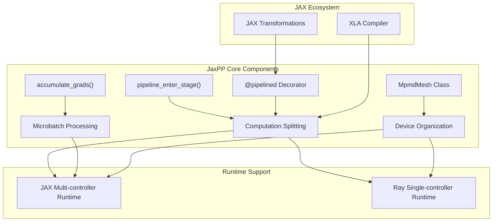
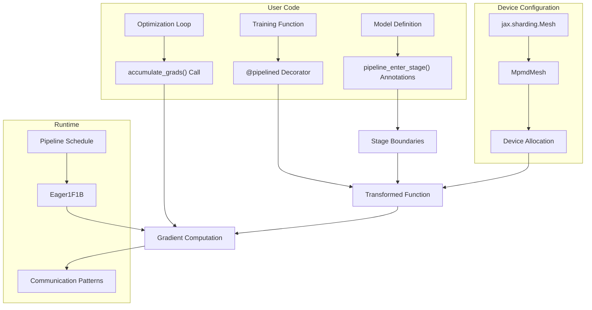
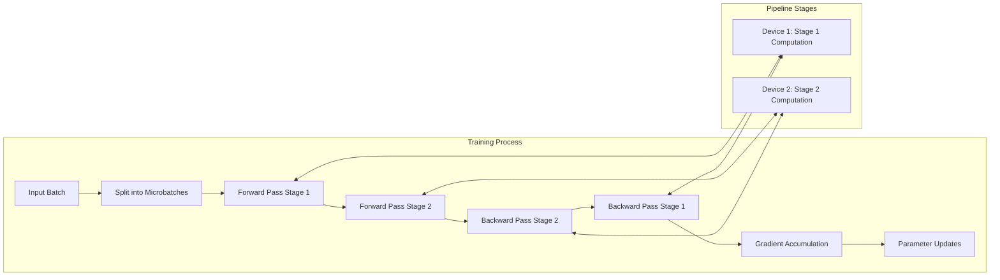
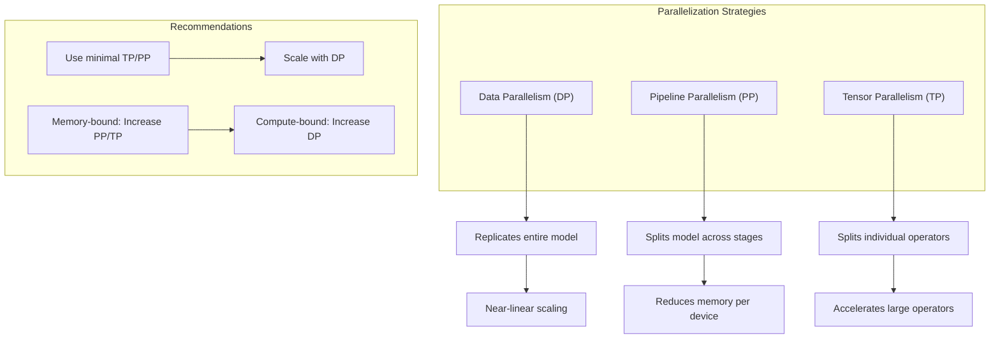

<!-- source: DeepWiki mcp.deepwiki.com · repo NVIDIA/jaxpp · page 1 Overview · fetched 2026-10-26 -->

# Overview

<details>
<summary>Relevant source files</summary>

The following files were used as context for generating this wiki page:

- [README.md](README.md)

</details>


JaxPP is a specialized JAX library that enables Multiple-Program Multiple-Data (MPMD) pipeline parallelism for training large language models (LLMs). It provides simple yet powerful tools to split JAX computations across multiple devices with minimal code changes, allowing efficient scaling of deep learning workloads that would otherwise be memory-constrained on single devices.

For specifics on the Pipeline Parallelism API implementation, see [Pipeline Parallelism API](#2.1). For details on gradient accumulation techniques, see [Gradient Accumulation](#2.3).

## Architecture and Key Components

JaxPP bridges the gap between JAX's powerful transformation system and the hardware-specific needs of large model training through a small set of core components.

### JaxPP Architecture



Sources: [README.md:1-12]()

### Component Roles and Relationships



Sources: [README.md:42-110]()

## Core Functionality

JaxPP enables pipeline parallelism through three primary mechanisms:

1. **Stage Annotations**: The `pipeline_enter_stage()` function marks boundaries between pipeline stages in model code.
2. **Function Transformation**: The `@pipelined` decorator transforms regular JAX functions to operate in a pipelined fashion.
3. **Gradient Accumulation**: The `accumulate_grads()` function enables efficient processing of microbatches.

### Data Flow in Pipeline Parallelism



Sources: [README.md:74-99]()

## Usage Pattern

Using JaxPP involves a few specific patterns:

1. **Model Modification**: Add `pipeline_enter_stage()` calls at appropriate points in your model to define stage boundaries.
2. **Mesh Configuration**: Create a `MpmdMesh` to define your device topology.
3. **Training Function Decoration**: Apply the `@pipelined` decorator to your training step function.
4. **Gradient Accumulation**: Use `accumulate_grads()` to process microbatches efficiently.

### Typical Code Structure

| Component | Purpose | Example Location |
|-----------|---------|-----------------|
| Model Annotation | Mark pipeline stage boundaries | [README.md:45-72]() |
| MpmdMesh Creation | Configure device topology | [README.md:107-110]() |
| Pipelined Decoration | Transform training function | [README.md:83-84]() |
| Gradient Accumulation | Process microbatches | [README.md:90-95]() |

Sources: [README.md:42-110]()

## Parallelization Strategies

JaxPP supports multiple parallelization strategies that can be combined effectively:



Sources: [README.md:176-177]()

## Runtime Support

JaxPP supports two runtime environments:

1. **JAX Multi-controller Runtime**: The default runtime where each device has its own controller.
2. **Ray Single-controller Runtime**: An experimental runtime built with Ray that uses a single controller.

## Current Status and Limitations

JaxPP is under active development with unstable APIs that may change. Key points to note:

- The library requires JAX 0.5.1, CUDA 12, and cuDNN 9
- It has been tested with several models from MaxText
- For multi-node setups, JaxPP must be installed on all participating nodes

## Installation and Testing

Basic installation requires cloning the repository and installing with pip:

```
git clone https://github.com/NVIDIA/jaxpp.git
cd jaxpp
pip install -e .
```

The repository also provides Docker containers for development and testing.

Sources: [README.md:24-32](), [README.md:115-164]()

## Example and Benchmarks

JaxPP includes basic examples that demonstrate its functionality, and it has been integrated into a fork of MaxText with minimal changes for benchmarking. The example in the README demonstrates how to use JaxPP with a Flax module and how to set up the training loop with gradient accumulation.

Sources: [README.md:40-113](), [README.md:176-177]()

---

