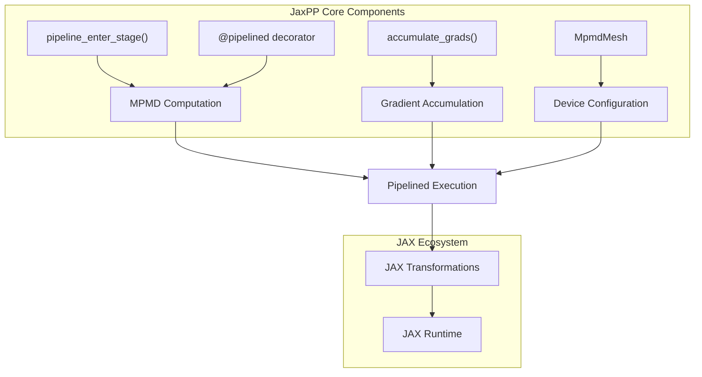
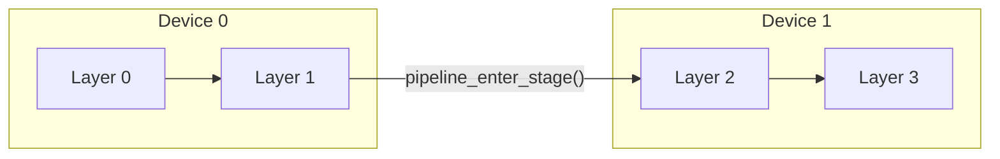
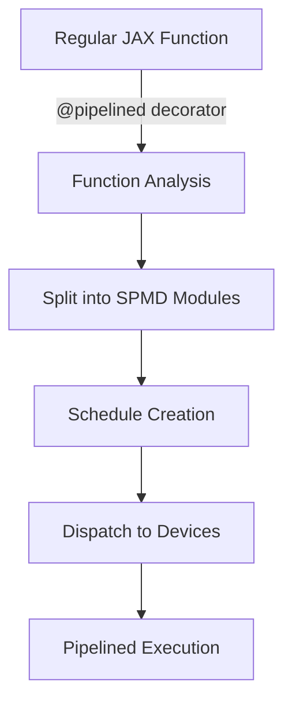
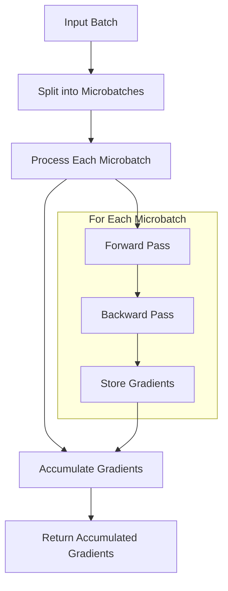
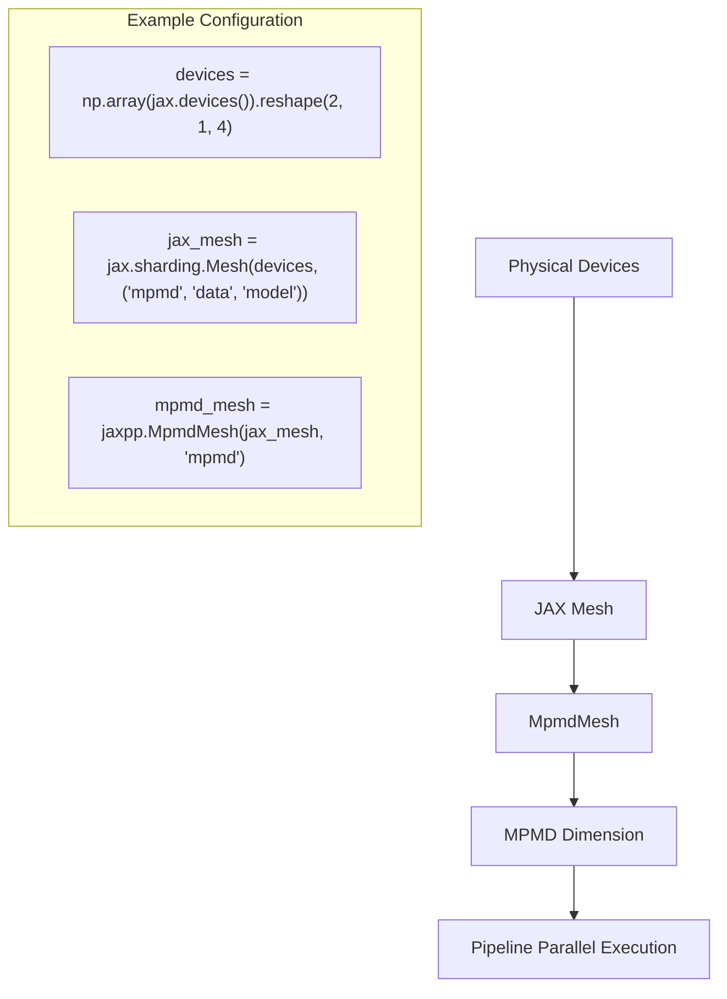
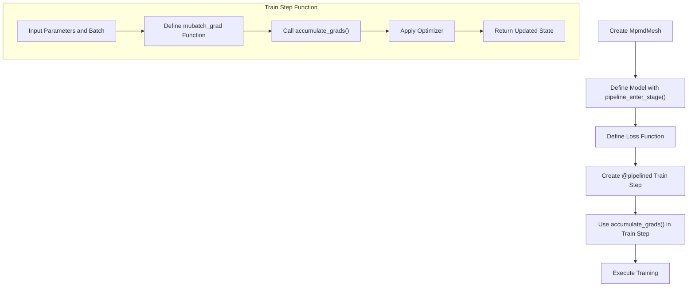
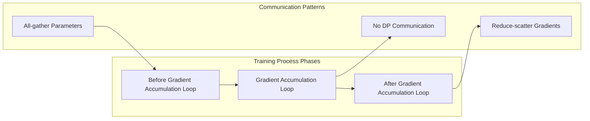
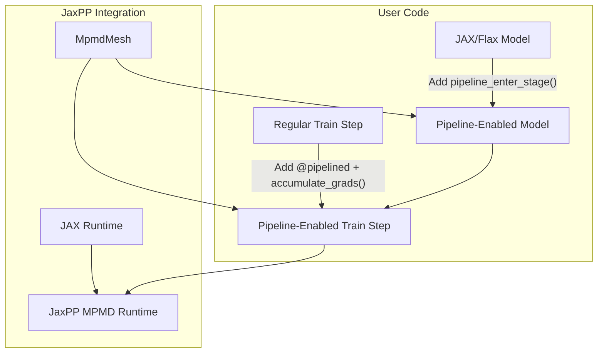

<!-- source: DeepWiki mcp.deepwiki.com · repo NVIDIA/jaxpp · page 2 Core Functionality · fetched 2026-10-26 -->

# Core Functionality

Relevant source files

The following files were used as context for generating this wiki page:

- [PERF_GUIDE.md](PERF_GUIDE.md)
- [README.md](README.md)

This page describes the main components and features of JaxPP that enable pipeline parallelism for JAX computations. JaxPP provides a set of tools to split JAX computations across multiple devices with minimal code changes, allowing efficient scaling of deep learning training workloads. For information about performance optimization strategies, see [Performance Optimization](#3).

## Overview of Core Components

JaxPP's core functionality revolves around four key components that work together to enable pipeline parallelism:

1. **`pipeline_enter_stage()`** - A function to mark boundaries between pipeline stages in model code
2. **`@pipelined` decorator** - Transforms functions to execute in a pipelined fashion across devices
3. **`accumulate_grads()`** - Manages gradient accumulation for pipeline-parallel training
4. **`MpmdMesh`** - Configures device meshes for Multiple-Program Multiple-Data (MPMD) execution

These components provide a seamless way to implement pipeline parallelism with minimal modifications to existing JAX code.

Sources: [README.md:3-8]()

## JaxPP Architecture

The following diagram illustrates the relationship between JaxPP's core components and how they interact with JAX:

Sources: [README.md:3-8](), [README.md:41-113]()

## Pipeline Stage Management

JaxPP uses the `pipeline_enter_stage()` function to mark boundaries between pipeline stages in model code. This allows the library to automatically split computations across devices.

### How Pipeline Stages Work

In a pipelined model, the computation is divided into multiple stages that can run on different devices. The `pipeline_enter_stage()` function signals transitions between these stages:

The code pattern typically involves inserting `pipeline_enter_stage()` calls at appropriate points in the model's forward pass, as shown in the example from README.md:

Sources: [README.md:44-72]()

## Pipelined Function Transformation

The `@pipelined` decorator transforms a function to execute in a pipelined fashion across multiple devices. This decorator takes a `mpmd_mesh` parameter that specifies the device configuration for pipeline parallelism.

### Function Transformation Flow

When a function is decorated with `@pipelined`, JaxPP:
1. Analyzes the function to identify pipeline stage boundaries
2. Splits the computation into multiple SPMD modules
3. Creates a pipeline schedule for executing these modules
4. Dispatches the modules to different devices according to the schedule

Sources: [README.md:83-99]()

## Gradient Accumulation

The `accumulate_grads()` function is a key component for training with pipeline parallelism. It manages the process of computing and accumulating gradients across multiple microbatches.

### Gradient Accumulation Process

The `accumulate_grads()` function takes several parameters:
- A gradient function to apply to each microbatch
- The input batch to be split into microbatches
- Output shardings for controlling how results are distributed
- A schedule that defines the pipeline execution pattern

Sources: [README.md:90-95](), [PERF_GUIDE.md:44-62]()

## Device Mesh Configuration

The `MpmdMesh` class configures device meshes for Multiple-Program Multiple-Data (MPMD) execution. It wraps a standard JAX `Mesh` object and specifies which dimension corresponds to the MPMD execution.

### Device Mesh Structure

The `MpmdMesh` configuration defines how the pipeline stages are mapped to physical devices. In the example, the mesh is configured with dimensions for MPMD (pipeline parallelism), data parallelism, and model parallelism.

Sources: [README.md:102-111]()

## End-to-End Training Workflow

The following diagram illustrates how all the core components work together in a typical training workflow with JaxPP:

This workflow demonstrates how the different components of JaxPP are combined to implement pipeline-parallel training. The `@pipelined` decorator transforms the train step function, which uses `accumulate_grads()` to compute gradients across microbatches.

Sources: [README.md:41-99]()

## Three Phases of Pipeline-Parallel Training

JaxPP's pipeline parallelism implementation divides the training process into three distinct phases, each with different communication patterns:

1. **Before Gradient Accumulation Loop**: Parameters are all-gathered across data-parallel ranks
2. **Gradient Accumulation Loop**: No data-parallel communication occurs during this phase
3. **After Gradient Accumulation Loop**: Gradients are reduce-scattered across data-parallel ranks

This organization optimizes the communication patterns to maximize training efficiency.

Sources: [PERF_GUIDE.md:27-70]()

## Integration with JAX Ecosystem

JaxPP is designed to integrate seamlessly with the JAX ecosystem, requiring minimal changes to existing JAX code:

This integration pattern allows users to adopt pipeline parallelism with minimal code changes, while maintaining compatibility with existing JAX code.

Sources: [README.md:41-113]()

## Summary of Core Components

| Component | Purpose | Key Features |
|-----------|---------|--------------|
| `pipeline_enter_stage()` | Mark stage boundaries | Signals transitions between pipeline stages |
| `@pipelined` | Transform functions | Enables pipelined execution across devices |
| `accumulate_grads()` | Manage gradient accumulation | Processes microbatches according to schedule |
| `MpmdMesh` | Configure device mesh | Specifies MPMD dimension for pipeline parallelism |

These core components provide a comprehensive framework for implementing pipeline parallelism in JAX, enabling efficient training of large language models across multiple devices.

Sources: [README.md:3-8](), [README.md:41-113]()

---

