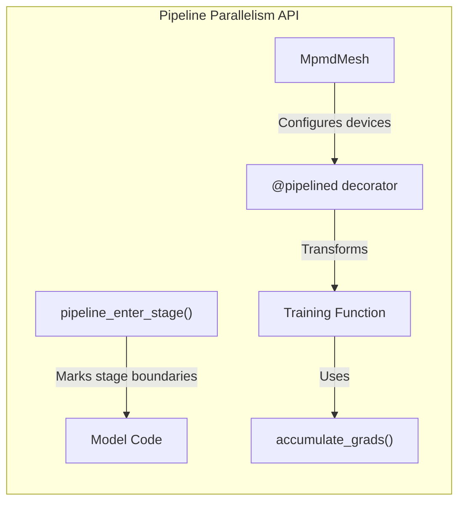
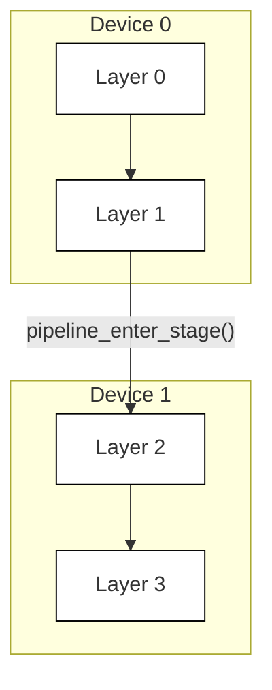
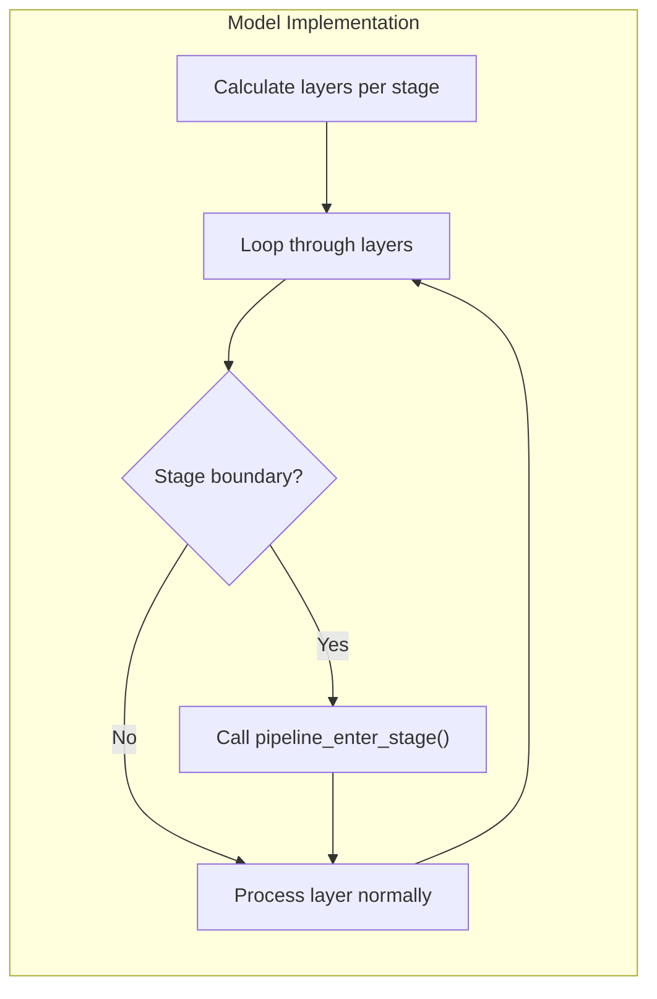
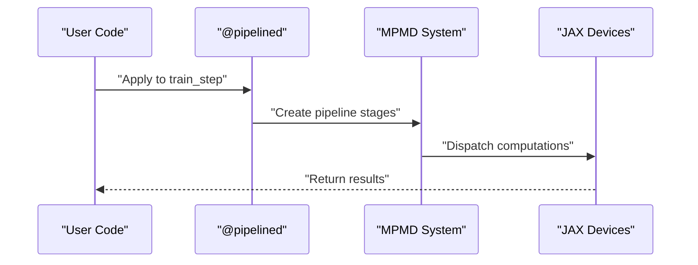
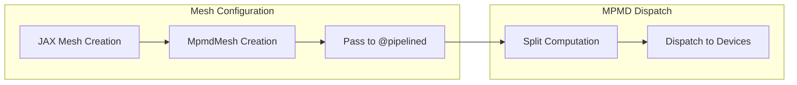
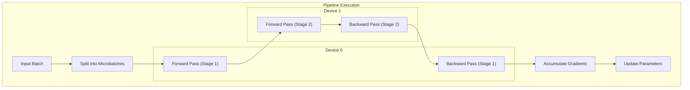
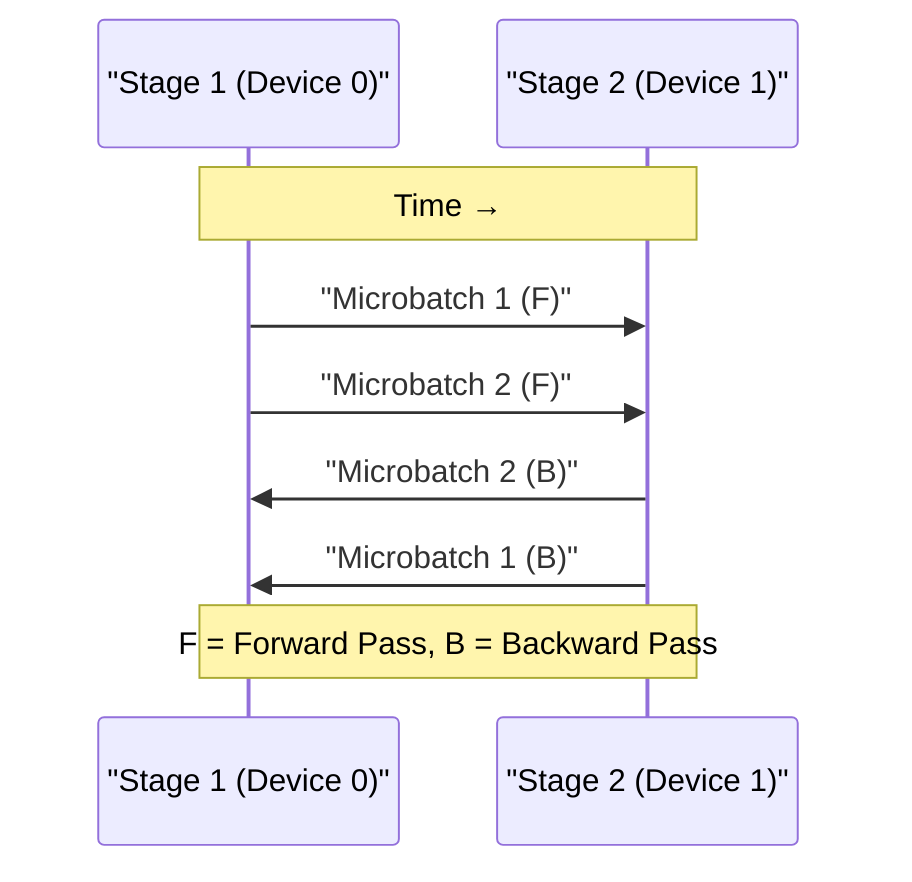
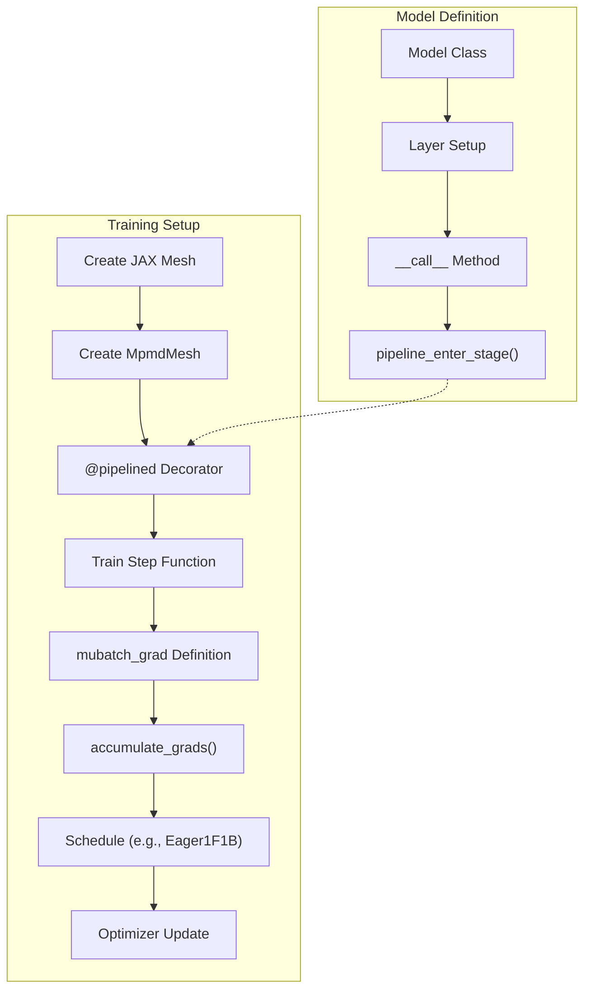

<!-- source: DeepWiki mcp.deepwiki.com · repo NVIDIA/jaxpp · page 2.1 Pipeline Parallelism API · fetched 2026-10-26 -->

# Pipeline Parallelism API

Relevant source files

The following files were used as context for generating this wiki page:

- [README.md](README.md)

## Purpose and Scope

This document details the Pipeline Parallelism API components in JaxPP, focusing on the `pipeline_enter_stage` function and the `@pipelined` decorator. These are the primary user-facing APIs that enable model-parallel training across multiple devices with minimal code changes. For information about configuring device meshes, see [MPMD Mesh Configuration](#2.2), and for details on gradient accumulation with pipeline parallelism, see [Gradient Accumulation](#2.3).

## Overview of Pipeline Parallelism

Pipeline parallelism is a distributed training technique that partitions a neural network model into sequential stages and assigns each stage to a different device. JaxPP implements this technique using two main components:

1. `pipeline_enter_stage()` - A function that marks transitions between pipeline stages in model code
2. `@pipelined` - A decorator that transforms functions to execute in a pipelined fashion across devices

Sources: [README.md:3-5]()

## Pipeline Stage Annotation

### The `pipeline_enter_stage` Function

The `pipeline_enter_stage()` function is used to mark the boundary between different pipeline stages in your model. It serves as an annotation that tells JaxPP where to split the computation across devices.

### Usage Pattern

When defining a model, you typically:

1. Determine how many pipeline stages you need (based on the number of devices)
2. Calculate how many layers should be assigned to each stage
3. Insert `pipeline_enter_stage()` calls at the appropriate boundaries

Here's the typical usage pattern from the README example:

Sources: [README.md:58-71]()

## The Pipelined Decorator

### The `@pipelined` Decorator

The `@pipelined` decorator transforms a function to execute in a pipelined fashion across multiple devices. It works with an `MpmdMesh` object that defines the device configuration for pipeline parallelism.

When applied to a function (typically a training step function), the decorator:

1. Analyzes the function body to identify pipeline stages (marked with `pipeline_enter_stage()`)
2. Splits the computation into separate SPMD modules
3. Handles the necessary cross-device communication
4. Dispatches the modules to appropriate devices

Sources: [README.md:80-84]()

### Integration with MpmdMesh

The `@pipelined` decorator requires an `mpmd_mesh` parameter, which is an instance of `MpmdMesh`. This object specifies which dimension of a JAX mesh represents the pipeline parallelism axis.

Sources: [README.md:102-111]()

## Pipeline Execution Flow

Pipeline parallelism in JaxPP typically involves processing data in micro-batches that flow through the pipeline stages. This is often combined with gradient accumulation to maintain optimization effectiveness.

Sources: [README.md:85-99]()

### Pipeline Schedules

JaxPP supports different pipeline schedules to determine how micro-batches flow through the pipeline. The example in the README demonstrates the `Eager1F1B` (1 Forward 1 Backward) schedule with 2 pipeline stages.

Sources: [README.md:94-95]()

## Complete Example Structure

Below is a diagram showing how all components interact in a typical JaxPP pipeline parallelism implementation:

Sources: [README.md:45-111]()

## Usage Example

The following table illustrates the key components and their roles in implementing pipeline parallelism with JaxPP:

| Component | Purpose | Typical Location |
|-----------|---------|------------------|
| `pipeline_enter_stage()` | Marks transitions between pipeline stages | Inside model's forward pass |
| `@pipelined` | Transforms a function for pipelined execution | Applied to training step function |
| `MpmdMesh` | Configures devices for pipeline parallelism | Training setup code |
| `accumulate_grads()` | Manages gradient computation across microbatches | Inside pipelined function |

### Code Integration Pattern

A typical implementation follows this pattern:

1. Define a model that uses `pipeline_enter_stage()` to mark stage boundaries
2. Create a `MpmdMesh` object to configure device assignment
3. Define a training step function and decorate it with `@pipelined`
4. Inside this function, use `accumulate_grads()` with a chosen pipeline schedule
5. Apply optimizer updates as usual

Sources: [README.md:45-111]()

## Technical Implementation Details

The Pipeline Parallelism API works by:

1. Identifying computational boundaries marked with `pipeline_enter_stage()`
2. Splitting the JAX computation graph at these boundaries
3. Converting the split parts into independent SPMD modules
4. Scheduling the execution of these modules across devices according to the specified pipeline schedule
5. Managing the communication of intermediate results between pipeline stages
6. Accumulating gradients across multiple micro-batches

The API integrates with JAX's existing transformation and compilation systems while enabling a programming model that feels similar to single-device JAX code.

Sources: [README.md:7-8]()

---

