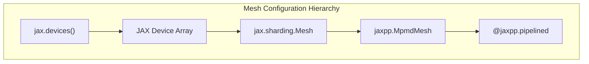
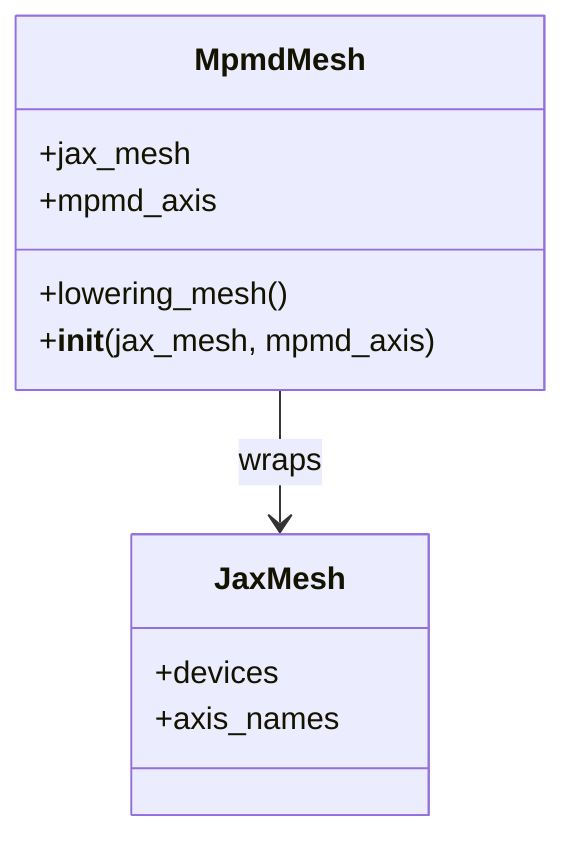
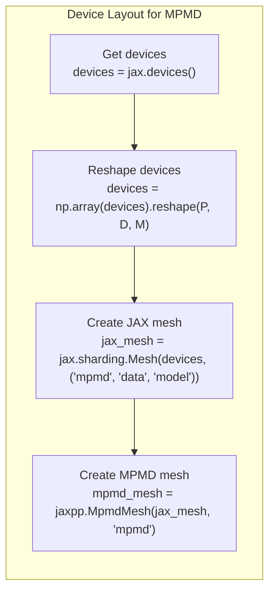
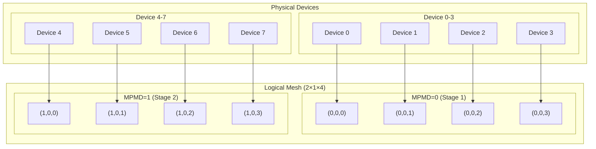
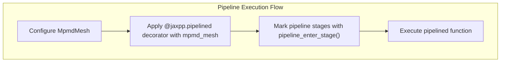
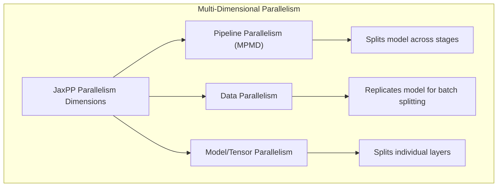
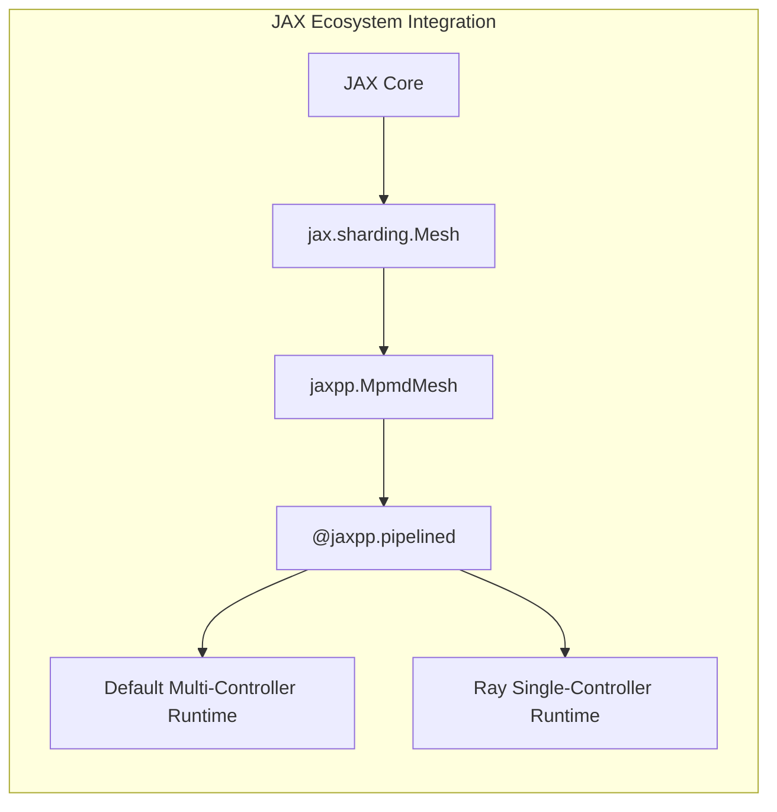

<!-- source: DeepWiki mcp.deepwiki.com · repo NVIDIA/jaxpp · page 2.2 MPMD Mesh Configuration · fetched 2026-10-26 -->

# MPMD Mesh Configuration

<details>
<summary>Relevant source files</summary>

The following files were used as context for generating this wiki page:

- [README.md](README.md)

</details>


## Purpose and Scope

This document explains how to configure device meshes for pipeline parallelism in JaxPP. Understanding MPMD mesh configuration is essential for effectively distributing JAX computations across multiple devices using the Multiple-Program Multiple-Data (MPMD) approach. For information about using the pipeline parallelism API, see [Pipeline Parallelism API](#2.1). For gradient accumulation details, see [Gradient Accumulation](#2.3).

## Introduction to MPMD Meshes

MPMD (Multiple-Program Multiple-Data) is a parallel computing paradigm where different programs operate on different data. In JaxPP, this allows different stages of a neural network to run on different devices. The `MpmdMesh` class in JaxPP configures these device allocations by wrapping JAX's standard `Mesh` object and specifying which dimension is used for pipeline parallelism.



Sources: [README.md:106-110]()

## The MpmdMesh Class

The `MpmdMesh` class is a wrapper around JAX's standard `Mesh` class that specifically designates which dimension is used for MPMD pipeline parallelism.

### Key Features:

- Wraps a standard JAX mesh
- Designates the MPMD dimension used for pipeline parallelism
- Provides methods to retrieve the underlying mesh structure for lowering computations



Sources: [README.md:106-110]()

## Configuring an MPMD Mesh

Creating an MPMD mesh involves three main steps:
1. Obtaining JAX devices
2. Creating a JAX mesh with appropriate dimensions
3. Wrapping it with the `MpmdMesh` class

### Device Layout

The device layout defines how physical devices are arranged into logical dimensions. For pipeline parallelism, one dimension (typically named "mpmd") is used to separate pipeline stages.



Where:
- `P`: Number of pipeline stages (mpmd dimension)
- `D`: Data parallelism dimension
- `M`: Model/tensor parallelism dimension

Sources: [README.md:106-110]()

### Example Configuration

Here's an example of how to create an MPMD mesh with 2 pipeline stages, 1 data parallel dimension, and 4 model parallel devices:

```
devices = np.array(jax.devices()[0]).reshape(2, 1, 4)
jax_mesh = jax.sharding.Mesh(devices, ("mpmd", "data", "model"))
mpmd_mesh = jaxpp.MpmdMesh(jax_mesh, "mpmd")
```

The resulting mesh will have the dimensions: `OrderedDict([('mpmd', 1), ('data', 1), ('model', 1)])` for each lowering stage, as the mpmd dimension is handled separately in the pipeline parallelism implementation.

Sources: [README.md:106-110]()

## Device Mapping Visualization

The following diagram illustrates how a model is mapped to devices when using MPMD mesh configuration:



Sources: [README.md:106-110]()

## Using MpmdMesh with Pipelined Functions

To use the configured MPMD mesh with pipeline parallelism, pass it to the `@jaxpp.pipelined` decorator:



### Application Example

```
# Configure MPMD mesh
devices = np.array(jax.devices()[0]).reshape(2, 1, 4)
jax_mesh = jax.sharding.Mesh(devices, ("mpmd", "data", "model"))
mpmd_mesh = jaxpp.MpmdMesh(jax_mesh, "mpmd")

# Apply to pipelined function
@partial(jaxpp.pipelined, mpmd_mesh=mpmd_mesh)
def pp_train_step(opt_state, pars, batch):
    # Function implementation
    ...
```

Sources: [README.md:83-99](), [README.md:106-110]()

## Multi-Dimensional Mesh Configuration

JaxPP's MPMD mesh supports multiple parallelism dimensions simultaneously, allowing for efficient scaling:



### Example of 3D Mesh (2×2×4)

This configuration enables:
- 2 pipeline stages
- 2× data parallelism
- 4× model/tensor parallelism

This requires 16 devices total (2×2×4) and allows for training much larger models than would fit on a single device.

Sources: [README.md:106-110]()

## Mesh Dimension Considerations

When designing your MPMD mesh configuration, consider:

| Dimension | Purpose | Impact on Training |
|-----------|---------|-------------------|
| MPMD (Pipeline) | Divides model into sequential stages | Reduces memory per device, introduces pipeline bubbles |
| Data Parallel | Replicates model for batch processing | Near-linear scaling, increases memory requirements |
| Model/Tensor Parallel | Divides individual layers | Reduces memory usage, increases communication |

The general guidance is to use minimal MPMD/PP and TP dimensions (just enough to fit your model in memory), then scale the DP dimension for throughput.

## MPMD Mesh Integration with JAX Ecosystem



Sources: [README.md:10-11]()

## Conclusion

MPMD mesh configuration is a critical part of setting up pipeline parallelism in JaxPP. By properly configuring the device mesh and specifying the MPMD dimension, you can effectively distribute your model across multiple devices for efficient training of large language models.

For information on how to use the configured mesh with the pipeline parallelism API, see [Pipeline Parallelism API](#2.1). For details on gradient accumulation with pipeline parallelism, see [Gradient Accumulation](#2.3).

---

