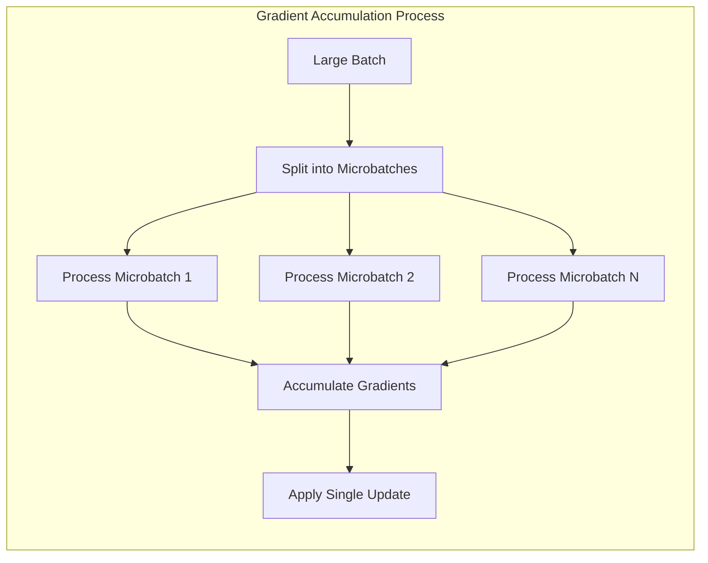
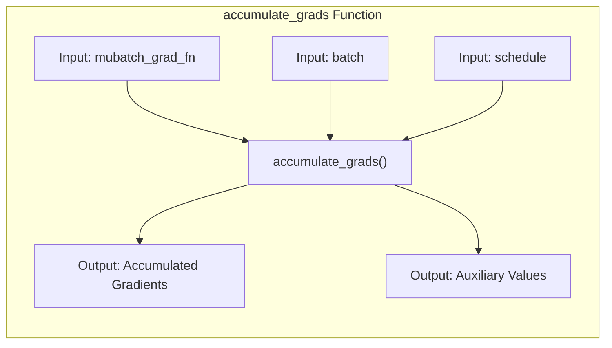
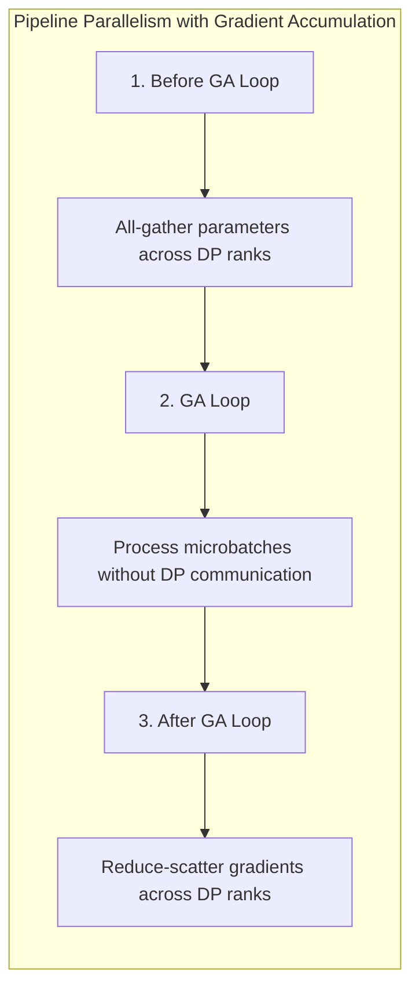
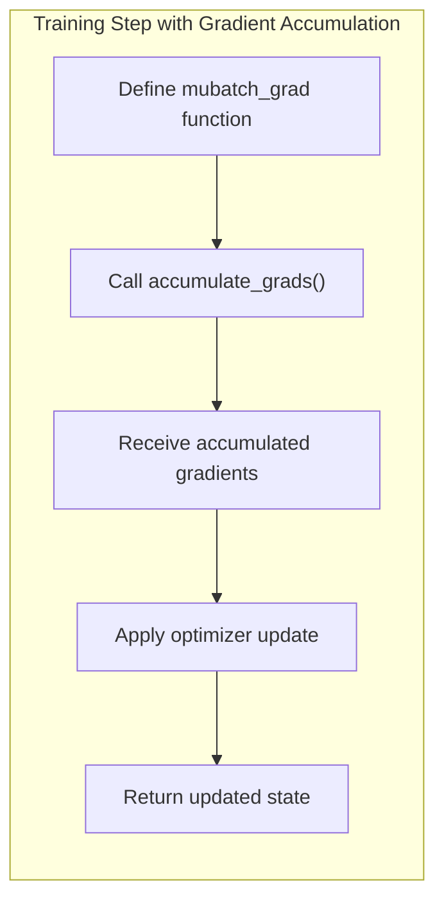
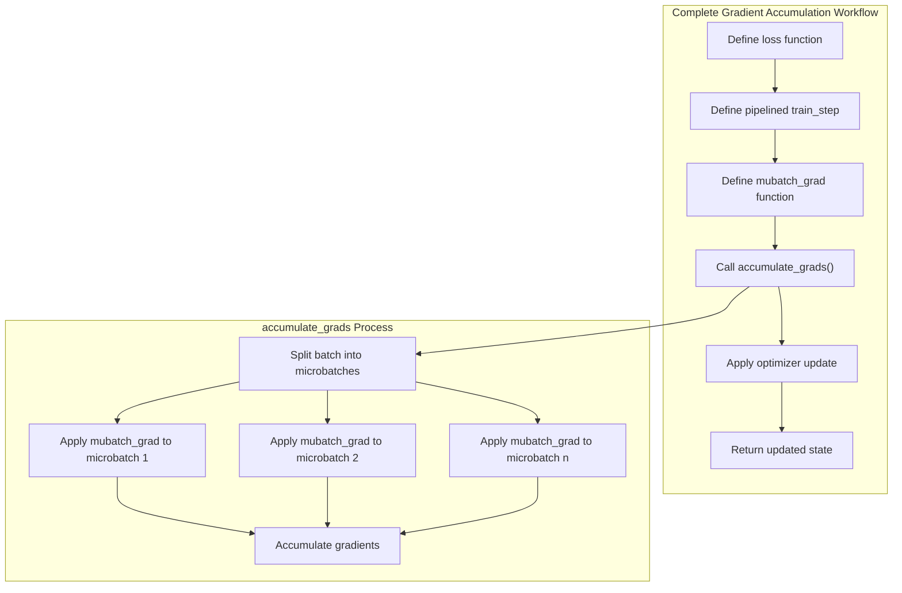

<!-- source: DeepWiki mcp.deepwiki.com · repo NVIDIA/jaxpp · page 2.3 Gradient Accumulation · fetched 2026-10-26 -->

# Gradient Accumulation

<details>
<summary>Relevant source files</summary>

The following files were used as context for generating this wiki page:

- [PERF_GUIDE.md](PERF_GUIDE.md)
- [README.md](README.md)

</details>


## Purpose and Scope

This document describes the Gradient Accumulation functionality in JaxPP, a key component for efficient training of large language models. Gradient Accumulation (GA) allows for processing larger batches by breaking them into smaller microbatches, accumulating gradients across these microbatches, and then updating model parameters once. This technique is crucial for memory optimization in LLM training, especially when used with pipeline parallelism.

For information about Pipeline Parallelism API, see [Pipeline Parallelism API](#2.1).
For information about general Performance Optimization, see [Performance Optimization](#3).

## Core Concept

Gradient Accumulation is a technique that enables training with effectively larger batch sizes by:

1. Breaking a large batch into smaller microbatches
2. Computing gradients for each microbatch independently
3. Accumulating these gradients
4. Applying the accumulated gradients to update model parameters once

This approach allows training models that would otherwise not fit in GPU memory if processing the entire batch at once.



Sources: [PERF_GUIDE.md:44-53](), [README.md:85-95]()

## The `accumulate_grads()` Function

The `accumulate_grads()` function is the primary API for gradient accumulation in JaxPP. It takes a gradient computation function and applies it to microbatches, accumulating the results.

### Function Signature and Parameters

```
jaxpp.accumulate_grads(
    mubatch_grad_fn,
    batch,
    out_shardings=None,
    schedule=jaxpp.Eager1F1B(n)
)
```

- `mubatch_grad_fn`: A function that computes gradients for a single microbatch
- `batch`: The input data batch to be split into microbatches
- `out_shardings`: Optional specifications for output sharding
- `schedule`: Pipeline schedule to use (e.g., Eager1F1B)

### Return Value

The function returns the accumulated gradients and any auxiliary outputs from the microbatch gradient function.



Sources: [README.md:90-95]()

## Memory Optimization Through Gradient Accumulation

Gradient Accumulation significantly reduces memory requirements during training by:

1. Processing smaller microbatches that require less activation memory
2. Avoiding storing all activations for the entire batch at once
3. Enabling effective use of pipeline parallelism with manageable memory footprint

### Memory Comparison

| Approach | Activation Memory Requirements | Benefits | Trade-offs |
|----------|-------------------------------|----------|------------|
| Full Batch | Proportional to batch size | Single forward/backward pass | High memory consumption |
| Gradient Accumulation | Proportional to microbatch size | Lower memory requirements | More computation steps |

Sources: [PERF_GUIDE.md:48-52]()

## Integration with Pipeline Parallelism

Gradient Accumulation is a crucial part of the three-phase computation approach used in pipeline parallelism with JaxPP:



### The Three Phases

1. **Before GA Loop**: Parameters are cast to bf16 and all-gathered across DP ranks
2. **GA Loop**: Microbatches are processed without DP communication
3. **After GA Loop**: Gradients are reduced-scattered across DP ranks for synchronization

Sources: [PERF_GUIDE.md:27-71]()

## Usage in Training Step

Gradient Accumulation is typically used within a pipelined training step, as shown in this pattern:



A typical implementation pattern involves:

1. Defining a function to compute gradients for a single microbatch
2. Passing this function to `accumulate_grads()`
3. Applying the accumulated gradients with an optimizer

Sources: [README.md:83-99]()

## Performance Considerations

For optimal performance with Gradient Accumulation:

1. **Balance GA Iterations**: Reduce GA (loop iterations) to a minimum, even if it may increase pipeline bubbles
2. **Scheduling Optimization**: Use efficient schedules like Eager1F1B to minimize pipeline bubbles
3. **Memory vs. Computation**: Consider using rematerialization to trade more computation for less memory usage
4. **Activation Management**: Consider offloading activations of older microbatches to reduce memory pressure

Sources: [PERF_GUIDE.md:54-61]()

## Complete Example Usage

In this example, we see the typical pattern for using Gradient Accumulation in a JaxPP training step:



The function `accumulate_grads()` handles splitting the batch, processing each microbatch, and accumulating the gradients, which significantly simplifies the implementation of pipeline parallelism with gradient accumulation.

Sources: [README.md:76-99]()

## Relationship with Other Parallelism Strategies

Gradient Accumulation complements other parallelism strategies in JaxPP:

| Strategy | Interaction with Gradient Accumulation |
|----------|----------------------------------------|
| Data Parallelism (DP) | GA loop operates without DP communication, improving efficiency |
| Pipeline Parallelism (PP) | GA enables efficient pipeline schedules across devices |
| Tensor Parallelism (TP) | GA helps reduce memory requirements, making TP more manageable |

The recommendation is to make TP and PP as small as possible (just enough to fit the model with activations in memory), then scale DP for near-linear throughput improvements.

Sources: [PERF_GUIDE.md:10-15](), [PERF_GUIDE.md:44-53]()

## Summary

Gradient Accumulation in JaxPP is a powerful technique that enables training larger models with limited memory resources. By processing smaller microbatches and accumulating gradients, it reduces memory requirements and integrates seamlessly with pipeline parallelism. The `accumulate_grads()` function provides a clean API for implementing this technique in your training code.

---

