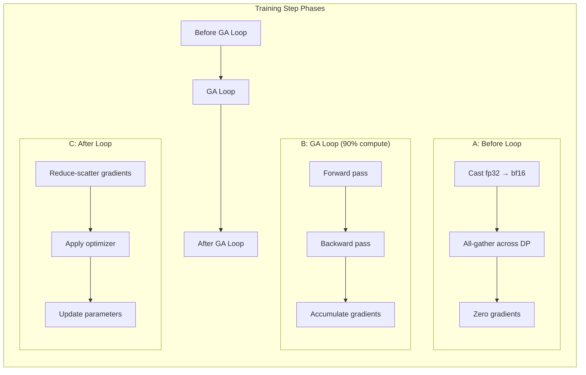
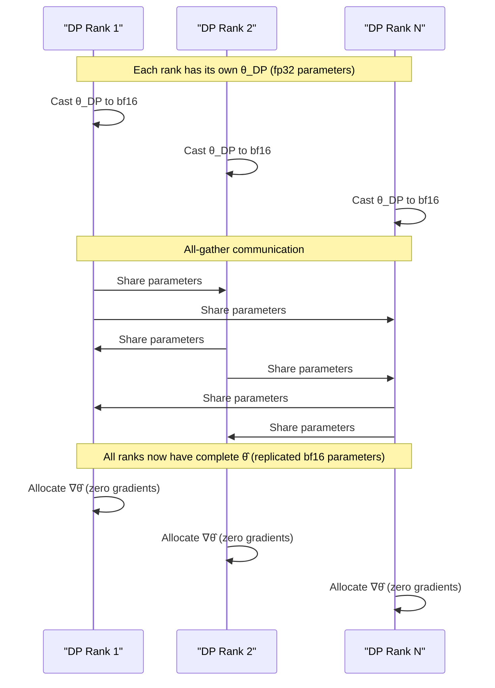
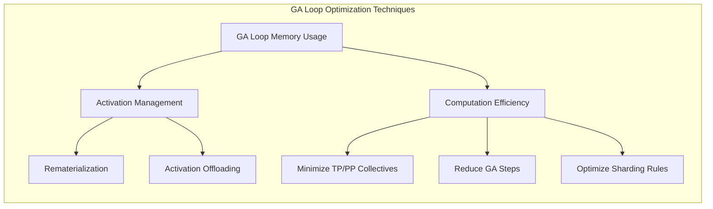
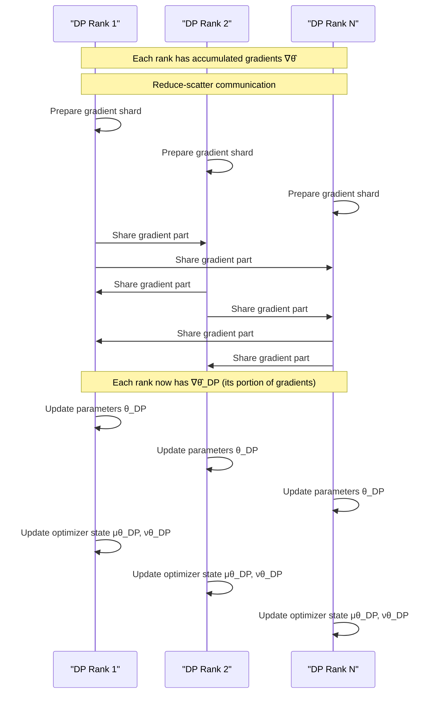
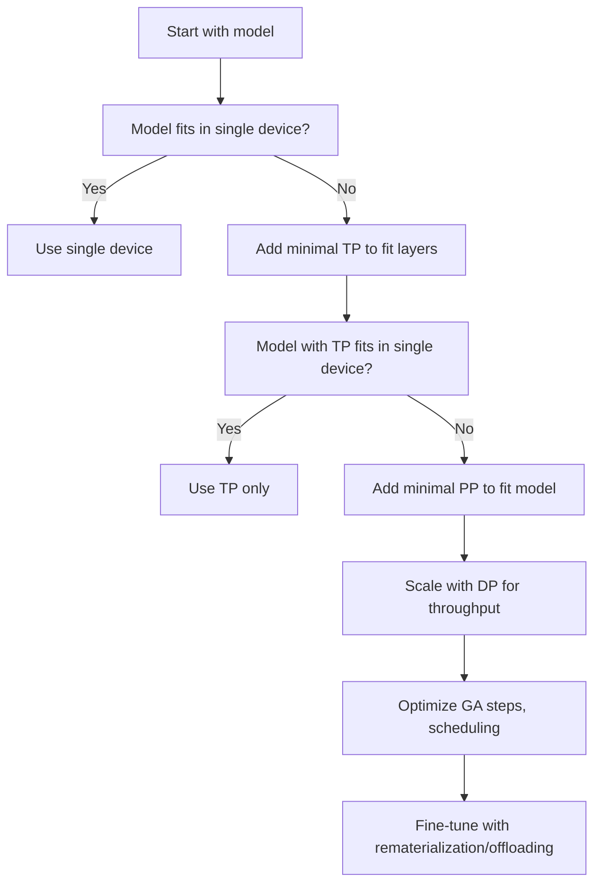
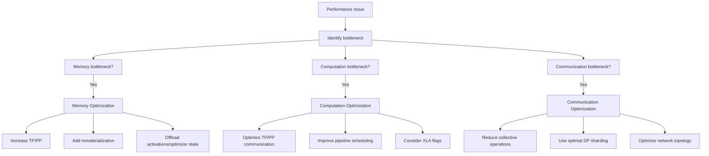

<!-- source: DeepWiki mcp.deepwiki.com · repo NVIDIA/jaxpp · page 3 Performance Optimization · fetched 2026-10-26 -->

# Performance Optimization

Relevant source files

The following files were used as context for generating this wiki page:

- [PERF_GUIDE.md](PERF_GUIDE.md)

This page provides an overview of performance optimization strategies for training Large Language Models (LLMs) using JaxPP. It focuses on how to efficiently scale model training across multiple devices while maximizing throughput and minimizing memory usage. For specific implementation details of parallelization techniques, see [Parallelization Strategies](#3.1). For memory-specific optimizations, see [Memory Management](#3.2).

## Optimization Philosophy

The primary goal of JaxPP's performance optimization is to maximize training throughput (tokens/second) while efficiently utilizing available hardware. The recommended approach follows a key principle:

> Make Tensor Parallelism (TP) and Pipeline Parallelism (PP) as small as possible—just enough to fit the model with activations in memory—then scale Data Parallelism (DP) for near-linear throughput improvements.

Sources: [PERF_GUIDE.md:10-15]()

## Training Step Decomposition

When using pipeline parallelism, a training step can be decomposed into three distinct phases, each with different performance characteristics and optimization strategies.

Sources: [PERF_GUIDE.md:18-71]()

### Before Gradient Accumulation Loop

In this phase:

1. "Master" (fp32) model parameters are cast to bf16
2. All-gather operation is performed across data-parallel ranks
3. Initial zero gradients are allocated for accumulation

Sources: [PERF_GUIDE.md:29-42]()

### Gradient Accumulation Loop

This is the most computation-heavy phase (approximately 90% of total computation). Key characteristics:

- No DP communication occurs
- Memory is primarily needed for microbatch activations
- Each iteration processes a microbatch of size: batch_size / gradient_accumulation_steps

Optimization techniques in this phase include:
- Pipeline scheduling (e.g., Zero Bubble)
- Activation rematerialization (trading computation for memory)
- Activation offloading for older microbatches

Sources: [PERF_GUIDE.md:44-62]()

### After Gradient Accumulation Loop

In this final phase:

1. DP-ranks perform reduce-scatter of their gradients to synchronize them
2. Each rank updates its portion of the model parameters
3. Optimizer state is updated

Sources: [PERF_GUIDE.md:63-71]()

## Memory-Performance Tradeoffs

Training LLMs involves several memory-performance tradeoffs that can be adjusted based on your specific hardware and model requirements.

| Technique | Memory Impact | Performance Impact | When to Use |
|-----------|---------------|-------------------|-------------|
| Gradient Accumulation | ↓ Memory usage by processing smaller microbatches | ↑ Training step time due to more loop iterations | When batch size is too large to fit in memory |
| Rematerialization | ↓ Memory usage by discarding and recomputing activations | ↑ Computation cost | When activations are a memory bottleneck |
| Precision Reduction | ↓ Memory usage by using lower precision (e.g., bf16) | Minimal impact if hardware supports it | Almost always beneficial on modern hardware |
| Activation Offloading | ↓ Memory usage by offloading older microbatch activations | ↑ I/O overhead | When compute/memory ratio is high |
| Optimizer State Offloading | ↓ Memory usage | ↑ I/O overhead | When using small DP with large optimizer state |

Sources: [PERF_GUIDE.md:22-25](), [PERF_GUIDE.md:48-55]()

## Scaling Strategy Recommendations

### Practical Guidelines

1. **Minimize PP depth**: Keep pipeline stages to a minimum to reduce pipeline bubbles
2. **Reduce GA steps**: Minimize gradient accumulation iterations to reduce overhead, potentially at the cost of a higher bubble which can be recovered with better schedules
3. **Optimize communication**: In the GA loop, optimize TP/EP/CP/SP sharding rules to minimize collective operations
4. **Balance rematerialization**: Trade memory for computation by rematerializing activations when needed
5. **Consider memory hierarchy**: For models with small DP, consider offloading optimizer state to free up memory

Sources: [PERF_GUIDE.md:9-16](), [PERF_GUIDE.md:54-62]()

## Performance Debugging

When encountering performance issues, consider the following diagnostic approach:

## Additional Resources

For more detailed information on performance optimization:

- Jax's scaling book on parallelization strategies: [Link to JAX scaling book](https://jax-ml.github.io/scaling-book/training/)
- The Ultra-Scale Playbook for additional explanations and visualizations
- For B200 and other XLA flags, refer to [NVIDIA JAX-Toolbox documentation](https://github.com/NVIDIA/JAX-Toolbox/blob/main/rosetta/docs/GPU_performance.md#tips-for-good-llm-training-performance-on-blackwell-b200)

Sources: [PERF_GUIDE.md:3-7]()

---

