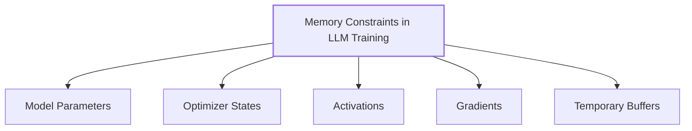
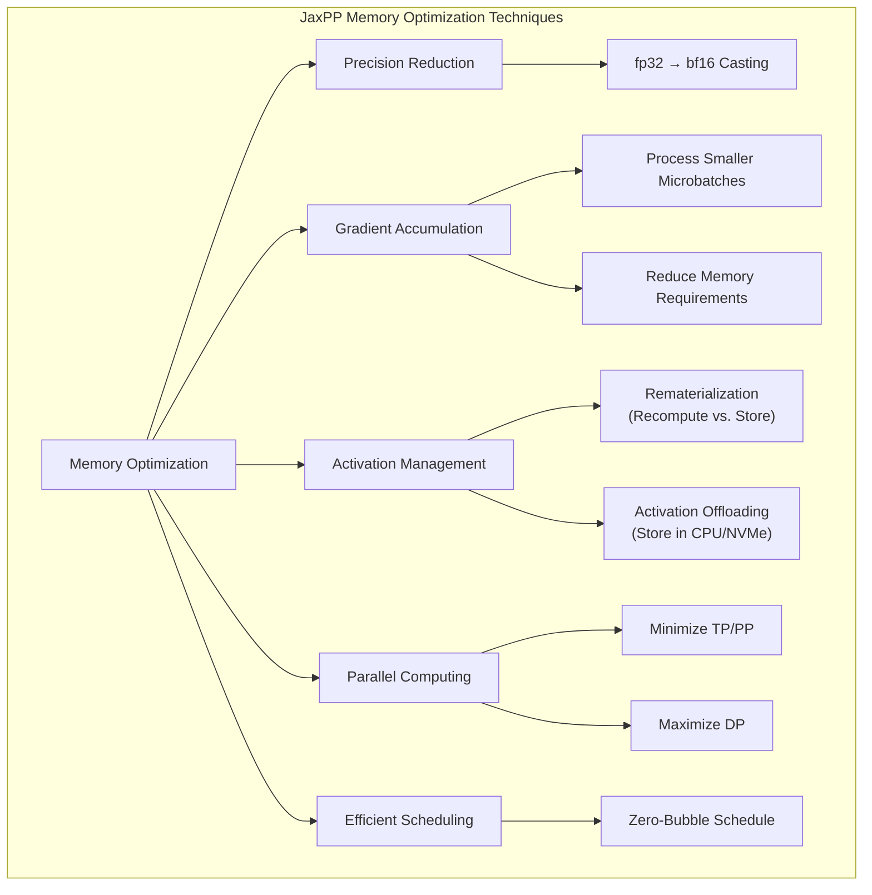
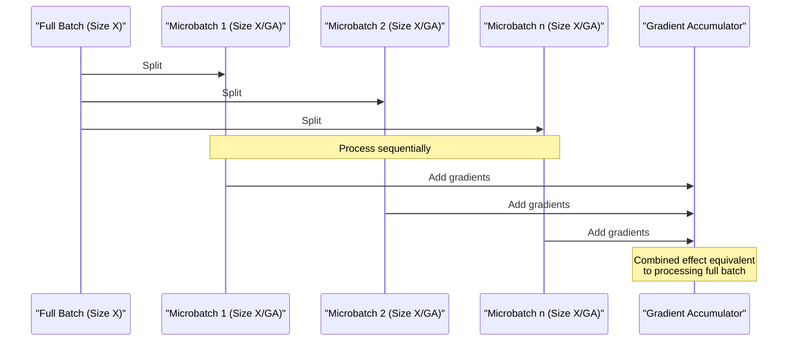
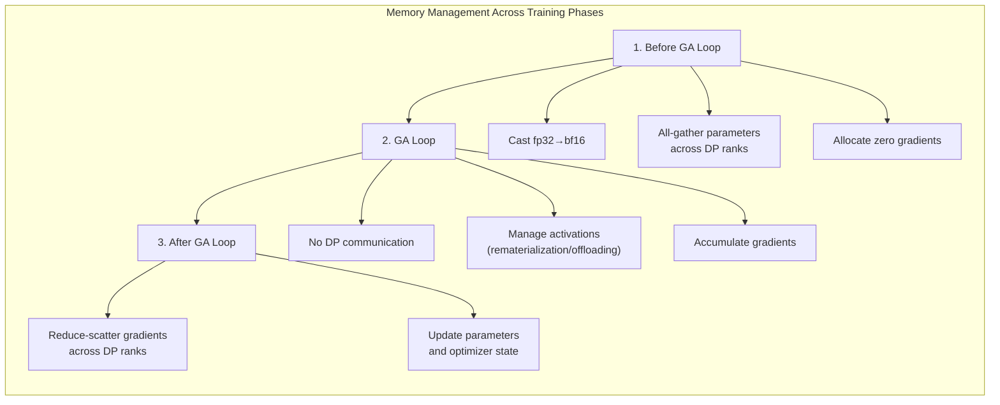
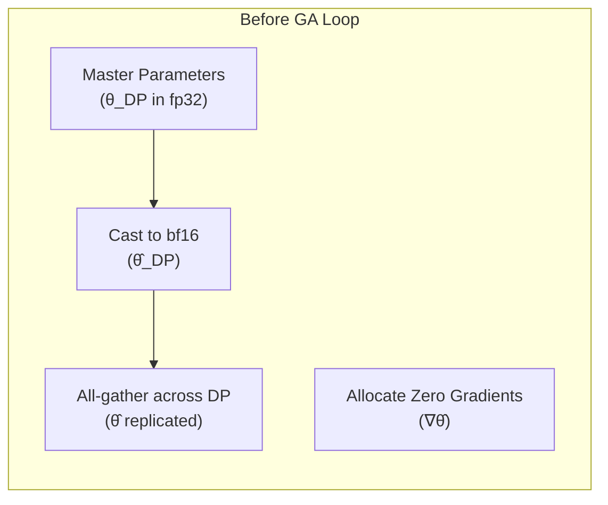
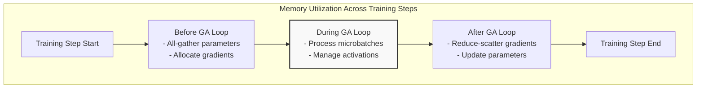
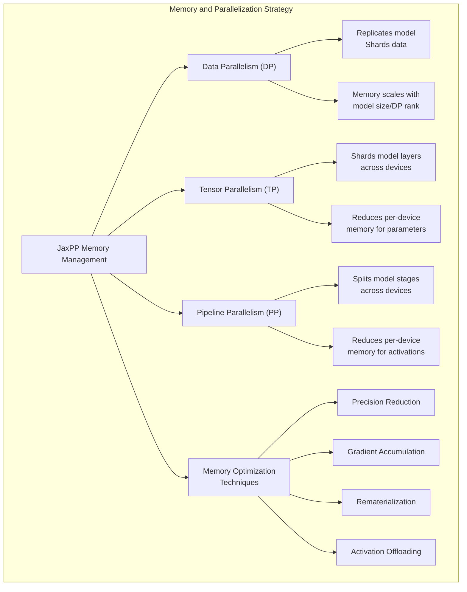

<!-- source: DeepWiki mcp.deepwiki.com · repo NVIDIA/jaxpp · page 3.2 Memory Management · fetched 2026-10-26 -->

# Memory Management

Relevant source files

The following files were used as context for generating this wiki page:

- [PERF_GUIDE.md](PERF_GUIDE.md)

This page details the memory optimization techniques and strategies used in JaxPP for efficient Large Language Model (LLM) training. It focuses on how to manage GPU memory consumption, which is a critical bottleneck when training large models. For information about parallelization strategies that affect memory usage, see [Parallelization Strategies](#3.1).

## Memory Challenges in LLM Training

LLM training faces several memory constraints that must be carefully managed:

Sources: [PERF_GUIDE.md:19-26]()

## Memory Components Breakdown

Understanding the memory footprint of different components is essential for effective optimization:

| Component | Description | Scale | Optimization Techniques |
|-----------|-------------|-------|-------------------------|
| Model Parameters (θ) | Weights of the neural network | Scales with model size | Precision reduction, parameter sharding |
| Optimizer States (μθ, νθ) | First and second moments in optimizers like Adam | 2x model size for Adam | Optimizer state offloading, sharding |
| Activations | Intermediate outputs between layers | Scales with batch size and model depth | Rematerialization, activation offloading |
| Gradients | Derivatives used for parameter updates | Same size as model parameters | Gradient accumulation, precision reduction |

Sources: [PERF_GUIDE.md:19-26](), [PERF_GUIDE.md:48-52]()

## Key Memory Optimization Techniques

JaxPP implements several techniques to optimize memory usage during training:

Sources: [PERF_GUIDE.md:10-15](), [PERF_GUIDE.md:33-35](), [PERF_GUIDE.md:48-62]()

### Precision Reduction

Converting from higher precision (fp32) to lower precision (bf16) significantly reduces memory footprint:

- Model parameters are typically stored in fp32 ("master weights")
- During training, parameters are cast to bf16 before computation
- This reduces memory requirements by approximately 50%
- Maintains training stability while conserving memory

Sources: [PERF_GUIDE.md:33-35]()

### Gradient Accumulation

Gradient Accumulation (GA) divides a large batch into smaller microbatches that are processed sequentially:

Benefits:
- Reduces peak memory usage by processing smaller chunks
- Enables training larger models without sacrificing batch size
- Memory requirements scale with microbatch size rather than full batch size

Sources: [PERF_GUIDE.md:44-50]()

### Activation Management

#### Rematerialization

Rematerialization trades computation for memory by recomputing activations during backpropagation rather than storing them:

- Forward pass activations are discarded after use
- During backward pass, activations are recomputed when needed
- Reduces memory footprint at the cost of additional computation
- Configurable to balance memory savings vs. computational overhead

#### Activation Offloading

Moves activations to slower but more abundant memory when not immediately needed:

- Stores activations in CPU memory or NVMe storage
- Transfers back to GPU when required for backward pass
- Enables handling larger models with limited GPU memory
- Particularly useful for older microbatches in the pipeline

Sources: [PERF_GUIDE.md:51-54]()

## Memory Management During Training Phases

JaxPP's training process is divided into three phases, each with specific memory management strategies:

Sources: [PERF_GUIDE.md:27-71]()

### Before Gradient Accumulation Loop

Memory operations:
- Cast full-precision (fp32) parameters to lower precision (bf16)
- Perform all-gather operation across data-parallel ranks
- Allocate memory for gradient accumulation

Sources: [PERF_GUIDE.md:29-42]()

### During Gradient Accumulation Loop

This phase is the most memory-intensive and computation-heavy part of training:

- Processes microbatches sequentially
- No communication between DP ranks (lower communication overhead)
- Primary memory consumption is from activations
- Applies rematerialization and offloading strategies to manage memory
- Gradients are accumulated into the pre-allocated buffer

Sources: [PERF_GUIDE.md:44-62]()

### After Gradient Accumulation Loop

Final phase that synchronizes and applies the accumulated gradients:

- Performs reduce-scatter operation for gradients across DP ranks
- Each DP rank receives a portion of the final gradients
- Updates parameters and optimizer states
- Optimizer state offloading can be applied here if needed

Sources: [PERF_GUIDE.md:63-71]()

## Memory Optimization Guidelines

To maximize memory efficiency when training large models with JaxPP:

1. **Minimize TP and PP requirements**: Use just enough for model+activations to fit in memory
   - Smaller PP reduces pipeline bubbles and improves efficiency
   - Excessive TP increases communication overhead

2. **Scale DP** for near-linear throughput improvements
   - DP scales almost perfectly with more GPUs

3. **Balance memory vs. computation**:
   - More rematerialization reduces memory at the cost of computation
   - Consider hardware capabilities when setting this tradeoff

4. **Optimize GA settings**:
   - Reduce GA (loop iterations) to minimize computation overhead
   - May increase pipeline bubbles, which can be mitigated with better scheduling

5. **Consider memory efficiency in scheduling**:
   - Zero-Bubble (ZB) scheduling can improve efficiency

Sources: [PERF_GUIDE.md:9-15](), [PERF_GUIDE.md:54-62]()

## Memory Consumption Visualization

Memory peaks during the GA loop due to activation storage, which is why activation management techniques (rematerialization and offloading) are critical for enabling training of larger models.

Sources: [PERF_GUIDE.md:48-52]()

## Relationship Between Memory Management and Parallelization

The memory management approach in JaxPP is tightly integrated with its parallelization strategy:

1. Use minimal TP/PP to fit the model and activations in memory
2. Scale DP to increase throughput
3. Apply memory optimization techniques throughout the training process

Sources: [PERF_GUIDE.md:10-15]()

## Conclusion

Effective memory management is crucial for training large language models. JaxPP provides various techniques to optimize memory usage, including precision reduction, gradient accumulation, rematerialization, and activation offloading. By carefully applying these techniques and balancing them with parallelization strategies, it's possible to train larger models more efficiently on limited hardware resources.

---

