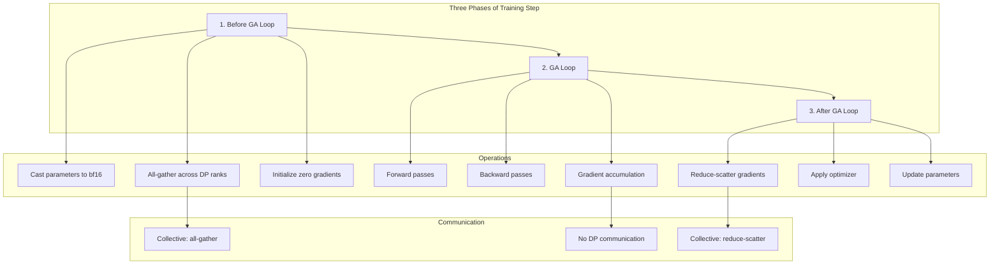
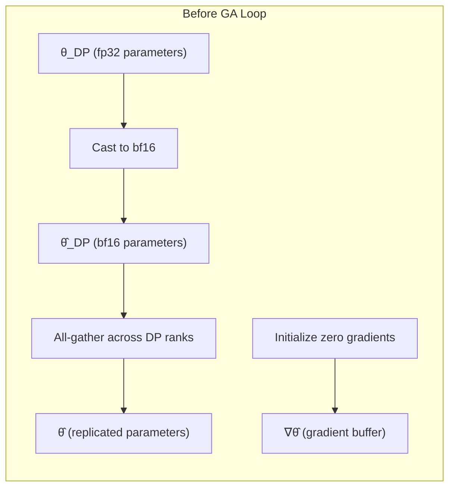
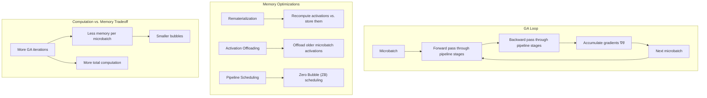
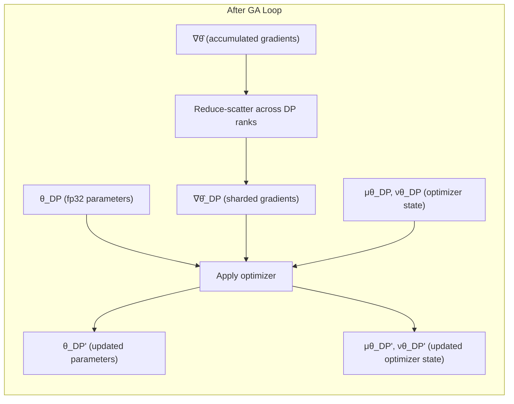
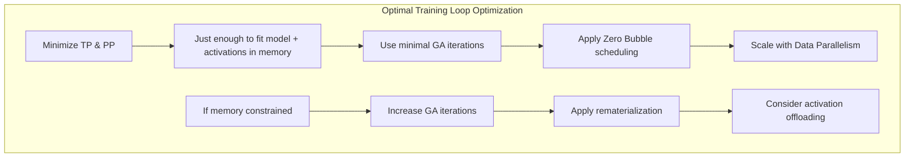

<!-- source: DeepWiki mcp.deepwiki.com · repo NVIDIA/jaxpp · page 3.3 Training Loop Optimization · fetched 2026-10-26 -->

# Training Loop Optimization

Relevant source files

The following files were used as context for generating this wiki page:

- [PERF_GUIDE.md](PERF_GUIDE.md)

This page explains how JaxPP optimizes the training loop during pipeline-parallel training of large language models. It focuses on the three distinct phases of computation that occur during a training step and the optimization techniques applicable to each phase. For information about pipeline parallelism configuration, see [Pipeline Parallelism API](#2.1), and for general memory management techniques, see [Memory Management](#3.2).

## Training Loop Structure

When using pipeline parallelism in JaxPP, the training step is decomposed into three distinct phases, each with different memory requirements, communication patterns, and optimization opportunities.

Sources: [PERF_GUIDE.md:27-71]()

## Phase 1: Before Gradient Accumulation Loop

The first phase prepares the model parameters for the gradient accumulation loop and initializes the gradient accumulation buffer.

### Operations and Memory Flow

In this phase:
1. The "master" model parameters (θ_DP) in fp32 precision are cast to bf16 precision (θ̂_DP)
2. These bf16 parameters are then all-gathered across data-parallel ranks to produce replicated parameters (θ̂)
3. A gradient buffer (∇θ̂) is initialized with zeros to accumulate gradients during the GA loop

The all-gather operation is a significant communication cost but happens only once per training step.

Sources: [PERF_GUIDE.md:29-42]()

## Phase 2: Gradient Accumulation Loop

The gradient accumulation loop is the most computation-intensive phase, accounting for approximately 90% of the computation in a training step.

### Loop Structure and Optimizations

Key characteristics of this phase:
1. No data-parallel communication occurs during this loop
2. Memory requirements include the replicated parameters and activations for processing microbatches
3. Activations often consume a large portion of memory
4. The number of GA iterations directly affects memory usage (fewer iterations = larger microbatches = more memory)

Optimization techniques:
1. **Rematerialization**: Trading computation for memory by recomputing activations instead of storing them
2. **Activation Offloading**: Moving older microbatch activations to host memory or other storage
3. **Pipeline Scheduling**: Using optimal schedules like Zero Bubble (ZB) to minimize pipeline bubbles
4. **Sharding Rules**: Optimizing tensor/expert/custom/sequence parallelism to minimize collectives

Sources: [PERF_GUIDE.md:44-62]()

## Phase 3: After Gradient Accumulation Loop

The final phase synchronizes the accumulated gradients across data-parallel ranks and updates the model parameters.

### Operations and Parameter Update

In this phase:
1. Each data-parallel rank has accumulated identical gradients (∇θ̂)
2. A reduce-scatter operation combines and distributes these gradients, so each rank gets its portion (∇θ̂_DP)
3. The optimizer (e.g., Adam) uses these gradients along with its state (μθ_DP, νθ_DP) to update the parameters
4. The result is updated parameters (θ_DP') and optimizer state (μθ_DP', νθ_DP')

The reduce-scatter operation is more memory-efficient than an all-reduce because each rank only needs its portion of the gradients to update its portion of the parameters.

Sources: [PERF_GUIDE.md:63-71]()

## Optimization Strategies and Recommendations

Here are key strategies for optimizing the training loop in JaxPP:

| Strategy | Description | Trade-offs |
|----------|-------------|------------|
| Minimize GA iterations | Reduce the number of loop iterations to minimize computation | Requires more memory per microbatch |
| Rematerialization | Recompute activations instead of storing them | Increases computation but reduces memory |
| Activation offloading | Move older microbatch activations to host memory | Adds I/O overhead but reduces GPU memory usage |
| Zero Bubble scheduling | Optimize pipeline scheduling to minimize bubbles | May require more complex implementation |
| Optimize TP/PP size | Keep tensor and pipeline parallelism as small as possible | Must be large enough to fit model in memory |
| Scale DP | Increase data parallelism for near-linear throughput scaling | Requires efficient collective operations |

### Memory vs. Performance Balance

The key principle in JaxPP training loop optimization is to:
1. Make TP and PP as small as possible, just enough to fit the model with activations in memory
2. Keep PP small to avoid long pipelines with more bubbles
3. Reduce GA to a minimum, possibly trading for a higher bubble that can be recovered with better scheduling
4. Scale with DP for near-linear throughput improvement

Sources: [PERF_GUIDE.md:9-15](), [PERF_GUIDE.md:54-62]()

## Implementation in JaxPP

The training loop optimization in JaxPP is primarily implemented through the `accumulate_grads()` function, which handles the three phases described above. This function is a key part of the pipeline parallelism API and works in conjunction with the `@pipelined` decorator and `pipeline_enter_stage()` function.

For specific implementation details and usage examples, see [Gradient Accumulation](#2.3).

Sources: [PERF_GUIDE.md:17-25]()

---

