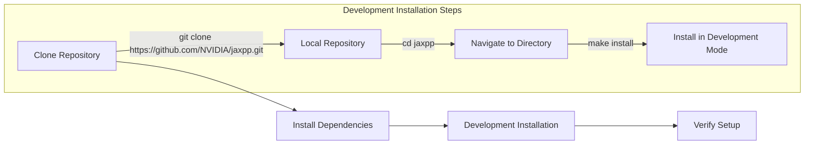
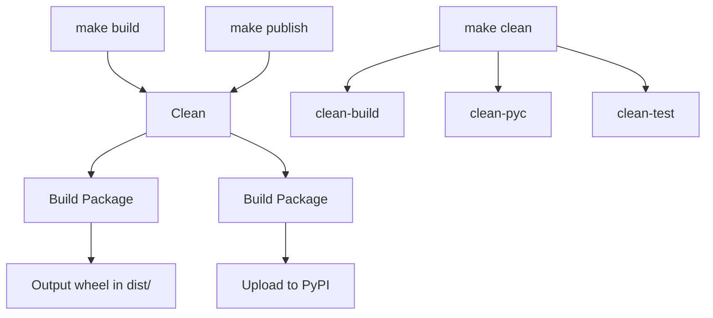
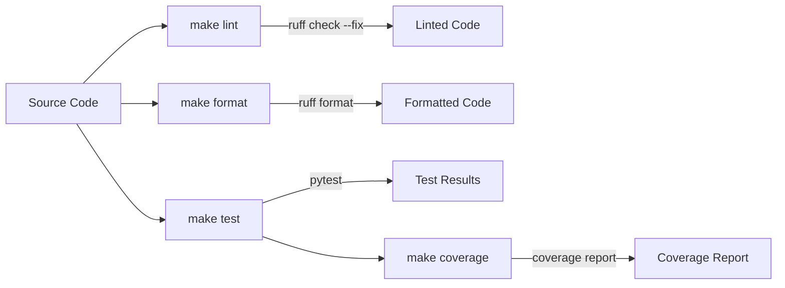
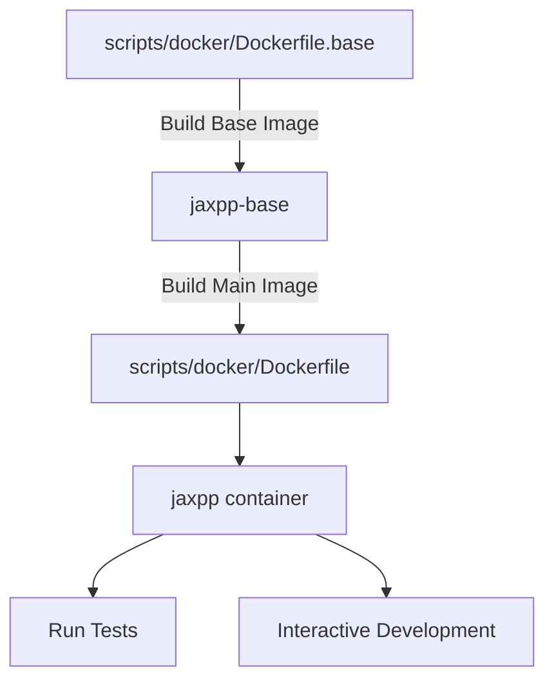
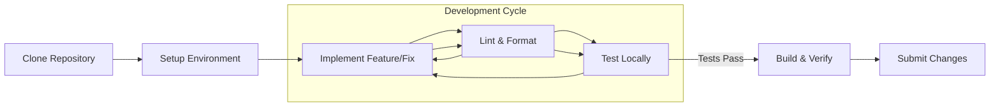
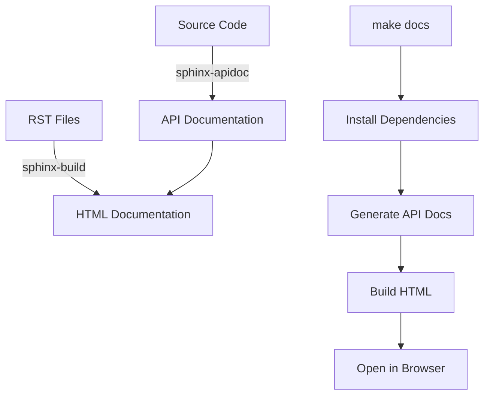

<!-- source: DeepWiki mcp.deepwiki.com · repo NVIDIA/jaxpp · page 4 Development Guide · fetched 2026-10-26 -->

# Development Guide

<details>
<summary>Relevant source files</summary>

The following files were used as context for generating this wiki page:

- [Makefile](Makefile)
- [README.md](README.md)

</details>


This guide provides comprehensive instructions for developers working with the JaxPP codebase. It covers environment setup, build processes, testing, Docker usage, and development workflows. For installation instructions for users, see [Overview](#1), and for contribution guidelines, see [Contributing to JaxPP](#6).

## Development Environment Setup

### Prerequisites

Before starting development with JaxPP, ensure you have the following prerequisites:

- Python 3.8 or higher
- CUDA 12 and cuDNN 9
- Git
- pip/pip3

### Local Development Setup



To set up a local development environment:

1. Clone the repository:
   ```bash
   git clone https://github.com/NVIDIA/jaxpp.git
   cd jaxpp
   ```

2. Install the package in development mode:
   ```bash
   make install
   ```

This command installs JaxPP with all development dependencies using `pip install -e ".[dev,test,docs]"`.

Sources: [Makefile:118-119](), [README.md:24-32]()

## Build System

JaxPP uses a Makefile-based build system to automate common development tasks.



### Build Commands

| Command | Description | Implementation |
|---------|-------------|----------------|
| `make build` | Builds source and wheel package | Cleans, upgrades wheel, builds using python3 -m build --wheel |
| `make publish` | Builds and uploads wheel to PyPI | Builds, installs twine, uploads using twine |
| `make clean` | Removes all build artifacts | Runs clean-build, clean-pyc, clean-test |
| `make clean-build` | Removes build artifacts | Removes build/, dist/, .eggs/ |
| `make clean-pyc` | Removes Python artifacts | Removes .pyc, .pyo, __pycache__ |
| `make clean-test` | Removes test artifacts | Removes .tox/, .coverage, htmlcov/ |

Sources: [Makefile:49-68](), [Makefile:105-112]()

## Testing and Linting

JaxPP uses pytest for testing and ruff for linting and formatting.



### Testing Commands

| Command | Description | Implementation |
|---------|-------------|----------------|
| `make test` | Runs tests using pytest | Executes pytest |
| `make test-all` | Runs tests on all Python versions | Executes tox |
| `make coverage` | Checks code coverage | Runs pytest with coverage and generates reports |

### Linting Commands

| Command | Description | Implementation |
|---------|-------------|----------------|
| `make lint` | Checks and fixes code style | Runs ruff check --fix |
| `make format` | Formats code | Runs ruff format |

Sources: [Makefile:79-84](), [Makefile:89-100]()

## Docker Development Environment

JaxPP provides Docker containers for isolated development and testing environments.



### Building Docker Images

The Docker build process consists of two stages:

1. Building the base image with core dependencies:
   ```bash
   docker build --force-rm=true \
     -f scripts/docker/Dockerfile.base \
     --build-arg CUDA_BASE_IMAGE=nvcr.io/nvidia/cuda:12.6.3-devel-ubuntu22.04 \
     -t jaxpp-base .
   ```

2. Building the main image using the base image:
   ```bash
   docker build --force-rm=true \
     -f scripts/docker/Dockerfile \
     --build-arg BASE_IMAGE=jaxpp-base \
     -t jaxpp .
   ```

### Running Tests in Docker

The Docker container can be used to run tests in an isolated environment:

1. Basic example test:
   ```bash
   docker run --gpus=all --shm-size=10.24gb --ulimit memlock=-1 --ulimit stack=67108864 \
     -e XLA_FLAGS='--xla_gpu_graph_level=0' --rm --workdir=/workdir/jaxpp jaxpp \
     "python /workdir/jaxpp/examples/basic.py --dtype=float32"
   ```

2. Full pytest suite:
   ```bash
   docker run --gpus=all --shm-size=10.24gb --ulimit memlock=-1 --ulimit stack=67108864 \
     -e XLA_PYTHON_CLIENT_ALLOCATOR=platform \
     --rm --workdir=/workdir/jaxpp jaxpp "nvidia-smi && make install && pytest"
   ```

Sources: [README.md:115-165]()

## Development Workflow

The typical development workflow for JaxPP follows these steps:



### Common Development Tasks

1. **Code formatting and linting**:
   Before committing any changes, ensure the code is properly formatted and linted:
   ```bash
   make format
   make lint
   ```

2. **Running tests**:
   Always run tests before submitting changes:
   ```bash
   make test
   ```

3. **Building the package**:
   To verify the build process works correctly:
   ```bash
   make build
   ```

Sources: [Makefile:16]()

## Documentation Development

JaxPP uses Sphinx for generating documentation.



### Documentation Commands

| Command | Description | Implementation |
|---------|-------------|----------------|
| `make docs` | Generates Sphinx HTML documentation | Installs dependencies, runs sphinx-apidoc and sphinx-build |
| `make clean-docs` | Cleans documentation files | Removes generated documentation |
| `make servedocs` | Compiles docs and watches for changes | Uses watchdog to monitor changes |

Building the documentation:

1. Clean any existing documentation:
   ```bash
   make clean-docs
   ```

2. Generate the documentation:
   ```bash
   make docs
   ```

This will generate HTML documentation and open it in your default browser.

Sources: [Makefile:70-73](), [Makefile:125-132]()

## Multi-node Development

JaxPP supports multi-node configurations for pipeline parallelism, which has specific setup requirements for development and testing.

### Multi-node Setup Requirements

1. Install JaxPP on all participating nodes
2. Ensure all necessary dependencies are installed on each node
3. Configure network settings for inter-node communication

For multi-node development:
- Each node should follow the same local development setup
- Tests should be run on all nodes to ensure compatibility
- Docker containers can be used to ensure consistent environments across nodes

Sources: [README.md:167-173]()

## Troubleshooting

When developing with JaxPP, you might encounter common issues. Here are some troubleshooting tips:

1. **Memory-related issues**: JaxPP operations can be memory-intensive. Ensure your GPU has sufficient memory, or try reducing batch sizes.

2. **CUDA versions mismatch**: JaxPP requires CUDA 12 and cuDNN 9. Ensure these are correctly installed and configured.

3. **Test failures**: If tests fail, check the specific error messages. Common issues include:
   - Device memory exhaustion
   - Version incompatibilities
   - Numerical precision issues

4. **Build errors**: If you encounter build errors, ensure all dependencies are correctly installed:
   ```bash
   make clean
   make install
   ```

---

