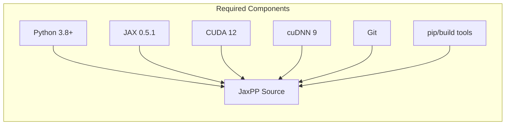
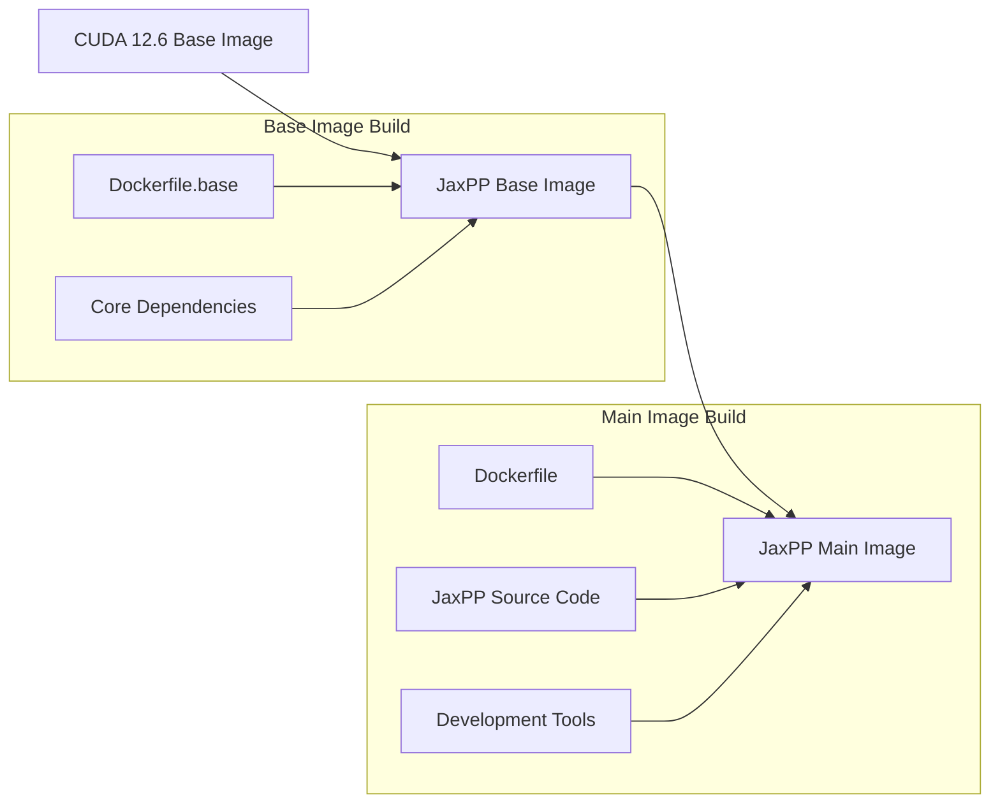

<!-- source: DeepWiki mcp.deepwiki.com · repo NVIDIA/jaxpp · page 4.1 Building from Source · fetched 2026-10-26 -->

# Building from Source

<details>
<summary>Relevant source files</summary>

The following files were used as context for generating this wiki page:

- [Makefile](Makefile)
- [README.md](README.md)

</details>


This document details the process of building and installing JaxPP from source code. For information about testing the library after installation, see [Testing and Linting](#4.2). For Docker-based development environments, see [Docker Environment](#4.3).

## Prerequisites

Before building JaxPP from source, ensure your system meets the following requirements:

- Python 3.8 or newer
- JAX 0.5.1
- CUDA 12 and cuDNN 9 (same as `jax[cuda_12]`'s default dependencies)
- Git
- pip and build tools



Sources: [README.md:26-27]()

## Getting the Source Code

Clone the JaxPP repository from GitHub:

```
git clone https://github.com/NVIDIA/jaxpp.git
cd jaxpp
```

Sources: [README.md:28-30]()

## Installation Options

JaxPP offers multiple installation approaches depending on your needs:

### Standard Installation

For a standard installation directly from the cloned repository:

```
pip install -e .
```

This command installs JaxPP in development mode, allowing you to modify the source code and have changes immediately available without reinstalling.

### Development Installation

For development, including documentation and testing tools:

```
make install
```

This command runs `pip install -e ".[dev,test,docs]"`, which installs JaxPP with all development, testing, and documentation dependencies.

Sources: [Makefile:118-119](), [README.md:29-31]()

## Building the Package

The JaxPP repository includes a comprehensive Makefile with various build targets:

### Building Distribution Packages

To build distribution packages (wheel):

```
make build
```

This command:
1. Cleans previous build artifacts
2. Upgrades the wheel package
3. Builds a wheel package using Python's build module
4. Lists the contents of the `dist` directory

Sources: [Makefile:105-108]()

## Build System Architecture

```mermaid
flowchart TD
    A["Source Code"] --> B["make clean"]
    B --> C["make build"]
    C --> D["Wheel Package (.whl)"]
    
    A --> E["make install"]
    E --> F["Installed Development Package"]
    
    subgraph "Build Commands"
        B
        C
        G["make clean-build"]
        H["make clean-pyc"]
        I["make clean-test"]
    end
    
    G --> B
    H --> B
    I --> B
```



Sources: [Makefile:49-108]()

### Publishing Packages

For package maintainers, JaxPP can be published to PyPI:

```
make publish
```

This command builds the package and uploads it to PyPI using twine.

Sources: [Makefile:110-112]()

## Clean Commands

JaxPP's Makefile includes several commands for cleaning build artifacts:

| Command | Description | Details |
|---------|-------------|---------|
| `make clean` | Remove all artifacts | Removes build, Python, and test artifacts |
| `make clean-build` | Remove build artifacts | Removes build/, dist/, .eggs/ directories |
| `make clean-pyc` | Remove Python artifacts | Removes .pyc, .pyo files and __pycache__ directories |
| `make clean-test` | Remove test artifacts | Removes test coverage reports and cache |
| `make clean-docs` | Remove documentation artifacts | Cleans generated documentation files |

Sources: [Makefile:49-73]()

## Documentation Building

To generate JaxPP's documentation:

```
make docs
```

This command:
1. Installs the package with documentation dependencies
2. Cleans previous documentation artifacts
3. Generates API docs using sphinx-apidoc
4. Builds HTML documentation
5. Opens the documentation in a browser

Sources: [Makefile:125-128]()

## Building with Docker

JaxPP provides Docker containers for development and testing. The build process consists of two stages:

1. **Building the base image** with core dependencies
2. **Building the main image** with JaxPP installed



### Building the Base Image

```
docker build --force-rm=true \
  -f scripts/docker/Dockerfile.base \
  --build-arg CUDA_BASE_IMAGE=nvcr.io/nvidia/cuda:12.6.3-devel-ubuntu22.04 \
  -t jaxpp-base .
```

### Building the Main Image

```
docker build --force-rm=true \
  -f scripts/docker/Dockerfile \
  --build-arg BASE_IMAGE=jaxpp-base \
  -t jaxpp .
```

Sources: [README.md:115-143]()

## Verifying the Installation

After building and installing JaxPP, verify the installation by running the basic example:

```
python examples/basic.py
```

This example demonstrates a simple pipeline-parallel model and confirms that JaxPP is correctly installed and functioning.

Sources: [README.md:34-38]()

## Multi-node Setup

For multi-node deployments, JaxPP must be installed on all participating nodes:

1. Follow the installation instructions on each node
2. Ensure all dependencies required by your workload are installed on all nodes

Sources: [README.md:167-173]()

## Troubleshooting Common Build Issues

| Issue | Solution |
|-------|----------|
| CUDA version mismatch | Ensure CUDA 12 and cuDNN 9 are properly installed |
| JAX compatibility issues | Verify you're using JAX 0.5.1 |
| Build failures | Run `make clean` before rebuilding |
| Missing dependencies | Install the required dependencies manually or use `pip install -e ".[dev,test,docs]"` |
| Documentation build errors | Ensure Sphinx and related packages are installed |

---

