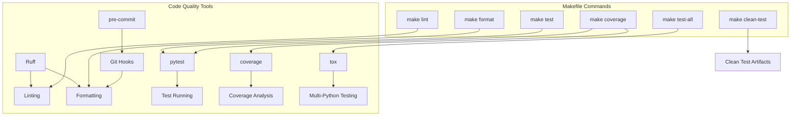
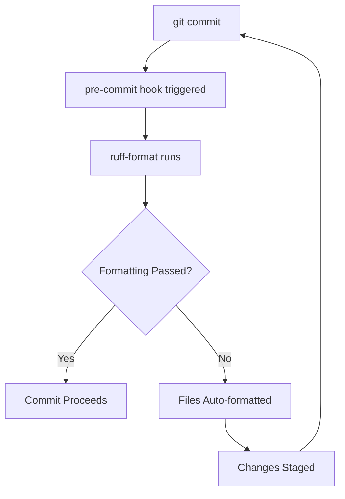
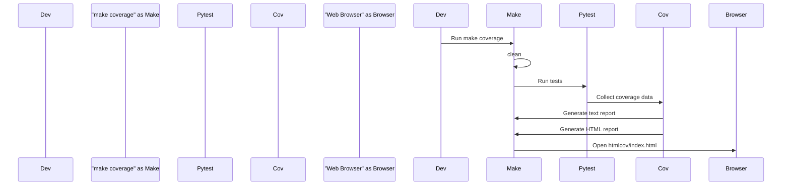
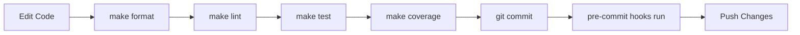

<!-- source: DeepWiki mcp.deepwiki.com · repo NVIDIA/jaxpp · page 4.2 Testing and Linting · fetched 2026-10-26 -->

# Testing and Linting

Relevant source files

The following files were used as context for generating this wiki page:

- [.pre-commit-config.yaml](.pre-commit-config.yaml)
- [Makefile](Makefile)

This document describes the testing infrastructure and code quality tools used in the JaxPP project. It covers the setup and usage of linting tools, testing frameworks, and code coverage analysis to maintain code quality throughout the codebase.

For information about building from source, see [Building from Source](#4.1). For details on the Docker development environment, see [Docker Environment](#4.3).

## Testing and Linting Infrastructure

JaxPP employs a structured approach to code quality assurance using standard Python development tools integrated through the project's Makefile and pre-commit hooks.

Sources: `Makefile`, `.pre-commit-config.yaml`

## Linting with Ruff

JaxPP uses Ruff, a fast Python linter and formatter written in Rust, for code quality checks and formatting. Ruff performs both linting (code quality checks) and formatting (code style enforcement).

### Pre-commit Integration

The repository configures git pre-commit hooks to automatically run Ruff formatting before commits are finalized:

Sources: `.pre-commit-config.yaml`

The pre-commit configuration in [.pre-commit-config.yaml:1-8]() specifies Ruff version v0.3.1 for the formatter hook.

### Makefile Linting Commands

The project provides several Makefile commands for manual linting and formatting:

| Command | Description | Implementation |
|---------|-------------|----------------|
| `make lint` | Run Ruff linter with auto-fixes | `ruff check --fix` |
| `make format` | Format all files with Ruff | `ruff format` |

Sources: [Makefile:79-84]()

## Testing Framework

JaxPP uses pytest as its primary testing framework for unit and integration tests.

### Running Tests

The Makefile provides several commands for executing tests:

| Command | Description | Implementation |
|---------|-------------|----------------|
| `make test` | Run tests with pytest | `pytest` |
| `make test-all` | Run tests across Python versions | `tox` |
| `make coverage` | Run tests with coverage analysis | Multiple commands |

Sources: [Makefile:89-100]()

### Coverage Analysis Workflow

Code coverage is measured using the coverage tool, which tracks which lines of code are executed during test runs.

Sources: [Makefile:95-100]()

## Test Artifact Management

The repository includes commands to clean up test-related artifacts:

| Command | Description |
|---------|-------------|
| `make clean-test` | Remove test and coverage artifacts |
| `make clean` | Remove all build, test, coverage and Python artifacts |

The `clean-test` command specifically removes:
- `.tox/` directory
- `.coverage` files
- `htmlcov/` directory
- `.pytest_cache` directory

Sources: [Makefile:64-68]()

## Integration with Development Workflow

The typical development workflow integrates these testing and linting tools as follows:

Sources: `Makefile`, `.pre-commit-config.yaml`

## Makefile Testing and Linting Command Summary

The following table summarizes all testing and linting related commands available in the Makefile:

| Command | Purpose |
|---------|---------|
| `make lint` | Check and fix linting issues |
| `make format` | Format code according to project style |
| `make test` | Run tests with pytest |
| `make test-all` | Run tests on multiple Python versions |
| `make coverage` | Run tests and generate coverage report |
| `make clean-test` | Clean test artifacts |
| `make clean` | Clean all artifacts including test artifacts |

Sources: [Makefile:16](), [Makefile:79-100]()

---

