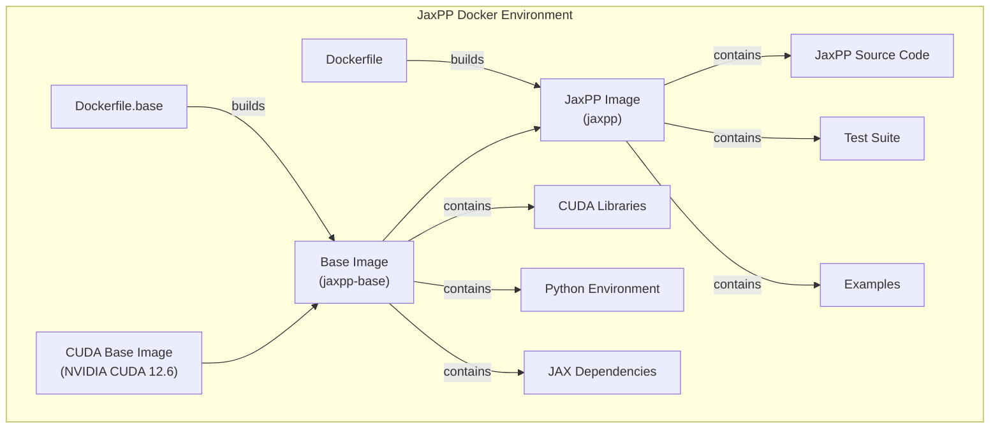
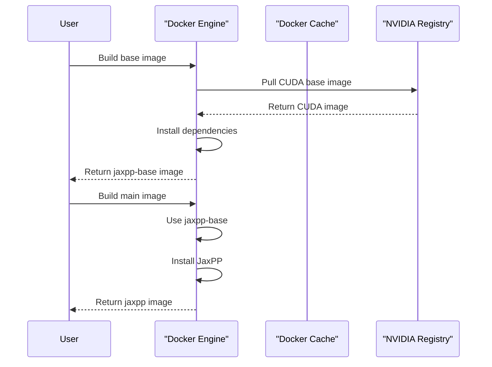
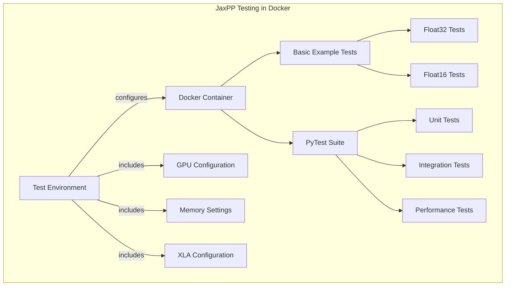
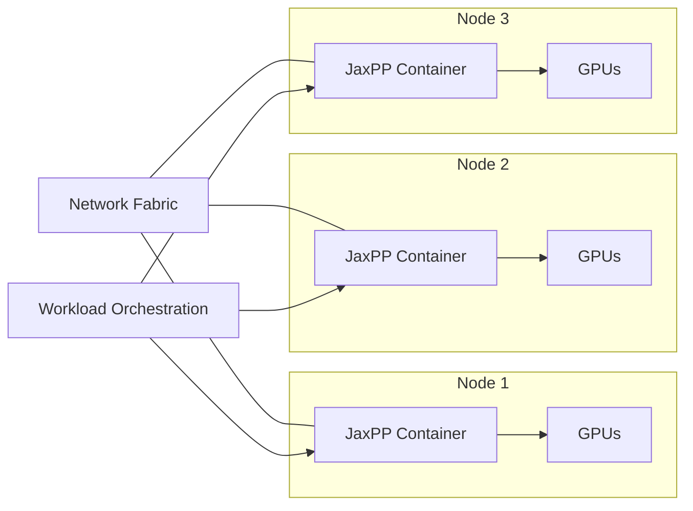

<!-- source: DeepWiki mcp.deepwiki.com · repo NVIDIA/jaxpp · page 4.3 Docker Environment · fetched 2026-10-26 -->

# Docker Environment

<details>
<summary>Relevant source files</summary>

The following files were used as context for generating this wiki page:

- [.dockerignore](.dockerignore)
- [README.md](README.md)

</details>


This page details the Docker configuration used for developing, testing, and deploying JaxPP. Docker containers provide consistent, reproducible environments with all necessary dependencies pre-installed, making them ideal for both development and deployment of JaxPP applications. For information about building JaxPP from source without Docker, see [Building from Source](#4.1).

## Docker Image Structure

JaxPP uses a two-stage Docker build process to create optimized, maintainable containers.



Sources: [README.md:115-143]()

The Docker environment consists of:

1. **Base Image**: Contains all core dependencies including CUDA, Python, and JAX dependencies
2. **JaxPP Image**: Built on top of the base image, contains the JaxPP library, tests, and examples

This two-stage approach allows for faster rebuilds when only the JaxPP code changes, as the base dependencies don't need to be rebuilt.

## Building Docker Images

### Prerequisites

Before building the Docker images, ensure you have:

- Docker installed and configured
- NVIDIA Container Toolkit installed (for GPU support)
- Sufficient disk space (several GB) for the Docker images

Sources: [README.md:119-122]()

### Building Process



Sources: [README.md:124-143]()

#### Step 1: Build the Base Image

The base image contains all the core dependencies and is built using CUDA 12.6:

```bash
docker build --force-rm=true \
  -f scripts/docker/Dockerfile.base \
  --build-arg CUDA_BASE_IMAGE=nvcr.io/nvidia/cuda:12.6.3-devel-ubuntu22.04 \
  -t jaxpp-base .
```

This command:
- Uses `scripts/docker/Dockerfile.base` as the build configuration
- Starts from NVIDIA's CUDA 12.6.3 development image
- Names the resulting image `jaxpp-base`

Sources: [README.md:126-132]()

#### Step 2: Build the Main Image

After building the base image, you build the main JaxPP image:

```bash
docker build --force-rm=true \
  -f scripts/docker/Dockerfile \
  --build-arg BASE_IMAGE=jaxpp-base \
  -t jaxpp .
```

This command:
- Uses `scripts/docker/Dockerfile` as the build configuration
- Uses the previously built `jaxpp-base` image as its starting point
- Names the resulting image `jaxpp`

Sources: [README.md:136-143]()

## Running JaxPP in Docker

The JaxPP Docker container provides a fully configured environment for running JaxPP applications with GPU support. The container expects to have access to NVIDIA GPUs through the NVIDIA Container Toolkit.

### Container Runtime Configuration

When running the JaxPP container, several important configuration options are needed:

| Option | Value | Purpose |
|--------|-------|---------|
| `--gpus=all` | - | Enables access to all available GPUs |
| `--shm-size=10.24gb` | 10.24GB | Sets shared memory size, crucial for multi-GPU workloads |
| `--ulimit memlock=-1` | Unlimited | Prevents memory locking issues in CUDA operations |
| `--ulimit stack=67108864` | 64MB | Increases stack size for deep recursive operations |
| `-e XLA_FLAGS='--xla_gpu_graph_level=0'` | - | Environment variable for XLA configuration |
| `-e XLA_PYTHON_CLIENT_ALLOCATOR=platform` | - | Controls JAX memory allocation behavior |

These settings are particularly important for ensuring proper performance and stability when running memory-intensive operations across multiple GPUs.

Sources: [README.md:150-154](), [README.md:158-162]()

## Testing with Docker

The Docker container includes several test mechanisms to verify JaxPP functionality:



Sources: [README.md:146-162]()

### Running the Basic Example Test

This test runs the basic example in both float32 and float16 precision modes:

```bash
docker run --gpus=all --shm-size=10.24gb --ulimit memlock=-1 --ulimit stack=67108864 \
  -e XLA_FLAGS='--xla_gpu_graph_level=0' --rm --workdir=/workdir/jaxpp jaxpp \
  "python /workdir/jaxpp/examples/basic.py --dtype=float32 && \
   python /workdir/jaxpp/examples/basic.py --dtype=float16"
```

Sources: [README.md:150-155]()

### Running the PyTest Suite

The full test suite can be run with PyTest:

```bash
docker run --gpus=all --shm-size=10.24gb --ulimit memlock=-1 --ulimit stack=67108864 \
  -e XLA_PYTHON_CLIENT_ALLOCATOR=platform \
  --rm --workdir=/workdir/jaxpp jaxpp "nvidia-smi && make install && pytest"
```

This command:
1. Verifies GPU availability with `nvidia-smi`
2. Installs JaxPP with `make install`
3. Runs the PyTest suite

Sources: [README.md:158-162]()

## Docker for Multi-Node Setups

When using JaxPP in a multi-node environment, Docker containers can simplify deployment by ensuring consistent environments across all nodes.



For multi-node setups:

1. Build the Docker image on each node or distribute it via a container registry
2. Ensure proper network configuration between containers
3. Install JaxPP and any workload-specific packages in each container
4. Configure appropriate environment variables for distributed execution

Sources: [README.md:167-173]()

## Docker Image Maintenance

The `.dockerignore` file ensures that unnecessary files are not included in the Docker build context, which helps keep images smaller and build times faster.

Key ignored paths include:
- Python cache files and bytecode
- Build artifacts and distributions
- Test and lint directories
- Git history 
- Temporary files

Sources: [.dockerignore:1-184]()

## Common Issues and Troubleshooting

When working with the JaxPP Docker environment, you might encounter these common issues:

1. **Insufficient GPU memory**: Ensure your system has enough GPU memory for your workloads
2. **Shared memory errors**: Increase `--shm-size` if you encounter NCCL or other communication errors
3. **Permission issues**: Run Docker with appropriate permissions or use user namespace mapping
4. **Container networking**: For multi-node setups, ensure proper network configuration between containers

To troubleshoot, check:
- Docker logs (`docker logs <container-id>`)
- GPU status inside the container (`nvidia-smi`)
- System resource usage (`htop`, `nvtop`)

---

