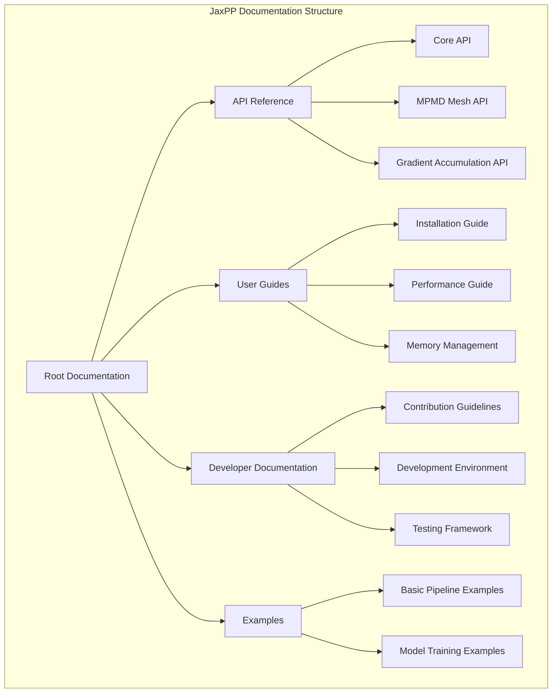
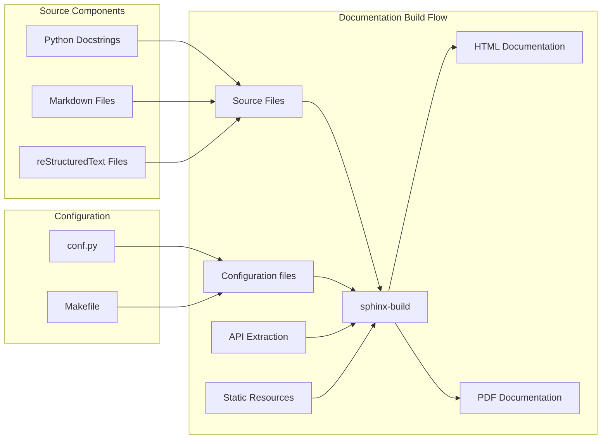
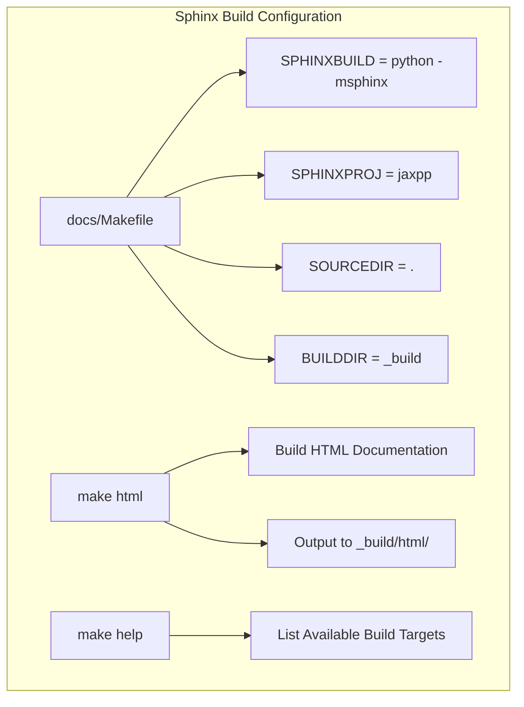
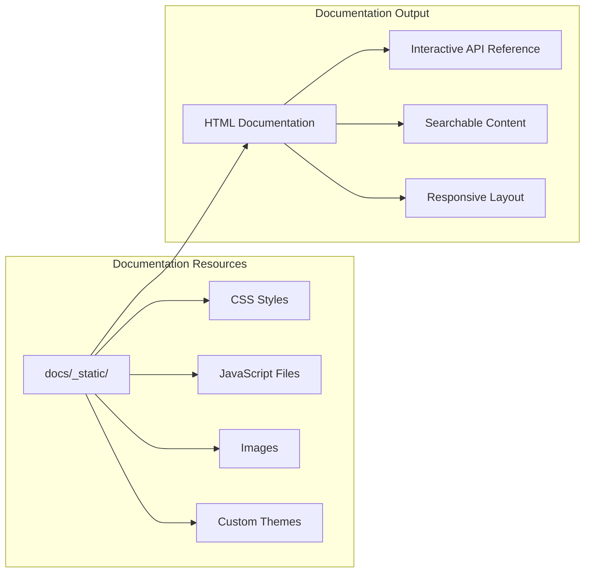
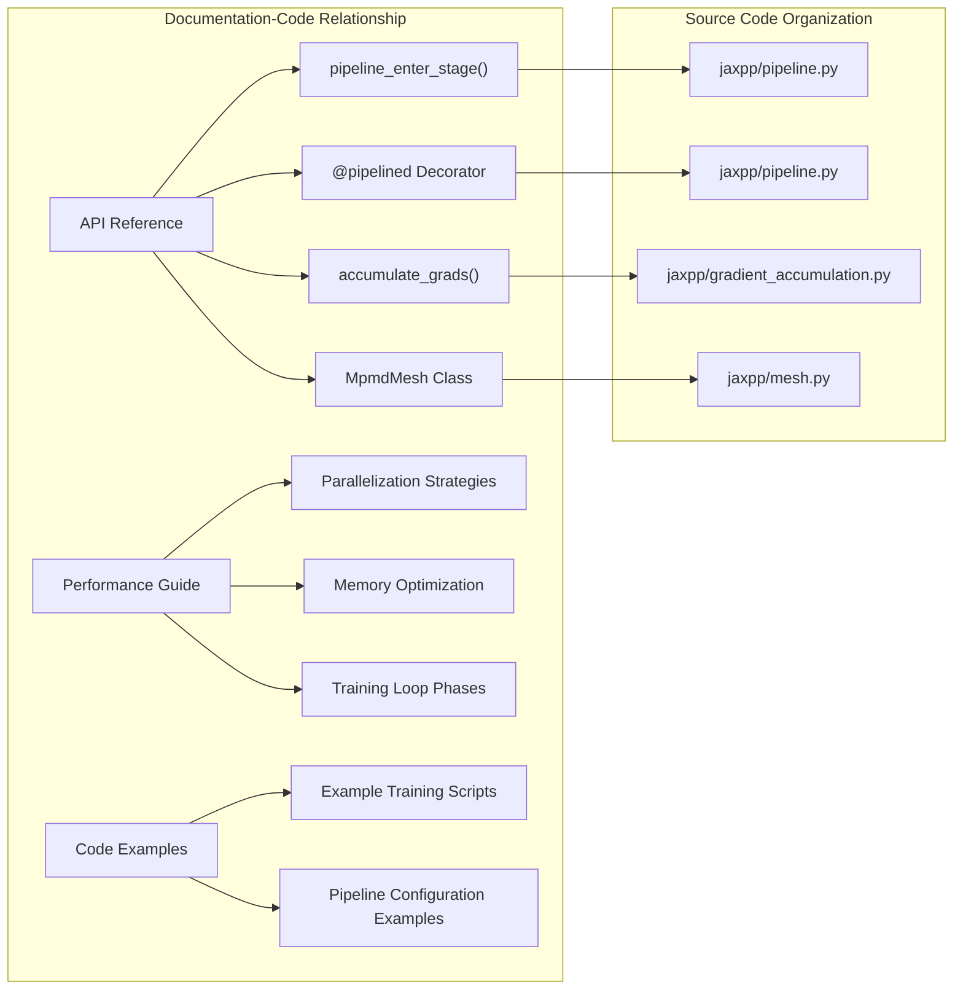
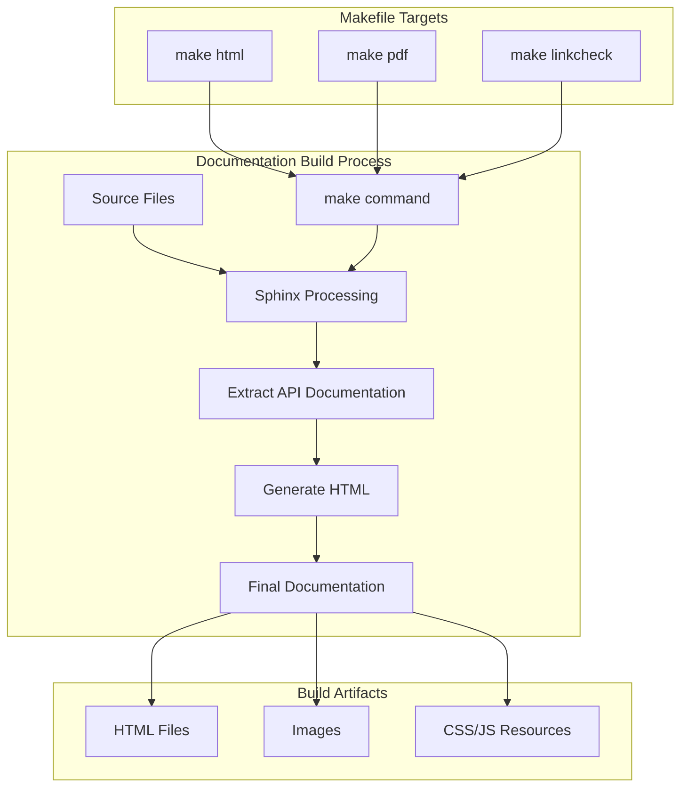
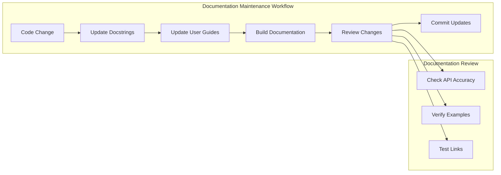

<!-- source: DeepWiki mcp.deepwiki.com · repo NVIDIA/jaxpp · page 5 Documentation System · fetched 2026-10-26 -->

# Documentation System

Relevant source files

The following files were used as context for generating this wiki page:

- [docs/Makefile](docs/Makefile)
- [docs/_static/.gitkeep](docs/_static/.gitkeep)

## Purpose and Scope

This document describes the documentation system for the JaxPP library, detailing how documentation is structured, built, and maintained. The documentation system ensures that developers, users, and contributors can effectively understand and utilize the JaxPP pipeline parallelism capabilities for large language model training.

For information about contributing to the documentation, see [Contributing to JaxPP](#6).

## Documentation Structure

The JaxPP documentation is organized into several key components to address different user needs:

The documentation is designed to provide a progressive learning path, from basic concepts to advanced techniques for optimizing JAX pipeline parallelism.

Sources: [docs/Makefile:1-35]()

## Documentation Build System

JaxPP uses Sphinx as its documentation generation framework. The build process transforms source documentation into HTML output that can be hosted and viewed in web browsers.

The documentation is built using the Makefile in the `docs` directory, which provides various targets for building different documentation formats.

Sources: [docs/Makefile:16-35]()

## Sphinx Configuration

The Sphinx documentation tool is configured through the Makefile, which sets up the build environment and options:

The Makefile defines several key variables:
- `SPHINXBUILD`: The command to run Sphinx
- `SPHINXPROJ`: The project name (jaxpp)
- `SOURCEDIR`: The source directory for documentation files
- `BUILDDIR`: The output directory for built documentation

Sources: [docs/Makefile:19-24]()

## Documentation Resources

The documentation includes static resources stored in the `_static` directory that provide additional assets for the generated documentation:

Static resources help enhance the presentation and functionality of the documentation.

Sources: [docs/_static/.gitkeep:1]()

## Documentation Content and Code Mapping

The following diagram illustrates how the documentation maps to actual code components in the JaxPP library:

This mapping ensures that documentation directly corresponds to the implementation, making it easier for developers to navigate between documentation and code.

Sources: [docs/Makefile:1-35]()

## Documentation Build Process

The documentation build process involves several steps that transform source content into the final documentation:

To build the documentation, users can run the appropriate `make` command in the `docs` directory, which will process the source files and generate the documentation output.

Sources: [docs/Makefile:26-35]()

## Documentation Types

The JaxPP documentation system includes different types of documentation to serve various purposes:

| Documentation Type | Purpose | Primary Audience | Location |
|--------------------|---------|------------------|----------|
| API Reference | Document function signatures, parameters, and return values | Developers | Generated from docstrings |
| User Guides | Explain concepts and provide how-to instructions | Users | Markdown/RST files |
| Performance Guide | Provide optimization strategies | Advanced users | Dedicated guide documents |
| Examples | Demonstrate usage patterns | New users | Examples directory |
| Development Guide | Document development processes | Contributors | Developer documentation |

Each type of documentation serves a specific audience and purpose within the overall documentation system.

Sources: [docs/Makefile:1-35]()

## Maintaining Documentation

Documentation maintenance is an essential part of the JaxPP project. As the codebase evolves, the documentation must be kept up to date to reflect changes in the API and functionality.

When making changes to the JaxPP codebase, developers should ensure that they update the relevant documentation to maintain accuracy and completeness.

Sources: [docs/Makefile:1-35]()

---

