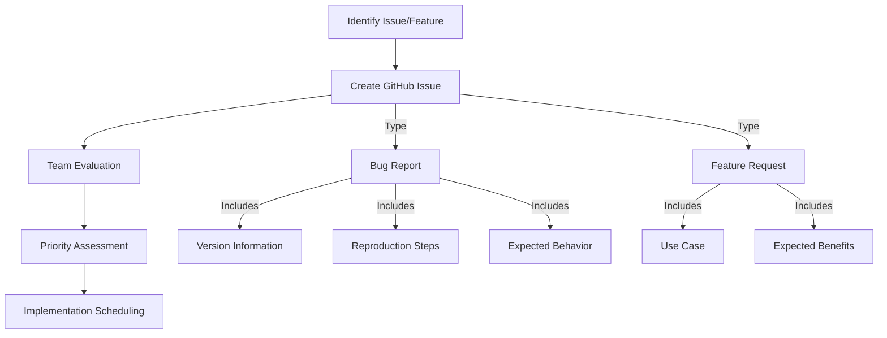
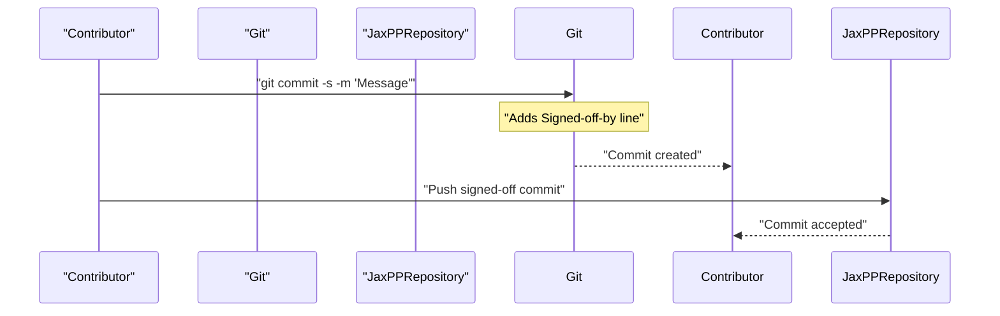

<!-- source: DeepWiki mcp.deepwiki.com · repo NVIDIA/jaxpp · page 6 Contributing to JaxPP · fetched 2026-10-26 -->

# Contributing to JaxPP

<details>
<summary>Relevant source files</summary>

The following files were used as context for generating this wiki page:

- [.github/ISSUE_TEMPLATE.md](.github/ISSUE_TEMPLATE.md)
- [CONTRIBUTING.md](CONTRIBUTING.md)

</details>


This document outlines the guidelines and procedures for contributing to the JaxPP project. For information about building and testing the codebase, see the [Development Guide](#4).

## Current Contribution Types

JaxPP currently accepts the following types of external contributions:

1. **Bug reports in code or documentation**
2. **Feature requests**

**Note:** The project is not currently accepting external code contributions other than test cases and code examples in bug reports and feature requests.



Title: JaxPP Contribution Workflow

Sources: [CONTRIBUTING.md:1-21]()

## Bug Reporting Guidelines

When reporting a bug, please use the issue template and provide complete information to help reproduce and address the issue:

### Required Information

1. **Environment Details**:
   - JaxPP version
   - JAX version
   - cuDNN version
   - cuBLAS version
   - NCCL version
   - Python version
   - Operating System

2. **Problem Description**:
   - What you were trying to accomplish
   - What happened instead
   - What you expected to happen

3. **Reproduction Steps**:
   - Commands executed
   - Complete output
   - Traceback for crashes

```mermaid
classDiagram
    class "JaxPPBugReport" {
        +EnvironmentInfo
        +ProblemDescription
        +ReproductionSteps
        +ExpectedBehavior
        +ActualOutcome
    }
    
    class "EnvironmentInfo" {
        +JaxPPVersion
        +JaxVersion
        +cuDNNVersion
        +cuBLASVersion
        +NCCLVersion
        +PythonVersion
        +OperatingSystem
    }
    
    class "ReproductionSteps" {
        +Commands
        +Output
        +Traceback
    }
    
    "JaxPPBugReport" "1" *-- "1" "EnvironmentInfo"
    "JaxPPBugReport" "1" *-- "1" "ReproductionSteps"
```

Title: JaxPP Bug Report Structure

Sources: [.github/ISSUE_TEMPLATE.md:1-19]()

## Feature Requests

When requesting a new feature:

1. Clearly describe the feature you would like to see implemented
2. Explain the use case and how it would benefit JaxPP users
3. Label the issue as a "Feature Request"

## Commit Sign-off Requirements

Although external code contributions are currently limited, all commits to the JaxPP codebase require a sign-off to certify compliance with the Developer Certificate of Origin (DCO).

### How to Sign Off on Commits

Use the `--signoff` (or `-s`) option when committing changes:

```shell
git commit -s -m "Add cool feature."
```

This appends the following to your commit message:

```
Signed-off-by: Your Name <your@email.com>
```



Title: JaxPP Commit Sign-off Process

Sources: [CONTRIBUTING.md:23-51]()

### Developer Certificate of Origin

By signing off on commits, contributors certify compliance with the Developer Certificate of Origin 1.1, which states:

1. The contribution was created in whole or part by the contributor, who has the right to submit it under the open source license.
2. The contribution is based on previous work covered under an appropriate open source license.
3. The contribution was provided directly by the contributor or by someone who certified the same.
4. The contributor understands that the project and contribution are public and may be redistributed.

The full text of the DCO can be found in the CONTRIBUTING.md file.

Sources: [CONTRIBUTING.md:52-91]()

## Issue Processing Flow

When a bug report or feature request is received:

1. The project team evaluates it
2. The issue is prioritized based on severity and impact
3. Implementation is scheduled according to priority
4. The team implements the fix or feature
5. Changes are tested and merged

## Related Documentation

For additional information about working with the JaxPP codebase:

- [Development Guide](#4) - Instructions for building, testing, and working with the codebase
- [Repository Structure](#7) - Overview of the organization of the repository

---

