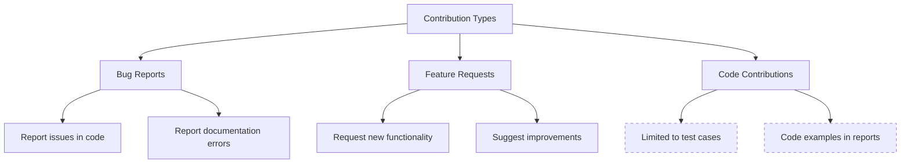
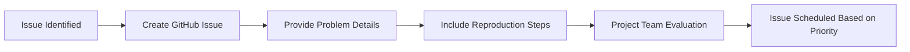
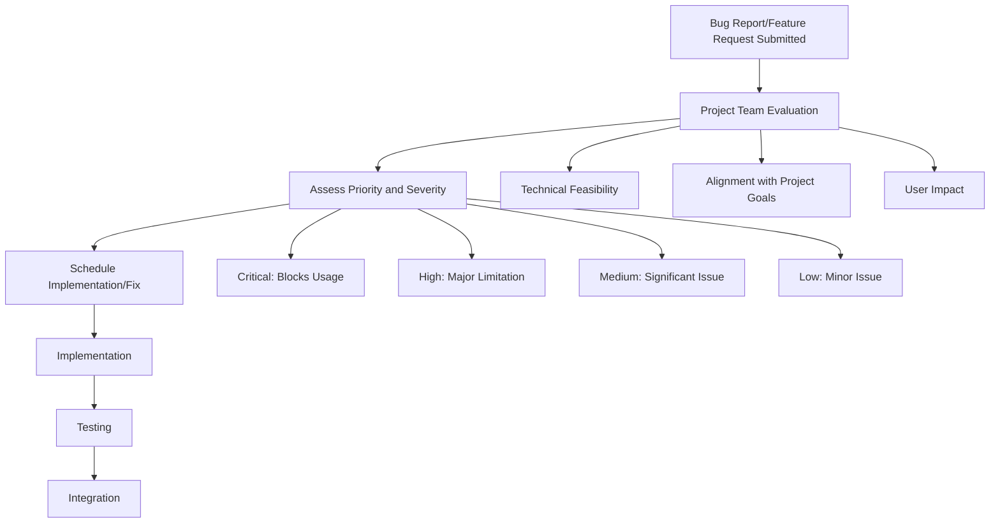
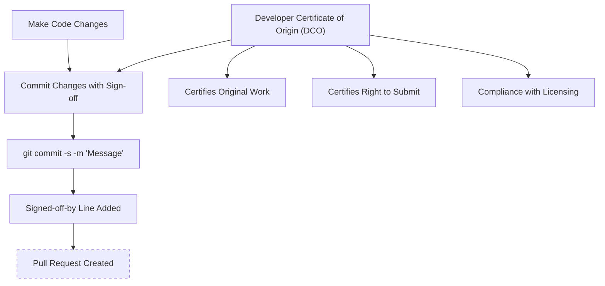
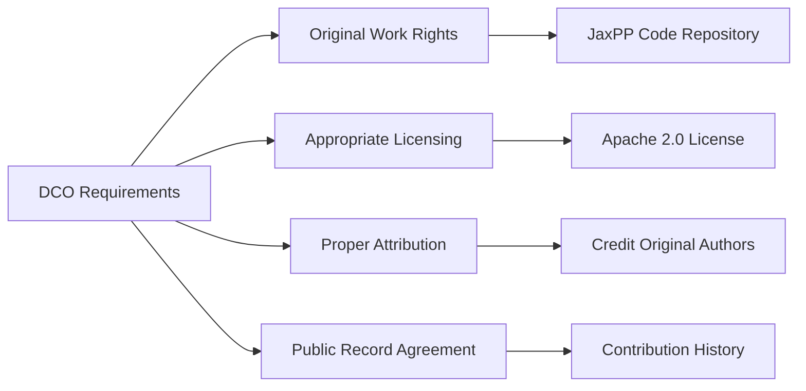
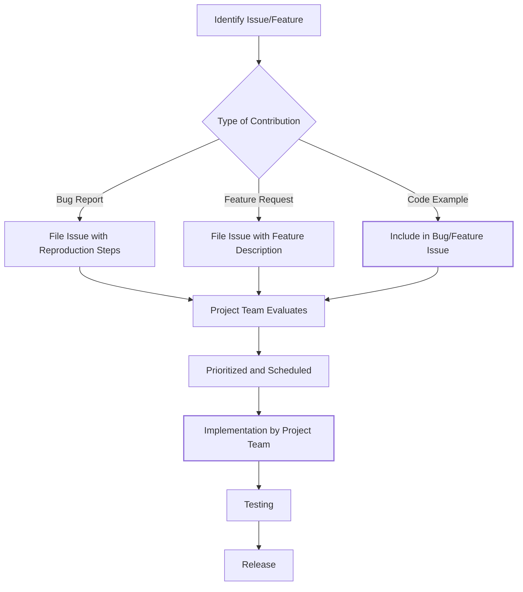
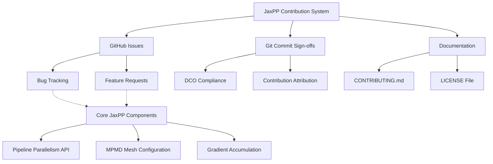

<!-- source: DeepWiki mcp.deepwiki.com · repo NVIDIA/jaxpp · page 6.1 Contribution Guidelines · fetched 2026-10-26 -->

# Contribution Guidelines

<details>
<summary>Relevant source files</summary>

The following files were used as context for generating this wiki page:

- [CONTRIBUTING.md](CONTRIBUTING.md)

</details>


## Introduction

This document outlines the guidelines and processes for contributing to the JaxPP (JAX Pipeline Parallelism) library. It covers how to report bugs, request features, and the requirements for code contributions. For information about reporting specific issues with JaxPP, see [Issue Reporting](#6.2). For licensing details, see [License Information](#6.3).

## Contribution Policies

JaxPP currently accepts the following types of contributions:

1. Bug reports for code or documentation
2. Feature requests



Sources: [CONTRIBUTING.md:1-21]()

**Important Note**: At present, the JaxPP project is **not accepting external code contributions** other than test cases and code examples that accompany bug reports and feature requests.

## Bug Reporting Process

When reporting a bug in JaxPP:

1. File an issue describing the details of the problem
2. Include clear steps to reproduce the issue
3. Provide relevant information about your environment
4. If possible, include test cases that demonstrate the bug

This information helps the project team understand, prioritize, and address the reported issues efficiently.



Sources: [CONTRIBUTING.md:4-9](), [CONTRIBUTING.md:15-17]()

## Feature Request Process

To request a new feature for JaxPP:

1. File an issue describing the desired feature
2. Label the issue as a "Feature Request"
3. Explain the use case and benefits
4. Include code examples if applicable

The project team evaluates feature requests based on alignment with project goals, technical feasibility, and user impact.

Sources: [CONTRIBUTING.md:10-17]()

## Evaluation and Scheduling

When a bug report or feature request is received, the process flows as follows:



Sources: [CONTRIBUTING.md:15-17]()

## Code Contribution Requirements

While external code contributions are currently limited, all code changes to the JaxPP project must adhere to the following requirements:

### Sign-off Process

Contributors must sign off on their commits to certify that the contribution is their original work or they have the right to submit it under the project's license.



To sign off on a commit, use the `--signoff` (or `-s`) option when committing changes:

```
git commit -s -m "Add cool feature."
```

This appends a "Signed-off-by" line to your commit message:

```
Signed-off-by: Your Name <your@email.com>
```

### Developer Certificate of Origin

By signing off on commits, contributors certify compliance with the Developer Certificate of Origin (DCO) version 1.1, which requires that:

1. The contribution was created in whole or part by the contributor who has the right to submit it
2. The contribution is based on previous work covered by an appropriate open source license
3. The contribution was provided directly by another person who certified compliance
4. The contributor understands that records of the contribution are maintained indefinitely



Sources: [CONTRIBUTING.md:22-91]()

## Contribution Process Overview

The complete contribution process for JaxPP follows this general workflow:



Sources: [CONTRIBUTING.md:1-21]()

## Relationship to JaxPP Codebase

The contribution policies connect to the JaxPP codebase in the following ways:



Sources: [CONTRIBUTING.md]()

## Summary

Contributing to JaxPP currently focuses on bug reports and feature requests. While external code contributions are limited, all contributors must adhere to the sign-off process and Developer Certificate of Origin requirements. This ensures that all contributions are properly attributed and legally compliant.

The JaxPP team evaluates all contributions based on technical merit, alignment with project goals, and user impact before scheduling implementation.

Sources: [CONTRIBUTING.md]()

---

