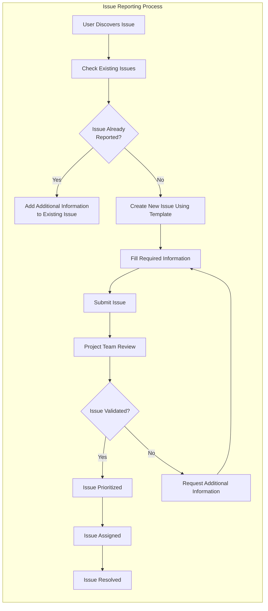
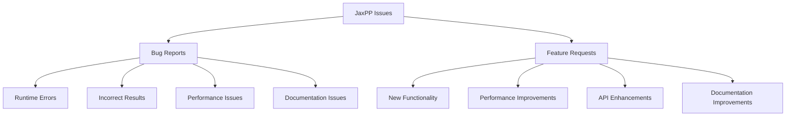
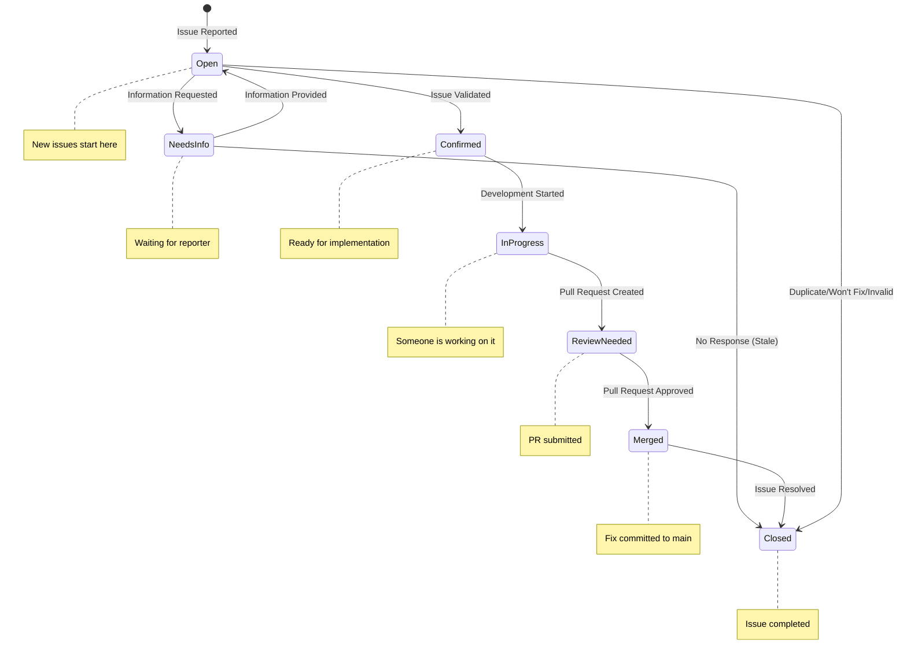
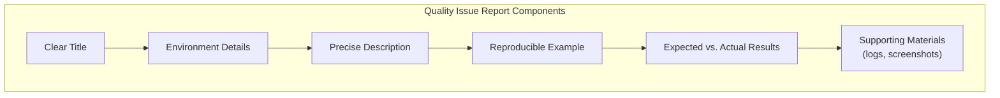

<!-- source: DeepWiki mcp.deepwiki.com · repo NVIDIA/jaxpp · page 6.2 Issue Reporting · fetched 2026-10-26 -->

# Issue Reporting

<details>
<summary>Relevant source files</summary>

The following files were used as context for generating this wiki page:

- [.github/ISSUE_TEMPLATE.md](.github/ISSUE_TEMPLATE.md)

</details>


This document outlines the procedures for reporting bugs and requesting features for the JaxPP library. Effective issue reporting helps the development team identify, prioritize, and address problems efficiently. For information on contributing code changes rather than reporting issues, see [Contribution Guidelines](#6.1).

## Issue Reporting Workflow

The following diagram illustrates the general workflow for reporting and addressing issues in the JaxPP project:



Sources: [.github/ISSUE_TEMPLATE.md:1-20]()

## Types of Issues

JaxPP project handles two primary types of issue reports:



Sources: [.github/ISSUE_TEMPLATE.md:9-12]()

## Creating a Bug Report

When reporting a bug in JaxPP, please follow these steps to ensure your issue can be addressed efficiently:

1. **Check for existing issues**: Search the existing issues to avoid duplicates
2. **Use the issue template**: Fill out all sections of the template
3. **Provide environment details**: Include version information for all relevant software
4. **Describe the issue clearly**: Explain what happened and what you expected
5. **Include reproducible steps**: Provide commands and outputs that demonstrate the issue

### Required Information for Bug Reports

The following information must be included in all bug reports:

| Information | Description | Example |
|-------------|-------------|---------|
| JaxPP version | Version of JaxPP library | 0.1.0 |
| JAX version | Version of JAX library | 0.4.13 |
| cuDNN version | Version of cuDNN | 8.9.5 |
| cuBLAS version | Version of cuBLAS | 12.1.3.1 |
| NCCL version | Version of NCCL | 2.18.5 |
| Python version | Version of Python | 3.10.12 |
| Operating System | OS and version | Ubuntu 22.04 LTS |
| Description | Clear explanation of the issue | During pipeline parallel training with 4 GPUs, an error occurs when... |
| Steps to reproduce | Commands and code to reproduce the issue | See example below |

### Example Bug Report

The template format helps ensure all necessary information is provided:

```
* JaxPP version: 0.1.0
* Jax version: 0.4.13
* cuDNN version: 8.9.5
* cuBLAS version: 12.1.3.1
* NCCL version: 2.18.5
* Python version: 3.10.12
* Operating System: Ubuntu 22.04 LTS

### Description

When running a pipelined model with 4 GPUs in a 2x2 configuration (2 PP stages, 2 DP replicas), 
the training crashes after 10 iterations with a NCCL error.

### What I Did

```python
import jaxpp
mesh = jaxpp.MpmdMesh(2, 2)  # 2 pipeline stages, 2 data parallel replicas
model = create_pipelined_model(mesh)
for i in range(100):
    loss = train_step(model, data[i])
    print(f"Step {i}, Loss: {loss}")
```

Error traceback:
RuntimeError: NCCL error: unhandled system error, NCCL version 2.18.5
```

Sources: [.github/ISSUE_TEMPLATE.md:1-19]()

## Creating a Feature Request

Feature requests help guide the development of JaxPP. When submitting a feature request:

1. **Check existing requests**: Ensure the feature hasn't already been requested
2. **Provide clear rationale**: Explain why the feature would be valuable
3. **Describe the solution**: If possible, outline how the feature might be implemented
4. **Consider alternatives**: Mention alternative approaches you've considered

### Feature Request Template

While there isn't a specific template for feature requests like there is for bug reports, you should include:

```
### Feature Description

A clear and concise description of the feature you're requesting.

### Use Case

Explain when and how this feature would be used, and what problem it solves.

### Proposed Implementation

If you have ideas on how this feature could be implemented, describe them here.

### Alternatives Considered

Describe alternative solutions or features you've considered.

### Additional Context

Add any other context, examples, or screenshots about the feature request here.
```

Sources: [.github/ISSUE_TEMPLATE.md:9-12]()

## Issue Lifecycle

The following diagram illustrates how issues progress through the JaxPP development process:



## Best Practices for Issue Reporting

To maximize the effectiveness of your issue report:

1. **Be specific**: Provide precise details about the issue
2. **Be concise**: Keep your report focused on the essential information
3. **One issue per report**: Create separate reports for unrelated issues
4. **Include context**: Explain what you were trying to accomplish
5. **Follow up**: Respond promptly to requests for additional information
6. **Use clear formatting**: Format code, logs, and error messages for readability



Sources: [.github/ISSUE_TEMPLATE.md:9-19]()

## Where to Report Issues

All JaxPP issues should be reported via the GitHub Issues page for the repository. This ensures that all issues are tracked in one place and can be properly assigned, labeled, and prioritized.

When creating an issue:
1. Navigate to the [NVIDIA/jaxpp](https://github.com/NVIDIA/jaxpp) repository
2. Click on the "Issues" tab
3. Click the "New Issue" button
4. Fill out the issue template with all required information
5. Submit the issue

## After Reporting an Issue

After reporting an issue:

1. **Issue acknowledgment**: A project maintainer will review your issue
2. **Issue triage**: The issue will be assessed for severity, impact, and resource requirements
3. **Information requests**: You may be asked for additional information
4. **Issue resolution**: Once addressed, the issue will be closed with an explanation

Maintaining active communication throughout this process helps ensure that your issue is resolved efficiently.

## Conclusion

Effective issue reporting is crucial for the continuous improvement of the JaxPP library. By following the guidelines in this document, you help the development team better understand and address your concerns, ultimately contributing to the quality and usability of the project.

---

