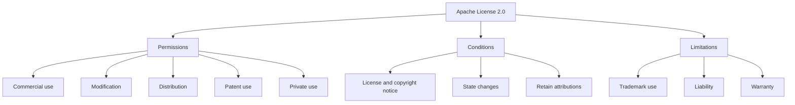
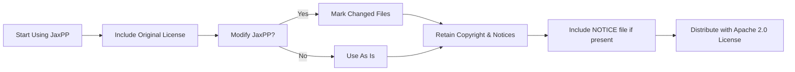
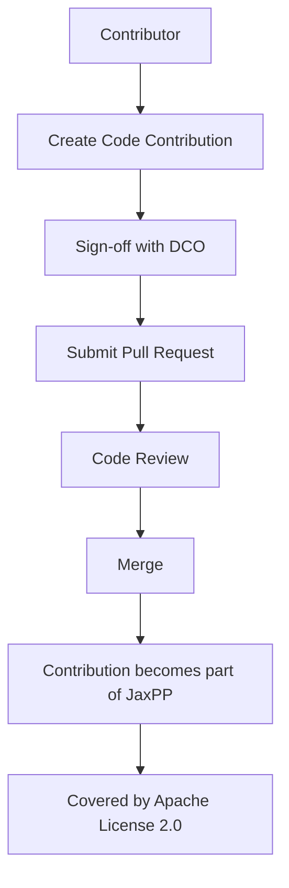
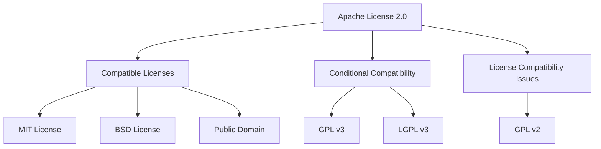

<!-- source: DeepWiki mcp.deepwiki.com · repo NVIDIA/jaxpp · page 6.3 License Information · fetched 2026-10-26 -->

# License Information

<details>
<summary>Relevant source files</summary>

The following files were used as context for generating this wiki page:

- [LICENSE](LICENSE)

</details>


This document provides detailed information about the licensing of the JaxPP library, covering the terms of use, redistribution rights, and obligations for both users and contributors. The information in this document is essential for understanding how JaxPP can be legally used, modified, and distributed.

## License Overview

JaxPP is licensed under the Apache License, Version 2.0 (the "License"). This is a permissive open-source license that allows for free use, modification, and distribution of the software, with minimal requirements on users.

The full text of the Apache License 2.0 can be found in the root directory of the repository in the `LICENSE` file.

Sources: [LICENSE:1-202]()

## Apache License 2.0 Summary

The Apache License 2.0 provides several key permissions, conditions, and limitations that affect how you can use JaxPP:



Sources: [LICENSE:6-177]()

### Key Permissions

The Apache License 2.0 grants you the following permissions:

1. **Use for any purpose**: You may use JaxPP for any purpose, including commercial applications.
2. **Modify the code**: You may modify the JaxPP source code.
3. **Distribute**: You may distribute the original or modified versions of JaxPP.
4. **Patent rights**: The license grants patent rights from contributors.

### Key Conditions

When using, modifying, or distributing JaxPP, you must comply with the following conditions:

1. **Include a copy of the license**: Any distribution must include a copy of the Apache License 2.0.
2. **State changes**: Modified files must carry prominent notices stating that you changed the files.
3. **Retain notices**: You must retain all copyright, patent, trademark, and attribution notices in the source code.
4. **Notice file**: If a NOTICE file is included with the distribution, you must include that file in any derivative works.

### Limitations and Disclaimers

The license includes important limitations:

1. **No warranty**: The software is provided "AS IS" without warranties of any kind.
2. **No liability**: Contributors are not liable for damages arising from the use of JaxPP.
3. **Trademark restrictions**: The license does not grant permission to use the trade names or trademarks of contributors, except as required for reasonable and customary use.

Sources: [LICENSE:67-177]()

## License Compliance Workflow

The following diagram outlines the basic workflow for complying with the Apache License 2.0 when using JaxPP:



Sources: [LICENSE:90-129]()

## Contributions and Licensing

When contributing to JaxPP, your contributions are subject to the same Apache License 2.0 terms. The contribution process includes signing off on your commits, indicating that you have the right to submit the contribution under the project's license.



Key points regarding contributions:

1. By submitting a contribution, you agree to license it under Apache License 2.0.
2. The license does not require you to assign copyright to the project, you retain ownership of your contributions.
3. Any intentional submission for inclusion is governed by the license without additional terms or conditions.

Sources: [LICENSE:131-137]()

## License Header Requirements

The Apache License 2.0 recommends that each file in the codebase include a license header. For JaxPP, source files should include the following header:

```
Copyright [yyyy] NVIDIA Corporation

Licensed under the Apache License, Version 2.0 (the "License");
you may not use this file except in compliance with the License.
You may obtain a copy of the License at

    http://www.apache.org/licenses/LICENSE-2.0

Unless required by applicable law or agreed to in writing, software
distributed under the License is distributed on an "AS IS" BASIS,
WITHOUT WARRANTIES OR CONDITIONS OF ANY KIND, either express or implied.
See the License for the specific language governing permissions and
limitations under the License.
```

Sources: [LICENSE:179-202]()

## License Implications for Different Use Cases

The table below summarizes what the Apache License 2.0 means for different JaxPP usage scenarios:

| Use Case | Allowed? | Requirements |
|----------|----------|--------------|
| Using JaxPP in a closed-source project | Yes | Include license copy and notices |
| Modifying JaxPP for internal use | Yes | None for internal use only |
| Distributing modified JaxPP | Yes | Mark changes, include license, retain notices |
| Using JaxPP in a commercial product | Yes | Include license copy and notices |
| Sublicensing JaxPP | Yes | Subject to Apache License 2.0 conditions |
| Using JaxPP name/trademarks | Limited | Only for reasonable and customary attribution |

Sources: [LICENSE:90-129](), [LICENSE:139-142]()

## License Compatibility

The Apache License 2.0 is compatible with many other open-source licenses. Here's how it interacts with some common licenses:



Note that when combining JaxPP with other software, you need to comply with the terms of all applicable licenses.

Sources: [LICENSE:1-202]()

## Summary of Rights and Obligations

The Apache License 2.0 provides a balance of rights and obligations that benefits both the creators and users of JaxPP:

1. **For users**: Broad rights to use, modify, and distribute with minimal restrictions.
2. **For contributors**: Protection from liability while ensuring attribution.
3. **For the community**: Encourages collaboration while protecting intellectual property rights.

The license is designed to allow maximum freedom for users while preserving attribution and disclaiming warranties and liabilities.

Sources: [LICENSE:1-202]()

---

