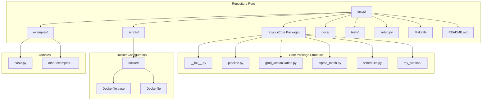
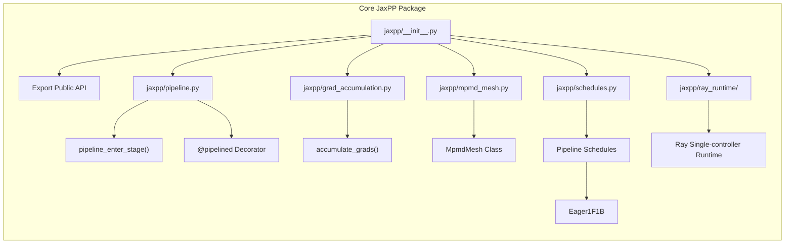
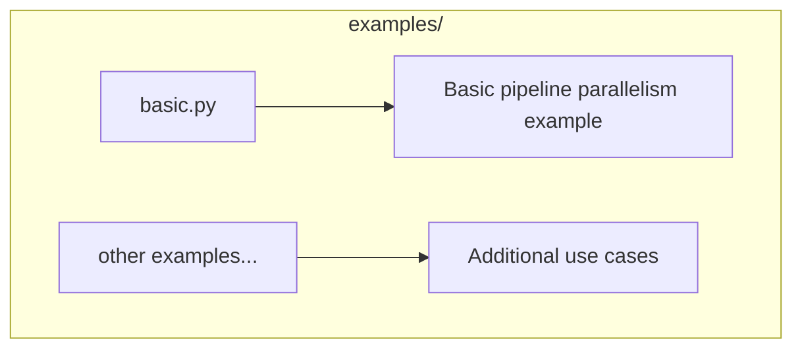
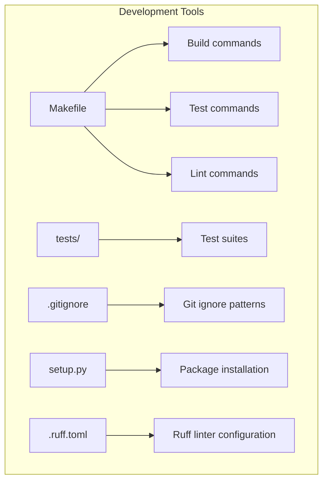
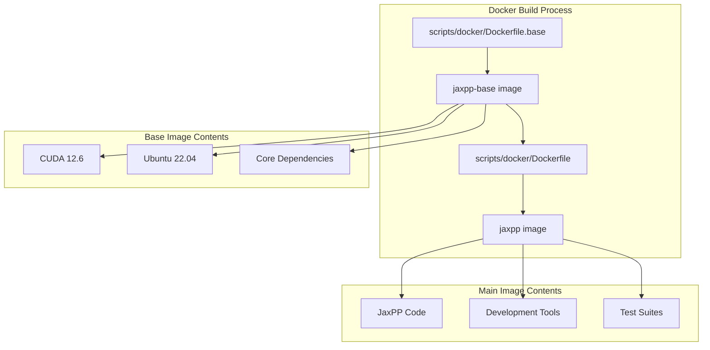
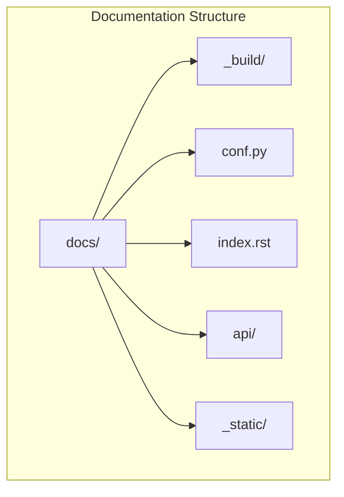
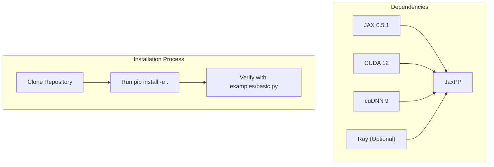
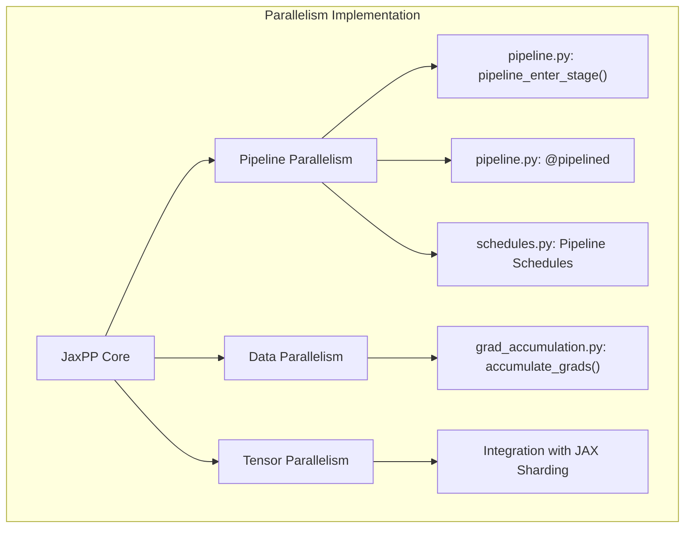

<!-- source: DeepWiki mcp.deepwiki.com · repo NVIDIA/jaxpp · page 7 Repository Structure · fetched 2026-10-26 -->

# Repository Structure

Relevant source files

The following files were used as context for generating this wiki page:

- [.dockerignore](.dockerignore)
- [.gitignore](.gitignore)
- [README.md](README.md)

## Purpose

This document provides a detailed overview of the JaxPP repository organization, file structure, and key components. It serves as a map to help developers navigate the codebase and understand how different parts of the system are organized. For information about the core functionality and API, see [Core Functionality](#2).

## Repository Layout

JaxPP follows a standard Python package layout with some specialized directories for examples, documentation, and development tools.

Sources: [README.md](), [.gitignore]()

## Core Package Structure

The main functionality of JaxPP is organized in a Python package that implements pipeline parallelism primitives and utilities. The core modules implement the key components of the system architecture.

Sources: [README.md]()

### Key Files and Their Purposes

| File | Description |
|------|-------------|
| `jaxpp/pipeline.py` | Implements the pipeline parallelism core functionality, including `pipeline_enter_stage()` and the `@pipelined` decorator |
| `jaxpp/grad_accumulation.py` | Contains the `accumulate_grads()` function for handling gradient accumulation in pipelined training |
| `jaxpp/mpmd_mesh.py` | Defines the `MpmdMesh` class for configuring device meshes for pipeline parallelism |
| `jaxpp/schedules.py` | Implements different pipeline scheduling strategies like `Eager1F1B` |
| `jaxpp/ray_runtime/` | Contains the experimental Ray-based single-controller runtime implementation |

Sources: [README.md]()

## Example Directory

The examples directory contains sample code demonstrating how to use JaxPP for different use cases. These examples serve as practical guides for implementing pipeline parallelism in various scenarios.

The `basic.py` example demonstrates:
- Creating a simple model with pipeline stages
- Defining a pipelined training function
- Setting up the MpmdMesh
- Running training with pipeline parallelism

Sources: [README.md:114]()

## Development and Testing Infrastructure

The repository includes various files and directories related to development, testing, and quality assurance.

### Testing Framework

The project uses pytest for unit and integration testing. Test files are organized in the `tests/` directory, matching the structure of the main package.

### Build System

The Makefile provides commands for:
- Building the package
- Running tests
- Linting and formatting code
- Building documentation

Sources: [.gitignore](), [README.md:157-162]()

## Docker Configuration

JaxPP provides Docker containers for development and testing, configured in two stages:

The Docker configuration is designed to provide a consistent environment for development and testing, with all necessary dependencies pre-installed.

Sources: [README.md:115-143]()

## Documentation System

The documentation for JaxPP is organized in the `docs/` directory and uses Sphinx for generation.

The documentation system likely includes:
- API reference documentation
- Usage guides
- Performance optimization recommendations
- Development guidelines

Sources: [.gitignore:73-75]()

## Installation and Dependencies

JaxPP has specific dependencies and installation requirements:

The installation process is straightforward and follows standard Python package installation practices. For multi-node setups, JaxPP needs to be installed on all participating nodes.

Sources: [README.md:24-38](), [README.md:167-173]()

## Additional Resources

The repository includes several other important files:

| File | Description |
|------|-------------|
| `README.md` | Overview, installation instructions, examples, and citations |
| `CONTRIBUTING.md` | Guidelines for contributors |
| `LICENSE` | Apache 2.0 license information |

Sources: [README.md]()

## File Organization for Different Parallelism Techniques

JaxPP's codebase organization reflects its support for various parallelism techniques:

Sources: [README.md:42-72]()