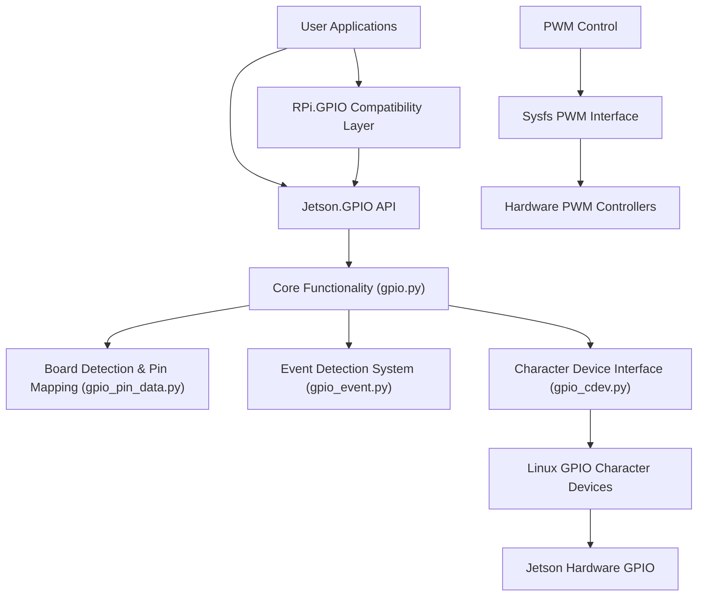
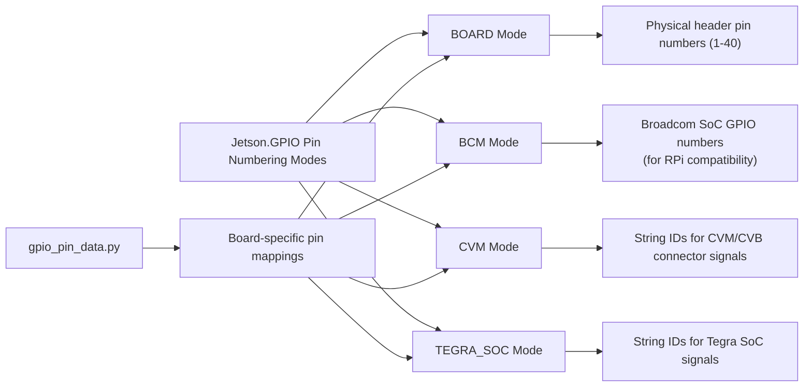
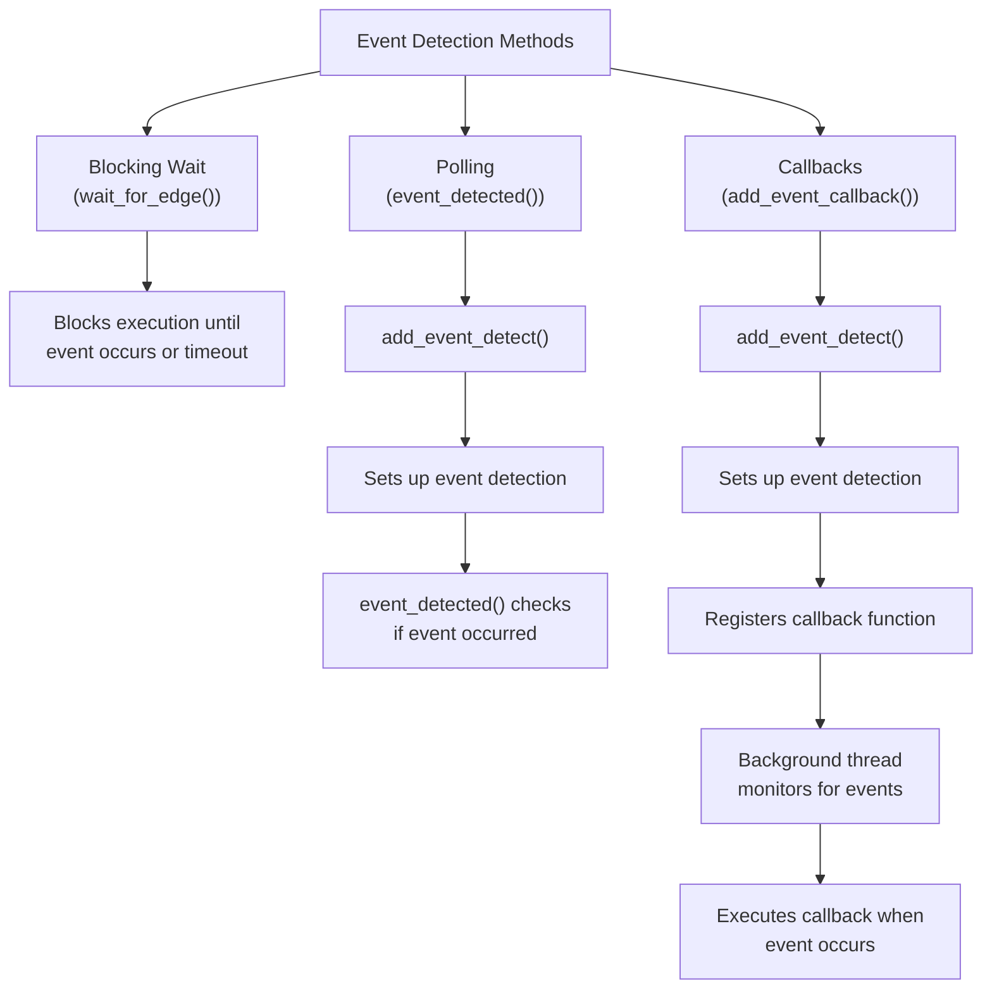

<!-- source: DeepWiki mcp.deepwiki.com · repo NVIDIA/jetson-gpio · page 1 Overview · fetched 2026-10-26 -->

# Overview

Relevant source files

The following files were used as context for generating this wiki page:

- [README.md](README.md)
- [debian/changelog](debian/changelog)
- [lib/python/Jetson/GPIO/__init__.py](lib/python/Jetson/GPIO/__init__.py)

Jetson.GPIO is a Python library that enables software control of General Purpose Input/Output (GPIO) pins on NVIDIA Jetson development boards. This library provides a user-friendly API for interfacing with external hardware through digital input/output operations, event detection, and PWM control.

The library was designed with compatibility in mind, offering the same API as the popular RPi.GPIO library for Raspberry Pi. This makes it straightforward to port applications from Raspberry Pi to Jetson platforms with minimal code changes.

For installation instructions and setting up required permissions, see [Getting Started](#2).

## Supported Hardware

Jetson.GPIO supports the following NVIDIA Jetson platforms:
- Jetson Nano (including 2GB variant)
- Jetson TX1
- Jetson TX2 (including TX2 NX variant)
- Jetson AGX Xavier (including Xavier NX and Industrial variants)
- Jetson AGX Orin (including Orin NX and Orin Nano variants)
- Clara AGX Xavier

Each supported board comes with board-specific pin mappings that are automatically detected and loaded by the library.

Sources: [README.md:3-8](), [debian/changelog]()

## Library Architecture

Jetson.GPIO is structured with a layered architecture that abstracts hardware differences between Jetson models while providing a consistent API to application developers.

The library consists of several key components:

1. **Core API (gpio.py)**: Implements the main GPIO functionality and exposes the API
2. **Pin Mapping (gpio_pin_data.py)**: Contains board-specific pin definitions
3. **Event System (gpio_event.py)**: Implements event detection and callback mechanisms
4. **Hardware Interface (gpio_cdev.py)**: Interfaces with Linux GPIO character devices
5. **RPi.GPIO Compatibility Layer**: Allows code written for Raspberry Pi to work on Jetson

Sources: [lib/python/Jetson/GPIO/__init__.py](), [README.md:19-23]()

## Version and Feature Evolution

Jetson.GPIO has evolved significantly since its initial release. Version 2.1.0 (February 2023) marked a significant transition from sysfs-based to character device-based implementation, improving performance and reliability. Recent versions have added support for newer boards like Jetson Orin Nano, Orin NX, and various improvements to functionality.

The current version is 2.1.9, which supports Jetson Orin Nano and Jetson Orin NX Super.

Sources: [lib/python/Jetson/GPIO/__init__.py:2](), [debian/changelog:1-16]()

## Pin Numbering Modes

One of the key features of Jetson.GPIO is its flexibility in pin numbering. The library supports four distinct pin numbering modes to accommodate different use cases:

- **BOARD**: Uses physical pin numbers on the 40-pin header (1-40)
- **BCM**: Uses Broadcom SoC GPIO numbers for Raspberry Pi compatibility
- **CVM**: Uses string identifiers for CVM/CVB connector signals
- **TEGRA_SOC**: Uses string identifiers for Tegra SoC signals

Developers must specify a pin numbering mode before using any GPIO functions.

Sources: [README.md:155-172]()

## Core Functionality

Jetson.GPIO provides a comprehensive set of functions for GPIO control:

| Function Category | Key Functions | Description |
|-------------------|---------------|-------------|
| Setup & Configuration | `setmode()`, `setup()` | Configure pin numbering mode and pin direction |
| Input Operations | `input()` | Read digital values from pins |
| Output Operations | `output()` | Write digital values to pins |
| Event Handling | `wait_for_edge()`, `add_event_detect()` | Detect and respond to pin state changes |
| PWM Control | `PWM()`, `start()`, `ChangeDutyCycle()` | Control Pulse Width Modulation on supported pins |
| Cleanup | `cleanup()` | Release resources and reset pins |

Sources: [README.md:137-409]()

## Event Detection System

The library offers three methods for detecting input changes (events) on GPIO pins:

1. **Blocking Wait**: Uses `wait_for_edge()` to pause program execution until an event occurs
2. **Polling**: Uses `add_event_detect()` and `event_detected()` to periodically check for events
3. **Callbacks**: Uses `add_event_detect()` with a callback function that runs automatically when an event occurs

The event system can detect rising edges, falling edges, or both, and includes features like debounce timing to prevent false triggers.

Sources: [README.md:291-398]()

## PWM Support

Jetson.GPIO supports hardware PWM (Pulse Width Modulation) on specific pins that are connected to hardware PWM controllers. Unlike RPi.GPIO, it does not provide software-emulated PWM.

PWM availability varies by board:
- Jetson Nano: 2 PWM channels
- Jetson AGX Xavier: 3 PWM channels
- Jetson TX1/TX2: No PWM channels
- Jetson Orin: Up to 8 PWM channels (depending on model)

Note that the system pinmux must be configured correctly for PWM signals to reach the pins. The library does not modify the pinmux configuration.

Sources: [README.md:410-424](), [debian/changelog:16-18]()

## Docker Support

The library can be used within Docker containers, with two approaches available:

1. **Privileged mode**: Allows automatic board detection by mapping `/proc/device-tree` paths
2. **Non-privileged mode**: Requires manually specifying the Jetson model through an environment variable

In both cases, the container needs access to `/dev/gpiochip0` to operate the GPIO pins.

Sources: [README.md:427-490]()

## Use Cases and Applications

Jetson.GPIO is suitable for a wide range of applications:

1. **Sensor Integration**: Reading from digital sensors, buttons, and switches
2. **Output Control**: Driving LEDs, relays, and other digital outputs
3. **Motor Control**: Using PWM for servo or DC motor speed control
4. **Embedded Systems**: Integrating Jetson boards into larger embedded systems
5. **Educational Projects**: Learning about GPIO and interfacing with hardware

Sample applications are provided in the repository to demonstrate these capabilities.

Sources: [README.md:85-135]()

---

