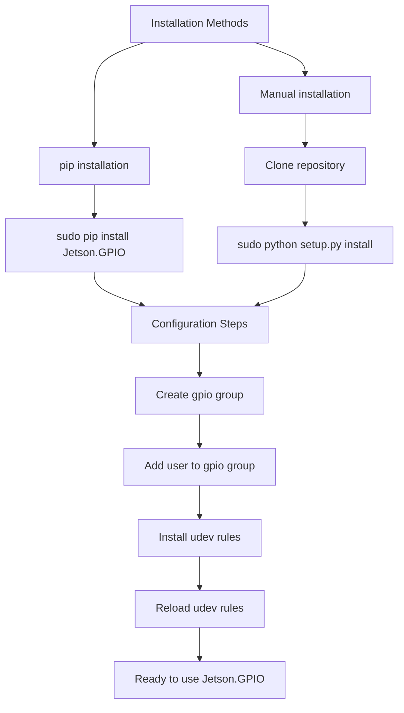
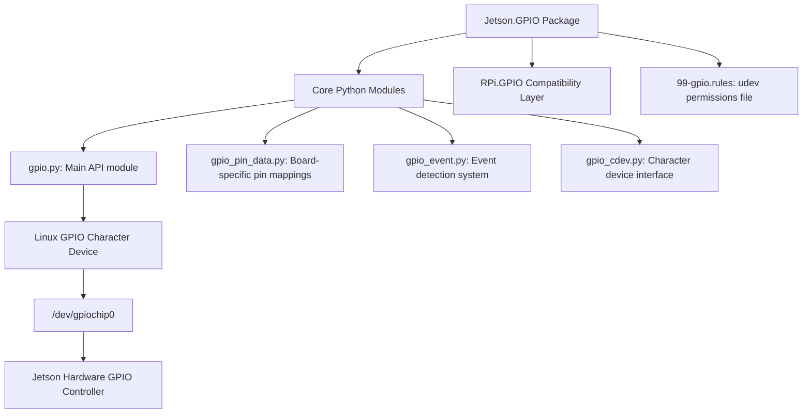

<!-- source: DeepWiki mcp.deepwiki.com · repo NVIDIA/jetson-gpio · page 2 Getting Started · fetched 2026-10-26 -->

# Getting Started

<details>
<summary>Relevant source files</summary>

The following files were used as context for generating this wiki page:

- [README.md](README.md)
- [debian/rules](debian/rules)
- [lib/python/Jetson/GPIO/99-gpio.rules](lib/python/Jetson/GPIO/99-gpio.rules)
- [setup.py](setup.py)

</details>


This page explains how to install the Jetson.GPIO library and set up your environment to begin working with GPIO pins on NVIDIA Jetson development boards. For information about specific API usage, see [API Reference](#3), and for hardware compatibility details, see [Hardware Support](#4).

## Installation Process Overview

The Jetson.GPIO library can be installed using either pip or manual installation from source. After installation, user permissions must be configured to allow non-root access to GPIO pins.

### Installation Diagram



Sources: [setup.py:31-46](), [README.md:33-52]()

## Installation Methods

### Using pip

The easiest way to install the library is using pip:

```bash
sudo pip install Jetson.GPIO
```

For Python 3:

```bash
sudo pip3 install Jetson.GPIO
```

This installs the current version of the library (2.1.9) along with all necessary dependencies.

Sources: [setup.py:31-34](), [README.md:38-42]()

### Manual Installation

Alternatively, you can clone the repository or download it as an archive:

1. Clone the repository or download and extract the archive
2. Navigate to the extracted directory
3. Install using setup.py:

```bash
sudo python setup.py install
```

When installed using either method, the library's files are placed in your Python package directory, including the main modules and configuration files.

Sources: [README.md:44-52]()

## System Components Installed

The installation process places several key components in your system:



Sources: [README.md:16-23]()

## Setting Up User Permissions

To use GPIO pins without root privileges, you must set up proper user permissions:

1. Create a GPIO user group (if it doesn't already exist):
```bash
sudo groupadd -f -r gpio
```

2. Add your user to this group:
```bash
sudo usermod -a -G gpio your_user_name
```

3. Install the custom udev rules file to set appropriate permissions:

   If you installed via pip:
   ```bash
   sudo cp venv/lib/pythonXX/site-packages/Jetson/GPIO/99-gpio.rules /etc/udev/rules.d/
   ```
   
   If you installed from source:
   ```bash
   sudo cp lib/python/Jetson/GPIO/99-gpio.rules /etc/udev/rules.d/
   ```

4. Reload the udev rules:
```bash
sudo udevadm control --reload-rules && sudo udevadm trigger
```

5. Log out and log back in for the group changes to take effect.

The udev rules file (99-gpio.rules) configures permissions for GPIO, PWM, and SPI device access:

| Device Type | Permission | Description |
|-------------|------------|-------------|
| GPIO | 660 (rw-rw----) | Gives read-write access to GPIO devices to members of gpio group |
| PWM | 660 (rw-rw----) | Allows PWM control for gpio group members |
| SPI | 660 (rw-rw----) | Provides SPI interface access for gpio group members |

Sources: [README.md:54-83](), [lib/python/Jetson/GPIO/99-gpio.rules:22-31]()

## Verifying Your Installation

You can verify your installation by running one of the sample scripts provided in the repository:

```bash
python samples/simple_output.py
```

This will output alternating high and low values at BCM pin 18 (or board pin 12 on the header) every 2 seconds. If you've connected an LED with an appropriate resistor to this pin, it should blink.

Other sample scripts available include:

| Script | Description |
|--------|-------------|
| simple_input.py | Reads input from BCM pin 12 |
| simple_output.py | Toggles output on BCM pin 18 |
| button_led.py | Controls an LED with a button press |
| button_event.py | Uses blocking wait for button events |
| button_interrupt.py | Demonstrates interrupt-based button handling |

Sources: [README.md:85-117]()

## Docker Integration

The Jetson.GPIO library can also be used within Docker containers. For detailed instructions, please refer to the [Docker Integration](#5.1) page.

Sources: [README.md:427-490]()

## Next Steps

Now that you've installed and configured Jetson.GPIO, you can:

- Learn about the various [Pin Numbering](#3.1) systems
- Explore [Basic GPIO Operations](#3.2) for input and output
- Try [Event Detection](#3.3) for responding to GPIO events
- Experiment with [PWM](#3.4) for pulse width modulation

For a complete reference of the API, see the [API Reference](#3) page.

---

