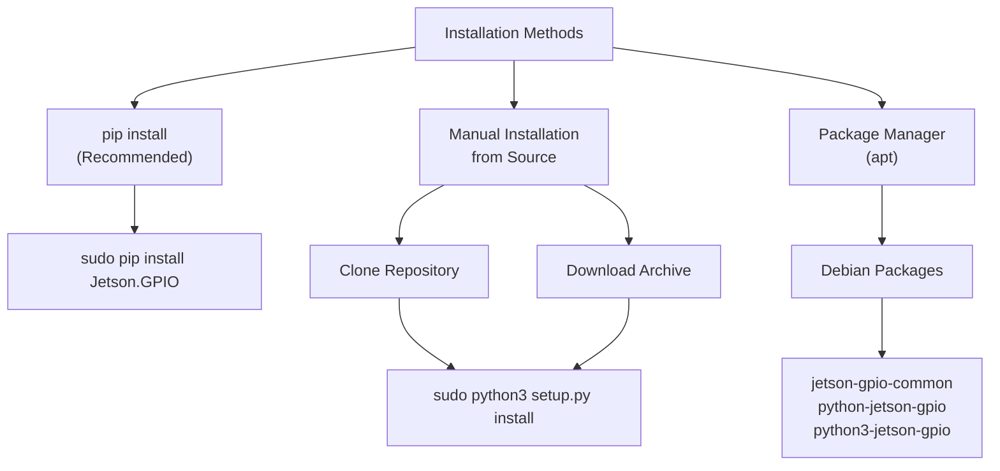
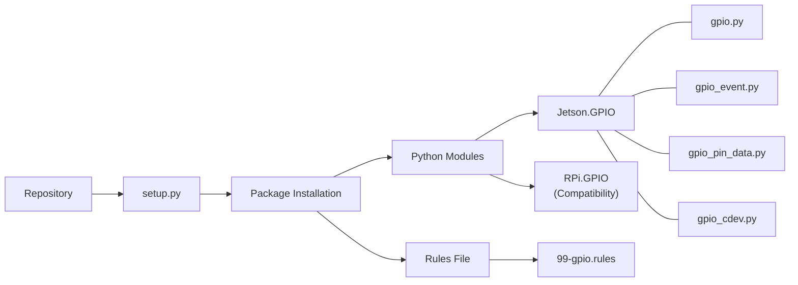
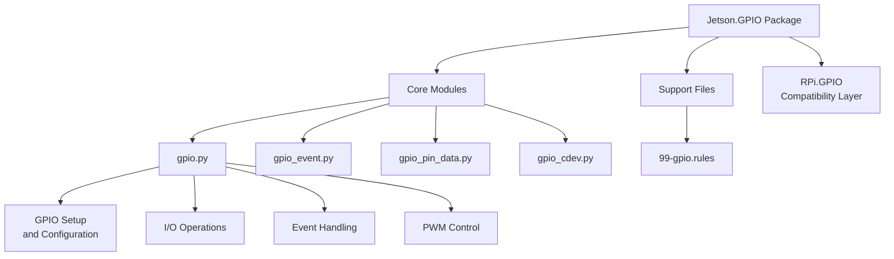

<!-- source: DeepWiki mcp.deepwiki.com · repo NVIDIA/jetson-gpio · page 2.1 Installation · fetched 2026-10-26 -->

# Installation

<details>
<summary>Relevant source files</summary>

The following files were used as context for generating this wiki page:

- [MANIFEST.in](MANIFEST.in)
- [README.md](README.md)
- [debian/control](debian/control)
- [setup.py](setup.py)

</details>


This document details the various methods for installing the Jetson.GPIO library on supported NVIDIA Jetson development boards. The Jetson.GPIO library enables Python applications to control GPIO pins for digital input and output. For information about setting up permissions after installation, see [Setting Up Permissions](#2.2).

## Overview of Installation Methods

The Jetson.GPIO library can be installed using different methods depending on your preferences and requirements.



Sources: [README.md:35-52]()(setup.py:21-46)()

## System Requirements

Before installing Jetson.GPIO, ensure your system meets the following requirements:

| Requirement | Details |
|-------------|---------|
| **Hardware** | Jetson TX1, TX2, AGX Xavier, Nano, or newer Jetson boards |
| **Python Version** | Python 2.7 or Python 3.x |
| **Operating System** | Linux for Tegra (L4T) |

Sources: [README.md:3-8](), [setup.py:23-29]()

## Installation using pip (Recommended)

The simplest and recommended method to install Jetson.GPIO is using Python's package manager `pip`. This automatically handles package dependencies and makes upgrading easier.

```bash
sudo pip install Jetson.GPIO
```

For Python 3 specifically, use:

```bash
sudo pip3 install Jetson.GPIO
```

Sources: [README.md:38-42]()

## Manual Installation from Source

You can also install Jetson.GPIO directly from the source code, which allows you to access the latest development version or make custom modifications.



### Steps for manual installation:

1. **Clone the repository or download the archive**:
   ```bash
   git clone https://github.com/NVIDIA/jetson-gpio.git
   cd jetson-gpio
   ```

2. **Install using setup.py**:
   ```bash
   sudo python3 setup.py install
   ```

3. **Alternative: Use directly without installing**:
   You can also use the library directly from the downloaded directory by setting the PYTHONPATH environment variable:
   ```bash
   export PYTHONPATH=/path/to/jetson-gpio:$PYTHONPATH
   ```

Sources: [README.md:44-52](), [setup.py:31-46]()

## Installation using Package Manager

The Jetson.GPIO library is also available as Debian packages for Jetson platforms. These packages include:

- **jetson-gpio-common**: Common files required by both Python versions
- **python-jetson-gpio**: Python 2.x version of the library
- **python3-jetson-gpio**: Python 3.x version of the library

To install using apt:

```bash
sudo apt update
sudo apt install python3-jetson-gpio
```

Sources: [debian/control:19-37]()

## Package Structure

After installation, the Jetson.GPIO library is structured as follows:



The installed package includes:

1. **Core Python Modules**:
   - `gpio.py`: Main functionality implementation
   - `gpio_event.py`: Event detection system
   - `gpio_pin_data.py`: Board-specific pin mappings
   - `gpio_cdev.py`: Character device interface

2. **Support Files**:
   - `99-gpio.rules`: udev rules for setting up permissions

3. **Raspberry Pi Compatibility Layer**:
   - `RPi.GPIO`: Compatibility API for Raspberry Pi GPIO code

Sources: [setup.py:42-45](), [README.md:19-23](), [MANIFEST.in:1-4]()

## Verifying Installation

After installation, you can verify that Jetson.GPIO was installed correctly by importing it in Python:

```python
import Jetson.GPIO as GPIO
print(GPIO.VERSION)
```

This should print the installed version of the library without any errors.

## Next Steps

After successful installation, you need to configure proper permissions to use GPIO pins without root privileges. See [Setting Up Permissions](#2.2) for detailed instructions on adding your user to the appropriate groups and setting up udev rules.

Sources: [README.md:54-83]()

## Troubleshooting

### Common Installation Issues

| Issue | Solution |
|-------|----------|
| **Permission denied during pip install** | Use `sudo` with pip install command |
| **Package not found in pip** | Ensure internet connectivity and try updating pip with `pip install --upgrade pip` |
| **ImportError after installation** | Verify Python version compatibility and check if the package was installed in the correct Python environment |
| **Conflicts with existing packages** | Consider using a virtual environment for isolation |

### Version Conflicts

If you have multiple versions installed or are upgrading from an older version, you may encounter conflicts. In such cases:

1. Uninstall the existing version:
   ```bash
   sudo pip uninstall Jetson.GPIO
   ```

2. Install the desired version:
   ```bash
   sudo pip install Jetson.GPIO==2.1.9
   ```

Sources: [setup.py:32]()

---

