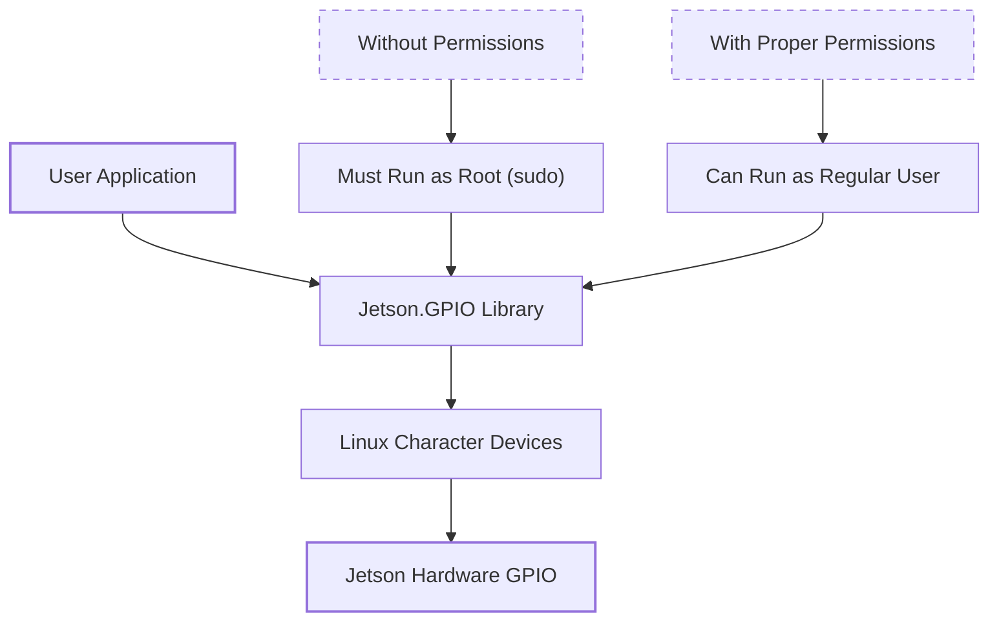
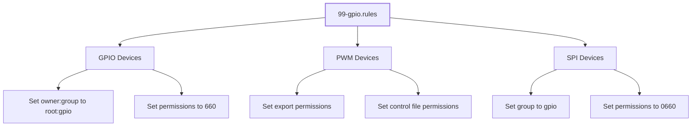
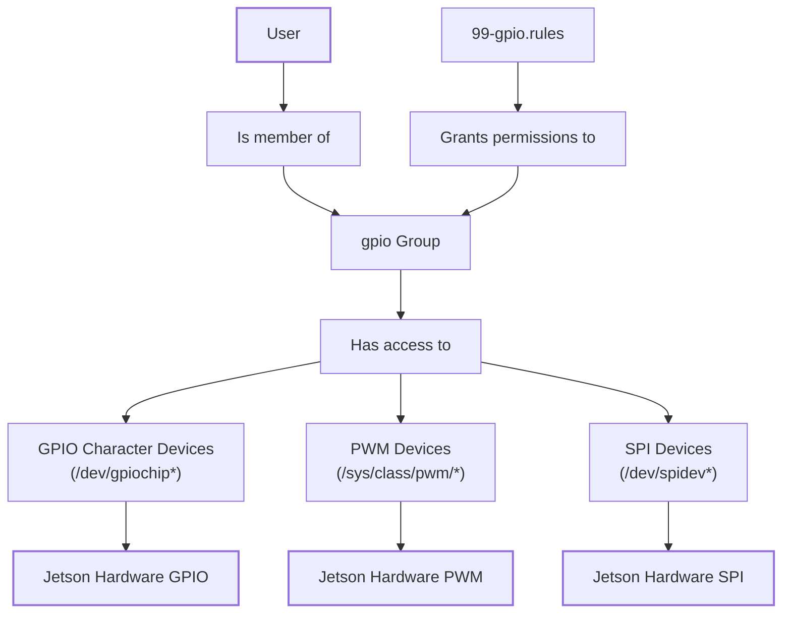

<!-- source: DeepWiki mcp.deepwiki.com · repo NVIDIA/jetson-gpio · page 2.2 Setting Up Permissions · fetched 2026-10-26 -->

# Setting Up Permissions

<details>
<summary>Relevant source files</summary>

The following files were used as context for generating this wiki page:

- [README.md](README.md)
- [lib/python/Jetson/GPIO/99-gpio.rules](lib/python/Jetson/GPIO/99-gpio.rules)
- [samples/run_sample.sh](samples/run_sample.sh)

</details>


This document explains how to configure your system to allow non-root users to access GPIO pins on NVIDIA Jetson devices. Proper permissions are essential for running GPIO applications without requiring superuser privileges, which is both more convenient and more secure.

For information about installing the Jetson.GPIO library, see [Installation](#2.1).

## Why Permissions Matter

By default, Linux systems restrict access to hardware devices for security reasons. The GPIO pins on Jetson boards are controlled through character devices (`/dev/gpiochip*`) that require specific permissions to access. Without proper configuration, you would need to run all GPIO applications as root, which is a security risk.



Sources: [README.md:54-58]()

## Permission Setup Process

Setting up proper permissions involves three main steps:

1. Creating a dedicated user group for GPIO access
2. Adding users to this group
3. Installing custom udev rules
4. Applying the new rules


Sources: [README.md:54-83]()

## Step-by-Step Instructions

### 1. Create the GPIO Group

First, create a new system group called `gpio`:

```bash
sudo groupadd -f -r gpio
```

The `-f` flag ensures the command doesn't fail if the group already exists, and `-r` creates a system group.

Sources: [README.md:61-62]()

### 2. Add User to the GPIO Group

Add your user account to the newly created group:

```bash
sudo usermod -a -G gpio your_user_name
```

Replace `your_user_name` with your actual username. The `-a` option adds the user to the group without removing them from other groups, and `-G` specifies which group to add the user to.

Sources: [README.md:61-62]()

### 3. Install udev Rules

The Jetson.GPIO library comes with a udev rules file called `99-gpio.rules` that needs to be copied to the system's udev rules directory.

If you downloaded the source code:

```bash
sudo cp lib/python/Jetson/GPIO/99-gpio.rules /etc/udev/rules.d/
```

If you installed the library using pip into a virtual environment:

```bash
sudo cp venv/lib/pythonNN/site-packages/Jetson/GPIO/99-gpio.rules /etc/udev/rules.d/
```

Replace `pythonNN` with your Python version (e.g., `python3.8`).

Sources: [README.md:65-77]()

### 4. Apply the Rules

For the new udev rules to take effect, either reboot your system or reload the rules:

```bash
sudo udevadm control --reload-rules && sudo udevadm trigger
```

This command reloads the rules and triggers udev to apply them immediately.

Sources: [README.md:79-83]()

## Understanding the udev Rules

The `99-gpio.rules` file contains rules that modify permissions for GPIO-related devices to allow members of the `gpio` group to access them.



The rule file applies permission changes to three types of devices:

1. **GPIO Character Devices** (`gpiochip*`): Sets owner to root, group to gpio, and permissions to 660 (read/write for owner and group)
2. **PWM Devices** (`pwmchip*`): Sets permissions for export/unexport and control files (period, duty_cycle, enable)
3. **SPI Devices** (`spidev*`): Sets group to gpio and permissions to 0660

Sources: [lib/python/Jetson/GPIO/99-gpio.rules:22-31]()

## Verifying Permissions

After setting up permissions, you can verify they're correctly applied by:

1. Checking if you're in the `gpio` group:
   ```bash
   groups
   ```
   Your username should appear in the list of groups.

2. Checking device permissions:
   ```bash
   ls -l /dev/gpiochip*
   ```
   The devices should show `crw-rw----` permissions with group `gpio`.

## Permission Architecture

The following diagram shows how the permission system interacts with the GPIO hardware:



Sources: [lib/python/Jetson/GPIO/99-gpio.rules:22-31](), [README.md:54-83]()

## Troubleshooting Permission Issues

If you encounter permission-related errors when using the Jetson.GPIO library, check the following:

1. **User not in gpio group**: Make sure your user is added to the gpio group and you've logged out and back in (or restarted) for the group membership to take effect.

2. **Rules not applied**: Verify that the udev rules file exists in `/etc/udev/rules.d/` and that the rules have been applied.

3. **File paths**: If you installed the library in a non-standard location, make sure you're copying the rules file from the correct path.

4. **System updates**: If you've updated your system, the permissions might need to be reapplied.

## Using GPIO from Docker Containers

When using the Jetson GPIO library from Docker containers, special considerations for permissions are needed. The container needs access to the GPIO devices:

```bash
sudo docker container run -it --rm \
--device /dev/gpiochip0 \
your_image
```

For more details on using GPIO with Docker, see [Docker Integration](#5.1).

Sources: [README.md:427-448]()

## Summary

Proper permission setup is crucial for using the Jetson GPIO library without root privileges. By creating a gpio group, adding your user to it, and applying the provided udev rules, you can securely access GPIO, PWM, and SPI functionality on your Jetson device.

After completing these steps, you'll be ready to run the sample applications or your own GPIO code as a regular user. For examples of using the library, see the next sections of the documentation.

Sources: [README.md:54-83](), [lib/python/Jetson/GPIO/99-gpio.rules:22-31]()

---

