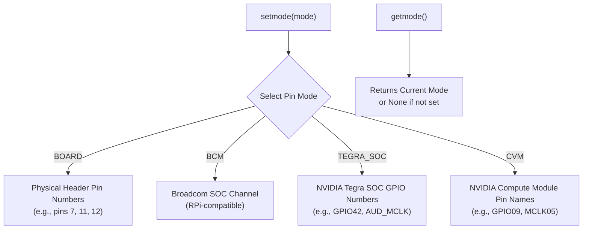
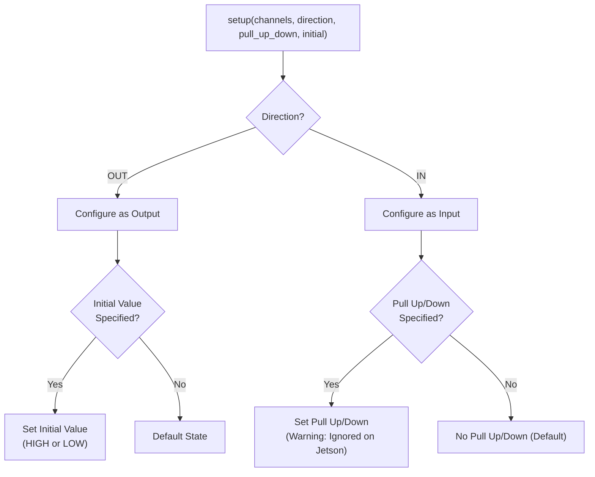
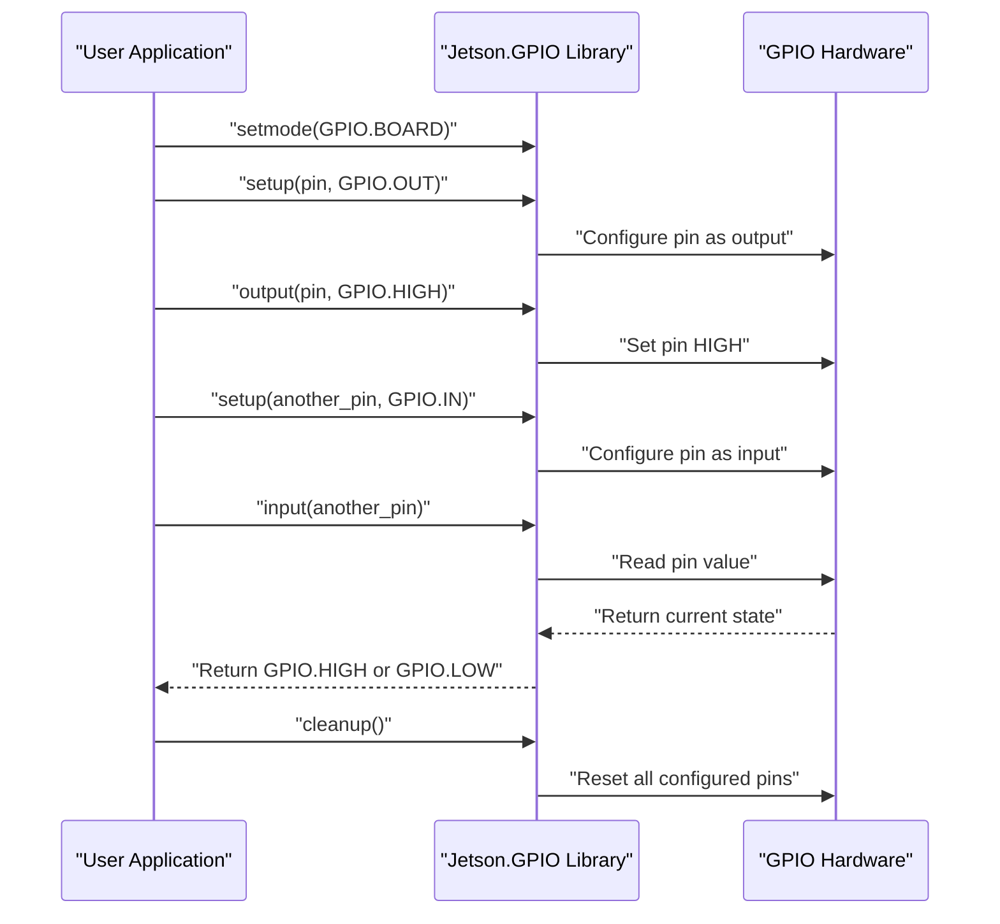
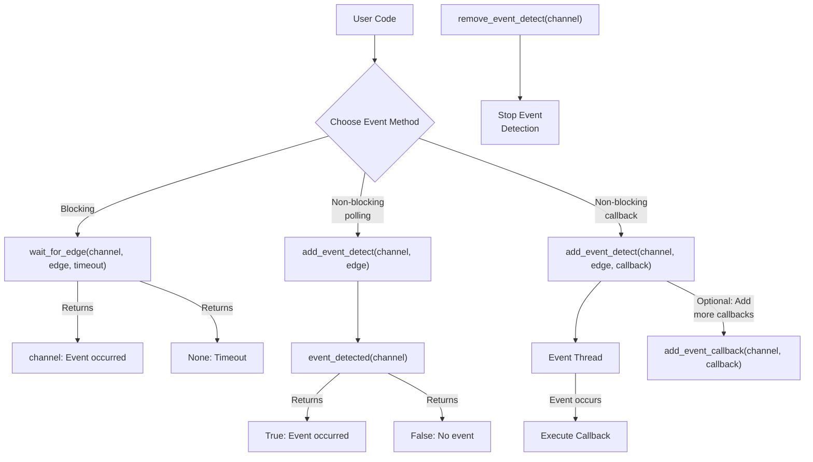
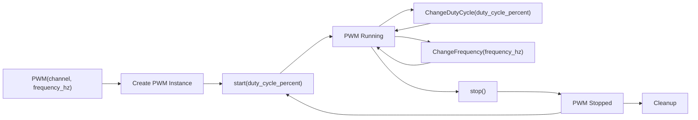

<!-- source: DeepWiki mcp.deepwiki.com · repo NVIDIA/jetson-gpio · page 3 API Reference · fetched 2026-10-26 -->

# API Reference

<details>
<summary>Relevant source files</summary>

The following files were used as context for generating this wiki page:

- [lib/python/Jetson/GPIO/__init__.py](lib/python/Jetson/GPIO/__init__.py)
- [lib/python/Jetson/GPIO/gpio.py](lib/python/Jetson/GPIO/gpio.py)
- [samples/test_all_apis.py](samples/test_all_apis.py)

</details>


This document provides a comprehensive reference for the Jetson.GPIO library API, which allows Python applications to control GPIO pins on NVIDIA Jetson development boards. The API enables digital input/output operations, event detection, and PWM control.

For installation instructions, see [Getting Started](#2). For detailed pin mapping information, see [Pin Mappings](#4.2).

## Pin Numbering Modes

Jetson.GPIO supports multiple pin numbering systems to accommodate different needs.



The pin numbering mode must be set before any GPIO operations using `setmode()`.

| Mode Constant | Value | Description |
|---------------|-------|-------------|
| `BOARD` | 10 | Physical pin numbers on the J41 header |
| `BCM` | 11 | Broadcom SOC channel numbering (RPi-compatible) |
| `TEGRA_SOC` | 1000 | NVIDIA Tegra SOC GPIO numbering |
| `CVM` | 1001 | NVIDIA Compute Module pin numbering |

```python
# Example: Setting pin mode to BOARD
GPIO.setmode(GPIO.BOARD)
```

Sources: [lib/python/Jetson/GPIO/gpio.py:36-42](), [lib/python/Jetson/GPIO/gpio.py:285-306]()

## GPIO Setup and Configuration

### Setting Up Pins

Before using GPIO pins, they must be configured as either inputs or outputs using the `setup()` function.



| Parameter | Description |
|-----------|-------------|
| `channels` | Single pin number or tuple/list of pin numbers |
| `direction` | `GPIO.IN` or `GPIO.OUT` |
| `pull_up_down` | `GPIO.PUD_OFF` (default), `GPIO.PUD_UP`, or `GPIO.PUD_DOWN` (note: ignored on Jetson) |
| `initial` | For outputs only: `GPIO.HIGH` or `GPIO.LOW` (initial state) |

```python
# Example: Setup a single pin as input
GPIO.setup(channel, GPIO.IN)

# Example: Setup multiple pins as outputs with initial values
GPIO.setup((channel1, channel2), GPIO.OUT, initial=(GPIO.HIGH, GPIO.LOW))
```

Sources: [lib/python/Jetson/GPIO/gpio.py:324-363]()

### Cleaning Up

When finished with GPIO operations, resources should be released using `cleanup()`.

```python
# Cleanup specific channel
GPIO.cleanup(channel)

# Cleanup all channels
GPIO.cleanup()
```

The `cleanup()` function:
- Releases channels that were set up in the current program
- Turns off event detection
- Disables PWM
- Resets pin modes to their default state

Sources: [lib/python/Jetson/GPIO/gpio.py:366-387]()

## Basic GPIO Operations

### Reading Input

Read the value of a pin configured as input using the `input()` function.

```python
# Returns GPIO.HIGH or GPIO.LOW
value = GPIO.input(channel)
```

Sources: [lib/python/Jetson/GPIO/gpio.py:390-400]()

### Writing Output

Set the value of a pin configured as output using the `output()` function.

```python
# Set a single channel
GPIO.output(channel, GPIO.HIGH)

# Set multiple channels to the same value
GPIO.output((channel1, channel2), GPIO.HIGH)

# Set multiple channels to different values
GPIO.output((channel1, channel2), (GPIO.HIGH, GPIO.LOW))
```

Sources: [lib/python/Jetson/GPIO/gpio.py:403-419]()



## Event Detection

The library provides several methods to detect and respond to changes in GPIO pin states:

### Blocking Wait for Edge

```python
# Block until a rising edge is detected or timeout occurs
GPIO.wait_for_edge(channel, GPIO.RISING, timeout=1000)  # timeout in ms
```

### Non-blocking Event Detection

```python
# Add event detection without a callback
GPIO.add_event_detect(channel, GPIO.FALLING)

# Check if an event has occurred
if GPIO.event_detected(channel):
    # Event occurred
    pass
```

### Event Callbacks

```python
# Add event detection with a callback
def my_callback(channel):
    print(f"Event detected on channel {channel}")

GPIO.add_event_detect(channel, GPIO.BOTH, callback=my_callback)

# Add additional callback to an existing event detection
GPIO.add_event_callback(channel, another_callback)

# Remove event detection
GPIO.remove_event_detect(channel)
```



Edge detection constants:
- `GPIO.RISING`: Detect rising edge (LOW to HIGH transition)
- `GPIO.FALLING`: Detect falling edge (HIGH to LOW transition)
- `GPIO.BOTH`: Detect both rising and falling edges

Sources: [lib/python/Jetson/GPIO/gpio.py:429-504](), [lib/python/Jetson/GPIO/gpio.py:507-557]()

## PWM (Pulse Width Modulation)

Jetson.GPIO provides hardware PWM support through the `PWM` class.



Example usage:

```python
# Create PWM instance at 100 Hz
pwm = GPIO.PWM(channel, 100)

# Start PWM with 50% duty cycle
pwm.start(50)

# Change duty cycle to 75%
pwm.ChangeDutyCycle(75)

# Change frequency to 200 Hz
pwm.ChangeFrequency(200)

# Stop PWM
pwm.stop()

# Cleanup
GPIO.cleanup()
```

Notes:
- PWM is only available on certain pins (see [Pin Mappings](#4.2))
- PWM frequency range depends on the hardware capabilities
- Duty cycle must be between 0 (always off) and 100 (always on)

Sources: [lib/python/Jetson/GPIO/gpio.py:571-652]()

## Other Functions

### Get Current Pin Function

`gpio_function(channel)` returns the current configuration of a GPIO pin.

```python
function = GPIO.gpio_function(channel)
# Returns GPIO.IN, GPIO.OUT, or GPIO.UNKNOWN
```

Sources: [lib/python/Jetson/GPIO/gpio.py:560-568]()

### Control Warnings

```python
# Enable warnings (default)
GPIO.setwarnings(True)

# Disable warnings
GPIO.setwarnings(False)
```

Sources: [lib/python/Jetson/GPIO/gpio.py:278-282]()

## Constants Reference

### Pin States

| Constant | Value | Description |
|----------|-------|-------------|
| `HIGH` | 1 | Logic high level |
| `LOW` | 0 | Logic low level |

### Pin Directions

| Constant | Value | Description |
|----------|-------|-------------|
| `IN` | 1 | Configure pin as input |
| `OUT` | 0 | Configure pin as output |
| `UNKNOWN` | -1 | Pin is not yet configured |
| `HARD_PWM` | 43 | Pin is configured for hardware PWM |

### Pull-up/down Resistors

| Constant | Value | Description |
|----------|-------|-------------|
| `PUD_OFF` | 20 | No pull-up/down |
| `PUD_DOWN` | 21 | Pull-down resistor enabled |
| `PUD_UP` | 22 | Pull-up resistor enabled |

Note: Pull-up/down settings are ignored on Jetson boards as they are not supported by the hardware.

### Edge Detection

| Constant | Value | Description |
|----------|-------|-------------|
| `RISING` | 31 | Detect rising edge (LOW to HIGH) |
| `FALLING` | 32 | Detect falling edge (HIGH to LOW) |
| `BOTH` | 33 | Detect both edges |

Sources: [lib/python/Jetson/GPIO/gpio.py:37-67]()

## Full API Overview

```mermaid
classDiagram
    class "GPIO" {
        +BOARD
        +BCM
        +TEGRA_SOC
        +CVM
        +IN
        +OUT
        +HIGH
        +LOW
        +RISING
        +FALLING
        +BOTH
        +PUD_OFF
        +PUD_UP
        +PUD_DOWN
        +setmode(mode)
        +getmode()
        +setup(channels, direction, pull_up_down, initial)
        +cleanup(channel)
        +input(channel)
        +output(channels, values)
        +wait_for_edge(channel, edge, bouncetime, timeout)
        +add_event_detect(channel, edge, callback, bouncetime)
        +event_detected(channel)
        +add_event_callback(channel, callback)
        +remove_event_detect(channel)
        +gpio_function(channel)
        +setwarnings(state)
    }
    
    class "PWM" {
        +__init__(channel, frequency_hz)
        +start(duty_cycle_percent)
        +ChangeFrequency(frequency_hz)
        +ChangeDutyCycle(duty_cycle_percent)
        +stop()
    }
    
    GPIO --> PWM : creates
```

Sources: [lib/python/Jetson/GPIO/gpio.py:1-653](), [lib/python/Jetson/GPIO/__init__.py:1-3]()

---

