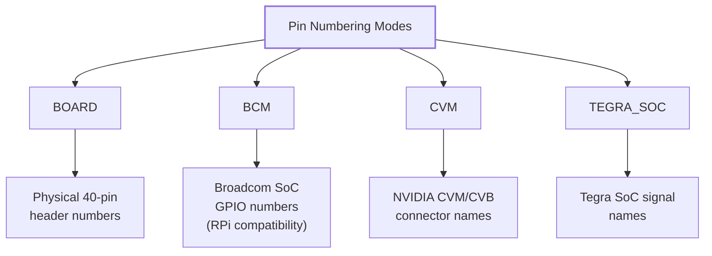
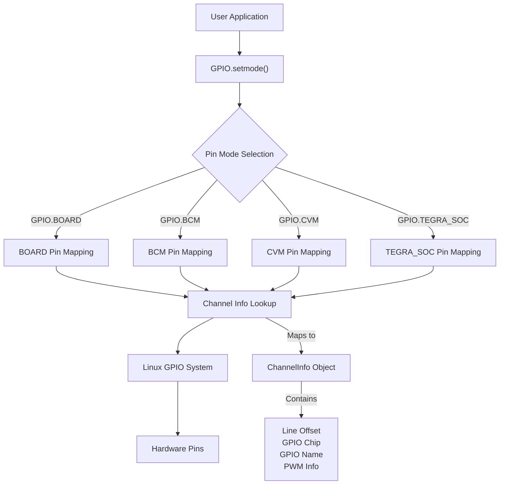
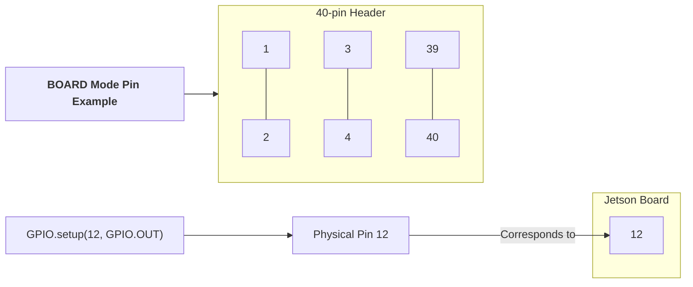
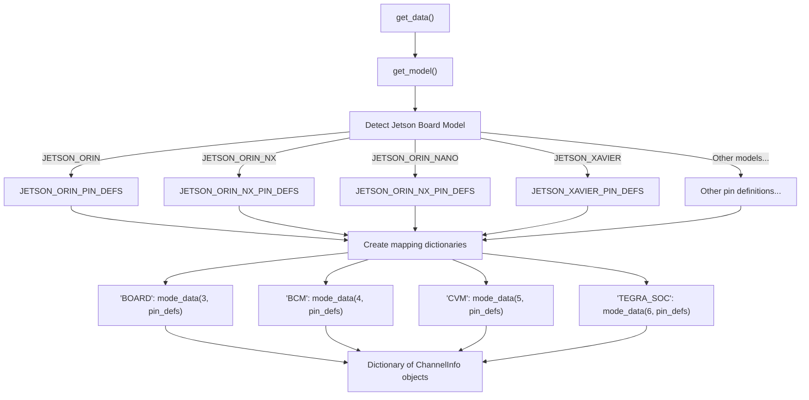

<!-- source: DeepWiki mcp.deepwiki.com · repo NVIDIA/jetson-gpio · page 3.1 Pin Numbering · fetched 2026-10-26 -->

# Pin Numbering

<details>
<summary>Relevant source files</summary>

The following files were used as context for generating this wiki page:

- [README.md](README.md)
- [lib/python/Jetson/GPIO/gpio.py](lib/python/Jetson/GPIO/gpio.py)
- [lib/python/Jetson/GPIO/gpio_pin_data.py](lib/python/Jetson/GPIO/gpio_pin_data.py)

</details>


## Purpose

This page explains the pin numbering systems used in the Jetson GPIO library. Understanding pin numbering is essential for correctly identifying and accessing GPIO pins on Jetson development boards. The Jetson.GPIO library provides multiple pin numbering modes to accommodate different development approaches and to ease porting of code from other platforms such as Raspberry Pi.

For information about the physical pin mappings for specific Jetson boards, see [Pin Mappings](#4.2).

Sources: [README.md:154-180](), [lib/python/Jetson/GPIO/gpio.py:37-41]()

## Pin Numbering Modes

The Jetson GPIO library supports four different pin numbering modes:



Each mode provides a different way to reference the same physical pins:

1. **BOARD Mode** - Uses physical pin numbers on the 40-pin header (integers)
2. **BCM Mode** - Uses Broadcom SoC GPIO numbers for Raspberry Pi compatibility (integers)
3. **CVM Mode** - Uses NVIDIA Computer Vision Module/Board connector signal names (strings)
4. **TEGRA_SOC Mode** - Uses NVIDIA Tegra SoC signal names (strings)

Sources: [lib/python/Jetson/GPIO/gpio.py:37-41](), [README.md:154-172]()

## Setting the Pin Numbering Mode

Before using any GPIO functions, you must specify which pin numbering mode you want to use:

```python
import Jetson.GPIO as GPIO

# Choose one of the following:
GPIO.setmode(GPIO.BOARD)  # Use physical board pin numbers
GPIO.setmode(GPIO.BCM)    # Use Broadcom SoC GPIO numbers
GPIO.setmode(GPIO.CVM)    # Use NVIDIA CVM/CVB connector signal names
GPIO.setmode(GPIO.TEGRA_SOC)  # Use Tegra SoC signal names
```

You can check which mode is currently set:

```python
mode = GPIO.getmode()  # Returns GPIO.BOARD, GPIO.BCM, GPIO.CVM, GPIO.TEGRA_SOC, or None
```

The library will raise a `RuntimeError` if you attempt to use GPIO functions without first setting the pin numbering mode.

Sources: [lib/python/Jetson/GPIO/gpio.py:87-312](), [README.md:162-180]()

## Pin Numbering System Implementation

The following diagram shows how the pin numbering system is implemented in the Jetson GPIO library:



Internally, each pin reference (whether it's a board pin number, BCM number, or a signal name) is mapped to a `ChannelInfo` object that contains all the necessary information to access the actual hardware pin through the Linux GPIO system.

Sources: [lib/python/Jetson/GPIO/gpio_pin_data.py:475-496](), [lib/python/Jetson/GPIO/gpio.py:70-75]()

## BOARD Mode

BOARD mode uses the physical pin numbers on the 40-pin GPIO header of the Jetson development board. This is the most straightforward mode for beginners and when working directly with the physical hardware.

### Key characteristics:

- Uses integer values corresponding to the physical pin numbers (1-40)
- Consistent across different Jetson models for common pins
- Easy to locate pins when looking at the physical board



The BOARD pin definition for each supported Jetson board is in the 4th position of the pin definition tuples in the `gpio_pin_data.py` file.

Sources: [lib/python/Jetson/GPIO/gpio_pin_data.py:44](), [lib/python/Jetson/GPIO/gpio_pin_data.py:656-661]()

## BCM Mode

BCM mode uses the Broadcom SoC GPIO numbering, which is designed for compatibility with code written for Raspberry Pi. This mode allows for easier porting of existing Raspberry Pi GPIO code to Jetson platforms.

### Key characteristics:

- Uses integer values that do not correspond to physical pin locations
- Designed for compatibility with Raspberry Pi code
- Pin numbers generally differ from BOARD mode numbers

The BCM pin definition for each supported Jetson board is in the 5th position of the pin definition tuples in the `gpio_pin_data.py` file.

Sources: [lib/python/Jetson/GPIO/gpio_pin_data.py:45](), [lib/python/Jetson/GPIO/gpio_pin_data.py:656-661]()

## CVM and TEGRA_SOC Modes

These modes use string-based pin names instead of integer pin numbers:

### CVM Mode:
- Uses signal names from the NVIDIA Computer Vision Module/Board (CVM/CVB) connector
- Examples: 'GPIO09', 'UART1_RTS', 'I2S0_SCLK'

### TEGRA_SOC Mode:
- Uses signal names directly from the NVIDIA Tegra SoC
- Examples: 'GP167', 'GP72_UART1_RTS_N', 'GP122'

These modes are more technical but can be useful for developers working directly with the Jetson hardware specifications or when referencing NVIDIA's technical documentation.

The CVM pin name definition is in the 6th position, and the TEGRA_SOC pin name definition is in the 7th position of the pin definition tuples in the `gpio_pin_data.py` file.

Sources: [lib/python/Jetson/GPIO/gpio_pin_data.py:46-47](), [lib/python/Jetson/GPIO/gpio_pin_data.py:656-661]()

## Pin Data Structure

The following table shows a simplified example of how the pin mappings are structured for a few pins on the Jetson Orin NX:

| Linux GPIO | Linux GPIO Name | GPIO Chip | BOARD | BCM | CVM | TEGRA_SOC |
|------------|-----------------|-----------|-------|-----|-----|-----------|
| 144 | PAC.06 | tegra234-gpio | 7 | 4 | GPIO09 | GP167 |
| 112 | PR.04 | tegra234-gpio | 11 | 17 | UART1_RTS | GP72_UART1_RTS_N |
| 50 | PH.07 | tegra234-gpio | 12 | 18 | I2S0_SCLK | GP122 |
| 122 | PY.00 | tegra234-gpio | 13 | 27 | SPI1_SCK | GP36_SPI3_CLK |

Each row represents a single physical pin on the Jetson board, with mappings to all four pin numbering modes. The library uses these mappings to translate between your chosen numbering mode and the actual Linux GPIO system.

Sources: [lib/python/Jetson/GPIO/gpio_pin_data.py:53-75]()

## Internal Mapping Implementation

The pin mappings are loaded based on the detected Jetson board model:



When you call `GPIO.setmode()`, the library selects the appropriate mapping dictionary based on your chosen mode. Then, when you reference a pin in your code, the library looks up the corresponding `ChannelInfo` object to access the correct GPIO pin.

Sources: [lib/python/Jetson/GPIO/gpio_pin_data.py:613-663](), [lib/python/Jetson/GPIO/gpio.py:285-307]()

## Usage Example

Here's an example showing how to use different pin numbering modes:

```python
import Jetson.GPIO as GPIO
import time

# Using BOARD mode
GPIO.setmode(GPIO.BOARD)
GPIO.setup(12, GPIO.OUT)  # Using physical pin 12
GPIO.output(12, GPIO.HIGH)
time.sleep(1)
GPIO.cleanup()

# Using BCM mode
GPIO.setmode(GPIO.BCM)
GPIO.setup(18, GPIO.OUT)  # Using BCM pin 18 (same as physical pin 12)
GPIO.output(18, GPIO.HIGH)
time.sleep(1)
GPIO.cleanup()

# Using CVM mode
GPIO.setmode(GPIO.CVM)
GPIO.setup('I2S0_SCLK', GPIO.OUT)  # Using CVM signal name (same as physical pin 12)
GPIO.output('I2S0_SCLK', GPIO.HIGH)
time.sleep(1)
GPIO.cleanup()

# Using TEGRA_SOC mode
GPIO.setmode(GPIO.TEGRA_SOC)
GPIO.setup('GP122', GPIO.OUT)  # Using Tegra SoC signal name (same as physical pin 12)
GPIO.output('GP122', GPIO.HIGH)
time.sleep(1)
GPIO.cleanup()
```

Note that in this example, we're accessing the same physical pin (pin 12 on the 40-pin header of a Jetson Orin) using four different pin numbering modes.

Sources: [lib/python/Jetson/GPIO/gpio.py:285-307](), [lib/python/Jetson/GPIO/gpio_pin_data.py:53-75]()

## Best Practices

1. **Choose one pin numbering mode** and use it consistently throughout your application to avoid confusion.

2. **BOARD mode** is recommended for beginners and when working directly with the physical hardware, as it makes it easier to locate pins.

3. **BCM mode** is useful when porting existing Raspberry Pi code to Jetson platforms.

4. **CVM and TEGRA_SOC modes** are more appropriate for advanced users who are working with NVIDIA's technical documentation or need to reference specific signals.

5. **Document your pin mode** choice in your code to help others understand which pin numbering system you're using.

6. **Set warnings** to help catch potential issues:
   ```python
   GPIO.setwarnings(True)  # This is the default
   ```

7. **Always clean up** at the end of your program to reset GPIO pins:
   ```python
   GPIO.cleanup()
   ```

Sources: [README.md:162-180](), [lib/python/Jetson/GPIO/gpio.py:278-307]()

---

