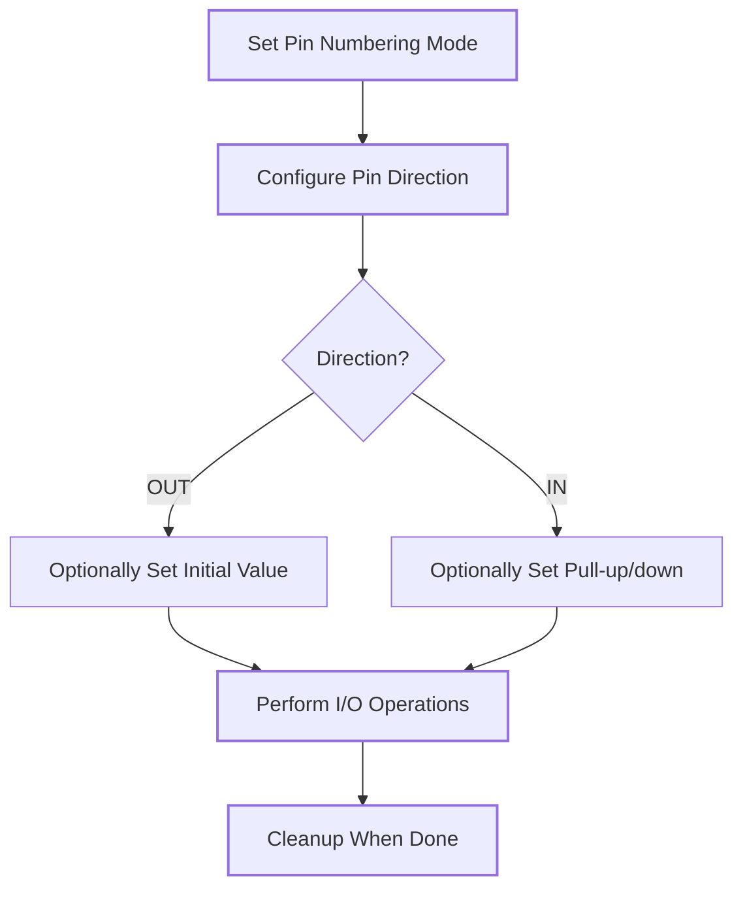
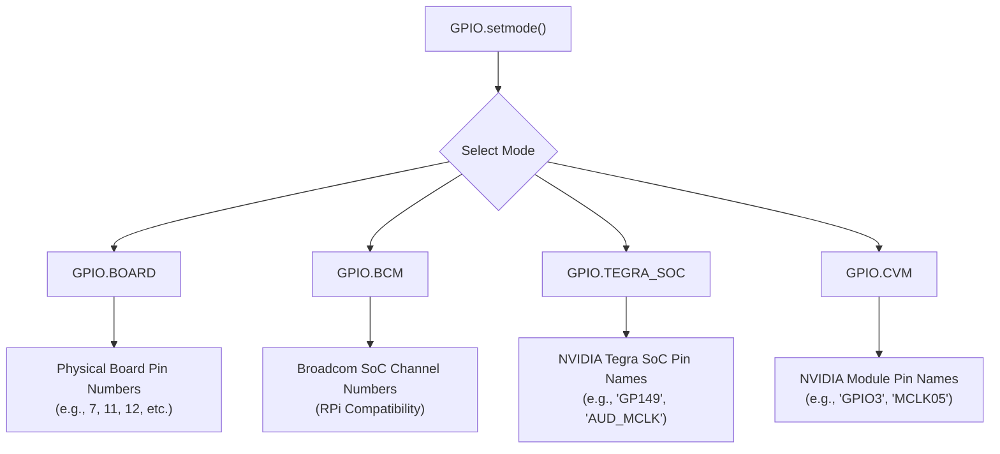
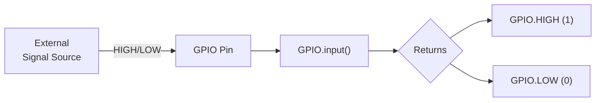
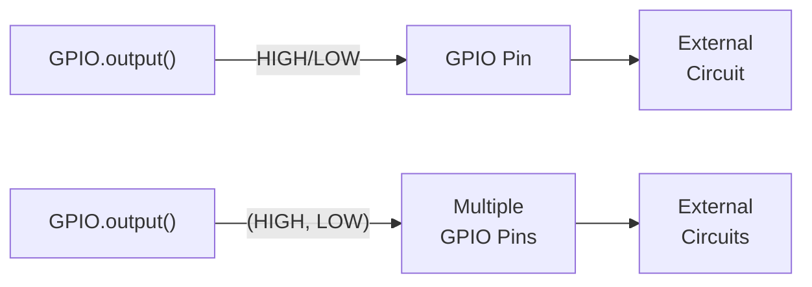
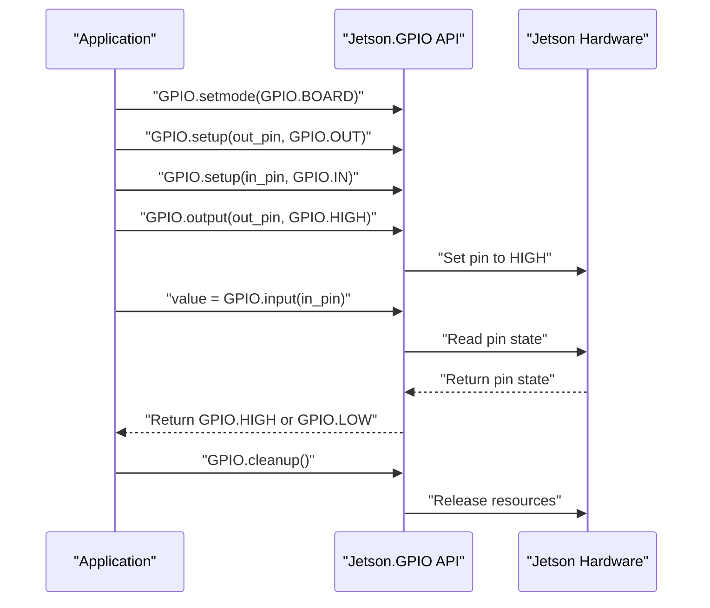

<!-- source: DeepWiki mcp.deepwiki.com · repo NVIDIA/jetson-gpio · page 3.2 Basic GPIO Operations · fetched 2026-10-26 -->

# Basic GPIO Operations

<details>
<summary>Relevant source files</summary>

The following files were used as context for generating this wiki page:

- [lib/python/Jetson/GPIO/gpio.py](lib/python/Jetson/GPIO/gpio.py)
- [samples/simple_input.py](samples/simple_input.py)
- [samples/simple_out.py](samples/simple_out.py)
- [samples/test_all_apis.py](samples/test_all_apis.py)

</details>


This document covers the core functions for configuring and interacting with GPIO pins on NVIDIA Jetson development boards using the Jetson.GPIO library. It focuses on setting up pins, reading input values, writing output values, and proper cleanup. For event-based operations, see [Event Detection](#3.3), and for PWM functionality, see [PWM](#3.4).

## Pin Configuration Flow

Before performing any GPIO operations, pins must be properly configured following this sequence:



Sources: [lib/python/Jetson/GPIO/gpio.py:284-370]()

## Setting Pin Numbering Mode

Before configuring or accessing any GPIO pins, you must set the pin numbering mode using `GPIO.setmode()`. The library supports four pin numbering modes:



Sources: [lib/python/Jetson/GPIO/gpio.py:284-311](), [samples/test_all_apis.py:235-269]()

### Examples of Pin Mode Usage:

```python
# Using BOARD pin numbering (physical pin numbers)
GPIO.setmode(GPIO.BOARD)
GPIO.setup(18, GPIO.OUT)  # Uses physical pin 18

# Using BCM pin numbering (Broadcom compatibility)
GPIO.setmode(GPIO.BCM)
GPIO.setup(24, GPIO.OUT)  # Uses the BCM channel 24
```

Sources: [samples/simple_out.py:29-32](), [samples/simple_input.py:32-33]()

## Configuring Pins

After setting the pin numbering mode, you must configure each pin as either an input or output using `GPIO.setup()`.

### Setting Up Output Pins

```python
# Configure single pin as output with default initial state (LOW)
GPIO.setup(pin, GPIO.OUT)

# Configure single pin as output with HIGH initial state
GPIO.setup(pin, GPIO.OUT, initial=GPIO.HIGH)

# Configure multiple pins as outputs
GPIO.setup((pin1, pin2, pin3), GPIO.OUT)

# Configure multiple pins with different initial states
GPIO.setup((pin1, pin2), GPIO.OUT, initial=(GPIO.HIGH, GPIO.LOW))
```

Sources: [lib/python/Jetson/GPIO/gpio.py:326-363](), [samples/test_all_apis.py:284-325]()

### Setting Up Input Pins

```python
# Configure single pin as input
GPIO.setup(pin, GPIO.IN)

# Configure multiple pins as inputs
GPIO.setup((pin1, pin2, pin3), GPIO.IN)
```

Note: While the library accepts a `pull_up_down` parameter for compatibility with RPi.GPIO, Jetson.GPIO currently ignores this parameter and issues a warning.

Sources: [lib/python/Jetson/GPIO/gpio.py:326-363](), [samples/test_all_apis.py:329-356]()

## Reading Input Values

To read the current state of a configured input pin, use the `GPIO.input()` function:



Sources: [lib/python/Jetson/GPIO/gpio.py:390-401](), [samples/simple_input.py:22-51]()

### Example Usage:

```python
# Read value from an input pin
GPIO.setmode(GPIO.BOARD)
GPIO.setup(input_pin, GPIO.IN)

value = GPIO.input(input_pin)
if value == GPIO.HIGH:
    print("Input is HIGH")
else:
    print("Input is LOW")
```

Sources: [samples/simple_input.py:35-45]()

## Setting Output Values

To set the state of a configured output pin, use the `GPIO.output()` function:



Sources: [lib/python/Jetson/GPIO/gpio.py:403-419](), [samples/simple_out.py:22-47]()

### Example Usage:

```python
# Set single pin HIGH
GPIO.output(output_pin, GPIO.HIGH)

# Set single pin LOW
GPIO.output(output_pin, GPIO.LOW)

# Set multiple pins to the same value
GPIO.output((pin1, pin2, pin3), GPIO.HIGH)

# Set multiple pins to different values
GPIO.output((pin1, pin2, pin3), (GPIO.HIGH, GPIO.LOW, GPIO.HIGH))
```

Sources: [lib/python/Jetson/GPIO/gpio.py:403-419](), [samples/test_all_apis.py:408-432]()

### Toggle Example:

```python
# Toggle an output pin
current_value = GPIO.HIGH
GPIO.output(output_pin, current_value)
current_value ^= GPIO.HIGH  # Toggle between HIGH and LOW
```

Sources: [samples/simple_out.py:35-42]()

## Checking Pin Configuration

You can check the current configured function of a pin using `GPIO.gpio_function()`:

```python
function = GPIO.gpio_function(pin)
if function == GPIO.IN:
    print("Pin is configured as input")
elif function == GPIO.OUT:
    print("Pin is configured as output")
elif function == GPIO.UNKNOWN:
    print("Pin is not configured")
```

Sources: [lib/python/Jetson/GPIO/gpio.py:560-568](), [samples/test_all_apis.py:474-497]()

## Cleanup

Always clean up GPIO resources when your program exits to release the pins and avoid potential issues with future GPIO access:

```python
try:
    # Your GPIO code here
finally:
    GPIO.cleanup()  # Clean up all pins
```

You can also clean up specific pins:

```python
GPIO.cleanup(pin)  # Clean up a single pin
GPIO.cleanup((pin1, pin2))  # Clean up multiple pins
```

Sources: [lib/python/Jetson/GPIO/gpio.py:366-387](), [samples/simple_out.py:43-44](), [samples/simple_input.py:47-48]()

## Complete Input/Output Flow



Sources: [lib/python/Jetson/GPIO/gpio.py:390-419](), [samples/simple_input.py:22-51](), [samples/simple_out.py:22-47]()

## Common Examples

### LED Blink Example

```python
import RPi.GPIO as GPIO
import time

# Set up the pin (physical pin 18 in this example)
GPIO.setmode(GPIO.BOARD)
GPIO.setup(18, GPIO.OUT, initial=GPIO.LOW)

try:
    while True:
        # Turn LED on
        GPIO.output(18, GPIO.HIGH)
        time.sleep(1)
        
        # Turn LED off
        GPIO.output(18, GPIO.LOW)
        time.sleep(1)
finally:
    # Always clean up
    GPIO.cleanup()
```

Sources: [samples/simple_out.py:22-47]()

### Button Input Example

```python
import RPi.GPIO as GPIO
import time

# Set up pins
GPIO.setmode(GPIO.BOARD)
GPIO.setup(18, GPIO.IN)  # Button input pin

previous_state = None
try:
    while True:
        # Read button state
        current_state = GPIO.input(18)
        
        # Only print when state changes
        if current_state != previous_state:
            if current_state == GPIO.HIGH:
                print("Button pressed")
            else:
                print("Button released")
            previous_state = current_state
            
        time.sleep(0.1)
finally:
    GPIO.cleanup()
```

Sources: [samples/simple_input.py:22-51]()

## Technical Implementation Details

Internally, the Jetson.GPIO library uses the Linux GPIO character device interface to interact with the hardware. The `setup()` function configures the GPIO pin and stores this configuration in internal dictionaries. The `input()` and `output()` functions use the character device interface functions to read from and write to the pins.

When a GPIO pin is set up, the library opens the corresponding GPIO character device file (`/dev/gpiochip0`) and creates a line handle that can be used for subsequent operations. The `cleanup()` function releases these resources.

Sources: [lib/python/Jetson/GPIO/gpio.py:149-168](), [lib/python/Jetson/GPIO/gpio.py:241-265]()

---

