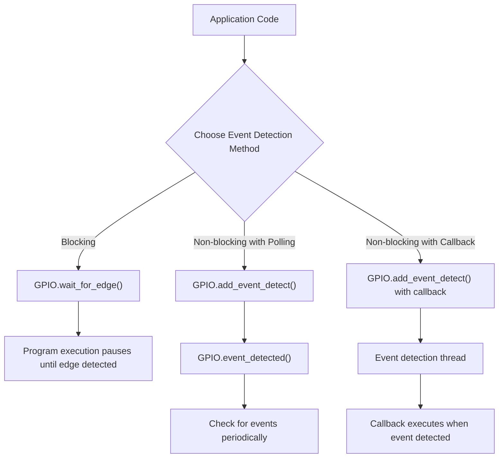
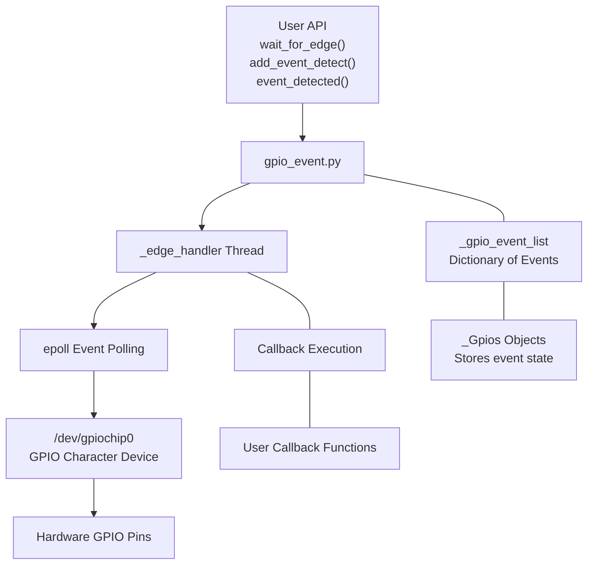
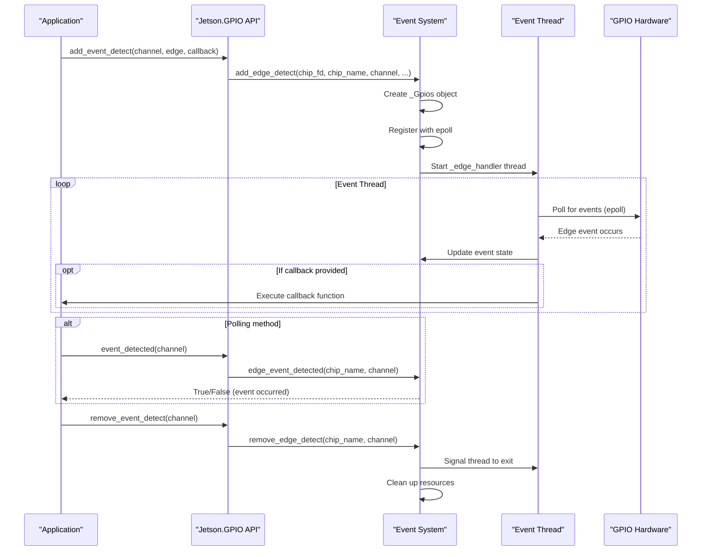

<!-- source: DeepWiki mcp.deepwiki.com · repo NVIDIA/jetson-gpio · page 3.3 Event Detection · fetched 2026-10-26 -->

# Event Detection

<details>
<summary>Relevant source files</summary>

The following files were used as context for generating this wiki page:

- [lib/python/Jetson/GPIO/gpio.py](lib/python/Jetson/GPIO/gpio.py)
- [lib/python/Jetson/GPIO/gpio_event.py](lib/python/Jetson/GPIO/gpio_event.py)
- [samples/button_event.py](samples/button_event.py)
- [samples/button_interrupt.py](samples/button_interrupt.py)
- [samples/issue40.py](samples/issue40.py)

</details>


The Event Detection system in Jetson.GPIO allows you to detect and respond to changes in GPIO pin states. Instead of continuously polling pin values, you can use event detection to efficiently react to transitions (like button presses) using callbacks or blocking wait mechanisms.

## Overview of Event Detection

Jetson.GPIO offers three main approaches for detecting GPIO pin state changes:

1. **Blocking Wait**: Use `wait_for_edge()` to pause program execution until a specified edge event occurs
2. **Event Detection with Polling**: Use `add_event_detect()` and `event_detected()` to check for events in a non-blocking manner
3. **Event Detection with Callbacks**: Use `add_event_detect()` with a callback function to automatically execute code when an event occurs



Sources: [lib/python/Jetson/GPIO/gpio.py:422-557](), [lib/python/Jetson/GPIO/gpio_event.py:104-518]()

## Edge Types

When working with event detection, you need to specify which type of edge (transition) you want to detect:

| Constant | Value | Description |
|----------|-------|-------------|
| `GPIO.RISING` | 31 | Transition from LOW to HIGH |
| `GPIO.FALLING` | 32 | Transition from HIGH to LOW |
| `GPIO.BOTH` | 33 | Either RISING or FALLING transition |

These constants are defined with an offset to prevent them from being confused with other constants like HIGH and LOW.

Sources: [lib/python/Jetson/GPIO/gpio.py:56-61]()

## API Reference

### Blocking Event Detection

#### `GPIO.wait_for_edge(channel, edge, bouncetime=None, timeout=None)`

Blocks until an edge event is detected on the specified GPIO channel.

**Parameters:**
- `channel`: The channel/pin number based on the current numbering mode
- `edge`: The edge type to detect - must be `GPIO.RISING`, `GPIO.FALLING`, or `GPIO.BOTH`
- `bouncetime`: Optional debounce time in milliseconds (integer >= 0)
- `timeout`: Optional timeout in seconds (integer >= 0)

**Returns:**
- The channel number if an event was detected
- `None` if a timeout occurred
- Raises exceptions on errors

**Example:**
```python
# Wait for a button press (falling edge)
GPIO.wait_for_edge(button_pin, GPIO.FALLING)
print("Button was pressed!")
```

Sources: [lib/python/Jetson/GPIO/gpio.py:507-557](), [lib/python/Jetson/GPIO/gpio_event.py:452-490](), [samples/button_event.py:46-55]()

### Non-Blocking Event Detection

#### `GPIO.add_event_detect(channel, edge, callback=None, bouncetime=None, polltime=0.2)`

Sets up event detection for a specified GPIO channel in a non-blocking manner.

**Parameters:**
- `channel`: The channel/pin number based on the current numbering mode
- `edge`: The edge type to detect - must be `GPIO.RISING`, `GPIO.FALLING`, or `GPIO.BOTH`
- `callback`: Optional function to call when an event is detected
- `bouncetime`: Optional debounce time in milliseconds (integer >= 0)
- `polltime`: Maximum time to wait between polling for events (default 0.2 seconds)

**Note:** One channel only allows one event detection setup at a time.

#### `GPIO.event_detected(channel)`

Checks if an event has been detected on the specified channel.

**Parameters:**
- `channel`: The channel/pin number to check

**Returns:**
- `True` if an event has been detected since the last call
- `False` otherwise

**Example using polling:**
```python
# Set up event detection for a button
GPIO.add_event_detect(button_pin, GPIO.FALLING)

# Later, check if button was pressed
if GPIO.event_detected(button_pin):
    print("Button was pressed!")
```

Sources: [lib/python/Jetson/GPIO/gpio.py:429-483](), [lib/python/Jetson/GPIO/gpio_event.py:104-169](), [lib/python/Jetson/GPIO/gpio_event.py:228-249]()

### Callback-Based Event Detection

#### `GPIO.add_event_callback(channel, callback)`

Adds a callback function for a channel that already has event detection enabled.

**Parameters:**
- `channel`: The channel/pin number
- `callback`: A function to be called when an event is detected

**Example with callback:**
```python
# Define callback function
def button_callback(channel):
    print(f"Button on channel {channel} was pressed!")

# Set up event detection with callback
GPIO.add_event_detect(button_pin, GPIO.FALLING, callback=button_callback)

# Or add the callback after setting up detection
GPIO.add_event_callback(button_pin, button_callback)
```

Sources: [lib/python/Jetson/GPIO/gpio.py:488-504](), [lib/python/Jetson/GPIO/gpio_event.py:212-226](), [samples/button_interrupt.py:31-50]()

### Cleanup

#### `GPIO.remove_event_detect(channel, timeout=0.5)`

Removes event detection for the specified channel.

**Parameters:**
- `channel`: The channel/pin number
- `timeout`: Maximum time to wait for the event detection thread to stop

Sources: [lib/python/Jetson/GPIO/gpio.py:467-469](), [lib/python/Jetson/GPIO/gpio_event.py:179-204]()

## Internal Architecture

The event detection system in Jetson.GPIO uses a thread-based implementation with Linux GPIO character devices to efficiently detect pin changes.



Sources: [lib/python/Jetson/GPIO/gpio_event.py:62-77](), [lib/python/Jetson/GPIO/gpio_event.py:81-102](), [lib/python/Jetson/GPIO/gpio_event.py:349-446]()

### Event Detection Process



Sources: [lib/python/Jetson/GPIO/gpio.py:429-483](), [lib/python/Jetson/GPIO/gpio_event.py:104-204](), [lib/python/Jetson/GPIO/gpio_event.py:349-446]()

### Key Components

1. **Event Registration**:
   - Each GPIO pin can have one active event detection at a time
   - Events are stored in the `_gpio_event_list` dictionary

2. **Event Detection Thread**:
   - `_edge_handler` function runs in a separate thread
   - Uses `epoll` to efficiently wait for hardware events
   - Reads events from the GPIO character device

3. **Debouncing**:
   - Hardware button presses can "bounce", causing multiple rapid events
   - `bouncetime` parameter sets a minimum time between detected events
   - Implemented in the event thread using timestamps

4. **Callbacks**:
   - Multiple callbacks can be registered per channel
   - Executed directly from the event thread
   - Should be kept short to avoid blocking the event thread

Sources: [lib/python/Jetson/GPIO/gpio_event.py:81-102](), [lib/python/Jetson/GPIO/gpio_event.py:349-446]()

## Best Practices

1. **Choose the Right Approach**:
   - Use `wait_for_edge()` for simple applications where blocking is acceptable
   - Use `add_event_detect()` with callbacks for responsive applications

2. **Set Appropriate Bouncetime**:
   - Mechanical buttons often need 200-300ms debounce time
   - Electronic signals might need shorter or no debounce time

3. **Keep Callbacks Brief**:
   - Callbacks run in the event detection thread
   - Long-running callbacks will delay detection of other events
   - For complex processing, have the callback set a flag or use a queue

4. **Always Clean Up**:
   - Call `remove_event_detect()` when done with an event
   - Or use `GPIO.cleanup()` to clean up all resources

Sources: [lib/python/Jetson/GPIO/gpio.py:429-463](), [lib/python/Jetson/GPIO/gpio_event.py:349-446](), [samples/button_interrupt.py:31-60]()

## Example: Button Press Detection

Here's a complete example showing different event detection methods:

1. **Blocking Method**:
```python
import RPi.GPIO as GPIO
import time

button_pin = 18
GPIO.setmode(GPIO.BOARD)
GPIO.setup(button_pin, GPIO.IN)

print("Waiting for button press...")
GPIO.wait_for_edge(button_pin, GPIO.FALLING)
print("Button was pressed!")
GPIO.cleanup()
```

2. **Callback Method**:
```python
import RPi.GPIO as GPIO
import time

def button_callback(channel):
    print(f"Button on channel {channel} was pressed!")

button_pin = 18
GPIO.setmode(GPIO.BOARD)
GPIO.setup(button_pin, GPIO.IN)

GPIO.add_event_detect(button_pin, GPIO.FALLING, callback=button_callback, bouncetime=300)

try:
    print("Running... Press Ctrl+C to exit")
    while True:
        time.sleep(1)
finally:
    GPIO.cleanup()
```

Sources: [samples/button_event.py:36-60](), [samples/button_interrupt.py:31-63](), [samples/issue40.py:27-45]()

---

