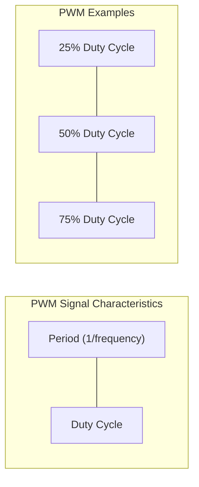
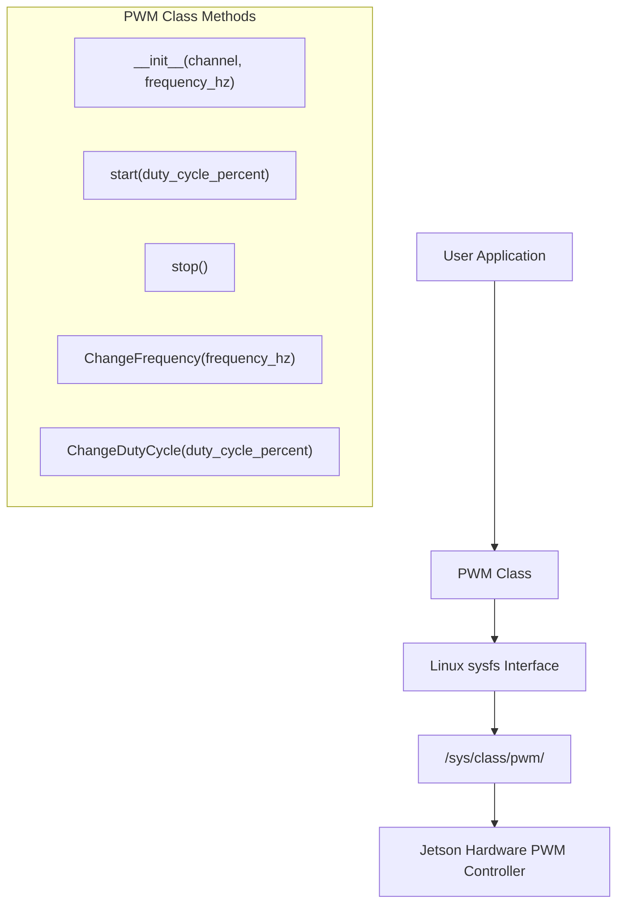
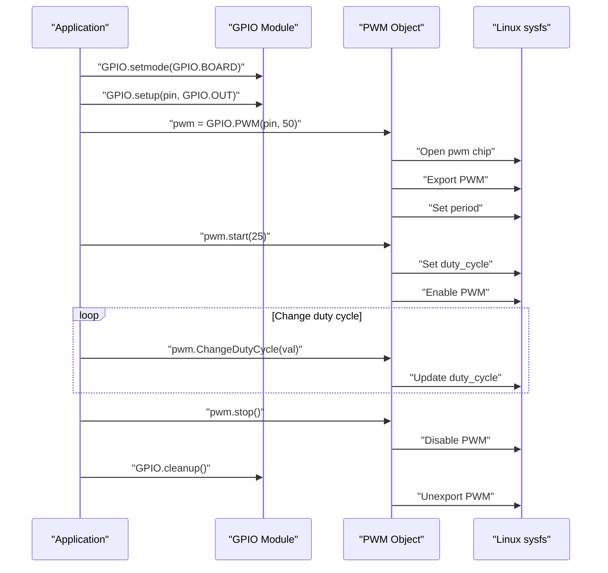
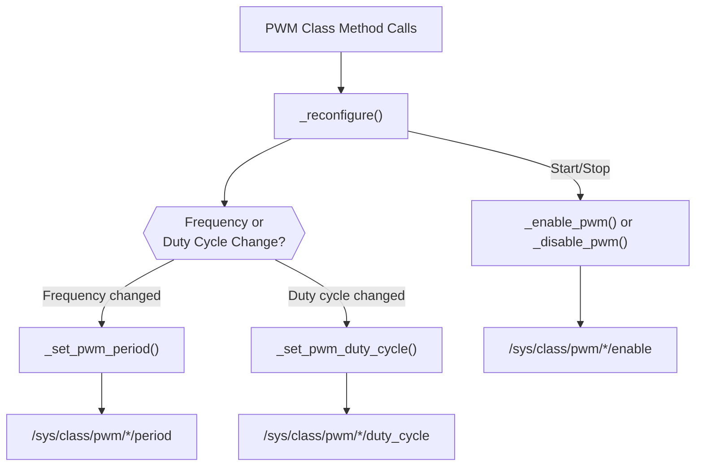

<!-- source: DeepWiki mcp.deepwiki.com · repo NVIDIA/jetson-gpio · page 3.4 PWM · fetched 2026-10-26 -->

# PWM

<details>
<summary>Relevant source files</summary>

The following files were used as context for generating this wiki page:

- [debian/changelog](debian/changelog)
- [lib/python/Jetson/GPIO/gpio.py](lib/python/Jetson/GPIO/gpio.py)
- [samples/simple_pwm.py](samples/simple_pwm.py)

</details>


This page documents the Pulse Width Modulation (PWM) capabilities in the Jetson GPIO library. It covers the API, usage patterns, and hardware considerations for generating PWM signals on supported Jetson boards.

For information about general GPIO operations, see [Basic GPIO Operations](#3.2).

## Introduction to PWM

Pulse Width Modulation (PWM) is a technique for controlling power by rapidly switching a digital signal between on and off states. By varying the duty cycle (the proportion of time the signal is in the "on" state), PWM can simulate a variable voltage output.



Sources: [lib/python/Jetson/GPIO/gpio.py:571-652]()

Common applications of PWM include:
- LED brightness control
- Motor speed control
- Servo motor positioning
- Audio tone generation

The Jetson GPIO library provides hardware PWM functionality through a dedicated `PWM` class that interfaces with the Jetson's hardware PWM controllers.

## PWM Architecture

The Jetson.GPIO library implements PWM by interacting with the Linux sysfs interface to access hardware PWM controllers on Jetson boards.



Sources: [lib/python/Jetson/GPIO/gpio.py:571-652](), [lib/python/Jetson/GPIO/gpio.py:190-204]()

When a PWM object is created:
1. The system exports the specified PWM channel via sysfs
2. Sets the initial period based on the requested frequency
3. Sets the duty cycle to 0
4. Marks the channel as being in `HARD_PWM` mode

PWM signals can be started, stopped, and modified through methods that write to the appropriate sysfs files.

## PWM API Reference

### Class Constructor

```
GPIO.PWM(channel, frequency_hz)
```

Creates a new PWM instance for the specified channel.

| Parameter | Type | Description |
|-----------|------|-------------|
| channel | int | The GPIO channel number (in the current numbering mode) |
| frequency_hz | float | The PWM frequency in Hz |

Returns a new PWM object.

**Notes:**
- The channel must correspond to a hardware PWM pin on the Jetson board
- Creates a PWM instance but doesn't start the output (requires calling start())
- If the channel is already configured (for GPIO or PWM), appropriate warnings or errors will be generated

### Methods

#### start(duty_cycle_percent)

```
pwm.start(duty_cycle_percent)
```

Starts PWM output on the channel.

| Parameter | Type | Description |
|-----------|------|-------------|
| duty_cycle_percent | float | The duty cycle as a percentage (0.0 to 100.0) |

#### stop()

```
pwm.stop()
```

Stops PWM output on the channel.

#### ChangeFrequency(frequency_hz)

```
pwm.ChangeFrequency(frequency_hz)
```

Changes the PWM frequency.

| Parameter | Type | Description |
|-----------|------|-------------|
| frequency_hz | float | The new frequency in Hz |

**Note:** Changing frequency may momentarily stop and restart the PWM signal.

#### ChangeDutyCycle(duty_cycle_percent)

```
pwm.ChangeDutyCycle(duty_cycle_percent)
```

Changes the PWM duty cycle.

| Parameter | Type | Description |
|-----------|------|-------------|
| duty_cycle_percent | float | The new duty cycle as a percentage (0.0 to 100.0) |

Sources: [lib/python/Jetson/GPIO/gpio.py:571-652]()

## Usage Example

The following sequence illustrates how to use the PWM API to create a gradually varying brightness control:



Sources: [samples/simple_pwm.py:40-63](), [lib/python/Jetson/GPIO/gpio.py:571-652]()

A complete example is provided in the samples directory:

```python
# Board pin-numbering scheme
GPIO.setmode(GPIO.BOARD)
# Set pin as an output pin with initial state HIGH
GPIO.setup(output_pin, GPIO.OUT, initial=GPIO.HIGH)
# Create PWM object with frequency 50Hz
p = GPIO.PWM(output_pin, 50)
# Start PWM with 25% duty cycle
p.start(25)

try:
    while True:
        # Vary duty cycle
        time.sleep(0.25)
        if val >= 100:
            incr = -incr
        if val <= 0:
            incr = -incr
        val += incr
        p.ChangeDutyCycle(val)
finally:
    # Clean up
    p.stop()
    GPIO.cleanup()
```

Sources: [samples/simple_pwm.py:40-63]()

## Internal Implementation

The PWM functionality is implemented through the Linux sysfs interface, which provides a user-space API to hardware PWM controllers.

### PWM Sysfs Paths

The library interacts with the following sysfs paths:

| Path | Description |
|------|-------------|
| `/sys/class/pwm/pwmchip*/export` | Export a PWM channel |
| `/sys/class/pwm/pwmchip*/unexport` | Unexport a PWM channel |
| `/sys/class/pwm/pwmchip*/pwm*/period` | Set PWM period in nanoseconds |
| `/sys/class/pwm/pwmchip*/pwm*/duty_cycle` | Set duty cycle in nanoseconds |
| `/sys/class/pwm/pwmchip*/pwm*/enable` | Enable/disable PWM output |

The library handles conversion between user-friendly units (Hz, percentage) and the nanosecond values required by the sysfs interface.



Sources: [lib/python/Jetson/GPIO/gpio.py:165-239](), [lib/python/Jetson/GPIO/gpio.py:627-652]()

### Implementation Details

The PWM implementation includes several key internal functions:

- `_export_pwm`: Makes the PWM channel available via sysfs
- `_unexport_pwm`: Removes the PWM channel from sysfs
- `_set_pwm_period`: Sets the PWM period (frequency)
- `_set_pwm_duty_cycle`: Sets the duty cycle
- `_enable_pwm`/`_disable_pwm`: Controls output state
- `_reconfigure`: Core method for changing PWM parameters

Sources: [lib/python/Jetson/GPIO/gpio.py:189-239](), [lib/python/Jetson/GPIO/gpio.py:627-652]()

## Hardware Support

Different Jetson boards have different PWM capabilities. The library automatically detects the board and maps the appropriate pins.

### Supported Boards and PWM Pins

| Board | Supported PWM Pins (BOARD numbering) |
|-------|-------------------------------------|
| Jetson Xavier | 18 |
| Jetson Nano | 33 |
| Jetson NX | 33 |
| Clara AGX Xavier | 18 |
| Jetson TX2 NX | 32 |
| Jetson Orin | 18 (PWM8 added in v2.1.7) |
| Jetson Orin NX | 33 |
| Jetson Orin Nano | 33 |

Sources: [samples/simple_pwm.py:25-34](), [debian/changelog:10-21]()

### Recent PWM Updates

The Jetson GPIO library's PWM support continues to evolve with each release:

- v2.1.7: Added PWM8 to Jetson Orin
- v2.1.4: Updated PWM directory list for new kernel versions
- v2.1.2: Updated PWM pins list for Jetson Orin NX and Jetson Orin Nano
- v2.0.190: Fixed PWM bug when previous duty cycle is higher than period

Sources: [debian/changelog:10-92]()

## Best Practices

When working with PWM on Jetson GPIO, consider these best practices:

1. Always call `stop()` on the PWM object before program exit
2. Use the `cleanup()` function to properly release resources
3. Be aware that PWM channels may be limited and board-specific
4. Changing frequency will momentarily stop and restart the PWM output
5. Duty cycle values must be between 0.0 and 100.0
6. Frequency changes reset the duty cycle, so update frequency before duty cycle

Sources: [lib/python/Jetson/GPIO/gpio.py:602-625](), [samples/simple_pwm.py:62-63]()

---

