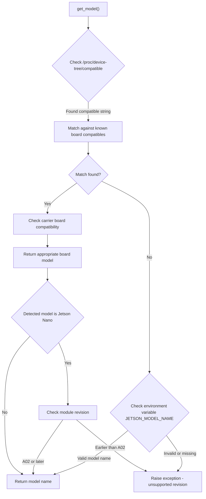
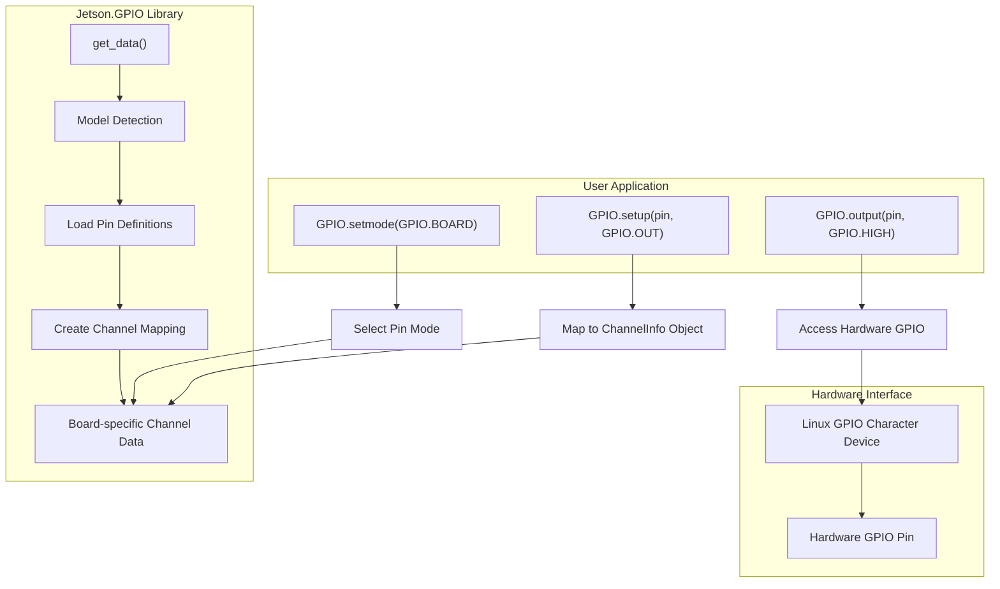

<!-- source: DeepWiki mcp.deepwiki.com · repo NVIDIA/jetson-gpio · page 4 Hardware Support · fetched 2026-10-26 -->

# Hardware Support

<details>
<summary>Relevant source files</summary>

The following files were used as context for generating this wiki page:

- [debian/changelog](debian/changelog)
- [lib/python/Jetson/GPIO/gpio_pin_data.py](lib/python/Jetson/GPIO/gpio_pin_data.py)
- [samples/issue40-trigger.py](samples/issue40-trigger.py)
- [samples/jetson_model.py](samples/jetson_model.py)

</details>


## Overview

This document provides detailed information about the hardware platforms supported by the Jetson.GPIO library. It covers the supported Jetson board models, their detection mechanism, and the GPIO pin mapping systems implemented across different hardware generations. For information about pin numbering systems, see [Pin Numbering](#3.1), and for detailed pin mappings, see [Pin Mappings](#4.2).

Sources: [lib/python/Jetson/GPIO/gpio_pin_data.py:24-35]()

## Supported Jetson Boards

The Jetson.GPIO library supports a wide range of NVIDIA Jetson development boards across multiple generations of hardware platforms. The following table summarizes the supported boards:

| Board Model | Processor | RAM Options | Initial Support Version |
|-------------|-----------|-------------|-------------------------|
| Jetson Orin Nano | ARM A78AE | 4GB/8GB | 2.1.1 |
| Jetson Orin Nano Super | ARM A78AE | 8GB/16GB | 2.1.8 |
| Jetson Orin NX | ARM A78AE | 8GB/16GB | 2.0.210 |
| Jetson Orin NX Super | ARM A78AE | 16GB/32GB | 2.1.9 |
| Jetson AGX Orin | ARM A78AE | 32GB/64GB | 2.0.180 |
| Clara AGX Xavier | ARM Carmel | 16GB | 2.0.10 |
| Jetson Xavier NX | ARM Carmel | 8GB/16GB | 2.0.5 |
| Jetson AGX Xavier | ARM Carmel | 8GB/16GB/32GB/64GB | Pre-2.0.4 |
| Jetson TX2 NX | ARM A57 + Denver | 4GB | 2.0.16 |
| Jetson TX2 | ARM A57 + Denver | 4GB/8GB | Pre-2.0.4 |
| Jetson TX1 | ARM A57 | 4GB | Pre-2.0.4 |
| Jetson Nano | ARM A57 | 2GB/4GB | Pre-2.0.4/2.0.11 |

Sources: [lib/python/Jetson/GPIO/gpio_pin_data.py:361-472](), [debian/changelog:1-187]()

## Board Detection Mechanism

The Jetson.GPIO library implements an automated board detection mechanism to identify the specific Jetson model on which it is running. This ensures that appropriate pin definitions and hardware capabilities are loaded for each supported platform.

### Board Detection Flow



The board detection mechanism works as follows:

1. Read the compatible strings from `/proc/device-tree/compatible`
2. Match against known compatible strings defined for each board model
3. Verify carrier board compatibility (warnings issued for non-standard carrier boards)
4. For Jetson Nano, verify module revision is A02 or later
5. If no match found in compatible strings, check the `JETSON_MODEL_NAME` environment variable (useful in Docker containers)
6. Return the identified model or raise an exception if detection fails

Sources: [lib/python/Jetson/GPIO/gpio_pin_data.py:499-607]()

## Pin Definition Architecture

Each Jetson board has unique GPIO pin mappings defined in the `gpio_pin_data.py` file. These definitions establish the relationship between logical pin numbers (used in application code) and physical hardware pins.

### Pin Definition Structure

```mermaid
classDiagram
    class "Pin Definition Entry" {
        +Linux GPIO pin number
        +Linux exported GPIO name
        +GPIO chip name/instance
        +Pin number (BOARD mode)
        +Pin number (BCM mode)
        +Pin name (CVM mode)
        +Pin name (TEGRA_SOC mode)
        +PWM chip sysfs directory
        +PWM ID within PWM chip
    }
    
    class "Board Pin Definitions" {
        +JETSON_ORIN_NX_PIN_DEFS
        +JETSON_ORIN_NANO_PIN_DEFS
        +JETSON_ORIN_PIN_DEFS
        +CLARA_AGX_XAVIER_PIN_DEFS
        +JETSON_NX_PIN_DEFS
        +JETSON_XAVIER_PIN_DEFS
        +JETSON_TX2_NX_PIN_DEFS
        +JETSON_TX2_PIN_DEFS
        +JETSON_TX1_PIN_DEFS
        +JETSON_NANO_PIN_DEFS
    }
    
    class "Jetson GPIO Data" {
        +Model name
        +Pin definitions array
        +Board information dict
    }
    
    "Board Pin Definitions" --> "Pin Definition Entry" : contains
    "Jetson GPIO Data" --> "Board Pin Definitions" : references
    "ChannelInfo" --> "Pin Definition Entry" : created from
```

Each pin definition includes comprehensive information needed to interact with the hardware:

1. Linux GPIO pin number (line offset within chip)
2. Linux exported GPIO name (if different from standard naming)
3. GPIO chip name/instance
4. Pin numbering in different modes (BOARD, BCM, CVM, TEGRA_SOC)
5. PWM chip and ID information (for pins supporting PWM functionality)

The library creates `ChannelInfo` objects from these definitions when initializing a GPIO pin.

Sources: [lib/python/Jetson/GPIO/gpio_pin_data.py:37-52](), [lib/python/Jetson/GPIO/gpio_pin_data.py:475-497]()

## Pin Mapping System

The Jetson.GPIO library supports four pin numbering modes to accommodate different preferences and use cases:

### Pin Numbering Modes

1. **BOARD mode**: Numbers match the physical pin positions on the J41 header
2. **BCM mode**: Broadcom-style pin numbers for Raspberry Pi compatibility
3. **CVM mode**: NVIDIA CVM (Computer Vision Module) pin names
4. **TEGRA_SOC mode**: Tegra SoC-specific pin names

### Pin Mapping Architecture



When initializing GPIO operations, the library:

1. Detects the Jetson model
2. Loads appropriate pin definitions
3. Creates channel mappings for all pin numbering modes
4. Uses these mappings to translate logical pin numbers to physical hardware pins

Sources: [lib/python/Jetson/GPIO/gpio_pin_data.py:647-661]()

## Hardware Platform Compatibility

Different Jetson boards use different SoCs (Systems on Chip) and have varying GPIO capabilities. The library identifies compatible boards using specific identifier strings.

### Compatible Board String Tables

| Board Model | Compatible String Identifiers |
|-------------|-------------------------------|
| Jetson Orin Nano/NX | nvidia,p3509-0000+p3767-0003, nvidia,p3768-0000+p3767-0003, etc. |
| Jetson AGX Orin | nvidia,p3737-0000+p3701-0000, nvidia,p3737-0000+p3701-0004, etc. |
| Clara AGX Xavier | nvidia,e3900-0000+p2888-0004 |
| Jetson Xavier NX | nvidia,p3509-0000+p3668-0000, nvidia,p3449-0000+p3668-0001, etc. |
| Jetson AGX Xavier | nvidia,p2972-0000, nvidia,galen-industrial, etc. |
| Jetson TX2 NX | nvidia,p3509-0000+p3636-0001 |
| Jetson TX2 | nvidia,p2771-0000, nvidia,quill, etc. |
| Jetson TX1 | nvidia,p2371-2180, nvidia,jetson-cv |
| Jetson Nano | nvidia,p3450-0000, nvidia,p3450-0002, nvidia,jetson-nano |

Sources: [lib/python/Jetson/GPIO/gpio_pin_data.py:78-358]()

## Hardware Support Limitations

While the Jetson.GPIO library aims to provide comprehensive support for all Jetson development boards, there are some limitations to be aware of:

1. **Carrier Board Compatibility**: The library is primarily tested and verified with NVIDIA's developer kit carrier boards. Non-standard carrier boards may have different pin mappings or functionality.

2. **PWM Availability**: PWM support depends on the underlying kernel configuration and device tree. Some PWM controllers might not be enabled in all versions of the Linux for Tegra (L4T) software.

3. **Input/Output Restrictions**: Some pins may be input-only or output-only due to hardware connections on the carrier board or module. These restrictions are documented in the pin definition comments.

4. **GPIO Pull-up/Pull-down**: Unlike Raspberry Pi, Jetson platforms do not support software-controlled pull-up/pull-down resistors through this library.

Sources: [lib/python/Jetson/GPIO/gpio_pin_data.py:198-218](), [lib/python/Jetson/GPIO/gpio_pin_data.py:261-283](), [lib/python/Jetson/GPIO/gpio_pin_data.py:345-347]()

## Usage Examples

To determine the current Jetson model programmatically, you can use the following code:

```python
import Jetson.GPIO as GPIO
print(GPIO.model)
```

This will output the detected Jetson model name, which can be useful for implementing model-specific functionality in your applications.

Sources: [samples/jetson_model.py:20-21]()

## Summary

The Jetson.GPIO library provides comprehensive hardware support for all current Jetson platforms, from the older TX1 to the latest Orin series. The library's automated board detection ensures that the appropriate pin definitions are used regardless of the underlying hardware, providing a consistent GPIO programming interface across the Jetson product line.

For detailed information about specific pin mappings for each board, see [Pin Mappings](#4.2), and for details about using the GPIO API, see [API Reference](#3).

---

