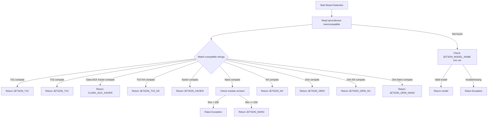
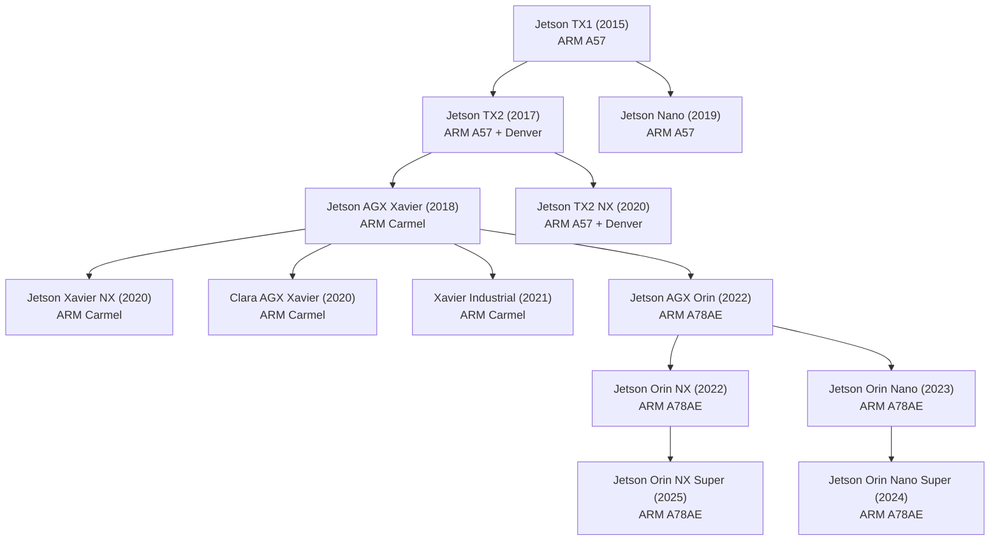
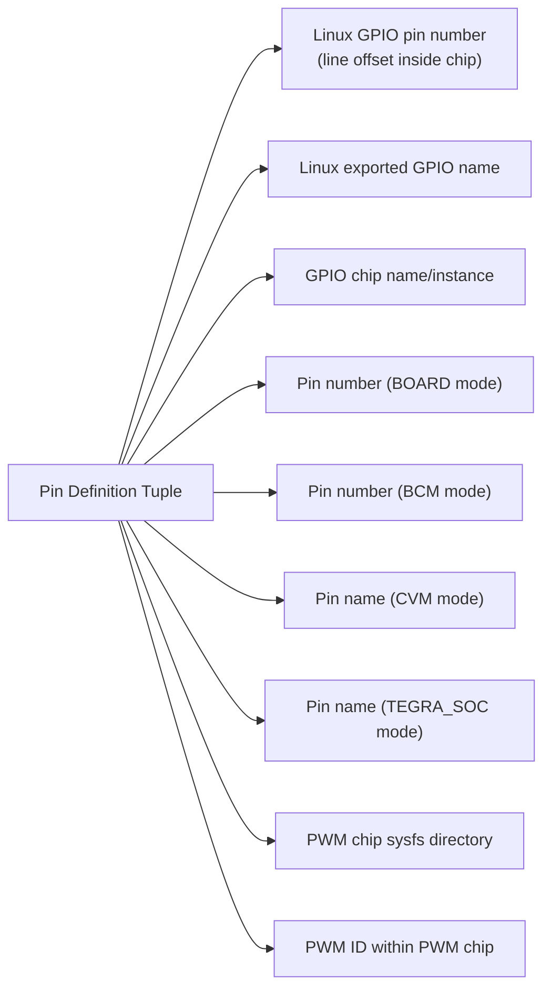
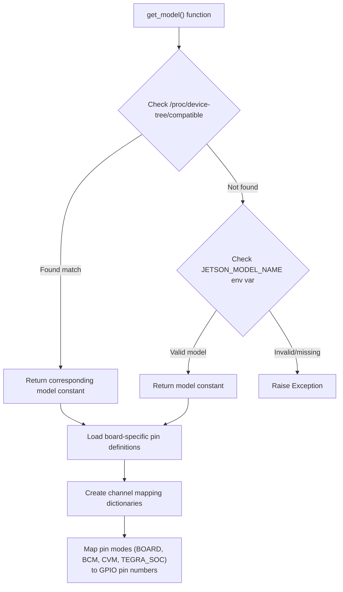
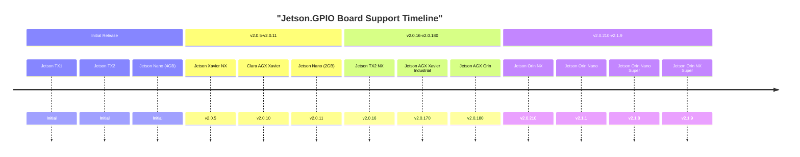

<!-- source: DeepWiki mcp.deepwiki.com · repo NVIDIA/jetson-gpio · page 4.1 Supported Boards · fetched 2026-10-26 -->

# Supported Boards

<details>
<summary>Relevant source files</summary>

The following files were used as context for generating this wiki page:

- [debian/changelog](debian/changelog)
- [lib/python/Jetson/GPIO/gpio_pin_data.py](lib/python/Jetson/GPIO/gpio_pin_data.py)
- [samples/issue40-trigger.py](samples/issue40-trigger.py)
- [samples/jetson_model.py](samples/jetson_model.py)

</details>


This page documents the NVIDIA Jetson development boards supported by the Jetson.GPIO library. It covers which boards are compatible with the library, their key specifications, and how the library detects and interfaces with different board variants. For detailed pin mapping information, see [Pin Mappings](#4.2).

## Board Detection Process

The Jetson.GPIO library needs to determine which Jetson hardware it's running on to provide the correct pin mappings and hardware interfaces. The library uses a systematic approach to detect the board model.



Sources: [lib/python/Jetson/GPIO/gpio_pin_data.py:549-607]()

## Supported Jetson Platforms

The library currently supports multiple generations of Jetson hardware, from the original TX1 to the latest Orin series.

| Board | Processor | RAM Configurations | Added in Version |
|-------|-----------|-------------------|-----------------|
| Jetson Orin NX | ARM A78AE | 32GB, 64GB | 2.0.210 |
| Jetson Orin NX Super | ARM A78AE | 32GB, 64GB | 2.1.9 |
| Jetson Orin Nano | ARM A78AE | 32GB, 64GB | 2.1.1 |
| Jetson Orin Nano Super | ARM A78AE | 32GB, 64GB | 2.1.8 |
| Jetson AGX Orin | ARM A78AE | 32GB, 64GB | 2.0.180 |
| Clara AGX Xavier | ARM Carmel | 16GB | 2.0.10 |
| Jetson AGX Xavier | ARM Carmel | 8GB, 16GB, 32GB, 64GB | Initial |
| Jetson AGX Xavier Industrial | ARM Carmel | 8GB, 16GB, 32GB, 64GB | 2.0.170 |
| Jetson Xavier NX | ARM Carmel | 8GB, 16GB | 2.0.5 |
| Jetson TX2 NX | ARM A57 + Denver | 4GB | 2.0.16 |
| Jetson TX2 | ARM A57 + Denver | 4GB, 8GB | Initial |
| Jetson TX1 | ARM A57 | 4GB | Initial |
| Jetson Nano | ARM A57 | 2GB, 4GB | Initial (4GB), 2.0.11 (2GB) |

Sources: [lib/python/Jetson/GPIO/gpio_pin_data.py:24-35](), [lib/python/Jetson/GPIO/gpio_pin_data.py:361-471](), [debian/changelog:1-100]()

## Evolution of Jetson Platforms

The following diagram shows the evolution of NVIDIA's Jetson platform family:



Sources: [lib/python/Jetson/GPIO/gpio_pin_data.py:24-35](), [debian/changelog:1-100]()

## Platform Identification Constants

The library defines constants for each supported board in `gpio_pin_data.py`:

```python
CLARA_AGX_XAVIER = 'CLARA_AGX_XAVIER'
JETSON_NX = 'JETSON_NX'
JETSON_XAVIER = 'JETSON_XAVIER'
JETSON_TX2 = 'JETSON_TX2'
JETSON_TX1 = 'JETSON_TX1'
JETSON_NANO = 'JETSON_NANO'
JETSON_TX2_NX = 'JETSON_TX2_NX'
JETSON_ORIN = 'JETSON_ORIN'
JETSON_ORIN_NX = 'JETSON_ORIN_NX'
JETSON_ORIN_NANO = 'JETSON_ORIN_NANO'
```

These constants are used both internally for board detection and can be accessed in user code through the `GPIO.model` property.

Sources: [lib/python/Jetson/GPIO/gpio_pin_data.py:24-35]()

## Pin Definition Structure

The library defines GPIO pin data for each supported board. Each pin definition is structured as a tuple containing:



Example pin definition for Jetson Orin NX:
```python
(144, 'PAC.06', "tegra234-gpio", 7, 4, 'GPIO09', 'GP167', None, None)
```

This represents:
- Linux GPIO pin number: 144
- Linux exported name: PAC.06
- GPIO chip: tegra234-gpio
- BOARD pin number: 7
- BCM pin number: 4
- CVM pin name: GPIO09
- TEGRA_SOC pin name: GP167
- No PWM capability (None, None)

Sources: [lib/python/Jetson/GPIO/gpio_pin_data.py:37-52]()

## Board-Specific Pin Definitions

Each board has its own pin definition array that maps the physical pins to their various numbering schemes and capabilities:

| Board | Pin Definition Array | GPIO Chip | Number of Pins |
|-------|----------------------|-----------|---------------|
| Jetson Orin NX | JETSON_ORIN_NX_PIN_DEFS | tegra234-gpio | 20 |
| Jetson Orin Nano | JETSON_ORIN_NX_PIN_DEFS | tegra234-gpio | 20 |
| Jetson AGX Orin | JETSON_ORIN_PIN_DEFS | tegra234-gpio | 20 |
| Clara AGX Xavier | CLARA_AGX_XAVIER_PIN_DEFS | tegra194-gpio | 20 |
| Jetson Xavier NX | JETSON_NX_PIN_DEFS | tegra194-gpio | 20 |
| Jetson AGX Xavier | JETSON_XAVIER_PIN_DEFS | tegra194-gpio | 20 |
| Jetson TX2 NX | JETSON_TX2_NX_PIN_DEFS | tegra-gpio | 20 |
| Jetson TX2 | JETSON_TX2_PIN_DEFS | tegra-gpio | 19 |
| Jetson TX1 | JETSON_TX1_PIN_DEFS | tegra-gpio | 20 |
| Jetson Nano | JETSON_NANO_PIN_DEFS | tegra-gpio | 20 |

Sources: [lib/python/Jetson/GPIO/gpio_pin_data.py:53-359]()

## Board Identification Mechanism

The library uses a two-step approach to identify the board:



The main identification mechanism uses compatible strings in `/proc/device-tree/compatible` to determine the board model. For Docker containers or other environments where the device tree may not be accessible, the `JETSON_MODEL_NAME` environment variable can be used.

Sources: [lib/python/Jetson/GPIO/gpio_pin_data.py:499-607](), [lib/python/Jetson/GPIO/gpio_pin_data.py:609-663]()

## Compatible String Matching

Each board variant has a specific set of compatible strings that are used for identification:

| Board | Compatible Strings |
|-------|-------------------|
| Jetson Orin NX | nvidia,p3509-0000+p3767-0000, nvidia,p3768-0000+p3767-0000, etc. |
| Jetson Orin Nano | nvidia,p3509-0000+p3767-0003, nvidia,p3768-0000+p3767-0003, etc. |
| Jetson AGX Orin | nvidia,p3737-0000+p3701-0000, nvidia,p3737-0000+p3701-0004, etc. |
| Clara AGX Xavier | nvidia,e3900-0000+p2888-0004 |
| Jetson Xavier NX | nvidia,p3509-0000+p3668-0000, nvidia,p3449-0000+p3668-0000, etc. |
| Jetson AGX Xavier | nvidia,p2972-0000, nvidia,jetson-xavier, etc. |
| Jetson TX2 NX | nvidia,p3509-0000+p3636-0001 |
| Jetson TX2 | nvidia,p2771-0000, nvidia,quill, etc. |
| Jetson TX1 | nvidia,p2371-2180, nvidia,jetson-cv |
| Jetson Nano | nvidia,p3450-0000, nvidia,p3450-0002, nvidia,jetson-nano |

Sources: [lib/python/Jetson/GPIO/gpio_pin_data.py:78-359]()

## Board and Carrier Compatibility

The library verifies compatibility between the Jetson module and carrier board to ensure proper functionality:

| Jetson Module | Expected Carrier Board(s) |
|---------------|--------------------------|
| TX1 | 2597 |
| TX2 | 2597 |
| Clara AGX Xavier | 3900 |
| TX2 NX | 3509 |
| Xavier | 2822 |
| Nano | 3449, 3542 |
| NX | 3509, 3449 |
| Orin | 3737 |
| Orin NX | 3509, 3768 |
| Orin Nano | 3509, 3768 |

If the carrier board is not from a Jetson Developer Kit, the library will issue a warning as functionality may be limited or unstable.

Sources: [lib/python/Jetson/GPIO/gpio_pin_data.py:527-541](), [lib/python/Jetson/GPIO/gpio_pin_data.py:559-595]()

## Checking Board Model in Code

To programmatically determine which Jetson model your code is running on:

```python
import Jetson.GPIO as GPIO
print(GPIO.model)  # Prints the detected Jetson model name
```

This sample demonstrates a simple way to access the board model information from your application.

Sources: [samples/jetson_model.py:20-21]()

## PWM Support

Not all pins on every board support PWM functionality. The library provides information about PWM-capable pins through the pin definitions:

| Board | PWM-Capable Pins (BOARD numbering) |
|-------|-----------------------------------|
| Jetson Orin NX | 15, 32, 33 |
| Jetson Orin Nano | 15, 32, 33 |
| Jetson AGX Orin | 13, 15, 18, 32 |
| Clara AGX Xavier | 15, 32 |
| Jetson Xavier NX | 15, 32, 33 |
| Jetson AGX Xavier | 13, 15, 18, 32 |
| Jetson TX2 NX | 32, 33 |
| Jetson TX2 | No PWM pins defined in array |
| Jetson TX1 | No PWM pins defined in array |
| Jetson Nano | 32, 33 |

The PWM capability is indicated by the presence of PWM chip directory and PWM ID in the pin definition tuple.

Sources: [lib/python/Jetson/GPIO/gpio_pin_data.py:53-359]()

## Library Evolution

The Jetson.GPIO library has evolved to support new Jetson boards as they are released:



Sources: [debian/changelog:1-100]()

## Testing Board Support

To verify that your specific Jetson board is supported and functioning correctly, you can run a simple GPIO test:

```python
import Jetson.GPIO as GPIO
import time

# Print the Jetson model
print("Running on:", GPIO.model)

# Choose a pin based on your board (should work on all boards)
output_pin = 7  # Physical pin 7 (BOARD numbering)

# Set up the pin
GPIO.setmode(GPIO.BOARD)
GPIO.setup(output_pin, GPIO.OUT)

# Toggle the pin a few times
for _ in range(5):
    GPIO.output(output_pin, GPIO.HIGH)
    time.sleep(0.5)
    GPIO.output(output_pin, GPIO.LOW)
    time.sleep(0.5)

# Clean up
GPIO.cleanup()
```

This code toggles an output pin to verify basic GPIO functionality.

Sources: [samples/issue40-trigger.py:22-39]()

---

