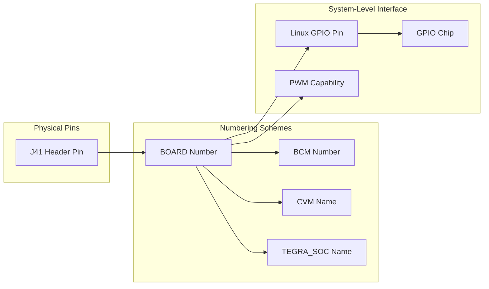
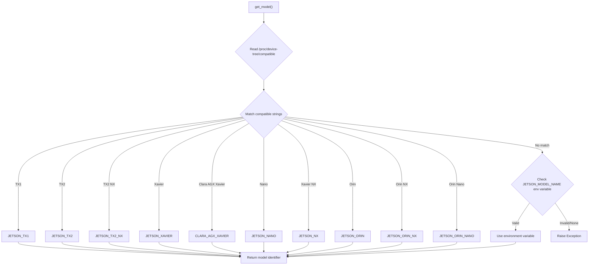
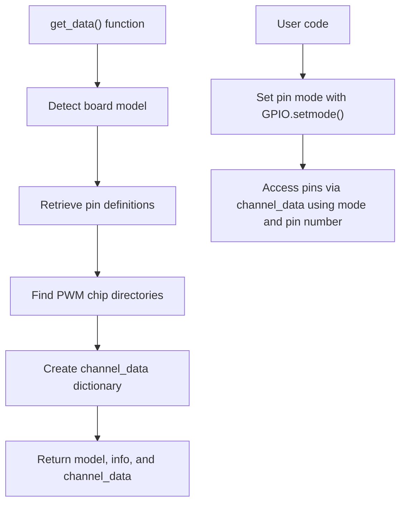

<!-- source: DeepWiki mcp.deepwiki.com · repo NVIDIA/jetson-gpio · page 4.2 Pin Mappings · fetched 2026-10-26 -->

# Pin Mappings

<details>
<summary>Relevant source files</summary>

The following files were used as context for generating this wiki page:

- [lib/python/Jetson/GPIO/gpio_pin_data.py](lib/python/Jetson/GPIO/gpio_pin_data.py)
- [samples/test_all_pins.py](samples/test_all_pins.py)
- [samples/test_all_pins_input.py](samples/test_all_pins_input.py)

</details>


This page provides detailed information about the pin mappings for all supported NVIDIA Jetson boards in the Jetson.GPIO library. It explains how physical pins on Jetson boards are mapped to different numbering systems (BOARD, BCM, CVM, TEGRA_SOC) and how to reference them in your code. For information about pin numbering modes themselves, see [Pin Numbering](#3.1).

## Pin Mapping Concept

Jetson GPIO pins can be referred to using different numbering schemes. The Jetson.GPIO library supports four pin numbering modes:

1. **BOARD** - Physical pin numbers on the J41 header
2. **BCM** - Broadcom SoC numbering (for Raspberry Pi compatibility)
3. **CVM** - NVIDIA Jetson-specific function names
4. **TEGRA_SOC** - NVIDIA Tegra SoC-specific function names

Each pin on a Jetson board has corresponding values in each of these numbering systems, along with information about its capabilities (e.g., PWM support).



Sources: [lib/python/Jetson/GPIO/gpio_pin_data.py:37-51]()

## Pin Definition Structure

In the Jetson.GPIO library, each pin is defined by a tuple containing the following information:

```mermaid
classDiagram
    class "Pin Definition Tuple" {
        +int Linux_GPIO_pin_number
        +string Linux_exported_GPIO_name
        +string GPIO_chip_name
        +int BOARD_pin_number
        +int BCM_pin_number
        +string CVM_pin_name
        +string TEGRA_SOC_pin_name
        +string PWM_chip_dir
        +int PWM_ID
    }
    
    class "ChannelInfo Class" {
        +int channel
        +int chip_fd
        +int line_handle
        +int line_offset
        +string direction
        +string edge
        +string consumer
        +string gpio_name
        +string gpio_chip
        +string pwm_chip_dir
        +int pwm_id
    }
    
    "Pin Definition Tuple" --> "ChannelInfo Class" : mapped to
```

These definitions are used to create `ChannelInfo` objects that the Jetson.GPIO library uses to interact with the hardware.

Sources: [lib/python/Jetson/GPIO/gpio_pin_data.py:37-51](), [lib/python/Jetson/GPIO/gpio_pin_data.py:475-496]()

## Supported Boards

The Jetson.GPIO library supports the following NVIDIA Jetson boards:

| Board Model | Processor | RAM Configurations |
|-------------|-----------|-------------------|
| Jetson Orin | ARM A78AE | 32GB, 64GB |
| Jetson Orin NX | ARM A78AE | 32GB, 64GB |
| Jetson Orin Nano | ARM A78AE | 32GB, 64GB |
| Jetson Xavier | ARM Carmel | 8GB, 16GB, 32GB, 64GB |
| Clara AGX Xavier | ARM Carmel | 16GB |
| Jetson Xavier NX | ARM Carmel | 8GB, 16GB |
| Jetson TX2 | ARM A57 + Denver | 4GB, 8GB |
| Jetson TX2 NX | ARM A57 + Denver | 4GB |
| Jetson TX1 | ARM A57 | 4GB |
| Jetson Nano | ARM A57 | 2GB, 4GB |

Sources: [lib/python/Jetson/GPIO/gpio_pin_data.py:362-471]()

## Board Detection

The library automatically detects the Jetson board it's running on by examining the device tree's compatible strings. This allows it to load the appropriate pin definitions for the specific board.



Sources: [lib/python/Jetson/GPIO/gpio_pin_data.py:549-607]()

## Pin Mapping Tables

Below are the pin mapping tables for each supported Jetson board. These tables show how physical pins (BOARD numbers) correspond to other numbering schemes.

### Jetson Orin

| BOARD Pin | BCM Pin | CVM Name | TEGRA_SOC Name | Linux GPIO | GPIO Chip | PWM |
|-----------|---------|----------|----------------|------------|-----------|-----|
| 7 | 4 | MCLK05 | GP66 | 106 | tegra234-gpio | No |
| 11 | 17 | UART1_RTS | GP72_UART1_RTS_N | 112 | tegra234-gpio | No |
| 12 | 18 | I2S2_CLK | GP122 | 50 | tegra234-gpio | No |
| 13 | 27 | PWM01 | GP68 | 108 | tegra234-gpio | Yes |
| 15 | 22 | GPIO27 | GP88_PWM1 | 85 | tegra234-gpio | Yes |
| 16 | 23 | GPIO08 | GP26 | 9 | tegra234-gpio-aon | No |
| 18 | 24 | GPIO35 | GP115 | 43 | tegra234-gpio | Yes |
| 19 | 10 | SPI1_MOSI | GP49_SPI1_MOSI | 135 | tegra234-gpio | No |
| 21 | 9 | SPI1_MISO | GP48_SPI1_MISO | 134 | tegra234-gpio | No |
| 22 | 25 | GPIO17 | GP56 | 96 | tegra234-gpio | No |
| 23 | 11 | SPI1_CLK | GP47_SPI1_CLK | 133 | tegra234-gpio | No |
| 24 | 8 | SPI1_CS0_N | GP50_SPI1_CS0_N | 136 | tegra234-gpio | No |
| 26 | 7 | SPI1_CS1_N | GP51_SPI1_CS1_N | 137 | tegra234-gpio | No |
| 29 | 5 | CAN0_DIN | GP18_CAN0_DIN | 1 | tegra234-gpio-aon | No |
| 31 | 6 | CAN0_DOUT | GP17_CAN0_DOUT | 0 | tegra234-gpio-aon | No |
| 32 | 12 | GPIO09 | GP25 | 8 | tegra234-gpio-aon | No |
| 33 | 13 | CAN1_DOUT | GP19_CAN1_DOUT | 2 | tegra234-gpio-aon | No |
| 35 | 19 | I2S2_FS | GP125 | 53 | tegra234-gpio | No |
| 36 | 16 | UART1_CTS | GP73_UART1_CTS_N | 113 | tegra234-gpio | No |
| 37 | 26 | CAN1_DIN | GP20_CAN1_DIN | 3 | tegra234-gpio-aon | No |
| 38 | 20 | I2S2_DIN | GP124 | 52 | tegra234-gpio | No |
| 40 | 21 | I2S2_DOUT | GP123 | 51 | tegra234-gpio | No |

Sources: [lib/python/Jetson/GPIO/gpio_pin_data.py:99-123]()

### Jetson Orin NX and Orin Nano

| BOARD Pin | BCM Pin | CVM Name | TEGRA_SOC Name | Linux GPIO | GPIO Chip | PWM |
|-----------|---------|----------|----------------|------------|-----------|-----|
| 7 | 4 | GPIO09 | GP167 | 144 | tegra234-gpio | No |
| 11 | 17 | UART1_RTS | GP72_UART1_RTS_N | 112 | tegra234-gpio | No |
| 12 | 18 | I2S0_SCLK | GP122 | 50 | tegra234-gpio | No |
| 13 | 27 | SPI1_SCK | GP36_SPI3_CLK | 122 | tegra234-gpio | No |
| 15 | 22 | GPIO12 | GP88_PWM1 | 85 | tegra234-gpio | Yes |
| 16 | 23 | SPI1_CS1 | GP40_SPI3_CS1_N | 126 | tegra234-gpio | No |
| 18 | 24 | SPI1_CS0 | GP39_SPI3_CS0_N | 125 | tegra234-gpio | No |
| 19 | 10 | SPI0_MOSI | GP49_SPI1_MOSI | 135 | tegra234-gpio | No |
| 21 | 9 | SPI0_MISO | GP48_SPI1_MISO | 134 | tegra234-gpio | No |
| 22 | 25 | SPI1_MISO | GP37_SPI3_MISO | 123 | tegra234-gpio | No |
| 23 | 11 | SPI0_SCK | GP47_SPI1_CLK | 133 | tegra234-gpio | No |
| 24 | 8 | SPI0_CS0 | GP50_SPI1_CS0_N | 136 | tegra234-gpio | No |
| 26 | 7 | SPI0_CS1 | GP51_SPI1_CS1_N | 137 | tegra234-gpio | No |
| 29 | 5 | GPIO01 | GP65 | 105 | tegra234-gpio | No |
| 31 | 6 | GPIO11 | GP66 | 106 | tegra234-gpio | No |
| 32 | 12 | GPIO07 | GP113_PWM7 | 41 | tegra234-gpio | Yes |
| 33 | 13 | GPIO13 | GP115 | 43 | tegra234-gpio | Yes |
| 35 | 19 | I2S0_FS | GP125 | 53 | tegra234-gpio | No |
| 36 | 16 | UART1_CTS | GP73_UART1_CTS_N | 113 | tegra234-gpio | No |
| 37 | 26 | SPI1_MOSI | GP38_SPI3_MOSI | 124 | tegra234-gpio | No |
| 38 | 20 | I2S0_SDIN | GP124 | 52 | tegra234-gpio | No |
| 40 | 21 | I2S0_SDOUT | GP123 | 51 | tegra234-gpio | No |

Sources: [lib/python/Jetson/GPIO/gpio_pin_data.py:53-76]()

### Jetson Xavier

| BOARD Pin | BCM Pin | CVM Name | TEGRA_SOC Name | Linux GPIO | GPIO Chip | PWM |
|-----------|---------|----------|----------------|------------|-----------|-----|
| 7 | 4 | MCLK05 | SOC_GPIO42 | 106 | tegra194-gpio | No |
| 11 | 17 | UART1_RTS | UART1_RTS | 112 | tegra194-gpio | No |
| 12 | 18 | I2S2_CLK | DAP2_SCLK | 51 | tegra194-gpio | No |
| 13 | 27 | PWM01 | SOC_GPIO44 | 108 | tegra194-gpio | Yes |
| 15 | 22 | GPIO27 | SOC_GPIO54 | 84 | tegra194-gpio | Yes |
| 16 | 23 | GPIO8 | CAN1_STB | 8 | tegra194-gpio-aon | No |
| 18 | 24 | GPIO35 | SOC_GPIO12 | 44 | tegra194-gpio | Yes |
| 19 | 10 | SPI1_MOSI | SPI1_MOSI | 162 | tegra194-gpio | No |
| 21 | 9 | SPI1_MISO | SPI1_MISO | 161 | tegra194-gpio | No |
| 22 | 25 | GPIO17 | SOC_GPIO21 | 101 | tegra194-gpio | No |
| 23 | 11 | SPI1_CLK | SPI1_SCK | 160 | tegra194-gpio | No |
| 24 | 8 | SPI1_CS0_N | SPI1_CS0_N | 163 | tegra194-gpio | No |
| 26 | 7 | SPI1_CS1_N | SPI1_CS1_N | 164 | tegra194-gpio | No |
| 29 | 5 | CAN0_DIN | CAN0_DIN | 3 | tegra194-gpio-aon | No |
| 31 | 6 | CAN0_DOUT | CAN0_DOUT | 2 | tegra194-gpio-aon | No |
| 32 | 12 | GPIO9 | CAN1_EN | 9 | tegra194-gpio-aon | No |
| 33 | 13 | CAN1_DOUT | CAN1_DOUT | 0 | tegra194-gpio-aon | No |
| 35 | 19 | I2S2_FS | DAP2_FS | 54 | tegra194-gpio | No |
| 36 | 16 | UART1_CTS | UART1_CTS | 113 | tegra194-gpio | No |
| 37 | 26 | CAN1_DIN | CAN1_DIN | 1 | tegra194-gpio-aon | No |
| 38 | 20 | I2S2_DIN | DAP2_DIN | 53 | tegra194-gpio | No |
| 40 | 21 | I2S2_DOUT | DAP2_DOUT | 52 | tegra194-gpio | No |

Sources: [lib/python/Jetson/GPIO/gpio_pin_data.py:196-222]()

### Jetson Xavier NX

| BOARD Pin | BCM Pin | CVM Name | TEGRA_SOC Name | Linux GPIO | GPIO Chip | PWM |
|-----------|---------|----------|----------------|------------|-----------|-----|
| 7 | 4 | GPIO09 | AUD_MCLK | 118 | tegra194-gpio | No |
| 11 | 17 | UART1_RTS | UART1_RTS | 112 | tegra194-gpio | No |
| 12 | 18 | I2S0_SCLK | DAP5_SCLK | 127 | tegra194-gpio | No |
| 13 | 27 | SPI1_SCK | SPI3_SCK | 149 | tegra194-gpio | No |
| 15 | 22 | GPIO12 | TOUCH_CLK | 16 | tegra194-gpio-aon | Yes |
| 16 | 23 | SPI1_CS1 | SPI3_CS1_N | 153 | tegra194-gpio | No |
| 18 | 24 | SPI1_CS0 | SPI3_CS0_N | 152 | tegra194-gpio | No |
| 19 | 10 | SPI0_MOSI | SPI1_MOSI | 162 | tegra194-gpio | No |
| 21 | 9 | SPI0_MISO | SPI1_MISO | 161 | tegra194-gpio | No |
| 22 | 25 | SPI1_MISO | SPI3_MISO | 150 | tegra194-gpio | No |
| 23 | 11 | SPI0_SCK | SPI1_SCK | 160 | tegra194-gpio | No |
| 24 | 8 | SPI0_CS0 | SPI1_CS0_N | 163 | tegra194-gpio | No |
| 26 | 7 | SPI0_CS1 | SPI1_CS1_N | 164 | tegra194-gpio | No |
| 29 | 5 | GPIO01 | SOC_GPIO41 | 105 | tegra194-gpio | No |
| 31 | 6 | GPIO11 | SOC_GPIO42 | 106 | tegra194-gpio | No |
| 32 | 12 | GPIO07 | SOC_GPIO44 | 108 | tegra194-gpio | Yes |
| 33 | 13 | GPIO13 | SOC_GPIO54 | 84 | tegra194-gpio | Yes |
| 35 | 19 | I2S0_FS | DAP5_FS | 130 | tegra194-gpio | No |
| 36 | 16 | UART1_CTS | UART1_CTS | 113 | tegra194-gpio | No |
| 37 | 26 | SPI1_MOSI | SPI3_MOSI | 151 | tegra194-gpio | No |
| 38 | 20 | I2S0_DIN | DAP5_DIN | 129 | tegra194-gpio | No |
| 40 | 21 | I2S0_DOUT | DAP5_DOUT | 128 | tegra194-gpio | No |

Sources: [lib/python/Jetson/GPIO/gpio_pin_data.py:164-187]()

### Clara AGX Xavier

The Clara AGX Xavier follows a similar pin mapping to the Jetson Xavier with slight differences in some pin functions and capabilities.

Sources: [lib/python/Jetson/GPIO/gpio_pin_data.py:133-159]()

### Jetson TX2

| BOARD Pin | BCM Pin | CVM Name | TEGRA_SOC Name | Linux GPIO | GPIO Chip | Notes |
|-----------|---------|----------|----------------|------------|-----------|-------|
| 7 | 4 | PAUDIO_MCLK | AUD_MCLK | 76 | tegra-gpio | |
| 11 | 17 | PUART0_RTS | UART1_RTS | 146 | tegra-gpio | Output-only |
| 12 | 18 | PI2S0_CLK | DAP1_SCLK | 72 | tegra-gpio | |
| 13 | 27 | PGPIO20_AUD_INT | GPIO_AUD0 | 77 | tegra-gpio | |
| 15 | 22 | GPIO_EXP_P17 | GPIO_EXP_P17 | 15 | tca9539 | |
| 16 | 23 | AO_DMIC_IN_DAT | CAN_GPIO0 | 40 | tegra-gpio-aon | Input-only |
| 18 | 24 | GPIO16_MDM_WAKE_AP | GPIO_MDM2 | 161 | tegra-gpio | |
| 19 | 10 | SPI1_MOSI | GPIO_CAM6 | 109 | tegra-gpio | |
| 21 | 9 | SPI1_MISO | GPIO_CAM5 | 108 | tegra-gpio | |
| 22 | 25 | GPIO_EXP_P16 | GPIO_EXP_P16 | 14 | tca9539 | |
| 23 | 11 | SPI1_CLK | GPIO_CAM4 | 107 | tegra-gpio | |
| 24 | 8 | SPI1_CS0 | GPIO_CAM7 | 110 | tegra-gpio | |
| 26 | - | - | - | - | - | Not available |
| 29 | 5 | GPIO19_AUD_RST | GPIO_AUD1 | 78 | tegra-gpio | |
| 31 | 6 | GPIO9_MOTION_INT | CAN_GPIO2 | 42 | tegra-gpio-aon | |
| 32 | 12 | AO_DMIC_IN_CLK | CAN_GPIO1 | 41 | tegra-gpio-aon | Output-only |
| 33 | 13 | GPIO11_AP_WAKE_BT | GPIO_PQ5 | 69 | tegra-gpio | |
| 35 | 19 | I2S0_LRCLK | DAP1_FS | 75 | tegra-gpio | |
| 36 | 16 | UART0_CTS | UART1_CTS | 147 | tegra-gpio | Input-only or Output-only |
| 37 | 26 | GPIO8_ALS_PROX_INT | GPIO_PQ4 | 68 | tegra-gpio | |
| 38 | 20 | I2S0_SDIN | DAP1_DIN | 74 | tegra-gpio | |
| 40 | 21 | I2S0_SDOUT | DAP1_DOUT | 73 | tegra-gpio | |

Note: Pin 26 is not available on Jetson TX2.

Sources: [lib/python/Jetson/GPIO/gpio_pin_data.py:259-295]()

### Jetson TX2 NX, TX1, and Nano

Similar pin mappings exist for other Jetson boards. Please refer to the source code for their detailed pin definitions.

Sources: [lib/python/Jetson/GPIO/gpio_pin_data.py:231-258](), [lib/python/Jetson/GPIO/gpio_pin_data.py:297-323](), [lib/python/Jetson/GPIO/gpio_pin_data.py:329-359]()

## Using Pin Mappings in Code

To use these pin mappings in your code, first set the pin numbering mode using `GPIO.setmode()` and then reference the pins using the corresponding numbers or names:

```python
import Jetson.GPIO as GPIO

# Set the pin mode (BOARD, BCM, CVM, or TEGRA_SOC)
GPIO.setmode(GPIO.BOARD)  # Using physical pin numbers

# Setup a pin
GPIO.setup(7, GPIO.OUT)   # Set pin 7 as output

# Or using a different mode
GPIO.setmode(GPIO.BCM)    # Using Broadcom pin numbers
GPIO.setup(4, GPIO.OUT)   # Same pin as above, but using BCM numbering
```

## Special Pin Considerations

Some pins have special properties or limitations:

1. **Input-only pins** - Some pins can only be configured as inputs due to hardware limitations.
2. **Output-only pins** - Some pins can only be configured as outputs.
3. **PWM-capable pins** - Only certain pins support PWM functionality.

The samples provided in the repository illustrate how to handle these special considerations.

Sources: [samples/test_all_pins.py:29-68](), [samples/test_all_pins_input.py:27-57]()

## Pin Mapping Implementation

The pin mapping is implemented through a `get_data()` function that creates a dictionary mapping each pin mode (BOARD, BCM, CVM, TEGRA_SOC) to a dictionary of `ChannelInfo` objects. These objects contain all the necessary information for the GPIO library to interact with the hardware.



Sources: [lib/python/Jetson/GPIO/gpio_pin_data.py:609-663]()

## Board Identification

The library identifies which Jetson board it's running on by examining the device tree's compatible strings. This automatic detection ensures that the correct pin definitions are used.

For Docker containers or environments where direct hardware access is limited, you can override the board detection by setting the `JETSON_MODEL_NAME` environment variable.

Sources: [lib/python/Jetson/GPIO/gpio_pin_data.py:499-542](), [lib/python/Jetson/GPIO/gpio_pin_data.py:549-607]()

---

