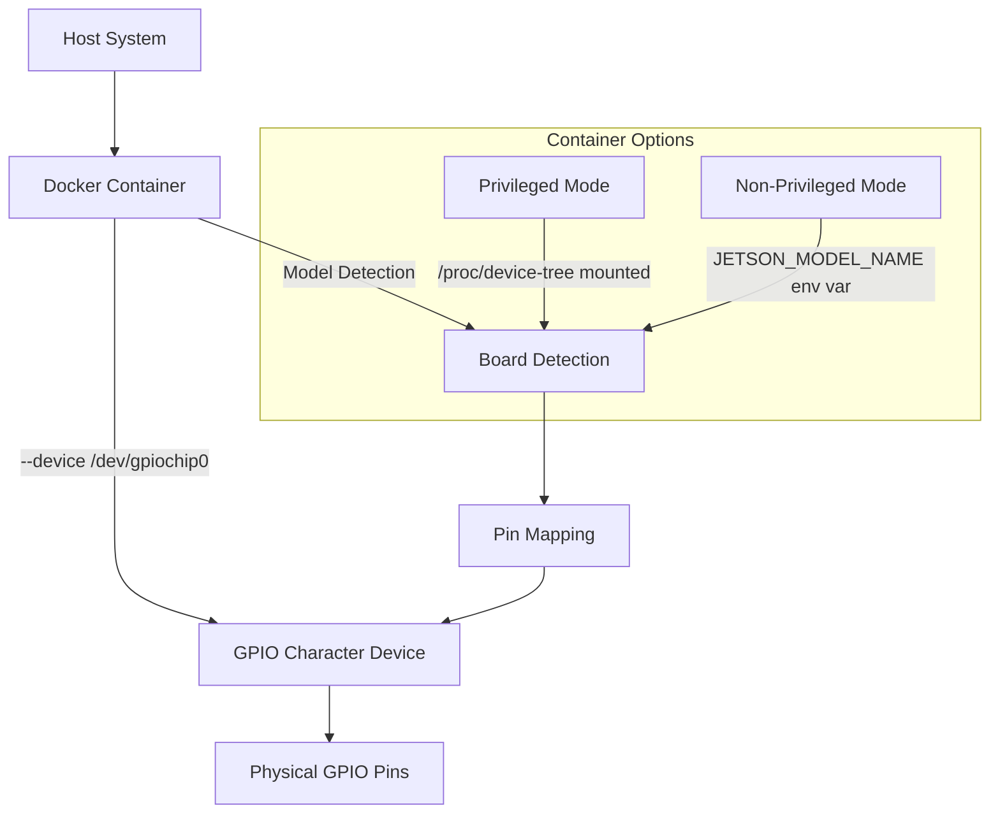
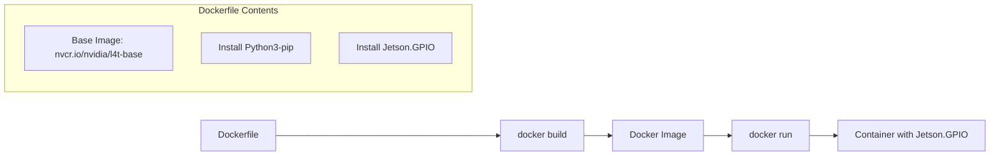
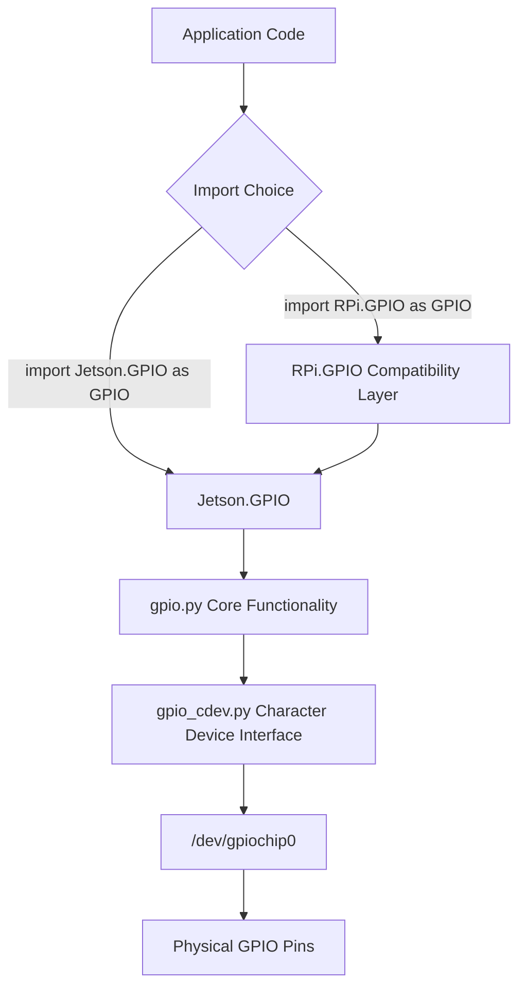
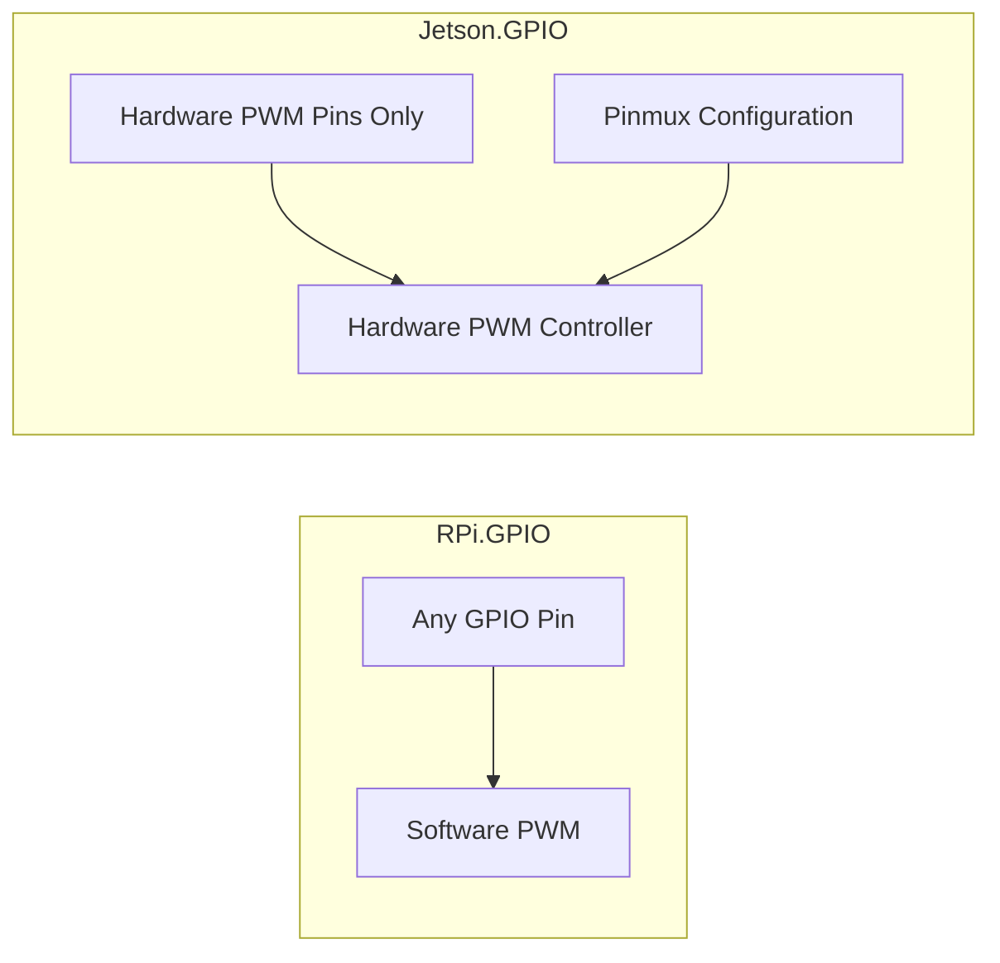
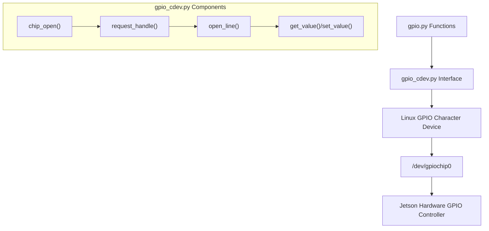

<!-- source: DeepWiki mcp.deepwiki.com · repo NVIDIA/jetson-gpio · page 5 Advanced Topics · fetched 2026-10-26 -->

# Advanced Topics

<details>
<summary>Relevant source files</summary>

The following files were used as context for generating this wiki page:

- [README.md](README.md)
- [lib/python/Jetson/GPIO/gpio_cdev.py](lib/python/Jetson/GPIO/gpio_cdev.py)
- [samples/docker/Dockerfile](samples/docker/Dockerfile)

</details>


This page covers advanced usage scenarios and features of the Jetson.GPIO library that go beyond basic GPIO operations. These topics are intended for users who need to integrate Jetson.GPIO in complex environments or leverage its compatibility features. For basic GPIO operations, refer to [Basic GPIO Operations](#3.2), and for event detection and PWM, see [Event Detection](#3.3) and [PWM](#3.4) respectively.

## Docker Integration

Jetson.GPIO can be used from within Docker containers, allowing for isolated and reproducible environments for GPIO applications.

### Docker Container Setup



Sources: [README.md:427-490]()

### Building a Docker Image

The Jetson.GPIO repository provides a sample Dockerfile that can be used as a starting point for creating a Docker image with Jetson.GPIO support:



Sources: [samples/docker/Dockerfile:1-25]()

To build a Docker image using the provided Dockerfile:

```
sudo docker image build -f samples/docker/Dockerfile -t gpio-app .
```

### Running in Privileged Mode

In privileged mode, the container has access to the system's device tree, which allows Jetson.GPIO to automatically detect the Jetson model:

| Parameter | Purpose |
|-----------|---------|
| `--privileged` | Grants extended privileges to the container |
| `-v /proc/device-tree/compatible:/proc/device-tree/compatible` | Maps device tree compatibility info |
| `-v /proc/device-tree/chosen:/proc/device-tree/chosen` | Maps device tree chosen info |
| `--device /dev/gpiochip0` | Provides access to GPIO character device |

Example command:

```
sudo docker container run -it --rm \
--runtime=nvidia --gpus all \
--privileged \
-v /proc/device-tree/compatible:/proc/device-tree/compatible \
-v /proc/device-tree/chosen:/proc/device-tree/chosen \
--device /dev/gpiochip0 \
gpio-app /bin/bash
```

Sources: [README.md:452-465]()

### Running in Non-Privileged Mode

To run in non-privileged mode, you need to explicitly provide the Jetson model name via an environment variable:

| Parameter | Purpose |
|-----------|---------|
| `--device /dev/gpiochip0` | Provides access to GPIO character device |
| `-e JETSON_MODEL_NAME=<model>` | Specifies the Jetson model |

Example command:

```
sudo docker container run -it --rm \
--runtime=nvidia --gpus all \
--device /dev/gpiochip0 \
-e JETSON_MODEL_NAME=JETSON_NANO \
gpio-app /bin/bash
```

To determine the correct model name value, you can run the `jetson_model.py` script on the host:

```
sudo python3 samples/jetson_model.py
```

Sources: [README.md:467-490]()

## Raspberry Pi Compatibility

Jetson.GPIO is designed to be API-compatible with the RPi.GPIO library, allowing for easy migration of code from Raspberry Pi to Jetson platforms.

### API Compatibility Architecture



Sources: [README.md:5-8](), [README.md:150-151]()

### Importing for Compatibility

To facilitate easy porting of code from Raspberry Pi, Jetson.GPIO can be imported using the RPi.GPIO name:

```python
# Original Raspberry Pi code
import RPi.GPIO as GPIO

# Works unchanged on Jetson with Jetson.GPIO installed
```

This allows existing Raspberry Pi GPIO code to run with minimal or no changes on Jetson platforms.

Sources: [README.md:150-151]()

### Pin Numbering Compatibility

Jetson.GPIO supports the same pin numbering modes as RPi.GPIO:

| Mode | Description | Usage |
|------|-------------|-------|
| BOARD | Physical pin numbers on the 40-pin header | `GPIO.setmode(GPIO.BOARD)` |
| BCM | Broadcom SoC GPIO numbers | `GPIO.setmode(GPIO.BCM)` |

Additionally, Jetson.GPIO provides two Jetson-specific modes:

| Mode | Description | Usage |
|------|-------------|-------|
| CVM | NVIDIA Compute Module pin names | `GPIO.setmode(GPIO.CVM)` |
| TEGRA_SOC | NVIDIA Tegra SoC signal names | `GPIO.setmode(GPIO.TEGRA_SOC)` |

Sources: [README.md:155-172]()

### Functional Differences

When porting code from Raspberry Pi to Jetson, note these key differences:

1. **PWM Support**: Unlike RPi.GPIO which supports software PWM on any pin, Jetson.GPIO only supports hardware PWM on specific pins.
   - Jetson Nano: 2 PWM channels
   - Jetson AGX Xavier: 3 PWM channels
   - Jetson TX1 and TX2: No PWM support

2. **Pinmux Configuration**: Jetson platforms require proper pinmux configuration for PWM functionality. The library does not dynamically modify the pinmux configuration.



Sources: [README.md:410-424]()

## Character Device Interface

Jetson.GPIO uses the Linux GPIO character device interface (`/dev/gpiochip0`) to interact with the hardware GPIO pins, providing more reliable and efficient access compared to the older sysfs approach.

### Character Device Architecture



The character device interface provides functions for:
- Opening and closing GPIO chips
- Requesting handles for GPIO lines
- Reading and writing GPIO line values
- Setting up event detection

Sources: [lib/python/Jetson/GPIO/gpio_cdev.py:142-283]()

### Key Functions in Character Device Interface

| Function | Purpose | File Location |
|----------|---------|---------------|
| `chip_open()` | Opens a GPIO chip by name | [gpio_cdev.py:145-151]() |
| `request_handle()` | Creates a request handle for a GPIO line | [gpio_cdev.py:234-246]() |
| `get_value()` | Reads the value of a GPIO line | [gpio_cdev.py:263-271]() |
| `set_value()` | Sets the value of a GPIO line | [gpio_cdev.py:276-283]() |
| `request_event()` | Sets up event detection on a GPIO line | [gpio_cdev.py:252-258]() |

Sources: [lib/python/Jetson/GPIO/gpio_cdev.py:142-283]()

## Performance Considerations

When using Jetson.GPIO in advanced scenarios, consider these performance aspects:

### Event Detection Polling Time

The event detection system uses a background thread that wakes up periodically to check for events. The default polling timeout is 0.2 seconds, but this can be customized:

```python
# Set polling time to 1 second
GPIO.add_event_detect(channel, GPIO.RISING, callback=callback_fn, polltime=1)
```

Setting a longer polling time reduces CPU usage but increases the maximum latency for event detection.

Sources: [README.md:371-383]()

### Event Removal Timeout

When removing event detection, a timeout can be specified:

```python
# Set timeout for removal to 1 second
GPIO.remove_event_detect(channel, timeout=1)
```

The default timeout is 0.5 seconds. It is recommended to set this timeout to at least twice the poll time.

Sources: [README.md:391-398]()

---

