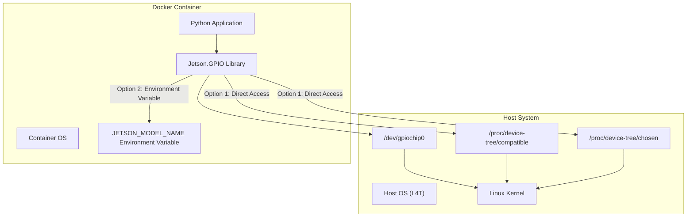
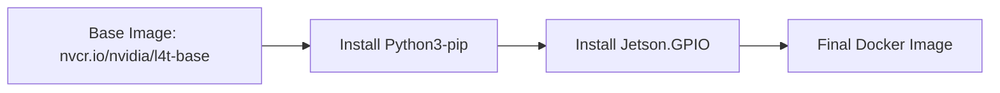
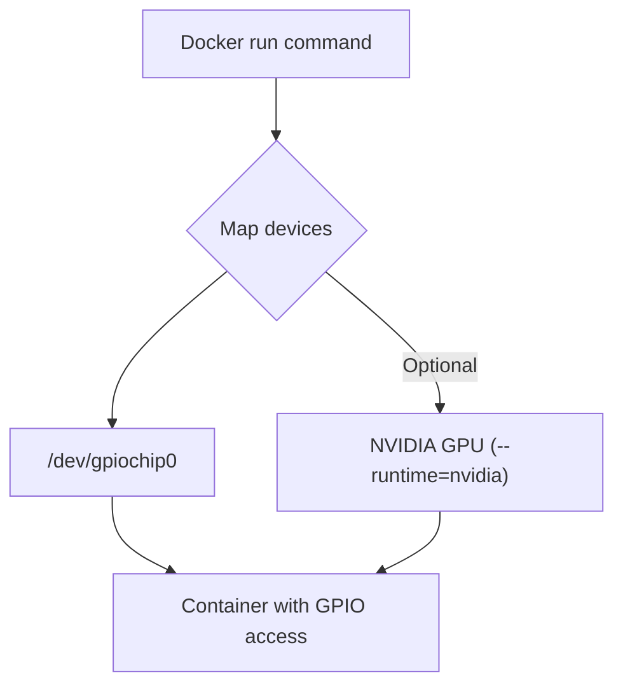
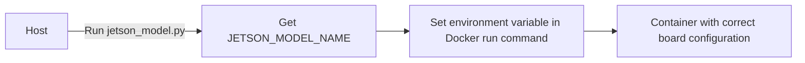
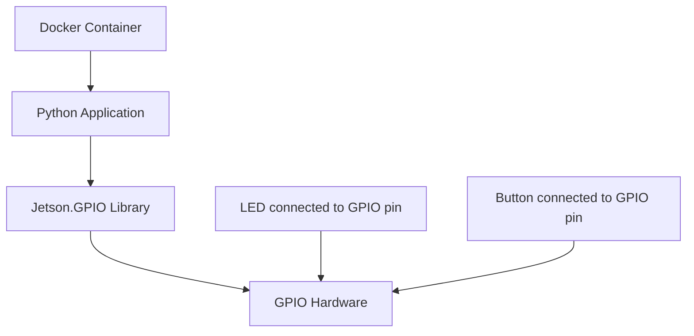

<!-- source: DeepWiki mcp.deepwiki.com · repo NVIDIA/jetson-gpio · page 5.1 Docker Integration · fetched 2026-10-26 -->

# Docker Integration

<details>
<summary>Relevant source files</summary>

The following files were used as context for generating this wiki page:

- [README.md](README.md)
- [samples/docker/Dockerfile](samples/docker/Dockerfile)

</details>


## Purpose and Scope

This document explains how to use the Jetson.GPIO library within Docker containers, allowing developers to create containerized applications that can access and control GPIO pins on Jetson development boards. It covers building Docker images with Jetson.GPIO, running containers with the necessary permissions, and the differences between privileged and non-privileged container execution modes.

Sources: [README.md:427-490]()

## Overview of Docker Integration

Docker containers provide isolation and portability for applications, while Jetson.GPIO requires access to hardware devices. This integration allows developers to leverage the benefits of containerization while still maintaining access to the physical GPIO pins.

### Docker and GPIO Architecture



Sources: [README.md:427-490]()

## Building a Docker Image with Jetson.GPIO

### Using the Sample Dockerfile

The repository includes a sample Dockerfile that can be used to create a Docker image with Jetson.GPIO pre-installed.



To build a Docker image using the provided sample Dockerfile:

```
sudo docker image build -f samples/docker/Dockerfile -t jetson-gpio-image .
```

Sources: [samples/docker/Dockerfile:20-25](), [README.md:431-435]()

### Custom Dockerfile Example

You can also create your own Dockerfile tailored to your specific application needs, ensuring it includes the Jetson.GPIO installation:

```
FROM nvcr.io/nvidia/l4t-base:<version>
RUN apt-get update && apt-get install -y python3-pip
RUN pip3 install Jetson.GPIO
# Add your application-specific dependencies and code here
```

Sources: [samples/docker/Dockerfile:20-25]()

## Running Containers with GPIO Access

### Basic Requirements

To use GPIO pins from within a Docker container, you must grant the container access to the GPIO hardware. This is done by mapping the GPIO character device into the container.



The minimum required option to access GPIO is:

```
--device /dev/gpiochip0
```

If you also need GPU access:

```
--runtime=nvidia --gpus all
```

Sources: [README.md:438-449]()

## Privileged vs. Non-Privileged Mode

There are two ways to run Jetson.GPIO in Docker containers, each with different security implications and setup requirements.

### Privileged Mode

In privileged mode, the container has access to the host's device tree, which allows the Jetson.GPIO library to automatically detect the board model.

To run a container in privileged mode:

```
sudo docker container run -it --rm \
--runtime=nvidia --gpus all \
--privileged \
-v /proc/device-tree/compatible:/proc/device-tree/compatible \
-v /proc/device-tree/chosen:/proc/device-tree/chosen \
--device /dev/gpiochip0 \
jetson-gpio-image /bin/bash
```

Sources: [README.md:452-465]()

### Non-Privileged Mode

For enhanced security, you can run in non-privileged mode by directly specifying the Jetson model name through an environment variable.



1. First, determine your Jetson model name by running on the host:

```
sudo python3 samples/jetson_model.py
```

2. Then, run the container with the model name as an environment variable:

```
sudo docker container run -it --rm \
--runtime=nvidia --gpus all \
--device /dev/gpiochip0 \
-e JETSON_MODEL_NAME=JETSON_NANO \
jetson-gpio-image /bin/bash
```

Replace `JETSON_NANO` with your actual Jetson model name (e.g., `JETSON_XAVIER`, `JETSON_ORIN`, etc.).

Sources: [README.md:467-490]()

## Example Application in Docker

This section demonstrates a simple example of running a GPIO application inside a Docker container.

### Running a Sample Application

Once inside the container, you can run any of the sample applications or your own GPIO code:



Example workflow:

1. Build the Docker image
2. Run the container with proper device mapping
3. Inside the container, run a GPIO sample application:
   ```
   python3 /path/to/simple_output.py
   ```

Sources: [README.md:431-435](), [README.md:452-465](), [README.md:467-490]()

## Best Practices and Troubleshooting

### Permission Issues

If you encounter permission issues when accessing GPIO pins from a container, ensure:

1. The container has access to `/dev/gpiochip0`
2. The container is either running in privileged mode or has the correct `JETSON_MODEL_NAME` environment variable set

### Board Detection Issues

If the library cannot detect your Jetson board:
- In privileged mode: Ensure `/proc/device-tree/compatible` and `/proc/device-tree/chosen` are correctly mounted
- In non-privileged mode: Verify you've provided the correct `JETSON_MODEL_NAME` environment variable

### Security Considerations

- Use non-privileged mode when possible for enhanced security
- Only map the specific devices needed by your application
- Consider using read-only mounts for sensitive paths

Sources: [README.md:452-490]()

## Related Topics

For more information about:
- Setting up GPIO permissions on the host system, see [Setting Up Permissions](#2.2)
- Basic GPIO operations and API reference, see [API Reference](#3)
- Supported Jetson boards and pin mappings, see [Hardware Support](#4)

---

