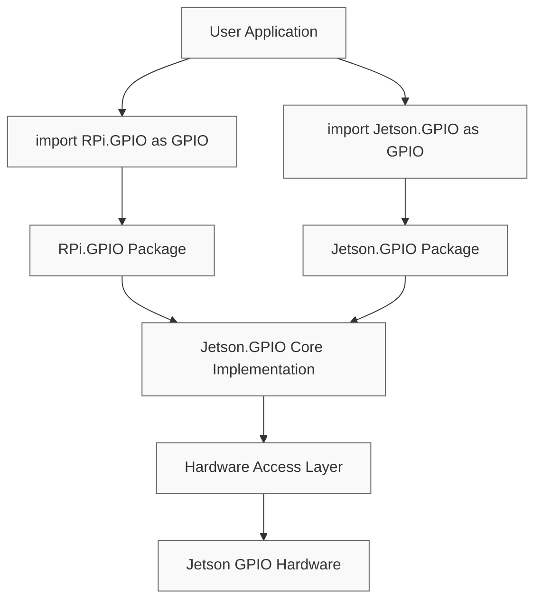
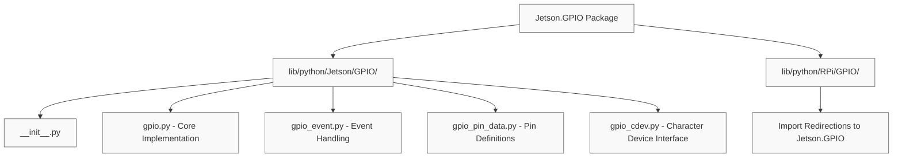
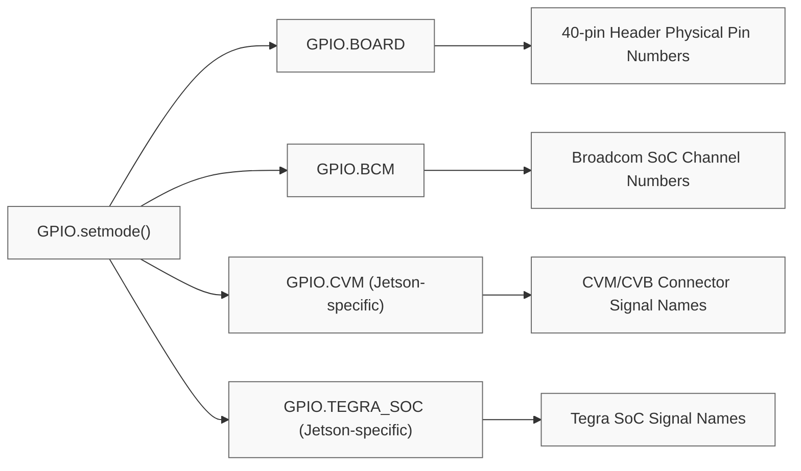

<!-- source: DeepWiki mcp.deepwiki.com · repo NVIDIA/jetson-gpio · page 5.2 Raspberry Pi Compatibility · fetched 2026-10-26 -->

# Raspberry Pi Compatibility

<details>
<summary>Relevant source files</summary>

The following files were used as context for generating this wiki page:

- [README.md](README.md)
- [lib/python/Jetson/GPIO/__init__.py](lib/python/Jetson/GPIO/__init__.py)
- [setup.py](setup.py)

</details>


## Purpose and Scope

This document details the compatibility layer between Jetson.GPIO and the Raspberry Pi GPIO library (RPi.GPIO). The Jetson.GPIO library is designed to provide a familiar interface for developers migrating from Raspberry Pi platforms to NVIDIA Jetson boards, allowing existing Raspberry Pi GPIO code to run with minimal or no modifications. This page explains how the compatibility layer works, how to utilize it, and any differences or limitations to be aware of when porting code.

For information about the general API reference of Jetson.GPIO, see [API Reference](#3). For hardware-specific details about supported Jetson boards, see [Hardware Support](#4).

## Compatibility Architecture

Jetson.GPIO implements a complete compatibility layer that mimics the RPi.GPIO interface, allowing code written for Raspberry Pi to run on Jetson devices with minimal changes.

### Import Compatibility Diagram



Sources: [setup.py:43](), [README.md:150-151]()

## Import Methods

The Jetson.GPIO library provides two import methods to support both Jetson-specific code and code ported from Raspberry Pi:

### Native Import

For new code written specifically for Jetson devices:

```python
import Jetson.GPIO as GPIO
```

### RPi.GPIO Compatible Import

For code ported from Raspberry Pi or when maintaining cross-platform compatibility:

```python
import RPi.GPIO as GPIO
```

The library provides identical functionality regardless of which import method is used. This allows existing Raspberry Pi code to run without modification to import statements.

Sources: [README.md:144-151](), [setup.py:43]()

## Package Structure

The Jetson.GPIO package includes both the `Jetson.GPIO` and `RPi.GPIO` module paths to support compatibility:



Sources: [setup.py:42-44]()

## API Compatibility

Jetson.GPIO implements all the public APIs provided by the RPi.GPIO library, ensuring compatibility for ported code.

### Compatible APIs

| Feature Category | Compatible Functions | Description |
|------------------|----------------------|-------------|
| Setup | `setmode()`, `getmode()`, `setup()`, `cleanup()` | Pin numbering modes and channel configuration |
| Input/Output | `input()`, `output()` | Reading and writing pin values |
| Events | `wait_for_edge()`, `add_event_detect()`, `add_event_callback()`, `event_detected()`, `remove_event_detect()` | Event detection and callback handling |
| PWM | `PWM()`, `start()`, `ChangeDutyCycle()`, `ChangeFrequency()`, `stop()` | Pulse Width Modulation functionality |
| Utilities | `setwarnings()`, `gpio_function()` | Configuration and information functions |
| Constants | `HIGH`, `LOW`, `BOARD`, `BCM`, `IN`, `OUT`, `RISING`, `FALLING`, `BOTH` | Standard constants for pin values, modes, and edge detection |

Sources: [README.md:139-409]()

## Pin Numbering Modes

Jetson.GPIO supports the same pin numbering modes as RPi.GPIO, plus additional Jetson-specific modes:



- **BOARD**: Uses physical pin numbers on the 40-pin GPIO header
- **BCM**: Uses Broadcom SoC channel numbers (maintained for RPi compatibility)
- **CVM**: Jetson-specific mode using CVM/CVB connector signal names
- **TEGRA_SOC**: Jetson-specific mode using Tegra SoC signal names

Sources: [README.md:154-172]()

## Porting Code from Raspberry Pi to Jetson

### Basic Porting Process

1. Install the Jetson.GPIO library:
   ```shell
   sudo pip install Jetson.GPIO
   ```

2. Set up proper permissions (required once):
   ```shell
   sudo groupadd -f -r gpio
   sudo usermod -a -G gpio your_user_name
   sudo cp /path/to/Jetson/GPIO/99-gpio.rules /etc/udev/rules.d/
   sudo udevadm control --reload-rules && sudo udevadm trigger
   ```

3. Ensure your code uses standard RPi.GPIO patterns:
   - Use `import RPi.GPIO as GPIO` (no changes needed)
   - Use standard pin modes (BOARD or BCM)
   - Use standard functions (setup, input, output, etc.)

4. Test and debug, addressing any hardware-specific differences

Sources: [README.md:34-83]()

## Key Differences and Limitations

When porting RPi.GPIO code to Jetson.GPIO, be aware of these important differences:

### PWM Implementation Differences

Unlike RPi.GPIO, Jetson.GPIO only supports hardware PWM, not software-emulated PWM:

| Feature | RPi.GPIO | Jetson.GPIO |
|---------|----------|-------------|
| PWM Implementation | Supports both hardware PWM and software-emulated PWM | Supports hardware PWM only |
| Available PWM Channels | Varies by Raspberry Pi model | Jetson Nano: 2 channels<br>Jetson AGX Xavier: 3 channels<br>Jetson TX1/TX2: No PWM channels |
| Pinmux Configuration | Not required | System pinmux must be configured to connect hardware PWM controllers to pins |

Attempting to use PWM on pins without hardware PWM controllers in Jetson will not work, unlike on Raspberry Pi where software emulation allows PWM on any GPIO pin.

Sources: [README.md:410-424]()

### Hardware Differences

Physical and electrical differences between Raspberry Pi and Jetson boards may affect GPIO behavior:

| Characteristic | Raspberry Pi | Jetson Boards |
|----------------|--------------|---------------|
| Voltage Level | 3.3V logic level | 3.3V logic level |
| Current Capability | Limited current per pin (typically max 16mA) | May have different current limitations |
| Number of Pins | 40-pin header | 40-pin header (layout may differ) |
| Pin Functionality | Pins have fixed functions | Pins may require additional configuration (pinmux) |

### Additional Jetson-Specific Features

Jetson.GPIO provides additional features not found in RPi.GPIO:

1. **Additional Pin Numbering Modes**: CVM and TEGRA_SOC modes for Jetson-specific pin addressing
2. **Board Information**: `GPIO.JETSON_INFO` dictionary provides detailed information about the Jetson module
3. **Polltime Configuration**: Optional `polltime` parameter in event detection to control thread polling timeout

Sources: [README.md:169-172](), [README.md:272-286](), [README.md:371-383]()

## Example: Direct Port from Raspberry Pi

This example shows a simple application that would work identically on both Raspberry Pi and Jetson:

```python
import RPi.GPIO as GPIO
import time

# Set up GPIO using Board pin numbers
GPIO.setmode(GPIO.BOARD)

# Set up pin 12 as output
GPIO.setup(12, GPIO.OUT)

# Blink LED 10 times
for i in range(10):
    GPIO.output(12, GPIO.HIGH)
    time.sleep(0.5)
    GPIO.output(12, GPIO.LOW)
    time.sleep(0.5)

# Clean up
GPIO.cleanup()
```

This code would run without modification on either platform.

Sources: [README.md:144-151](), [README.md:230-261]()

## Troubleshooting Porting Issues

| Issue | Possible Cause | Solution |
|-------|----------------|----------|
| PWM not working | Pin doesn't have hardware PWM or pinmux not configured | Use a supported hardware PWM pin and ensure correct pinmux configuration |
| Pin doesn't respond | Permission issues | Ensure user is in the gpio group and udev rules are installed |
| Different behavior between platforms | Hardware differences | Review pin capabilities and voltage/current requirements |
| Import errors | Package not installed properly | Confirm installation with pip and check for import conflicts |

Sources: [README.md:410-424](), [README.md:54-83]()

## Conclusion

The Jetson.GPIO library provides an effective compatibility layer that allows most RPi.GPIO code to run on Jetson boards with minimal or no changes. The compatibility extends to import mechanisms, API functions, pin numbering modes, and general usage patterns. 

When porting code, developers should be mindful of the hardware differences, particularly regarding PWM implementation, which is hardware-only on Jetson platforms. By understanding these differences and limitations, Raspberry Pi developers can quickly migrate their projects to take advantage of the more powerful Jetson platform while reusing their existing GPIO code.

---

