<!-- source: DeepWiki mcp.deepwiki.com · repo NVIDIA/jetson-gpio · page 6 Internal Architecture · fetched 2026-10-26 -->

# Internal Architecture

Relevant source files

The following files were used as context for generating this wiki page:

- [lib/python/Jetson/GPIO/gpio.py](lib/python/Jetson/GPIO/gpio.py)
- [lib/python/Jetson/GPIO/gpio_cdev.py](lib/python/Jetson/GPIO/gpio_cdev.py)
- [lib/python/Jetson/GPIO/gpio_event.py](lib/python/Jetson/GPIO/gpio_event.py)
- [lib/python/Jetson/GPIO/gpio_pin_data.py](lib/python/Jetson/GPIO/gpio_pin_data.py)

This document explains the internal design and implementation of the Jetson.GPIO library. It covers the core components, interactions, and mechanisms that enable GPIO control on NVIDIA Jetson platforms. For API usage information, see [API Reference](#3), and for hardware-specific details, see [Hardware Support](#4).

## Overall Architecture

The Jetson.GPIO library uses a layered architecture to provide Python interfaces for controlling GPIO pins on NVIDIA Jetson platforms. The library implements both a Jetson-specific API (`Jetson.GPIO`) and a Raspberry Pi-compatible API (`RPi.GPIO`) for easier code portability.

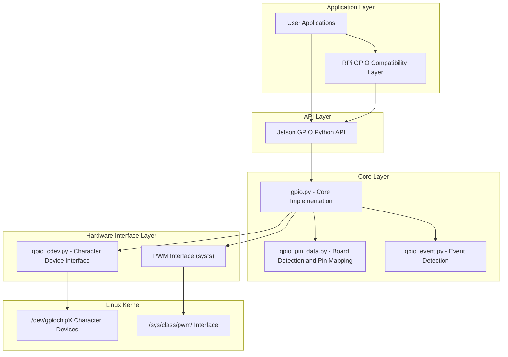

Sources: [lib/python/Jetson/GPIO/gpio.py:1-653](), [lib/python/Jetson/GPIO/gpio_pin_data.py:1-664](), [lib/python/Jetson/GPIO/gpio_event.py:1-518](), [lib/python/Jetson/GPIO/gpio_cdev.py:1-285]()

## Core Components

The library is structured around four primary modules, each with distinct responsibilities:

### 1. GPIO Pin Data Module

The `gpio_pin_data.py` module handles board detection and pin mapping. It contains:
- Pin definitions for all supported Jetson boards
- Logic to detect which Jetson board the code is running on
- Mapping between various pin numbering modes (BOARD, BCM, CVM, TEGRA_SOC)

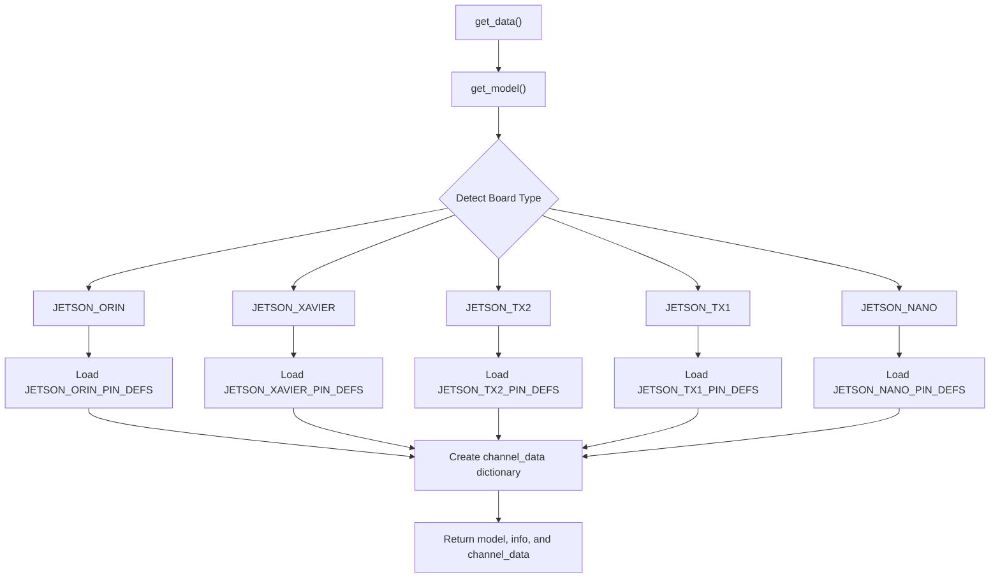

Sources: [lib/python/Jetson/GPIO/gpio_pin_data.py:499-664]()

### 2. Core GPIO Module

The `gpio.py` module implements the main functionality and API of the library:
- Pin setup and configuration
- Input/output operations
- PWM control
- Clean-up functions

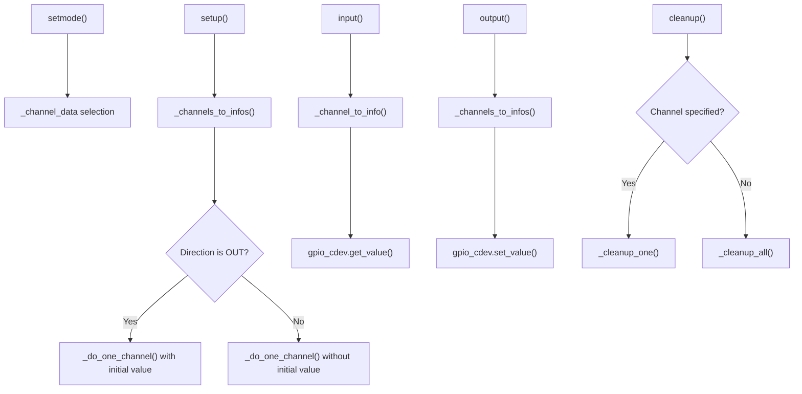

Sources: [lib/python/Jetson/GPIO/gpio.py:21-653]()

### 3. GPIO Event Detection

The `gpio_event.py` module handles event detection and callback management:
- Non-blocking edge detection with callbacks
- Blocking edge detection
- Event management and cleanup

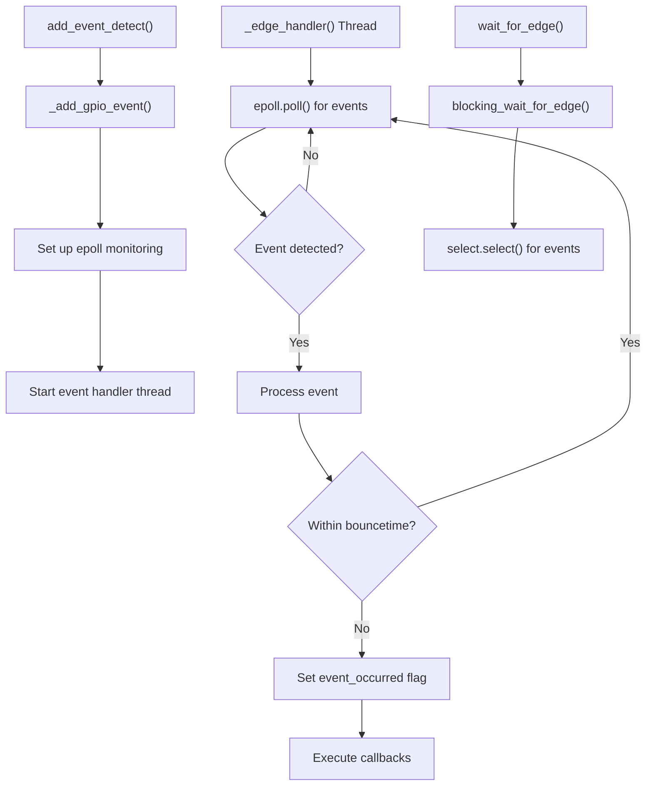

Sources: [lib/python/Jetson/GPIO/gpio_event.py:21-518]()

### 4. Character Device Interface

The `gpio_cdev.py` module provides the interface to the Linux GPIO character device API:
- Opening and closing GPIO chips and lines
- Reading and writing GPIO values
- Creating and managing GPIO event requests

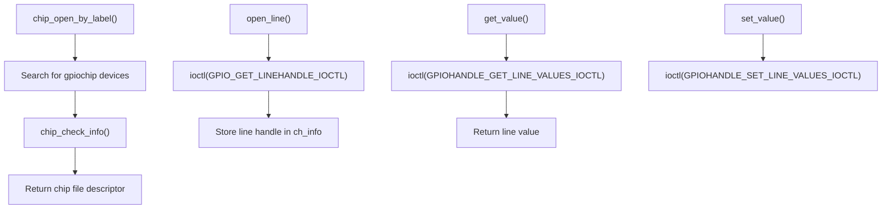

Sources: [lib/python/Jetson/GPIO/gpio_cdev.py:20-285]()

## Pin Mapping and Board Detection

The library supports multiple Jetson boards and provides several pin numbering modes. This system allows users to write portable code across different boards.

### Board Detection

The library automatically detects the Jetson board type by:
1. Reading `/proc/device-tree/compatible` to identify the board model
2. Using compatible strings to match known Jetson platforms
3. Falling back to the `JETSON_MODEL_NAME` environment variable for Docker containers

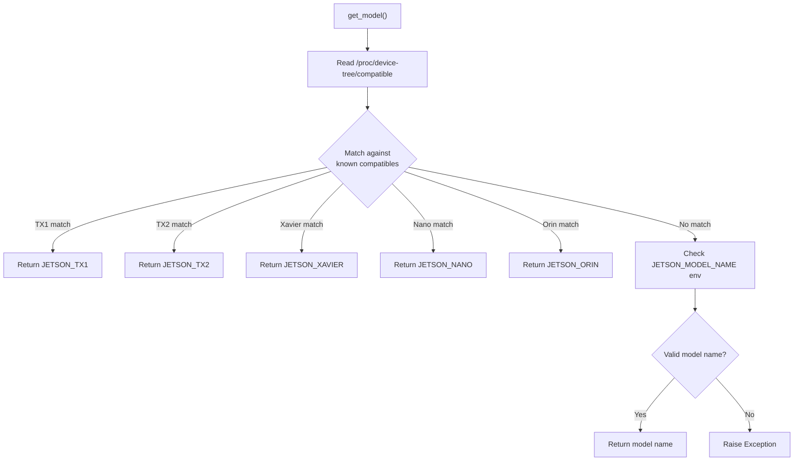

Sources: [lib/python/Jetson/GPIO/gpio_pin_data.py:499-607]()

### Pin Numbering Modes

The library supports four pin numbering modes:

1. **BOARD** - Physical pin numbering on the 40-pin header
2. **BCM** - Broadcom SoC pin numbering (for Raspberry Pi compatibility)
3. **CVM** - NVIDIA Computer Vision Module pin naming
4. **TEGRA_SOC** - Tegra SoC-specific pin naming

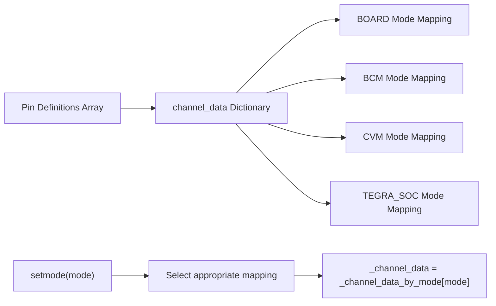

Sources: [lib/python/Jetson/GPIO/gpio_pin_data.py:36-52](), [lib/python/Jetson/GPIO/gpio.py:38-42](), [lib/python/Jetson/GPIO/gpio.py:287-306]()

## GPIO Operations Flow

This section explains the sequence of operations for the most common GPIO tasks.

### Pin Setup and Configuration

When a GPIO pin is configured using `setup()`:

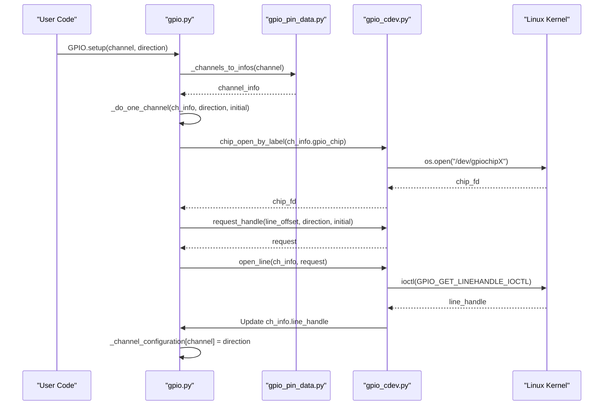

Sources: [lib/python/Jetson/GPIO/gpio.py:326-363](), [lib/python/Jetson/GPIO/gpio.py:151-162]()

### Reading and Writing GPIO Values

Input/output operations flow:

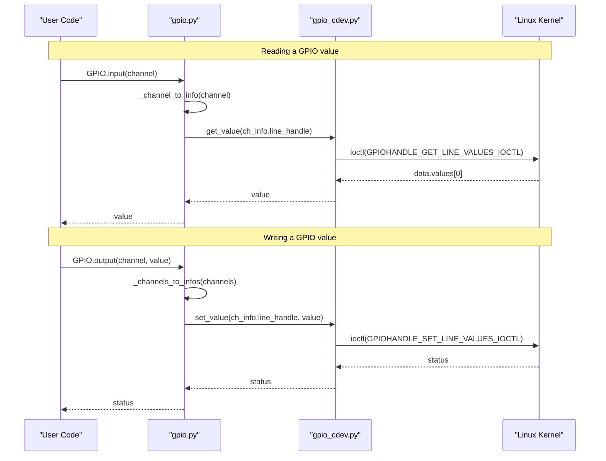

Sources: [lib/python/Jetson/GPIO/gpio.py:392-419](), [lib/python/Jetson/GPIO/gpio_cdev.py:263-283]()

## Event Handling System

The event handling system enables detection of GPIO pin state changes. It offers three different approaches for detecting events:

1. Polling - Simple checking of current pin value
2. Blocking wait - Wait for an event on a specific pin
3. Event detection with callbacks - Non-blocking detection with callbacks

### Event Detection Mechanism

The event detection system uses the Linux GPIO character device event interface and `epoll` to detect edge events efficiently:

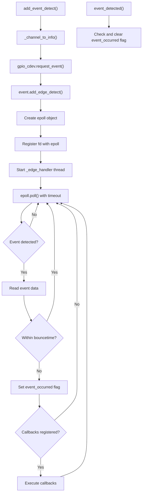

Sources: [lib/python/Jetson/GPIO/gpio.py:429-464](), [lib/python/Jetson/GPIO/gpio_event.py:104-169](), [lib/python/Jetson/GPIO/gpio_event.py:349-445]()

### Callback Handling

Callbacks are managed through a list in the GPIO event object:

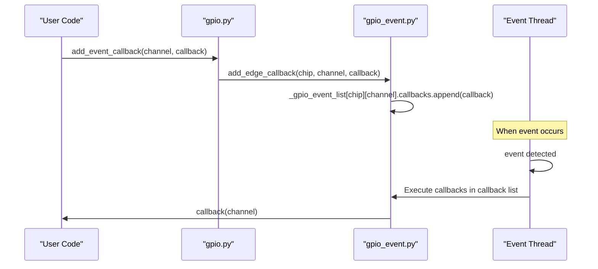

Sources: [lib/python/Jetson/GPIO/gpio.py:488-504](), [lib/python/Jetson/GPIO/gpio_event.py:212-226]()

## PWM Implementation

Pulse Width Modulation (PWM) is implemented using the Linux sysfs interface for hardware PWM control.

### PWM Class Structure

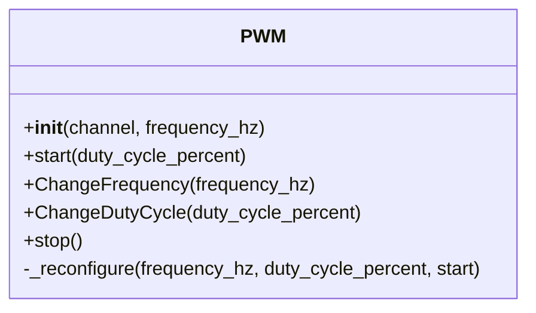

Sources: [lib/python/Jetson/GPIO/gpio.py:571-652]()

### PWM Operations Flow

The PWM functionality follows this sequence of operations:

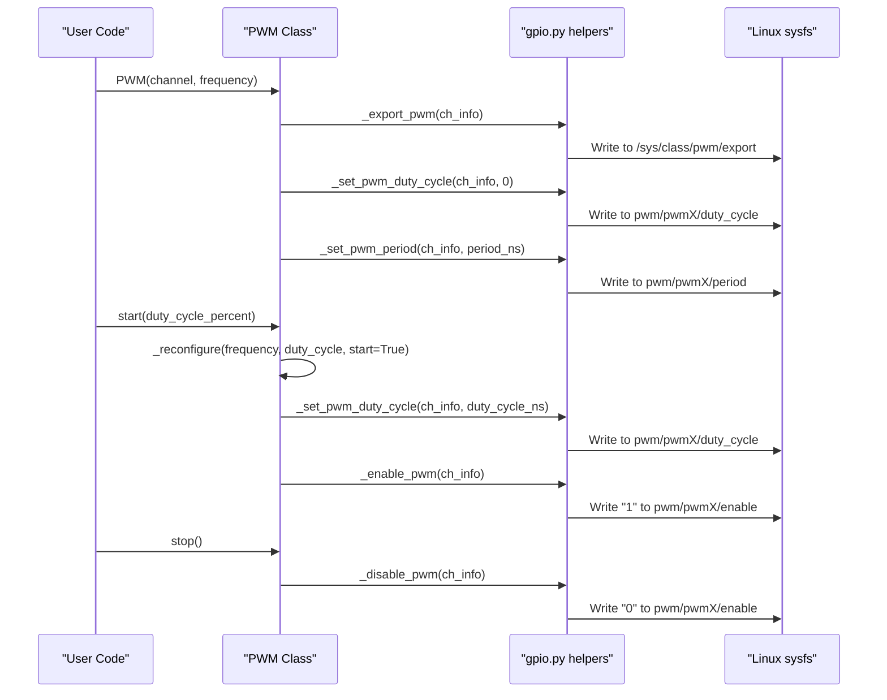

Sources: [lib/python/Jetson/GPIO/gpio.py:166-239](), [lib/python/Jetson/GPIO/gpio.py:571-652]()

## Memory Management and Resource Handling

The library manages resources carefully to avoid leaks and ensure proper cleanup:

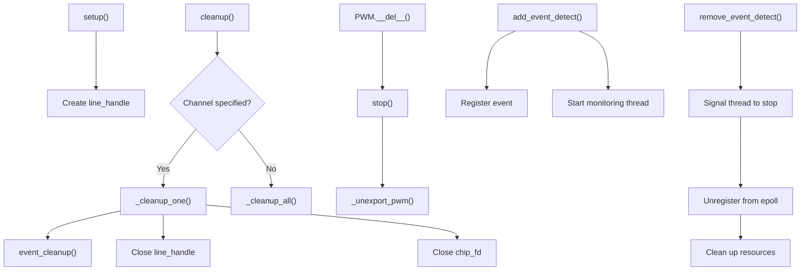

Sources: [lib/python/Jetson/GPIO/gpio.py:241-276](), [lib/python/Jetson/GPIO/gpio.py:370-387](), [lib/python/Jetson/GPIO/gpio_event.py:179-204]()

## Thread Safety and Synchronization

The event handling system uses thread synchronization to prevent race conditions:

1. A mutex lock (`_mutex`) protects access to shared data structures
2. Thread states are tracked in a dictionary (`_thread_running_dict`)
3. Thread exit states are monitored to ensure proper cleanup

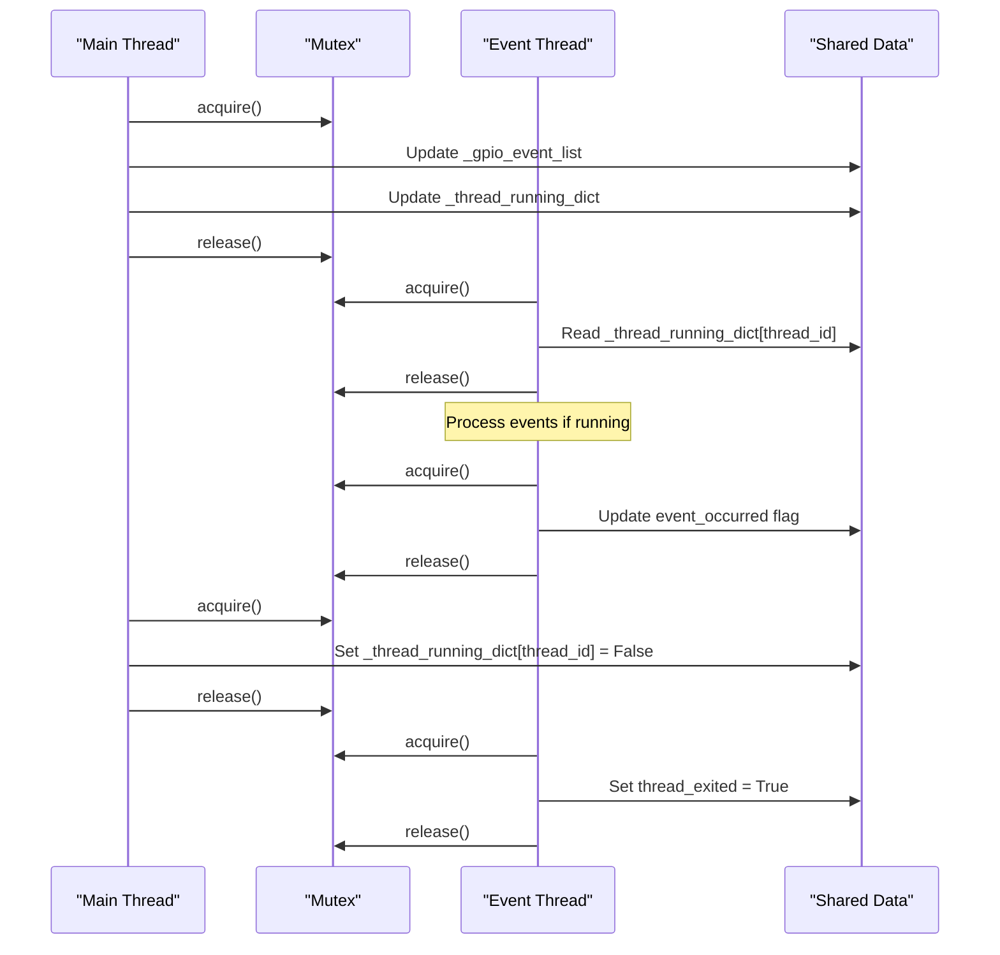

Sources: [lib/python/Jetson/GPIO/gpio_event.py:76-80](), [lib/python/Jetson/GPIO/gpio_event.py:349-445]()

---

