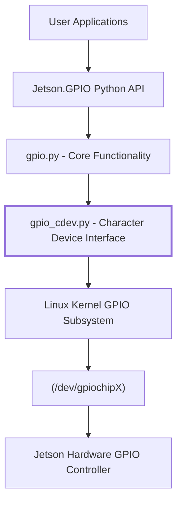
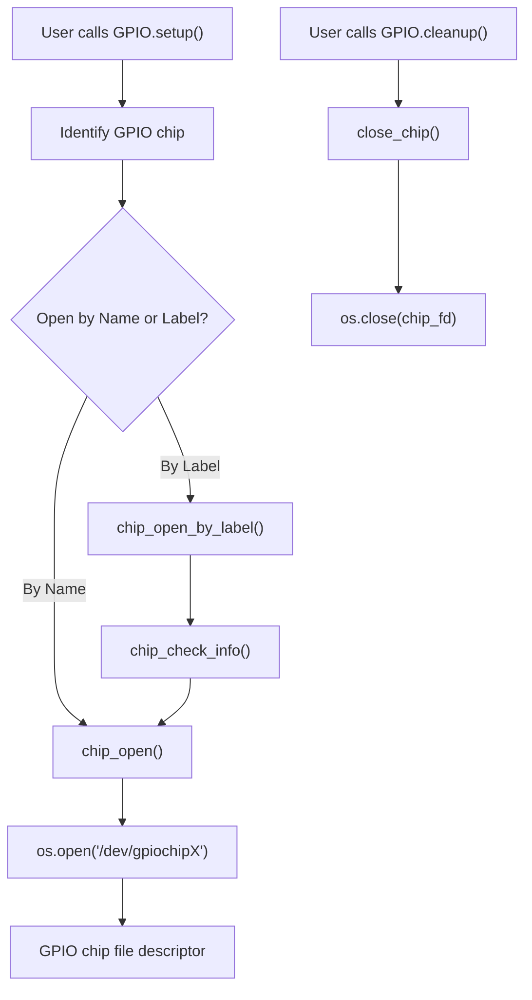
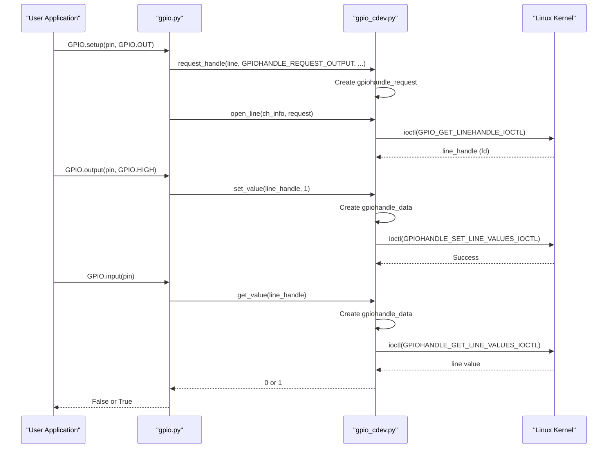

<!-- source: DeepWiki mcp.deepwiki.com · repo NVIDIA/jetson-gpio · page 6.1 GPIO Character Device Interface · fetched 2026-10-26 -->

# GPIO Character Device Interface

<details>
<summary>Relevant source files</summary>

The following files were used as context for generating this wiki page:

- [debian/changelog](debian/changelog)
- [lib/python/Jetson/GPIO/gpio_cdev.py](lib/python/Jetson/GPIO/gpio_cdev.py)

</details>


This page documents how the Jetson GPIO library interacts with the Linux GPIO character device interface, a critical low-level component that enables communication between the library and the physical GPIO hardware on Jetson platforms. For information about the event handling system built on top of this interface, see [Event Handling System](#6.2).

## Introduction to Character Device Interface

The Linux kernel provides two primary interfaces for accessing GPIO pins from user space: the older sysfs interface and the newer character device interface. In February 2023, with version 2.1.0, the Jetson GPIO library transitioned from the sysfs-based implementation to the character device-based implementation.

### Key Advantages of Character Device Interface

- More efficient access to GPIO pins
- Better support for event detection and handling
- Atomic operations for setting multiple GPIO pins
- Consistent with modern Linux kernel design
- Improved performance and reliability

Sources: [debian/changelog:63-67]()

## Architecture Overview

The following diagram illustrates how the GPIO Character Device Interface fits into the overall architecture of the Jetson GPIO library:



The GPIO Character Device Interface serves as the bridge between the library's high-level API and the Linux kernel's GPIO subsystem. It provides a standardized way to access GPIO functionality through character device files located at `/dev/gpiochipX`.

Sources: [lib/python/Jetson/GPIO/gpio_cdev.py:18-26]()

## Implementation Components

The character device interface implementation is contained within `gpio_cdev.py` and consists of several key components:

```mermaid
classDiagram
    class "gpio_cdev.py" {
        Constants
        CStructures
        ChipOperations
        LineOperations
        EventOperations
        ErrorHandling
    }
    
    class "Constants" {
        GPIO_HIGH
        GPIOHANDLE_REQUEST_INPUT
        GPIOHANDLE_REQUEST_OUTPUT
        GPIOEVENT_REQUEST_*
        GPIO_*_IOCTL
    }
    
    class "CStructures" {
        gpiochip_info
        gpiohandle_request
        gpiohandle_data
        gpioline_info
        gpioevent_request
        gpioevent_data
    }
    
    class "ChipOperations" {
        chip_open()
        chip_check_info()
        chip_open_by_label()
        close_chip()
    }
    
    class "LineOperations" {
        open_line()
        close_line()
        request_handle()
        get_value()
        set_value()
    }
    
    class "EventOperations" {
        request_event()
    }
    
    class "ErrorHandling" {
        GPIOError class
    }
    
    "gpio_cdev.py" --> "Constants"
    "gpio_cdev.py" --> "CStructures"
    "gpio_cdev.py" --> "ChipOperations"
    "gpio_cdev.py" --> "LineOperations"
    "gpio_cdev.py" --> "EventOperations"
    "gpio_cdev.py" --> "ErrorHandling"
```

Sources: [lib/python/Jetson/GPIO/gpio_cdev.py:32-46](), [lib/python/Jetson/GPIO/gpio_cdev.py:48-135](), [lib/python/Jetson/GPIO/gpio_cdev.py:138-284]()

## C-Style Structures

The module uses Python's `ctypes` to define C-compatible structures needed for ioctl operations with the Linux kernel. These structures mirror those defined in the Linux kernel's GPIO character device interface.

| Structure | Purpose | Key Fields |
|-----------|---------|------------|
| `gpiochip_info` | Information about a GPIO chip | name, label, lines |
| `gpiohandle_request` | Request for a GPIO handle | lineoffsets, flags, default_values, consumer_label, lines, fd |
| `gpiohandle_data` | Data for reading/writing GPIO values | values |
| `gpioline_info` | Information about a GPIO line | line_offset, flags, name, consumer |
| `gpioevent_request` | Request for GPIO event detection | lineoffset, handleflags, eventflags, consumer_label, fd |
| `gpioevent_data` | Data for GPIO events | timestamp, id |

Sources: [lib/python/Jetson/GPIO/gpio_cdev.py:48-135]()

## GPIO Chip Operations

The module provides several functions for working with GPIO chips:

### Chip Open and Close Flow



### Key Functions

- `chip_open(gpio_chip)`: Opens a GPIO chip by its device file path
- `chip_check_info(label, gpio_device)`: Opens and checks information about a GPIO chip
- `chip_open_by_label(label)`: Opens a GPIO chip by its label (searches /dev for matching gpiochip)
- `close_chip(chip_fd)`: Closes a GPIO chip file descriptor

Sources: [lib/python/Jetson/GPIO/gpio_cdev.py:145-202]()

## GPIO Line Operations

The module provides functions for working with individual GPIO lines (pins):

### Line Operation Flow



### Key Functions

- `open_line(ch_info, request)`: Opens a GPIO line using the provided channel info and request
- `close_line(line_handle)`: Closes a GPIO line file descriptor
- `request_handle(line_offset, direction, initial, consumer)`: Creates a handle request for a GPIO line
- `get_value(line_handle)`: Reads the current value of a GPIO line
- `set_value(line_handle, value)`: Sets the value of a GPIO line

Sources: [lib/python/Jetson/GPIO/gpio_cdev.py:207-283]()

## Event Detection

The module supports GPIO event detection through dedicated functions and structures:

### Key Components for Event Detection

- `request_event(line_offset, edge, consumer)`: Creates an event request for a GPIO line
- `gpioevent_request` structure: Configures event detection parameters
- `gpioevent_data` structure: Contains event timestamp and identifier

The event detection mechanism allows the library to respond to changes in GPIO pin states, such as rising edges (low-to-high transitions) or falling edges (high-to-low transitions). This is the foundation for the higher-level event handling system described in [Event Handling System](#6.2).

Sources: [lib/python/Jetson/GPIO/gpio_cdev.py:128-258]()

## Error Handling

The module provides a custom exception class for GPIO-specific errors:

```python
class GPIOError(IOError):
    """Base class for GPIO errors."""
    pass
```

This exception is raised when operations on GPIO chips or lines fail, providing meaningful error messages that include the underlying system error.

Sources: [lib/python/Jetson/GPIO/gpio_cdev.py:138-140]()

## Integration with Higher-Level API

The character device interface is used by the core GPIO functionality in `gpio.py`. When a user calls high-level functions like `GPIO.setup()`, `GPIO.input()`, or `GPIO.output()`, these functions:

1. Translate pin numbers from the user's chosen numbering scheme (BOARD, BCM, etc.) to specific chip and line offsets
2. Open the appropriate GPIO chip if not already open
3. Configure the requested GPIO line using the character device interface
4. Perform the requested operation (read/write) using ioctl calls
5. Manage the lifecycle of GPIO chip and line handles

This layered approach allows the library to provide a simple, user-friendly API while efficiently interacting with the hardware through the Linux kernel's character device interface.

Sources: [lib/python/Jetson/GPIO/gpio_cdev.py:24-26]()

## Transition from Sysfs to Character Device

The Jetson GPIO library transitioned from using the sysfs interface to the character device interface in version 2.1.0 (February 2023). This change was made to align with modern Linux kernel design, as the sysfs interface for GPIO is being deprecated in newer kernel versions.

### Benefits of the Transition

- Improved performance through more efficient kernel-userspace communication
- Better support for concurrent access to GPIO pins
- Enhanced event detection capabilities
- Future-proofing the library for compatibility with newer Linux kernel versions
- More robust error handling and resource management

This transition represents a significant improvement in the library's architecture while maintaining backward compatibility with existing user code.

Sources: [debian/changelog:63-67]()

---

