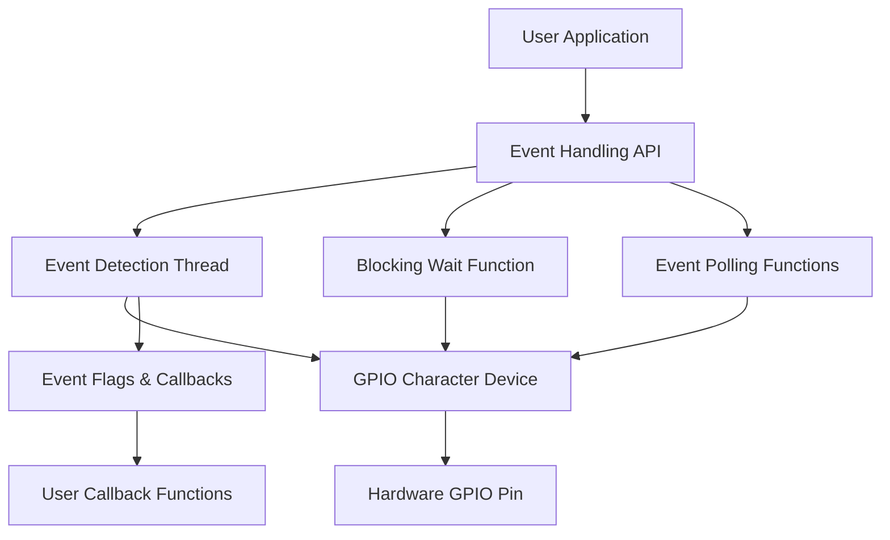
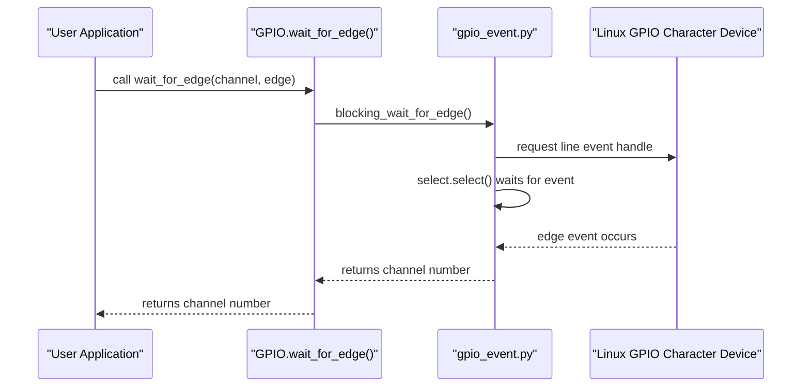
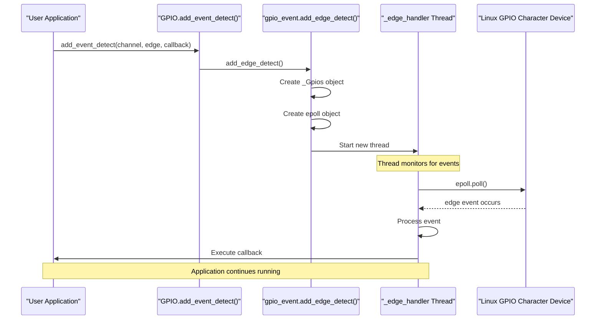
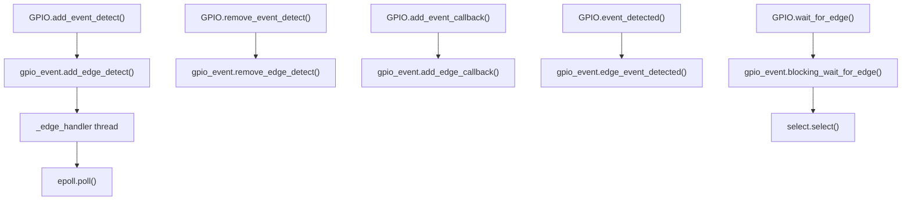
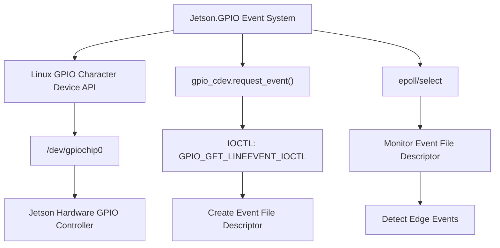

<!-- source: DeepWiki mcp.deepwiki.com · repo NVIDIA/jetson-gpio · page 6.2 Event Handling System · fetched 2026-10-26 -->

# Event Handling System

<details>
<summary>Relevant source files</summary>

The following files were used as context for generating this wiki page:

- [lib/python/Jetson/GPIO/gpio.py](lib/python/Jetson/GPIO/gpio.py)
- [lib/python/Jetson/GPIO/gpio_event.py](lib/python/Jetson/GPIO/gpio_event.py)

</details>


## Purpose and Scope

The Event Handling System in Jetson.GPIO provides mechanisms to detect and respond to changes in GPIO pin states (known as "edges"). This document explains the internal architecture of the event detection system, including how it detects edges, manages callbacks, and handles threaded event monitoring. For information about using event detection in your applications, see the [Event Detection API Reference](#3.3).

## System Overview

The Event Handling System allows Jetson.GPIO users to detect and respond to changes in GPIO pin states using three primary approaches:

1. **Polling**: Manually checking pin states periodically
2. **Blocking Waits**: Pausing program execution until an event occurs
3. **Event Detection with Callbacks**: Registering callbacks that execute when events occur



Sources: [lib/python/Jetson/GPIO/gpio.py:422-428](), [lib/python/Jetson/GPIO/gpio.py:507-557]()

## Core Components

The Event Handling System consists of several key components that work together to provide reliable edge detection:

```mermaid
classDiagram
    class "_gpio_event_list" {
        Dictionary
        chip_name → channel → _Gpios
    }
    
    class "_Gpios" {
        value_fd
        initial_thread
        thread_added
        thread_id
        thread_exited
        bouncetime
        callbacks[]
        lastcall
        event_occurred
    }
    
    class "_epoll_fd_thread" {
        Dictionary
        channel → epoll_object
    }
    
    class "_thread_running_dict" {
        Dictionary
        thread_id → running_state
    }
    
    class "EventDetectionThread" {
        _edge_handler()
    }
    
    _gpio_event_list -- _Gpios : contains
    EventDetectionThread -- _gpio_event_list : monitors
    EventDetectionThread -- _epoll_fd_thread : uses
    EventDetectionThread -- _thread_running_dict : checks state
```

Sources: [lib/python/Jetson/GPIO/gpio_event.py:62-79](), [lib/python/Jetson/GPIO/gpio_event.py:81-102]()

### Key Data Structures

1. **`_gpio_event_list`**: A two-layer dictionary that stores event detection information:
   - First level key: GPIO chip name
   - Second level key: Channel (pin number)
   - Value: `_Gpios` object containing event detection state

2. **`_epoll_fd_thread`**: Dictionary mapping channel numbers to epoll objects used for event monitoring

3. **`_thread_running_dict`**: Dictionary mapping thread IDs to their running state

4. **`_Gpios` Class**: Contains all state information for a GPIO pin's event detection:
   - File descriptor
   - Thread management flags
   - Callbacks
   - Debounce timing
   - Event flags

Sources: [lib/python/Jetson/GPIO/gpio_event.py:81-102](), [lib/python/Jetson/GPIO/gpio_event.py:62-79]()

## Event Detection Methods

The Event Handling System supports three different approaches for detecting GPIO pin state changes:

### 1. Polling Method

The simplest approach is polling, where applications periodically check the pin state using `GPIO.input()` and determine if a change has occurred. This method doesn't use the event detection system directly, but is included for completeness.

```python
previous_state = GPIO.input(channel)
while True:
    current_state = GPIO.input(channel)
    if current_state != previous_state:
        # Edge detected
        previous_state = current_state
    time.sleep(polling_interval)
```

### 2. Blocking Wait Method

The `wait_for_edge()` function provides a blocking approach, where program execution pauses until a specified edge is detected or a timeout occurs.



Sources: [lib/python/Jetson/GPIO/gpio.py:507-557](), [lib/python/Jetson/GPIO/gpio_event.py:452-490]()

### 3. Event Detection with Callbacks

The most sophisticated approach uses a background thread to monitor for events and trigger callbacks when events occur:



Sources: [lib/python/Jetson/GPIO/gpio.py:422-428](), [lib/python/Jetson/GPIO/gpio_event.py:105-169]()

## Implementation Details

### Event Thread Management

For non-blocking event detection, the system creates a background thread that monitors for GPIO events using Linux's `epoll` mechanism:

1. When `add_event_detect()` is called, a new thread is created via `_edge_handler()`
2. The thread uses `epoll.poll()` to efficiently wait for events on the GPIO file descriptor
3. When an event is detected, the thread:
   - Checks if it needs to debounce the input
   - Sets the `event_occurred` flag
   - Executes any registered callbacks
4. The thread continues running until `remove_event_detect()` is called

Sources: [lib/python/Jetson/GPIO/gpio_event.py:349-445]()

### Debounce Mechanism

Physical buttons and switches often "bounce" when pressed, causing multiple rapid transitions. The debounce mechanism prevents this from triggering multiple events:

1. When an event is detected, the current time is recorded
2. If another event occurs within the `bouncetime` window, it is ignored
3. Only events outside the bounce window will trigger callbacks or set flags

```python
# Simplified pseudocode based on actual implementation
current_time = get_current_time()
if (current_time - last_event_time) > bouncetime:
    # Process the event
    last_event_time = current_time
```

Sources: [lib/python/Jetson/GPIO/gpio_event.py:417-424]()

### Callback Execution

When an event is detected, the system can execute one or more callback functions:

1. Callbacks are registered with `add_event_callback()` and stored in the `_Gpios.callbacks` list
2. When an event occurs, the event thread executes each callback in sequence
3. Callbacks are executed in the context of the event thread, not the main application thread

Sources: [lib/python/Jetson/GPIO/gpio_event.py:431-433](), [lib/python/Jetson/GPIO/gpio.py:488-504]()

## API and Implementation Mapping

The following diagram shows how the user-facing API functions map to the internal implementation:



Sources: [lib/python/Jetson/GPIO/gpio.py:422-504](), [lib/python/Jetson/GPIO/gpio_event.py:105-497]()

## Linux GPIO Character Device Integration

The Event Handling System interfaces with the Linux GPIO character device API to monitor GPIO pins efficiently:



Sources: [lib/python/Jetson/GPIO/gpio.py:456-457](), [lib/python/Jetson/GPIO/gpio_event.py:123-125]()

The system uses the following key operations:

1. Request an event handle using `GPIO_GET_LINEEVENT_IOCTL`
2. Use `epoll` or `select` to monitor the event file descriptor
3. Read event data when notified of an event

## Thread Safety and Synchronization

The Event Handling System uses locking to ensure thread safety:

1. A global mutex (`_mutex`) is used to protect shared data structures
2. The mutex is acquired before modifying:
   - `_gpio_event_list`
   - `_epoll_fd_thread`
   - `_thread_running_dict`
3. Care is taken to release the mutex in case of exceptions

Sources: [lib/python/Jetson/GPIO/gpio_event.py:79](), [lib/python/Jetson/GPIO/gpio_event.py:137-154]()

## Technical Limitations and Considerations

1. **One Event Per Channel**: Only one event detection can be active on a channel at a time
2. **Thread Lifecycle**: Event threads have cleanup mechanisms but require proper management
3. **Callback Context**: Callbacks execute in the context of the event thread, not the main application thread
4. **Debounce Requirements**: Physical buttons may require appropriate debounce times
5. **System Resource Usage**: Each monitored GPIO pin creates a thread and file descriptors

Sources: [lib/python/Jetson/GPIO/gpio_event.py:117-128](), [lib/python/Jetson/GPIO/gpio.py:430-463]()

## Cleanup and Resource Management

Proper cleanup is essential to release resources used by the Event Handling System:

1. When `remove_event_detect()` is called:
   - The thread is signaled to stop
   - The epoll object is unregistered
   - The event is removed from `_gpio_event_list`

2. When `cleanup()` is called:
   - All event detection is removed
   - All threads are stopped
   - All file descriptors are closed

Sources: [lib/python/Jetson/GPIO/gpio_event.py:179-204](), [lib/python/Jetson/GPIO/gpio.py:366-387]()

This systematic cleanup ensures that resources are properly released when they are no longer needed.

---

