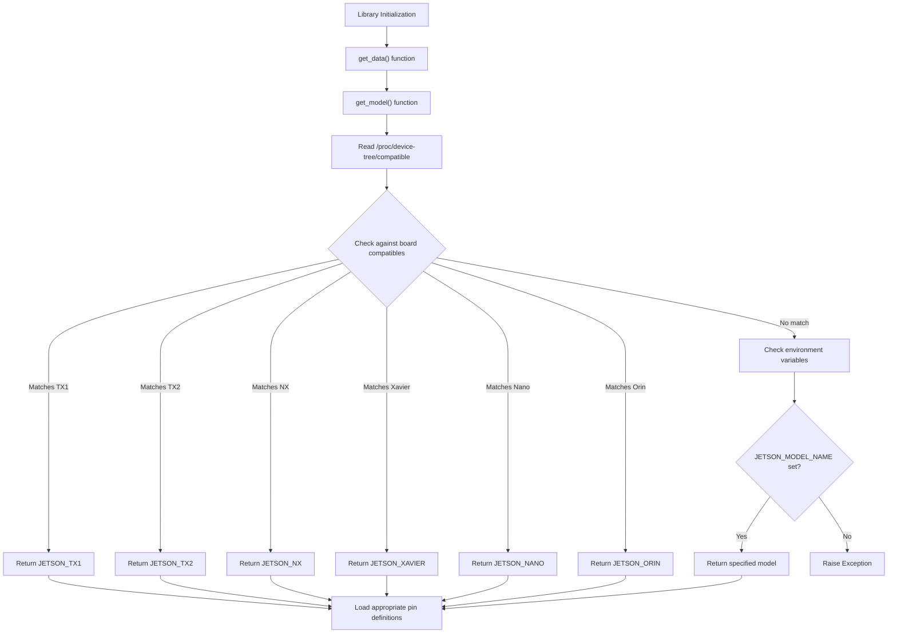
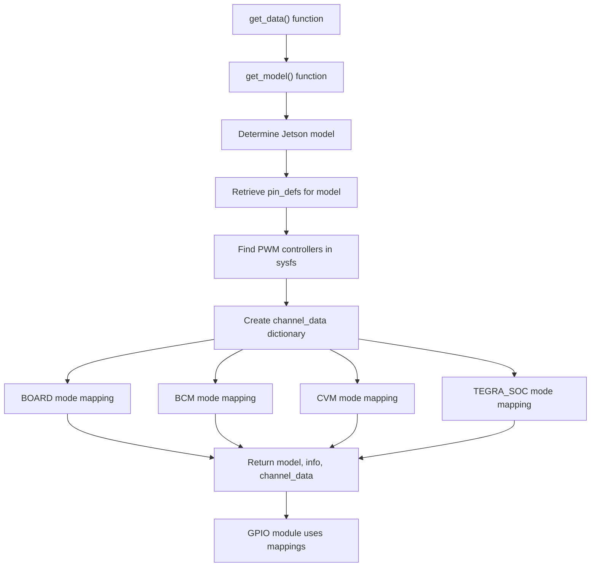
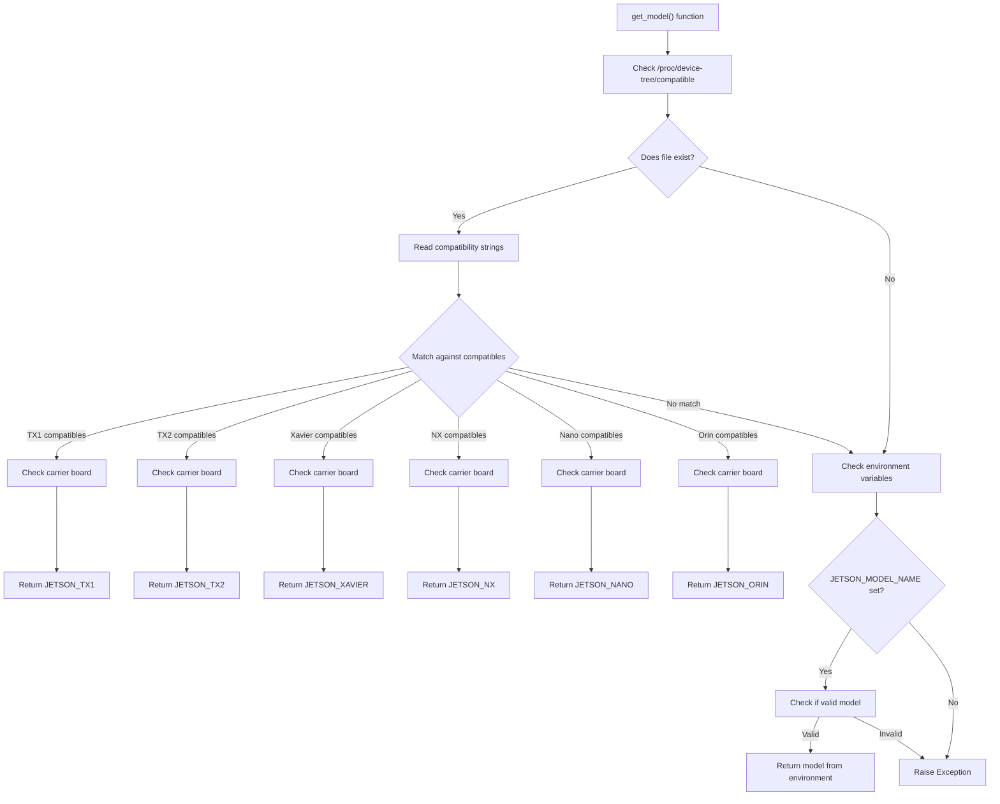
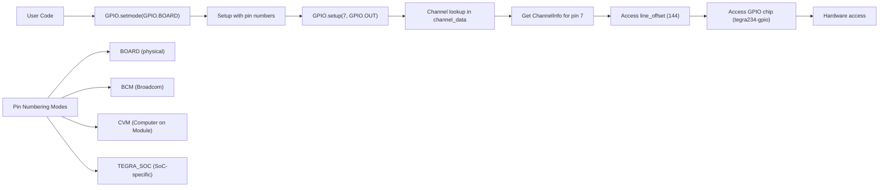

<!-- source: DeepWiki mcp.deepwiki.com · repo NVIDIA/jetson-gpio · page 6.3 Board Detection and Pin Mapping · fetched 2026-10-26 -->

# Board Detection and Pin Mapping

<details>
<summary>Relevant source files</summary>

The following files were used as context for generating this wiki page:

- [lib/python/Jetson/GPIO/gpio_pin_data.py](lib/python/Jetson/GPIO/gpio_pin_data.py)
- [samples/issue40-trigger.py](samples/issue40-trigger.py)
- [samples/jetson_model.py](samples/jetson_model.py)

</details>


## Purpose and Scope

This document explains how the Jetson.GPIO library detects which NVIDIA Jetson board is present in the system and how it maps pin numbers between different numbering schemes. Understanding these mechanisms is essential for developers who need to adapt GPIO code to run across different Jetson platforms or who want to understand how the library works internally.

For information about the supported pin numbering modes themselves, see [Pin Numbering](#3.1). For details about supported hardware platforms, see [Supported Boards](#4.1).

## Board Detection Process

The Jetson.GPIO library automatically detects which Jetson model is present in the system to provide the correct pin definitions. This detection happens when the library is first imported.



The board detection process works as follows:

1. The library checks the `/proc/device-tree/compatible` file, which contains the Device Tree compatibility strings
2. These strings are compared against predefined compatibility lists for each supported Jetson model
3. If a match is found, the corresponding model identifier is returned
4. If no match is found but the `JETSON_MODEL_NAME` environment variable is set, that value is used (useful for Docker containers)
5. If no model can be determined, an exception is raised

Sources: [lib/python/Jetson/GPIO/gpio_pin_data.py:549-607]()

## Pin Definition Structure

Each Jetson platform has a specific set of pin definitions stored in the `gpio_pin_data.py` file. These definitions map physical pins to their GPIO functions across different numbering schemes.

Pin definitions are stored as tuples with the following structure:

| Index | Content | Description |
|-------|---------|-------------|
| 0 | Line offset | Linux GPIO pin number (offset within the chip) |
| 1 | GPIO name | Linux exported GPIO name |
| 2 | GPIO chip | GPIO chip name/instance |
| 3 | BOARD pin | Pin number in BOARD mode |
| 4 | BCM pin | Pin number in BCM mode |
| 5 | CVM pin | Pin name in CVM mode |
| 6 | TEGRA_SOC pin | Pin name in TEGRA_SOC mode |
| 7 | PWM chip sysfs | PWM chip sysfs directory (if applicable) |
| 8 | PWM ID | PWM ID within PWM chip (if applicable) |

A sample pin definition for the Jetson Orin NX looks like:
```
(144, 'PAC.06', "tegra234-gpio", 7, 4, 'GPIO09', 'GP167', None, None)
```

This defines a pin with BOARD number 7, BCM number 4, etc.

Sources: [lib/python/Jetson/GPIO/gpio_pin_data.py:37-51](), [lib/python/Jetson/GPIO/gpio_pin_data.py:53-76]()

## Model-to-Pin Mapping Structure



The library organizes pin mappings in a hierarchical data structure:

1. `jetson_gpio_data` - A dictionary that maps each Jetson model to its pin definitions and board information
2. `channel_data` - A dictionary created by `get_data()` that maps pin numbering modes to pin channels
3. Each pin channel is represented by a `ChannelInfo` object containing all relevant GPIO information

Sources: [lib/python/Jetson/GPIO/gpio_pin_data.py:613-663](), [lib/python/Jetson/GPIO/gpio_pin_data.py:475-496]()

## Board Detection Implementation

The board detection is implemented in the `get_model()` function, which examines the system to determine which Jetson model is present:



When detecting the board, the library also validates if the carrier board is from a supported Jetson Developer Kit. If not, it displays a warning message that the GPIO library might not work correctly with unsupported carrier boards.

Sources: [lib/python/Jetson/GPIO/gpio_pin_data.py:499-545](), [lib/python/Jetson/GPIO/gpio_pin_data.py:549-607]()

## Pin Mapping Process

Once the board is detected, the library creates mappings between the different pin numbering schemes:



The pin mapping process works as follows:

1. User code selects a pin numbering mode (e.g., `GPIO.BOARD`)
2. When a pin number is specified (e.g., pin 7), the library looks up the corresponding `ChannelInfo` in the `channel_data` dictionary
3. The `ChannelInfo` contains the Linux GPIO line offset, chip name, and other details needed to access the hardware
4. These details are used to interface with the Linux GPIO character device API

Sources: [lib/python/Jetson/GPIO/gpio_pin_data.py:647-661]()

## ChannelInfo Structure

Each GPIO pin is represented by a `ChannelInfo` object with the following attributes:

| Attribute | Description |
|-----------|-------------|
| channel | Pin number in the specified mode (BOARD, BCM, etc.) |
| chip_fd | File descriptor of the GPIO chip |
| line_handle | File descriptor of the GPIO line |
| line_offset | Linux GPIO pin number (offset within chip) |
| direction | Pin direction (input or output) |
| edge | Edge detection setting (rising, falling, both) |
| consumer | Consumer label ("Jetson-gpio") |
| gpio_name | Linux exported GPIO name |
| gpio_chip | GPIO chip name/instance |
| pwm_chip_dir | PWM chip sysfs directory (if applicable) |
| pwm_id | PWM ID within PWM chip (if applicable) |

This structure encapsulates all the information needed to operate a GPIO pin across different numbering schemes.

Sources: [lib/python/Jetson/GPIO/gpio_pin_data.py:475-496]()

## Example Usage

Here's a simple example showing how to check which Jetson model is being used:

```python
import Jetson.GPIO as GPIO
print(GPIO.model)  # Prints the detected Jetson model
```

This code will print the detected Jetson model (e.g., "JETSON_NANO", "JETSON_ORIN", etc.).

Sources: [samples/jetson_model.py:20-21]()

When using GPIO pins, the model is automatically detected and the appropriate pin mappings are used:

```python
import Jetson.GPIO as GPIO

# Works across different Jetson models because pin mapping is handled internally
GPIO.setmode(GPIO.BOARD)
GPIO.setup(32, GPIO.OUT)
GPIO.output(32, GPIO.HIGH)
# ...
GPIO.cleanup()
```

Sources: [samples/issue40-trigger.py:22-36]()

## Supported Jetson Models

The library currently supports the following Jetson models:

| Model Identifier | Description |
|------------------|-------------|
| JETSON_TX1 | Jetson TX1 |
| JETSON_TX2 | Jetson TX2 |
| JETSON_TX2_NX | Jetson TX2 NX |
| JETSON_NANO | Jetson Nano |
| JETSON_XAVIER | Jetson Xavier |
| JETSON_NX | Jetson Xavier NX |
| CLARA_AGX_XAVIER | Clara AGX Xavier |
| JETSON_ORIN | Jetson AGX Orin |
| JETSON_ORIN_NX | Jetson Orin NX |
| JETSON_ORIN_NANO | Jetson Orin Nano |

Each model has its own set of pin definitions tailored to its specific hardware configuration.

Sources: [lib/python/Jetson/GPIO/gpio_pin_data.py:24-35](), [lib/python/Jetson/GPIO/gpio_pin_data.py:361-471]()

## Docker Container Support

For applications running inside Docker containers, the library provides an alternate method to specify the Jetson model:

1. Set the `JETSON_MODEL_NAME` environment variable to the appropriate model identifier
2. The library will use this value if it cannot detect the model through the standard method

This feature is useful when the container doesn't have access to the device tree information needed for automatic detection.

Sources: [lib/python/Jetson/GPIO/gpio_pin_data.py:597-605]()

## Summary

The board detection and pin mapping system in Jetson.GPIO ensures that:

1. The correct Jetson model is automatically detected
2. Appropriate pin definitions are loaded for that model
3. Pin numbers are correctly mapped between different numbering schemes
4. All necessary information to access the hardware is encapsulated

This enables users to write portable GPIO code that works across different Jetson platforms without modification, as long as they use the same physical pins or pin numbering scheme consistently.