# Page: Overview

# Overview

<details>
<summary>Relevant source files</summary>

The following files were used as context for generating this wiki page:

- [README.md](README.md)
- [debian/changelog](debian/changelog)
- [lib/python/Jetson/GPIO/__init__.py](lib/python/Jetson/GPIO/__init__.py)

</details>


Jetson.GPIO is a Python library that enables software control of General Purpose Input/Output (GPIO) pins on NVIDIA Jetson development boards. This library provides a user-friendly API for interfacing with external hardware through digital input/output operations, event detection, and PWM control.

The library was designed with compatibility in mind, offering the same API as the popular RPi.GPIO library for Raspberry Pi. This makes it straightforward to port applications from Raspberry Pi to Jetson platforms with minimal code changes.

For installation instructions and setting up required permissions, see [Getting Started](#2).

## Supported Hardware

Jetson.GPIO supports the following NVIDIA Jetson platforms:
- Jetson Nano (including 2GB variant)
- Jetson TX1
- Jetson TX2 (including TX2 NX variant)
- Jetson AGX Xavier (including Xavier NX and Industrial variants)
- Jetson AGX Orin (including Orin NX and Orin Nano variants)
- Clara AGX Xavier

Each supported board comes with board-specific pin mappings that are automatically detected and loaded by the library.

Sources: [README.md:3-8](), [debian/changelog]()

## Library Architecture

Jetson.GPIO is structured with a layered architecture that abstracts hardware differences between Jetson models while providing a consistent API to application developers.

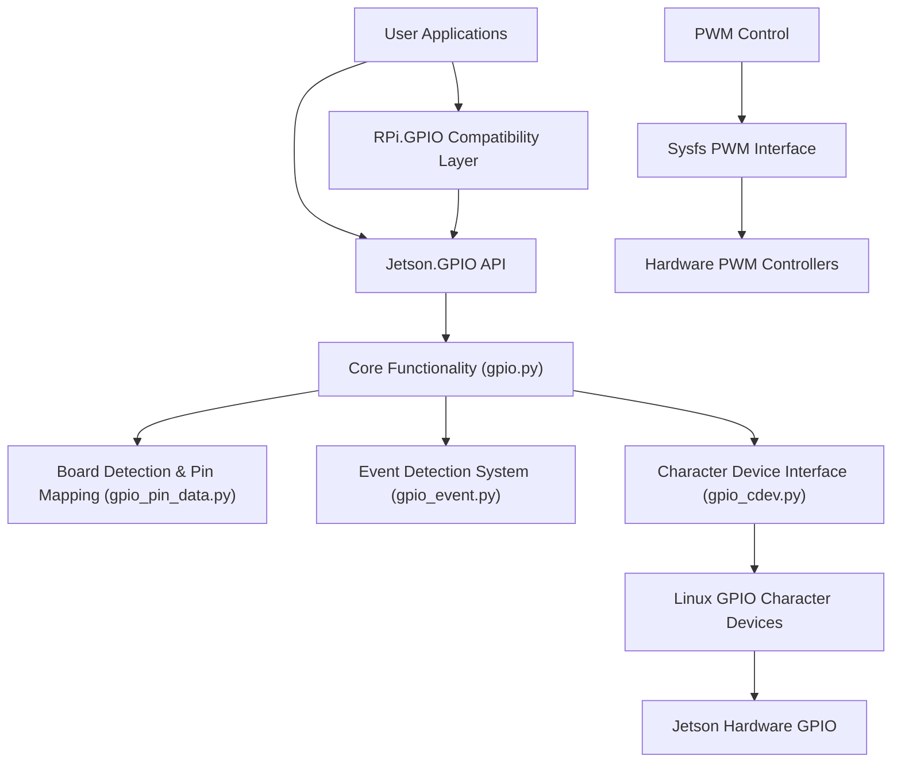

The library consists of several key components:

1. **Core API (gpio.py)**: Implements the main GPIO functionality and exposes the API
2. **Pin Mapping (gpio_pin_data.py)**: Contains board-specific pin definitions
3. **Event System (gpio_event.py)**: Implements event detection and callback mechanisms
4. **Hardware Interface (gpio_cdev.py)**: Interfaces with Linux GPIO character devices
5. **RPi.GPIO Compatibility Layer**: Allows code written for Raspberry Pi to work on Jetson

Sources: [lib/python/Jetson/GPIO/__init__.py](), [README.md:19-23]()

## Version and Feature Evolution

Jetson.GPIO has evolved significantly since its initial release. Version 2.1.0 (February 2023) marked a significant transition from sysfs-based to character device-based implementation, improving performance and reliability. Recent versions have added support for newer boards like Jetson Orin Nano, Orin NX, and various improvements to functionality.

The current version is 2.1.9, which supports Jetson Orin Nano and Jetson Orin NX Super.

Sources: [lib/python/Jetson/GPIO/__init__.py:2](), [debian/changelog:1-16]()

## Pin Numbering Modes

One of the key features of Jetson.GPIO is its flexibility in pin numbering. The library supports four distinct pin numbering modes to accommodate different use cases:

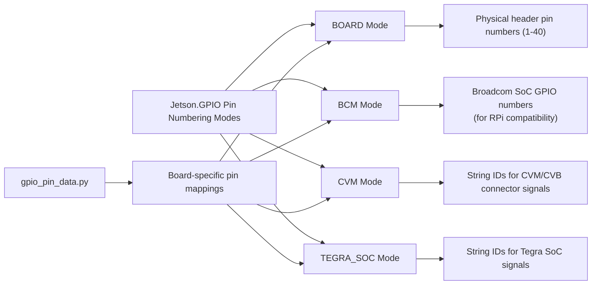

- **BOARD**: Uses physical pin numbers on the 40-pin header (1-40)
- **BCM**: Uses Broadcom SoC GPIO numbers for Raspberry Pi compatibility
- **CVM**: Uses string identifiers for CVM/CVB connector signals
- **TEGRA_SOC**: Uses string identifiers for Tegra SoC signals

Developers must specify a pin numbering mode before using any GPIO functions.

Sources: [README.md:155-172]()

## Core Functionality

Jetson.GPIO provides a comprehensive set of functions for GPIO control:

| Function Category | Key Functions | Description |
|-------------------|---------------|-------------|
| Setup & Configuration | `setmode()`, `setup()` | Configure pin numbering mode and pin direction |
| Input Operations | `input()` | Read digital values from pins |
| Output Operations | `output()` | Write digital values to pins |
| Event Handling | `wait_for_edge()`, `add_event_detect()` | Detect and respond to pin state changes |
| PWM Control | `PWM()`, `start()`, `ChangeDutyCycle()` | Control Pulse Width Modulation on supported pins |
| Cleanup | `cleanup()` | Release resources and reset pins |

Sources: [README.md:137-409]()

## Event Detection System

The library offers three methods for detecting input changes (events) on GPIO pins:

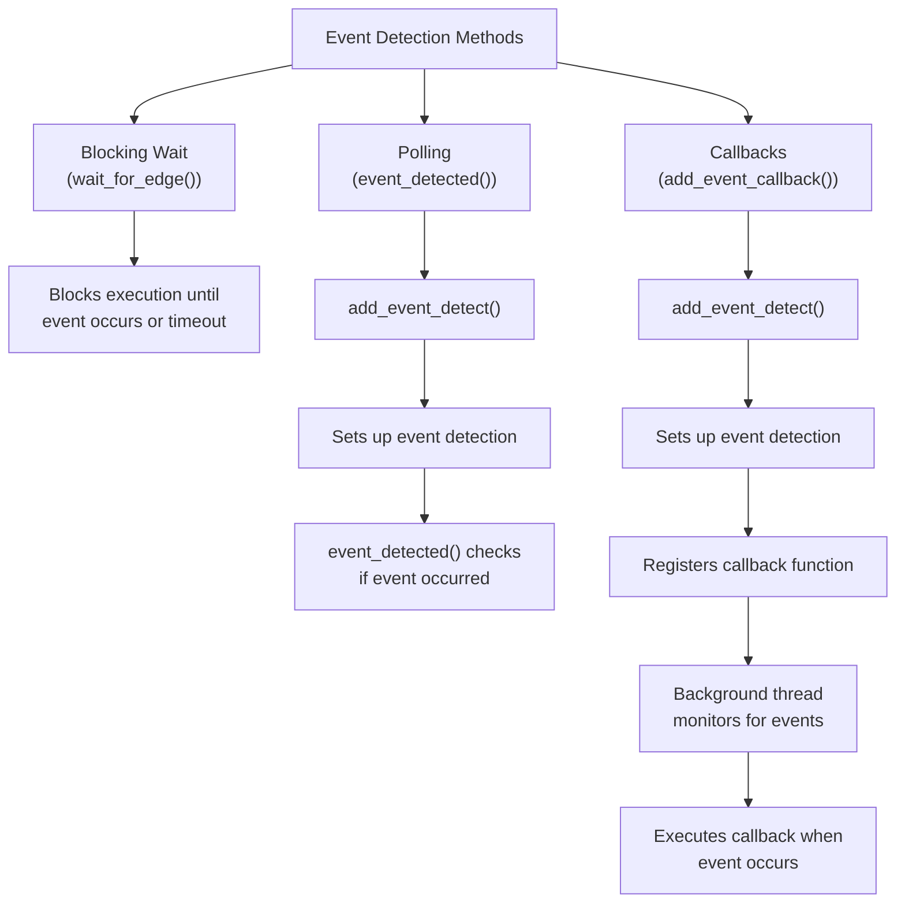

1. **Blocking Wait**: Uses `wait_for_edge()` to pause program execution until an event occurs
2. **Polling**: Uses `add_event_detect()` and `event_detected()` to periodically check for events
3. **Callbacks**: Uses `add_event_detect()` with a callback function that runs automatically when an event occurs

The event system can detect rising edges, falling edges, or both, and includes features like debounce timing to prevent false triggers.

Sources: [README.md:291-398]()

## PWM Support

Jetson.GPIO supports hardware PWM (Pulse Width Modulation) on specific pins that are connected to hardware PWM controllers. Unlike RPi.GPIO, it does not provide software-emulated PWM.

PWM availability varies by board:
- Jetson Nano: 2 PWM channels
- Jetson AGX Xavier: 3 PWM channels
- Jetson TX1/TX2: No PWM channels
- Jetson Orin: Up to 8 PWM channels (depending on model)

Note that the system pinmux must be configured correctly for PWM signals to reach the pins. The library does not modify the pinmux configuration.

Sources: [README.md:410-424](), [debian/changelog:16-18]()

## Docker Support

The library can be used within Docker containers, with two approaches available:

1. **Privileged mode**: Allows automatic board detection by mapping `/proc/device-tree` paths
2. **Non-privileged mode**: Requires manually specifying the Jetson model through an environment variable

In both cases, the container needs access to `/dev/gpiochip0` to operate the GPIO pins.

Sources: [README.md:427-490]()

## Use Cases and Applications

Jetson.GPIO is suitable for a wide range of applications:

1. **Sensor Integration**: Reading from digital sensors, buttons, and switches
2. **Output Control**: Driving LEDs, relays, and other digital outputs
3. **Motor Control**: Using PWM for servo or DC motor speed control
4. **Embedded Systems**: Integrating Jetson boards into larger embedded systems
5. **Educational Projects**: Learning about GPIO and interfacing with hardware

Sample applications are provided in the repository to demonstrate these capabilities.

Sources: [README.md:85-135]()

---

# Page: Getting Started

# Getting Started

<details>
<summary>Relevant source files</summary>

The following files were used as context for generating this wiki page:

- [README.md](README.md)
- [debian/rules](debian/rules)
- [lib/python/Jetson/GPIO/99-gpio.rules](lib/python/Jetson/GPIO/99-gpio.rules)
- [setup.py](setup.py)

</details>


This page explains how to install the Jetson.GPIO library and set up your environment to begin working with GPIO pins on NVIDIA Jetson development boards. For information about specific API usage, see [API Reference](#3), and for hardware compatibility details, see [Hardware Support](#4).

## Installation Process Overview

The Jetson.GPIO library can be installed using either pip or manual installation from source. After installation, user permissions must be configured to allow non-root access to GPIO pins.

### Installation Diagram

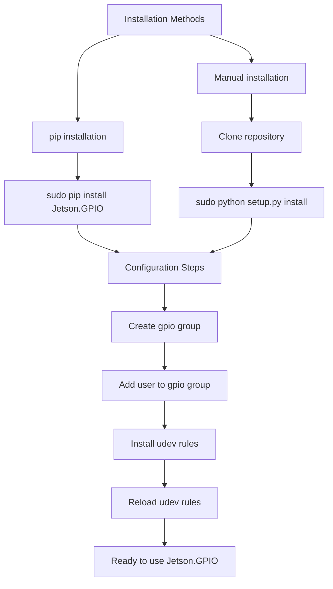

Sources: [setup.py:31-46](), [README.md:33-52]()

## Installation Methods

### Using pip

The easiest way to install the library is using pip:

```bash
sudo pip install Jetson.GPIO
```

For Python 3:

```bash
sudo pip3 install Jetson.GPIO
```

This installs the current version of the library (2.1.9) along with all necessary dependencies.

Sources: [setup.py:31-34](), [README.md:38-42]()

### Manual Installation

Alternatively, you can clone the repository or download it as an archive:

1. Clone the repository or download and extract the archive
2. Navigate to the extracted directory
3. Install using setup.py:

```bash
sudo python setup.py install
```

When installed using either method, the library's files are placed in your Python package directory, including the main modules and configuration files.

Sources: [README.md:44-52]()

## System Components Installed

The installation process places several key components in your system:

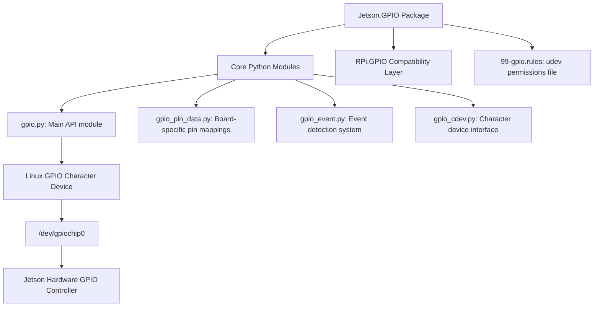

Sources: [README.md:16-23]()

## Setting Up User Permissions

To use GPIO pins without root privileges, you must set up proper user permissions:

1. Create a GPIO user group (if it doesn't already exist):
```bash
sudo groupadd -f -r gpio
```

2. Add your user to this group:
```bash
sudo usermod -a -G gpio your_user_name
```

3. Install the custom udev rules file to set appropriate permissions:

   If you installed via pip:
   ```bash
   sudo cp venv/lib/pythonXX/site-packages/Jetson/GPIO/99-gpio.rules /etc/udev/rules.d/
   ```
   
   If you installed from source:
   ```bash
   sudo cp lib/python/Jetson/GPIO/99-gpio.rules /etc/udev/rules.d/
   ```

4. Reload the udev rules:
```bash
sudo udevadm control --reload-rules && sudo udevadm trigger
```

5. Log out and log back in for the group changes to take effect.

The udev rules file (99-gpio.rules) configures permissions for GPIO, PWM, and SPI device access:

| Device Type | Permission | Description |
|-------------|------------|-------------|
| GPIO | 660 (rw-rw----) | Gives read-write access to GPIO devices to members of gpio group |
| PWM | 660 (rw-rw----) | Allows PWM control for gpio group members |
| SPI | 660 (rw-rw----) | Provides SPI interface access for gpio group members |

Sources: [README.md:54-83](), [lib/python/Jetson/GPIO/99-gpio.rules:22-31]()

## Verifying Your Installation

You can verify your installation by running one of the sample scripts provided in the repository:

```bash
python samples/simple_output.py
```

This will output alternating high and low values at BCM pin 18 (or board pin 12 on the header) every 2 seconds. If you've connected an LED with an appropriate resistor to this pin, it should blink.

Other sample scripts available include:

| Script | Description |
|--------|-------------|
| simple_input.py | Reads input from BCM pin 12 |
| simple_output.py | Toggles output on BCM pin 18 |
| button_led.py | Controls an LED with a button press |
| button_event.py | Uses blocking wait for button events |
| button_interrupt.py | Demonstrates interrupt-based button handling |

Sources: [README.md:85-117]()

## Docker Integration

The Jetson.GPIO library can also be used within Docker containers. For detailed instructions, please refer to the [Docker Integration](#5.1) page.

Sources: [README.md:427-490]()

## Next Steps

Now that you've installed and configured Jetson.GPIO, you can:

- Learn about the various [Pin Numbering](#3.1) systems
- Explore [Basic GPIO Operations](#3.2) for input and output
- Try [Event Detection](#3.3) for responding to GPIO events
- Experiment with [PWM](#3.4) for pulse width modulation

For a complete reference of the API, see the [API Reference](#3) page.

---

# Page: Installation

# Installation

<details>
<summary>Relevant source files</summary>

The following files were used as context for generating this wiki page:

- [MANIFEST.in](MANIFEST.in)
- [README.md](README.md)
- [debian/control](debian/control)
- [setup.py](setup.py)

</details>


This document details the various methods for installing the Jetson.GPIO library on supported NVIDIA Jetson development boards. The Jetson.GPIO library enables Python applications to control GPIO pins for digital input and output. For information about setting up permissions after installation, see [Setting Up Permissions](#2.2).

## Overview of Installation Methods

The Jetson.GPIO library can be installed using different methods depending on your preferences and requirements.

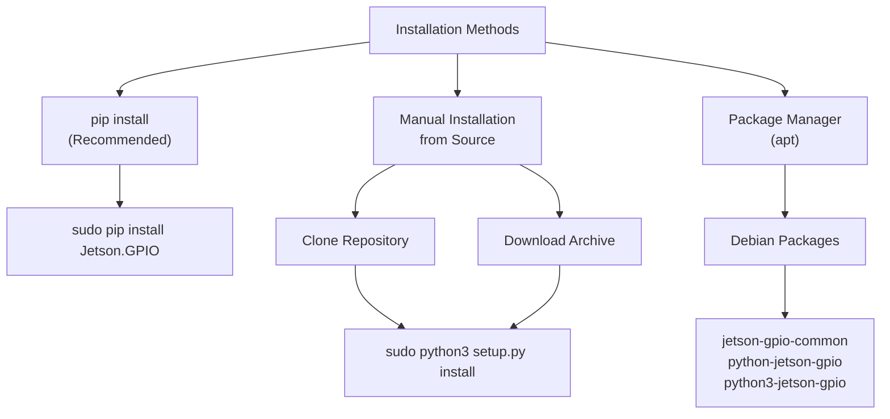

Sources: [README.md:35-52]()(setup.py:21-46)()

## System Requirements

Before installing Jetson.GPIO, ensure your system meets the following requirements:

| Requirement | Details |
|-------------|---------|
| **Hardware** | Jetson TX1, TX2, AGX Xavier, Nano, or newer Jetson boards |
| **Python Version** | Python 2.7 or Python 3.x |
| **Operating System** | Linux for Tegra (L4T) |

Sources: [README.md:3-8](), [setup.py:23-29]()

## Installation using pip (Recommended)

The simplest and recommended method to install Jetson.GPIO is using Python's package manager `pip`. This automatically handles package dependencies and makes upgrading easier.

```bash
sudo pip install Jetson.GPIO
```

For Python 3 specifically, use:

```bash
sudo pip3 install Jetson.GPIO
```

Sources: [README.md:38-42]()

## Manual Installation from Source

You can also install Jetson.GPIO directly from the source code, which allows you to access the latest development version or make custom modifications.

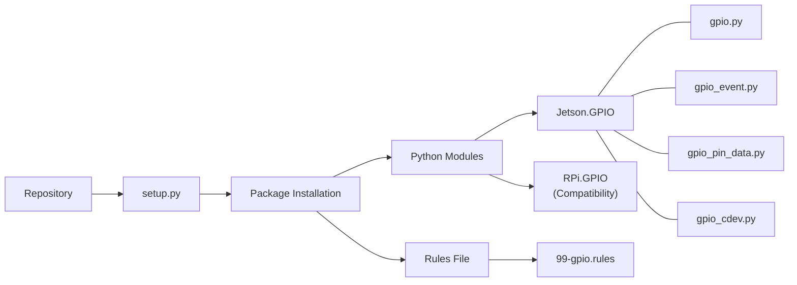

### Steps for manual installation:

1. **Clone the repository or download the archive**:
   ```bash
   git clone https://github.com/NVIDIA/jetson-gpio.git
   cd jetson-gpio
   ```

2. **Install using setup.py**:
   ```bash
   sudo python3 setup.py install
   ```

3. **Alternative: Use directly without installing**:
   You can also use the library directly from the downloaded directory by setting the PYTHONPATH environment variable:
   ```bash
   export PYTHONPATH=/path/to/jetson-gpio:$PYTHONPATH
   ```

Sources: [README.md:44-52](), [setup.py:31-46]()

## Installation using Package Manager

The Jetson.GPIO library is also available as Debian packages for Jetson platforms. These packages include:

- **jetson-gpio-common**: Common files required by both Python versions
- **python-jetson-gpio**: Python 2.x version of the library
- **python3-jetson-gpio**: Python 3.x version of the library

To install using apt:

```bash
sudo apt update
sudo apt install python3-jetson-gpio
```

Sources: [debian/control:19-37]()

## Package Structure

After installation, the Jetson.GPIO library is structured as follows:

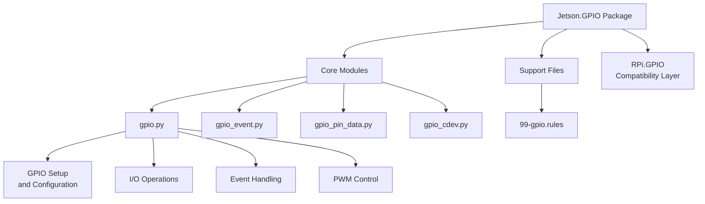

The installed package includes:

1. **Core Python Modules**:
   - `gpio.py`: Main functionality implementation
   - `gpio_event.py`: Event detection system
   - `gpio_pin_data.py`: Board-specific pin mappings
   - `gpio_cdev.py`: Character device interface

2. **Support Files**:
   - `99-gpio.rules`: udev rules for setting up permissions

3. **Raspberry Pi Compatibility Layer**:
   - `RPi.GPIO`: Compatibility API for Raspberry Pi GPIO code

Sources: [setup.py:42-45](), [README.md:19-23](), [MANIFEST.in:1-4]()

## Verifying Installation

After installation, you can verify that Jetson.GPIO was installed correctly by importing it in Python:

```python
import Jetson.GPIO as GPIO
print(GPIO.VERSION)
```

This should print the installed version of the library without any errors.

## Next Steps

After successful installation, you need to configure proper permissions to use GPIO pins without root privileges. See [Setting Up Permissions](#2.2) for detailed instructions on adding your user to the appropriate groups and setting up udev rules.

Sources: [README.md:54-83]()

## Troubleshooting

### Common Installation Issues

| Issue | Solution |
|-------|----------|
| **Permission denied during pip install** | Use `sudo` with pip install command |
| **Package not found in pip** | Ensure internet connectivity and try updating pip with `pip install --upgrade pip` |
| **ImportError after installation** | Verify Python version compatibility and check if the package was installed in the correct Python environment |
| **Conflicts with existing packages** | Consider using a virtual environment for isolation |

### Version Conflicts

If you have multiple versions installed or are upgrading from an older version, you may encounter conflicts. In such cases:

1. Uninstall the existing version:
   ```bash
   sudo pip uninstall Jetson.GPIO
   ```

2. Install the desired version:
   ```bash
   sudo pip install Jetson.GPIO==2.1.9
   ```

Sources: [setup.py:32]()

---

# Page: Setting Up Permissions

# Setting Up Permissions

<details>
<summary>Relevant source files</summary>

The following files were used as context for generating this wiki page:

- [README.md](README.md)
- [lib/python/Jetson/GPIO/99-gpio.rules](lib/python/Jetson/GPIO/99-gpio.rules)
- [samples/run_sample.sh](samples/run_sample.sh)

</details>


This document explains how to configure your system to allow non-root users to access GPIO pins on NVIDIA Jetson devices. Proper permissions are essential for running GPIO applications without requiring superuser privileges, which is both more convenient and more secure.

For information about installing the Jetson.GPIO library, see [Installation](#2.1).

## Why Permissions Matter

By default, Linux systems restrict access to hardware devices for security reasons. The GPIO pins on Jetson boards are controlled through character devices (`/dev/gpiochip*`) that require specific permissions to access. Without proper configuration, you would need to run all GPIO applications as root, which is a security risk.

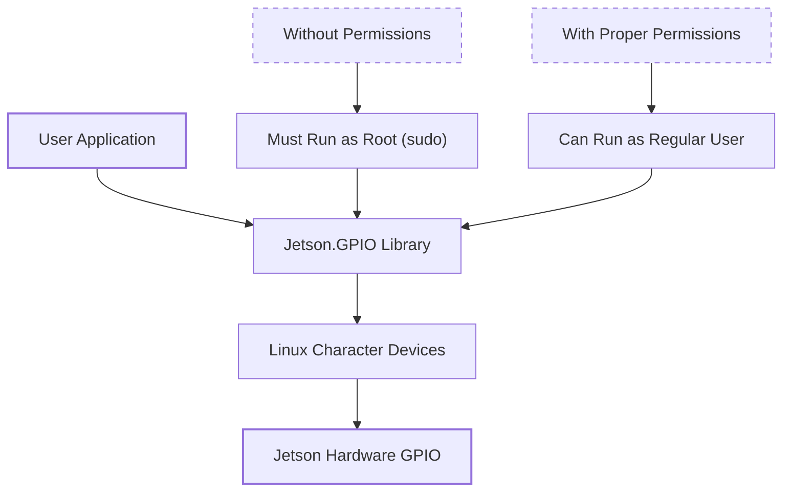

Sources: [README.md:54-58]()

## Permission Setup Process

Setting up proper permissions involves three main steps:

1. Creating a dedicated user group for GPIO access
2. Adding users to this group
3. Installing custom udev rules
4. Applying the new rules


Sources: [README.md:54-83]()

## Step-by-Step Instructions

### 1. Create the GPIO Group

First, create a new system group called `gpio`:

```bash
sudo groupadd -f -r gpio
```

The `-f` flag ensures the command doesn't fail if the group already exists, and `-r` creates a system group.

Sources: [README.md:61-62]()

### 2. Add User to the GPIO Group

Add your user account to the newly created group:

```bash
sudo usermod -a -G gpio your_user_name
```

Replace `your_user_name` with your actual username. The `-a` option adds the user to the group without removing them from other groups, and `-G` specifies which group to add the user to.

Sources: [README.md:61-62]()

### 3. Install udev Rules

The Jetson.GPIO library comes with a udev rules file called `99-gpio.rules` that needs to be copied to the system's udev rules directory.

If you downloaded the source code:

```bash
sudo cp lib/python/Jetson/GPIO/99-gpio.rules /etc/udev/rules.d/
```

If you installed the library using pip into a virtual environment:

```bash
sudo cp venv/lib/pythonNN/site-packages/Jetson/GPIO/99-gpio.rules /etc/udev/rules.d/
```

Replace `pythonNN` with your Python version (e.g., `python3.8`).

Sources: [README.md:65-77]()

### 4. Apply the Rules

For the new udev rules to take effect, either reboot your system or reload the rules:

```bash
sudo udevadm control --reload-rules && sudo udevadm trigger
```

This command reloads the rules and triggers udev to apply them immediately.

Sources: [README.md:79-83]()

## Understanding the udev Rules

The `99-gpio.rules` file contains rules that modify permissions for GPIO-related devices to allow members of the `gpio` group to access them.

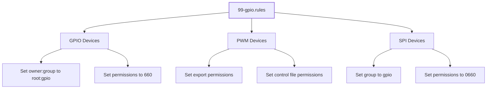

The rule file applies permission changes to three types of devices:

1. **GPIO Character Devices** (`gpiochip*`): Sets owner to root, group to gpio, and permissions to 660 (read/write for owner and group)
2. **PWM Devices** (`pwmchip*`): Sets permissions for export/unexport and control files (period, duty_cycle, enable)
3. **SPI Devices** (`spidev*`): Sets group to gpio and permissions to 0660

Sources: [lib/python/Jetson/GPIO/99-gpio.rules:22-31]()

## Verifying Permissions

After setting up permissions, you can verify they're correctly applied by:

1. Checking if you're in the `gpio` group:
   ```bash
   groups
   ```
   Your username should appear in the list of groups.

2. Checking device permissions:
   ```bash
   ls -l /dev/gpiochip*
   ```
   The devices should show `crw-rw----` permissions with group `gpio`.

## Permission Architecture

The following diagram shows how the permission system interacts with the GPIO hardware:

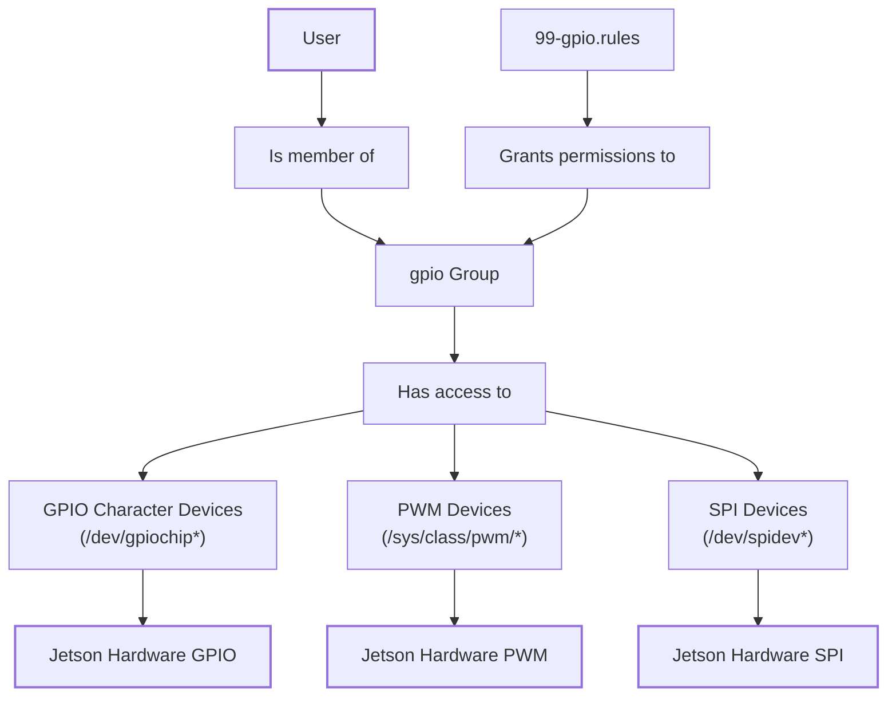

Sources: [lib/python/Jetson/GPIO/99-gpio.rules:22-31](), [README.md:54-83]()

## Troubleshooting Permission Issues

If you encounter permission-related errors when using the Jetson.GPIO library, check the following:

1. **User not in gpio group**: Make sure your user is added to the gpio group and you've logged out and back in (or restarted) for the group membership to take effect.

2. **Rules not applied**: Verify that the udev rules file exists in `/etc/udev/rules.d/` and that the rules have been applied.

3. **File paths**: If you installed the library in a non-standard location, make sure you're copying the rules file from the correct path.

4. **System updates**: If you've updated your system, the permissions might need to be reapplied.

## Using GPIO from Docker Containers

When using the Jetson GPIO library from Docker containers, special considerations for permissions are needed. The container needs access to the GPIO devices:

```bash
sudo docker container run -it --rm \
--device /dev/gpiochip0 \
your_image
```

For more details on using GPIO with Docker, see [Docker Integration](#5.1).

Sources: [README.md:427-448]()

## Summary

Proper permission setup is crucial for using the Jetson GPIO library without root privileges. By creating a gpio group, adding your user to it, and applying the provided udev rules, you can securely access GPIO, PWM, and SPI functionality on your Jetson device.

After completing these steps, you'll be ready to run the sample applications or your own GPIO code as a regular user. For examples of using the library, see the next sections of the documentation.

Sources: [README.md:54-83](), [lib/python/Jetson/GPIO/99-gpio.rules:22-31]()

---

# Page: API Reference

# API Reference

<details>
<summary>Relevant source files</summary>

The following files were used as context for generating this wiki page:

- [lib/python/Jetson/GPIO/__init__.py](lib/python/Jetson/GPIO/__init__.py)
- [lib/python/Jetson/GPIO/gpio.py](lib/python/Jetson/GPIO/gpio.py)
- [samples/test_all_apis.py](samples/test_all_apis.py)

</details>


This document provides a comprehensive reference for the Jetson.GPIO library API, which allows Python applications to control GPIO pins on NVIDIA Jetson development boards. The API enables digital input/output operations, event detection, and PWM control.

For installation instructions, see [Getting Started](#2). For detailed pin mapping information, see [Pin Mappings](#4.2).

## Pin Numbering Modes

Jetson.GPIO supports multiple pin numbering systems to accommodate different needs.

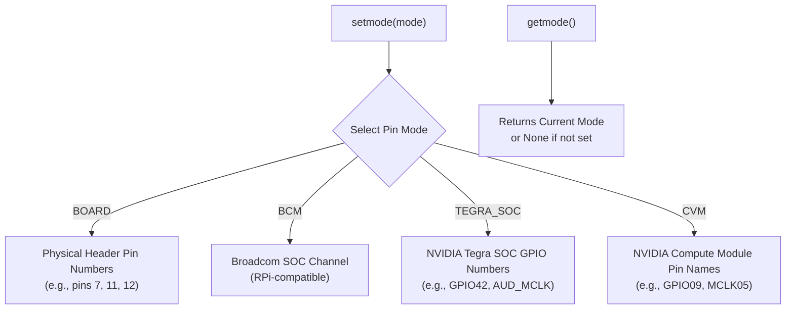

The pin numbering mode must be set before any GPIO operations using `setmode()`.

| Mode Constant | Value | Description |
|---------------|-------|-------------|
| `BOARD` | 10 | Physical pin numbers on the J41 header |
| `BCM` | 11 | Broadcom SOC channel numbering (RPi-compatible) |
| `TEGRA_SOC` | 1000 | NVIDIA Tegra SOC GPIO numbering |
| `CVM` | 1001 | NVIDIA Compute Module pin numbering |

```python
# Example: Setting pin mode to BOARD
GPIO.setmode(GPIO.BOARD)
```

Sources: [lib/python/Jetson/GPIO/gpio.py:36-42](), [lib/python/Jetson/GPIO/gpio.py:285-306]()

## GPIO Setup and Configuration

### Setting Up Pins

Before using GPIO pins, they must be configured as either inputs or outputs using the `setup()` function.

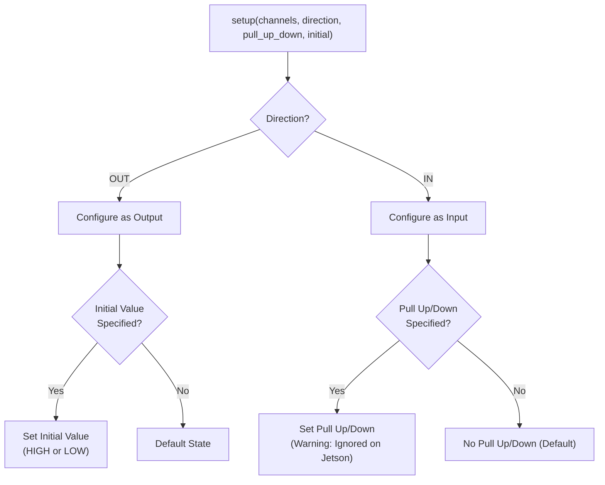

| Parameter | Description |
|-----------|-------------|
| `channels` | Single pin number or tuple/list of pin numbers |
| `direction` | `GPIO.IN` or `GPIO.OUT` |
| `pull_up_down` | `GPIO.PUD_OFF` (default), `GPIO.PUD_UP`, or `GPIO.PUD_DOWN` (note: ignored on Jetson) |
| `initial` | For outputs only: `GPIO.HIGH` or `GPIO.LOW` (initial state) |

```python
# Example: Setup a single pin as input
GPIO.setup(channel, GPIO.IN)

# Example: Setup multiple pins as outputs with initial values
GPIO.setup((channel1, channel2), GPIO.OUT, initial=(GPIO.HIGH, GPIO.LOW))
```

Sources: [lib/python/Jetson/GPIO/gpio.py:324-363]()

### Cleaning Up

When finished with GPIO operations, resources should be released using `cleanup()`.

```python
# Cleanup specific channel
GPIO.cleanup(channel)

# Cleanup all channels
GPIO.cleanup()
```

The `cleanup()` function:
- Releases channels that were set up in the current program
- Turns off event detection
- Disables PWM
- Resets pin modes to their default state

Sources: [lib/python/Jetson/GPIO/gpio.py:366-387]()

## Basic GPIO Operations

### Reading Input

Read the value of a pin configured as input using the `input()` function.

```python
# Returns GPIO.HIGH or GPIO.LOW
value = GPIO.input(channel)
```

Sources: [lib/python/Jetson/GPIO/gpio.py:390-400]()

### Writing Output

Set the value of a pin configured as output using the `output()` function.

```python
# Set a single channel
GPIO.output(channel, GPIO.HIGH)

# Set multiple channels to the same value
GPIO.output((channel1, channel2), GPIO.HIGH)

# Set multiple channels to different values
GPIO.output((channel1, channel2), (GPIO.HIGH, GPIO.LOW))
```

Sources: [lib/python/Jetson/GPIO/gpio.py:403-419]()

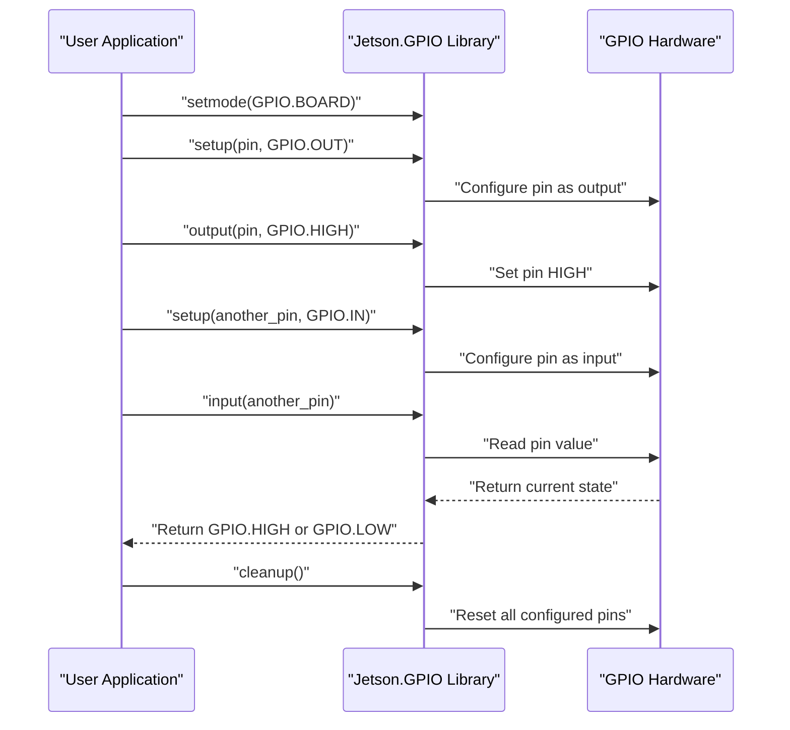

## Event Detection

The library provides several methods to detect and respond to changes in GPIO pin states:

### Blocking Wait for Edge

```python
# Block until a rising edge is detected or timeout occurs
GPIO.wait_for_edge(channel, GPIO.RISING, timeout=1000)  # timeout in ms
```

### Non-blocking Event Detection

```python
# Add event detection without a callback
GPIO.add_event_detect(channel, GPIO.FALLING)

# Check if an event has occurred
if GPIO.event_detected(channel):
    # Event occurred
    pass
```

### Event Callbacks

```python
# Add event detection with a callback
def my_callback(channel):
    print(f"Event detected on channel {channel}")

GPIO.add_event_detect(channel, GPIO.BOTH, callback=my_callback)

# Add additional callback to an existing event detection
GPIO.add_event_callback(channel, another_callback)

# Remove event detection
GPIO.remove_event_detect(channel)
```

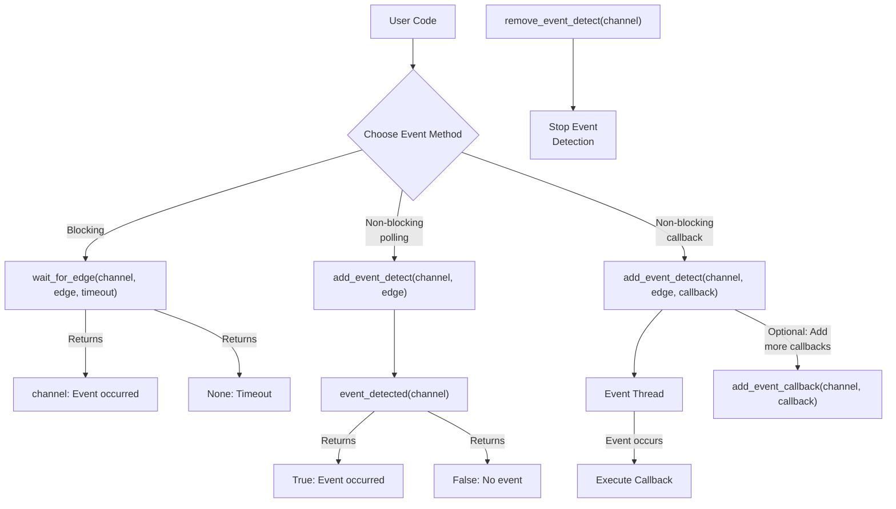

Edge detection constants:
- `GPIO.RISING`: Detect rising edge (LOW to HIGH transition)
- `GPIO.FALLING`: Detect falling edge (HIGH to LOW transition)
- `GPIO.BOTH`: Detect both rising and falling edges

Sources: [lib/python/Jetson/GPIO/gpio.py:429-504](), [lib/python/Jetson/GPIO/gpio.py:507-557]()

## PWM (Pulse Width Modulation)

Jetson.GPIO provides hardware PWM support through the `PWM` class.

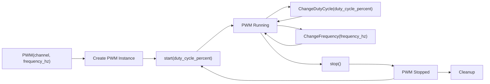

Example usage:

```python
# Create PWM instance at 100 Hz
pwm = GPIO.PWM(channel, 100)

# Start PWM with 50% duty cycle
pwm.start(50)

# Change duty cycle to 75%
pwm.ChangeDutyCycle(75)

# Change frequency to 200 Hz
pwm.ChangeFrequency(200)

# Stop PWM
pwm.stop()

# Cleanup
GPIO.cleanup()
```

Notes:
- PWM is only available on certain pins (see [Pin Mappings](#4.2))
- PWM frequency range depends on the hardware capabilities
- Duty cycle must be between 0 (always off) and 100 (always on)

Sources: [lib/python/Jetson/GPIO/gpio.py:571-652]()

## Other Functions

### Get Current Pin Function

`gpio_function(channel)` returns the current configuration of a GPIO pin.

```python
function = GPIO.gpio_function(channel)
# Returns GPIO.IN, GPIO.OUT, or GPIO.UNKNOWN
```

Sources: [lib/python/Jetson/GPIO/gpio.py:560-568]()

### Control Warnings

```python
# Enable warnings (default)
GPIO.setwarnings(True)

# Disable warnings
GPIO.setwarnings(False)
```

Sources: [lib/python/Jetson/GPIO/gpio.py:278-282]()

## Constants Reference

### Pin States

| Constant | Value | Description |
|----------|-------|-------------|
| `HIGH` | 1 | Logic high level |
| `LOW` | 0 | Logic low level |

### Pin Directions

| Constant | Value | Description |
|----------|-------|-------------|
| `IN` | 1 | Configure pin as input |
| `OUT` | 0 | Configure pin as output |
| `UNKNOWN` | -1 | Pin is not yet configured |
| `HARD_PWM` | 43 | Pin is configured for hardware PWM |

### Pull-up/down Resistors

| Constant | Value | Description |
|----------|-------|-------------|
| `PUD_OFF` | 20 | No pull-up/down |
| `PUD_DOWN` | 21 | Pull-down resistor enabled |
| `PUD_UP` | 22 | Pull-up resistor enabled |

Note: Pull-up/down settings are ignored on Jetson boards as they are not supported by the hardware.

### Edge Detection

| Constant | Value | Description |
|----------|-------|-------------|
| `RISING` | 31 | Detect rising edge (LOW to HIGH) |
| `FALLING` | 32 | Detect falling edge (HIGH to LOW) |
| `BOTH` | 33 | Detect both edges |

Sources: [lib/python/Jetson/GPIO/gpio.py:37-67]()

## Full API Overview

```mermaid
classDiagram
    class "GPIO" {
        +BOARD
        +BCM
        +TEGRA_SOC
        +CVM
        +IN
        +OUT
        +HIGH
        +LOW
        +RISING
        +FALLING
        +BOTH
        +PUD_OFF
        +PUD_UP
        +PUD_DOWN
        +setmode(mode)
        +getmode()
        +setup(channels, direction, pull_up_down, initial)
        +cleanup(channel)
        +input(channel)
        +output(channels, values)
        +wait_for_edge(channel, edge, bouncetime, timeout)
        +add_event_detect(channel, edge, callback, bouncetime)
        +event_detected(channel)
        +add_event_callback(channel, callback)
        +remove_event_detect(channel)
        +gpio_function(channel)
        +setwarnings(state)
    }
    
    class "PWM" {
        +__init__(channel, frequency_hz)
        +start(duty_cycle_percent)
        +ChangeFrequency(frequency_hz)
        +ChangeDutyCycle(duty_cycle_percent)
        +stop()
    }
    
    GPIO --> PWM : creates
```

Sources: [lib/python/Jetson/GPIO/gpio.py:1-653](), [lib/python/Jetson/GPIO/__init__.py:1-3]()

---

# Page: Pin Numbering

# Pin Numbering

<details>
<summary>Relevant source files</summary>

The following files were used as context for generating this wiki page:

- [README.md](README.md)
- [lib/python/Jetson/GPIO/gpio.py](lib/python/Jetson/GPIO/gpio.py)
- [lib/python/Jetson/GPIO/gpio_pin_data.py](lib/python/Jetson/GPIO/gpio_pin_data.py)

</details>


## Purpose

This page explains the pin numbering systems used in the Jetson GPIO library. Understanding pin numbering is essential for correctly identifying and accessing GPIO pins on Jetson development boards. The Jetson.GPIO library provides multiple pin numbering modes to accommodate different development approaches and to ease porting of code from other platforms such as Raspberry Pi.

For information about the physical pin mappings for specific Jetson boards, see [Pin Mappings](#4.2).

Sources: [README.md:154-180](), [lib/python/Jetson/GPIO/gpio.py:37-41]()

## Pin Numbering Modes

The Jetson GPIO library supports four different pin numbering modes:

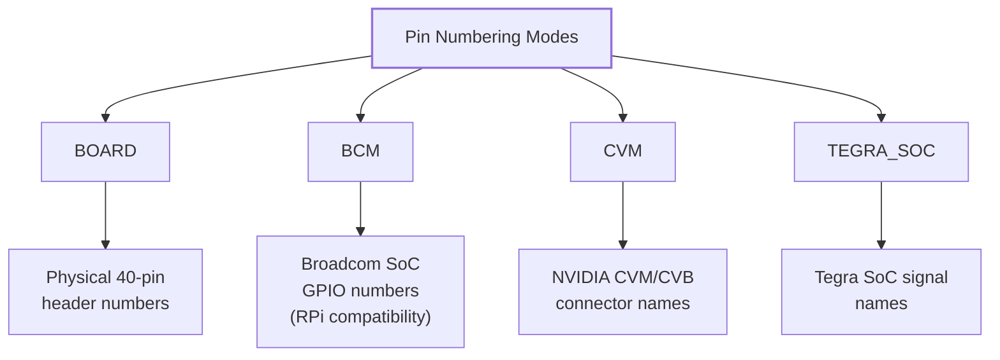

Each mode provides a different way to reference the same physical pins:

1. **BOARD Mode** - Uses physical pin numbers on the 40-pin header (integers)
2. **BCM Mode** - Uses Broadcom SoC GPIO numbers for Raspberry Pi compatibility (integers)
3. **CVM Mode** - Uses NVIDIA Computer Vision Module/Board connector signal names (strings)
4. **TEGRA_SOC Mode** - Uses NVIDIA Tegra SoC signal names (strings)

Sources: [lib/python/Jetson/GPIO/gpio.py:37-41](), [README.md:154-172]()

## Setting the Pin Numbering Mode

Before using any GPIO functions, you must specify which pin numbering mode you want to use:

```python
import Jetson.GPIO as GPIO

# Choose one of the following:
GPIO.setmode(GPIO.BOARD)  # Use physical board pin numbers
GPIO.setmode(GPIO.BCM)    # Use Broadcom SoC GPIO numbers
GPIO.setmode(GPIO.CVM)    # Use NVIDIA CVM/CVB connector signal names
GPIO.setmode(GPIO.TEGRA_SOC)  # Use Tegra SoC signal names
```

You can check which mode is currently set:

```python
mode = GPIO.getmode()  # Returns GPIO.BOARD, GPIO.BCM, GPIO.CVM, GPIO.TEGRA_SOC, or None
```

The library will raise a `RuntimeError` if you attempt to use GPIO functions without first setting the pin numbering mode.

Sources: [lib/python/Jetson/GPIO/gpio.py:87-312](), [README.md:162-180]()

## Pin Numbering System Implementation

The following diagram shows how the pin numbering system is implemented in the Jetson GPIO library:

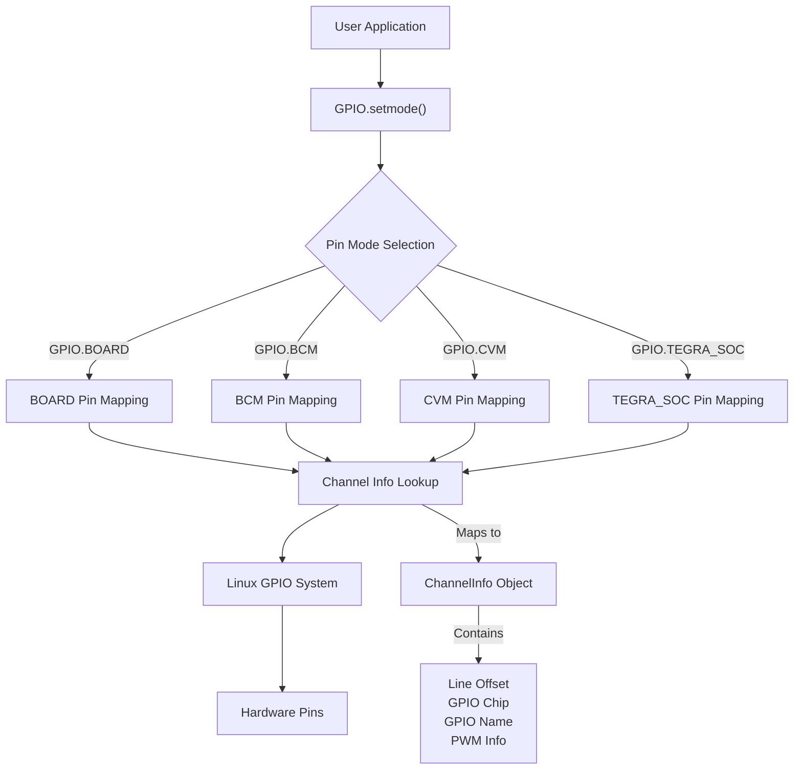

Internally, each pin reference (whether it's a board pin number, BCM number, or a signal name) is mapped to a `ChannelInfo` object that contains all the necessary information to access the actual hardware pin through the Linux GPIO system.

Sources: [lib/python/Jetson/GPIO/gpio_pin_data.py:475-496](), [lib/python/Jetson/GPIO/gpio.py:70-75]()

## BOARD Mode

BOARD mode uses the physical pin numbers on the 40-pin GPIO header of the Jetson development board. This is the most straightforward mode for beginners and when working directly with the physical hardware.

### Key characteristics:

- Uses integer values corresponding to the physical pin numbers (1-40)
- Consistent across different Jetson models for common pins
- Easy to locate pins when looking at the physical board

```mermaid
graph LR
    A["`**BOARD Mode Pin Example**`"] --> B

    subgraph B["40-pin Header"]
        1[1] --- 2[2]
        3[3] --- 4[4]
        39[39] --- 40[40]
    end

    C["GPIO.setup(12, GPIO.OUT)"] --> D["Physical Pin 12"]
    D --> |"Corresponds to"| 12
    
    subgraph Board["Jetson Board"]
        12[12]
    end
```

The BOARD pin definition for each supported Jetson board is in the 4th position of the pin definition tuples in the `gpio_pin_data.py` file.

Sources: [lib/python/Jetson/GPIO/gpio_pin_data.py:44](), [lib/python/Jetson/GPIO/gpio_pin_data.py:656-661]()

## BCM Mode

BCM mode uses the Broadcom SoC GPIO numbering, which is designed for compatibility with code written for Raspberry Pi. This mode allows for easier porting of existing Raspberry Pi GPIO code to Jetson platforms.

### Key characteristics:

- Uses integer values that do not correspond to physical pin locations
- Designed for compatibility with Raspberry Pi code
- Pin numbers generally differ from BOARD mode numbers

The BCM pin definition for each supported Jetson board is in the 5th position of the pin definition tuples in the `gpio_pin_data.py` file.

Sources: [lib/python/Jetson/GPIO/gpio_pin_data.py:45](), [lib/python/Jetson/GPIO/gpio_pin_data.py:656-661]()

## CVM and TEGRA_SOC Modes

These modes use string-based pin names instead of integer pin numbers:

### CVM Mode:
- Uses signal names from the NVIDIA Computer Vision Module/Board (CVM/CVB) connector
- Examples: 'GPIO09', 'UART1_RTS', 'I2S0_SCLK'

### TEGRA_SOC Mode:
- Uses signal names directly from the NVIDIA Tegra SoC
- Examples: 'GP167', 'GP72_UART1_RTS_N', 'GP122'

These modes are more technical but can be useful for developers working directly with the Jetson hardware specifications or when referencing NVIDIA's technical documentation.

The CVM pin name definition is in the 6th position, and the TEGRA_SOC pin name definition is in the 7th position of the pin definition tuples in the `gpio_pin_data.py` file.

Sources: [lib/python/Jetson/GPIO/gpio_pin_data.py:46-47](), [lib/python/Jetson/GPIO/gpio_pin_data.py:656-661]()

## Pin Data Structure

The following table shows a simplified example of how the pin mappings are structured for a few pins on the Jetson Orin NX:

| Linux GPIO | Linux GPIO Name | GPIO Chip | BOARD | BCM | CVM | TEGRA_SOC |
|------------|-----------------|-----------|-------|-----|-----|-----------|
| 144 | PAC.06 | tegra234-gpio | 7 | 4 | GPIO09 | GP167 |
| 112 | PR.04 | tegra234-gpio | 11 | 17 | UART1_RTS | GP72_UART1_RTS_N |
| 50 | PH.07 | tegra234-gpio | 12 | 18 | I2S0_SCLK | GP122 |
| 122 | PY.00 | tegra234-gpio | 13 | 27 | SPI1_SCK | GP36_SPI3_CLK |

Each row represents a single physical pin on the Jetson board, with mappings to all four pin numbering modes. The library uses these mappings to translate between your chosen numbering mode and the actual Linux GPIO system.

Sources: [lib/python/Jetson/GPIO/gpio_pin_data.py:53-75]()

## Internal Mapping Implementation

The pin mappings are loaded based on the detected Jetson board model:

```mermaid
flowchart TD
    A["get_data()"] --> B["get_model()"]
    B --> C["Detect Jetson Board Model"]
    C -->|"JETSON_ORIN"| D1["JETSON_ORIN_PIN_DEFS"]
    C -->|"JETSON_ORIN_NX"| D2["JETSON_ORIN_NX_PIN_DEFS"]
    C -->|"JETSON_ORIN_NANO"| D3["JETSON_ORIN_NX_PIN_DEFS"]
    C -->|"JETSON_XAVIER"| D4["JETSON_XAVIER_PIN_DEFS"]
    C -->|"Other models..."| D5["Other pin definitions..."]
    
    D1 --> E["Create mapping dictionaries"]
    D2 --> E
    D3 --> E
    D4 --> E
    D5 --> E
    
    E --> F["'BOARD': mode_data(3, pin_defs)"]
    E --> G["'BCM': mode_data(4, pin_defs)"]
    E --> H["'CVM': mode_data(5, pin_defs)"]
    E --> I["'TEGRA_SOC': mode_data(6, pin_defs)"]
    
    F --> J["Dictionary of ChannelInfo objects"]
    G --> J
    H --> J
    I --> J
```

When you call `GPIO.setmode()`, the library selects the appropriate mapping dictionary based on your chosen mode. Then, when you reference a pin in your code, the library looks up the corresponding `ChannelInfo` object to access the correct GPIO pin.

Sources: [lib/python/Jetson/GPIO/gpio_pin_data.py:613-663](), [lib/python/Jetson/GPIO/gpio.py:285-307]()

## Usage Example

Here's an example showing how to use different pin numbering modes:

```python
import Jetson.GPIO as GPIO
import time

# Using BOARD mode
GPIO.setmode(GPIO.BOARD)
GPIO.setup(12, GPIO.OUT)  # Using physical pin 12
GPIO.output(12, GPIO.HIGH)
time.sleep(1)
GPIO.cleanup()

# Using BCM mode
GPIO.setmode(GPIO.BCM)
GPIO.setup(18, GPIO.OUT)  # Using BCM pin 18 (same as physical pin 12)
GPIO.output(18, GPIO.HIGH)
time.sleep(1)
GPIO.cleanup()

# Using CVM mode
GPIO.setmode(GPIO.CVM)
GPIO.setup('I2S0_SCLK', GPIO.OUT)  # Using CVM signal name (same as physical pin 12)
GPIO.output('I2S0_SCLK', GPIO.HIGH)
time.sleep(1)
GPIO.cleanup()

# Using TEGRA_SOC mode
GPIO.setmode(GPIO.TEGRA_SOC)
GPIO.setup('GP122', GPIO.OUT)  # Using Tegra SoC signal name (same as physical pin 12)
GPIO.output('GP122', GPIO.HIGH)
time.sleep(1)
GPIO.cleanup()
```

Note that in this example, we're accessing the same physical pin (pin 12 on the 40-pin header of a Jetson Orin) using four different pin numbering modes.

Sources: [lib/python/Jetson/GPIO/gpio.py:285-307](), [lib/python/Jetson/GPIO/gpio_pin_data.py:53-75]()

## Best Practices

1. **Choose one pin numbering mode** and use it consistently throughout your application to avoid confusion.

2. **BOARD mode** is recommended for beginners and when working directly with the physical hardware, as it makes it easier to locate pins.

3. **BCM mode** is useful when porting existing Raspberry Pi code to Jetson platforms.

4. **CVM and TEGRA_SOC modes** are more appropriate for advanced users who are working with NVIDIA's technical documentation or need to reference specific signals.

5. **Document your pin mode** choice in your code to help others understand which pin numbering system you're using.

6. **Set warnings** to help catch potential issues:
   ```python
   GPIO.setwarnings(True)  # This is the default
   ```

7. **Always clean up** at the end of your program to reset GPIO pins:
   ```python
   GPIO.cleanup()
   ```

Sources: [README.md:162-180](), [lib/python/Jetson/GPIO/gpio.py:278-307]()

---

# Page: Basic GPIO Operations

# Basic GPIO Operations

<details>
<summary>Relevant source files</summary>

The following files were used as context for generating this wiki page:

- [lib/python/Jetson/GPIO/gpio.py](lib/python/Jetson/GPIO/gpio.py)
- [samples/simple_input.py](samples/simple_input.py)
- [samples/simple_out.py](samples/simple_out.py)
- [samples/test_all_apis.py](samples/test_all_apis.py)

</details>


This document covers the core functions for configuring and interacting with GPIO pins on NVIDIA Jetson development boards using the Jetson.GPIO library. It focuses on setting up pins, reading input values, writing output values, and proper cleanup. For event-based operations, see [Event Detection](#3.3), and for PWM functionality, see [PWM](#3.4).

## Pin Configuration Flow

Before performing any GPIO operations, pins must be properly configured following this sequence:

```mermaid
flowchart TD
    A["Set Pin Numbering Mode"] --> B["Configure Pin Direction"]
    B --> C{"Direction?"}
    C -->|"OUT"| D["Optionally Set Initial Value"]
    C -->|"IN"| E["Optionally Set Pull-up/down"]
    D --> F["Perform I/O Operations"]
    E --> F
    F --> G["Cleanup When Done"]
    
    style A stroke-width:2px
    style B stroke-width:2px
    style F stroke-width:2px
    style G stroke-width:2px
```

Sources: [lib/python/Jetson/GPIO/gpio.py:284-370]()

## Setting Pin Numbering Mode

Before configuring or accessing any GPIO pins, you must set the pin numbering mode using `GPIO.setmode()`. The library supports four pin numbering modes:

```mermaid
graph TD
    A["GPIO.setmode()"] --> B{"Select Mode"}
    B --> C["GPIO.BOARD"]
    B --> D["GPIO.BCM"]
    B --> E["GPIO.TEGRA_SOC"]
    B --> F["GPIO.CVM"]
    
    C --> G["Physical Board Pin Numbers<br>(e.g., 7, 11, 12, etc.)"]
    D --> H["Broadcom SoC Channel Numbers<br>(RPi Compatibility)"]
    E --> I["NVIDIA Tegra SoC Pin Names<br>(e.g., 'GP149', 'AUD_MCLK')"]
    F --> J["NVIDIA Module Pin Names<br>(e.g., 'GPIO3', 'MCLK05')"]
```

Sources: [lib/python/Jetson/GPIO/gpio.py:284-311](), [samples/test_all_apis.py:235-269]()

### Examples of Pin Mode Usage:

```python
# Using BOARD pin numbering (physical pin numbers)
GPIO.setmode(GPIO.BOARD)
GPIO.setup(18, GPIO.OUT)  # Uses physical pin 18

# Using BCM pin numbering (Broadcom compatibility)
GPIO.setmode(GPIO.BCM)
GPIO.setup(24, GPIO.OUT)  # Uses the BCM channel 24
```

Sources: [samples/simple_out.py:29-32](), [samples/simple_input.py:32-33]()

## Configuring Pins

After setting the pin numbering mode, you must configure each pin as either an input or output using `GPIO.setup()`.

### Setting Up Output Pins

```python
# Configure single pin as output with default initial state (LOW)
GPIO.setup(pin, GPIO.OUT)

# Configure single pin as output with HIGH initial state
GPIO.setup(pin, GPIO.OUT, initial=GPIO.HIGH)

# Configure multiple pins as outputs
GPIO.setup((pin1, pin2, pin3), GPIO.OUT)

# Configure multiple pins with different initial states
GPIO.setup((pin1, pin2), GPIO.OUT, initial=(GPIO.HIGH, GPIO.LOW))
```

Sources: [lib/python/Jetson/GPIO/gpio.py:326-363](), [samples/test_all_apis.py:284-325]()

### Setting Up Input Pins

```python
# Configure single pin as input
GPIO.setup(pin, GPIO.IN)

# Configure multiple pins as inputs
GPIO.setup((pin1, pin2, pin3), GPIO.IN)
```

Note: While the library accepts a `pull_up_down` parameter for compatibility with RPi.GPIO, Jetson.GPIO currently ignores this parameter and issues a warning.

Sources: [lib/python/Jetson/GPIO/gpio.py:326-363](), [samples/test_all_apis.py:329-356]()

## Reading Input Values

To read the current state of a configured input pin, use the `GPIO.input()` function:

```mermaid
flowchart LR
    A["External<br>Signal Source"] -->|"HIGH/LOW"| B["GPIO Pin"]
    B --> C["GPIO.input()"]
    C --> D{"Returns"}
    D --> E["GPIO.HIGH (1)"]
    D --> F["GPIO.LOW (0)"]
```

Sources: [lib/python/Jetson/GPIO/gpio.py:390-401](), [samples/simple_input.py:22-51]()

### Example Usage:

```python
# Read value from an input pin
GPIO.setmode(GPIO.BOARD)
GPIO.setup(input_pin, GPIO.IN)

value = GPIO.input(input_pin)
if value == GPIO.HIGH:
    print("Input is HIGH")
else:
    print("Input is LOW")
```

Sources: [samples/simple_input.py:35-45]()

## Setting Output Values

To set the state of a configured output pin, use the `GPIO.output()` function:

```mermaid
flowchart LR
    A["GPIO.output()"] -->|"HIGH/LOW"| B["GPIO Pin"]
    B --> C["External<br>Circuit"]
    
    D["GPIO.output()"] -->|"(HIGH, LOW)"| E["Multiple<br>GPIO Pins"]
    E --> F["External<br>Circuits"]
```

Sources: [lib/python/Jetson/GPIO/gpio.py:403-419](), [samples/simple_out.py:22-47]()

### Example Usage:

```python
# Set single pin HIGH
GPIO.output(output_pin, GPIO.HIGH)

# Set single pin LOW
GPIO.output(output_pin, GPIO.LOW)

# Set multiple pins to the same value
GPIO.output((pin1, pin2, pin3), GPIO.HIGH)

# Set multiple pins to different values
GPIO.output((pin1, pin2, pin3), (GPIO.HIGH, GPIO.LOW, GPIO.HIGH))
```

Sources: [lib/python/Jetson/GPIO/gpio.py:403-419](), [samples/test_all_apis.py:408-432]()

### Toggle Example:

```python
# Toggle an output pin
current_value = GPIO.HIGH
GPIO.output(output_pin, current_value)
current_value ^= GPIO.HIGH  # Toggle between HIGH and LOW
```

Sources: [samples/simple_out.py:35-42]()

## Checking Pin Configuration

You can check the current configured function of a pin using `GPIO.gpio_function()`:

```python
function = GPIO.gpio_function(pin)
if function == GPIO.IN:
    print("Pin is configured as input")
elif function == GPIO.OUT:
    print("Pin is configured as output")
elif function == GPIO.UNKNOWN:
    print("Pin is not configured")
```

Sources: [lib/python/Jetson/GPIO/gpio.py:560-568](), [samples/test_all_apis.py:474-497]()

## Cleanup

Always clean up GPIO resources when your program exits to release the pins and avoid potential issues with future GPIO access:

```python
try:
    # Your GPIO code here
finally:
    GPIO.cleanup()  # Clean up all pins
```

You can also clean up specific pins:

```python
GPIO.cleanup(pin)  # Clean up a single pin
GPIO.cleanup((pin1, pin2))  # Clean up multiple pins
```

Sources: [lib/python/Jetson/GPIO/gpio.py:366-387](), [samples/simple_out.py:43-44](), [samples/simple_input.py:47-48]()

## Complete Input/Output Flow

```mermaid
sequenceDiagram
    participant App as "Application"
    participant GPIO as "Jetson.GPIO API"
    participant HW as "Jetson Hardware"
    
    App->>GPIO: "GPIO.setmode(GPIO.BOARD)"
    App->>GPIO: "GPIO.setup(out_pin, GPIO.OUT)"
    App->>GPIO: "GPIO.setup(in_pin, GPIO.IN)"
    
    App->>GPIO: "GPIO.output(out_pin, GPIO.HIGH)"
    GPIO->>HW: "Set pin to HIGH"
    
    App->>GPIO: "value = GPIO.input(in_pin)"
    GPIO->>HW: "Read pin state"
    HW-->>GPIO: "Return pin state"
    GPIO-->>App: "Return GPIO.HIGH or GPIO.LOW"
    
    App->>GPIO: "GPIO.cleanup()"
    GPIO->>HW: "Release resources"
```

Sources: [lib/python/Jetson/GPIO/gpio.py:390-419](), [samples/simple_input.py:22-51](), [samples/simple_out.py:22-47]()

## Common Examples

### LED Blink Example

```python
import RPi.GPIO as GPIO
import time

# Set up the pin (physical pin 18 in this example)
GPIO.setmode(GPIO.BOARD)
GPIO.setup(18, GPIO.OUT, initial=GPIO.LOW)

try:
    while True:
        # Turn LED on
        GPIO.output(18, GPIO.HIGH)
        time.sleep(1)
        
        # Turn LED off
        GPIO.output(18, GPIO.LOW)
        time.sleep(1)
finally:
    # Always clean up
    GPIO.cleanup()
```

Sources: [samples/simple_out.py:22-47]()

### Button Input Example

```python
import RPi.GPIO as GPIO
import time

# Set up pins
GPIO.setmode(GPIO.BOARD)
GPIO.setup(18, GPIO.IN)  # Button input pin

previous_state = None
try:
    while True:
        # Read button state
        current_state = GPIO.input(18)
        
        # Only print when state changes
        if current_state != previous_state:
            if current_state == GPIO.HIGH:
                print("Button pressed")
            else:
                print("Button released")
            previous_state = current_state
            
        time.sleep(0.1)
finally:
    GPIO.cleanup()
```

Sources: [samples/simple_input.py:22-51]()

## Technical Implementation Details

Internally, the Jetson.GPIO library uses the Linux GPIO character device interface to interact with the hardware. The `setup()` function configures the GPIO pin and stores this configuration in internal dictionaries. The `input()` and `output()` functions use the character device interface functions to read from and write to the pins.

When a GPIO pin is set up, the library opens the corresponding GPIO character device file (`/dev/gpiochip0`) and creates a line handle that can be used for subsequent operations. The `cleanup()` function releases these resources.

Sources: [lib/python/Jetson/GPIO/gpio.py:149-168](), [lib/python/Jetson/GPIO/gpio.py:241-265]()

---

# Page: Event Detection

# Event Detection

<details>
<summary>Relevant source files</summary>

The following files were used as context for generating this wiki page:

- [lib/python/Jetson/GPIO/gpio.py](lib/python/Jetson/GPIO/gpio.py)
- [lib/python/Jetson/GPIO/gpio_event.py](lib/python/Jetson/GPIO/gpio_event.py)
- [samples/button_event.py](samples/button_event.py)
- [samples/button_interrupt.py](samples/button_interrupt.py)
- [samples/issue40.py](samples/issue40.py)

</details>


The Event Detection system in Jetson.GPIO allows you to detect and respond to changes in GPIO pin states. Instead of continuously polling pin values, you can use event detection to efficiently react to transitions (like button presses) using callbacks or blocking wait mechanisms.

## Overview of Event Detection

Jetson.GPIO offers three main approaches for detecting GPIO pin state changes:

1. **Blocking Wait**: Use `wait_for_edge()` to pause program execution until a specified edge event occurs
2. **Event Detection with Polling**: Use `add_event_detect()` and `event_detected()` to check for events in a non-blocking manner
3. **Event Detection with Callbacks**: Use `add_event_detect()` with a callback function to automatically execute code when an event occurs

```mermaid
flowchart TD
    A["Application Code"] --> B{"Choose Event Detection Method"}
    
    B -->|"Blocking"| C["GPIO.wait_for_edge()"]
    C --> D["Program execution pauses until edge detected"]
    
    B -->|"Non-blocking with Polling"| E["GPIO.add_event_detect()"]
    E --> F["GPIO.event_detected()"]
    F --> G["Check for events periodically"]
    
    B -->|"Non-blocking with Callback"| H["GPIO.add_event_detect() with callback"]
    H --> I["Event detection thread"]
    I --> J["Callback executes when event detected"]
```

Sources: [lib/python/Jetson/GPIO/gpio.py:422-557](), [lib/python/Jetson/GPIO/gpio_event.py:104-518]()

## Edge Types

When working with event detection, you need to specify which type of edge (transition) you want to detect:

| Constant | Value | Description |
|----------|-------|-------------|
| `GPIO.RISING` | 31 | Transition from LOW to HIGH |
| `GPIO.FALLING` | 32 | Transition from HIGH to LOW |
| `GPIO.BOTH` | 33 | Either RISING or FALLING transition |

These constants are defined with an offset to prevent them from being confused with other constants like HIGH and LOW.

Sources: [lib/python/Jetson/GPIO/gpio.py:56-61]()

## API Reference

### Blocking Event Detection

#### `GPIO.wait_for_edge(channel, edge, bouncetime=None, timeout=None)`

Blocks until an edge event is detected on the specified GPIO channel.

**Parameters:**
- `channel`: The channel/pin number based on the current numbering mode
- `edge`: The edge type to detect - must be `GPIO.RISING`, `GPIO.FALLING`, or `GPIO.BOTH`
- `bouncetime`: Optional debounce time in milliseconds (integer >= 0)
- `timeout`: Optional timeout in seconds (integer >= 0)

**Returns:**
- The channel number if an event was detected
- `None` if a timeout occurred
- Raises exceptions on errors

**Example:**
```python
# Wait for a button press (falling edge)
GPIO.wait_for_edge(button_pin, GPIO.FALLING)
print("Button was pressed!")
```

Sources: [lib/python/Jetson/GPIO/gpio.py:507-557](), [lib/python/Jetson/GPIO/gpio_event.py:452-490](), [samples/button_event.py:46-55]()

### Non-Blocking Event Detection

#### `GPIO.add_event_detect(channel, edge, callback=None, bouncetime=None, polltime=0.2)`

Sets up event detection for a specified GPIO channel in a non-blocking manner.

**Parameters:**
- `channel`: The channel/pin number based on the current numbering mode
- `edge`: The edge type to detect - must be `GPIO.RISING`, `GPIO.FALLING`, or `GPIO.BOTH`
- `callback`: Optional function to call when an event is detected
- `bouncetime`: Optional debounce time in milliseconds (integer >= 0)
- `polltime`: Maximum time to wait between polling for events (default 0.2 seconds)

**Note:** One channel only allows one event detection setup at a time.

#### `GPIO.event_detected(channel)`

Checks if an event has been detected on the specified channel.

**Parameters:**
- `channel`: The channel/pin number to check

**Returns:**
- `True` if an event has been detected since the last call
- `False` otherwise

**Example using polling:**
```python
# Set up event detection for a button
GPIO.add_event_detect(button_pin, GPIO.FALLING)

# Later, check if button was pressed
if GPIO.event_detected(button_pin):
    print("Button was pressed!")
```

Sources: [lib/python/Jetson/GPIO/gpio.py:429-483](), [lib/python/Jetson/GPIO/gpio_event.py:104-169](), [lib/python/Jetson/GPIO/gpio_event.py:228-249]()

### Callback-Based Event Detection

#### `GPIO.add_event_callback(channel, callback)`

Adds a callback function for a channel that already has event detection enabled.

**Parameters:**
- `channel`: The channel/pin number
- `callback`: A function to be called when an event is detected

**Example with callback:**
```python
# Define callback function
def button_callback(channel):
    print(f"Button on channel {channel} was pressed!")

# Set up event detection with callback
GPIO.add_event_detect(button_pin, GPIO.FALLING, callback=button_callback)

# Or add the callback after setting up detection
GPIO.add_event_callback(button_pin, button_callback)
```

Sources: [lib/python/Jetson/GPIO/gpio.py:488-504](), [lib/python/Jetson/GPIO/gpio_event.py:212-226](), [samples/button_interrupt.py:31-50]()

### Cleanup

#### `GPIO.remove_event_detect(channel, timeout=0.5)`

Removes event detection for the specified channel.

**Parameters:**
- `channel`: The channel/pin number
- `timeout`: Maximum time to wait for the event detection thread to stop

Sources: [lib/python/Jetson/GPIO/gpio.py:467-469](), [lib/python/Jetson/GPIO/gpio_event.py:179-204]()

## Internal Architecture

The event detection system in Jetson.GPIO uses a thread-based implementation with Linux GPIO character devices to efficiently detect pin changes.

```mermaid
flowchart TD
    A["User API<br>wait_for_edge()<br>add_event_detect()<br>event_detected()"] --> B["gpio_event.py"]
    B --> C["_edge_handler Thread"]
    C --> D["epoll Event Polling"]
    D --> E["/dev/gpiochip0<br>GPIO Character Device"]
    E --> F["Hardware GPIO Pins"]
    
    B --- G["_gpio_event_list<br>Dictionary of Events"]
    G --- H["_Gpios Objects<br>Stores event state"]
    C --- I["Callback Execution"]
    I --- J["User Callback Functions"]
```

Sources: [lib/python/Jetson/GPIO/gpio_event.py:62-77](), [lib/python/Jetson/GPIO/gpio_event.py:81-102](), [lib/python/Jetson/GPIO/gpio_event.py:349-446]()

### Event Detection Process

```mermaid
sequenceDiagram
    participant App as "Application"
    participant GPIO as "Jetson.GPIO API"
    participant Event as "Event System"
    participant Thread as "Event Thread"
    participant HW as "GPIO Hardware"
    
    App->>GPIO: add_event_detect(channel, edge, callback)
    GPIO->>Event: add_edge_detect(chip_fd, chip_name, channel, ...)
    Event->>Event: Create _Gpios object
    Event->>Event: Register with epoll
    Event->>Thread: Start _edge_handler thread
    
    loop Event Thread
        Thread->>HW: Poll for events (epoll)
        HW-->>Thread: Edge event occurs
        Thread->>Event: Update event state
        opt If callback provided
            Thread->>App: Execute callback function
        end
    end
    
    alt Polling method
        App->>GPIO: event_detected(channel)
        GPIO->>Event: edge_event_detected(chip_name, channel)
        Event-->>App: True/False (event occurred)
    end
    
    App->>GPIO: remove_event_detect(channel)
    GPIO->>Event: remove_edge_detect(chip_name, channel)
    Event->>Thread: Signal thread to exit
    Event->>Event: Clean up resources
```

Sources: [lib/python/Jetson/GPIO/gpio.py:429-483](), [lib/python/Jetson/GPIO/gpio_event.py:104-204](), [lib/python/Jetson/GPIO/gpio_event.py:349-446]()

### Key Components

1. **Event Registration**:
   - Each GPIO pin can have one active event detection at a time
   - Events are stored in the `_gpio_event_list` dictionary

2. **Event Detection Thread**:
   - `_edge_handler` function runs in a separate thread
   - Uses `epoll` to efficiently wait for hardware events
   - Reads events from the GPIO character device

3. **Debouncing**:
   - Hardware button presses can "bounce", causing multiple rapid events
   - `bouncetime` parameter sets a minimum time between detected events
   - Implemented in the event thread using timestamps

4. **Callbacks**:
   - Multiple callbacks can be registered per channel
   - Executed directly from the event thread
   - Should be kept short to avoid blocking the event thread

Sources: [lib/python/Jetson/GPIO/gpio_event.py:81-102](), [lib/python/Jetson/GPIO/gpio_event.py:349-446]()

## Best Practices

1. **Choose the Right Approach**:
   - Use `wait_for_edge()` for simple applications where blocking is acceptable
   - Use `add_event_detect()` with callbacks for responsive applications

2. **Set Appropriate Bouncetime**:
   - Mechanical buttons often need 200-300ms debounce time
   - Electronic signals might need shorter or no debounce time

3. **Keep Callbacks Brief**:
   - Callbacks run in the event detection thread
   - Long-running callbacks will delay detection of other events
   - For complex processing, have the callback set a flag or use a queue

4. **Always Clean Up**:
   - Call `remove_event_detect()` when done with an event
   - Or use `GPIO.cleanup()` to clean up all resources

Sources: [lib/python/Jetson/GPIO/gpio.py:429-463](), [lib/python/Jetson/GPIO/gpio_event.py:349-446](), [samples/button_interrupt.py:31-60]()

## Example: Button Press Detection

Here's a complete example showing different event detection methods:

1. **Blocking Method**:
```python
import RPi.GPIO as GPIO
import time

button_pin = 18
GPIO.setmode(GPIO.BOARD)
GPIO.setup(button_pin, GPIO.IN)

print("Waiting for button press...")
GPIO.wait_for_edge(button_pin, GPIO.FALLING)
print("Button was pressed!")
GPIO.cleanup()
```

2. **Callback Method**:
```python
import RPi.GPIO as GPIO
import time

def button_callback(channel):
    print(f"Button on channel {channel} was pressed!")

button_pin = 18
GPIO.setmode(GPIO.BOARD)
GPIO.setup(button_pin, GPIO.IN)

GPIO.add_event_detect(button_pin, GPIO.FALLING, callback=button_callback, bouncetime=300)

try:
    print("Running... Press Ctrl+C to exit")
    while True:
        time.sleep(1)
finally:
    GPIO.cleanup()
```

Sources: [samples/button_event.py:36-60](), [samples/button_interrupt.py:31-63](), [samples/issue40.py:27-45]()

---

# Page: PWM

# PWM

<details>
<summary>Relevant source files</summary>

The following files were used as context for generating this wiki page:

- [debian/changelog](debian/changelog)
- [lib/python/Jetson/GPIO/gpio.py](lib/python/Jetson/GPIO/gpio.py)
- [samples/simple_pwm.py](samples/simple_pwm.py)

</details>


This page documents the Pulse Width Modulation (PWM) capabilities in the Jetson GPIO library. It covers the API, usage patterns, and hardware considerations for generating PWM signals on supported Jetson boards.

For information about general GPIO operations, see [Basic GPIO Operations](#3.2).

## Introduction to PWM

Pulse Width Modulation (PWM) is a technique for controlling power by rapidly switching a digital signal between on and off states. By varying the duty cycle (the proportion of time the signal is in the "on" state), PWM can simulate a variable voltage output.

```mermaid
graph LR
    subgraph "PWM Signal Characteristics"
        A["Period (1/frequency)"] --- B["Duty Cycle"]
    end
    
    subgraph "PWM Examples"
        C["25% Duty Cycle"] --- D["50% Duty Cycle"] --- E["75% Duty Cycle"]
    end
```

Sources: [lib/python/Jetson/GPIO/gpio.py:571-652]()

Common applications of PWM include:
- LED brightness control
- Motor speed control
- Servo motor positioning
- Audio tone generation

The Jetson GPIO library provides hardware PWM functionality through a dedicated `PWM` class that interfaces with the Jetson's hardware PWM controllers.

## PWM Architecture

The Jetson.GPIO library implements PWM by interacting with the Linux sysfs interface to access hardware PWM controllers on Jetson boards.

```mermaid
flowchart TD
    A["User Application"] --> B["PWM Class"]
    B --> C["Linux sysfs Interface"]
    C --> D["/sys/class/pwm/"]
    D --> E["Jetson Hardware PWM Controller"]
    
    subgraph "PWM Class Methods"
        F["__init__(channel, frequency_hz)"]
        G["start(duty_cycle_percent)"]
        H["stop()"]
        I["ChangeFrequency(frequency_hz)"]
        J["ChangeDutyCycle(duty_cycle_percent)"]
    end
```

Sources: [lib/python/Jetson/GPIO/gpio.py:571-652](), [lib/python/Jetson/GPIO/gpio.py:190-204]()

When a PWM object is created:
1. The system exports the specified PWM channel via sysfs
2. Sets the initial period based on the requested frequency
3. Sets the duty cycle to 0
4. Marks the channel as being in `HARD_PWM` mode

PWM signals can be started, stopped, and modified through methods that write to the appropriate sysfs files.

## PWM API Reference

### Class Constructor

```
GPIO.PWM(channel, frequency_hz)
```

Creates a new PWM instance for the specified channel.

| Parameter | Type | Description |
|-----------|------|-------------|
| channel | int | The GPIO channel number (in the current numbering mode) |
| frequency_hz | float | The PWM frequency in Hz |

Returns a new PWM object.

**Notes:**
- The channel must correspond to a hardware PWM pin on the Jetson board
- Creates a PWM instance but doesn't start the output (requires calling start())
- If the channel is already configured (for GPIO or PWM), appropriate warnings or errors will be generated

### Methods

#### start(duty_cycle_percent)

```
pwm.start(duty_cycle_percent)
```

Starts PWM output on the channel.

| Parameter | Type | Description |
|-----------|------|-------------|
| duty_cycle_percent | float | The duty cycle as a percentage (0.0 to 100.0) |

#### stop()

```
pwm.stop()
```

Stops PWM output on the channel.

#### ChangeFrequency(frequency_hz)

```
pwm.ChangeFrequency(frequency_hz)
```

Changes the PWM frequency.

| Parameter | Type | Description |
|-----------|------|-------------|
| frequency_hz | float | The new frequency in Hz |

**Note:** Changing frequency may momentarily stop and restart the PWM signal.

#### ChangeDutyCycle(duty_cycle_percent)

```
pwm.ChangeDutyCycle(duty_cycle_percent)
```

Changes the PWM duty cycle.

| Parameter | Type | Description |
|-----------|------|-------------|
| duty_cycle_percent | float | The new duty cycle as a percentage (0.0 to 100.0) |

Sources: [lib/python/Jetson/GPIO/gpio.py:571-652]()

## Usage Example

The following sequence illustrates how to use the PWM API to create a gradually varying brightness control:

```mermaid
sequenceDiagram
    participant App as "Application"
    participant GPIO as "GPIO Module"
    participant PWM as "PWM Object"
    participant Sysfs as "Linux sysfs"
    
    App->>GPIO: "GPIO.setmode(GPIO.BOARD)"
    App->>GPIO: "GPIO.setup(pin, GPIO.OUT)"
    App->>PWM: "pwm = GPIO.PWM(pin, 50)"
    PWM->>Sysfs: "Open pwm chip"
    PWM->>Sysfs: "Export PWM"
    PWM->>Sysfs: "Set period"
    App->>PWM: "pwm.start(25)"
    PWM->>Sysfs: "Set duty_cycle"
    PWM->>Sysfs: "Enable PWM"
    loop Change duty cycle
        App->>PWM: "pwm.ChangeDutyCycle(val)"
        PWM->>Sysfs: "Update duty_cycle"
    end
    App->>PWM: "pwm.stop()"
    PWM->>Sysfs: "Disable PWM"
    App->>GPIO: "GPIO.cleanup()"
    PWM->>Sysfs: "Unexport PWM"
```

Sources: [samples/simple_pwm.py:40-63](), [lib/python/Jetson/GPIO/gpio.py:571-652]()

A complete example is provided in the samples directory:

```python
# Board pin-numbering scheme
GPIO.setmode(GPIO.BOARD)
# Set pin as an output pin with initial state HIGH
GPIO.setup(output_pin, GPIO.OUT, initial=GPIO.HIGH)
# Create PWM object with frequency 50Hz
p = GPIO.PWM(output_pin, 50)
# Start PWM with 25% duty cycle
p.start(25)

try:
    while True:
        # Vary duty cycle
        time.sleep(0.25)
        if val >= 100:
            incr = -incr
        if val <= 0:
            incr = -incr
        val += incr
        p.ChangeDutyCycle(val)
finally:
    # Clean up
    p.stop()
    GPIO.cleanup()
```

Sources: [samples/simple_pwm.py:40-63]()

## Internal Implementation

The PWM functionality is implemented through the Linux sysfs interface, which provides a user-space API to hardware PWM controllers.

### PWM Sysfs Paths

The library interacts with the following sysfs paths:

| Path | Description |
|------|-------------|
| `/sys/class/pwm/pwmchip*/export` | Export a PWM channel |
| `/sys/class/pwm/pwmchip*/unexport` | Unexport a PWM channel |
| `/sys/class/pwm/pwmchip*/pwm*/period` | Set PWM period in nanoseconds |
| `/sys/class/pwm/pwmchip*/pwm*/duty_cycle` | Set duty cycle in nanoseconds |
| `/sys/class/pwm/pwmchip*/pwm*/enable` | Enable/disable PWM output |

The library handles conversion between user-friendly units (Hz, percentage) and the nanosecond values required by the sysfs interface.

```mermaid
flowchart TD
    A["PWM Class Method Calls"] --> B["_reconfigure()"]
    B --> C{{"Frequency or\nDuty Cycle Change?"}}
    C -- "Frequency changed" --> D["_set_pwm_period()"]
    C -- "Duty cycle changed" --> E["_set_pwm_duty_cycle()"]
    D --> F["/sys/class/pwm/*/period"]
    E --> G["/sys/class/pwm/*/duty_cycle"]
    B -- "Start/Stop" --> H["_enable_pwm() or _disable_pwm()"]
    H --> I["/sys/class/pwm/*/enable"]
```

Sources: [lib/python/Jetson/GPIO/gpio.py:165-239](), [lib/python/Jetson/GPIO/gpio.py:627-652]()

### Implementation Details

The PWM implementation includes several key internal functions:

- `_export_pwm`: Makes the PWM channel available via sysfs
- `_unexport_pwm`: Removes the PWM channel from sysfs
- `_set_pwm_period`: Sets the PWM period (frequency)
- `_set_pwm_duty_cycle`: Sets the duty cycle
- `_enable_pwm`/`_disable_pwm`: Controls output state
- `_reconfigure`: Core method for changing PWM parameters

Sources: [lib/python/Jetson/GPIO/gpio.py:189-239](), [lib/python/Jetson/GPIO/gpio.py:627-652]()

## Hardware Support

Different Jetson boards have different PWM capabilities. The library automatically detects the board and maps the appropriate pins.

### Supported Boards and PWM Pins

| Board | Supported PWM Pins (BOARD numbering) |
|-------|-------------------------------------|
| Jetson Xavier | 18 |
| Jetson Nano | 33 |
| Jetson NX | 33 |
| Clara AGX Xavier | 18 |
| Jetson TX2 NX | 32 |
| Jetson Orin | 18 (PWM8 added in v2.1.7) |
| Jetson Orin NX | 33 |
| Jetson Orin Nano | 33 |

Sources: [samples/simple_pwm.py:25-34](), [debian/changelog:10-21]()

### Recent PWM Updates

The Jetson GPIO library's PWM support continues to evolve with each release:

- v2.1.7: Added PWM8 to Jetson Orin
- v2.1.4: Updated PWM directory list for new kernel versions
- v2.1.2: Updated PWM pins list for Jetson Orin NX and Jetson Orin Nano
- v2.0.190: Fixed PWM bug when previous duty cycle is higher than period

Sources: [debian/changelog:10-92]()

## Best Practices

When working with PWM on Jetson GPIO, consider these best practices:

1. Always call `stop()` on the PWM object before program exit
2. Use the `cleanup()` function to properly release resources
3. Be aware that PWM channels may be limited and board-specific
4. Changing frequency will momentarily stop and restart the PWM output
5. Duty cycle values must be between 0.0 and 100.0
6. Frequency changes reset the duty cycle, so update frequency before duty cycle

Sources: [lib/python/Jetson/GPIO/gpio.py:602-625](), [samples/simple_pwm.py:62-63]()

---

# Page: Hardware Support

# Hardware Support

<details>
<summary>Relevant source files</summary>

The following files were used as context for generating this wiki page:

- [debian/changelog](debian/changelog)
- [lib/python/Jetson/GPIO/gpio_pin_data.py](lib/python/Jetson/GPIO/gpio_pin_data.py)
- [samples/issue40-trigger.py](samples/issue40-trigger.py)
- [samples/jetson_model.py](samples/jetson_model.py)

</details>


## Overview

This document provides detailed information about the hardware platforms supported by the Jetson.GPIO library. It covers the supported Jetson board models, their detection mechanism, and the GPIO pin mapping systems implemented across different hardware generations. For information about pin numbering systems, see [Pin Numbering](#3.1), and for detailed pin mappings, see [Pin Mappings](#4.2).

Sources: [lib/python/Jetson/GPIO/gpio_pin_data.py:24-35]()

## Supported Jetson Boards

The Jetson.GPIO library supports a wide range of NVIDIA Jetson development boards across multiple generations of hardware platforms. The following table summarizes the supported boards:

| Board Model | Processor | RAM Options | Initial Support Version |
|-------------|-----------|-------------|-------------------------|
| Jetson Orin Nano | ARM A78AE | 4GB/8GB | 2.1.1 |
| Jetson Orin Nano Super | ARM A78AE | 8GB/16GB | 2.1.8 |
| Jetson Orin NX | ARM A78AE | 8GB/16GB | 2.0.210 |
| Jetson Orin NX Super | ARM A78AE | 16GB/32GB | 2.1.9 |
| Jetson AGX Orin | ARM A78AE | 32GB/64GB | 2.0.180 |
| Clara AGX Xavier | ARM Carmel | 16GB | 2.0.10 |
| Jetson Xavier NX | ARM Carmel | 8GB/16GB | 2.0.5 |
| Jetson AGX Xavier | ARM Carmel | 8GB/16GB/32GB/64GB | Pre-2.0.4 |
| Jetson TX2 NX | ARM A57 + Denver | 4GB | 2.0.16 |
| Jetson TX2 | ARM A57 + Denver | 4GB/8GB | Pre-2.0.4 |
| Jetson TX1 | ARM A57 | 4GB | Pre-2.0.4 |
| Jetson Nano | ARM A57 | 2GB/4GB | Pre-2.0.4/2.0.11 |

Sources: [lib/python/Jetson/GPIO/gpio_pin_data.py:361-472](), [debian/changelog:1-187]()

## Board Detection Mechanism

The Jetson.GPIO library implements an automated board detection mechanism to identify the specific Jetson model on which it is running. This ensures that appropriate pin definitions and hardware capabilities are loaded for each supported platform.

### Board Detection Flow

```mermaid
flowchart TD
    A["get_model()"] --> B{"Check /proc/device-tree/compatible"}
    B -->|"Found compatible string"| C["Match against known board compatibles"]
    C --> D{"Match found?"}
    D -->|"Yes"| E["Check carrier board compatibility"]
    D -->|"No"| F{"Check environment variable JETSON_MODEL_NAME"}
    
    F -->|"Valid model name"| J["Return model name"]
    F -->|"Invalid or missing"| K["Raise exception - board not detected"]
    
    E --> G["Return appropriate board model"]
    
    G --> H{"Detected model is Jetson Nano"}
    H -->|"Yes"| I["Check module revision"]
    I -->|"A02 or later"| J
    I -->|"Earlier than A02"| K["Raise exception - unsupported revision"]
    H -->|"No"| J
```

The board detection mechanism works as follows:

1. Read the compatible strings from `/proc/device-tree/compatible`
2. Match against known compatible strings defined for each board model
3. Verify carrier board compatibility (warnings issued for non-standard carrier boards)
4. For Jetson Nano, verify module revision is A02 or later
5. If no match found in compatible strings, check the `JETSON_MODEL_NAME` environment variable (useful in Docker containers)
6. Return the identified model or raise an exception if detection fails

Sources: [lib/python/Jetson/GPIO/gpio_pin_data.py:499-607]()

## Pin Definition Architecture

Each Jetson board has unique GPIO pin mappings defined in the `gpio_pin_data.py` file. These definitions establish the relationship between logical pin numbers (used in application code) and physical hardware pins.

### Pin Definition Structure

```mermaid
classDiagram
    class "Pin Definition Entry" {
        +Linux GPIO pin number
        +Linux exported GPIO name
        +GPIO chip name/instance
        +Pin number (BOARD mode)
        +Pin number (BCM mode)
        +Pin name (CVM mode)
        +Pin name (TEGRA_SOC mode)
        +PWM chip sysfs directory
        +PWM ID within PWM chip
    }
    
    class "Board Pin Definitions" {
        +JETSON_ORIN_NX_PIN_DEFS
        +JETSON_ORIN_NANO_PIN_DEFS
        +JETSON_ORIN_PIN_DEFS
        +CLARA_AGX_XAVIER_PIN_DEFS
        +JETSON_NX_PIN_DEFS
        +JETSON_XAVIER_PIN_DEFS
        +JETSON_TX2_NX_PIN_DEFS
        +JETSON_TX2_PIN_DEFS
        +JETSON_TX1_PIN_DEFS
        +JETSON_NANO_PIN_DEFS
    }
    
    class "Jetson GPIO Data" {
        +Model name
        +Pin definitions array
        +Board information dict
    }
    
    "Board Pin Definitions" --> "Pin Definition Entry" : contains
    "Jetson GPIO Data" --> "Board Pin Definitions" : references
    "ChannelInfo" --> "Pin Definition Entry" : created from
```

Each pin definition includes comprehensive information needed to interact with the hardware:

1. Linux GPIO pin number (line offset within chip)
2. Linux exported GPIO name (if different from standard naming)
3. GPIO chip name/instance
4. Pin numbering in different modes (BOARD, BCM, CVM, TEGRA_SOC)
5. PWM chip and ID information (for pins supporting PWM functionality)

The library creates `ChannelInfo` objects from these definitions when initializing a GPIO pin.

Sources: [lib/python/Jetson/GPIO/gpio_pin_data.py:37-52](), [lib/python/Jetson/GPIO/gpio_pin_data.py:475-497]()

## Pin Mapping System

The Jetson.GPIO library supports four pin numbering modes to accommodate different preferences and use cases:

### Pin Numbering Modes

1. **BOARD mode**: Numbers match the physical pin positions on the J41 header
2. **BCM mode**: Broadcom-style pin numbers for Raspberry Pi compatibility
3. **CVM mode**: NVIDIA CVM (Computer Vision Module) pin names
4. **TEGRA_SOC mode**: Tegra SoC-specific pin names

### Pin Mapping Architecture

```mermaid
flowchart TD
    subgraph "User Application"
        A1["GPIO.setmode(GPIO.BOARD)"]
        A2["GPIO.setup(pin, GPIO.OUT)"]
        A3["GPIO.output(pin, GPIO.HIGH)"]
    end
    
    subgraph "Jetson.GPIO Library"
        B["get_data()"]
        C["Model Detection"]
        D["Load Pin Definitions"]
        E["Create Channel Mapping"]
        F["Board-specific Channel Data"]
        
        B --> C
        C --> D
        D --> E
        E --> F
    end
    
    A1 --> G["Select Pin Mode"]
    G --> F
    A2 --> H["Map to ChannelInfo Object"]
    H --> F
    A3 --> I["Access Hardware GPIO"]
    
    subgraph "Hardware Interface"
        J["Linux GPIO Character Device"]
        K["Hardware GPIO Pin"]
    end
    
    I --> J
    J --> K
```

When initializing GPIO operations, the library:

1. Detects the Jetson model
2. Loads appropriate pin definitions
3. Creates channel mappings for all pin numbering modes
4. Uses these mappings to translate logical pin numbers to physical hardware pins

Sources: [lib/python/Jetson/GPIO/gpio_pin_data.py:647-661]()

## Hardware Platform Compatibility

Different Jetson boards use different SoCs (Systems on Chip) and have varying GPIO capabilities. The library identifies compatible boards using specific identifier strings.

### Compatible Board String Tables

| Board Model | Compatible String Identifiers |
|-------------|-------------------------------|
| Jetson Orin Nano/NX | nvidia,p3509-0000+p3767-0003, nvidia,p3768-0000+p3767-0003, etc. |
| Jetson AGX Orin | nvidia,p3737-0000+p3701-0000, nvidia,p3737-0000+p3701-0004, etc. |
| Clara AGX Xavier | nvidia,e3900-0000+p2888-0004 |
| Jetson Xavier NX | nvidia,p3509-0000+p3668-0000, nvidia,p3449-0000+p3668-0001, etc. |
| Jetson AGX Xavier | nvidia,p2972-0000, nvidia,galen-industrial, etc. |
| Jetson TX2 NX | nvidia,p3509-0000+p3636-0001 |
| Jetson TX2 | nvidia,p2771-0000, nvidia,quill, etc. |
| Jetson TX1 | nvidia,p2371-2180, nvidia,jetson-cv |
| Jetson Nano | nvidia,p3450-0000, nvidia,p3450-0002, nvidia,jetson-nano |

Sources: [lib/python/Jetson/GPIO/gpio_pin_data.py:78-358]()

## Hardware Support Limitations

While the Jetson.GPIO library aims to provide comprehensive support for all Jetson development boards, there are some limitations to be aware of:

1. **Carrier Board Compatibility**: The library is primarily tested and verified with NVIDIA's developer kit carrier boards. Non-standard carrier boards may have different pin mappings or functionality.

2. **PWM Availability**: PWM support depends on the underlying kernel configuration and device tree. Some PWM controllers might not be enabled in all versions of the Linux for Tegra (L4T) software.

3. **Input/Output Restrictions**: Some pins may be input-only or output-only due to hardware connections on the carrier board or module. These restrictions are documented in the pin definition comments.

4. **GPIO Pull-up/Pull-down**: Unlike Raspberry Pi, Jetson platforms do not support software-controlled pull-up/pull-down resistors through this library.

Sources: [lib/python/Jetson/GPIO/gpio_pin_data.py:198-218](), [lib/python/Jetson/GPIO/gpio_pin_data.py:261-283](), [lib/python/Jetson/GPIO/gpio_pin_data.py:345-347]()

## Usage Examples

To determine the current Jetson model programmatically, you can use the following code:

```python
import Jetson.GPIO as GPIO
print(GPIO.model)
```

This will output the detected Jetson model name, which can be useful for implementing model-specific functionality in your applications.

Sources: [samples/jetson_model.py:20-21]()

## Summary

The Jetson.GPIO library provides comprehensive hardware support for all current Jetson platforms, from the older TX1 to the latest Orin series. The library's automated board detection ensures that the appropriate pin definitions are used regardless of the underlying hardware, providing a consistent GPIO programming interface across the Jetson product line.

For detailed information about specific pin mappings for each board, see [Pin Mappings](#4.2), and for details about using the GPIO API, see [API Reference](#3).

---

# Page: Supported Boards

# Supported Boards

<details>
<summary>Relevant source files</summary>

The following files were used as context for generating this wiki page:

- [debian/changelog](debian/changelog)
- [lib/python/Jetson/GPIO/gpio_pin_data.py](lib/python/Jetson/GPIO/gpio_pin_data.py)
- [samples/issue40-trigger.py](samples/issue40-trigger.py)
- [samples/jetson_model.py](samples/jetson_model.py)

</details>


This page documents the NVIDIA Jetson development boards supported by the Jetson.GPIO library. It covers which boards are compatible with the library, their key specifications, and how the library detects and interfaces with different board variants. For detailed pin mapping information, see [Pin Mappings](#4.2).

## Board Detection Process

The Jetson.GPIO library needs to determine which Jetson hardware it's running on to provide the correct pin mappings and hardware interfaces. The library uses a systematic approach to detect the board model.

```mermaid
flowchart TD
    A["Start Board Detection"] --> B["Read /proc/device-tree/compatible"]
    B --> C{"Match compatible strings"}
    C -->|"TX1 compats"| D["Return JETSON_TX1"]
    C -->|"TX2 compats"| E["Return JETSON_TX2"]
    C -->|"Clara AGX Xavier compats"| F["Return CLARA_AGX_XAVIER"]
    C -->|"TX2 NX compats"| G["Return JETSON_TX2_NX"]
    C -->|"Xavier compats"| H["Return JETSON_XAVIER"]
    C -->|"Nano compats"| I["Check module revision"]
    C -->|"NX compats"| J["Return JETSON_NX"]
    C -->|"Orin compats"| K["Return JETSON_ORIN"]
    C -->|"Orin NX compats"| L["Return JETSON_ORIN_NX"]
    C -->|"Orin Nano compats"| M["Return JETSON_ORIN_NANO"]
    
    I -->|"Rev < 200"| N["Raise Exception"]
    I -->|"Rev >= 200"| O["Return JETSON_NANO"]
    
    B -->|"Not found"| P["Check JETSON_MODEL_NAME env var"]
    P -->|"Valid model"| Q["Return model"]
    P -->|"Invalid/missing"| R["Raise Exception"]
```

Sources: [lib/python/Jetson/GPIO/gpio_pin_data.py:549-607]()

## Supported Jetson Platforms

The library currently supports multiple generations of Jetson hardware, from the original TX1 to the latest Orin series.

| Board | Processor | RAM Configurations | Added in Version |
|-------|-----------|-------------------|-----------------|
| Jetson Orin NX | ARM A78AE | 32GB, 64GB | 2.0.210 |
| Jetson Orin NX Super | ARM A78AE | 32GB, 64GB | 2.1.9 |
| Jetson Orin Nano | ARM A78AE | 32GB, 64GB | 2.1.1 |
| Jetson Orin Nano Super | ARM A78AE | 32GB, 64GB | 2.1.8 |
| Jetson AGX Orin | ARM A78AE | 32GB, 64GB | 2.0.180 |
| Clara AGX Xavier | ARM Carmel | 16GB | 2.0.10 |
| Jetson AGX Xavier | ARM Carmel | 8GB, 16GB, 32GB, 64GB | Initial |
| Jetson AGX Xavier Industrial | ARM Carmel | 8GB, 16GB, 32GB, 64GB | 2.0.170 |
| Jetson Xavier NX | ARM Carmel | 8GB, 16GB | 2.0.5 |
| Jetson TX2 NX | ARM A57 + Denver | 4GB | 2.0.16 |
| Jetson TX2 | ARM A57 + Denver | 4GB, 8GB | Initial |
| Jetson TX1 | ARM A57 | 4GB | Initial |
| Jetson Nano | ARM A57 | 2GB, 4GB | Initial (4GB), 2.0.11 (2GB) |

Sources: [lib/python/Jetson/GPIO/gpio_pin_data.py:24-35](), [lib/python/Jetson/GPIO/gpio_pin_data.py:361-471](), [debian/changelog:1-100]()

## Evolution of Jetson Platforms

The following diagram shows the evolution of NVIDIA's Jetson platform family:

```mermaid
graph TD
    TX1["Jetson TX1 (2015)\nARM A57"]
    TX2["Jetson TX2 (2017)\nARM A57 + Denver"]
    NANO["Jetson Nano (2019)\nARM A57"]
    XAVIER["Jetson AGX Xavier (2018)\nARM Carmel"]
    TX2NX["Jetson TX2 NX (2020)\nARM A57 + Denver"]
    NX["Jetson Xavier NX (2020)\nARM Carmel"]
    CLARA["Clara AGX Xavier (2020)\nARM Carmel"]
    XAVI["Xavier Industrial (2021)\nARM Carmel"]
    ORIN["Jetson AGX Orin (2022)\nARM A78AE"]
    ORINNX["Jetson Orin NX (2022)\nARM A78AE"]
    ORINNANO["Jetson Orin Nano (2023)\nARM A78AE"]
    ORINNXS["Jetson Orin NX Super (2025)\nARM A78AE"]
    ORINNS["Jetson Orin Nano Super (2024)\nARM A78AE"]
    
    TX1 --> TX2
    TX1 --> NANO
    TX2 --> XAVIER
    TX2 --> TX2NX
    XAVIER --> NX
    XAVIER --> CLARA
    XAVIER --> XAVI
    XAVIER --> ORIN
    ORIN --> ORINNX
    ORIN --> ORINNANO
    ORINNX --> ORINNXS
    ORINNANO --> ORINNS
```

Sources: [lib/python/Jetson/GPIO/gpio_pin_data.py:24-35](), [debian/changelog:1-100]()

## Platform Identification Constants

The library defines constants for each supported board in `gpio_pin_data.py`:

```python
CLARA_AGX_XAVIER = 'CLARA_AGX_XAVIER'
JETSON_NX = 'JETSON_NX'
JETSON_XAVIER = 'JETSON_XAVIER'
JETSON_TX2 = 'JETSON_TX2'
JETSON_TX1 = 'JETSON_TX1'
JETSON_NANO = 'JETSON_NANO'
JETSON_TX2_NX = 'JETSON_TX2_NX'
JETSON_ORIN = 'JETSON_ORIN'
JETSON_ORIN_NX = 'JETSON_ORIN_NX'
JETSON_ORIN_NANO = 'JETSON_ORIN_NANO'
```

These constants are used both internally for board detection and can be accessed in user code through the `GPIO.model` property.

Sources: [lib/python/Jetson/GPIO/gpio_pin_data.py:24-35]()

## Pin Definition Structure

The library defines GPIO pin data for each supported board. Each pin definition is structured as a tuple containing:

```mermaid
graph LR
    A["Pin Definition Tuple"] --> B["Linux GPIO pin number\n(line offset inside chip)"]
    A --> C["Linux exported GPIO name"]
    A --> D["GPIO chip name/instance"]
    A --> E["Pin number (BOARD mode)"]
    A --> F["Pin number (BCM mode)"]
    A --> G["Pin name (CVM mode)"]
    A --> H["Pin name (TEGRA_SOC mode)"]
    A --> I["PWM chip sysfs directory"]
    A --> J["PWM ID within PWM chip"]
```

Example pin definition for Jetson Orin NX:
```python
(144, 'PAC.06', "tegra234-gpio", 7, 4, 'GPIO09', 'GP167', None, None)
```

This represents:
- Linux GPIO pin number: 144
- Linux exported name: PAC.06
- GPIO chip: tegra234-gpio
- BOARD pin number: 7
- BCM pin number: 4
- CVM pin name: GPIO09
- TEGRA_SOC pin name: GP167
- No PWM capability (None, None)

Sources: [lib/python/Jetson/GPIO/gpio_pin_data.py:37-52]()

## Board-Specific Pin Definitions

Each board has its own pin definition array that maps the physical pins to their various numbering schemes and capabilities:

| Board | Pin Definition Array | GPIO Chip | Number of Pins |
|-------|----------------------|-----------|---------------|
| Jetson Orin NX | JETSON_ORIN_NX_PIN_DEFS | tegra234-gpio | 20 |
| Jetson Orin Nano | JETSON_ORIN_NX_PIN_DEFS | tegra234-gpio | 20 |
| Jetson AGX Orin | JETSON_ORIN_PIN_DEFS | tegra234-gpio | 20 |
| Clara AGX Xavier | CLARA_AGX_XAVIER_PIN_DEFS | tegra194-gpio | 20 |
| Jetson Xavier NX | JETSON_NX_PIN_DEFS | tegra194-gpio | 20 |
| Jetson AGX Xavier | JETSON_XAVIER_PIN_DEFS | tegra194-gpio | 20 |
| Jetson TX2 NX | JETSON_TX2_NX_PIN_DEFS | tegra-gpio | 20 |
| Jetson TX2 | JETSON_TX2_PIN_DEFS | tegra-gpio | 19 |
| Jetson TX1 | JETSON_TX1_PIN_DEFS | tegra-gpio | 20 |
| Jetson Nano | JETSON_NANO_PIN_DEFS | tegra-gpio | 20 |

Sources: [lib/python/Jetson/GPIO/gpio_pin_data.py:53-359]()

## Board Identification Mechanism

The library uses a two-step approach to identify the board:

```mermaid
flowchart TD
    A["get_model() function"] --> B{"Check /proc/device-tree/compatible"}
    B -->|"Found match"| C["Return corresponding model constant"]
    B -->|"Not found"| D{"Check JETSON_MODEL_NAME env var"}
    D -->|"Valid model"| E["Return model constant"]
    D -->|"Invalid/missing"| F["Raise Exception"]
    
    C --> G["Load board-specific pin definitions"]
    E --> G
    G --> H["Create channel mapping dictionaries"]
    H --> I["Map pin modes (BOARD, BCM, CVM, TEGRA_SOC)\nto GPIO pin numbers"]
```

The main identification mechanism uses compatible strings in `/proc/device-tree/compatible` to determine the board model. For Docker containers or other environments where the device tree may not be accessible, the `JETSON_MODEL_NAME` environment variable can be used.

Sources: [lib/python/Jetson/GPIO/gpio_pin_data.py:499-607](), [lib/python/Jetson/GPIO/gpio_pin_data.py:609-663]()

## Compatible String Matching

Each board variant has a specific set of compatible strings that are used for identification:

| Board | Compatible Strings |
|-------|-------------------|
| Jetson Orin NX | nvidia,p3509-0000+p3767-0000, nvidia,p3768-0000+p3767-0000, etc. |
| Jetson Orin Nano | nvidia,p3509-0000+p3767-0003, nvidia,p3768-0000+p3767-0003, etc. |
| Jetson AGX Orin | nvidia,p3737-0000+p3701-0000, nvidia,p3737-0000+p3701-0004, etc. |
| Clara AGX Xavier | nvidia,e3900-0000+p2888-0004 |
| Jetson Xavier NX | nvidia,p3509-0000+p3668-0000, nvidia,p3449-0000+p3668-0000, etc. |
| Jetson AGX Xavier | nvidia,p2972-0000, nvidia,jetson-xavier, etc. |
| Jetson TX2 NX | nvidia,p3509-0000+p3636-0001 |
| Jetson TX2 | nvidia,p2771-0000, nvidia,quill, etc. |
| Jetson TX1 | nvidia,p2371-2180, nvidia,jetson-cv |
| Jetson Nano | nvidia,p3450-0000, nvidia,p3450-0002, nvidia,jetson-nano |

Sources: [lib/python/Jetson/GPIO/gpio_pin_data.py:78-359]()

## Board and Carrier Compatibility

The library verifies compatibility between the Jetson module and carrier board to ensure proper functionality:

| Jetson Module | Expected Carrier Board(s) |
|---------------|--------------------------|
| TX1 | 2597 |
| TX2 | 2597 |
| Clara AGX Xavier | 3900 |
| TX2 NX | 3509 |
| Xavier | 2822 |
| Nano | 3449, 3542 |
| NX | 3509, 3449 |
| Orin | 3737 |
| Orin NX | 3509, 3768 |
| Orin Nano | 3509, 3768 |

If the carrier board is not from a Jetson Developer Kit, the library will issue a warning as functionality may be limited or unstable.

Sources: [lib/python/Jetson/GPIO/gpio_pin_data.py:527-541](), [lib/python/Jetson/GPIO/gpio_pin_data.py:559-595]()

## Checking Board Model in Code

To programmatically determine which Jetson model your code is running on:

```python
import Jetson.GPIO as GPIO
print(GPIO.model)  # Prints the detected Jetson model name
```

This sample demonstrates a simple way to access the board model information from your application.

Sources: [samples/jetson_model.py:20-21]()

## PWM Support

Not all pins on every board support PWM functionality. The library provides information about PWM-capable pins through the pin definitions:

| Board | PWM-Capable Pins (BOARD numbering) |
|-------|-----------------------------------|
| Jetson Orin NX | 15, 32, 33 |
| Jetson Orin Nano | 15, 32, 33 |
| Jetson AGX Orin | 13, 15, 18, 32 |
| Clara AGX Xavier | 15, 32 |
| Jetson Xavier NX | 15, 32, 33 |
| Jetson AGX Xavier | 13, 15, 18, 32 |
| Jetson TX2 NX | 32, 33 |
| Jetson TX2 | No PWM pins defined in array |
| Jetson TX1 | No PWM pins defined in array |
| Jetson Nano | 32, 33 |

The PWM capability is indicated by the presence of PWM chip directory and PWM ID in the pin definition tuple.

Sources: [lib/python/Jetson/GPIO/gpio_pin_data.py:53-359]()

## Library Evolution

The Jetson.GPIO library has evolved to support new Jetson boards as they are released:

```mermaid
timeline
    title "Jetson.GPIO Board Support Timeline"
    section Initial Release
        Jetson TX1 : Initial
        Jetson TX2 : Initial
        Jetson Nano (4GB) : Initial
    section v2.0.5-v2.0.11
        Jetson Xavier NX : v2.0.5
        Clara AGX Xavier : v2.0.10
        Jetson Nano (2GB) : v2.0.11
    section v2.0.16-v2.0.180
        Jetson TX2 NX : v2.0.16
        Jetson AGX Xavier Industrial : v2.0.170
        Jetson AGX Orin : v2.0.180
    section v2.0.210-v2.1.9
        Jetson Orin NX : v2.0.210
        Jetson Orin Nano : v2.1.1
        Jetson Orin Nano Super : v2.1.8
        Jetson Orin NX Super : v2.1.9
```

Sources: [debian/changelog:1-100]()

## Testing Board Support

To verify that your specific Jetson board is supported and functioning correctly, you can run a simple GPIO test:

```python
import Jetson.GPIO as GPIO
import time

# Print the Jetson model
print("Running on:", GPIO.model)

# Choose a pin based on your board (should work on all boards)
output_pin = 7  # Physical pin 7 (BOARD numbering)

# Set up the pin
GPIO.setmode(GPIO.BOARD)
GPIO.setup(output_pin, GPIO.OUT)

# Toggle the pin a few times
for _ in range(5):
    GPIO.output(output_pin, GPIO.HIGH)
    time.sleep(0.5)
    GPIO.output(output_pin, GPIO.LOW)
    time.sleep(0.5)

# Clean up
GPIO.cleanup()
```

This code toggles an output pin to verify basic GPIO functionality.

Sources: [samples/issue40-trigger.py:22-39]()

---

# Page: Pin Mappings

# Pin Mappings

<details>
<summary>Relevant source files</summary>

The following files were used as context for generating this wiki page:

- [lib/python/Jetson/GPIO/gpio_pin_data.py](lib/python/Jetson/GPIO/gpio_pin_data.py)
- [samples/test_all_pins.py](samples/test_all_pins.py)
- [samples/test_all_pins_input.py](samples/test_all_pins_input.py)

</details>


This page provides detailed information about the pin mappings for all supported NVIDIA Jetson boards in the Jetson.GPIO library. It explains how physical pins on Jetson boards are mapped to different numbering systems (BOARD, BCM, CVM, TEGRA_SOC) and how to reference them in your code. For information about pin numbering modes themselves, see [Pin Numbering](#3.1).

## Pin Mapping Concept

Jetson GPIO pins can be referred to using different numbering schemes. The Jetson.GPIO library supports four pin numbering modes:

1. **BOARD** - Physical pin numbers on the J41 header
2. **BCM** - Broadcom SoC numbering (for Raspberry Pi compatibility)
3. **CVM** - NVIDIA Jetson-specific function names
4. **TEGRA_SOC** - NVIDIA Tegra SoC-specific function names

Each pin on a Jetson board has corresponding values in each of these numbering systems, along with information about its capabilities (e.g., PWM support).

```mermaid
flowchart LR
    subgraph "Physical Pins"
        A["J41 Header Pin"]
    end
    
    subgraph "Numbering Schemes"
        B["BOARD Number"]
        C["BCM Number"]
        D["CVM Name"]
        E["TEGRA_SOC Name"]
    end
    
    subgraph "System-Level Interface"
        F["Linux GPIO Pin"]
        G["GPIO Chip"]
        H["PWM Capability"]
    end
    
    A --> B
    B --> C
    B --> D
    B --> E
    B --> F
    F --> G
    B --> H
```

Sources: [lib/python/Jetson/GPIO/gpio_pin_data.py:37-51]()

## Pin Definition Structure

In the Jetson.GPIO library, each pin is defined by a tuple containing the following information:

```mermaid
classDiagram
    class "Pin Definition Tuple" {
        +int Linux_GPIO_pin_number
        +string Linux_exported_GPIO_name
        +string GPIO_chip_name
        +int BOARD_pin_number
        +int BCM_pin_number
        +string CVM_pin_name
        +string TEGRA_SOC_pin_name
        +string PWM_chip_dir
        +int PWM_ID
    }
    
    class "ChannelInfo Class" {
        +int channel
        +int chip_fd
        +int line_handle
        +int line_offset
        +string direction
        +string edge
        +string consumer
        +string gpio_name
        +string gpio_chip
        +string pwm_chip_dir
        +int pwm_id
    }
    
    "Pin Definition Tuple" --> "ChannelInfo Class" : mapped to
```

These definitions are used to create `ChannelInfo` objects that the Jetson.GPIO library uses to interact with the hardware.

Sources: [lib/python/Jetson/GPIO/gpio_pin_data.py:37-51](), [lib/python/Jetson/GPIO/gpio_pin_data.py:475-496]()

## Supported Boards

The Jetson.GPIO library supports the following NVIDIA Jetson boards:

| Board Model | Processor | RAM Configurations |
|-------------|-----------|-------------------|
| Jetson Orin | ARM A78AE | 32GB, 64GB |
| Jetson Orin NX | ARM A78AE | 32GB, 64GB |
| Jetson Orin Nano | ARM A78AE | 32GB, 64GB |
| Jetson Xavier | ARM Carmel | 8GB, 16GB, 32GB, 64GB |
| Clara AGX Xavier | ARM Carmel | 16GB |
| Jetson Xavier NX | ARM Carmel | 8GB, 16GB |
| Jetson TX2 | ARM A57 + Denver | 4GB, 8GB |
| Jetson TX2 NX | ARM A57 + Denver | 4GB |
| Jetson TX1 | ARM A57 | 4GB |
| Jetson Nano | ARM A57 | 2GB, 4GB |

Sources: [lib/python/Jetson/GPIO/gpio_pin_data.py:362-471]()

## Board Detection

The library automatically detects the Jetson board it's running on by examining the device tree's compatible strings. This allows it to load the appropriate pin definitions for the specific board.

```mermaid
flowchart TD
    A["get_model()"] --> B{"Read /proc/device-tree/compatible"}
    B --> C{"Match compatible strings"}
    C -->|TX1| D["JETSON_TX1"]
    C -->|TX2| E["JETSON_TX2"]
    C -->|TX2 NX| F["JETSON_TX2_NX"]
    C -->|Xavier| G["JETSON_XAVIER"]
    C -->|Clara AGX Xavier| H["CLARA_AGX_XAVIER"]
    C -->|Nano| I["JETSON_NANO"]
    C -->|Xavier NX| J["JETSON_NX"]
    C -->|Orin| K["JETSON_ORIN"]
    C -->|Orin NX| L["JETSON_ORIN_NX"]
    C -->|Orin Nano| M["JETSON_ORIN_NANO"]
    C -->|No match| N{"Check JETSON_MODEL_NAME env variable"}
    N -->|Valid| O["Use environment variable"]
    N -->|Invalid/None| P["Raise Exception"]
    
    D & E & F & G & H & I & J & K & L & M & O --> Q["Return model identifier"]
```

Sources: [lib/python/Jetson/GPIO/gpio_pin_data.py:549-607]()

## Pin Mapping Tables

Below are the pin mapping tables for each supported Jetson board. These tables show how physical pins (BOARD numbers) correspond to other numbering schemes.

### Jetson Orin

| BOARD Pin | BCM Pin | CVM Name | TEGRA_SOC Name | Linux GPIO | GPIO Chip | PWM |
|-----------|---------|----------|----------------|------------|-----------|-----|
| 7 | 4 | MCLK05 | GP66 | 106 | tegra234-gpio | No |
| 11 | 17 | UART1_RTS | GP72_UART1_RTS_N | 112 | tegra234-gpio | No |
| 12 | 18 | I2S2_CLK | GP122 | 50 | tegra234-gpio | No |
| 13 | 27 | PWM01 | GP68 | 108 | tegra234-gpio | Yes |
| 15 | 22 | GPIO27 | GP88_PWM1 | 85 | tegra234-gpio | Yes |
| 16 | 23 | GPIO08 | GP26 | 9 | tegra234-gpio-aon | No |
| 18 | 24 | GPIO35 | GP115 | 43 | tegra234-gpio | Yes |
| 19 | 10 | SPI1_MOSI | GP49_SPI1_MOSI | 135 | tegra234-gpio | No |
| 21 | 9 | SPI1_MISO | GP48_SPI1_MISO | 134 | tegra234-gpio | No |
| 22 | 25 | GPIO17 | GP56 | 96 | tegra234-gpio | No |
| 23 | 11 | SPI1_CLK | GP47_SPI1_CLK | 133 | tegra234-gpio | No |
| 24 | 8 | SPI1_CS0_N | GP50_SPI1_CS0_N | 136 | tegra234-gpio | No |
| 26 | 7 | SPI1_CS1_N | GP51_SPI1_CS1_N | 137 | tegra234-gpio | No |
| 29 | 5 | CAN0_DIN | GP18_CAN0_DIN | 1 | tegra234-gpio-aon | No |
| 31 | 6 | CAN0_DOUT | GP17_CAN0_DOUT | 0 | tegra234-gpio-aon | No |
| 32 | 12 | GPIO09 | GP25 | 8 | tegra234-gpio-aon | No |
| 33 | 13 | CAN1_DOUT | GP19_CAN1_DOUT | 2 | tegra234-gpio-aon | No |
| 35 | 19 | I2S2_FS | GP125 | 53 | tegra234-gpio | No |
| 36 | 16 | UART1_CTS | GP73_UART1_CTS_N | 113 | tegra234-gpio | No |
| 37 | 26 | CAN1_DIN | GP20_CAN1_DIN | 3 | tegra234-gpio-aon | No |
| 38 | 20 | I2S2_DIN | GP124 | 52 | tegra234-gpio | No |
| 40 | 21 | I2S2_DOUT | GP123 | 51 | tegra234-gpio | No |

Sources: [lib/python/Jetson/GPIO/gpio_pin_data.py:99-123]()

### Jetson Orin NX and Orin Nano

| BOARD Pin | BCM Pin | CVM Name | TEGRA_SOC Name | Linux GPIO | GPIO Chip | PWM |
|-----------|---------|----------|----------------|------------|-----------|-----|
| 7 | 4 | GPIO09 | GP167 | 144 | tegra234-gpio | No |
| 11 | 17 | UART1_RTS | GP72_UART1_RTS_N | 112 | tegra234-gpio | No |
| 12 | 18 | I2S0_SCLK | GP122 | 50 | tegra234-gpio | No |
| 13 | 27 | SPI1_SCK | GP36_SPI3_CLK | 122 | tegra234-gpio | No |
| 15 | 22 | GPIO12 | GP88_PWM1 | 85 | tegra234-gpio | Yes |
| 16 | 23 | SPI1_CS1 | GP40_SPI3_CS1_N | 126 | tegra234-gpio | No |
| 18 | 24 | SPI1_CS0 | GP39_SPI3_CS0_N | 125 | tegra234-gpio | No |
| 19 | 10 | SPI0_MOSI | GP49_SPI1_MOSI | 135 | tegra234-gpio | No |
| 21 | 9 | SPI0_MISO | GP48_SPI1_MISO | 134 | tegra234-gpio | No |
| 22 | 25 | SPI1_MISO | GP37_SPI3_MISO | 123 | tegra234-gpio | No |
| 23 | 11 | SPI0_SCK | GP47_SPI1_CLK | 133 | tegra234-gpio | No |
| 24 | 8 | SPI0_CS0 | GP50_SPI1_CS0_N | 136 | tegra234-gpio | No |
| 26 | 7 | SPI0_CS1 | GP51_SPI1_CS1_N | 137 | tegra234-gpio | No |
| 29 | 5 | GPIO01 | GP65 | 105 | tegra234-gpio | No |
| 31 | 6 | GPIO11 | GP66 | 106 | tegra234-gpio | No |
| 32 | 12 | GPIO07 | GP113_PWM7 | 41 | tegra234-gpio | Yes |
| 33 | 13 | GPIO13 | GP115 | 43 | tegra234-gpio | Yes |
| 35 | 19 | I2S0_FS | GP125 | 53 | tegra234-gpio | No |
| 36 | 16 | UART1_CTS | GP73_UART1_CTS_N | 113 | tegra234-gpio | No |
| 37 | 26 | SPI1_MOSI | GP38_SPI3_MOSI | 124 | tegra234-gpio | No |
| 38 | 20 | I2S0_SDIN | GP124 | 52 | tegra234-gpio | No |
| 40 | 21 | I2S0_SDOUT | GP123 | 51 | tegra234-gpio | No |

Sources: [lib/python/Jetson/GPIO/gpio_pin_data.py:53-76]()

### Jetson Xavier

| BOARD Pin | BCM Pin | CVM Name | TEGRA_SOC Name | Linux GPIO | GPIO Chip | PWM |
|-----------|---------|----------|----------------|------------|-----------|-----|
| 7 | 4 | MCLK05 | SOC_GPIO42 | 106 | tegra194-gpio | No |
| 11 | 17 | UART1_RTS | UART1_RTS | 112 | tegra194-gpio | No |
| 12 | 18 | I2S2_CLK | DAP2_SCLK | 51 | tegra194-gpio | No |
| 13 | 27 | PWM01 | SOC_GPIO44 | 108 | tegra194-gpio | Yes |
| 15 | 22 | GPIO27 | SOC_GPIO54 | 84 | tegra194-gpio | Yes |
| 16 | 23 | GPIO8 | CAN1_STB | 8 | tegra194-gpio-aon | No |
| 18 | 24 | GPIO35 | SOC_GPIO12 | 44 | tegra194-gpio | Yes |
| 19 | 10 | SPI1_MOSI | SPI1_MOSI | 162 | tegra194-gpio | No |
| 21 | 9 | SPI1_MISO | SPI1_MISO | 161 | tegra194-gpio | No |
| 22 | 25 | GPIO17 | SOC_GPIO21 | 101 | tegra194-gpio | No |
| 23 | 11 | SPI1_CLK | SPI1_SCK | 160 | tegra194-gpio | No |
| 24 | 8 | SPI1_CS0_N | SPI1_CS0_N | 163 | tegra194-gpio | No |
| 26 | 7 | SPI1_CS1_N | SPI1_CS1_N | 164 | tegra194-gpio | No |
| 29 | 5 | CAN0_DIN | CAN0_DIN | 3 | tegra194-gpio-aon | No |
| 31 | 6 | CAN0_DOUT | CAN0_DOUT | 2 | tegra194-gpio-aon | No |
| 32 | 12 | GPIO9 | CAN1_EN | 9 | tegra194-gpio-aon | No |
| 33 | 13 | CAN1_DOUT | CAN1_DOUT | 0 | tegra194-gpio-aon | No |
| 35 | 19 | I2S2_FS | DAP2_FS | 54 | tegra194-gpio | No |
| 36 | 16 | UART1_CTS | UART1_CTS | 113 | tegra194-gpio | No |
| 37 | 26 | CAN1_DIN | CAN1_DIN | 1 | tegra194-gpio-aon | No |
| 38 | 20 | I2S2_DIN | DAP2_DIN | 53 | tegra194-gpio | No |
| 40 | 21 | I2S2_DOUT | DAP2_DOUT | 52 | tegra194-gpio | No |

Sources: [lib/python/Jetson/GPIO/gpio_pin_data.py:196-222]()

### Jetson Xavier NX

| BOARD Pin | BCM Pin | CVM Name | TEGRA_SOC Name | Linux GPIO | GPIO Chip | PWM |
|-----------|---------|----------|----------------|------------|-----------|-----|
| 7 | 4 | GPIO09 | AUD_MCLK | 118 | tegra194-gpio | No |
| 11 | 17 | UART1_RTS | UART1_RTS | 112 | tegra194-gpio | No |
| 12 | 18 | I2S0_SCLK | DAP5_SCLK | 127 | tegra194-gpio | No |
| 13 | 27 | SPI1_SCK | SPI3_SCK | 149 | tegra194-gpio | No |
| 15 | 22 | GPIO12 | TOUCH_CLK | 16 | tegra194-gpio-aon | Yes |
| 16 | 23 | SPI1_CS1 | SPI3_CS1_N | 153 | tegra194-gpio | No |
| 18 | 24 | SPI1_CS0 | SPI3_CS0_N | 152 | tegra194-gpio | No |
| 19 | 10 | SPI0_MOSI | SPI1_MOSI | 162 | tegra194-gpio | No |
| 21 | 9 | SPI0_MISO | SPI1_MISO | 161 | tegra194-gpio | No |
| 22 | 25 | SPI1_MISO | SPI3_MISO | 150 | tegra194-gpio | No |
| 23 | 11 | SPI0_SCK | SPI1_SCK | 160 | tegra194-gpio | No |
| 24 | 8 | SPI0_CS0 | SPI1_CS0_N | 163 | tegra194-gpio | No |
| 26 | 7 | SPI0_CS1 | SPI1_CS1_N | 164 | tegra194-gpio | No |
| 29 | 5 | GPIO01 | SOC_GPIO41 | 105 | tegra194-gpio | No |
| 31 | 6 | GPIO11 | SOC_GPIO42 | 106 | tegra194-gpio | No |
| 32 | 12 | GPIO07 | SOC_GPIO44 | 108 | tegra194-gpio | Yes |
| 33 | 13 | GPIO13 | SOC_GPIO54 | 84 | tegra194-gpio | Yes |
| 35 | 19 | I2S0_FS | DAP5_FS | 130 | tegra194-gpio | No |
| 36 | 16 | UART1_CTS | UART1_CTS | 113 | tegra194-gpio | No |
| 37 | 26 | SPI1_MOSI | SPI3_MOSI | 151 | tegra194-gpio | No |
| 38 | 20 | I2S0_DIN | DAP5_DIN | 129 | tegra194-gpio | No |
| 40 | 21 | I2S0_DOUT | DAP5_DOUT | 128 | tegra194-gpio | No |

Sources: [lib/python/Jetson/GPIO/gpio_pin_data.py:164-187]()

### Clara AGX Xavier

The Clara AGX Xavier follows a similar pin mapping to the Jetson Xavier with slight differences in some pin functions and capabilities.

Sources: [lib/python/Jetson/GPIO/gpio_pin_data.py:133-159]()

### Jetson TX2

| BOARD Pin | BCM Pin | CVM Name | TEGRA_SOC Name | Linux GPIO | GPIO Chip | Notes |
|-----------|---------|----------|----------------|------------|-----------|-------|
| 7 | 4 | PAUDIO_MCLK | AUD_MCLK | 76 | tegra-gpio | |
| 11 | 17 | PUART0_RTS | UART1_RTS | 146 | tegra-gpio | Output-only |
| 12 | 18 | PI2S0_CLK | DAP1_SCLK | 72 | tegra-gpio | |
| 13 | 27 | PGPIO20_AUD_INT | GPIO_AUD0 | 77 | tegra-gpio | |
| 15 | 22 | GPIO_EXP_P17 | GPIO_EXP_P17 | 15 | tca9539 | |
| 16 | 23 | AO_DMIC_IN_DAT | CAN_GPIO0 | 40 | tegra-gpio-aon | Input-only |
| 18 | 24 | GPIO16_MDM_WAKE_AP | GPIO_MDM2 | 161 | tegra-gpio | |
| 19 | 10 | SPI1_MOSI | GPIO_CAM6 | 109 | tegra-gpio | |
| 21 | 9 | SPI1_MISO | GPIO_CAM5 | 108 | tegra-gpio | |
| 22 | 25 | GPIO_EXP_P16 | GPIO_EXP_P16 | 14 | tca9539 | |
| 23 | 11 | SPI1_CLK | GPIO_CAM4 | 107 | tegra-gpio | |
| 24 | 8 | SPI1_CS0 | GPIO_CAM7 | 110 | tegra-gpio | |
| 26 | - | - | - | - | - | Not available |
| 29 | 5 | GPIO19_AUD_RST | GPIO_AUD1 | 78 | tegra-gpio | |
| 31 | 6 | GPIO9_MOTION_INT | CAN_GPIO2 | 42 | tegra-gpio-aon | |
| 32 | 12 | AO_DMIC_IN_CLK | CAN_GPIO1 | 41 | tegra-gpio-aon | Output-only |
| 33 | 13 | GPIO11_AP_WAKE_BT | GPIO_PQ5 | 69 | tegra-gpio | |
| 35 | 19 | I2S0_LRCLK | DAP1_FS | 75 | tegra-gpio | |
| 36 | 16 | UART0_CTS | UART1_CTS | 147 | tegra-gpio | Input-only or Output-only |
| 37 | 26 | GPIO8_ALS_PROX_INT | GPIO_PQ4 | 68 | tegra-gpio | |
| 38 | 20 | I2S0_SDIN | DAP1_DIN | 74 | tegra-gpio | |
| 40 | 21 | I2S0_SDOUT | DAP1_DOUT | 73 | tegra-gpio | |

Note: Pin 26 is not available on Jetson TX2.

Sources: [lib/python/Jetson/GPIO/gpio_pin_data.py:259-295]()

### Jetson TX2 NX, TX1, and Nano

Similar pin mappings exist for other Jetson boards. Please refer to the source code for their detailed pin definitions.

Sources: [lib/python/Jetson/GPIO/gpio_pin_data.py:231-258](), [lib/python/Jetson/GPIO/gpio_pin_data.py:297-323](), [lib/python/Jetson/GPIO/gpio_pin_data.py:329-359]()

## Using Pin Mappings in Code

To use these pin mappings in your code, first set the pin numbering mode using `GPIO.setmode()` and then reference the pins using the corresponding numbers or names:

```python
import Jetson.GPIO as GPIO

# Set the pin mode (BOARD, BCM, CVM, or TEGRA_SOC)
GPIO.setmode(GPIO.BOARD)  # Using physical pin numbers

# Setup a pin
GPIO.setup(7, GPIO.OUT)   # Set pin 7 as output

# Or using a different mode
GPIO.setmode(GPIO.BCM)    # Using Broadcom pin numbers
GPIO.setup(4, GPIO.OUT)   # Same pin as above, but using BCM numbering
```

## Special Pin Considerations

Some pins have special properties or limitations:

1. **Input-only pins** - Some pins can only be configured as inputs due to hardware limitations.
2. **Output-only pins** - Some pins can only be configured as outputs.
3. **PWM-capable pins** - Only certain pins support PWM functionality.

The samples provided in the repository illustrate how to handle these special considerations.

Sources: [samples/test_all_pins.py:29-68](), [samples/test_all_pins_input.py:27-57]()

## Pin Mapping Implementation

The pin mapping is implemented through a `get_data()` function that creates a dictionary mapping each pin mode (BOARD, BCM, CVM, TEGRA_SOC) to a dictionary of `ChannelInfo` objects. These objects contain all the necessary information for the GPIO library to interact with the hardware.

```mermaid
flowchart TD
    A["get_data() function"] --> B["Detect board model"]
    B --> C["Retrieve pin definitions"]
    C --> D["Find PWM chip directories"]
    D --> E["Create channel_data dictionary"]
    E --> F["Return model, info, and channel_data"]
    
    G["User code"] --> H["Set pin mode with GPIO.setmode()"]
    H --> I["Access pins via channel_data using mode and pin number"]
```

Sources: [lib/python/Jetson/GPIO/gpio_pin_data.py:609-663]()

## Board Identification

The library identifies which Jetson board it's running on by examining the device tree's compatible strings. This automatic detection ensures that the correct pin definitions are used.

For Docker containers or environments where direct hardware access is limited, you can override the board detection by setting the `JETSON_MODEL_NAME` environment variable.

Sources: [lib/python/Jetson/GPIO/gpio_pin_data.py:499-542](), [lib/python/Jetson/GPIO/gpio_pin_data.py:549-607]()

---

# Page: Advanced Topics

# Advanced Topics

<details>
<summary>Relevant source files</summary>

The following files were used as context for generating this wiki page:

- [README.md](README.md)
- [lib/python/Jetson/GPIO/gpio_cdev.py](lib/python/Jetson/GPIO/gpio_cdev.py)
- [samples/docker/Dockerfile](samples/docker/Dockerfile)

</details>


This page covers advanced usage scenarios and features of the Jetson.GPIO library that go beyond basic GPIO operations. These topics are intended for users who need to integrate Jetson.GPIO in complex environments or leverage its compatibility features. For basic GPIO operations, refer to [Basic GPIO Operations](#3.2), and for event detection and PWM, see [Event Detection](#3.3) and [PWM](#3.4) respectively.

## Docker Integration

Jetson.GPIO can be used from within Docker containers, allowing for isolated and reproducible environments for GPIO applications.

### Docker Container Setup

```mermaid
flowchart TD
    A["Host System"] --> B["Docker Container"]
    B -->|"--device /dev/gpiochip0"| C["GPIO Character Device"]
    C --> D["Physical GPIO Pins"]
    B -->|"Model Detection"| E["Board Detection"]
    
    subgraph "Container Options"
        F["Privileged Mode"] -->|"/proc/device-tree mounted"| E
        G["Non-Privileged Mode"] -->|"JETSON_MODEL_NAME env var"| E
    end
    
    E --> H["Pin Mapping"]
    H --> C
```

Sources: [README.md:427-490]()

### Building a Docker Image

The Jetson.GPIO repository provides a sample Dockerfile that can be used as a starting point for creating a Docker image with Jetson.GPIO support:

```mermaid
flowchart LR
    A["Dockerfile"] --> B["docker build"]
    B --> C["Docker Image"]
    C --> D["docker run"]
    D --> E["Container with Jetson.GPIO"]
    
    subgraph "Dockerfile Contents"
        F["Base Image: nvcr.io/nvidia/l4t-base"]
        G["Install Python3-pip"]
        H["Install Jetson.GPIO"]
    end
```

Sources: [samples/docker/Dockerfile:1-25]()

To build a Docker image using the provided Dockerfile:

```
sudo docker image build -f samples/docker/Dockerfile -t gpio-app .
```

### Running in Privileged Mode

In privileged mode, the container has access to the system's device tree, which allows Jetson.GPIO to automatically detect the Jetson model:

| Parameter | Purpose |
|-----------|---------|
| `--privileged` | Grants extended privileges to the container |
| `-v /proc/device-tree/compatible:/proc/device-tree/compatible` | Maps device tree compatibility info |
| `-v /proc/device-tree/chosen:/proc/device-tree/chosen` | Maps device tree chosen info |
| `--device /dev/gpiochip0` | Provides access to GPIO character device |

Example command:

```
sudo docker container run -it --rm \
--runtime=nvidia --gpus all \
--privileged \
-v /proc/device-tree/compatible:/proc/device-tree/compatible \
-v /proc/device-tree/chosen:/proc/device-tree/chosen \
--device /dev/gpiochip0 \
gpio-app /bin/bash
```

Sources: [README.md:452-465]()

### Running in Non-Privileged Mode

To run in non-privileged mode, you need to explicitly provide the Jetson model name via an environment variable:

| Parameter | Purpose |
|-----------|---------|
| `--device /dev/gpiochip0` | Provides access to GPIO character device |
| `-e JETSON_MODEL_NAME=<model>` | Specifies the Jetson model |

Example command:

```
sudo docker container run -it --rm \
--runtime=nvidia --gpus all \
--device /dev/gpiochip0 \
-e JETSON_MODEL_NAME=JETSON_NANO \
gpio-app /bin/bash
```

To determine the correct model name value, you can run the `jetson_model.py` script on the host:

```
sudo python3 samples/jetson_model.py
```

Sources: [README.md:467-490]()

## Raspberry Pi Compatibility

Jetson.GPIO is designed to be API-compatible with the RPi.GPIO library, allowing for easy migration of code from Raspberry Pi to Jetson platforms.

### API Compatibility Architecture

```mermaid
flowchart TD
    A["Application Code"] --> B{"Import Choice"}
    B -->|"import Jetson.GPIO as GPIO"| C["Jetson.GPIO"]
    B -->|"import RPi.GPIO as GPIO"| D["RPi.GPIO Compatibility Layer"]
    D --> C
    C --> E["gpio.py Core Functionality"]
    E --> F["gpio_cdev.py Character Device Interface"]
    F --> G["/dev/gpiochip0"]
    G --> H["Physical GPIO Pins"]
```

Sources: [README.md:5-8](), [README.md:150-151]()

### Importing for Compatibility

To facilitate easy porting of code from Raspberry Pi, Jetson.GPIO can be imported using the RPi.GPIO name:

```python
# Original Raspberry Pi code
import RPi.GPIO as GPIO

# Works unchanged on Jetson with Jetson.GPIO installed
```

This allows existing Raspberry Pi GPIO code to run with minimal or no changes on Jetson platforms.

Sources: [README.md:150-151]()

### Pin Numbering Compatibility

Jetson.GPIO supports the same pin numbering modes as RPi.GPIO:

| Mode | Description | Usage |
|------|-------------|-------|
| BOARD | Physical pin numbers on the 40-pin header | `GPIO.setmode(GPIO.BOARD)` |
| BCM | Broadcom SoC GPIO numbers | `GPIO.setmode(GPIO.BCM)` |

Additionally, Jetson.GPIO provides two Jetson-specific modes:

| Mode | Description | Usage |
|------|-------------|-------|
| CVM | NVIDIA Compute Module pin names | `GPIO.setmode(GPIO.CVM)` |
| TEGRA_SOC | NVIDIA Tegra SoC signal names | `GPIO.setmode(GPIO.TEGRA_SOC)` |

Sources: [README.md:155-172]()

### Functional Differences

When porting code from Raspberry Pi to Jetson, note these key differences:

1. **PWM Support**: Unlike RPi.GPIO which supports software PWM on any pin, Jetson.GPIO only supports hardware PWM on specific pins.
   - Jetson Nano: 2 PWM channels
   - Jetson AGX Xavier: 3 PWM channels
   - Jetson TX1 and TX2: No PWM support

2. **Pinmux Configuration**: Jetson platforms require proper pinmux configuration for PWM functionality. The library does not dynamically modify the pinmux configuration.

```mermaid
flowchart LR
    subgraph "RPi.GPIO"
        A["Any GPIO Pin"] --> B["Software PWM"]
    end
    
    subgraph "Jetson.GPIO"
        C["Hardware PWM Pins Only"] --> D["Hardware PWM Controller"]
        E["Pinmux Configuration"] --> D
    end
```

Sources: [README.md:410-424]()

## Character Device Interface

Jetson.GPIO uses the Linux GPIO character device interface (`/dev/gpiochip0`) to interact with the hardware GPIO pins, providing more reliable and efficient access compared to the older sysfs approach.

### Character Device Architecture

```mermaid
flowchart TD
    A["gpio.py Functions"] --> B["gpio_cdev.py Interface"]
    B --> C["Linux GPIO Character Device"]
    C --> D["/dev/gpiochip0"]
    D --> E["Jetson Hardware GPIO Controller"]
    
    subgraph "gpio_cdev.py Components"
        F["chip_open()"] --> G["request_handle()"]
        G --> H["open_line()"]
        H --> I["get_value()/set_value()"]
    end
```

The character device interface provides functions for:
- Opening and closing GPIO chips
- Requesting handles for GPIO lines
- Reading and writing GPIO line values
- Setting up event detection

Sources: [lib/python/Jetson/GPIO/gpio_cdev.py:142-283]()

### Key Functions in Character Device Interface

| Function | Purpose | File Location |
|----------|---------|---------------|
| `chip_open()` | Opens a GPIO chip by name | [gpio_cdev.py:145-151]() |
| `request_handle()` | Creates a request handle for a GPIO line | [gpio_cdev.py:234-246]() |
| `get_value()` | Reads the value of a GPIO line | [gpio_cdev.py:263-271]() |
| `set_value()` | Sets the value of a GPIO line | [gpio_cdev.py:276-283]() |
| `request_event()` | Sets up event detection on a GPIO line | [gpio_cdev.py:252-258]() |

Sources: [lib/python/Jetson/GPIO/gpio_cdev.py:142-283]()

## Performance Considerations

When using Jetson.GPIO in advanced scenarios, consider these performance aspects:

### Event Detection Polling Time

The event detection system uses a background thread that wakes up periodically to check for events. The default polling timeout is 0.2 seconds, but this can be customized:

```python
# Set polling time to 1 second
GPIO.add_event_detect(channel, GPIO.RISING, callback=callback_fn, polltime=1)
```

Setting a longer polling time reduces CPU usage but increases the maximum latency for event detection.

Sources: [README.md:371-383]()

### Event Removal Timeout

When removing event detection, a timeout can be specified:

```python
# Set timeout for removal to 1 second
GPIO.remove_event_detect(channel, timeout=1)
```

The default timeout is 0.5 seconds. It is recommended to set this timeout to at least twice the poll time.

Sources: [README.md:391-398]()

---

# Page: Docker Integration

# Docker Integration

<details>
<summary>Relevant source files</summary>

The following files were used as context for generating this wiki page:

- [README.md](README.md)
- [samples/docker/Dockerfile](samples/docker/Dockerfile)

</details>


## Purpose and Scope

This document explains how to use the Jetson.GPIO library within Docker containers, allowing developers to create containerized applications that can access and control GPIO pins on Jetson development boards. It covers building Docker images with Jetson.GPIO, running containers with the necessary permissions, and the differences between privileged and non-privileged container execution modes.

Sources: [README.md:427-490]()

## Overview of Docker Integration

Docker containers provide isolation and portability for applications, while Jetson.GPIO requires access to hardware devices. This integration allows developers to leverage the benefits of containerization while still maintaining access to the physical GPIO pins.

### Docker and GPIO Architecture

```mermaid
flowchart TD
    subgraph "Host System"
        H["Host OS (L4T)"]
        K["Linux Kernel"]
        D["/dev/gpiochip0"]
        P1["/proc/device-tree/compatible"]
        P2["/proc/device-tree/chosen"]
    end

    subgraph "Docker Container"
        C["Container OS"]
        A["Python Application"]
        J["Jetson.GPIO Library"]
        E["JETSON_MODEL_NAME Environment Variable"]
    end

    A --> J
    J --> D
    J --> |"Option 1: Direct Access"| P1
    J --> |"Option 1: Direct Access"| P2
    J --> |"Option 2: Environment Variable"| E
    D --> K
    P1 --> K
    P2 --> K
```

Sources: [README.md:427-490]()

## Building a Docker Image with Jetson.GPIO

### Using the Sample Dockerfile

The repository includes a sample Dockerfile that can be used to create a Docker image with Jetson.GPIO pre-installed.

```mermaid
flowchart LR
    A["Base Image: nvcr.io/nvidia/l4t-base"] --> B["Install Python3-pip"]
    B --> C["Install Jetson.GPIO"]
    C --> D["Final Docker Image"]
```

To build a Docker image using the provided sample Dockerfile:

```
sudo docker image build -f samples/docker/Dockerfile -t jetson-gpio-image .
```

Sources: [samples/docker/Dockerfile:20-25](), [README.md:431-435]()

### Custom Dockerfile Example

You can also create your own Dockerfile tailored to your specific application needs, ensuring it includes the Jetson.GPIO installation:

```
FROM nvcr.io/nvidia/l4t-base:<version>
RUN apt-get update && apt-get install -y python3-pip
RUN pip3 install Jetson.GPIO
# Add your application-specific dependencies and code here
```

Sources: [samples/docker/Dockerfile:20-25]()

## Running Containers with GPIO Access

### Basic Requirements

To use GPIO pins from within a Docker container, you must grant the container access to the GPIO hardware. This is done by mapping the GPIO character device into the container.

```mermaid
flowchart TD
    A["Docker run command"] --> B{"Map devices"}
    B --> C["/dev/gpiochip0"]
    B --> |"Optional"| D["NVIDIA GPU (--runtime=nvidia)"]
    C --> E["Container with GPIO access"]
    D --> E
```

The minimum required option to access GPIO is:

```
--device /dev/gpiochip0
```

If you also need GPU access:

```
--runtime=nvidia --gpus all
```

Sources: [README.md:438-449]()

## Privileged vs. Non-Privileged Mode

There are two ways to run Jetson.GPIO in Docker containers, each with different security implications and setup requirements.

### Privileged Mode

In privileged mode, the container has access to the host's device tree, which allows the Jetson.GPIO library to automatically detect the board model.

To run a container in privileged mode:

```
sudo docker container run -it --rm \
--runtime=nvidia --gpus all \
--privileged \
-v /proc/device-tree/compatible:/proc/device-tree/compatible \
-v /proc/device-tree/chosen:/proc/device-tree/chosen \
--device /dev/gpiochip0 \
jetson-gpio-image /bin/bash
```

Sources: [README.md:452-465]()

### Non-Privileged Mode

For enhanced security, you can run in non-privileged mode by directly specifying the Jetson model name through an environment variable.

```mermaid
flowchart LR
    A["Host"] --> |"Run jetson_model.py"| B["Get JETSON_MODEL_NAME"]
    B --> C["Set environment variable in Docker run command"]
    C --> D["Container with correct board configuration"]
```

1. First, determine your Jetson model name by running on the host:

```
sudo python3 samples/jetson_model.py
```

2. Then, run the container with the model name as an environment variable:

```
sudo docker container run -it --rm \
--runtime=nvidia --gpus all \
--device /dev/gpiochip0 \
-e JETSON_MODEL_NAME=JETSON_NANO \
jetson-gpio-image /bin/bash
```

Replace `JETSON_NANO` with your actual Jetson model name (e.g., `JETSON_XAVIER`, `JETSON_ORIN`, etc.).

Sources: [README.md:467-490]()

## Example Application in Docker

This section demonstrates a simple example of running a GPIO application inside a Docker container.

### Running a Sample Application

Once inside the container, you can run any of the sample applications or your own GPIO code:

```mermaid
flowchart TD
    A["Docker Container"] --> B["Python Application"]
    B --> C["Jetson.GPIO Library"]
    C --> D["GPIO Hardware"]
    E["LED connected to GPIO pin"] --> D
    F["Button connected to GPIO pin"] --> D
```

Example workflow:

1. Build the Docker image
2. Run the container with proper device mapping
3. Inside the container, run a GPIO sample application:
   ```
   python3 /path/to/simple_output.py
   ```

Sources: [README.md:431-435](), [README.md:452-465](), [README.md:467-490]()

## Best Practices and Troubleshooting

### Permission Issues

If you encounter permission issues when accessing GPIO pins from a container, ensure:

1. The container has access to `/dev/gpiochip0`
2. The container is either running in privileged mode or has the correct `JETSON_MODEL_NAME` environment variable set

### Board Detection Issues

If the library cannot detect your Jetson board:
- In privileged mode: Ensure `/proc/device-tree/compatible` and `/proc/device-tree/chosen` are correctly mounted
- In non-privileged mode: Verify you've provided the correct `JETSON_MODEL_NAME` environment variable

### Security Considerations

- Use non-privileged mode when possible for enhanced security
- Only map the specific devices needed by your application
- Consider using read-only mounts for sensitive paths

Sources: [README.md:452-490]()

## Related Topics

For more information about:
- Setting up GPIO permissions on the host system, see [Setting Up Permissions](#2.2)
- Basic GPIO operations and API reference, see [API Reference](#3)
- Supported Jetson boards and pin mappings, see [Hardware Support](#4)

---

# Page: Raspberry Pi Compatibility

# Raspberry Pi Compatibility

<details>
<summary>Relevant source files</summary>

The following files were used as context for generating this wiki page:

- [README.md](README.md)
- [lib/python/Jetson/GPIO/__init__.py](lib/python/Jetson/GPIO/__init__.py)
- [setup.py](setup.py)

</details>


## Purpose and Scope

This document details the compatibility layer between Jetson.GPIO and the Raspberry Pi GPIO library (RPi.GPIO). The Jetson.GPIO library is designed to provide a familiar interface for developers migrating from Raspberry Pi platforms to NVIDIA Jetson boards, allowing existing Raspberry Pi GPIO code to run with minimal or no modifications. This page explains how the compatibility layer works, how to utilize it, and any differences or limitations to be aware of when porting code.

For information about the general API reference of Jetson.GPIO, see [API Reference](#3). For hardware-specific details about supported Jetson boards, see [Hardware Support](#4).

## Compatibility Architecture

Jetson.GPIO implements a complete compatibility layer that mimics the RPi.GPIO interface, allowing code written for Raspberry Pi to run on Jetson devices with minimal changes.

### Import Compatibility Diagram

```mermaid
graph TD
    A["User Application"] --> B["import RPi.GPIO as GPIO"]
    A --> C["import Jetson.GPIO as GPIO"]
    
    B --> D["RPi.GPIO Package"]
    C --> E["Jetson.GPIO Package"]
    
    D --> F["Jetson.GPIO Core Implementation"]
    E --> F
    
    F --> G["Hardware Access Layer"]
    G --> H["Jetson GPIO Hardware"]
    
    style A fill:#f9f9f9,stroke:#666
    style B fill:#f9f9f9,stroke:#666
    style C fill:#f9f9f9,stroke:#666
    style D fill:#f9f9f9,stroke:#666
    style E fill:#f9f9f9,stroke:#666
    style F fill:#f9f9f9,stroke:#666
    style G fill:#f9f9f9,stroke:#666
    style H fill:#f9f9f9,stroke:#666
```

Sources: [setup.py:43](), [README.md:150-151]()

## Import Methods

The Jetson.GPIO library provides two import methods to support both Jetson-specific code and code ported from Raspberry Pi:

### Native Import

For new code written specifically for Jetson devices:

```python
import Jetson.GPIO as GPIO
```

### RPi.GPIO Compatible Import

For code ported from Raspberry Pi or when maintaining cross-platform compatibility:

```python
import RPi.GPIO as GPIO
```

The library provides identical functionality regardless of which import method is used. This allows existing Raspberry Pi code to run without modification to import statements.

Sources: [README.md:144-151](), [setup.py:43]()

## Package Structure

The Jetson.GPIO package includes both the `Jetson.GPIO` and `RPi.GPIO` module paths to support compatibility:

```mermaid
graph TD
    A["Jetson.GPIO Package"] --> B["lib/python/Jetson/GPIO/"]
    A --> C["lib/python/RPi/GPIO/"]
    
    B --> D["__init__.py"]
    B --> E["gpio.py - Core Implementation"]
    B --> F["gpio_event.py - Event Handling"]
    B --> G["gpio_pin_data.py - Pin Definitions"]
    B --> H["gpio_cdev.py - Character Device Interface"]
    
    C --> I["Import Redirections to Jetson.GPIO"]
    
    style A fill:#f9f9f9,stroke:#666
    style B fill:#f9f9f9,stroke:#666
    style C fill:#f9f9f9,stroke:#666
    style D fill:#f9f9f9,stroke:#666
    style E fill:#f9f9f9,stroke:#666
    style F fill:#f9f9f9,stroke:#666
    style G fill:#f9f9f9,stroke:#666
    style H fill:#f9f9f9,stroke:#666
    style I fill:#f9f9f9,stroke:#666
```

Sources: [setup.py:42-44]()

## API Compatibility

Jetson.GPIO implements all the public APIs provided by the RPi.GPIO library, ensuring compatibility for ported code.

### Compatible APIs

| Feature Category | Compatible Functions | Description |
|------------------|----------------------|-------------|
| Setup | `setmode()`, `getmode()`, `setup()`, `cleanup()` | Pin numbering modes and channel configuration |
| Input/Output | `input()`, `output()` | Reading and writing pin values |
| Events | `wait_for_edge()`, `add_event_detect()`, `add_event_callback()`, `event_detected()`, `remove_event_detect()` | Event detection and callback handling |
| PWM | `PWM()`, `start()`, `ChangeDutyCycle()`, `ChangeFrequency()`, `stop()` | Pulse Width Modulation functionality |
| Utilities | `setwarnings()`, `gpio_function()` | Configuration and information functions |
| Constants | `HIGH`, `LOW`, `BOARD`, `BCM`, `IN`, `OUT`, `RISING`, `FALLING`, `BOTH` | Standard constants for pin values, modes, and edge detection |

Sources: [README.md:139-409]()

## Pin Numbering Modes

Jetson.GPIO supports the same pin numbering modes as RPi.GPIO, plus additional Jetson-specific modes:

```mermaid
graph LR
    A["GPIO.setmode()"] --> B["GPIO.BOARD"]
    A --> C["GPIO.BCM"]
    A --> D["GPIO.CVM (Jetson-specific)"]
    A --> E["GPIO.TEGRA_SOC (Jetson-specific)"]
    
    B --> F["40-pin Header Physical Pin Numbers"]
    C --> G["Broadcom SoC Channel Numbers"]
    D --> H["CVM/CVB Connector Signal Names"]
    E --> I["Tegra SoC Signal Names"]
    
    style A fill:#f9f9f9,stroke:#666
    style B fill:#f9f9f9,stroke:#666
    style C fill:#f9f9f9,stroke:#666
    style D fill:#f9f9f9,stroke:#666
    style E fill:#f9f9f9,stroke:#666
    style F fill:#f9f9f9,stroke:#666
    style G fill:#f9f9f9,stroke:#666
    style H fill:#f9f9f9,stroke:#666
    style I fill:#f9f9f9,stroke:#666
```

- **BOARD**: Uses physical pin numbers on the 40-pin GPIO header
- **BCM**: Uses Broadcom SoC channel numbers (maintained for RPi compatibility)
- **CVM**: Jetson-specific mode using CVM/CVB connector signal names
- **TEGRA_SOC**: Jetson-specific mode using Tegra SoC signal names

Sources: [README.md:154-172]()

## Porting Code from Raspberry Pi to Jetson

### Basic Porting Process

1. Install the Jetson.GPIO library:
   ```shell
   sudo pip install Jetson.GPIO
   ```

2. Set up proper permissions (required once):
   ```shell
   sudo groupadd -f -r gpio
   sudo usermod -a -G gpio your_user_name
   sudo cp /path/to/Jetson/GPIO/99-gpio.rules /etc/udev/rules.d/
   sudo udevadm control --reload-rules && sudo udevadm trigger
   ```

3. Ensure your code uses standard RPi.GPIO patterns:
   - Use `import RPi.GPIO as GPIO` (no changes needed)
   - Use standard pin modes (BOARD or BCM)
   - Use standard functions (setup, input, output, etc.)

4. Test and debug, addressing any hardware-specific differences

Sources: [README.md:34-83]()

## Key Differences and Limitations

When porting RPi.GPIO code to Jetson.GPIO, be aware of these important differences:

### PWM Implementation Differences

Unlike RPi.GPIO, Jetson.GPIO only supports hardware PWM, not software-emulated PWM:

| Feature | RPi.GPIO | Jetson.GPIO |
|---------|----------|-------------|
| PWM Implementation | Supports both hardware PWM and software-emulated PWM | Supports hardware PWM only |
| Available PWM Channels | Varies by Raspberry Pi model | Jetson Nano: 2 channels<br>Jetson AGX Xavier: 3 channels<br>Jetson TX1/TX2: No PWM channels |
| Pinmux Configuration | Not required | System pinmux must be configured to connect hardware PWM controllers to pins |

Attempting to use PWM on pins without hardware PWM controllers in Jetson will not work, unlike on Raspberry Pi where software emulation allows PWM on any GPIO pin.

Sources: [README.md:410-424]()

### Hardware Differences

Physical and electrical differences between Raspberry Pi and Jetson boards may affect GPIO behavior:

| Characteristic | Raspberry Pi | Jetson Boards |
|----------------|--------------|---------------|
| Voltage Level | 3.3V logic level | 3.3V logic level |
| Current Capability | Limited current per pin (typically max 16mA) | May have different current limitations |
| Number of Pins | 40-pin header | 40-pin header (layout may differ) |
| Pin Functionality | Pins have fixed functions | Pins may require additional configuration (pinmux) |

### Additional Jetson-Specific Features

Jetson.GPIO provides additional features not found in RPi.GPIO:

1. **Additional Pin Numbering Modes**: CVM and TEGRA_SOC modes for Jetson-specific pin addressing
2. **Board Information**: `GPIO.JETSON_INFO` dictionary provides detailed information about the Jetson module
3. **Polltime Configuration**: Optional `polltime` parameter in event detection to control thread polling timeout

Sources: [README.md:169-172](), [README.md:272-286](), [README.md:371-383]()

## Example: Direct Port from Raspberry Pi

This example shows a simple application that would work identically on both Raspberry Pi and Jetson:

```python
import RPi.GPIO as GPIO
import time

# Set up GPIO using Board pin numbers
GPIO.setmode(GPIO.BOARD)

# Set up pin 12 as output
GPIO.setup(12, GPIO.OUT)

# Blink LED 10 times
for i in range(10):
    GPIO.output(12, GPIO.HIGH)
    time.sleep(0.5)
    GPIO.output(12, GPIO.LOW)
    time.sleep(0.5)

# Clean up
GPIO.cleanup()
```

This code would run without modification on either platform.

Sources: [README.md:144-151](), [README.md:230-261]()

## Troubleshooting Porting Issues

| Issue | Possible Cause | Solution |
|-------|----------------|----------|
| PWM not working | Pin doesn't have hardware PWM or pinmux not configured | Use a supported hardware PWM pin and ensure correct pinmux configuration |
| Pin doesn't respond | Permission issues | Ensure user is in the gpio group and udev rules are installed |
| Different behavior between platforms | Hardware differences | Review pin capabilities and voltage/current requirements |
| Import errors | Package not installed properly | Confirm installation with pip and check for import conflicts |

Sources: [README.md:410-424](), [README.md:54-83]()

## Conclusion

The Jetson.GPIO library provides an effective compatibility layer that allows most RPi.GPIO code to run on Jetson boards with minimal or no changes. The compatibility extends to import mechanisms, API functions, pin numbering modes, and general usage patterns. 

When porting code, developers should be mindful of the hardware differences, particularly regarding PWM implementation, which is hardware-only on Jetson platforms. By understanding these differences and limitations, Raspberry Pi developers can quickly migrate their projects to take advantage of the more powerful Jetson platform while reusing their existing GPIO code.

---

# Page: Internal Architecture

# Internal Architecture

<details>
<summary>Relevant source files</summary>

The following files were used as context for generating this wiki page:

- [lib/python/Jetson/GPIO/gpio.py](lib/python/Jetson/GPIO/gpio.py)
- [lib/python/Jetson/GPIO/gpio_cdev.py](lib/python/Jetson/GPIO/gpio_cdev.py)
- [lib/python/Jetson/GPIO/gpio_event.py](lib/python/Jetson/GPIO/gpio_event.py)
- [lib/python/Jetson/GPIO/gpio_pin_data.py](lib/python/Jetson/GPIO/gpio_pin_data.py)

</details>


This document explains the internal design and implementation of the Jetson.GPIO library. It covers the core components, interactions, and mechanisms that enable GPIO control on NVIDIA Jetson platforms. For API usage information, see [API Reference](#3), and for hardware-specific details, see [Hardware Support](#4).

## Overall Architecture

The Jetson.GPIO library uses a layered architecture to provide Python interfaces for controlling GPIO pins on NVIDIA Jetson platforms. The library implements both a Jetson-specific API (`Jetson.GPIO`) and a Raspberry Pi-compatible API (`RPi.GPIO`) for easier code portability.

```mermaid
flowchart TD
    subgraph "Application Layer"
        App["User Applications"]
        RPi["RPi.GPIO Compatibility Layer"]
    end
    
    subgraph "API Layer"
        GPIO["Jetson.GPIO Python API"]
    end
    
    subgraph "Core Layer"
        Core["gpio.py - Core Implementation"]
        PinData["gpio_pin_data.py - Board Detection and Pin Mapping"]
        Event["gpio_event.py - Event Detection"]
    end
    
    subgraph "Hardware Interface Layer"
        CDEV["gpio_cdev.py - Character Device Interface"]
        PWM["PWM Interface (sysfs)"]
    end
    
    subgraph "Linux Kernel"
        LinuxGPIO["/dev/gpiochipX Character Devices"]
        LinuxPWM["/sys/class/pwm/ Interface"]
    end
    
    App --> GPIO
    App --> RPi
    RPi --> GPIO
    GPIO --> Core
    Core --> PinData
    Core --> Event
    Core --> CDEV
    Core --> PWM
    CDEV --> LinuxGPIO
    PWM --> LinuxPWM
```

Sources: [lib/python/Jetson/GPIO/gpio.py:1-653](), [lib/python/Jetson/GPIO/gpio_pin_data.py:1-664](), [lib/python/Jetson/GPIO/gpio_event.py:1-518](), [lib/python/Jetson/GPIO/gpio_cdev.py:1-285]()

## Core Components

The library is structured around four primary modules, each with distinct responsibilities:

### 1. GPIO Pin Data Module

The `gpio_pin_data.py` module handles board detection and pin mapping. It contains:
- Pin definitions for all supported Jetson boards
- Logic to detect which Jetson board the code is running on
- Mapping between various pin numbering modes (BOARD, BCM, CVM, TEGRA_SOC)

```mermaid
flowchart TD
    A["get_data()"] --> B["get_model()"]
    B --> C{"Detect Board Type"}
    C --> D["JETSON_ORIN"]
    C --> E["JETSON_XAVIER"]
    C --> F["JETSON_TX2"]
    C --> G["JETSON_TX1"]
    C --> H["JETSON_NANO"]
    
    D --> I["Load JETSON_ORIN_PIN_DEFS"]
    E --> J["Load JETSON_XAVIER_PIN_DEFS"]
    F --> K["Load JETSON_TX2_PIN_DEFS"]
    G --> L["Load JETSON_TX1_PIN_DEFS"]
    H --> M["Load JETSON_NANO_PIN_DEFS"]
    
    I --> N["Create channel_data dictionary"]
    J --> N
    K --> N
    L --> N
    M --> N
    
    N --> O["Return model, info, and channel_data"]
```

Sources: [lib/python/Jetson/GPIO/gpio_pin_data.py:499-664]()

### 2. Core GPIO Module

The `gpio.py` module implements the main functionality and API of the library:
- Pin setup and configuration
- Input/output operations
- PWM control
- Clean-up functions

```mermaid
flowchart TD
    A["setmode()"] --> B["_channel_data selection"]
    
    C["setup()"] --> D["_channels_to_infos()"]
    D --> E{"Direction is OUT?"}
    E -->|"Yes"| F["_do_one_channel() with initial value"]
    E -->|"No"| G["_do_one_channel() without initial value"]
    
    H["input()"] --> I["_channel_to_info()"]
    I --> J["gpio_cdev.get_value()"]
    
    K["output()"] --> L["_channels_to_infos()"]
    L --> M["gpio_cdev.set_value()"]
    
    N["cleanup()"] --> O{"Channel specified?"}
    O -->|"Yes"| P["_cleanup_one()"]
    O -->|"No"| Q["_cleanup_all()"]
```

Sources: [lib/python/Jetson/GPIO/gpio.py:21-653]()

### 3. GPIO Event Detection

The `gpio_event.py` module handles event detection and callback management:
- Non-blocking edge detection with callbacks
- Blocking edge detection
- Event management and cleanup

```mermaid
flowchart TD
    A["add_event_detect()"] --> B["_add_gpio_event()"]
    B --> C["Set up epoll monitoring"]
    C --> D["Start event handler thread"]
    
    E["_edge_handler() Thread"] --> F["epoll.poll() for events"]
    F --> G{"Event detected?"}
    G -->|"Yes"| H["Process event"]
    G -->|"No"| F
    H --> I{"Within bouncetime?"}
    I -->|"No"| J["Set event_occurred flag"]
    J --> K["Execute callbacks"]
    I -->|"Yes"| F
    
    L["wait_for_edge()"] --> M["blocking_wait_for_edge()"]
    M --> N["select.select() for events"]
```

Sources: [lib/python/Jetson/GPIO/gpio_event.py:21-518]()

### 4. Character Device Interface

The `gpio_cdev.py` module provides the interface to the Linux GPIO character device API:
- Opening and closing GPIO chips and lines
- Reading and writing GPIO values
- Creating and managing GPIO event requests

```mermaid
flowchart TD
    A["chip_open_by_label()"] --> B["Search for gpiochip devices"]
    B --> C["chip_check_info()"]
    C --> D["Return chip file descriptor"]
    
    E["open_line()"] --> F["ioctl(GPIO_GET_LINEHANDLE_IOCTL)"]
    F --> G["Store line handle in ch_info"]
    
    H["get_value()"] --> I["ioctl(GPIOHANDLE_GET_LINE_VALUES_IOCTL)"]
    I --> J["Return line value"]
    
    K["set_value()"] --> L["ioctl(GPIOHANDLE_SET_LINE_VALUES_IOCTL)"]
```

Sources: [lib/python/Jetson/GPIO/gpio_cdev.py:20-285]()

## Pin Mapping and Board Detection

The library supports multiple Jetson boards and provides several pin numbering modes. This system allows users to write portable code across different boards.

### Board Detection

The library automatically detects the Jetson board type by:
1. Reading `/proc/device-tree/compatible` to identify the board model
2. Using compatible strings to match known Jetson platforms
3. Falling back to the `JETSON_MODEL_NAME` environment variable for Docker containers

```mermaid
flowchart TD
    A["get_model()"] --> B["Read /proc/device-tree/compatible"]
    B --> C{"Match against\nknown compatibles"}
    
    C -->|"TX1 match"| D["Return JETSON_TX1"]
    C -->|"TX2 match"| E["Return JETSON_TX2"]
    C -->|"Xavier match"| F["Return JETSON_XAVIER"]
    C -->|"Nano match"| G["Return JETSON_NANO"]
    C -->|"Orin match"| H["Return JETSON_ORIN"]
    C -->|"No match"| I["Check JETSON_MODEL_NAME env"]
    
    I --> J{"Valid model name?"}
    J -->|"Yes"| K["Return model name"]
    J -->|"No"| L["Raise Exception"]
```

Sources: [lib/python/Jetson/GPIO/gpio_pin_data.py:499-607]()

### Pin Numbering Modes

The library supports four pin numbering modes:

1. **BOARD** - Physical pin numbering on the 40-pin header
2. **BCM** - Broadcom SoC pin numbering (for Raspberry Pi compatibility)
3. **CVM** - NVIDIA Computer Vision Module pin naming
4. **TEGRA_SOC** - Tegra SoC-specific pin naming

```mermaid
flowchart LR
    A["Pin Definitions Array"] --> B["channel_data Dictionary"]
    
    B --> C["BOARD Mode Mapping"]
    B --> D["BCM Mode Mapping"]
    B --> E["CVM Mode Mapping"]
    B --> F["TEGRA_SOC Mode Mapping"]
    
    G["setmode(mode)"] --> H["Select appropriate mapping"]
    H --> I["_channel_data = _channel_data_by_mode[mode]"]
```

Sources: [lib/python/Jetson/GPIO/gpio_pin_data.py:36-52](), [lib/python/Jetson/GPIO/gpio.py:38-42](), [lib/python/Jetson/GPIO/gpio.py:287-306]()

## GPIO Operations Flow

This section explains the sequence of operations for the most common GPIO tasks.

### Pin Setup and Configuration

When a GPIO pin is configured using `setup()`:

```mermaid
sequenceDiagram
    participant A as "User Code"
    participant B as "gpio.py"
    participant C as "gpio_pin_data.py"
    participant D as "gpio_cdev.py"
    participant E as "Linux Kernel"
    
    A->>B: GPIO.setup(channel, direction)
    B->>C: _channels_to_infos(channel)
    C-->>B: channel_info
    B->>B: _do_one_channel(ch_info, direction, initial)
    B->>D: chip_open_by_label(ch_info.gpio_chip)
    D->>E: os.open("/dev/gpiochipX")
    E-->>D: chip_fd
    D-->>B: chip_fd
    B->>D: request_handle(line_offset, direction, initial)
    D-->>B: request
    B->>D: open_line(ch_info, request)
    D->>E: ioctl(GPIO_GET_LINEHANDLE_IOCTL)
    E-->>D: line_handle
    D->>B: Update ch_info.line_handle
    B->>B: _channel_configuration[channel] = direction
```

Sources: [lib/python/Jetson/GPIO/gpio.py:326-363](), [lib/python/Jetson/GPIO/gpio.py:151-162]()

### Reading and Writing GPIO Values

Input/output operations flow:

```mermaid
sequenceDiagram
    participant A as "User Code"
    participant B as "gpio.py"
    participant C as "gpio_cdev.py"
    participant D as "Linux Kernel"
    
    Note over A,D: Reading a GPIO value
    A->>B: GPIO.input(channel)
    B->>B: _channel_to_info(channel)
    B->>C: get_value(ch_info.line_handle)
    C->>D: ioctl(GPIOHANDLE_GET_LINE_VALUES_IOCTL)
    D-->>C: data.values[0]
    C-->>B: value
    B-->>A: value
    
    Note over A,D: Writing a GPIO value
    A->>B: GPIO.output(channel, value)
    B->>B: _channels_to_infos(channels)
    B->>C: set_value(ch_info.line_handle, value)
    C->>D: ioctl(GPIOHANDLE_SET_LINE_VALUES_IOCTL)
    D-->>C: status
    C-->>B: status
    B-->>A: status
```

Sources: [lib/python/Jetson/GPIO/gpio.py:392-419](), [lib/python/Jetson/GPIO/gpio_cdev.py:263-283]()

## Event Handling System

The event handling system enables detection of GPIO pin state changes. It offers three different approaches for detecting events:

1. Polling - Simple checking of current pin value
2. Blocking wait - Wait for an event on a specific pin
3. Event detection with callbacks - Non-blocking detection with callbacks

### Event Detection Mechanism

The event detection system uses the Linux GPIO character device event interface and `epoll` to detect edge events efficiently:

```mermaid
flowchart TD
    A["add_event_detect()"] --> B["_channel_to_info()"]
    B --> C["gpio_cdev.request_event()"]
    C --> D["event.add_edge_detect()"]
    
    D --> E["Create epoll object"]
    E --> F["Register fd with epoll"]
    F --> G["Start _edge_handler thread"]
    
    G --> H["epoll.poll() with timeout"]
    H --> I{"Event detected?"}
    I -->|"No"| H
    I -->|"Yes"| J["Read event data"]
    
    J --> K{"Within bouncetime?"}
    K -->|"Yes"| H
    K -->|"No"| L["Set event_occurred flag"]
    
    L --> M{"Callbacks registered?"}
    M -->|"Yes"| N["Execute callbacks"]
    N --> H
    M -->|"No"| H
    
    O["event_detected()"] --> P["Check and clear event_occurred flag"]
```

Sources: [lib/python/Jetson/GPIO/gpio.py:429-464](), [lib/python/Jetson/GPIO/gpio_event.py:104-169](), [lib/python/Jetson/GPIO/gpio_event.py:349-445]()

### Callback Handling

Callbacks are managed through a list in the GPIO event object:

```mermaid
sequenceDiagram
    participant A as "User Code"
    participant B as "gpio.py"
    participant C as "gpio_event.py"
    participant D as "Event Thread"
    
    A->>B: add_event_callback(channel, callback)
    B->>C: add_edge_callback(chip, channel, callback)
    C->>C: _gpio_event_list[chip][channel].callbacks.append(callback)
    
    Note over D: When event occurs
    D->>D: event detected
    D->>C: Execute callbacks in callback list
    C->>A: callback(channel)
```

Sources: [lib/python/Jetson/GPIO/gpio.py:488-504](), [lib/python/Jetson/GPIO/gpio_event.py:212-226]()

## PWM Implementation

Pulse Width Modulation (PWM) is implemented using the Linux sysfs interface for hardware PWM control.

### PWM Class Structure

```mermaid
classDiagram
    class PWM {
        +__init__(channel, frequency_hz)
        +start(duty_cycle_percent)
        +ChangeFrequency(frequency_hz)
        +ChangeDutyCycle(duty_cycle_percent)
        +stop()
        -_reconfigure(frequency_hz, duty_cycle_percent, start)
    }
```

Sources: [lib/python/Jetson/GPIO/gpio.py:571-652]()

### PWM Operations Flow

The PWM functionality follows this sequence of operations:

```mermaid
sequenceDiagram
    participant A as "User Code"
    participant B as "PWM Class"
    participant C as "gpio.py helpers"
    participant D as "Linux sysfs"
    
    A->>B: PWM(channel, frequency)
    B->>C: _export_pwm(ch_info)
    C->>D: Write to /sys/class/pwm/export
    B->>C: _set_pwm_duty_cycle(ch_info, 0)
    C->>D: Write to pwm/pwmX/duty_cycle
    B->>C: _set_pwm_period(ch_info, period_ns)
    C->>D: Write to pwm/pwmX/period
    
    A->>B: start(duty_cycle_percent)
    B->>B: _reconfigure(frequency, duty_cycle, start=True)
    B->>C: _set_pwm_duty_cycle(ch_info, duty_cycle_ns)
    C->>D: Write to pwm/pwmX/duty_cycle
    B->>C: _enable_pwm(ch_info)
    C->>D: Write "1" to pwm/pwmX/enable
    
    A->>B: stop()
    B->>C: _disable_pwm(ch_info)
    C->>D: Write "0" to pwm/pwmX/enable
```

Sources: [lib/python/Jetson/GPIO/gpio.py:166-239](), [lib/python/Jetson/GPIO/gpio.py:571-652]()

## Memory Management and Resource Handling

The library manages resources carefully to avoid leaks and ensure proper cleanup:

```mermaid
flowchart TD
    A["setup()"] --> B["Create line_handle"]
    
    C["cleanup()"] --> D{"Channel specified?"}
    D -->|"Yes"| E["_cleanup_one()"]
    D -->|"No"| F["_cleanup_all()"]
    
    E --> G["event_cleanup()"]
    E --> H["Close line_handle"]
    E --> I["Close chip_fd"]
    
    J["PWM.__del__()"] --> K["stop()"]
    K --> L["_unexport_pwm()"]
    
    M["add_event_detect()"] --> N["Register event"]
    M --> O["Start monitoring thread"]
    
    P["remove_event_detect()"] --> Q["Signal thread to stop"]
    Q --> R["Unregister from epoll"]
    R --> S["Clean up resources"]
```

Sources: [lib/python/Jetson/GPIO/gpio.py:241-276](), [lib/python/Jetson/GPIO/gpio.py:370-387](), [lib/python/Jetson/GPIO/gpio_event.py:179-204]()

## Thread Safety and Synchronization

The event handling system uses thread synchronization to prevent race conditions:

1. A mutex lock (`_mutex`) protects access to shared data structures
2. Thread states are tracked in a dictionary (`_thread_running_dict`)
3. Thread exit states are monitored to ensure proper cleanup

```mermaid
sequenceDiagram
    participant A as "Main Thread"
    participant B as "Mutex"
    participant C as "Event Thread"
    participant D as "Shared Data"
    
    A->>B: acquire()
    A->>D: Update _gpio_event_list
    A->>D: Update _thread_running_dict
    A->>B: release()
    
    C->>B: acquire()
    C->>D: Read _thread_running_dict[thread_id]
    C->>B: release()
    
    Note over C: Process events if running
    
    C->>B: acquire()
    C->>D: Update event_occurred flag
    C->>B: release()
    
    A->>B: acquire()
    A->>D: Set _thread_running_dict[thread_id] = False
    A->>B: release()
    
    C->>B: acquire()
    C->>D: Set thread_exited = True
    C->>B: release()
```

Sources: [lib/python/Jetson/GPIO/gpio_event.py:76-80](), [lib/python/Jetson/GPIO/gpio_event.py:349-445]()

---

# Page: GPIO Character Device Interface

# GPIO Character Device Interface

<details>
<summary>Relevant source files</summary>

The following files were used as context for generating this wiki page:

- [debian/changelog](debian/changelog)
- [lib/python/Jetson/GPIO/gpio_cdev.py](lib/python/Jetson/GPIO/gpio_cdev.py)

</details>


This page documents how the Jetson GPIO library interacts with the Linux GPIO character device interface, a critical low-level component that enables communication between the library and the physical GPIO hardware on Jetson platforms. For information about the event handling system built on top of this interface, see [Event Handling System](#6.2).

## Introduction to Character Device Interface

The Linux kernel provides two primary interfaces for accessing GPIO pins from user space: the older sysfs interface and the newer character device interface. In February 2023, with version 2.1.0, the Jetson GPIO library transitioned from the sysfs-based implementation to the character device-based implementation.

### Key Advantages of Character Device Interface

- More efficient access to GPIO pins
- Better support for event detection and handling
- Atomic operations for setting multiple GPIO pins
- Consistent with modern Linux kernel design
- Improved performance and reliability

Sources: [debian/changelog:63-67]()

## Architecture Overview

The following diagram illustrates how the GPIO Character Device Interface fits into the overall architecture of the Jetson GPIO library:

```mermaid
flowchart TD
    A["User Applications"] --> B["Jetson.GPIO Python API"]
    B --> C["gpio.py - Core Functionality"]
    C --> D["gpio_cdev.py - Character Device Interface"]
    D --> E["Linux Kernel GPIO Subsystem"]
    E --> F["(/dev/gpiochipX)"]
    F --> G["Jetson Hardware GPIO Controller"]
    
    style D stroke-width:3px
```

The GPIO Character Device Interface serves as the bridge between the library's high-level API and the Linux kernel's GPIO subsystem. It provides a standardized way to access GPIO functionality through character device files located at `/dev/gpiochipX`.

Sources: [lib/python/Jetson/GPIO/gpio_cdev.py:18-26]()

## Implementation Components

The character device interface implementation is contained within `gpio_cdev.py` and consists of several key components:

```mermaid
classDiagram
    class "gpio_cdev.py" {
        Constants
        CStructures
        ChipOperations
        LineOperations
        EventOperations
        ErrorHandling
    }
    
    class "Constants" {
        GPIO_HIGH
        GPIOHANDLE_REQUEST_INPUT
        GPIOHANDLE_REQUEST_OUTPUT
        GPIOEVENT_REQUEST_*
        GPIO_*_IOCTL
    }
    
    class "CStructures" {
        gpiochip_info
        gpiohandle_request
        gpiohandle_data
        gpioline_info
        gpioevent_request
        gpioevent_data
    }
    
    class "ChipOperations" {
        chip_open()
        chip_check_info()
        chip_open_by_label()
        close_chip()
    }
    
    class "LineOperations" {
        open_line()
        close_line()
        request_handle()
        get_value()
        set_value()
    }
    
    class "EventOperations" {
        request_event()
    }
    
    class "ErrorHandling" {
        GPIOError class
    }
    
    "gpio_cdev.py" --> "Constants"
    "gpio_cdev.py" --> "CStructures"
    "gpio_cdev.py" --> "ChipOperations"
    "gpio_cdev.py" --> "LineOperations"
    "gpio_cdev.py" --> "EventOperations"
    "gpio_cdev.py" --> "ErrorHandling"
```

Sources: [lib/python/Jetson/GPIO/gpio_cdev.py:32-46](), [lib/python/Jetson/GPIO/gpio_cdev.py:48-135](), [lib/python/Jetson/GPIO/gpio_cdev.py:138-284]()

## C-Style Structures

The module uses Python's `ctypes` to define C-compatible structures needed for ioctl operations with the Linux kernel. These structures mirror those defined in the Linux kernel's GPIO character device interface.

| Structure | Purpose | Key Fields |
|-----------|---------|------------|
| `gpiochip_info` | Information about a GPIO chip | name, label, lines |
| `gpiohandle_request` | Request for a GPIO handle | lineoffsets, flags, default_values, consumer_label, lines, fd |
| `gpiohandle_data` | Data for reading/writing GPIO values | values |
| `gpioline_info` | Information about a GPIO line | line_offset, flags, name, consumer |
| `gpioevent_request` | Request for GPIO event detection | lineoffset, handleflags, eventflags, consumer_label, fd |
| `gpioevent_data` | Data for GPIO events | timestamp, id |

Sources: [lib/python/Jetson/GPIO/gpio_cdev.py:48-135]()

## GPIO Chip Operations

The module provides several functions for working with GPIO chips:

### Chip Open and Close Flow

```mermaid
flowchart TD
    A["User calls GPIO.setup()"] --> B["Identify GPIO chip"]
    B --> C{"Open by Name or Label?"}
    C -->|"By Name"| D["chip_open()"]
    C -->|"By Label"| E["chip_open_by_label()"]
    E --> F["chip_check_info()"]
    F --> D
    D --> G["os.open('/dev/gpiochipX')"]
    G --> H["GPIO chip file descriptor"]
    
    J["User calls GPIO.cleanup()"] --> K["close_chip()"]
    K --> L["os.close(chip_fd)"]
```

### Key Functions

- `chip_open(gpio_chip)`: Opens a GPIO chip by its device file path
- `chip_check_info(label, gpio_device)`: Opens and checks information about a GPIO chip
- `chip_open_by_label(label)`: Opens a GPIO chip by its label (searches /dev for matching gpiochip)
- `close_chip(chip_fd)`: Closes a GPIO chip file descriptor

Sources: [lib/python/Jetson/GPIO/gpio_cdev.py:145-202]()

## GPIO Line Operations

The module provides functions for working with individual GPIO lines (pins):

### Line Operation Flow

```mermaid
sequenceDiagram
    participant App as "User Application"
    participant GPIO as "gpio.py"
    participant CDEV as "gpio_cdev.py"
    participant Kernel as "Linux Kernel"
    
    App->>GPIO: GPIO.setup(pin, GPIO.OUT)
    GPIO->>CDEV: request_handle(line, GPIOHANDLE_REQUEST_OUTPUT, ...)
    CDEV->>CDEV: Create gpiohandle_request
    GPIO->>CDEV: open_line(ch_info, request)
    CDEV->>Kernel: ioctl(GPIO_GET_LINEHANDLE_IOCTL)
    Kernel-->>CDEV: line_handle (fd)
    
    App->>GPIO: GPIO.output(pin, GPIO.HIGH)
    GPIO->>CDEV: set_value(line_handle, 1)
    CDEV->>CDEV: Create gpiohandle_data
    CDEV->>Kernel: ioctl(GPIOHANDLE_SET_LINE_VALUES_IOCTL)
    Kernel-->>CDEV: Success
    
    App->>GPIO: GPIO.input(pin)
    GPIO->>CDEV: get_value(line_handle)
    CDEV->>CDEV: Create gpiohandle_data
    CDEV->>Kernel: ioctl(GPIOHANDLE_GET_LINE_VALUES_IOCTL)
    Kernel-->>CDEV: line value
    CDEV-->>GPIO: 0 or 1
    GPIO-->>App: False or True
```

### Key Functions

- `open_line(ch_info, request)`: Opens a GPIO line using the provided channel info and request
- `close_line(line_handle)`: Closes a GPIO line file descriptor
- `request_handle(line_offset, direction, initial, consumer)`: Creates a handle request for a GPIO line
- `get_value(line_handle)`: Reads the current value of a GPIO line
- `set_value(line_handle, value)`: Sets the value of a GPIO line

Sources: [lib/python/Jetson/GPIO/gpio_cdev.py:207-283]()

## Event Detection

The module supports GPIO event detection through dedicated functions and structures:

### Key Components for Event Detection

- `request_event(line_offset, edge, consumer)`: Creates an event request for a GPIO line
- `gpioevent_request` structure: Configures event detection parameters
- `gpioevent_data` structure: Contains event timestamp and identifier

The event detection mechanism allows the library to respond to changes in GPIO pin states, such as rising edges (low-to-high transitions) or falling edges (high-to-low transitions). This is the foundation for the higher-level event handling system described in [Event Handling System](#6.2).

Sources: [lib/python/Jetson/GPIO/gpio_cdev.py:128-258]()

## Error Handling

The module provides a custom exception class for GPIO-specific errors:

```python
class GPIOError(IOError):
    """Base class for GPIO errors."""
    pass
```

This exception is raised when operations on GPIO chips or lines fail, providing meaningful error messages that include the underlying system error.

Sources: [lib/python/Jetson/GPIO/gpio_cdev.py:138-140]()

## Integration with Higher-Level API

The character device interface is used by the core GPIO functionality in `gpio.py`. When a user calls high-level functions like `GPIO.setup()`, `GPIO.input()`, or `GPIO.output()`, these functions:

1. Translate pin numbers from the user's chosen numbering scheme (BOARD, BCM, etc.) to specific chip and line offsets
2. Open the appropriate GPIO chip if not already open
3. Configure the requested GPIO line using the character device interface
4. Perform the requested operation (read/write) using ioctl calls
5. Manage the lifecycle of GPIO chip and line handles

This layered approach allows the library to provide a simple, user-friendly API while efficiently interacting with the hardware through the Linux kernel's character device interface.

Sources: [lib/python/Jetson/GPIO/gpio_cdev.py:24-26]()

## Transition from Sysfs to Character Device

The Jetson GPIO library transitioned from using the sysfs interface to the character device interface in version 2.1.0 (February 2023). This change was made to align with modern Linux kernel design, as the sysfs interface for GPIO is being deprecated in newer kernel versions.

### Benefits of the Transition

- Improved performance through more efficient kernel-userspace communication
- Better support for concurrent access to GPIO pins
- Enhanced event detection capabilities
- Future-proofing the library for compatibility with newer Linux kernel versions
- More robust error handling and resource management

This transition represents a significant improvement in the library's architecture while maintaining backward compatibility with existing user code.

Sources: [debian/changelog:63-67]()

---

# Page: Event Handling System

# Event Handling System

<details>
<summary>Relevant source files</summary>

The following files were used as context for generating this wiki page:

- [lib/python/Jetson/GPIO/gpio.py](lib/python/Jetson/GPIO/gpio.py)
- [lib/python/Jetson/GPIO/gpio_event.py](lib/python/Jetson/GPIO/gpio_event.py)

</details>


## Purpose and Scope

The Event Handling System in Jetson.GPIO provides mechanisms to detect and respond to changes in GPIO pin states (known as "edges"). This document explains the internal architecture of the event detection system, including how it detects edges, manages callbacks, and handles threaded event monitoring. For information about using event detection in your applications, see the [Event Detection API Reference](#3.3).

## System Overview

The Event Handling System allows Jetson.GPIO users to detect and respond to changes in GPIO pin states using three primary approaches:

1. **Polling**: Manually checking pin states periodically
2. **Blocking Waits**: Pausing program execution until an event occurs
3. **Event Detection with Callbacks**: Registering callbacks that execute when events occur

```mermaid
flowchart TD
    A["User Application"] --> B["Event Handling API"]
    B --> C["Event Detection Thread"]
    C --> D["GPIO Character Device"]
    D --> E["Hardware GPIO Pin"]
    
    B --> F["Blocking Wait Function"]
    F --> D
    
    B --> G["Event Polling Functions"]
    G --> D
    
    C --> H["Event Flags & Callbacks"]
    H --> I["User Callback Functions"]
```

Sources: [lib/python/Jetson/GPIO/gpio.py:422-428](), [lib/python/Jetson/GPIO/gpio.py:507-557]()

## Core Components

The Event Handling System consists of several key components that work together to provide reliable edge detection:

```mermaid
classDiagram
    class "_gpio_event_list" {
        Dictionary
        chip_name → channel → _Gpios
    }
    
    class "_Gpios" {
        value_fd
        initial_thread
        thread_added
        thread_id
        thread_exited
        bouncetime
        callbacks[]
        lastcall
        event_occurred
    }
    
    class "_epoll_fd_thread" {
        Dictionary
        channel → epoll_object
    }
    
    class "_thread_running_dict" {
        Dictionary
        thread_id → running_state
    }
    
    class "EventDetectionThread" {
        _edge_handler()
    }
    
    _gpio_event_list -- _Gpios : contains
    EventDetectionThread -- _gpio_event_list : monitors
    EventDetectionThread -- _epoll_fd_thread : uses
    EventDetectionThread -- _thread_running_dict : checks state
```

Sources: [lib/python/Jetson/GPIO/gpio_event.py:62-79](), [lib/python/Jetson/GPIO/gpio_event.py:81-102]()

### Key Data Structures

1. **`_gpio_event_list`**: A two-layer dictionary that stores event detection information:
   - First level key: GPIO chip name
   - Second level key: Channel (pin number)
   - Value: `_Gpios` object containing event detection state

2. **`_epoll_fd_thread`**: Dictionary mapping channel numbers to epoll objects used for event monitoring

3. **`_thread_running_dict`**: Dictionary mapping thread IDs to their running state

4. **`_Gpios` Class**: Contains all state information for a GPIO pin's event detection:
   - File descriptor
   - Thread management flags
   - Callbacks
   - Debounce timing
   - Event flags

Sources: [lib/python/Jetson/GPIO/gpio_event.py:81-102](), [lib/python/Jetson/GPIO/gpio_event.py:62-79]()

## Event Detection Methods

The Event Handling System supports three different approaches for detecting GPIO pin state changes:

### 1. Polling Method

The simplest approach is polling, where applications periodically check the pin state using `GPIO.input()` and determine if a change has occurred. This method doesn't use the event detection system directly, but is included for completeness.

```python
previous_state = GPIO.input(channel)
while True:
    current_state = GPIO.input(channel)
    if current_state != previous_state:
        # Edge detected
        previous_state = current_state
    time.sleep(polling_interval)
```

### 2. Blocking Wait Method

The `wait_for_edge()` function provides a blocking approach, where program execution pauses until a specified edge is detected or a timeout occurs.

```mermaid
sequenceDiagram
    participant A as "User Application"
    participant B as "GPIO.wait_for_edge()"
    participant C as "gpio_event.py"
    participant D as "Linux GPIO Character Device"
    
    A->>B: call wait_for_edge(channel, edge)
    B->>C: blocking_wait_for_edge()
    C->>D: request line event handle
    C->>C: select.select() waits for event
    D-->>C: edge event occurs
    C-->>B: returns channel number
    B-->>A: returns channel number
```

Sources: [lib/python/Jetson/GPIO/gpio.py:507-557](), [lib/python/Jetson/GPIO/gpio_event.py:452-490]()

### 3. Event Detection with Callbacks

The most sophisticated approach uses a background thread to monitor for events and trigger callbacks when events occur:

```mermaid
sequenceDiagram
    participant A as "User Application"
    participant B as "GPIO.add_event_detect()"
    participant C as "gpio_event.add_edge_detect()"
    participant D as "_edge_handler Thread"
    participant E as "Linux GPIO Character Device"
    
    A->>B: add_event_detect(channel, edge, callback)
    B->>C: add_edge_detect()
    C->>C: Create _Gpios object
    C->>C: Create epoll object
    C->>D: Start new thread
    Note over D: Thread monitors for events
    D->>E: epoll.poll()
    E-->>D: edge event occurs
    D->>D: Process event
    D->>A: Execute callback
    Note over A,D: Application continues running
```

Sources: [lib/python/Jetson/GPIO/gpio.py:422-428](), [lib/python/Jetson/GPIO/gpio_event.py:105-169]()

## Implementation Details

### Event Thread Management

For non-blocking event detection, the system creates a background thread that monitors for GPIO events using Linux's `epoll` mechanism:

1. When `add_event_detect()` is called, a new thread is created via `_edge_handler()`
2. The thread uses `epoll.poll()` to efficiently wait for events on the GPIO file descriptor
3. When an event is detected, the thread:
   - Checks if it needs to debounce the input
   - Sets the `event_occurred` flag
   - Executes any registered callbacks
4. The thread continues running until `remove_event_detect()` is called

Sources: [lib/python/Jetson/GPIO/gpio_event.py:349-445]()

### Debounce Mechanism

Physical buttons and switches often "bounce" when pressed, causing multiple rapid transitions. The debounce mechanism prevents this from triggering multiple events:

1. When an event is detected, the current time is recorded
2. If another event occurs within the `bouncetime` window, it is ignored
3. Only events outside the bounce window will trigger callbacks or set flags

```python
# Simplified pseudocode based on actual implementation
current_time = get_current_time()
if (current_time - last_event_time) > bouncetime:
    # Process the event
    last_event_time = current_time
```

Sources: [lib/python/Jetson/GPIO/gpio_event.py:417-424]()

### Callback Execution

When an event is detected, the system can execute one or more callback functions:

1. Callbacks are registered with `add_event_callback()` and stored in the `_Gpios.callbacks` list
2. When an event occurs, the event thread executes each callback in sequence
3. Callbacks are executed in the context of the event thread, not the main application thread

Sources: [lib/python/Jetson/GPIO/gpio_event.py:431-433](), [lib/python/Jetson/GPIO/gpio.py:488-504]()

## API and Implementation Mapping

The following diagram shows how the user-facing API functions map to the internal implementation:

```mermaid
flowchart TD
    A1["GPIO.add_event_detect()"] --> B1["gpio_event.add_edge_detect()"]
    A2["GPIO.remove_event_detect()"] --> B2["gpio_event.remove_edge_detect()"]
    A3["GPIO.add_event_callback()"] --> B3["gpio_event.add_edge_callback()"]
    A4["GPIO.event_detected()"] --> B4["gpio_event.edge_event_detected()"]
    A5["GPIO.wait_for_edge()"] --> B5["gpio_event.blocking_wait_for_edge()"]
    
    B1 --> C1["_edge_handler thread"]
    C1 --> D1["epoll.poll()"]
    
    B5 --> D2["select.select()"]
```

Sources: [lib/python/Jetson/GPIO/gpio.py:422-504](), [lib/python/Jetson/GPIO/gpio_event.py:105-497]()

## Linux GPIO Character Device Integration

The Event Handling System interfaces with the Linux GPIO character device API to monitor GPIO pins efficiently:

```mermaid
flowchart TD
    A["Jetson.GPIO Event System"] --> B["Linux GPIO Character Device API"]
    B --> C["/dev/gpiochip0"]
    C --> D["Jetson Hardware GPIO Controller"]
    
    A --> E["gpio_cdev.request_event()"]
    E --> F["IOCTL: GPIO_GET_LINEEVENT_IOCTL"]
    F --> G["Create Event File Descriptor"]
    
    A --> H["epoll/select"]
    H --> I["Monitor Event File Descriptor"]
    I --> J["Detect Edge Events"]
```

Sources: [lib/python/Jetson/GPIO/gpio.py:456-457](), [lib/python/Jetson/GPIO/gpio_event.py:123-125]()

The system uses the following key operations:

1. Request an event handle using `GPIO_GET_LINEEVENT_IOCTL`
2. Use `epoll` or `select` to monitor the event file descriptor
3. Read event data when notified of an event

## Thread Safety and Synchronization

The Event Handling System uses locking to ensure thread safety:

1. A global mutex (`_mutex`) is used to protect shared data structures
2. The mutex is acquired before modifying:
   - `_gpio_event_list`
   - `_epoll_fd_thread`
   - `_thread_running_dict`
3. Care is taken to release the mutex in case of exceptions

Sources: [lib/python/Jetson/GPIO/gpio_event.py:79](), [lib/python/Jetson/GPIO/gpio_event.py:137-154]()

## Technical Limitations and Considerations

1. **One Event Per Channel**: Only one event detection can be active on a channel at a time
2. **Thread Lifecycle**: Event threads have cleanup mechanisms but require proper management
3. **Callback Context**: Callbacks execute in the context of the event thread, not the main application thread
4. **Debounce Requirements**: Physical buttons may require appropriate debounce times
5. **System Resource Usage**: Each monitored GPIO pin creates a thread and file descriptors

Sources: [lib/python/Jetson/GPIO/gpio_event.py:117-128](), [lib/python/Jetson/GPIO/gpio.py:430-463]()

## Cleanup and Resource Management

Proper cleanup is essential to release resources used by the Event Handling System:

1. When `remove_event_detect()` is called:
   - The thread is signaled to stop
   - The epoll object is unregistered
   - The event is removed from `_gpio_event_list`

2. When `cleanup()` is called:
   - All event detection is removed
   - All threads are stopped
   - All file descriptors are closed

Sources: [lib/python/Jetson/GPIO/gpio_event.py:179-204](), [lib/python/Jetson/GPIO/gpio.py:366-387]()

This systematic cleanup ensures that resources are properly released when they are no longer needed.

---

# Page: Board Detection and Pin Mapping

# Board Detection and Pin Mapping

<details>
<summary>Relevant source files</summary>

The following files were used as context for generating this wiki page:

- [lib/python/Jetson/GPIO/gpio_pin_data.py](lib/python/Jetson/GPIO/gpio_pin_data.py)
- [samples/issue40-trigger.py](samples/issue40-trigger.py)
- [samples/jetson_model.py](samples/jetson_model.py)

</details>


## Purpose and Scope

This document explains how the Jetson.GPIO library detects which NVIDIA Jetson board is present in the system and how it maps pin numbers between different numbering schemes. Understanding these mechanisms is essential for developers who need to adapt GPIO code to run across different Jetson platforms or who want to understand how the library works internally.

For information about the supported pin numbering modes themselves, see [Pin Numbering](#3.1). For details about supported hardware platforms, see [Supported Boards](#4.1).

## Board Detection Process

The Jetson.GPIO library automatically detects which Jetson model is present in the system to provide the correct pin definitions. This detection happens when the library is first imported.

```mermaid
flowchart TD
    A["Library Initialization"] --> B["get_data() function"]
    B --> C["get_model() function"]
    C --> D["Read /proc/device-tree/compatible"]
    D --> E{Check against board compatibles}
    
    E -->|"Matches TX1"| F1["Return JETSON_TX1"]
    E -->|"Matches TX2"| F2["Return JETSON_TX2"]
    E -->|"Matches NX"| F3["Return JETSON_NX"]
    E -->|"Matches Xavier"| F4["Return JETSON_XAVIER"]
    E -->|"Matches Nano"| F5["Return JETSON_NANO"]
    E -->|"Matches Orin"| F6["Return JETSON_ORIN"]
    E -->|"No match"| G["Check environment variables"]
    
    G --> H{JETSON_MODEL_NAME set?}
    H -->|"Yes"| I["Return specified model"]
    H -->|"No"| J["Raise Exception"]
    
    F1 --> K["Load appropriate pin definitions"]
    F2 --> K
    F3 --> K
    F4 --> K
    F5 --> K
    F6 --> K
    I --> K
```

The board detection process works as follows:

1. The library checks the `/proc/device-tree/compatible` file, which contains the Device Tree compatibility strings
2. These strings are compared against predefined compatibility lists for each supported Jetson model
3. If a match is found, the corresponding model identifier is returned
4. If no match is found but the `JETSON_MODEL_NAME` environment variable is set, that value is used (useful for Docker containers)
5. If no model can be determined, an exception is raised

Sources: [lib/python/Jetson/GPIO/gpio_pin_data.py:549-607]()

## Pin Definition Structure

Each Jetson platform has a specific set of pin definitions stored in the `gpio_pin_data.py` file. These definitions map physical pins to their GPIO functions across different numbering schemes.

Pin definitions are stored as tuples with the following structure:

| Index | Content | Description |
|-------|---------|-------------|
| 0 | Line offset | Linux GPIO pin number (offset within the chip) |
| 1 | GPIO name | Linux exported GPIO name |
| 2 | GPIO chip | GPIO chip name/instance |
| 3 | BOARD pin | Pin number in BOARD mode |
| 4 | BCM pin | Pin number in BCM mode |
| 5 | CVM pin | Pin name in CVM mode |
| 6 | TEGRA_SOC pin | Pin name in TEGRA_SOC mode |
| 7 | PWM chip sysfs | PWM chip sysfs directory (if applicable) |
| 8 | PWM ID | PWM ID within PWM chip (if applicable) |

A sample pin definition for the Jetson Orin NX looks like:
```
(144, 'PAC.06', "tegra234-gpio", 7, 4, 'GPIO09', 'GP167', None, None)
```

This defines a pin with BOARD number 7, BCM number 4, etc.

Sources: [lib/python/Jetson/GPIO/gpio_pin_data.py:37-51](), [lib/python/Jetson/GPIO/gpio_pin_data.py:53-76]()

## Model-to-Pin Mapping Structure

```mermaid
flowchart TD
    A["get_data() function"] --> B["get_model() function"]
    B --> C["Determine Jetson model"]
    C --> D["Retrieve pin_defs for model"]
    D --> E["Find PWM controllers in sysfs"]
    E --> F["Create channel_data dictionary"]
    
    F --> G["BOARD mode mapping"]
    F --> H["BCM mode mapping"]
    F --> I["CVM mode mapping"]
    F --> J["TEGRA_SOC mode mapping"]
    
    G --> K["Return model, info, channel_data"]
    H --> K
    I --> K
    J --> K
    
    K --> L["GPIO module uses mappings"]
```

The library organizes pin mappings in a hierarchical data structure:

1. `jetson_gpio_data` - A dictionary that maps each Jetson model to its pin definitions and board information
2. `channel_data` - A dictionary created by `get_data()` that maps pin numbering modes to pin channels
3. Each pin channel is represented by a `ChannelInfo` object containing all relevant GPIO information

Sources: [lib/python/Jetson/GPIO/gpio_pin_data.py:613-663](), [lib/python/Jetson/GPIO/gpio_pin_data.py:475-496]()

## Board Detection Implementation

The board detection is implemented in the `get_model()` function, which examines the system to determine which Jetson model is present:

```mermaid
flowchart TD
    A["get_model() function"] --> B["Check /proc/device-tree/compatible"]
    B --> C{Does file exist?}
    
    C -->|"Yes"| D["Read compatibility strings"]
    C -->|"No"| E["Check environment variables"]
    
    D --> F{Match against compatibles}
    F -->|"TX1 compatibles"| G1["Check carrier board"]
    F -->|"TX2 compatibles"| G2["Check carrier board"]
    F -->|"Xavier compatibles"| G3["Check carrier board"]
    F -->|"NX compatibles"| G4["Check carrier board"]
    F -->|"Nano compatibles"| G5["Check carrier board"]
    F -->|"Orin compatibles"| G6["Check carrier board"]
    F -->|"No match"| E
    
    G1 --> H1["Return JETSON_TX1"]
    G2 --> H2["Return JETSON_TX2"]
    G3 --> H3["Return JETSON_XAVIER"]
    G4 --> H4["Return JETSON_NX"]
    G5 --> H5["Return JETSON_NANO"]
    G6 --> H6["Return JETSON_ORIN"]
    
    E --> I{JETSON_MODEL_NAME set?}
    I -->|"Yes"| J["Check if valid model"]
    I -->|"No"| K["Raise Exception"]
    
    J -->|"Valid"| L["Return model from environment"]
    J -->|"Invalid"| K
```

When detecting the board, the library also validates if the carrier board is from a supported Jetson Developer Kit. If not, it displays a warning message that the GPIO library might not work correctly with unsupported carrier boards.

Sources: [lib/python/Jetson/GPIO/gpio_pin_data.py:499-545](), [lib/python/Jetson/GPIO/gpio_pin_data.py:549-607]()

## Pin Mapping Process

Once the board is detected, the library creates mappings between the different pin numbering schemes:

```mermaid
flowchart LR
    A["User Code"] --> B["GPIO.setmode(GPIO.BOARD)"]
    B --> C["Setup with pin numbers"]
    C --> D["GPIO.setup(7, GPIO.OUT)"]
    
    D --> E["Channel lookup in channel_data"]
    E --> F["Get ChannelInfo for pin 7"]
    F --> G["Access line_offset (144)"]
    G --> H["Access GPIO chip (tegra234-gpio)"]
    
    H --> I["Hardware access"]
    
    J["Pin Numbering Modes"] --> K["BOARD (physical)"]
    J --> L["BCM (Broadcom)"]
    J --> M["CVM (Computer on Module)"]
    J --> N["TEGRA_SOC (SoC-specific)"]
```

The pin mapping process works as follows:

1. User code selects a pin numbering mode (e.g., `GPIO.BOARD`)
2. When a pin number is specified (e.g., pin 7), the library looks up the corresponding `ChannelInfo` in the `channel_data` dictionary
3. The `ChannelInfo` contains the Linux GPIO line offset, chip name, and other details needed to access the hardware
4. These details are used to interface with the Linux GPIO character device API

Sources: [lib/python/Jetson/GPIO/gpio_pin_data.py:647-661]()

## ChannelInfo Structure

Each GPIO pin is represented by a `ChannelInfo` object with the following attributes:

| Attribute | Description |
|-----------|-------------|
| channel | Pin number in the specified mode (BOARD, BCM, etc.) |
| chip_fd | File descriptor of the GPIO chip |
| line_handle | File descriptor of the GPIO line |
| line_offset | Linux GPIO pin number (offset within chip) |
| direction | Pin direction (input or output) |
| edge | Edge detection setting (rising, falling, both) |
| consumer | Consumer label ("Jetson-gpio") |
| gpio_name | Linux exported GPIO name |
| gpio_chip | GPIO chip name/instance |
| pwm_chip_dir | PWM chip sysfs directory (if applicable) |
| pwm_id | PWM ID within PWM chip (if applicable) |

This structure encapsulates all the information needed to operate a GPIO pin across different numbering schemes.

Sources: [lib/python/Jetson/GPIO/gpio_pin_data.py:475-496]()

## Example Usage

Here's a simple example showing how to check which Jetson model is being used:

```python
import Jetson.GPIO as GPIO
print(GPIO.model)  # Prints the detected Jetson model
```

This code will print the detected Jetson model (e.g., "JETSON_NANO", "JETSON_ORIN", etc.).

Sources: [samples/jetson_model.py:20-21]()

When using GPIO pins, the model is automatically detected and the appropriate pin mappings are used:

```python
import Jetson.GPIO as GPIO

# Works across different Jetson models because pin mapping is handled internally
GPIO.setmode(GPIO.BOARD)
GPIO.setup(32, GPIO.OUT)
GPIO.output(32, GPIO.HIGH)
# ...
GPIO.cleanup()
```

Sources: [samples/issue40-trigger.py:22-36]()

## Supported Jetson Models

The library currently supports the following Jetson models:

| Model Identifier | Description |
|------------------|-------------|
| JETSON_TX1 | Jetson TX1 |
| JETSON_TX2 | Jetson TX2 |
| JETSON_TX2_NX | Jetson TX2 NX |
| JETSON_NANO | Jetson Nano |
| JETSON_XAVIER | Jetson Xavier |
| JETSON_NX | Jetson Xavier NX |
| CLARA_AGX_XAVIER | Clara AGX Xavier |
| JETSON_ORIN | Jetson AGX Orin |
| JETSON_ORIN_NX | Jetson Orin NX |
| JETSON_ORIN_NANO | Jetson Orin Nano |

Each model has its own set of pin definitions tailored to its specific hardware configuration.

Sources: [lib/python/Jetson/GPIO/gpio_pin_data.py:24-35](), [lib/python/Jetson/GPIO/gpio_pin_data.py:361-471]()

## Docker Container Support

For applications running inside Docker containers, the library provides an alternate method to specify the Jetson model:

1. Set the `JETSON_MODEL_NAME` environment variable to the appropriate model identifier
2. The library will use this value if it cannot detect the model through the standard method

This feature is useful when the container doesn't have access to the device tree information needed for automatic detection.

Sources: [lib/python/Jetson/GPIO/gpio_pin_data.py:597-605]()

## Summary

The board detection and pin mapping system in Jetson.GPIO ensures that:

1. The correct Jetson model is automatically detected
2. Appropriate pin definitions are loaded for that model
3. Pin numbers are correctly mapped between different numbering schemes
4. All necessary information to access the hardware is encapsulated

This enables users to write portable GPIO code that works across different Jetson platforms without modification, as long as they use the same physical pins or pin numbering scheme consistently.