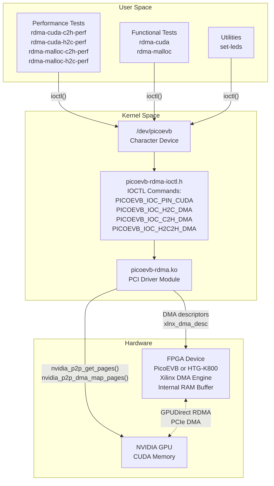
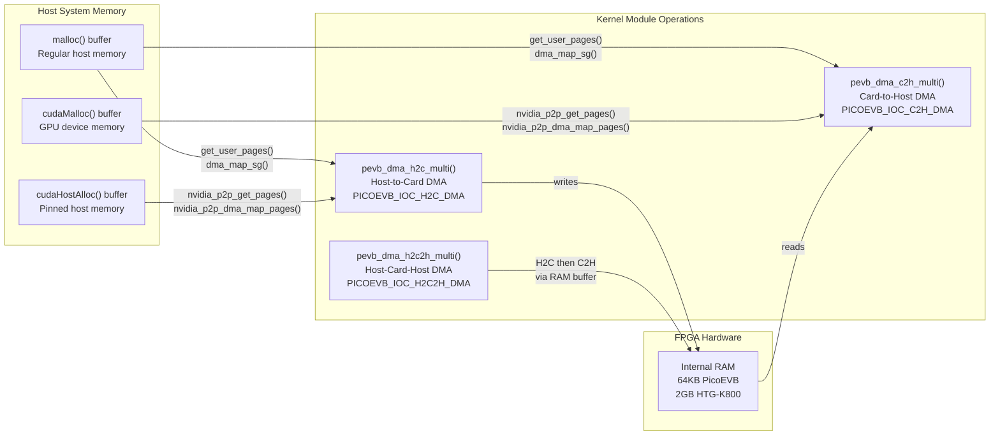
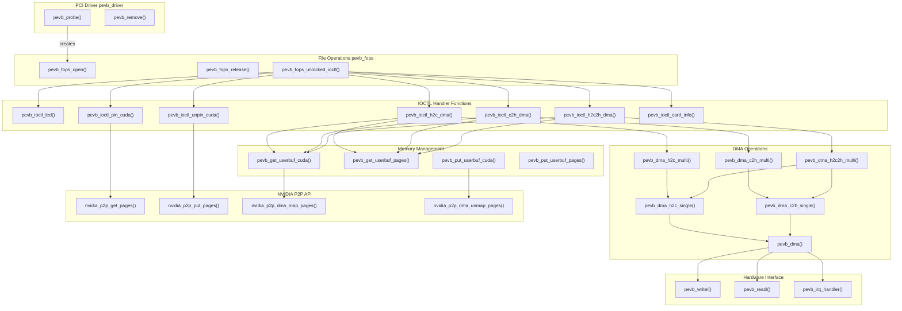
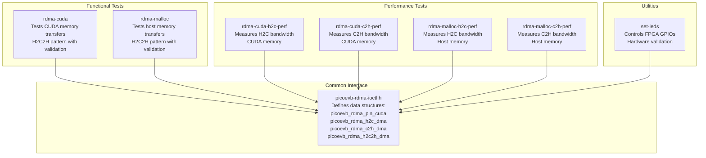
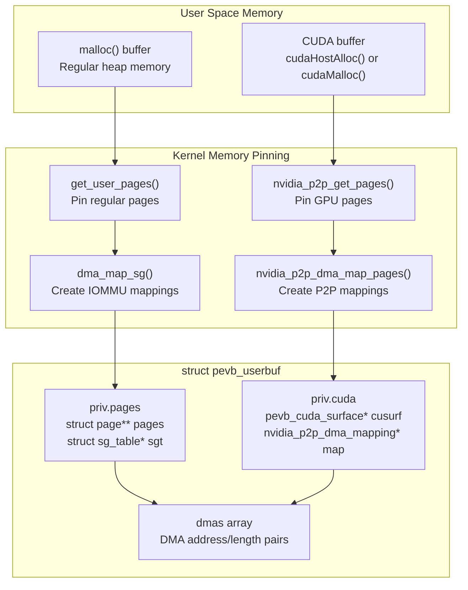

<!-- source: DeepWiki mcp.deepwiki.com · repo NVIDIA/jetson-rdma-picoevb · page 1 Overview · fetched 2026-10-26 -->

# Overview

Relevant source files

The following files were used as context for generating this wiki page:

- [README.md](README.md)
- [kernel-module/picoevb-rdma.c](kernel-module/picoevb-rdma.c)

## Purpose and Scope

This document provides an introduction to the **jetson-rdma-picoevb** system, a hardware-based demonstration of NVIDIA GPUDirect RDMA technology. The system enables PCIe devices to directly access GPU memory, allowing zero-copy data transfer between CUDA-capable GPUs and FPGA hardware without CPU involvement.

This overview covers the system's purpose, architecture, major components, and supported hardware platforms. For detailed setup instructions, see [Getting Started](#2). For in-depth architectural concepts, see [System Architecture](#3). For component-specific documentation, see [Kernel Module](#4), [Client Applications](#5), and [FPGA Development](#6).

**Sources:** [README.md:1-15]()

## System Purpose

The jetson-rdma-picoevb system demonstrates **GPUDirect RDMA** (Remote Direct Memory Access), a technology that allows PCIe devices to read from and write to GPU memory directly without staging data through system memory or requiring CPU involvement. This enables:

- **Zero-copy data transfer** between GPU and PCIe devices
- **Reduced CPU overhead** by eliminating memory copy operations
- **Lower latency** by avoiding round-trips through system memory
- **Higher bandwidth utilization** through direct PCIe-to-GPU paths

The system uses FPGA boards as the PCIe device that performs DMA operations against CUDA-allocated memory. This serves as a reference implementation for developers building production systems that require high-performance GPU-to-hardware communication.

**Platform Support:**
- NVIDIA Jetson AGX Xavier (ARM64 with integrated GPU)
- NVIDIA Drive AGX Xavier (ARM64 with integrated GPU)
- x86 Linux PCs with Quadro or Tesla GPUs (discrete GPU)

**Sources:** [README.md:1-10](), [kernel-module/picoevb-rdma.c:26-32]()

## High-Level Architecture

**Sources:** [kernel-module/picoevb-rdma.c:37-72](), [kernel-module/picoevb-rdma-ioctl.h](), [README.md:12-15]()

## Major Components

The system consists of three primary software layers and two hardware components:

### Software Components

| Component | File/Module | Purpose |
|-----------|-------------|---------|
| **Kernel Module** | `picoevb-rdma.ko` | PCI driver that manages FPGA device, orchestrates DMA operations, and integrates with NVIDIA P2P API for GPU memory access |
| **IOCTL Interface** | `picoevb-rdma-ioctl.h` | Defines user-kernel API including data structures (`picoevb_rdma_pin_cuda`, `picoevb_rdma_h2c_dma`, etc.) and command codes |
| **Client Applications** | `rdma-cuda.cu`, `rdma-malloc.c`, performance tests, utilities | User-space applications for testing data integrity and measuring transfer performance |

### Hardware Components

| Component | Specification | Role |
|-----------|--------------|------|
| **FPGA Board** | PicoEVB (64KB RAM, M.2) or HTG-K800 (2GB RAM, PCIe x16) | Acts as PCIe device performing DMA; contains Xilinx DMA engine and internal RAM buffer |
| **GPU** | NVIDIA Jetson/Drive iGPU or Quadro/Tesla dGPU | Target for CUDA memory allocations; supports P2P peer-to-peer access |

**Sources:** [kernel-module/picoevb-rdma.c:51-71](), [README.md:22-82](), [kernel-module/picoevb-rdma-ioctl.h]()

## Data Transfer Patterns

The system implements three DMA transfer patterns, all using the FPGA's internal RAM as an intermediate buffer:

### Transfer Pattern Details

| Pattern | IOCTL Command | Function | Description |
|---------|---------------|----------|-------------|
| **H2C** | `PICOEVB_IOC_H2C_DMA` | `pevb_dma_h2c_multi()` | Host-to-Card: Transfers data from system memory to FPGA RAM |
| **C2H** | `PICOEVB_IOC_C2H_DMA` | `pevb_dma_c2h_multi()` | Card-to-Host: Transfers data from FPGA RAM to system memory |
| **H2C2H** | `PICOEVB_IOC_H2C2H_DMA` | `pevb_dma_h2c2h_multi()` | Host-Card-Host: Copies data from one system memory location to another via FPGA RAM |

The H2C2H pattern is used for functional validation tests as it exercises both read and write paths in a single operation. The FPGA RAM size determines the maximum chunk size for each DMA operation: 64KB for PicoEVB, 2GB for HTG-K800.

**Sources:** [kernel-module/picoevb-rdma.c:679-908](), [kernel-module/picoevb-rdma-ioctl.h](), [README.md:352-359]()

## Kernel Module Architecture

The kernel module `picoevb-rdma.ko` is implemented as a PCI driver registered via `pevb_driver`. Upon device probe, it creates a character device at `/dev/picoevb` and sets up the `pevb_fops` file operations structure. The module handles IOCTL commands to pin CUDA memory (via `nvidia_p2p_get_pages()`), map it for DMA (via `nvidia_p2p_dma_map_pages()`), and execute DMA transfers using Xilinx DMA engine registers.

**Sources:** [kernel-module/picoevb-rdma.c:137-1312](), [kernel-module/picoevb-rdma.c:1131-1136](), [kernel-module/picoevb-rdma.c:1273-1279]()

## Supported Hardware

### FPGA Boards

| Board | Form Factor | FPGA | RAM Size | Programming | Vivado Version |
|-------|-------------|------|----------|-------------|----------------|
| **PicoEVB** | M.2 (requires adapter for Jetson/PC) | Xilinx Artix-7 | 64 KB | USB via xvcd | 2018.3 |
| **HTG-K800** | PCIe x16 card | Xilinx XCKU-60 Kintex UltraScale | 2 GB | JTAG via Xilinx Platform Cable | 2018.1 |

### Host Platforms

| Platform | Architecture | GPU Type | Memory Allocation | Build Script |
|----------|--------------|----------|-------------------|--------------|
| **Jetson AGX Xavier** | ARM64 | Integrated GPU (iGPU) | `cudaHostAlloc()` - unified memory | `build-for-jetson-drive-igpu-native.sh` |
| **Drive AGX Xavier** | ARM64 | Integrated GPU (iGPU) | `cudaHostAlloc()` - unified memory | `build-for-jetson-drive-igpu-native.sh` |
| **x86 Linux PC** | x86_64 | Discrete GPU (dGPU) - Quadro/Tesla | `cudaMalloc()` - device memory | `build-for-pc-native.sh` |

The key architectural difference between platforms is the GPU memory model:
- **Integrated GPUs (iGPU):** Use unified memory accessible by both CPU and GPU; applications use `cudaHostAlloc()` to allocate pinned host memory
- **Discrete GPUs (dGPU):** Use separate device memory; applications use `cudaMalloc()` to allocate GPU memory, controlled by `NV_BUILD_DGPU` compile flag

**Sources:** [README.md:22-92](), [kernel-module/picoevb-rdma.c:42-49](), [kernel-module/picoevb-rdma.c:1248-1256]()

## Client Application Suite

The system includes several user-space applications for testing and benchmarking:

**Application Descriptions:**

- **rdma-cuda / rdma-malloc:** Functional tests that perform H2C2H transfers to validate data integrity. They fill source memory with a pattern, execute the transfer, and verify the destination matches.

- **rdma-cuda-*-perf / rdma-malloc-*-perf:** Performance benchmarks that measure unidirectional H2C or C2H bandwidth. They report transfer time and throughput in MB/s.

- **set-leds:** Hardware control utility that sets GPIO values controlling LEDs on the PicoEVB board for basic hardware validation.

All applications communicate with the kernel module through `ioctl()` calls on `/dev/picoevb`, using data structures defined in `picoevb-rdma-ioctl.h`.

**Sources:** [README.md:325-383](), [client-applications/]()

## Memory Management Model

The kernel module handles two distinct memory types through a unified interface (`pevb_userbuf`):

**Memory Handling Functions:**

| Memory Type | Pin Function | Unpin Function | Key Operations |
|-------------|--------------|----------------|----------------|
| **Regular (malloc)** | `pevb_get_userbuf_pages()` | `pevb_put_userbuf_pages()` | `get_user_pages()`, `sg_alloc_table_from_pages()`, `dma_map_sg()` |
| **CUDA (GPU)** | `pevb_get_userbuf_cuda()` | `pevb_put_userbuf_cuda()` | `nvidia_p2p_get_pages()`, `nvidia_p2p_dma_map_pages()` |

Both paths populate a `pevb_userbuf` structure containing an array of DMA address/length pairs (`pevb_userbuf_dma`), which are then used to construct Xilinx DMA descriptors (`xlnx_dma_desc`). The module handles transfer chunking when memory is not contiguous or when FPGA RAM size limits apply.

**Sources:** [kernel-module/picoevb-rdma.c:90-117](), [kernel-module/picoevb-rdma.c:356-527](), [kernel-module/picoevb-rdma.h]()

## Next Steps

- **To set up the system:** See [Getting Started](#2) for hardware setup, software installation, and quick start instructions
- **To understand DMA operations:** See [System Architecture](#3) for RDMA fundamentals and data flow details
- **To develop with the kernel module:** See [Kernel Module](#4) for API reference and implementation details
- **To build and run tests:** See [Client Applications](#5) and [Building and Deployment](#7)
- **To modify FPGA bitstreams:** See [FPGA Development](#6) for Vivado project structure and synthesis procedures

**Sources:** [README.md:1-384]()

---

