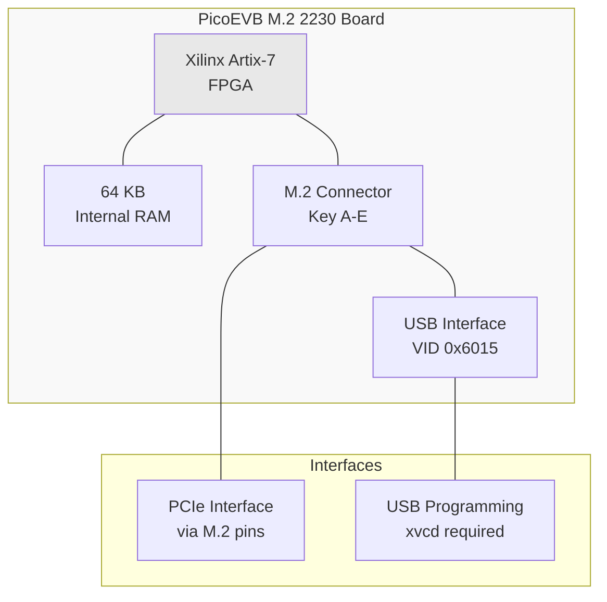
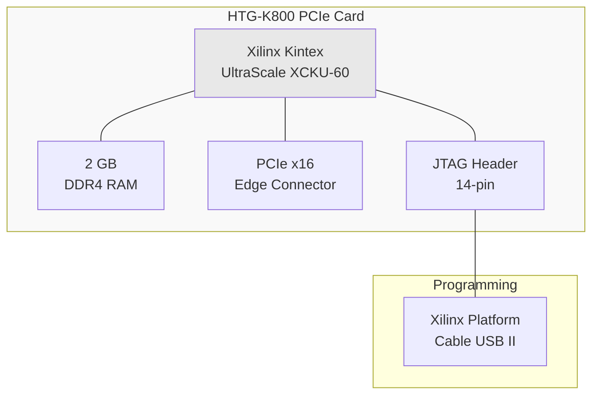
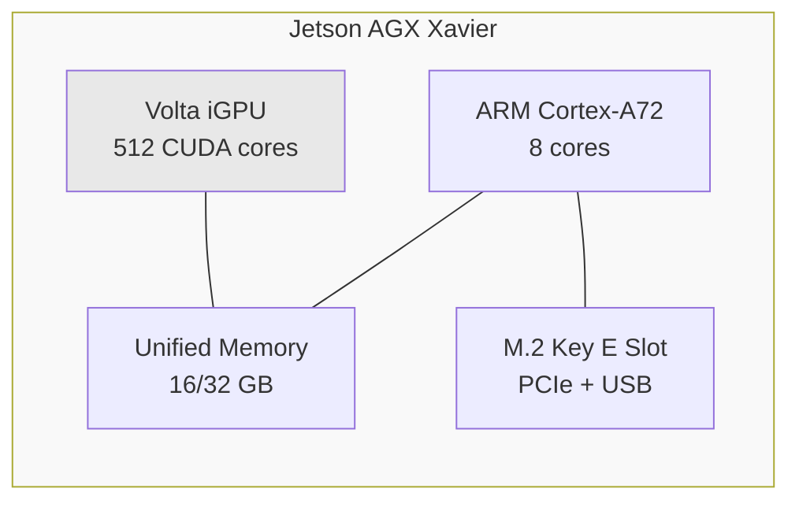
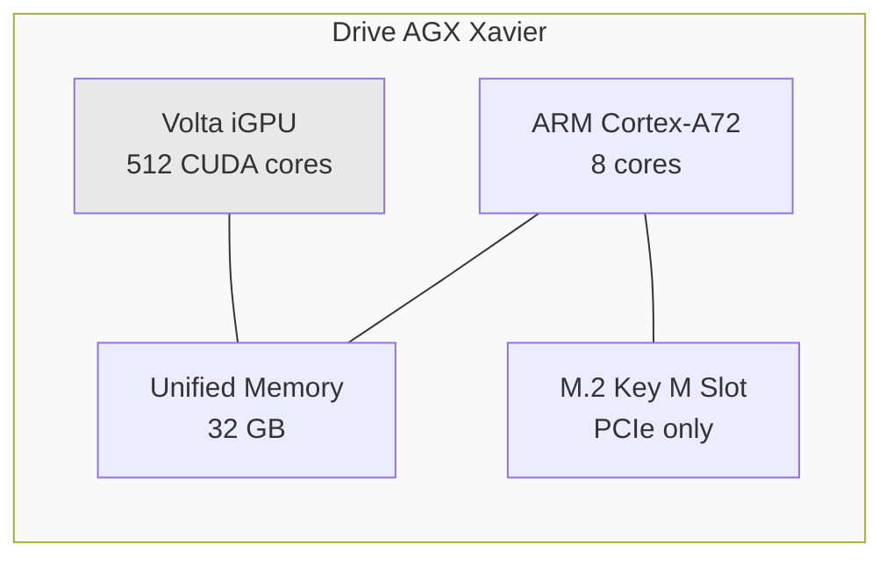
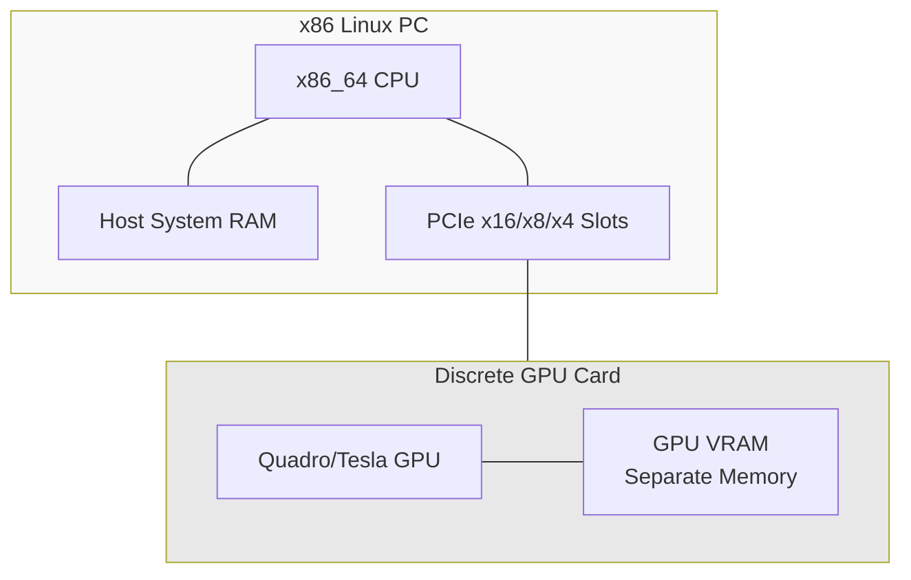
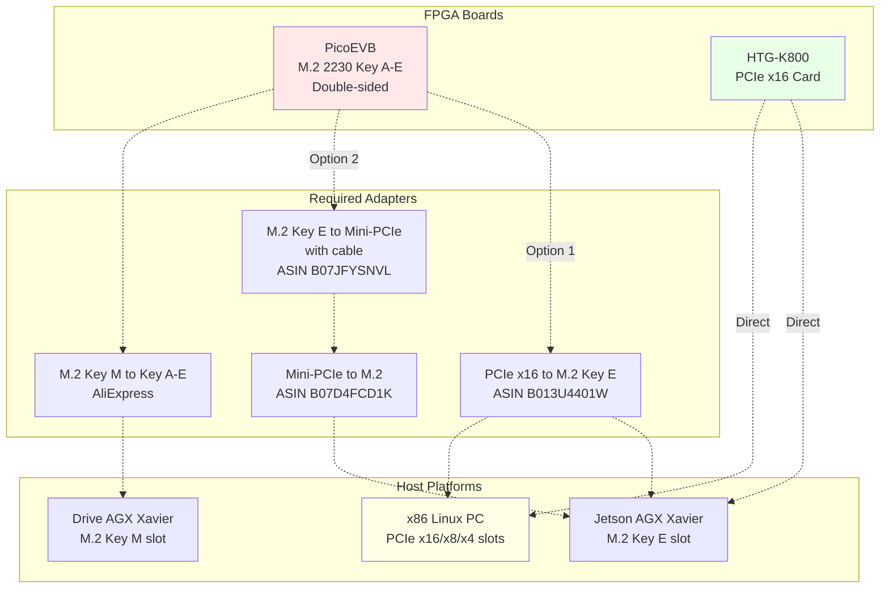
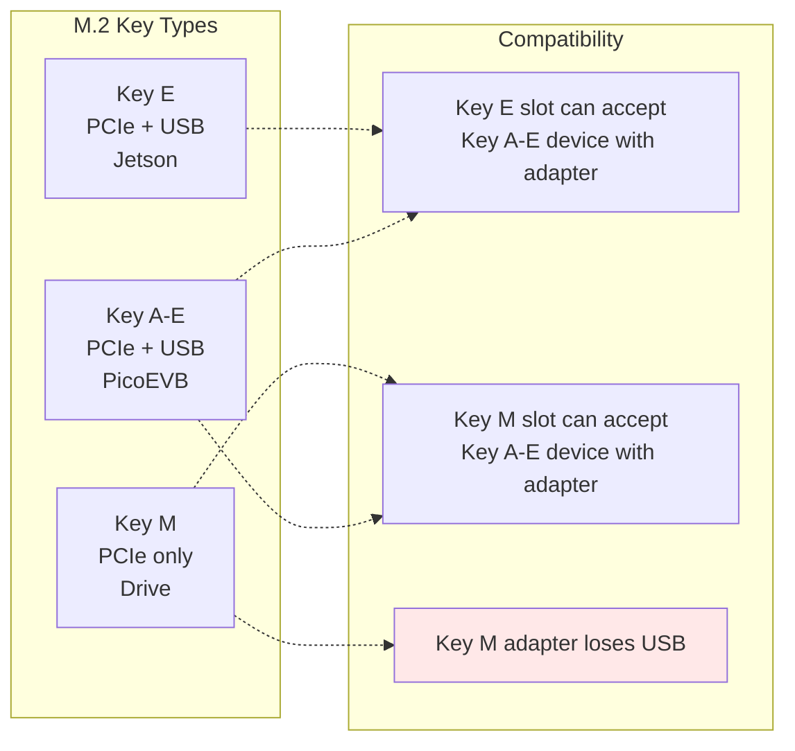

<!-- source: DeepWiki mcp.deepwiki.com · repo NVIDIA/jetson-rdma-picoevb · page 1.2 Hardware Compatibility · fetched 2026-10-26 -->

# Hardware Compatibility

<details>
<summary>Relevant source files</summary>

The following files were used as context for generating this wiki page:

- [README.md](README.md)

</details>


This page documents the hardware components supported by the jetson-rdma-picoevb system, including FPGA boards, host platforms, and required adapters. It provides technical specifications and connection requirements for each supported configuration.

For information about software build configurations for different platforms, see [Build System Overview](#7.1). For FPGA programming procedures, see [Programming FPGAs](#6.3). For detailed setup instructions, see [Hardware Setup](#2.1).

---

## Supported FPGA Boards

The system supports two FPGA boards with distinct characteristics and use cases:

### FPGA Board Specifications

| Specification | PicoEVB | HTG-K800 |
|--------------|---------|----------|
| **Form Factor** | M.2 2230 (double-sided) | PCIe x16 Card |
| **FPGA** | Xilinx Artix-7 | Xilinx Kintex UltraScale XCKU-60 |
| **Onboard RAM** | 64 KB | 2 GB |
| **PCIe Interface** | Via M.2 connector | Direct PCIe x16 |
| **Programming Interface** | USB (via M.2 connector) | JTAG (Xilinx Platform Cable USB II) |
| **Vivado Version** | 2018.3 | 2018.1 |
| **Project Directory** | `fpga-picoevb/` | `fpga-htg-k800/` |
| **Bitstream File** | `fpga-picoevb/*.mcs.bz2` | `fpga-htg-k800/*.mcs.bz2` |

**Sources:** [README.md:23-26](), [README.md:29-92](), [README.md:103-106]()

---

### PicoEVB Board



**PicoEVB Characteristics:**
- **Vendor:** RHS Research LLC
- **Availability:** picoevb.com, Amazon (ASIN B0779PC8S4)
- **Physical Size:** M.2 2230 (22mm x 30mm), double-sided
- **Programming:** Requires `xvcd` daemon for USB-based JTAG
- **USB Product ID:** `0x6015` (for programming)
- **RAM Limitation:** 64 KB constrains DMA transfer chunking strategy
- **Mechanical Note:** Double-sided design requires special adapters for single-sided M.2 slots

**Sources:** [README.md:29-73](), [README.md:109-120](), [README.md:176-178]()

---

### HTG-K800 Board



**HTG-K800 Characteristics:**
- **Vendor:** HiTech Global
- **Availability:** hitechglobal.com
- **Physical Size:** Full-height, full-length PCIe card
- **Programming:** Xilinx Platform Cable USB II (HW-USB-II-G)
- **FPGA Support:** XCKU-60 default, easily changed in Vivado project
- **RAM Advantage:** 2 GB allows larger DMA transfers without chunking
- **Mechanical Note:** Fits directly into PCIe x16 slots without adapters

**Sources:** [README.md:75-91](), [README.md:193-205]()

---

## Supported Host Platforms

The system supports three distinct host platform categories, each with specific GPU architectures and memory models:

### Host Platform Specifications

| Platform | Architecture | GPU Type | GPU Memory Model | M.2/PCIe Interface | Build Script Identifier |
|----------|--------------|----------|------------------|-------------------|-------------------------|
| **Jetson AGX Xavier** | ARM64 (aarch64) | iGPU (Integrated) | Unified Memory | M.2 Key E | `jetson-drive-igpu` |
| **Drive AGX Xavier** | ARM64 (aarch64) | iGPU (Integrated) | Unified Memory | M.2 Key M | `jetson-drive-igpu` |
| **x86 Linux PC** | x86_64 | dGPU (Discrete) | Separate Device Memory | PCIe x1/x4/x8/x16 | `pc` |

**Sources:** [README.md:8-10](), [README.md:211-322]()

---

### Platform-Specific Details

#### NVIDIA Jetson AGX Xavier



**Jetson Platform Details:**
- **Operating System:** Linux for Tegra (L4T)
- **GPU Architecture:** Integrated (iGPU) - shares system memory
- **CUDA API:** Uses `cudaHostAlloc()` for unified memory allocation
- **M.2 Slot:** Key E, supports PCIe + USB
- **PCI Domain:** Typically `0003:01:00.0` for PCIe devices
- **Build Mode:** Native ARM64 compilation or cross-compilation from x86
- **Kernel Headers:** Located in `/usr/src/` on device
- **USB Support:** Available for PicoEVB programming via xvcd

**Sources:** [README.md:8](), [README.md:211-220](), [README.md:268-278]()

---

#### NVIDIA Drive AGX Xavier



**Drive Platform Details:**
- **Operating System:** Embedded Linux (Drive OS)
- **GPU Architecture:** Integrated (iGPU) - shares system memory
- **CUDA API:** Uses `cudaHostAlloc()` for unified memory allocation
- **M.2 Slot:** Key M, PCIe only (no USB)
- **Programming Limitation:** Cannot program PicoEVB while connected (no USB)
- **Workaround:** Program PicoEVB on separate system, then connect to Drive
- **Build Mode:** Native ARM64 compilation or cross-compilation from x86

**Sources:** [README.md:9](), [README.md:63-69](), [README.md:117-120]()

---

#### x86 Linux PC with Discrete GPU



**x86 PC Platform Details:**
- **Operating System:** Standard Linux distribution (Ubuntu, etc.)
- **GPU Architecture:** Discrete (dGPU) - separate GPU memory
- **CUDA API:** Uses `cudaMalloc()` for device memory allocation
- **Compilation Flag:** `NV_BUILD_DGPU` defined during build
- **PCIe Slots:** Multiple slots available for FPGA and GPU cards
- **GPU Types:** NVIDIA Quadro or Tesla required for P2P support
- **Build Mode:** Native x86_64 compilation
- **USB Support:** Available for PicoEVB programming via xvcd

**Sources:** [README.md:10](), [README.md:246-255](), [README.md:312-321]()

---

## Physical Connection Requirements

Different host platforms require different adapter configurations to connect FPGA boards:

### Connection Topology Diagram



**Sources:** [README.md:40-73]()

---

### PicoEVB Connection Options

#### Option 1: PCIe Slot Adapter (Jetson or PC)

**Components:**
- PicoEVB board
- PCIe x16/x8/x4/x2/x1 to M.2 Key E adapter
  - Example: Amazon ASIN B013U4401W
  - Product: "Sourcingbay M.2(NGFF) Wireless Card to PCI-e 1X Adapter"

**Advantages:**
- Single adapter required
- Direct PCIe slot connection
- Stable mechanical connection
- Suitable for both Jetson and PC

**Limitations:**
- Requires available PCIe slot on host
- Adapter availability varies by region/time

**Sources:** [README.md:47-50]()

---

#### Option 2: Mini-PCIe Chain (Jetson Only)

**Components:**
- PicoEVB board
- M.2 2230 Key E to Mini-PCIe adapter with cable
  - Example: Amazon ASIN B07JFYSNVL or B00JSBPF70
- Mini-PCIe to M.2 2230 adapter board
  - Example: Amazon ASIN B07D4FCD1K
  - Product: "HLT M.2 (NGFF) to mPCIe (PCIe+USB) Adapter"

**Advantages:**
- Connects to Jetson's native M.2 Key E slot
- Preserves USB functionality for programming

**Limitations:**
- Two adapters required (complexity)
- Cable length may introduce signal integrity concerns
- Adapter availability varies

**Sources:** [README.md:52-61]()

---

#### Option 3: Key M to Key A-E Adapter (Drive Only)

**Components:**
- PicoEVB board
- M.2 Key M to Key A-E adapter
  - Example: AliExpress
  - Product: "M.2 Wifi Adapter M.2 M Key to A+E Key Slot"

**Advantages:**
- Single adapter for Drive AGX Xavier
- Matches Drive's M.2 Key M connector

**Limitations:**
- **No USB support** - cannot program PicoEVB while connected to Drive
- Must program PicoEVB on different system first
- Adapter less commonly available

**Sources:** [README.md:63-69](), [README.md:117-120]()

---

### HTG-K800 Connection

**Direct Connection:**
- No adapters required
- Plugs directly into PCIe x16 slot
- Compatible with both Jetson AGX Xavier and x86 PC
- Standard full-height, full-length PCIe card form factor

**Mechanical Requirements:**
- PCIe x16 slot (also works in x8/x4 with reduced lanes)
- Adequate chassis clearance for full-length card
- Slot bracket screw for mechanical stability

**Sources:** [README.md:78-81]()

---

## Platform Compatibility Matrix

### FPGA Board to Host Platform Compatibility

| FPGA Board | Jetson AGX Xavier | Drive AGX Xavier | x86 Linux PC | Notes |
|------------|-------------------|------------------|--------------|-------|
| **PicoEVB** | ✓ With adapter | ✓ With adapter (no USB) | ✓ With adapter | Requires M.2 adapter |
| **HTG-K800** | ✓ Direct | ✗ Not tested | ✓ Direct | Direct PCIe connection |

**Sources:** [README.md:22-92]()

---

### Programming Method by Configuration

```mermaid
graph TB
    subgraph Config1["PicoEVB on Jetson"]
        PEJ["PicoEVB Board"]
        XVCDJ["xvcd on Jetson<br/>USB 0x6015"]
        VIVADOJ["Vivado on x86 PC<br/>SSH tunnel<br/>port 2542"]
    end
    
    subgraph Config2["PicoEVB on Drive"]
        PED["PicoEVB Board"]
        NOTE1["⚠ Cannot program<br/>No USB on M.2 Key M"]
        WORKA["Program on Jetson/PC<br/>then connect to Drive"]
    end
    
    subgraph Config3["PicoEVB on PC"]
        PEP["PicoEVB Board"]
        XVCDP["xvcd on PC<br/>USB 0x6015"]
        VIVADOP["Vivado on same PC<br/>localhost:2542"]
    end
    
    subgraph Config4["HTG-K800 on Any Platform"]
        HTGB["HTG-K800 Board"]
        JTAG["Xilinx Platform<br/>Cable USB II"]
        VIVADOH["Vivado on x86 PC<br/>Direct JTAG"]
    end
    
    PEJ --- XVCDJ
    XVCDJ --- VIVADOJ
    
    PED --- NOTE1
    NOTE1 --- WORKA
    
    PEP --- XVCDP
    XVCDP --- VIVADOP
    
    HTGB --- JTAG
    JTAG --- VIVADOH
    
    style NOTE1 fill:#ffe8e8
    style WORKA fill:#fff8e8
```



**Sources:** [README.md:163-205]()

---

### PCI Device Identification

When loaded, the `picoevb-rdma.ko` module binds to the FPGA device:

**Expected `lspci` Output:**
```
0003:01:00.0 Memory controller: NVIDIA Corporation Device 0001
	Subsystem: NVIDIA Corporation Device 0001
	Flags: bus master, fast devsel, latency 0, IRQ 36
	Memory at 34210000 (32-bit, non-prefetchable) [size=4K]
	Memory at 34200000 (32-bit, non-prefetchable) [size=64K]
	Capabilities: <access denied>
	Kernel driver in use: picoevb-rdma
```

**PCI Configuration Details:**
- **Vendor ID:** NVIDIA Corporation (reused for FPGA device)
- **Device ID:** `0x0001`
- **Class:** Memory controller
- **BAR0:** 4 KB (control registers)
- **BAR1:** 64 KB (data buffer)
- **Driver:** `picoevb-rdma`

**Sources:** [README.md:268-278]()

---

## Hardware Limitations and Design Constraints

### RAM Size Impact on DMA Strategy

| FPGA Board | RAM Size | Transfer Strategy | Impact on Code |
|------------|----------|-------------------|----------------|
| PicoEVB | 64 KB | Chunked transfers | Driver divides large transfers into 64 KB chunks |
| HTG-K800 | 2 GB | Large block transfers | Can handle multi-megabyte transfers without chunking |

**Chunking Implementation:**
The kernel driver at [kernel-module/picoevb-rdma.c]() implements transfer chunking to accommodate the 64 KB RAM limitation on PicoEVB. For H2C2H transfers, data flow is:
1. Host → FPGA RAM (64 KB chunk)
2. FPGA RAM → Host (64 KB chunk)
3. Repeat for next chunk until complete

**Sources:** [README.md:352-359]()

---

### M.2 Key Type Compatibility



**Key Type Details:**
- **Key E:** 2230 size, PCIe + USB signals, used by Jetson AGX Xavier
- **Key M:** 2280 size, PCIe + SATA signals (no USB), used by Drive AGX Xavier
- **Key A-E:** Universal notching, PCIe + USB, used by PicoEVB
- **Consequence:** Drive AGX Xavier cannot program PicoEVB while connected

**Sources:** [README.md:42-69](), [README.md:117-120]()

---

## Software Compatibility Considerations

### Build Script to Platform Mapping

| Build Script | Target Platform | GPU Type | CUDA Memory API |
|--------------|----------------|----------|-----------------|
| `build-for-jetson-drive-igpu-native.sh` | Jetson/Drive (native) | iGPU | `cudaHostAlloc()` |
| `build-for-jetson-drive-igpu-on-pc.sh` | Jetson/Drive (cross) | iGPU | `cudaHostAlloc()` |
| `build-for-pc-native.sh` | x86 PC | dGPU | `cudaMalloc()` with `NV_BUILD_DGPU` |

**iGPU vs dGPU Implications:**
- **iGPU (Jetson/Drive):** Unified memory architecture, CUDA memory directly accessible by CPU
- **dGPU (PC):** Separate GPU memory, requires explicit memory mapping for P2P access
- **Code Impact:** Conditional compilation in [client-applications/rdma-cuda.cu]() based on `NV_BUILD_DGPU`

**Sources:** [README.md:211-322](), Diagram 6 from high-level architecture

---

## Adapter Procurement Notes

**Adapter Availability Disclaimer:**
The adapters listed in this documentation are examples based on products available at the time of writing. Product availability, vendor sources, and ASIN codes change frequently.

**Search Strategy:**
When searching for adapters, use these technical specifications:
- M.2 form factor and key type (E, M, A-E)
- PCIe signal support required
- USB signal support (if needed for programming)
- Cable vs. card-to-card adapter
- Size constraints (2230, 2242, 2280)

**Alternative Sources:**
- Amazon (various regions)
- AliExpress
- Newegg
- eBay
- Specialized electronics distributors

**Sources:** [README.md:71-73]()

---

## Summary of Hardware Requirements

To deploy the jetson-rdma-picoevb system, you need:

**Minimum Configuration:**
1. **FPGA Board:** PicoEVB or HTG-K800
2. **Host Platform:** Jetson AGX Xavier, Drive AGX Xavier, or x86 PC with CUDA GPU
3. **Adapters:** Platform-specific adapters for PicoEVB (HTG-K800 requires none)
4. **Programming Tools:**
   - PicoEVB: xvcd + Vivado (USB-based JTAG)
   - HTG-K800: Xilinx Platform Cable USB II + Vivado

**For Development:**
- x86 Linux PC with Vivado 2018.1/2018.3
- CUDA Toolkit on target platform
- Kernel headers for driver compilation
- Build tools (gcc, make, bc)

**Sources:** [README.md:1-384]()

---

