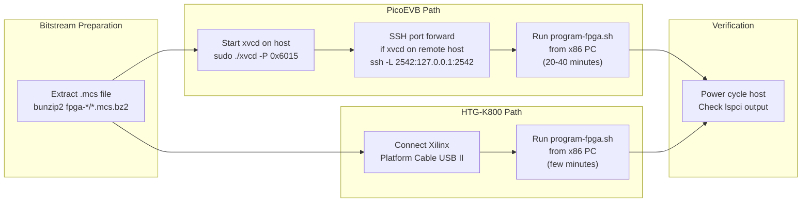
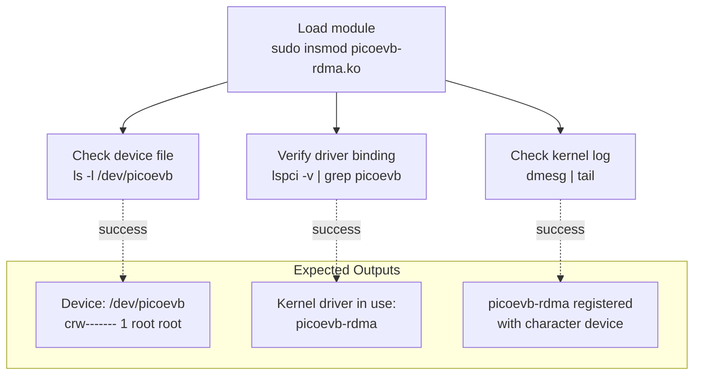

<!-- source: DeepWiki mcp.deepwiki.com · repo NVIDIA/jetson-rdma-picoevb · page 2 Getting Started · fetched 2026-10-26 -->

# Getting Started

<details>
<summary>Relevant source files</summary>

The following files were used as context for generating this wiki page:

- [README.md](README.md)

</details>


This page provides a practical guide for setting up the jetson-rdma-picoevb system from initial hardware installation to running your first tests. It covers the complete workflow including hardware connections, software installation, FPGA programming, kernel module loading, and test execution.

For detailed hardware specifications and adapter requirements, see [Hardware Compatibility](#1.2). For comprehensive build instructions and cross-compilation options, see [Building and Deployment](#7). For test execution details and performance analysis, see [Testing and Validation](#8).

## Setup Workflow Overview

The complete system setup follows a specific sequence of steps across three domains: hardware installation, FPGA programming, and software deployment.

**Setup Workflow Diagram**

```mermaid
graph TB
    subgraph "Phase 1: Hardware Installation"
        HW1["Install FPGA board<br/>(PicoEVB or HTG-K800)"]
        HW2["Connect adapters<br/>if required"]
        HW3["Verify PCIe detection<br/>lspci command"]
    end
    
    subgraph "Phase 2: FPGA Programming"
        FPGA1["Install Vivado<br/>2018.1 or 2018.3"]
        FPGA2["Extract bitstream<br/>fpga-*/&#42;.mcs.bz2"]
        FPGA3["Run xvcd<br/>(PicoEVB only)"]
        FPGA4["Execute<br/>program-fpga.sh"]
    end
    
    subgraph "Phase 3: Software Build"
        SW1["Install prerequisites<br/>build-essential, bc"]
        SW2["Build kernel module<br/>build-for-*-native.sh"]
        SW3["Build applications<br/>build-for-*-native.sh"]
    end
    
    subgraph "Phase 4: Module Loading"
        MOD1["Load module<br/>sudo insmod picoevb-rdma.ko"]
        MOD2["Verify /dev/picoevb<br/>device file exists"]
        MOD3["Check lspci -v<br/>driver binding"]
    end
    
    subgraph "Phase 5: Test Execution"
        TEST1["Run functional test<br/>sudo ./rdma-cuda"]
        TEST2["Run performance test<br/>sudo ./rdma-cuda-c2h-perf"]
        TEST3["Verify results"]
    end
    
    HW1 --> HW2
    HW2 --> HW3
    HW3 --> FPGA1
    
    FPGA1 --> FPGA2
    FPGA2 --> FPGA3
    FPGA3 --> FPGA4
    
    FPGA4 --> SW1
    SW1 --> SW2
    SW2 --> SW3
    
    SW3 --> MOD1
    MOD1 --> MOD2
    MOD2 --> MOD3
    
    MOD3 --> TEST1
    TEST1 --> TEST2
    TEST2 --> TEST3
```



**Sources**: [README.md:1-384]()

## Platform and Component Selection

Before beginning setup, identify your platform and FPGA board. The system supports three platform types and two FPGA boards with specific requirements.

| Platform | Architecture | GPU Type | Memory API | Build Script |
|----------|-------------|----------|------------|--------------|
| Jetson AGX Xavier | ARM64 | iGPU (integrated) | `cudaHostAlloc()` | `build-for-jetson-drive-igpu-native.sh` |
| Drive AGX Xavier | ARM64 | iGPU (integrated) | `cudaHostAlloc()` | `build-for-jetson-drive-igpu-native.sh` |
| x86 Linux PC | x86_64 | dGPU (discrete) | `cudaMalloc()` | `build-for-pc-native.sh` |

| FPGA Board | Form Factor | RAM Size | Programming Interface | Vivado Version | Bitstream Location |
|------------|-------------|----------|---------------------|----------------|-------------------|
| PicoEVB | M.2 (double-sided) | 64 KB | USB (via xvcd) | 2018.3 | `fpga-picoevb/*.mcs.bz2` |
| HTG-K800 | PCIe x16 card | 2 GB | JTAG (Xilinx cable) | 2018.1 | `fpga-htg-k800/*.mcs.bz2` |

**Sources**: [README.md:8-11](), [README.md:24-92](), [README.md:103-106]()

## Hardware Installation Process

The physical installation varies by platform and FPGA board. Detailed adapter requirements and mechanical considerations are documented in [Hardware Setup](#2.1).

### PicoEVB Installation on Jetson AGX Xavier

PicoEVB uses M.2 key E interface. Jetson's M.2 key E slot only supports single-sided devices, so a dual-adapter chain is required:

1. Connect M.2 key E to Mini-PCIe adapter with FFC cable (ASIN B07JFYSNVL or B00JSBPF70)
2. Connect Mini-PCIe to M.2 adapter board (ASIN B07D4FCD1K)
3. Insert PicoEVB into final adapter
4. Verify PCIe detection: `lspci | grep "Memory controller: NVIDIA"`

### PicoEVB Installation on Drive AGX Xavier

Drive's M.2 key M connector requires a single M.2 key M to key A-E adapter. Note that Drive's M.2 slot does not support USB, so the FPGA must be programmed on a different system before connection.

### HTG-K800 Installation

HTG-K800 uses standard PCIe x16 connector and inserts directly into any compatible slot on Jetson or PC systems.

**Sources**: [README.md:29-82]()

## Software Prerequisites Installation

All platforms require common build tools and platform-specific components.

### Common Prerequisites

```bash
sudo apt update
sudo apt install build-essential bc
```

### Vivado Installation (for FPGA programming)

Xilinx Vivado WebPACK Edition must be installed on an x86 Linux PC:

1. Download from [xilinx.com](https://www.xilinx.com/)
2. Install version 2018.3 for PicoEVB or 2018.1 for HTG-K800
3. Ensure `vivado` command is in `$PATH`

### xvcd Installation (PicoEVB only)

The Xilinx Virtual Cable Daemon enables FPGA programming via USB:

```bash
sudo apt install libftdi-dev
git clone https://github.com/RHSResearchLLC/xvcd.git
cd xvcd/linux/src
make
```

The resulting `xvcd` binary must run on the system where PicoEVB is physically connected.

### CUDA Development Tools

For Jetson/Drive systems, CUDA tools are typically pre-installed with L4T. For x86 PC systems, install NVIDIA CUDA Toolkit from [nvidia.com/cuda](https://developer.nvidia.com/cuda-downloads).

For kernel module compilation on Jetson/Drive, install kernel headers if not present:

```bash
# Headers typically located at /usr/src/linux-headers-$(uname -r)
ls /usr/src/
```

**Sources**: [README.md:95-135](), [README.md:215-219](), [README.md:285-290]()

## FPGA Programming Procedure

FPGA programming writes the hardware bitstream to the device. Pre-compiled bitstreams are provided and do not require regeneration unless modifying FPGA logic.

**FPGA Programming Flow**



### Programming PicoEVB

```bash
# On the system with PicoEVB connected (Jetson or PC)
cd /path/to/xvcd/linux/src
sudo ./xvcd -P 0x6015

# If xvcd runs on remote Jetson, forward port from x86 PC
ssh -L 2542:127.0.0.1:2542 jetson_ip_address

# On x86 PC with Vivado installed
cd /path/to/jetson-rdma-picoevb/fpga-picoevb/
bunzip2 -k *.mcs.bz2
./program-fpga.sh
# Wait 20-40 minutes; process appears hung but is running
```

### Programming HTG-K800

```bash
# On x86 PC with Vivado and Xilinx cable
cd /path/to/jetson-rdma-picoevb/fpga-htg-k800/
bunzip2 -k *.mcs.bz2
./program-fpga.sh
# Wait a few minutes
```

After programming, power cycle the host system to ensure proper PCIe enumeration.

**Sources**: [README.md:136-206]()

## Building Software Components

Software must be built for the target platform. Native builds compile on the target hardware; cross-compilation builds on x86 for ARM targets.

### Kernel Module Build

**On Jetson/Drive (native build):**

```bash
cd /path/to/jetson-rdma-picoevb/kernel-module/
./build-for-jetson-drive-igpu-native.sh
# Generates picoevb-rdma.ko
```

**On x86 PC for Jetson/Drive (cross-compile):**

```bash
cd /path/to/jetson-rdma-picoevb/kernel-module/
KDIR=/path/to/linux-headers-4.9.140-tegra/kernel-4.9/ \
  ./build-for-jetson-drive-igpu-on-pc.sh
# Generates picoevb-rdma.ko (copy to target)
```

**On x86 PC (native build):**

```bash
cd /path/to/jetson-rdma-picoevb/kernel-module/
./build-for-pc-native.sh
# Generates picoevb-rdma.ko
```

### Client Applications Build

**On Jetson/Drive (native build):**

```bash
cd /path/to/jetson-rdma-picoevb/client-applications/
./build-for-jetson-drive-igpu-native.sh
# Generates: rdma-cuda, rdma-malloc, rdma-*-perf, set-leds
```

**On x86 PC (native build):**

```bash
cd /path/to/jetson-rdma-picoevb/client-applications/
./build-for-pc-native.sh
# Generates: rdma-cuda, rdma-malloc, rdma-*-perf, set-leds
```

Note: Cross-compilation of CUDA applications from x86 to ARM64 is not fully supported by the provided scripts.

**Sources**: [README.md:211-256](), [README.md:280-322]()

## Module Loading and Verification

After building the kernel module, load it and verify proper binding to the FPGA device.

**Module Loading and Verification Process**



### Loading the Module

```bash
cd /path/to/jetson-rdma-picoevb/kernel-module/
sudo insmod ./picoevb-rdma.ko
```

### Verification Steps

**Check device file creation:**

```bash
ls -l /dev/picoevb
# Expected: crw------- 1 root root 240, 0 ... /dev/picoevb
```

**Verify driver binding:**

```bash
lspci -v | grep -A 10 "Memory controller: NVIDIA"
# Expected output includes:
#   Kernel driver in use: picoevb-rdma
```

Example output from [README.md:269-278]():

```
0003:01:00.0 Memory controller: NVIDIA Corporation Device 0001
	Subsystem: NVIDIA Corporation Device 0001
	Flags: bus master, fast devsel, latency 0, IRQ 36
	Memory at 34210000 (32-bit, non-prefetchable) [size=4K]
	Memory at 34200000 (32-bit, non-prefetchable) [size=64K]
	Capabilities: <access denied>
	Kernel driver in use: picoevb-rdma
```

**Check kernel messages:**

```bash
dmesg | tail -20
# Look for picoevb-rdma initialization messages
```

**Sources**: [README.md:257-278]()

## Running Initial Tests

After module loading, run functional and performance tests to verify system operation. Tests require root privileges or appropriate permissions on `/dev/picoevb`.

### Functional Tests

The functional tests perform bidirectional H2C2H transfers with data validation:

```bash
cd /path/to/jetson-rdma-picoevb/client-applications/

# Test with regular malloc'd memory
sudo ./rdma-malloc

# Test with CUDA memory
sudo ./rdma-cuda
```

**Test execution workflow (from [README.md:332-343]()):**

1. Allocate source and destination memory
2. Prepare CUDA memory with `cuPointerSetAttribute(CU_POINTER_ATTRIBUTE_SYNC_MEMOPS)` and pin via `PICOEVB_IOC_PIN_CUDA`
3. Fill source with known pattern
4. Fill destination with different values
5. Execute H2C2H DMA via `PICOEVB_IOC_H2C2H_DMA` ioctl
6. Validate destination matches source

### Performance Tests

Unidirectional bandwidth tests measure H2C and C2H transfer rates:

```bash
# Host-to-Card performance (malloc memory)
sudo ./rdma-malloc-h2c-perf

# Card-to-Host performance (malloc memory)
sudo ./rdma-malloc-c2h-perf

# Host-to-Card performance (CUDA memory)
sudo ./rdma-cuda-h2c-perf

# Card-to-Host performance (CUDA memory)
sudo ./rdma-cuda-c2h-perf
```

Tests output bandwidth in MB/s. See [Testing and Validation](#8) for detailed performance analysis and troubleshooting.

### Hardware Control Test

The LED control utility verifies basic hardware access:

```bash
sudo ./set-leds 2  # Turn on LED pattern
sudo ./set-leds 5  # Turn on different pattern
```

Parameter values 0-7 control three LEDs; hardware inverts the value (0=all on, 7=all off).

**Sources**: [README.md:323-384]()

## System Verification Checklist

After completing setup, verify all components are operational:

| Component | Verification Command | Expected Result |
|-----------|---------------------|-----------------|
| PCIe Detection | `lspci \| grep "Memory controller: NVIDIA"` | Device listed at specific bus address |
| Driver Binding | `lspci -v \| grep picoevb` | Shows "Kernel driver in use: picoevb-rdma" |
| Device File | `ls -l /dev/picoevb` | Character device exists with major 240 |
| Module Loaded | `lsmod \| grep picoevb` | Shows picoevb_rdma module |
| Basic Hardware Access | `sudo ./set-leds 0` | LEDs light up on PicoEVB |
| Functional Test | `sudo ./rdma-cuda` | Completes without errors |
| Performance Test | `sudo ./rdma-cuda-c2h-perf` | Reports bandwidth in MB/s |

**Sources**: [README.md:257-384]()

## Next Steps

After completing the setup and initial tests:

- For detailed hardware configuration and adapter selection, see [Hardware Setup](#2.1)
- For comprehensive software installation details, see [Software Prerequisites](#2.2)
- For a streamlined minimal example, see [Quick Start Guide](#2.3)
- For understanding the DMA transfer patterns, see [Data Transfer Patterns](#3.2)
- For kernel module internals and API details, see [Kernel Module](#4)
- For detailed test procedures and performance tuning, see [Testing and Validation](#8)

**Sources**: [README.md:1-384]()

---

