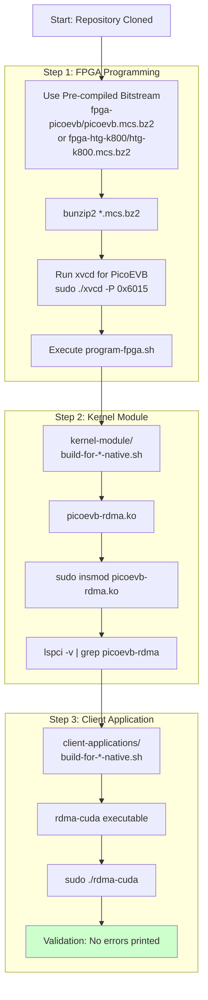
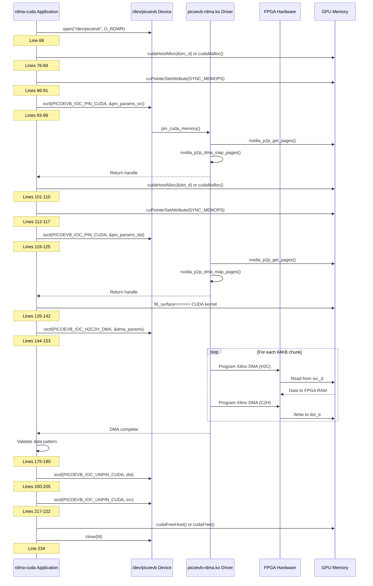

<!-- source: DeepWiki mcp.deepwiki.com · repo NVIDIA/jetson-rdma-picoevb · page 2.3 Quick Start Guide · fetched 2026-10-26 -->

# Quick Start Guide

<details>
<summary>Relevant source files</summary>

The following files were used as context for generating this wiki page:

- [README.md](README.md)
- [client-applications/rdma-cuda.cu](client-applications/rdma-cuda.cu)

</details>


This page provides a minimal working example to quickly set up and verify the jetson-rdma-picoevb system. It assumes you have completed hardware installation and installed software prerequisites. For detailed setup instructions, see [Hardware Setup](#2.1) and [Software Prerequisites](#2.2). For comprehensive build options and testing procedures, see [Building and Deployment](#7) and [Testing and Validation](#8).

## Prerequisites Summary

Before proceeding, ensure you have:

| Requirement | Status Check Command |
|-------------|---------------------|
| FPGA board physically installed | `lspci \| grep -i xilinx` or `lspci \| grep -i nvidia.*0001` |
| Kernel headers installed | `ls /usr/src/linux-headers-$(uname -r)` |
| CUDA toolkit installed | `nvcc --version` |
| Build tools installed | `gcc --version && make --version` |

**Sources:** [README.md:207-256]()

## Quick Start Workflow

The following diagram shows the minimal path from source code to a working test:



**Sources:** [README.md:136-206](), [README.md:211-256](), [README.md:282-321](), [README.md:323-347]()

## Step 1: Program the FPGA

### Using Pre-compiled Bitstream

A pre-compiled bitstream is provided to skip the synthesis step (which takes 5-60 minutes).

#### For PicoEVB

```bash
# Navigate to FPGA directory
cd /path/to/jetson-rdma-picoevb/fpga-picoevb/

# Decompress the bitstream
bunzip2 picoevb.mcs.bz2

# In one terminal, start xvcd (assuming PicoEVB is installed locally)
sudo /path/to/xvcd/xvcd -P 0x6015

# In another terminal, program the FPGA
# This takes 20-40 minutes and produces minimal output
./program-fpga.sh
```

#### For HTG-K800

```bash
# Navigate to FPGA directory
cd /path/to/jetson-rdma-picoevb/fpga-htg-k800/

# Decompress the bitstream
bunzip2 htg-k800.mcs.bz2

# Program the FPGA (requires Xilinx Platform Cable USB II)
# This takes a few minutes
./program-fpga.sh
```

**Note:** If programming on Jetson and running Vivado remotely, use SSH port forwarding:
```bash
ssh -L 2542:127.0.0.1:2542 ip_address_of_jetson
```

**Sources:** [README.md:136-206]()

## Step 2: Build and Load Kernel Module

### Choose Build Script by Platform

| Platform | Build Script | Notes |
|----------|--------------|-------|
| Jetson/Drive AGX Xavier (native) | `build-for-jetson-drive-igpu-native.sh` | iGPU support |
| x86 PC (native) | `build-for-pc-native.sh` | dGPU support |
| x86 PC (cross-compile) | `build-for-jetson-drive-igpu-on-pc.sh` | Requires L4T kernel headers |

### Build and Load

```bash
# Navigate to kernel module directory
cd /path/to/jetson-rdma-picoevb/kernel-module/

# Build the module (example for Jetson native)
./build-for-jetson-drive-igpu-native.sh

# Load the module
sudo insmod picoevb-rdma.ko

# Verify module is loaded and bound to FPGA device
lspci -v | grep -A 5 "Memory controller"
```

### Expected Output

The `lspci -v` command should show the kernel driver in use:

```
0003:01:00.0 Memory controller: NVIDIA Corporation Device 0001
	Subsystem: NVIDIA Corporation Device 0001
	Flags: bus master, fast devsel, latency 0, IRQ 36
	Memory at 34210000 (32-bit, non-prefetchable) [size=4K]
	Memory at 34200000 (32-bit, non-prefetchable) [size=64K]
	Kernel driver in use: picoevb-rdma
```

You should also see `/dev/picoevb` device file created:
```bash
ls -l /dev/picoevb
```

**Sources:** [README.md:211-278]()

## Step 3: Build and Run Test Application

### Build Client Applications

```bash
# Navigate to client applications directory
cd /path/to/jetson-rdma-picoevb/client-applications/

# Build applications (example for Jetson native)
./build-for-jetson-drive-igpu-native.sh
```

This generates several executables:
- `rdma-cuda` - Functional test using CUDA memory
- `rdma-malloc` - Functional test using host memory
- `rdma-cuda-c2h-perf` - Card-to-host performance benchmark
- `rdma-cuda-h2c-perf` - Host-to-card performance benchmark
- `rdma-malloc-c2h-perf` - Card-to-host performance (malloc)
- `rdma-malloc-h2c-perf` - Host-to-card performance (malloc)
- `set-leds` - Hardware control utility

**Sources:** [README.md:282-321]()

### Run Functional Test

The `rdma-cuda` test is recommended for initial verification:

```bash
sudo ./rdma-cuda
```

### Test Execution Flow

The following diagram shows the internal execution flow of `rdma-cuda` with actual IOCTL commands and code functions:



**Sources:** [client-applications/rdma-cuda.cu:52-241]()

### Expected Output

If the test succeeds, it produces **no output** and returns exit code 0:

```bash
sudo ./rdma-cuda
echo $?
# Should print: 0
```

If the test fails, it prints error messages to stderr:
- Memory allocation failures: `Allocation of src_d failed`
- IOCTL failures: `ioctl(PIN_CUDA src) failed`
- Data validation errors: `dst[0x1234] is 0xabcd not 0x5678`

**Sources:** [client-applications/rdma-cuda.cu:82-190](), [README.md:323-360]()

## Step 4: Verify with Performance Test

Run a performance test to measure bandwidth:

```bash
sudo ./rdma-cuda-c2h-perf
```

### Expected Performance Output

```
Transfer size: 4194304 bytes
Transfer time: 0.012345 seconds
Bandwidth: 339.87 MB/s
```

Typical bandwidth ranges:
- **PicoEVB**: 300-400 MB/s (limited by 64KB FPGA RAM requiring chunking)
- **HTG-K800**: Higher throughput possible with 2GB FPGA RAM

**Sources:** [README.md:361-371]()

## Troubleshooting Quick Checks

| Issue | Check Command | Resolution |
|-------|---------------|------------|
| FPGA not visible | `lspci \| grep -i memory` | Verify physical installation |
| Module not loading | `dmesg \| tail` | Check kernel version compatibility |
| Device file missing | `ls /dev/picoevb` | Module may not be loaded |
| Permission denied | `ls -l /dev/picoevb` | Run with `sudo` or adjust permissions |
| CUDA errors | `nvidia-smi` | Verify GPU is detected |

For detailed troubleshooting, see [Troubleshooting](#9).

## Next Steps

After successful quick start:

1. **Explore other tests** - Try `rdma-malloc` for non-CUDA transfers, see [Functional Tests](#5.2)
2. **Run benchmarks** - Measure H2C and C2H bandwidth, see [Performance Benchmarks](#5.3)
3. **Understand architecture** - Learn about DMA patterns, see [Data Transfer Patterns](#3.2)
4. **Develop applications** - Use the IOCTL interface, see [IOCTL Interface](#4.2)
5. **Modify FPGA** - Customize hardware logic, see [FPGA Development](#6)

**Sources:** [README.md:1-384]()

## File Organization Reference

The following table maps quick start steps to source directories:

| Component | Directory | Key Files |
|-----------|-----------|-----------|
| FPGA bitstreams | `fpga-picoevb/` or `fpga-htg-k800/` | `*.mcs.bz2`, `program-fpga.sh` |
| Kernel module | `kernel-module/` | `picoevb-rdma.c`, `build-for-*-native.sh` |
| Client applications | `client-applications/` | `rdma-cuda.cu`, `Makefile` |
| IOCTL interface | `kernel-module/` | `picoevb-rdma-ioctl.h` |

**Sources:** [README.md:136-384]()

---

