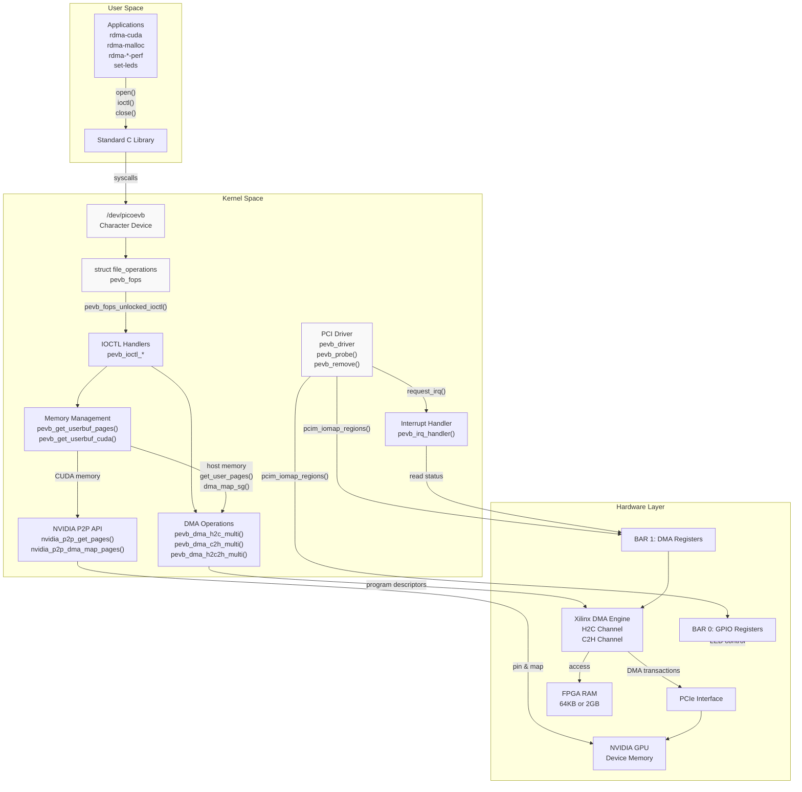
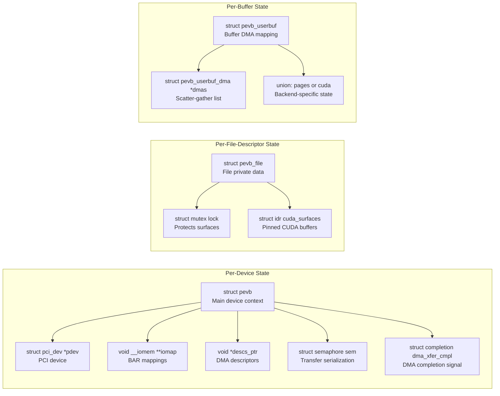
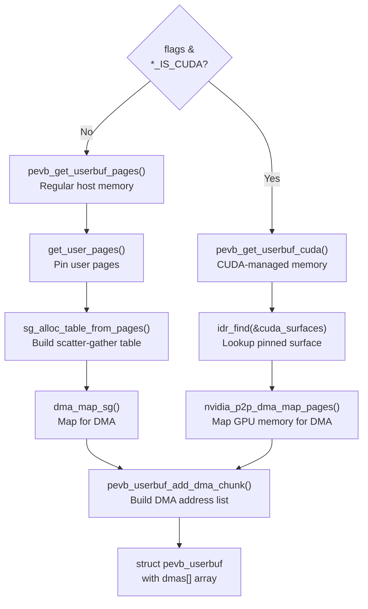
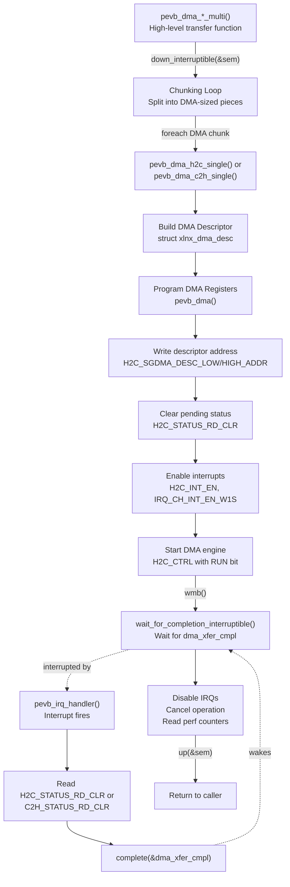
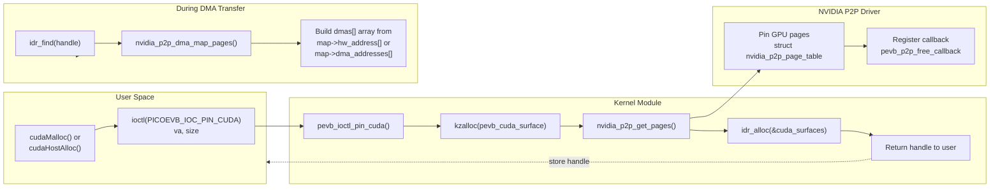
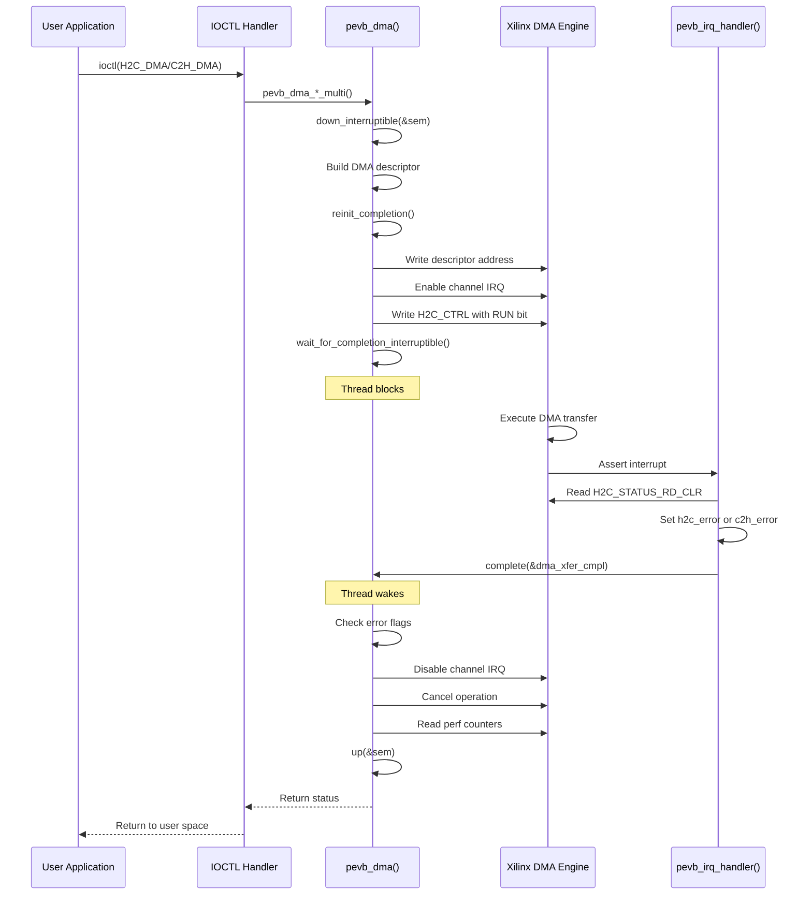

<!-- source: DeepWiki mcp.deepwiki.com · repo NVIDIA/jetson-rdma-picoevb · page 3 System Architecture · fetched 2026-10-26 -->

# System Architecture

<details>
<summary>Relevant source files</summary>

The following files were used as context for generating this wiki page:

- [kernel-module/picoevb-rdma.c](kernel-module/picoevb-rdma.c)
- [rdma-flow.svg](rdma-flow.svg)

</details>


This page provides a comprehensive overview of the jetson-rdma-picoevb system architecture, focusing on the interactions between user space applications, the kernel module, and hardware components. For detailed information about specific aspects, see:
- RDMA concepts and GPUDirect technology: [RDMA Fundamentals](#3.1)
- H2C, C2H, and H2C2H transfer mechanisms: [Data Transfer Patterns](#3.2)
- Memory pinning and mapping strategies: [Memory Management](#3.3)
- Kernel module implementation details: [Kernel Module](#4)
- Application programming interfaces: [Client Applications](#5)

## Three-Tier System Architecture

The system is organized into three distinct layers, each with well-defined responsibilities and interfaces.



**Sources:** [kernel-module/picoevb-rdma.c:1-1312]()

### User Space Layer

Applications interact with the kernel module exclusively through the character device `/dev/picoevb`. The character device is created during module initialization [kernel-module/picoevb-rdma.c:1188-1189]() and provides a file-based interface accessible via standard system calls.

| Component | Code Symbol | Purpose |
|-----------|-------------|---------|
| Character device node | `/dev/picoevb` | Entry point for user-space communication |
| Device class | `pevb_class` | Manages device node creation [kernel-module/picoevb-rdma.c:119]() |
| Character device | `struct cdev pevb->cdev` | Kernel representation [kernel-module/picoevb-rdma.c:63]() |
| Device number | `dev_t pevb->devt` | Major/minor number allocation [kernel-module/picoevb-rdma.c:62]() |

**Sources:** [kernel-module/picoevb-rdma.c:119](), [kernel-module/picoevb-rdma.c:56-71](), [kernel-module/picoevb-rdma.c:1175-1193]()

### Kernel Space Layer

The kernel module `picoevb-rdma.ko` implements a PCI device driver that manages DMA operations and integrates with NVIDIA's P2P API.

#### Core Data Structures



**Sources:** [kernel-module/picoevb-rdma.c:56-71](), [kernel-module/picoevb-rdma.c:73-77](), [kernel-module/picoevb-rdma.c:95-117]()

#### File Operations

The `pevb_fops` structure defines the character device interface:

```mermaid
graph TD
    open["pevb_fops_open()"]
    release["pevb_fops_release()"]
    ioctl["pevb_fops_unlocked_ioctl()"]
    
    open -->|"allocate"| pevb_file["struct pevb_file"]
    open -->|"initialize"| idr["idr_init(&cuda_surfaces)"]
    
    release -->|"iterate"| cuda_surfs["cuda_surfaces IDR"]
    release -->|"for each surface"| put_pages["nvidia_p2p_put_pages()"]
    release -->|"free"| pevb_file2["struct pevb_file"]
    
    ioctl -->|"PICOEVB_IOC_LED"| led["pevb_ioctl_led()"]
    ioctl -->|"PICOEVB_IOC_PIN_CUDA"| pin["pevb_ioctl_pin_cuda()"]
    ioctl -->|"PICOEVB_IOC_UNPIN_CUDA"| unpin["pevb_ioctl_unpin_cuda()"]
    ioctl -->|"PICOEVB_IOC_H2C_DMA"| h2c["pevb_ioctl_h2c_dma()"]
    ioctl -->|"PICOEVB_IOC_C2H_DMA"| c2h["pevb_ioctl_c2h_dma()"]
    ioctl -->|"PICOEVB_IOC_H2C2H_DMA"| h2c2h["pevb_ioctl_h2c2h_dma()"]
    ioctl -->|"PICOEVB_IOC_CARD_INFO"| info["pevb_ioctl_card_info()"]
```



**Sources:** [kernel-module/picoevb-rdma.c:1131-1136](), [kernel-module/picoevb-rdma.c:137-153](), [kernel-module/picoevb-rdma.c:176-217](), [kernel-module/picoevb-rdma.c:1104-1129]()

### Hardware Layer

The hardware layer consists of two primary components accessed via PCIe Base Address Registers (BARs):

| BAR | Symbol | Offset | Purpose |
|-----|--------|--------|---------|
| 0 | `BAR_GPIO` | `pevb->iomap[0]` | GPIO and LED control registers |
| 1 | `BAR_DMA` | `pevb->iomap[1]` | Xilinx DMA engine registers |

The Xilinx DMA engine provides separate H2C (Host-to-Card) and C2H (Card-to-Host) channels, each with its own control, status, and descriptor registers. Register definitions are located in [kernel-module/picoevb-rdma.h]().

**Sources:** [kernel-module/picoevb-rdma.c:39-40](), [kernel-module/picoevb-rdma.c:1201-1207]()

## IOCTL Command Processing Flow

The kernel module processes seven distinct IOCTL commands, each implementing a specific operation.

```mermaid
graph TB
    UserApp["User Application<br/>ioctl(fd, cmd, &params)"]
    
    Dispatch["pevb_fops_unlocked_ioctl()<br/>Command dispatch"]
    
    LED["PICOEVB_IOC_LED<br/>pevb_ioctl_led()"]
    PIN["PICOEVB_IOC_PIN_CUDA<br/>pevb_ioctl_pin_cuda()"]
    UNPIN["PICOEVB_IOC_UNPIN_CUDA<br/>pevb_ioctl_unpin_cuda()"]
    H2C["PICOEVB_IOC_H2C_DMA<br/>pevb_ioctl_h2c_dma()"]
    C2H["PICOEVB_IOC_C2H_DMA<br/>pevb_ioctl_c2h_dma()"]
    H2C2H["PICOEVB_IOC_H2C2H_DMA<br/>pevb_ioctl_h2c2h_dma()"]
    INFO["PICOEVB_IOC_CARD_INFO<br/>pevb_ioctl_card_info()"]
    
    UserApp --> Dispatch
    
    Dispatch --> LED
    Dispatch --> PIN
    Dispatch --> UNPIN
    Dispatch --> H2C
    Dispatch --> C2H
    Dispatch --> H2C2H
    Dispatch --> INFO
    
    LED -->|"pevb_writel()"| GPIORegs["BAR_GPIO + 0x00"]
    
    PIN -->|"nvidia_p2p_get_pages()"| P2PPin["Pin GPU memory"]
    PIN -->|"idr_alloc()"| StoreHandle["Store in cuda_surfaces"]
    
    UNPIN -->|"idr_find() + idr_remove()"| FindHandle["Lookup handle"]
    UNPIN -->|"nvidia_p2p_put_pages()"| P2PUnpin["Unpin GPU memory"]
    
    H2C -->|"pevb_get_userbuf_*()"| MapSrc["Map source buffer"]
    H2C -->|"pevb_dma_h2c_multi()"| TransferH2C["Execute H2C transfer"]
    
    C2H -->|"pevb_get_userbuf_*()"| MapDst["Map destination buffer"]
    C2H -->|"pevb_dma_c2h_multi()"| TransferC2H["Execute C2H transfer"]
    
    H2C2H -->|"pevb_get_userbuf_*()"| MapBoth["Map src & dst buffers"]
    H2C2H -->|"pevb_dma_h2c2h_multi()"| TransferH2C2H["Execute H2C2H transfer"]
    
    INFO -->|"copy_to_user()"| ReturnInfo["Return fpga_ram_size"]
```



**Sources:** [kernel-module/picoevb-rdma.c:1104-1129](), [kernel-module/picoevb-rdma-ioctl.h]()

### Memory Buffer Acquisition

Before DMA operations, the kernel must map user-space buffers into DMA-accessible addresses. The `pevb_get_userbuf_*` functions handle two distinct memory types:



**Sources:** [kernel-module/picoevb-rdma.c:417-485](), [kernel-module/picoevb-rdma.c:356-414](), [kernel-module/picoevb-rdma.c:334-353]()

## DMA Transfer Execution

DMA transfers are orchestrated through the Xilinx DMA engine, which operates on descriptor-based scatter-gather DMA.



**Sources:** [kernel-module/picoevb-rdma.c:790-848](), [kernel-module/picoevb-rdma.c:850-908](), [kernel-module/picoevb-rdma.c:679-702](), [kernel-module/picoevb-rdma.c:704-727](), [kernel-module/picoevb-rdma.c:570-677](), [kernel-module/picoevb-rdma.c:529-568]()

### DMA Descriptor Structure

Each DMA operation is described by a `struct xlnx_dma_desc` programmed into coherent memory:

| Field | Type | Purpose |
|-------|------|---------|
| `control` | `u32` | Control flags: MAGIC, EOP, COMPLETED, STOP |
| `len` | `u32` | Transfer length in bytes |
| `src_adr` / `src_adr_hi` | `u64` | Source address (PCIe or FPGA RAM) |
| `dst_adr` / `dst_adr_hi` | `u64` | Destination address (PCIe or FPGA RAM) |
| `nxt_adr` / `nxt_adr_hi` | `u64` | Next descriptor (unused, always 0) |

The descriptor is allocated once during probe via `dmam_alloc_coherent()` [kernel-module/picoevb-rdma.c:1167-1173]() and reused for all transfers.

**Sources:** [kernel-module/picoevb-rdma.h](), [kernel-module/picoevb-rdma.c:688-699](), [kernel-module/picoevb-rdma.c:713-724]()

## CUDA P2P Integration

For CUDA memory transfers, the kernel module uses NVIDIA's P2P API to pin and map GPU memory for DMA access.



**Sources:** [kernel-module/picoevb-rdma.c:228-295](), [kernel-module/picoevb-rdma.c:356-414](), [kernel-module/picoevb-rdma.c:156-173]()

### Platform-Specific Differences

The P2P API has different signatures and behaviors on iGPU (integrated GPU) vs. dGPU (discrete GPU) platforms, controlled by the `NV_BUILD_DGPU` compile-time flag:

| Aspect | iGPU (`linux/nv-p2p.h`) | dGPU (`nv-p2p.h`) |
|--------|--------------------------|-------------------|
| Header include | `#include <linux/nv-p2p.h>` [kernel-module/picoevb-rdma.c:30]() | `#include <nv-p2p.h>` [kernel-module/picoevb-rdma.c:28]() |
| Page size | 4KB (`GPU_PAGE_SHIFT = 12`) [kernel-module/picoevb-rdma.c:45]() | 64KB (`GPU_PAGE_SHIFT = 16`) [kernel-module/picoevb-rdma.c:43]() |
| `nvidia_p2p_get_pages()` signature | No PID/TID args [kernel-module/picoevb-rdma.c:254]() | Requires PID/TID (0, 0) [kernel-module/picoevb-rdma.c:250-254]() |
| `nvidia_p2p_dma_map_pages()` signature | Takes `struct device*` and direction [kernel-module/picoevb-rdma.c:382-383]() | Takes `struct pci_dev*` [kernel-module/picoevb-rdma.c:379-380]() |
| DMA address array | `map->hw_address[]` [kernel-module/picoevb-rdma.c:400]() | `map->dma_addresses[]` [kernel-module/picoevb-rdma.c:397]() |
| Callback behavior | Callback frees `cusurf` [kernel-module/picoevb-rdma.c:206-209]() | Must manually call callback [kernel-module/picoevb-rdma.c:204]() |

**Sources:** [kernel-module/picoevb-rdma.c:26-32](), [kernel-module/picoevb-rdma.c:42-49](), [kernel-module/picoevb-rdma.c:250-254](), [kernel-module/picoevb-rdma.c:379-411]()

## PCI Driver Initialization

The kernel module registers as a PCI driver and binds to specific vendor/device IDs.

```mermaid
graph TB
    ModInit["pevb_init()<br/>module_init"]
    ClassCreate["class_create('picoevb')"]
    PCIReg["pci_register_driver(&pevb_driver)"]
    
    Probe["pevb_probe()<br/>Called for matching device"]
    
    AllocPevb["devm_kzalloc(struct pevb)"]
    AllocDescs["dmam_alloc_coherent()<br/>DMA descriptor memory"]
    AllocChrdev["alloc_chrdev_region()"]
    CdevInit["cdev_init(&pevb->cdev)"]
    CdevAdd["cdev_add()"]
    DevCreate["device_create(pevb_class)"]
    
    EnablePCI["pcim_enable_device()"]
    MapBARs["pcim_iomap_regions()<br/>BAR_GPIO | BAR_DMA"]
    SetMaster["pci_set_master()<br/>pci_set_dma_mask(64-bit)"]
    ReqIRQ["request_irq(pevb_irq_handler)"]
    
    Remove["pevb_remove()<br/>Called at device removal"]
    FreeIRQ["free_irq()"]
    ClearMaster["pci_clear_master()"]
    DevDestroy["device_destroy()"]
    CdevDel["cdev_del()"]
    UnregChrdev["unregister_chrdev_region()"]
    
    ModInit --> ClassCreate
    ClassCreate --> PCIReg
    
    PCIReg -.->|"device found"| Probe
    
    Probe --> AllocPevb
    AllocPevb --> AllocDescs
    AllocDescs --> AllocChrdev
    AllocChrdev --> CdevInit
    CdevInit --> CdevAdd
    CdevAdd --> DevCreate
    DevCreate --> EnablePCI
    EnablePCI --> MapBARs
    MapBARs --> SetMaster
    SetMaster --> ReqIRQ
    
    ReqIRQ -.->|"device ready"| UserSpace["User space can open /dev/picoevb"]
    
    UserSpace -.->|"rmmod or device removal"| Remove
    
    Remove --> FreeIRQ
    FreeIRQ --> ClearMaster
    ClearMaster --> DevDestroy
    DevDestroy --> CdevDel
    CdevDel --> UnregChrdev
```



**Sources:** [kernel-module/picoevb-rdma.c:1281-1294](), [kernel-module/picoevb-rdma.c:1138-1230](), [kernel-module/picoevb-rdma.c:1232-1242]()

### Device Identification

The module supports two FPGA boards distinguished by PCI subsystem device ID:

```c
static const struct pci_device_id pevb_pci_ids[] = {
    PCI_ENTRY(0x0001, picoevb),     // 64KB FPGA RAM
    PCI_ENTRY(0x0002, htg_k800),    // 2GB FPGA RAM
    { },
};
```

Driver data specifies board-specific parameters:

| Board | Subsystem Device ID | `num_h2c_chans` | `fpga_ram_size` |
|-------|---------------------|-----------------|-----------------|
| PicoEVB | `0x0001` | 1 | `SZ_64K` (65536 bytes) |
| HTG-K800 | `0x0002` | 1 | `SZ_2G` (2147483648 bytes) |

**Sources:** [kernel-module/picoevb-rdma.c:1266-1271](), [kernel-module/picoevb-rdma.c:1248-1256]()

## System Resource Management

### Synchronization Primitives

The kernel module uses multiple synchronization mechanisms:

| Primitive | Symbol | Purpose | Scope |
|-----------|--------|---------|-------|
| Semaphore | `pevb->sem` | Serializes DMA operations [kernel-module/picoevb-rdma.c:65]() | Per-device |
| Completion | `pevb->dma_xfer_cmpl` | Waits for DMA completion [kernel-module/picoevb-rdma.c:68]() | Per-device |
| Mutex | `pevb_file->lock` | Protects CUDA surface IDR [kernel-module/picoevb-rdma.c:75]() | Per-file-descriptor |

The semaphore ensures only one DMA operation executes at a time, preventing concurrent access to shared hardware resources [kernel-module/picoevb-rdma.c:739](), [kernel-module/picoevb-rdma.c:800](), [kernel-module/picoevb-rdma.c:860]().

**Sources:** [kernel-module/picoevb-rdma.c:56-77](), [kernel-module/picoevb-rdma.c:1164]()

### Memory Allocation

| Resource | Allocation Function | Lifetime | Purpose |
|----------|---------------------|----------|---------|
| `struct pevb` | `devm_kzalloc()` [kernel-module/picoevb-rdma.c:1143]() | Device lifetime | Main device context |
| DMA descriptors | `dmam_alloc_coherent()` [kernel-module/picoevb-rdma.c:1167-1168]() | Device lifetime | Hardware-accessible descriptors |
| `struct pevb_file` | `kzalloc()` [kernel-module/picoevb-rdma.c:142]() | File descriptor lifetime | Per-open state |
| `struct pevb_cuda_surface` | `kzalloc()` [kernel-module/picoevb-rdma.c:239]() | Until unpinned or file close | Pinned CUDA buffer tracking |
| `struct pevb_userbuf.dmas` | `kmalloc_array()` [kernel-module/picoevb-rdma.c:388](), [kernel-module/picoevb-rdma.c:475]() | DMA operation duration | Scatter-gather DMA address list |

The use of managed allocation functions (`devm_*`, `dmam_*`) ensures automatic cleanup on device removal.

**Sources:** [kernel-module/picoevb-rdma.c:1143-1173](), [kernel-module/picoevb-rdma.c:142-144](), [kernel-module/picoevb-rdma.c:239-241]()

## Interrupt-Driven Completion

DMA transfers complete asynchronously via hardware interrupts.



**Sources:** [kernel-module/picoevb-rdma.c:570-677](), [kernel-module/picoevb-rdma.c:529-568](), [kernel-module/picoevb-rdma.c:589](), [kernel-module/picoevb-rdma.c:636]()

### Error Detection

The interrupt handler checks status register bits for error conditions:

```c
const u32 bad_status =
    (XLNX_DMA_H2C_STATUS_DESC_ERR_MASK << XLNX_DMA_H2C_STATUS_DESC_ERR_SHIFT) |
    (XLNX_DMA_H2C_STATUS_WRITE_ERR_MASK << XLNX_DMA_H2C_STATUS_WRITE_ERR_SHIFT) |
    (XLNX_DMA_H2C_STATUS_READ_ERR_MASK << XLNX_DMA_H2C_STATUS_READ_ERR_SHIFT) |
    XLNX_DMA_H2C_STATUS_IDLE_STOPPED |
    XLNX_DMA_H2C_STATUS_INVALID_LEN |
    XLNX_DMA_H2C_STATUS_MAGIC_STOPPED |
    XLNX_DMA_H2C_STATUS_ALIGN_MISMATCH;
```

Any of these bits being set indicates a transfer failure, causing the DMA operation to return `-EIO` [kernel-module/picoevb-rdma.c:640-644]().

**Sources:** [kernel-module/picoevb-rdma.c:534-544](), [kernel-module/picoevb-rdma.c:552](), [kernel-module/picoevb-rdma.c:562]()

---

