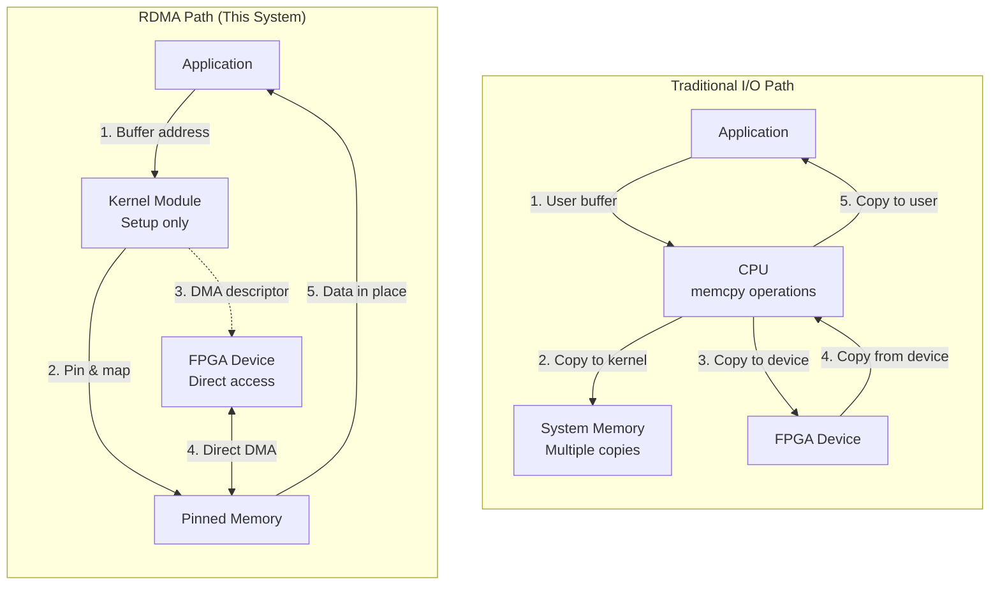
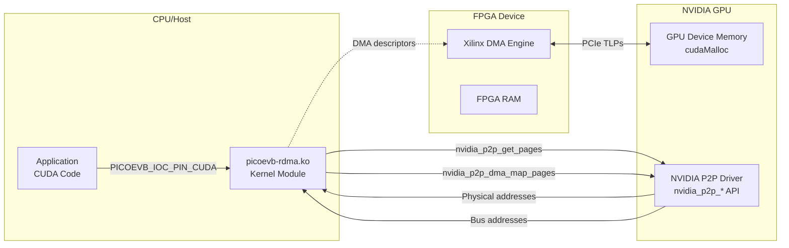
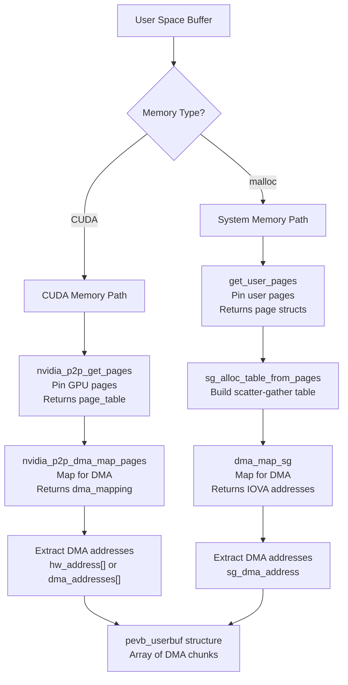
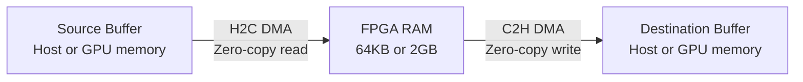
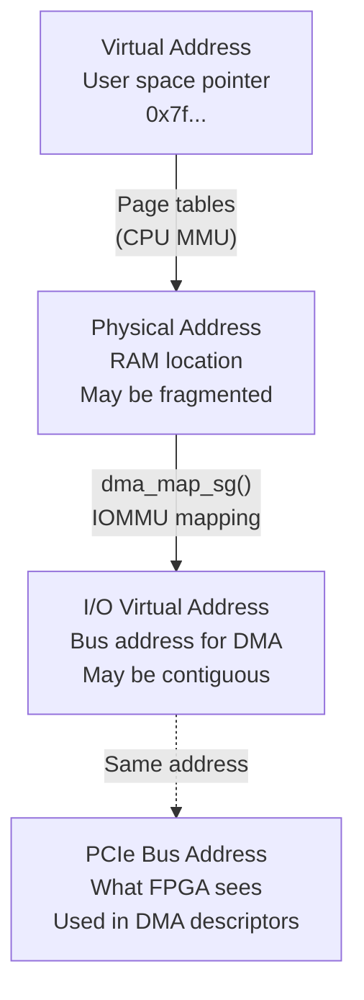

<!-- source: DeepWiki mcp.deepwiki.com · repo NVIDIA/jetson-rdma-picoevb · page 3.1 RDMA Fundamentals · fetched 2026-10-26 -->

# RDMA Fundamentals

<details>
<summary>Relevant source files</summary>

The following files were used as context for generating this wiki page:

- [kernel-module/picoevb-rdma.c](kernel-module/picoevb-rdma.c)
- [rdma-flow.svg](rdma-flow.svg)

</details>


This page explains the core Remote Direct Memory Access (RDMA) concepts that underpin the jetson-rdma-picoevb system. It covers traditional DMA operation, GPUDirect RDMA technology, memory pinning mechanisms, and zero-copy data transfer principles. For details on specific data transfer patterns (H2C, C2H, H2C2H), see [Data Transfer Patterns](#3.2). For implementation details of memory management in the kernel module, see [Memory Management](#3.3).

---

## What is RDMA?

Remote Direct Memory Access (RDMA) refers to the ability of a device to directly access memory without involving the CPU in the data movement operation. In traditional I/O operations, the CPU must orchestrate data movement between devices and memory, consuming CPU cycles and introducing latency. RDMA eliminates this overhead by allowing peripheral devices to read from and write to system memory autonomously.

In the context of this system, "remote" refers to the FPGA device on the PCIe bus accessing memory that may reside in host RAM or GPU device memory. The kernel module acts as an orchestrator, setting up the memory mappings and DMA descriptors, but once configured, the actual data transfer occurs directly over the PCIe bus without CPU involvement.

**Key RDMA Benefits:**
- **Zero CPU overhead** during data transfer
- **Zero-copy operation** - data moves directly between devices
- **Lower latency** - no CPU intermediary
- **Higher bandwidth** - full PCIe bandwidth utilization

---

## Traditional I/O vs RDMA Data Path

The following diagram contrasts traditional CPU-mediated I/O with RDMA:



**Sources:** [kernel-module/picoevb-rdma.c:417-527]()

In the traditional path, data must be copied multiple times through CPU-mediated operations. In the RDMA path implemented by this system, the kernel module pins the user memory pages and provides DMA descriptors to the FPGA, which then performs direct memory transfers.

---

## GPUDirect RDMA Technology

GPUDirect RDMA is NVIDIA's technology that extends RDMA capabilities to GPU memory. It enables third-party PCIe devices (like the FPGA in this system) to directly access GPU memory without involving the CPU or system memory as an intermediate buffer.

### GPUDirect RDMA Architecture



**Sources:** [kernel-module/picoevb-rdma.c:228-295](), [kernel-module/picoevb-rdma.c:356-414]()

### NVIDIA P2P API Integration

The system integrates with NVIDIA's P2P API through several key functions:

| Function | Purpose | Code Location |
|----------|---------|---------------|
| `nvidia_p2p_get_pages` | Pin GPU memory pages and obtain physical page table | [kernel-module/picoevb-rdma.c:250-259]() |
| `nvidia_p2p_dma_map_pages` | Map GPU pages for DMA by converting to bus addresses | [kernel-module/picoevb-rdma.c:379-386]() |
| `nvidia_p2p_dma_unmap_pages` | Unmap DMA mappings when transfer completes | [kernel-module/picoevb-rdma.c:507-514]() |
| `nvidia_p2p_put_pages` | Unpin GPU pages and release resources | [kernel-module/picoevb-rdma.c:198-202]() |
| `nvidia_p2p_free_page_table` | Free page table structure | [kernel-module/picoevb-rdma.c:168]() |

The P2P API differs between integrated GPU (iGPU) platforms like Jetson and discrete GPU (dGPU) platforms:

**Discrete GPU (dGPU):** Uses `<nv-p2p.h>` header with different function signatures that include PID/UID parameters and use 64KB GPU pages.

**Integrated GPU (iGPU):** Uses `<linux/nv-p2p.h>` header with simpler function signatures and 4KB GPU pages. The iGPU driver automatically calls the free callback on page release.

This distinction is handled via conditional compilation:
```c
#ifdef NV_BUILD_DGPU
#define GPU_PAGE_SHIFT  16  // 64KB pages
#else
#define GPU_PAGE_SHIFT  12  // 4KB pages
#endif
```

**Sources:** [kernel-module/picoevb-rdma.c:26-32](), [kernel-module/picoevb-rdma.c:42-49]()

---

## Memory Pinning and DMA Mapping

Before DMA can occur, memory pages must be **pinned** (locked in physical memory) and **mapped** for DMA access. Pinning prevents the operating system from swapping pages to disk or moving them in physical memory, which would invalidate the DMA operation.

### Memory Pinning Flow



**Sources:** [kernel-module/picoevb-rdma.c:356-414](), [kernel-module/picoevb-rdma.c:417-485]()

### The pevb_userbuf Structure

Both memory paths converge to populate a `pevb_userbuf` structure that contains an array of DMA-accessible address ranges:

```c
struct pevb_userbuf {
    int n_dmas;                      // Number of contiguous DMA chunks
    struct pevb_userbuf_dma *dmas;   // Array of DMA chunks
    // ... private data for memory type-specific cleanup
};

struct pevb_userbuf_dma {
    dma_addr_t addr;  // Bus address for DMA
    u64 len;          // Length of this contiguous chunk
};
```

**Sources:** [kernel-module/picoevb-rdma.c:90-117]()

The kernel module merges adjacent DMA chunks to minimize descriptor overhead in `pevb_userbuf_add_dma_chunk()`:

**Sources:** [kernel-module/picoevb-rdma.c:334-353]()

---

## Zero-Copy Data Paths

Zero-copy operation means data moves directly from source to destination without intermediate buffering. This system implements three zero-copy patterns:

### Zero-Copy Pattern Comparison

| Pattern | Source | Intermediate | Destination | Use Case |
|---------|--------|--------------|-------------|----------|
| **H2C** | Host memory | FPGA RAM | FPGA RAM | Loading data to FPGA |
| **C2H** | FPGA RAM | None | Host/GPU memory | Reading FPGA results |
| **H2C2H** | Host/GPU memory | FPGA RAM | Host/GPU memory | Memory copy via FPGA |

### H2C2H: The Double-Zero-Copy Pattern

The H2C2H pattern is unique because it performs zero-copy in both directions:



**Sources:** [kernel-module/picoevb-rdma.c:729-788]()

The FPGA RAM acts as a small intermediate buffer, but the data never passes through CPU-accessible memory. The kernel module chunks large transfers into FPGA RAM-sized segments:

```c
len_chunk = min_t(u64, src_len_remaining, dst_len_remaining);
len_chunk = min_t(u64, len_chunk, pevb->drvdata->fpga_ram_size);
len_chunk = min_t(u64, len_chunk, XLNX_DMA_DESC_LEN_MAX_WORD_ALIGNED);
```

**Sources:** [kernel-module/picoevb-rdma.c:762-765]()

---

## Memory Types and Addressing

The system handles three distinct memory types, each with different properties and handling requirements:

### Memory Type Characteristics

```mermaid
graph TB
    subgraph MALLOC["malloc() Memory"]
        M_ALLOC["malloc()<br/>Standard allocation"]
        M_PROP["Properties:<br/>- Virtual memory<br/>- Swappable<br/>- Non-contiguous"]
        M_PIN["get_user_pages()<br/>Pin in physical RAM"]
        M_MAP["dma_map_sg()<br/>Create IOMMU mapping"]
        
        M_ALLOC --> M_PROP
        M_PROP --> M_PIN
        M_PIN --> M_MAP
    end
    
    subgraph CUDA_HOST["cudaHostAlloc() Memory"]
        CH_ALLOC["cudaHostAlloc()<br/>Pinned host memory"]
        CH_PROP["Properties:<br/>- Pre-pinned<br/>- Non-swappable<br/>- Page-locked"]
        CH_PIN["nvidia_p2p_get_pages()<br/>Get page table"]
        CH_MAP["nvidia_p2p_dma_map_pages()<br/>Create PCIe mapping"]
        
        CH_ALLOC --> CH_PROP
        CH_PROP --> CH_PIN
        CH_PIN --> CH_MAP
    end
    
    subgraph CUDA_DEV["cudaMalloc() Memory"]
        CD_ALLOC["cudaMalloc()<br/>GPU device memory"]
        CD_PROP["Properties:<br/>- On GPU<br/>- Not in system RAM<br/>- PCIe-accessible"]
        CD_PIN["nvidia_p2p_get_pages()<br/>Get page table"]
        CD_MAP["nvidia_p2p_dma_map_pages()<br/>Create PCIe mapping"]
        
        CD_ALLOC --> CD_PROP
        CD_PROP --> CD_PIN
        CD_PIN --> CD_MAP
    end
```



**Sources:** [kernel-module/picoevb-rdma.c:417-485](), [kernel-module/picoevb-rdma.c:356-414]()

### Page Size Differences

The system must handle different page sizes depending on GPU type:

| Platform | GPU Type | Page Size | Constant | Code Reference |
|----------|----------|-----------|----------|----------------|
| x86 + Quadro/Tesla | dGPU | 64 KB | `GPU_PAGE_SIZE` (64K) | [kernel-module/picoevb-rdma.c:43]() |
| Jetson/Drive AGX | iGPU | 4 KB | `GPU_PAGE_SIZE` (4K) | [kernel-module/picoevb-rdma.c:45]() |
| All platforms | System RAM | 4 KB | `PAGE_SIZE` | [kernel-module/picoevb-rdma.c:435]() |

The pinning code must align virtual addresses to GPU page boundaries:

```c
cusurf->va = pin_params.va & GPU_PAGE_MASK;
cusurf->offset = pin_params.va & GPU_PAGE_OFFSET;
aligned_len = (cusurf->offset + cusurf->len + GPU_PAGE_SIZE - 1) & GPU_PAGE_MASK;
```

**Sources:** [kernel-module/picoevb-rdma.c:244-248]()

---

## IOMMU and Address Translation

Modern systems use an Input-Output Memory Management Unit (IOMMU) to provide virtual addressing for DMA operations. This adds a layer of address translation between device bus addresses and physical memory addresses.

### Address Translation Layers



**Sources:** [kernel-module/picoevb-rdma.c:469-473]()

The IOMMU can coalesce multiple physical pages into a contiguous I/O virtual address space, which is why the system may see fewer DMA chunks than physical pages:

```c
ubuf->priv.pages.map_ret = dma_map_sg(&pevb->pdev->dev,
    ubuf->priv.pages.sgt->sgl, ubuf->priv.pages.sgt->nents,
    to_dev ? DMA_TO_DEVICE : DMA_FROM_DEVICE);
```

The returned `map_ret` value indicates how many contiguous DMA segments resulted from the mapping, which may be less than the number of physical pages due to IOMMU coalescing.

**Sources:** [kernel-module/picoevb-rdma.c:469-473]()

---

## DMA Direction and Coherency

DMA operations have directionality that affects cache coherency:

| Direction Constant | Meaning | Data Flow | Cache Handling |
|-------------------|---------|-----------|----------------|
| `DMA_TO_DEVICE` | Host to Card (H2C) | CPU writes, device reads | CPU cache flushed before DMA |
| `DMA_FROM_DEVICE` | Card to Host (C2H) | Device writes, CPU reads | CPU cache invalidated after DMA |
| `DMA_BIDIRECTIONAL` | Both directions | Both read and write | Both flush and invalidate |

The kernel module specifies direction when mapping pages:

```c
// For source buffers (device reads)
to_dev = 1;  // DMA_TO_DEVICE

// For destination buffers (device writes)
to_dev = 0;  // DMA_FROM_DEVICE
```

**Sources:** [kernel-module/picoevb-rdma.c:430](), [kernel-module/picoevb-rdma.c:471](), [kernel-module/picoevb-rdma.c:383]()

The Xilinx DMA engine is programmed with a write memory barrier (`wmb()`) to ensure all descriptor writes complete before DMA starts:

```c
/*
 * Ensure all memory writes for descriptor and configuration registers
 * have completed before triggering the DMA operation.
 */
wmb();
pevb_writel(pevb, BAR_DMA, val, reg);
```

**Sources:** [kernel-module/picoevb-rdma.c:629-634]()

---

## Summary: RDMA Components in This System

The following table maps RDMA concepts to their implementation in the codebase:

| RDMA Concept | Implementation | Key Functions | Code Location |
|--------------|----------------|---------------|---------------|
| Memory pinning (CUDA) | NVIDIA P2P API | `nvidia_p2p_get_pages` | [kernel-module/picoevb-rdma.c:250-259]() |
| Memory pinning (malloc) | Linux kernel API | `get_user_pages` | [kernel-module/picoevb-rdma.c:442-451]() |
| DMA mapping (CUDA) | NVIDIA P2P API | `nvidia_p2p_dma_map_pages` | [kernel-module/picoevb-rdma.c:379-386]() |
| DMA mapping (malloc) | Linux kernel API | `dma_map_sg` | [kernel-module/picoevb-rdma.c:469-473]() |
| Zero-copy H2C | Xilinx DMA descriptors | `pevb_dma_h2c_single` | [kernel-module/picoevb-rdma.c:679-702]() |
| Zero-copy C2H | Xilinx DMA descriptors | `pevb_dma_c2h_single` | [kernel-module/picoevb-rdma.c:704-727]() |
| DMA completion | Interrupt handling | `pevb_irq_handler` | [kernel-module/picoevb-rdma.c:529-568]() |

This RDMA infrastructure enables the high-bandwidth, low-latency transfers between host memory, GPU memory, and FPGA hardware that are the core value proposition of the jetson-rdma-picoevb system. The next sections cover how these building blocks are composed into specific [Data Transfer Patterns](#3.2) and how the system manages the lifecycle of [Memory Management](#3.3) operations.

---

