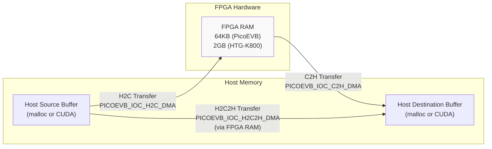
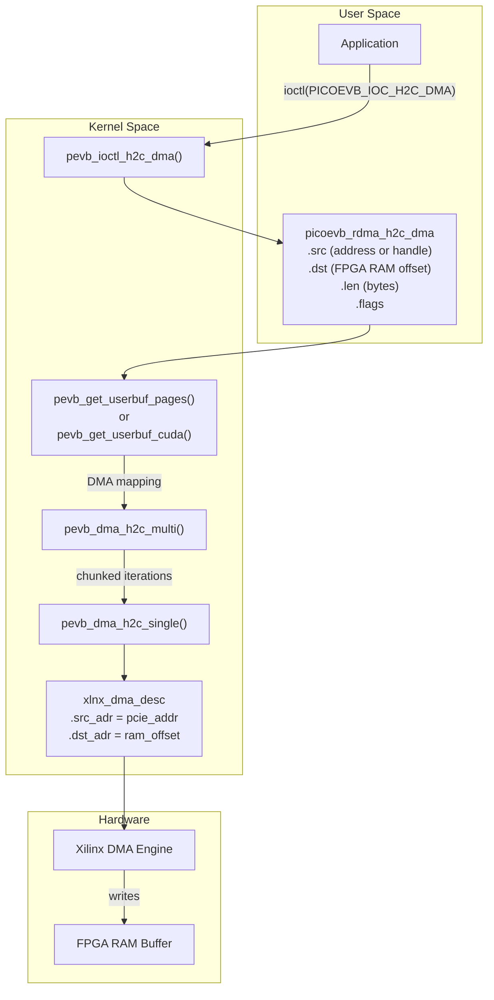
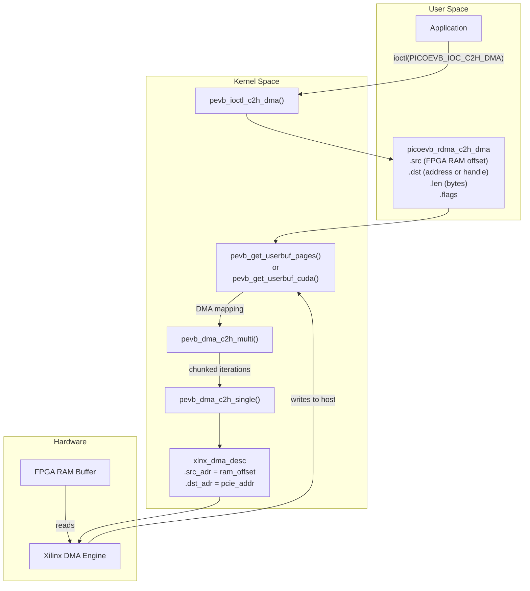
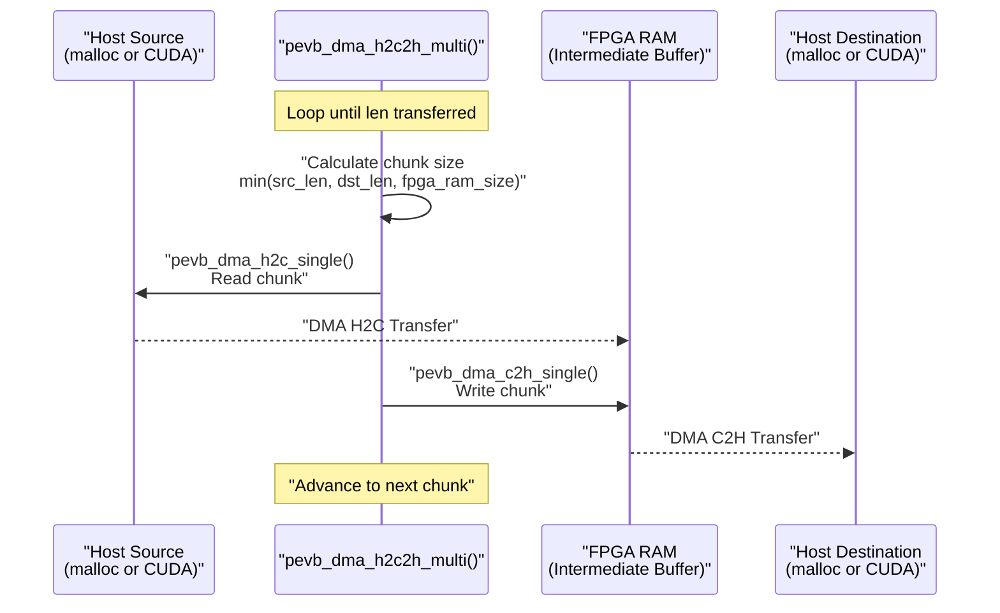
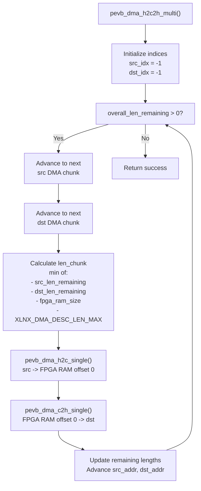
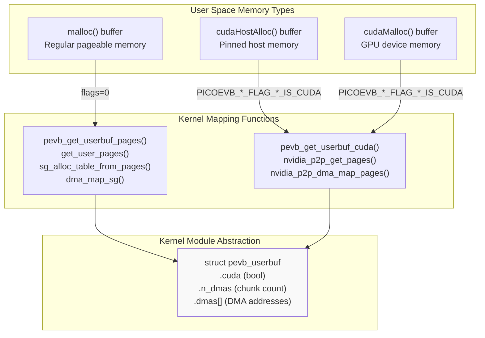
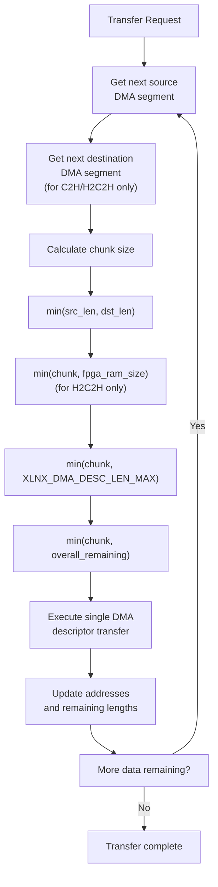

<!-- source: DeepWiki mcp.deepwiki.com · repo NVIDIA/jetson-rdma-picoevb · page 3.2 Data Transfer Patterns · fetched 2026-10-26 -->

# Data Transfer Patterns

<details>
<summary>Relevant source files</summary>

The following files were used as context for generating this wiki page:

- [kernel-module/picoevb-rdma-ioctl.h](kernel-module/picoevb-rdma-ioctl.h)
- [kernel-module/picoevb-rdma.c](kernel-module/picoevb-rdma.c)

</details>


## Purpose and Scope

This document describes the three DMA transfer patterns implemented by the `picoevb-rdma` kernel module: Host-to-Card (H2C), Card-to-Host (C2H), and Host-to-Card-to-Host (H2C2H). Each pattern serves different use cases and has distinct constraints based on FPGA RAM capacity and DMA engine capabilities.

For information about memory pinning and CUDA P2P integration, see [Memory Management](#3.3). For details about the IOCTL interface and data structures, see [IOCTL Interface](#4.2). For hardware register programming, see [Hardware Register Interface](#4.5).

---

## Transfer Pattern Overview

The system supports three fundamental DMA transfer patterns, each initiated via a specific IOCTL command:



**Sources:** [kernel-module/picoevb-rdma.c:998-1102](), [kernel-module/picoevb-rdma-ioctl.h:32-84]()

| Pattern | IOCTL Command | Use Case | FPGA RAM Role |
|---------|--------------|----------|---------------|
| H2C | `PICOEVB_IOC_H2C_DMA` | Write data to FPGA | Destination |
| C2H | `PICOEVB_IOC_C2H_DMA` | Read data from FPGA | Source |
| H2C2H | `PICOEVB_IOC_H2C2H_DMA` | Memory-to-memory copy via FPGA | Intermediate buffer |

**Sources:** [kernel-module/picoevb-rdma-ioctl.h:77-83]()

---

## H2C (Host-to-Card) Transfer Pattern

### Pattern Description

The H2C pattern transfers data from host memory (regular or CUDA) to FPGA onboard RAM. This is a unidirectional write operation where the FPGA RAM acts as the destination.



**Sources:** [kernel-module/picoevb-rdma.c:998-1047](), [kernel-module/picoevb-rdma.c:790-848]()

### Implementation Functions

| Function | Line Range | Purpose |
|----------|------------|---------|
| `pevb_ioctl_h2c_dma()` | [998-1047]() | IOCTL entry point, validates parameters |
| `pevb_dma_h2c_multi()` | [790-848]() | Handles multi-chunk transfers |
| `pevb_dma_h2c_single()` | [679-702]() | Executes single DMA descriptor |

**Sources:** [kernel-module/picoevb-rdma.c:679-848]()

### Data Structure

```c
struct picoevb_rdma_h2c_dma {
    __u64 src;           // Host buffer pointer or CUDA handle
    __u64 dst;           // FPGA RAM offset
    __u64 len;           // Transfer length in bytes
    __u64 flags;         // PICOEVB_H2C_DMA_FLAG_SRC_IS_CUDA
    __u64 dma_time_ns;   // Output: transfer duration
};
```

**Sources:** [kernel-module/picoevb-rdma-ioctl.h:51-62]()

### Constraints

- Destination offset (`dst`) must be within FPGA RAM capacity (64KB or 2GB)
- Transfer length is chunked to respect `XLNX_DMA_DESC_LEN_MAX_WORD_ALIGNED`
- Validation check at [kernel-module/picoevb-rdma.c:1013-1014]()

---

## C2H (Card-to-Host) Transfer Pattern

### Pattern Description

The C2H pattern transfers data from FPGA onboard RAM to host memory (regular or CUDA). This is a unidirectional read operation where the FPGA RAM acts as the source.



**Sources:** [kernel-module/picoevb-rdma.c:1053-1102](), [kernel-module/picoevb-rdma.c:850-908]()

### Implementation Functions

| Function | Line Range | Purpose |
|----------|------------|---------|
| `pevb_ioctl_c2h_dma()` | [1053-1102]() | IOCTL entry point, validates parameters |
| `pevb_dma_c2h_multi()` | [850-908]() | Handles multi-chunk transfers |
| `pevb_dma_c2h_single()` | [704-727]() | Executes single DMA descriptor |

**Sources:** [kernel-module/picoevb-rdma.c:704-908]()

### Data Structure

```c
struct picoevb_rdma_c2h_dma {
    __u64 dst;           // Host buffer pointer or CUDA handle
    __u64 src;           // FPGA RAM offset
    __u64 len;           // Transfer length in bytes
    __u64 flags;         // PICOEVB_C2H_DMA_FLAG_DST_IS_CUDA
    __u64 dma_time_ns;   // Output: transfer duration
};
```

**Sources:** [kernel-module/picoevb-rdma-ioctl.h:64-75]()

### Constraints

- Source offset (`src`) must be within FPGA RAM capacity (64KB or 2GB)
- Transfer length is chunked to respect `XLNX_DMA_DESC_LEN_MAX_WORD_ALIGNED`
- Validation check at [kernel-module/picoevb-rdma.c:1068-1069]()

---

## H2C2H (Host-to-Card-to-Host) Transfer Pattern

### Pattern Description

The H2C2H pattern is a bidirectional transfer that copies data from one host memory location to another using FPGA RAM as an intermediate buffer. This pattern executes two sequential DMA operations (H2C followed by C2H) for each chunk of data.



**Sources:** [kernel-module/picoevb-rdma.c:729-788]()

### Implementation Flow

The `pevb_dma_h2c2h_multi()` function orchestrates the interleaved H2C and C2H operations:



**Sources:** [kernel-module/picoevb-rdma.c:729-788]()

### Key Implementation Details

The chunking logic at [kernel-module/picoevb-rdma.c:762-765]() determines the size of each transfer iteration:

```c
len_chunk = min_t(u64, src_len_remaining, dst_len_remaining);
len_chunk = min_t(u64, len_chunk, pevb->drvdata->fpga_ram_size);
len_chunk = min_t(u64, len_chunk, XLNX_DMA_DESC_LEN_MAX_WORD_ALIGNED);
len_chunk = min_t(u64, len_chunk, overall_len_remaining);
```

This ensures:
1. The chunk fits within both source and destination scatter-gather segments
2. The chunk does not exceed FPGA RAM capacity
3. The chunk respects DMA engine descriptor limits
4. The chunk does not exceed the total remaining transfer length

**Sources:** [kernel-module/picoevb-rdma.c:762-765]()

### Data Structure

```c
struct picoevb_rdma_h2c2h_dma {
    __u64 src;           // Host source pointer or CUDA handle
    __u64 dst;           // Host dest pointer or CUDA handle
    __u64 len;           // Transfer length in bytes
    __u64 flags;         // SRC_IS_CUDA | DST_IS_CUDA
    __u64 dma_time_ns;   // Output: total transfer duration
};
```

**Sources:** [kernel-module/picoevb-rdma-ioctl.h:32-44]()

### Use Cases

The H2C2H pattern is useful for:
- Memory-to-memory copies that leverage GPUDirect RDMA
- Data transformation in FPGA between H2C and C2H stages
- Testing bidirectional DMA functionality
- Benchmarking end-to-end transfer performance

---

## Memory Type Support

Both regular host memory and CUDA-managed memory can be used as source or destination for all transfer patterns. The kernel module abstracts these differences through a unified `pevb_userbuf` structure.



**Sources:** [kernel-module/picoevb-rdma.c:95-117](), [kernel-module/picoevb-rdma.c:356-526]()

### Memory Type Flags

Each IOCTL structure includes flags to indicate memory type:

| Transfer Pattern | Flag | Description |
|-----------------|------|-------------|
| H2C | `PICOEVB_H2C_DMA_FLAG_SRC_IS_CUDA` | Source is CUDA memory |
| C2H | `PICOEVB_C2H_DMA_FLAG_DST_IS_CUDA` | Destination is CUDA memory |
| H2C2H | `PICOEVB_H2C2H_DMA_FLAG_SRC_IS_CUDA` | Source is CUDA memory |
| H2C2H | `PICOEVB_H2C2H_DMA_FLAG_DST_IS_CUDA` | Destination is CUDA memory |

**Sources:** [kernel-module/picoevb-rdma-ioctl.h:43-44](), [kernel-module/picoevb-rdma-ioctl.h:62](), [kernel-module/picoevb-rdma-ioctl.h:75]()

### Regular Memory Handling

For `malloc()` buffers, the kernel uses the standard Linux DMA API:

1. **Pin pages**: `get_user_pages()` at [kernel-module/picoevb-rdma.c:442-451]()
2. **Create scatter-gather table**: `sg_alloc_table_from_pages()` at [kernel-module/picoevb-rdma.c:464-467]()
3. **Map for DMA**: `dma_map_sg()` at [kernel-module/picoevb-rdma.c:469-473]()
4. **Build DMA chunk list**: [kernel-module/picoevb-rdma.c:480-482]()

**Sources:** [kernel-module/picoevb-rdma.c:417-485]()

### CUDA Memory Handling

For CUDA buffers (both host-pinned and device memory), the kernel uses NVIDIA's P2P API:

1. **Retrieve page table**: `nvidia_p2p_get_pages()` at [kernel-module/picoevb-rdma.c:250-259]()
2. **Map for DMA**: `nvidia_p2p_dma_map_pages()` at [kernel-module/picoevb-rdma.c:379-386]()
3. **Build DMA chunk list**: [kernel-module/picoevb-rdma.c:393-411]()

The system handles differences between dGPU and iGPU through conditional compilation:
- **dGPU**: 64KB GPU pages (`GPU_PAGE_SHIFT = 16`)
- **iGPU**: 4KB GPU pages (`GPU_PAGE_SHIFT = 12`)

**Sources:** [kernel-module/picoevb-rdma.c:42-49](), [kernel-module/picoevb-rdma.c:356-414]()

---

## Transfer Chunking and Constraints

All transfer functions must handle chunking because host memory mappings may not be physically contiguous, and transfers may exceed FPGA RAM or DMA descriptor limits.

### Chunking Strategy



**Sources:** [kernel-module/picoevb-rdma.c:729-908]()

### Constraint Table

| Constraint | Source | Value | Applies To |
|------------|--------|-------|------------|
| FPGA RAM Size | `pevb->drvdata->fpga_ram_size` | 64KB (PicoEVB)<br/>2GB (HTG-K800) | H2C2H only |
| DMA Descriptor Max | `XLNX_DMA_DESC_LEN_MAX_WORD_ALIGNED` | Defined in hardware header | All patterns |
| Segment Size | Scatter-gather list | Variable per mapping | All patterns |
| Address Alignment | Implicit | 4-byte aligned | All patterns |

**Sources:** [kernel-module/picoevb-rdma.c:1248-1256](), [kernel-module/picoevb-rdma.c:762-765]()

### FPGA RAM Size Detection

The FPGA RAM size is stored in per-device driver data and can be queried via `PICOEVB_IOC_CARD_INFO`:

```c
static const struct pevb_drvdata drvdata_picoevb = {
    .num_h2c_chans = 1,
    .fpga_ram_size = SZ_64K,  // 65536 bytes
};

static const struct pevb_drvdata drvdata_htg_k800 = {
    .num_h2c_chans = 1,
    .fpga_ram_size = SZ_2G,   // 2147483648 bytes
};
```

**Sources:** [kernel-module/picoevb-rdma.c:1248-1256]()

### Multi-Chunk Transfer Overhead

The implementation includes a performance note at [kernel-module/picoevb-rdma.c:823-831]() indicating that for H2C and C2H patterns, generating multiple descriptors in a single batch would reduce IRQ latency between chunks. However, the current implementation executes descriptors sequentially for simplicity. This optimization does not apply to H2C2H transfers, which must be sequential due to FPGA RAM reuse.

**Sources:** [kernel-module/picoevb-rdma.c:823-831](), [kernel-module/picoevb-rdma.c:882-891]()

---

