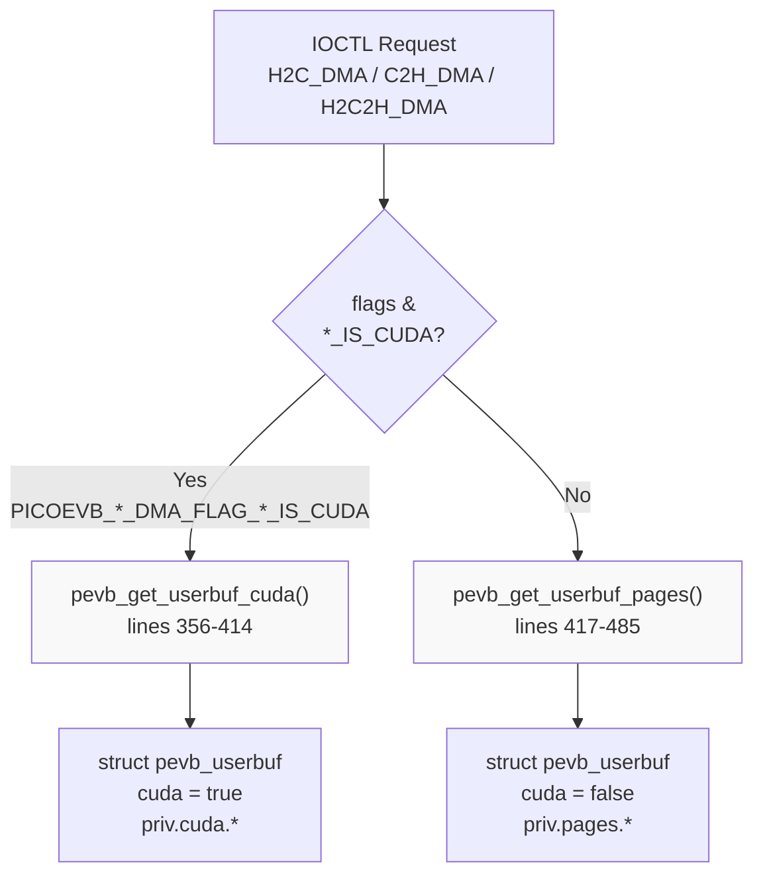
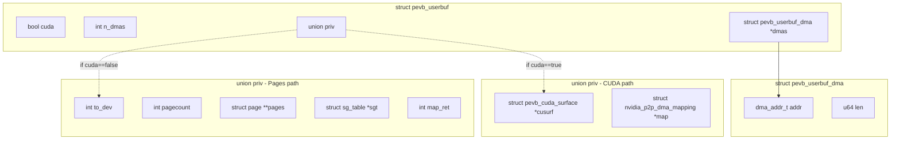
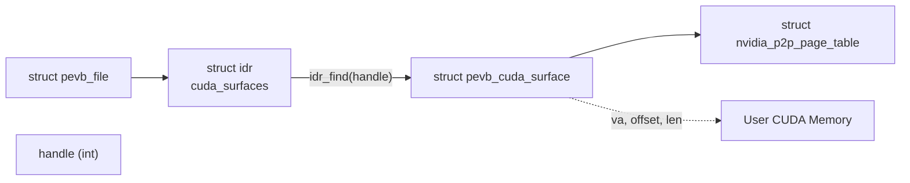
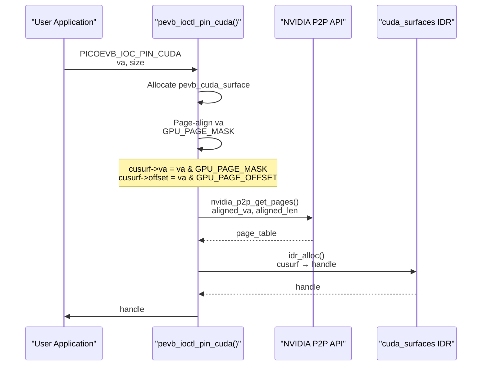
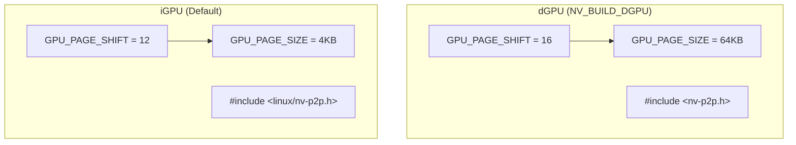
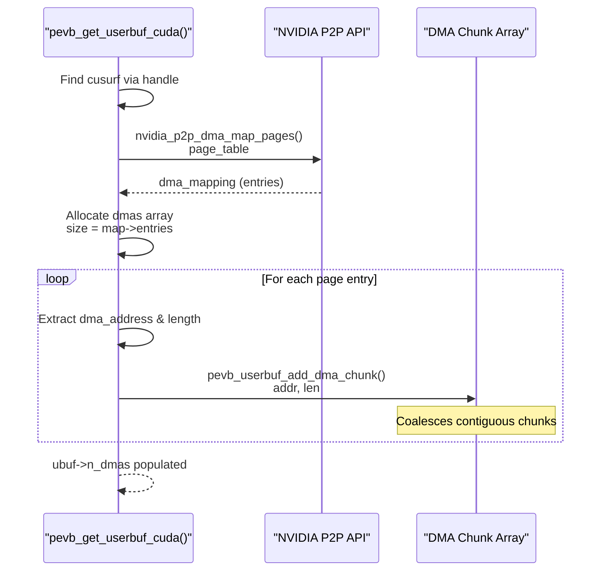
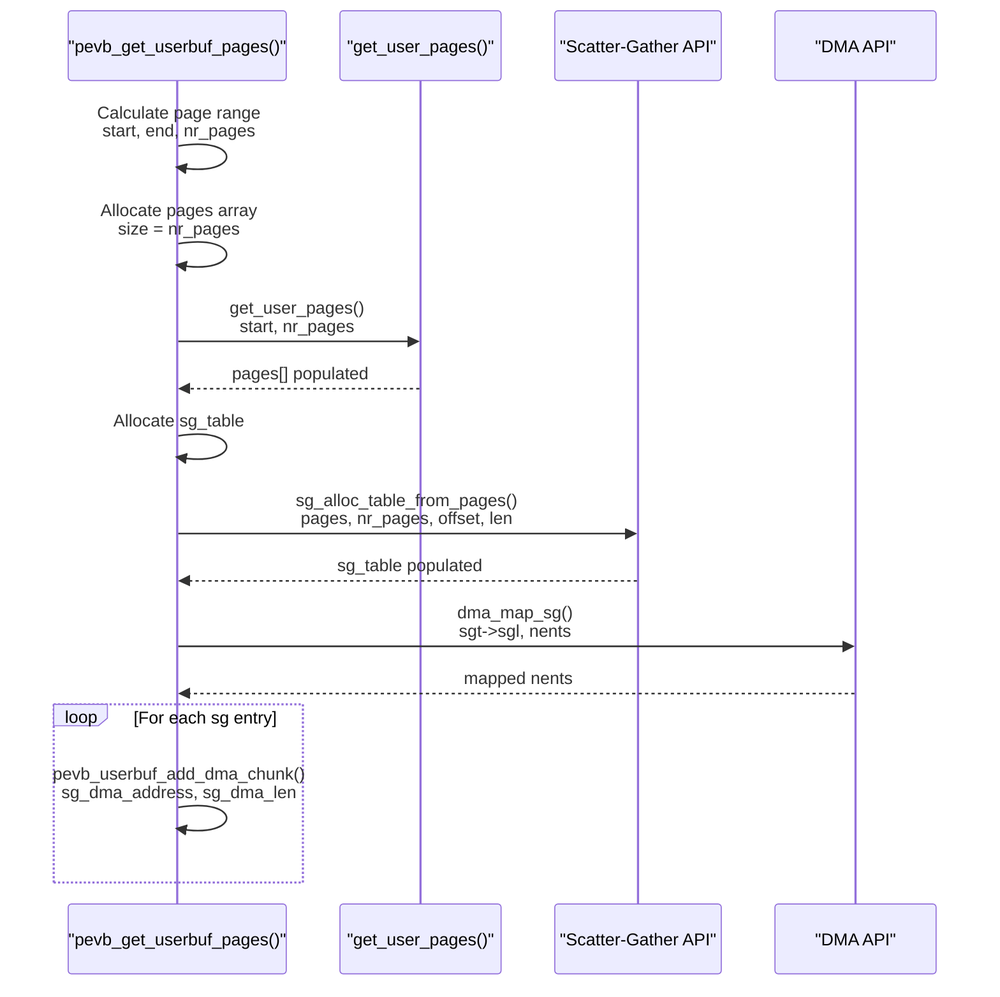
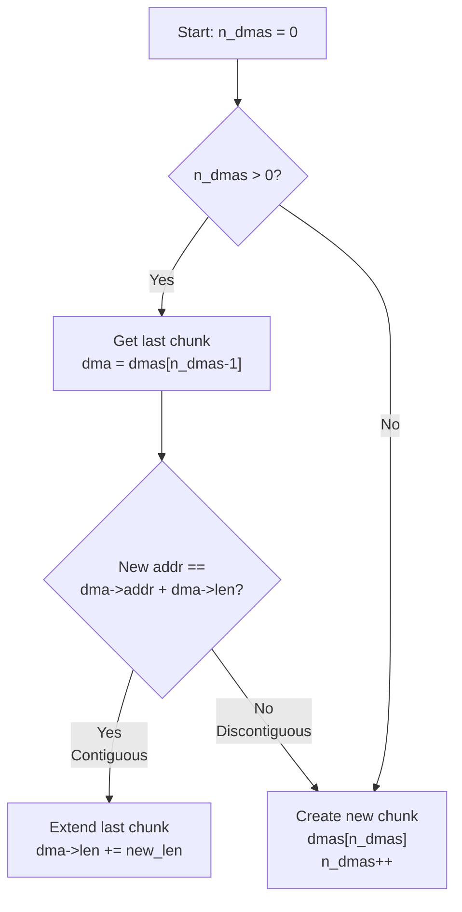
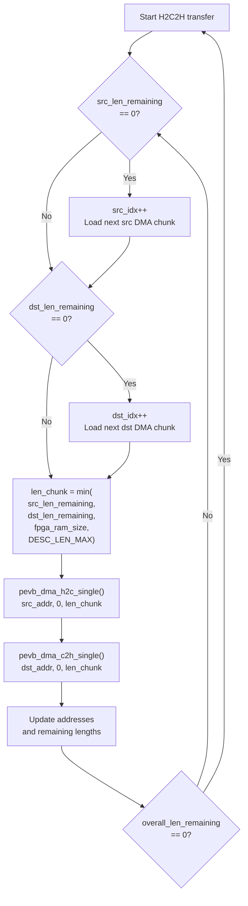
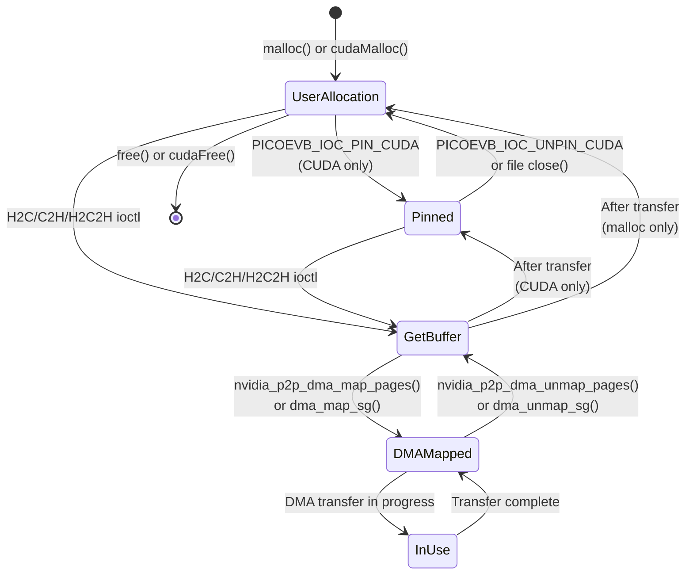

<!-- source: DeepWiki mcp.deepwiki.com · repo NVIDIA/jetson-rdma-picoevb · page 3.3 Memory Management · fetched 2026-10-26 -->

# Memory Management

<details>
<summary>Relevant source files</summary>

The following files were used as context for generating this wiki page:

- [client-applications/rdma-cuda.cu](client-applications/rdma-cuda.cu)
- [kernel-module/picoevb-rdma.c](kernel-module/picoevb-rdma.c)

</details>


## Purpose and Scope

This page documents the memory management subsystem of the picoevb-rdma kernel module, which handles the pinning and DMA mapping of user-space memory for direct hardware access. This includes both regular host memory (allocated with `malloc`) and CUDA-managed GPU memory (allocated with `cudaMalloc` or `cudaHostAlloc`).

For information about the data transfer operations that use this pinned memory, see [Data Transfer Patterns](#3.2). For details about the IOCTL commands that trigger memory pinning, see [IOCTL Interface](#4.2).

---

## Overview

The kernel module must convert user-space virtual addresses into physical addresses that the FPGA's DMA engine can use. This requires two steps:

1. **Memory Pinning**: Lock pages in physical memory to prevent the kernel from swapping them out during DMA
2. **DMA Mapping**: Obtain bus addresses that the PCIe device can use to access the pinned pages

The system supports two fundamentally different memory types, each requiring different APIs:

| Memory Type | Allocation Method | Pinning API | Use Case |
|-------------|-------------------|-------------|----------|
| Regular Host Memory | `malloc()` | `get_user_pages()` + `dma_map_sg()` | CPU-accessible buffers |
| CUDA GPU Memory | `cudaMalloc()` / `cudaHostAlloc()` | `nvidia_p2p_get_pages()` + `nvidia_p2p_dma_map_pages()` | GPU-accessible buffers for GPUDirect RDMA |

**Sources**: [kernel-module/picoevb-rdma.c:417-527]()

---

## Memory Type Detection



**Memory Type Selection Diagram**

The kernel module determines memory type through flags in the IOCTL request structure. User applications set `PICOEVB_H2C_DMA_FLAG_SRC_IS_CUDA`, `PICOEVB_C2H_DMA_FLAG_DST_IS_CUDA`, or `PICOEVB_H2C2H_DMA_FLAG_SRC_IS_CUDA` / `PICOEVB_H2C2H_DMA_FLAG_DST_IS_CUDA` to indicate CUDA memory.

**Sources**: [kernel-module/picoevb-rdma.c:932-956](), [kernel-module/picoevb-rdma.c:1018-1027](), [kernel-module/picoevb-rdma.c:1073-1082]()

---

## Data Structures

### Core Memory Structures



**Memory Buffer Data Structures**

The `pevb_userbuf` structure [kernel-module/picoevb-rdma.c:95-117]() is the unified representation of a user buffer, regardless of whether it contains CUDA or regular memory. Key fields:

- `cuda`: Boolean flag indicating memory type
- `n_dmas`: Number of DMA-addressable chunks
- `dmas`: Array of `pevb_userbuf_dma` structures, each containing a physical address and length
- `priv`: Union containing type-specific state

**Sources**: [kernel-module/picoevb-rdma.c:90-117]()

### CUDA Surface Tracking



**CUDA Surface Management**

The `pevb_cuda_surface` structure [kernel-module/picoevb-rdma.c:80-88]() tracks pinned CUDA memory:

- `pevb_file`: Back-pointer to the file descriptor
- `va`: Original virtual address (page-aligned)
- `offset`: Offset within first page
- `len`: Length of pinned region
- `handle`: Integer handle returned to user space
- `page_table`: NVIDIA P2P page table containing physical page information

Each file descriptor maintains an IDR (ID Radix tree) mapping handles to surfaces [kernel-module/picoevb-rdma.c:76]().

**Sources**: [kernel-module/picoevb-rdma.c:73-88](), [kernel-module/picoevb-rdma.c:148]()

---

## CUDA Memory Pinning

### Pinning Process Flow



**CUDA Memory Pinning Sequence**

The pinning process [kernel-module/picoevb-rdma.c:228-295]():

1. User calls `ioctl(PICOEVB_IOC_PIN_CUDA)` with virtual address and size
2. Kernel allocates `pevb_cuda_surface` structure
3. Virtual address is page-aligned according to GPU page size
4. `nvidia_p2p_get_pages()` locks the pages and returns a page table
5. Handle is allocated via IDR and returned to user space

**Sources**: [kernel-module/picoevb-rdma.c:228-295]()

### GPU Page Size Differences



**GPU Page Size Configuration**

The system handles different page sizes for discrete and integrated GPUs [kernel-module/picoevb-rdma.c:42-49]():

| Platform | `GPU_PAGE_SHIFT` | `GPU_PAGE_SIZE` | Header Location |
|----------|------------------|-----------------|-----------------|
| dGPU (x86 with Quadro/Tesla) | 16 | 65536 (64KB) | `<nv-p2p.h>` |
| iGPU (Jetson/Drive Xavier) | 12 | 4096 (4KB) | `<linux/nv-p2p.h>` |

Page alignment is critical for CUDA memory:

```c
cusurf->va = pin_params.va & GPU_PAGE_MASK;
cusurf->offset = pin_params.va & GPU_PAGE_OFFSET;
aligned_len = (cusurf->offset + cusurf->len + GPU_PAGE_SIZE - 1) & GPU_PAGE_MASK;
```

**Sources**: [kernel-module/picoevb-rdma.c:42-49](), [kernel-module/picoevb-rdma.c:244-248]()

### DMA Mapping for CUDA Memory



**CUDA DMA Mapping Sequence**

The DMA mapping process for CUDA memory [kernel-module/picoevb-rdma.c:356-414]():

1. Lookup `pevb_cuda_surface` from the provided handle
2. Call `nvidia_p2p_dma_map_pages()` to get bus addresses
3. Iterate through page table entries
4. For dGPU: Use `dma_addresses[i]` array [kernel-module/picoevb-rdma.c:397-398]()
5. For iGPU: Use `hw_address[i]` and `hw_len[i]` arrays [kernel-module/picoevb-rdma.c:400-401]()
6. Coalesce contiguous physical ranges into single DMA chunks [kernel-module/picoevb-rdma.c:334-353]()

**Sources**: [kernel-module/picoevb-rdma.c:356-414]()

### CUDA Memory Cleanup

The module provides two cleanup paths:

**Explicit Unpinning** [kernel-module/picoevb-rdma.c:297-331]():
- User calls `ioctl(PICOEVB_IOC_UNPIN_CUDA)`
- Handle is removed from IDR
- `nvidia_p2p_put_pages()` releases the pages
- Callback `pevb_p2p_free_callback()` frees the surface

**Automatic Cleanup on File Close** [kernel-module/picoevb-rdma.c:176-217]():
- Iterate through all surfaces in IDR
- Call `nvidia_p2p_put_pages()` for each
- Callback behavior differs between dGPU and iGPU:
  - dGPU: Must explicitly call `pevb_p2p_free_callback()` [kernel-module/picoevb-rdma.c:204]()
  - iGPU: Callback is invoked automatically [kernel-module/picoevb-rdma.c:206-209]()

**Sources**: [kernel-module/picoevb-rdma.c:176-217](), [kernel-module/picoevb-rdma.c:297-331]()

---

## Regular Memory Pinning

### Pinning Process for malloc() Buffers



**Regular Memory Pinning Sequence**

The process for regular host memory [kernel-module/picoevb-rdma.c:417-485]():

1. Calculate page-aligned range [kernel-module/picoevb-rdma.c:432-435]()
2. Call `get_user_pages()` to pin pages in memory [kernel-module/picoevb-rdma.c:442-451]()
   - For kernel < 4.6.0, requires `current` and `current->mm` parameters
   - Direction flag: `0` for reads (to device), `FOLL_WRITE` for writes (from device)
3. Build scatter-gather table from pinned pages [kernel-module/picoevb-rdma.c:464-467]()
4. Map scatter-gather list for DMA [kernel-module/picoevb-rdma.c:469-473]()
5. Extract DMA address/length pairs from mapped sg entries [kernel-module/picoevb-rdma.c:480-482]()

**Sources**: [kernel-module/picoevb-rdma.c:417-485]()

### DMA Direction Handling

The `to_dev` parameter determines DMA direction:

| Parameter | DMA Direction | Page Flags | Use Case |
|-----------|---------------|------------|----------|
| `to_dev = 1` | `DMA_TO_DEVICE` | Read-only (`0`) | H2C transfer (host is source) |
| `to_dev = 0` | `DMA_FROM_DEVICE` | Writable (`FOLL_WRITE`) | C2H transfer (host is destination) |

This is set when getting the user buffer:
- H2C: Source buffer has `to_dev = 1` [kernel-module/picoevb-rdma.c:1026]()
- C2H: Destination buffer has `to_dev = 0` [kernel-module/picoevb-rdma.c:1081]()
- H2C2H: Source `to_dev = 1`, destination `to_dev = 0` [kernel-module/picoevb-rdma.c:935](), [kernel-module/picoevb-rdma.c:948]()

**Sources**: [kernel-module/picoevb-rdma.c:430](), [kernel-module/picoevb-rdma.c:447](), [kernel-module/picoevb-rdma.c:471]()

### Regular Memory Cleanup

Cleanup for regular memory [kernel-module/picoevb-rdma.c:487-502]():

```c
if (ubuf->priv.pages.map_ret)
    dma_unmap_sg(&pevb->pdev->dev, ubuf->priv.pages.sgt->sgl,
        ubuf->priv.pages.sgt->nents,
        ubuf->priv.pages.to_dev ? DMA_TO_DEVICE : DMA_FROM_DEVICE);
if (ubuf->priv.pages.sgt)
    sg_free_table(ubuf->priv.pages.sgt);
release_pages(ubuf->priv.pages.pages, ubuf->priv.pages.pagecount);
kfree(ubuf->priv.pages.pages);
```

Steps:
1. Unmap DMA scatter-gather list
2. Free scatter-gather table
3. Release pinned pages back to kernel
4. Free pages array

**Sources**: [kernel-module/picoevb-rdma.c:487-502]()

---

## Scatter-Gather List and DMA Chunking

### DMA Chunk Coalescing



**DMA Chunk Coalescing Algorithm**

The function `pevb_userbuf_add_dma_chunk()` [kernel-module/picoevb-rdma.c:334-353]() optimizes the DMA descriptor list by merging contiguous physical ranges:

```c
if (ubuf->n_dmas) {
    dma = &ubuf->dmas[ubuf->n_dmas - 1];
    end = dma->addr + dma->len;
    if (addr == end) {
        dma->len += len;  // Extend existing chunk
        return;
    }
}
// Otherwise create new chunk
```

This is important because:
- Systems with IOMMU may provide large contiguous mappings
- Fewer DMA descriptors mean less interrupt latency
- However, for H2C2H transfers, chunking is required due to FPGA RAM size limits

**Sources**: [kernel-module/picoevb-rdma.c:334-353]()

### Transfer Chunking for H2C2H



**H2C2H Transfer Chunking Flow**

For H2C2H transfers, the module must handle multiple constraints [kernel-module/picoevb-rdma.c:729-788]():

1. **Source/Destination Scatter-Gather**: Each may consist of multiple discontiguous physical ranges
2. **FPGA RAM Size**: PicoEVB has 64KB, HTG-K800 has 2GB [kernel-module/picoevb-rdma.c:763]()
3. **DMA Descriptor Limit**: Maximum 28-bit length field [kernel-module/picoevb-rdma.c:764]()

The transfer loop:
```c
len_chunk = min_t(u64, src_len_remaining, dst_len_remaining);
len_chunk = min_t(u64, len_chunk, pevb->drvdata->fpga_ram_size);
len_chunk = min_t(u64, len_chunk, XLNX_DMA_DESC_LEN_MAX_WORD_ALIGNED);
len_chunk = min_t(u64, len_chunk, overall_len_remaining);
```

Each chunk:
1. Copies from source to FPGA RAM (H2C) [kernel-module/picoevb-rdma.c:767]()
2. Copies from FPGA RAM to destination (C2H) [kernel-module/picoevb-rdma.c:771]()

**Sources**: [kernel-module/picoevb-rdma.c:729-788]()

---

## Memory Lifecycle Summary

### Complete Memory Lifecycle



**Memory Lifecycle State Diagram**

Key lifecycle differences between memory types:

| Stage | CUDA Memory | Regular Memory |
|-------|-------------|----------------|
| Allocation | `cudaMalloc()` or `cudaHostAlloc()` | `malloc()` |
| Explicit Pinning | Required via `PICOEVB_IOC_PIN_CUDA` | Not available |
| Transfer Preparation | Reference by handle | Direct address |
| DMA Mapping | `nvidia_p2p_dma_map_pages()` per transfer | `get_user_pages()` + `dma_map_sg()` per transfer |
| DMA Unmapping | `nvidia_p2p_dma_unmap_pages()` per transfer | `dma_unmap_sg()` + `release_pages()` per transfer |
| Explicit Unpinning | Optional via `PICOEVB_IOC_UNPIN_CUDA` | Not available |
| Deallocation | `cudaFree()` or `cudaFreeHost()` | `free()` |

**CUDA Memory Advantage**: Pin once, use multiple times. The handle system allows CUDA buffers to remain pinned across multiple DMA operations, avoiding repeated P2P API calls.

**Regular Memory Limitation**: Must pin/unpin for each DMA operation. Cannot maintain persistent pinning.

**Sources**: [kernel-module/picoevb-rdma.c:228-331](), [kernel-module/picoevb-rdma.c:356-414](), [kernel-module/picoevb-rdma.c:417-485](), [kernel-module/picoevb-rdma.c:518-527]()

---

## Application-Level Memory Management

### CUDA Memory Example

From the functional test [client-applications/rdma-cuda.cu:75-99]():

```c
// Allocate memory
#ifdef NV_BUILD_DGPU
    ce = cudaMalloc(&src_d, SURFACE_SIZE * sizeof(*src_d));
#else
    ce = cudaHostAlloc(&src_d, SURFACE_SIZE * sizeof(*src_d),
        cudaHostAllocDefault);
#endif

// Enable synchronous memops for P2P
cr = cuPointerSetAttribute(&flag, CU_POINTER_ATTRIBUTE_SYNC_MEMOPS,
    (CUdeviceptr)src_d);

// Pin for DMA
pin_params_src.va = (__u64)src_d;
pin_params_src.size = SURFACE_SIZE * sizeof(*src_d);
ret = ioctl(fd, PICOEVB_IOC_PIN_CUDA, &pin_params_src);

// Use handle in DMA operations
dma_params.src = pin_params_src.handle;
dma_params.flags = PICOEVB_H2C2H_DMA_FLAG_SRC_IS_CUDA;
```

Key points:
- `CU_POINTER_ATTRIBUTE_SYNC_MEMOPS` ensures memory operations complete before DMA [client-applications/rdma-cuda.cu:86-91]()
- PIN_CUDA returns a handle for subsequent operations [client-applications/rdma-cuda.cu:93-99]()
- Handles are used in DMA IOCTL structures [client-applications/rdma-cuda.cu:144-148]()

**Sources**: [client-applications/rdma-cuda.cu:75-99](), [client-applications/rdma-cuda.cu:144-148]()

---

## Summary

The memory management subsystem provides a unified interface for handling both CUDA GPU memory and regular host memory, abstracting the complexity of different pinning and mapping APIs. Key design decisions:

1. **Unified Buffer Representation**: `pevb_userbuf` structure handles both memory types through a discriminated union
2. **Handle-Based CUDA Access**: Allows persistent pinning and multiple reuse
3. **Automatic Cleanup**: IDR-based tracking ensures cleanup on file close
4. **DMA Chunk Optimization**: Coalesces contiguous physical ranges to minimize descriptor count
5. **Platform-Specific Adaptation**: Handles different GPU page sizes and P2P API variants

The system achieves zero-copy data transfers by directly programming DMA hardware with physical addresses obtained from the kernel's memory management and NVIDIA's P2P subsystems.

**Sources**: [kernel-module/picoevb-rdma.c:1-1312]()

---

