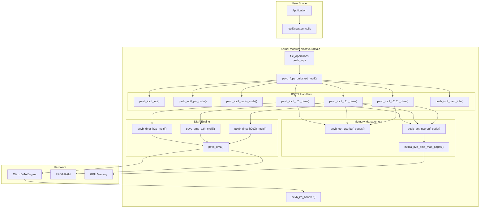
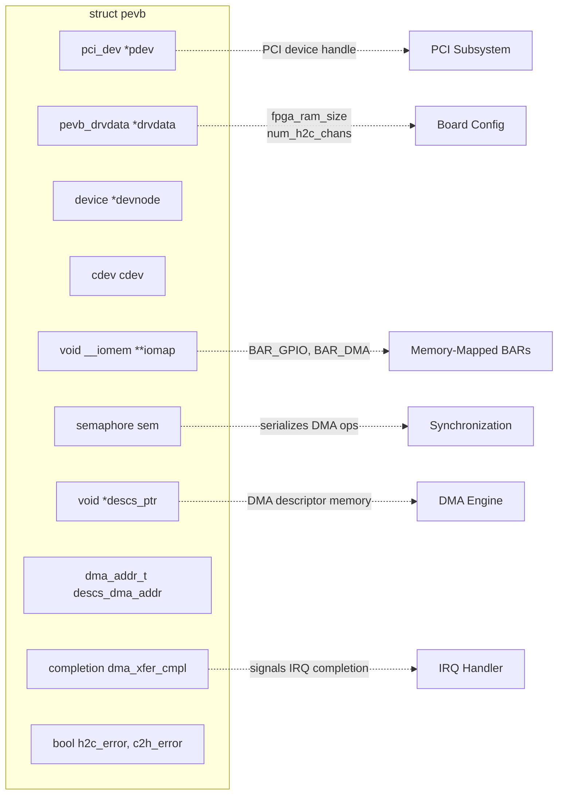
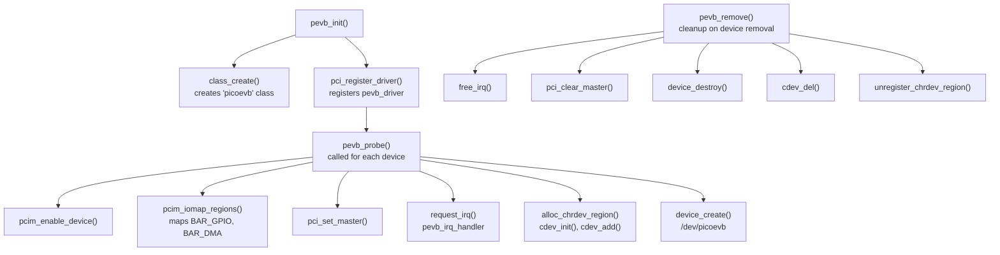
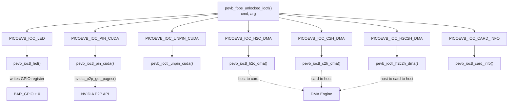
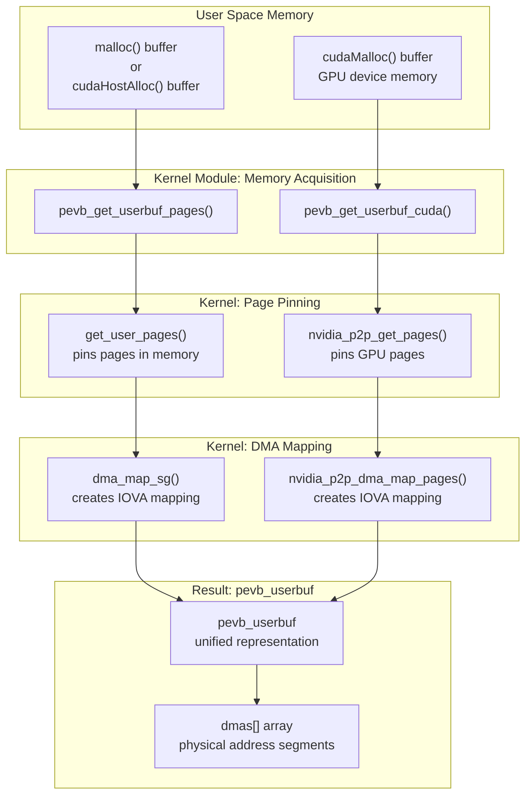
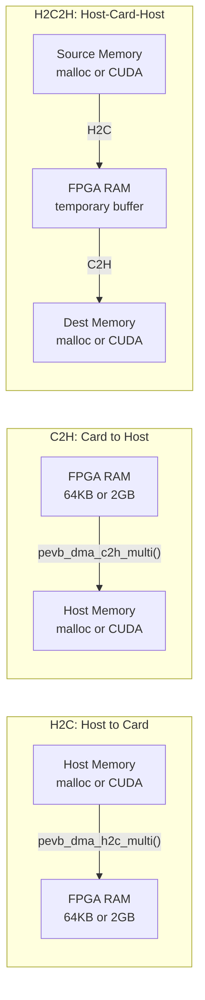
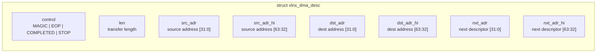
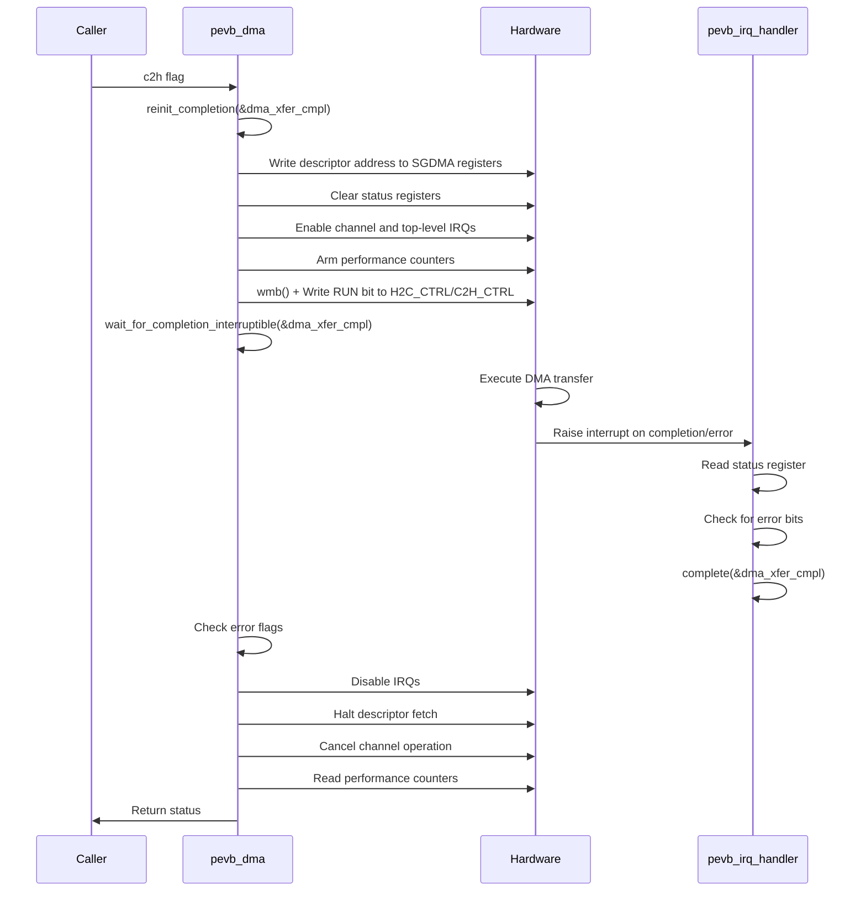
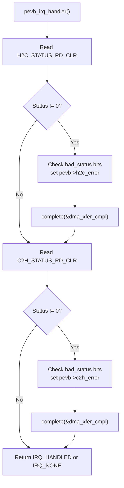

<!-- source: DeepWiki mcp.deepwiki.com · repo NVIDIA/jetson-rdma-picoevb · page 4 Kernel Module · fetched 2026-10-26 -->

# Kernel Module

<details>
<summary>Relevant source files</summary>

The following files were used as context for generating this wiki page:

- [kernel-module/picoevb-rdma.c](kernel-module/picoevb-rdma.c)

</details>


This document provides comprehensive documentation of the `picoevb-rdma` kernel module, the core component that enables GPUDirect RDMA functionality between FPGA devices and NVIDIA GPUs. The module implements a PCI device driver that manages DMA operations, integrates with NVIDIA's P2P API for GPU memory access, and exposes an IOCTL-based interface to user-space applications.

For details about the user-space applications that interact with this module, see [Client Applications](#5). For information about building and deploying the module, see [Building the Kernel Module](#7.2).

## Module Purpose and Architecture

The `picoevb-rdma` kernel module serves three critical roles:

1. **PCI Device Driver**: Manages PicoEVB and HTG-K800 FPGA cards as PCI devices, handling device initialization, BAR mappings, and interrupt registration
2. **DMA Orchestrator**: Coordinates data transfers between host memory, GPU memory, and FPGA RAM using the Xilinx DMA engine
3. **CUDA P2P Bridge**: Integrates with NVIDIA's P2P API to pin and map GPU memory for direct DMA access

The module creates a character device `/dev/picoevb` that user-space applications use to initiate DMA operations and control hardware features.

**Sources**: [kernel-module/picoevb-rdma.c:1-1312]()

## Core Data Structures

### Module Architecture Overview



**Sources**: [kernel-module/picoevb-rdma.c:1104-1129](), [kernel-module/picoevb-rdma.c:1131-1136]()

### Primary Data Structures

The module defines several key structures that maintain device state and track operations:

| Structure | Purpose | Location |
|-----------|---------|----------|
| `struct pevb` | Per-device state for FPGA card | [kernel-module/picoevb-rdma.c:56-71]() |
| `struct pevb_file` | Per-file-descriptor state | [kernel-module/picoevb-rdma.c:73-77]() |
| `struct pevb_cuda_surface` | Tracks pinned CUDA memory | [kernel-module/picoevb-rdma.c:80-87]() |
| `struct pevb_userbuf` | Unified user buffer representation | [kernel-module/picoevb-rdma.c:95-117]() |
| `struct pevb_userbuf_dma` | DMA segment descriptor | [kernel-module/picoevb-rdma.c:90-93]() |
| `struct pevb_drvdata` | Board-specific parameters | [kernel-module/picoevb-rdma.c:51-54]() |

#### struct pevb - Device Instance



**Sources**: [kernel-module/picoevb-rdma.c:56-71]()

#### struct pevb_file - File Descriptor State

Each open file descriptor maintains its own state, including a list of pinned CUDA surfaces tracked via an IDR (ID Radix tree) for efficient lookup by handle.

**Sources**: [kernel-module/picoevb-rdma.c:73-77](), [kernel-module/picoevb-rdma.c:137-153]()

#### struct pevb_userbuf - Unified Buffer Abstraction

The `pevb_userbuf` structure provides a unified representation of user-space memory that abstracts over two distinct paths:

- **Pages path**: Regular `malloc()` or `cudaHostAlloc()` memory, pinned via `get_user_pages()` and mapped via `dma_map_sg()`
- **CUDA path**: `cudaMalloc()` GPU memory, pinned via `nvidia_p2p_get_pages()` and mapped via `nvidia_p2p_dma_map_pages()`

Both paths populate the `dmas` array with DMA-accessible physical address segments.

**Sources**: [kernel-module/picoevb-rdma.c:95-117]()

## Device Lifecycle

### PCI Driver Registration

The module registers as a PCI driver using the standard Linux PCI subsystem:



**Sources**: [kernel-module/picoevb-rdma.c:1281-1294](), [kernel-module/picoevb-rdma.c:1138-1230](), [kernel-module/picoevb-rdma.c:1232-1242]()

### Device Identification

The module supports two FPGA boards, distinguished by PCI sub-device ID:

| Board | PCI Sub-Device ID | FPGA RAM Size | H2C Channels | Driver Data |
|-------|-------------------|---------------|--------------|-------------|
| PicoEVB | 0x0001 | 64 KB | 1 | `drvdata_picoevb` |
| HTG-K800 | 0x0002 | 2 GB | 1 | `drvdata_htg_k800` |

**Sources**: [kernel-module/picoevb-rdma.c:1248-1271]()

### BAR Layout

The module maps two Base Address Registers (BARs):

- **BAR 0 (BAR_GPIO)**: GPIO and LED control registers
- **BAR 1 (BAR_DMA)**: Xilinx DMA engine registers

**Sources**: [kernel-module/picoevb-rdma.c:39-40](), [kernel-module/picoevb-rdma.c:1201-1207]()

## IOCTL Command Dispatch

User-space applications communicate with the module through IOCTL commands. The `pevb_fops_unlocked_ioctl()` function dispatches commands to specialized handlers:



**Sources**: [kernel-module/picoevb-rdma.c:1104-1129]()

## Memory Management

### Two-Path Memory Handling

The module handles two fundamentally different memory types through a unified abstraction:



**Sources**: [kernel-module/picoevb-rdma.c:417-485](), [kernel-module/picoevb-rdma.c:356-414]()

### CUDA Memory Pinning Workflow

For CUDA memory (`cudaMalloc()` or `cudaHostAlloc()`), the module uses NVIDIA's P2P API:

1. **Pin Request**: User calls `PICOEVB_IOC_PIN_CUDA` with virtual address and size
2. **Alignment**: Module aligns VA to GPU page boundaries (4KB for iGPU, 64KB for dGPU)
3. **Get Pages**: `nvidia_p2p_get_pages()` pins the GPU memory and returns a page table
4. **Allocate Handle**: Module stores the pinned surface in IDR and returns a handle
5. **DMA Operations**: Subsequent DMA operations use the handle to reference the pinned memory
6. **Unpin**: User calls `PICOEVB_IOC_UNPIN_CUDA` or closes file descriptor to release

**Sources**: [kernel-module/picoevb-rdma.c:228-295](), [kernel-module/picoevb-rdma.c:297-331]()

### GPU Page Size Handling

The module handles different GPU page sizes based on build configuration:

| Configuration | Page Size | Page Shift | Usage |
|---------------|-----------|------------|-------|
| `NV_BUILD_DGPU` | 64 KB | 16 | Discrete GPUs (Quadro, Tesla) |
| Default (iGPU) | 4 KB | 12 | Integrated GPUs (Jetson, Drive) |

**Sources**: [kernel-module/picoevb-rdma.c:42-49]()

### Regular Memory Pinning Workflow

For regular host memory (`malloc()`), the module uses standard Linux memory management:

1. **Calculate Pages**: Determine page count from VA and length
2. **Get User Pages**: `get_user_pages()` pins pages in physical memory
3. **Build Scatter-Gather Table**: `sg_alloc_table_from_pages()` creates SG list
4. **DMA Mapping**: `dma_map_sg()` creates IOMMU/IOVA mappings
5. **Extract Segments**: Iterate through SG list to populate `dmas[]` array

**Sources**: [kernel-module/picoevb-rdma.c:417-485]()

### DMA Chunk Coalescing

The `pevb_userbuf_add_dma_chunk()` function optimizes the DMA segment list by merging adjacent physical address ranges, reducing the number of DMA operations needed:

**Sources**: [kernel-module/picoevb-rdma.c:334-353]()

## DMA Operations

### Three Transfer Patterns

The module implements three DMA patterns, each with its own use case:



**Sources**: [kernel-module/picoevb-rdma.c:790-848](), [kernel-module/picoevb-rdma.c:850-908](), [kernel-module/picoevb-rdma.c:729-788]()

### DMA Transfer Chunking

All DMA functions (`pevb_dma_h2c_multi()`, `pevb_dma_c2h_multi()`, `pevb_dma_h2c2h_multi()`) iterate through user buffer segments and chunk transfers based on hardware constraints:

| Constraint | Value | Source |
|------------|-------|--------|
| Max descriptor length | Word-aligned limit | `XLNX_DMA_DESC_LEN_MAX_WORD_ALIGNED` |
| FPGA RAM size | 64KB (PicoEVB) or 2GB (HTG-K800) | `pevb->drvdata->fpga_ram_size` |
| User buffer segment | Variable | From `dmas[]` array |

The loop selects the minimum of these constraints for each chunk, ensuring no single DMA operation exceeds hardware capabilities.

**Sources**: [kernel-module/picoevb-rdma.c:762-780]()

### DMA Descriptor Format

Each DMA operation uses a single descriptor programmed into coherent DMA memory:



For H2C transfers:
- Source: Host/GPU physical address from `pevb_userbuf.dmas[]`
- Destination: FPGA RAM offset

For C2H transfers:
- Source: FPGA RAM offset
- Destination: Host/GPU physical address from `pevb_userbuf.dmas[]`

**Sources**: [kernel-module/picoevb-rdma.c:679-702](), [kernel-module/picoevb-rdma.c:704-727]()

### Core DMA Execution

The `pevb_dma()` function implements the low-level DMA execution sequence:



**Sources**: [kernel-module/picoevb-rdma.c:570-677]()

## Interrupt Handling

### IRQ Handler Flow

The interrupt handler `pevb_irq_handler()` services completion interrupts from both H2C and C2H channels:



### Error Detection

The handler checks for error conditions in the status register:

| Error Flag | Meaning |
|------------|---------|
| `DESC_ERR` | Descriptor fetch error |
| `WRITE_ERR` | PCIe write error |
| `READ_ERR` | PCIe read error |
| `IDLE_STOPPED` | Channel stopped while idle |
| `INVALID_LEN` | Invalid transfer length |
| `MAGIC_STOPPED` | Descriptor magic mismatch |
| `ALIGN_MISMATCH` | Address alignment error |

If any error bit is set, the handler sets the corresponding error flag (`pevb->h2c_error` or `pevb->c2h_error`) which causes `pevb_dma()` to return `-EIO`.

**Sources**: [kernel-module/picoevb-rdma.c:529-568](), [kernel-module/picoevb-rdma.c:534-544]()

## Build Configuration

### Conditional CUDA Support

The module supports building without CUDA support using the `NV_BUILD_NO_CUDA` flag, which disables:
- CUDA memory pinning IOCTLs (`PICOEVB_IOC_PIN_CUDA`, `PICOEVB_IOC_UNPIN_CUDA`)
- P2P API integration
- CUDA-specific code paths in DMA handlers

**Sources**: [kernel-module/picoevb-rdma.c:26-32]()

### Platform-Specific P2P Headers

The module includes different P2P API headers based on build configuration:

| Build Flag | Header | Platform |
|------------|--------|----------|
| `NV_BUILD_DGPU` | `<nv-p2p.h>` | Discrete GPU (Quadro, Tesla) |
| Default | `<linux/nv-p2p.h>` | Integrated GPU (Jetson, Drive) |

The APIs differ slightly in function signatures (dGPU versions include additional PID/UID parameters).

**Sources**: [kernel-module/picoevb-rdma.c:27-31]()

## Synchronization Mechanisms

The module uses multiple synchronization primitives:

| Primitive | Field | Purpose |
|-----------|-------|---------|
| Semaphore | `pevb->sem` | Serializes DMA operations (only one transfer at a time) |
| Mutex | `pevb_file->lock` | Protects per-file CUDA surface IDR |
| Completion | `pevb->dma_xfer_cmpl` | Waits for IRQ-signaled DMA completion |

**Sources**: [kernel-module/picoevb-rdma.c:65](), [kernel-module/picoevb-rdma.c:68](), [kernel-module/picoevb-rdma.c:75](), [kernel-module/picoevb-rdma.c:1164]()

## DMA Coherency and Memory Barriers

Before starting a DMA operation, the module ensures all memory writes are visible to hardware:

```c
wmb();  // Write memory barrier
pevb_writel(pevb, BAR_DMA, val, reg);  // Start DMA
```

This guarantees that descriptor contents and configuration register writes complete before the DMA engine reads them.

**Sources**: [kernel-module/picoevb-rdma.c:629-634]()

## Register Access Helpers

The module provides debug-instrumented register access functions:

- `pevb_readl()`: Reads 32-bit register with debug logging
- `pevb_writel()`: Writes 32-bit register with debug logging

Both functions accept BAR index and register offset, using the `iomap` array for actual memory access.

**Sources**: [kernel-module/picoevb-rdma.c:121-135]()

## Device File Operations Summary

| Operation | Function | Description |
|-----------|----------|-------------|
| Open | `pevb_fops_open()` | Allocates `pevb_file`, initializes mutex and IDR |
| Release | `pevb_fops_release()` | Unpins all CUDA surfaces, frees `pevb_file` |
| IOCTL | `pevb_fops_unlocked_ioctl()` | Dispatches to command-specific handlers |

**Sources**: [kernel-module/picoevb-rdma.c:1131-1136]()

---

