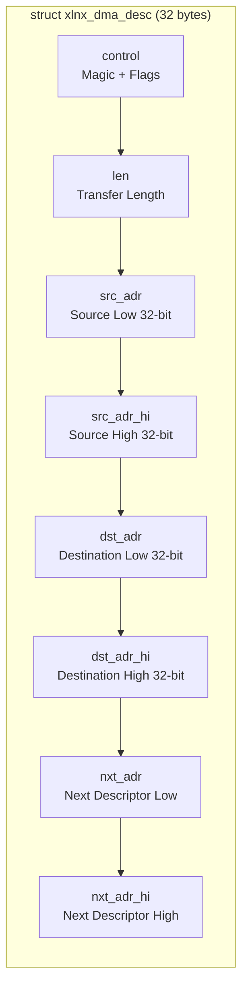
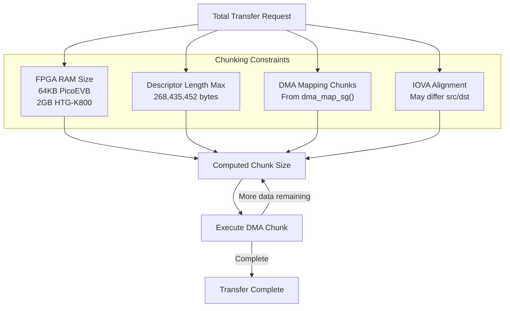
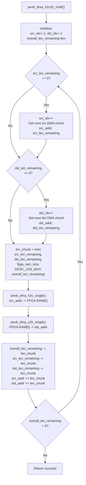
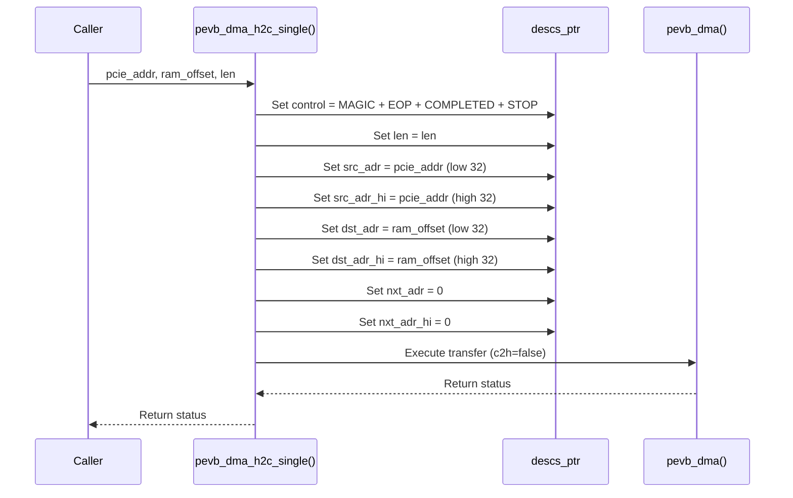
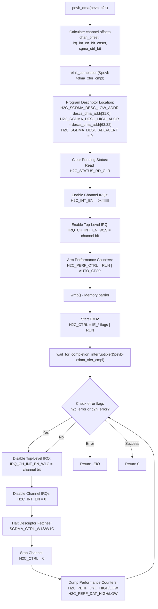
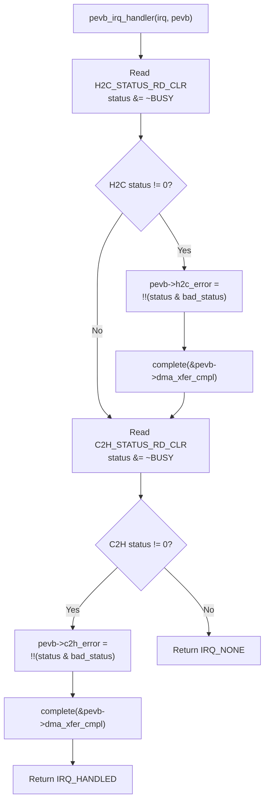
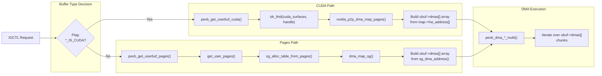

<!-- source: DeepWiki mcp.deepwiki.com · repo NVIDIA/jetson-rdma-picoevb · page 4.3 DMA Operations · fetched 2026-10-26 -->

# DMA Operations

<details>
<summary>Relevant source files</summary>

The following files were used as context for generating this wiki page:

- [kernel-module/picoevb-rdma.c](kernel-module/picoevb-rdma.c)
- [kernel-module/picoevb-rdma.h](kernel-module/picoevb-rdma.h)

</details>


This page documents the Direct Memory Access (DMA) operations implemented in the picoevb-rdma kernel module. It covers DMA descriptor management, transfer chunking strategies, and the execution flow for Host-to-Card (H2C), Card-to-Host (C2H), and Host-Card-Host (H2C2H) data transfers using the Xilinx DMA engine.

For the high-level IOCTL interface that triggers these operations, see [IOCTL Interface](#4.2). For the hardware registers that control the DMA engine, see [Hardware Register Interface](#4.5). For memory pinning and mapping prior to DMA, see [CUDA P2P Integration](#4.4).

**Sources:** [kernel-module/picoevb-rdma.c:1-1312]()

---

## DMA Descriptor Structure

The kernel module uses the Xilinx DMA engine's descriptor format to specify transfer parameters. Each descriptor defines a single contiguous transfer segment with source and destination addresses, length, and control flags.

### Descriptor Fields



**Descriptor Control Field Components**

| Bit Field | Value/Mask | Purpose |
|-----------|------------|---------|
| `XLNX_DMA_DESC_CONTROL_MAGIC` | `0xad4b0000` | Descriptor validation marker |
| `XLNX_DMA_DESC_CONTROL_EOP` | Bit 4 | End of Packet flag |
| `XLNX_DMA_DESC_CONTROL_COMPLETED` | Bit 1 | Request completion interrupt |
| `XLNX_DMA_DESC_CONTROL_STOP` | Bit 0 | Stop after this descriptor |

**Length Constraints**

| Constant | Value | Description |
|----------|-------|-------------|
| `XLNX_DMA_DESC_LEN_MAX` | 268,435,455 bytes | Maximum descriptor length (28 bits) |
| `XLNX_DMA_DESC_LEN_MAX_WORD_ALIGNED` | 268,435,452 bytes | Maximum word-aligned length |
| `XLNX_DMA_DESC_LEN_MAX_POW2_ALIGNED` | 134,217,728 bytes | Maximum power-of-2 aligned length |

**Sources:** [kernel-module/picoevb-rdma.h:19-37]()

---

## Transfer Chunking Logic

Large data transfers must be broken into smaller chunks to accommodate hardware and software constraints. The chunking logic operates differently for H2C, C2H, and H2C2H transfers.

### Chunking Constraints



### H2C2H Multi-Chunk Transfer

For H2C2H transfers, the FPGA RAM serves as an intermediate buffer. The system alternates between H2C and C2H transfers, reusing the same FPGA RAM location for each chunk.



**Sources:** [kernel-module/picoevb-rdma.c:729-788]()

### H2C and C2H Multi-Chunk Transfers

H2C and C2H transfers operate on a single buffer but may need chunking based on DMA mapping fragmentation and descriptor length limits.

**Key Difference:** H2C and C2H transfers do not have FPGA RAM size as a constraint because they write to or read from sequential FPGA RAM addresses rather than reusing the same buffer location.

**Sources:** [kernel-module/picoevb-rdma.c:790-848](), [kernel-module/picoevb-rdma.c:850-908]()

---

## Single Transfer Operations

Single transfer operations create one DMA descriptor and execute it through the hardware engine. These are the atomic building blocks for all DMA operations.

### pevb_dma_h2c_single() - Host to Card



**Function Signature:**
```c
static int pevb_dma_h2c_single(struct pevb *pevb, dma_addr_t pcie_addr,
    unsigned long ram_offset, unsigned long len)
```

**Sources:** [kernel-module/picoevb-rdma.c:679-702]()

### pevb_dma_c2h_single() - Card to Host

The C2H single transfer is nearly identical to H2C, with source and destination addresses swapped.

**Function Signature:**
```c
static int pevb_dma_c2h_single(struct pevb *pevb, dma_addr_t pcie_addr,
    unsigned long ram_offset, unsigned long len)
```

**Sources:** [kernel-module/picoevb-rdma.c:704-727]()

---

## Core DMA Execution Flow

The `pevb_dma()` function orchestrates hardware-level DMA execution, handling both H2C and C2H directions with channel-specific register programming.

### Hardware Programming Sequence



**Channel Offset Calculation:**

The hardware has separate register banks for H2C and C2H channels. The offset between them is computed as:

```
chan_offset = (c2h) ? (XLNX_REG(C2H, 0, H2C_CTRL) - XLNX_REG(H2C, 0, H2C_CTRL)) : 0
```

**Memory Barrier:**

The `wmb()` call at line 633 ensures that all descriptor writes and configuration register writes complete before the DMA engine is triggered by writing to `H2C_CTRL`.

**Sources:** [kernel-module/picoevb-rdma.c:570-677]()

---

## Interrupt-Driven Completion

DMA transfers complete asynchronously. The hardware generates an interrupt when the transfer finishes or encounters an error.

### Interrupt Handler Flow



**Error Status Bits:**

The following status bits indicate DMA errors:

| Status Bit | Description |
|------------|-------------|
| `DESC_ERR` | Descriptor fetch error (invalid format or access failure) |
| `WRITE_ERR` | PCIe write error during H2C transfer |
| `READ_ERR` | PCIe read error during transfer |
| `IDLE_STOPPED` | DMA engine stopped while idle (unexpected) |
| `INVALID_LEN` | Descriptor length field invalid |
| `MAGIC_STOPPED` | Descriptor magic number mismatch |
| `ALIGN_MISMATCH` | Address alignment violation |

**Sources:** [kernel-module/picoevb-rdma.c:529-568]()

---

## DMA User Buffer Management

Before executing DMA, the kernel must obtain DMA-mappable addresses for user-provided buffers. This involves different code paths for CUDA memory versus regular host memory.

### Buffer Mapping Flow



### pevb_userbuf Structure

The `struct pevb_userbuf` contains DMA-mapped address chunks:

```c
struct pevb_userbuf_dma {
    dma_addr_t  addr;  // DMA address
    u64         len;   // Chunk length
};

struct pevb_userbuf {
    int n_dmas;                      // Number of chunks
    struct pevb_userbuf_dma *dmas;   // Array of chunks
    // ... type-specific private data ...
};
```

**DMA Chunk Coalescing:**

The `pevb_userbuf_add_dma_chunk()` function merges contiguous DMA chunks to reduce iteration overhead:

```c
if (addr == end_of_previous_chunk) {
    dma->len += len;  // Extend previous chunk
} else {
    // Add new chunk
}
```

**Sources:** [kernel-module/picoevb-rdma.c:90-117](), [kernel-module/picoevb-rdma.c:334-353](), [kernel-module/picoevb-rdma.c:356-414](), [kernel-module/picoevb-rdma.c:417-485]()

---

## DMA Transfer Limitations

### Transfer Size Constraints

| Constraint | Value | Applies To |
|------------|-------|-----------|
| Single descriptor max | 268,435,452 bytes | All transfers |
| H2C2H chunk max | `fpga_ram_size` | H2C2H only |
| PicoEVB RAM | 64 KB | H2C2H on PicoEVB |
| HTG-K800 RAM | 2 GB | H2C2H on HTG-K800 |
| H2C/C2H to FPGA RAM | `fpga_ram_size` | H2C, C2H IOCTLs |

### Alignment Requirements

Transfers must be word-aligned (4-byte aligned) for optimal performance. The descriptor length maximum enforces this with `XLNX_DMA_DESC_LEN_MAX_WORD_ALIGNED`.

### Concurrency Control

DMA operations are serialized using a semaphore (`pevb->sem`) to prevent concurrent access to the hardware DMA engine and descriptor memory:

```c
if (down_interruptible(&pevb->sem))
    return -ERESTARTSYS;
// ... perform DMA ...
up(&pevb->sem);
```

This ensures that only one DMA operation executes at a time across all file handles to the device.

**Sources:** [kernel-module/picoevb-rdma.c:51-71](), [kernel-module/picoevb-rdma.c:739-740](), [kernel-module/picoevb-rdma.c:784-785]()

---

## Performance Optimization Notes

### IRQ Latency Trade-off

The code contains a FIXME comment noting that H2C and C2H transfers could be optimized by generating a chain of descriptors and submitting them all at once, rather than executing one descriptor per chunk:

```
FIXME: We should really generate a list of descriptors, and
send them to the HW all at once, to avoid IRQ latency
between transfers, when multiple are needed.
```

However, this optimization is less critical when the system has an IOMMU, as the IOMMU typically presents buffers as large contiguous mappings, reducing the number of chunks required.

**Sources:** [kernel-module/picoevb-rdma.c:823-831](), [kernel-module/picoevb-rdma.c:882-891]()

### IOMMU Impact

The kernel module sets unlimited segment size for DMA mappings:

```c
pevb->dma_params.max_segment_size = UINT_MAX;
pdev->dev.dma_parms = &pevb->dma_params;
```

This allows the DMA mapping layer to create arbitrarily large contiguous IOVA mappings, which reduces chunking overhead. On systems with an IOMMU, user buffers often map to a single large contiguous DMA address range regardless of physical memory fragmentation.

**Sources:** [kernel-module/picoevb-rdma.c:1150-1162]()

---

## Summary

The DMA operations layer implements the following key responsibilities:

1. **Descriptor Management** - Populates Xilinx DMA descriptor structures with transfer parameters
2. **Transfer Chunking** - Breaks large transfers into hardware-compatible chunks based on descriptor limits, FPGA RAM size, and DMA mapping fragmentation
3. **Hardware Programming** - Configures DMA engine registers, enables interrupts, and triggers transfers with proper memory barriers
4. **Interrupt Handling** - Processes completion and error interrupts to signal transfer completion
5. **Multi-Buffer Coordination** - Orchestrates H2C2H transfers by alternating H2C and C2H operations through FPGA RAM
6. **Concurrency Control** - Serializes DMA operations to prevent hardware conflicts

All DMA operations are exposed to user space through IOCTL commands documented in [IOCTL Interface](#4.2).

**Sources:** [kernel-module/picoevb-rdma.c:570-908]()

---

